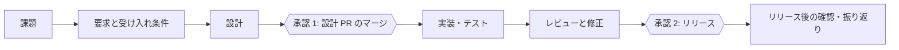

# AI Plugins

Claude Code と Codex に入れるプラグインのマーケットプレイスです。中心は **NDF**（`ndf` プラグイン）で、
開発の工程を AI エージェントへ任せるための手順・hook・実行の仕組みをまとめて配ります。

## このリポジトリの目的

**人が見るのは 2 つの承認だけにして、残りの開発の工程を AI エージェントが進められるようにする。** そのための
手順と仕組みを、チームのだれもが同じ形で使えるプラグインとして配ることが、このリポジトリの目的です。

NDF が受け持つのは次の流れです。



- **変更の大きさに合った工程だけを通す。** 文言の直しにも設計とレビューを課すことはしません。`development-workflow` が変更をモードに振り分け、要る工程だけを起動します
- **承認は 2 つだけ。** 設計 PR のマージと、本番へ届く操作です。それ以外の取り消せる操作は止めずに進め、何をしたかを報告します
- **決まりはスクリプトと hook で守る。** 手順書に書くだけにしません。止めるべき操作（本番への直接のマージなど）は hook が止め、進み具合は結果 JSON で記録します
- **複数の作業を並べて進める。** 1 つのリポジトリで複数のスプリントを同時に流し、リリースは 1 本にまとめます（下の「並行開発」）

このリポジトリが持つのは、プラグイン（`plugins/`）とマーケットプレイスの定義（`.claude-plugin/marketplace.json`）だけです。

## 入れる

まず **ndf** を入れます。使っている AI ツールの手順を 1 つ選んでください。

### Claude Code

```bash
/plugin marketplace add https://github.com/devbasex/ai-plugins
/plugin install ndf@ai-plugins
```

### Codex

```bash
codex plugin marketplace add https://github.com/devbasex/ai-plugins
codex plugin add ndf@ai-plugins
```

更新の方法と Slack 通知の設定は [plugins/ndf/README.md](./plugins/ndf/README.md) にあります。

## 使ってみる

### 1 つの作業を頼む

Claude Code では `/ndf:<Skill 名>` と打って呼びます。**Skill** は、AI が読んで従う作業の手順です。

| やりたいこと | 打つもの |
| --- | --- |
| 課題を、要求の整理からリリースまで進める | `/ndf:development-workflow #<課題番号>` |
| 変更をコミットして Pull Request を出す | `/ndf:pr` |
| Pull Request を 2 つの AI にレビューさせ、指摘が出なくなるまで直す | `/ndf:cross-review <PR番号>` |
| Pull Request に付いたレビューコメントに対応する | `/ndf:fix <PR番号>` |
| 作業用の git worktree を用意する | `/ndf:worktree` |

呼ばなくても、依頼に合う Skill を AI が選んで使うことがあります（例: 「PR を作って」）。

### 最後まで任せる（`/goal`）

先頭に `/goal` を付けると、その依頼が Claude Code の目標になり、終わるまで AI が止まらずに進めます。

```text
/goal /ndf:development-workflow #123
```

課題 123 の要求の整理・設計・実装・レビュー・リリースまでを進め、止まるのは 2 つの承認のときだけです。
会話の文脈が長くなったら、引継ぎ文書を書いて新しい会話へ切り替えます。

### 並行開発

複数の課題やスプリントを同時に進めるときは、**並列の計画**を 1 度作り、それを `--parallel` に渡して起動します。

```text
/goal /ndf:development-workflow --parallel p1 -- 終わり: [ndf-parallel] finished p1 の行を出したとき
```

1. **ラッパーを入れる。** 会話の切り替えとレーンの起動にはラッパー（中継）と tmux が要ります。claude の中で `/ndf:install-wrapper` を 1 度打ち、次に開いたシェルで `ndf-relay run` から claude を起動します
2. **並列の計画を作る。** 「課題 120 と 130 を並列で進める計画を作って」のように頼むと、AI が計画 `p1` を作ります（形は [parallel-plan.md](./plugins/ndf/skills/issue-plan-strategy/references/parallel-plan.md)）。計画は、同時に進める作業（**レーン**）の一覧と、レーンが触る場所・始める順序を持ちます
3. **上の 1 行で起動する。** このセッションが**オーガナイザー**になり、レーンごとに tmux の中で claude を起動して見回ります。レーンが出した質問と承認はオーガナイザーに集まるので、人はこの 1 つの画面で答えます。リリースはレーンどうしでぶつからないよう 1 本にまとめます

レーンの様子は `tmux -L ndf-lanes attach -t <レーン名>` で見られます。役割と用語は [docs/ndf-parallel-model.md](./docs/ndf-parallel-model.md)、手順は [parallel.md](./plugins/ndf/skills/development-workflow/references/parallel.md) にあります。

## 何が入っているか

| プラグイン名 | バージョン | できること | 詳細 |
| --- | --- | --- | --- |
| **ndf** | 11.0.41 | 開発の工程の Skill、専門のサブエージェントと実行主体（supervisor・worker）、hook、コマンド `ndf` | [README](./plugins/ndf/README.md) |
| **playwright-kit** | 4.0.5 | Playwright による E2E テストの計画・スクリプトの作成・証跡のレポート | [README](./plugins/playwright-kit/README.md) |

ndf に入るもの:

| 部品 | 中身 |
| --- | --- |
| Skill | 下の「NDF の Skill の一覧」 |
| サブエージェント（Claude Code） | 調査・データ分析・デバッグ・コードレビュー・CI/CD などの専門のエージェントと、工程を進める supervisor・worker（[agents/](./plugins/ndf/agents/)） |
| hook | 本番への直接のマージを止める、文脈の上限で引継ぎへ切り替える、本文で承認を待つ応答を質問へ戻す、待ちを Slack へ知らせる、など（[plugins/ndf/README.md の「Hooks」](./plugins/ndf/README.md#hooks)） |
| コマンド `ndf` | Skill と hook が呼ぶ処理のエントリポイント（`bin/ndf`）。プランの実行・待ち・マージ・リリースなどのサブコマンドを持つ |

外部サービスへつなぐ MCP サーバーの設定のプラグインもあります（Claude Code / Codex 向け）。
使うものだけを入れます（Claude Code なら `/plugin install <プラグイン名>@ai-plugins`）。

| プラグイン名 | つなぐ先 |
| --- | --- |
| [mcp-serena](./plugins/mcp/mcp-serena/) | シンボル単位のコードの読み書き |
| [mcp-notion](./plugins/mcp/mcp-notion/) | Notion |
| [mcp-bigquery](./plugins/mcp/mcp-bigquery/) | BigQuery |
| [mcp-dbhub](./plugins/mcp/mcp-dbhub/) | データベース（SQL） |
| [mcp-redash](./plugins/mcp/mcp-redash/) | Redash |
| [mcp-aws-docs](./plugins/mcp/mcp-aws-docs/) | AWS の公式ドキュメント |
| [mcp-chrome-devtools](./plugins/mcp/mcp-chrome-devtools/) | Chrome DevTools によるブラウザ操作 |
| [mcp-playwright](./plugins/mcp/mcp-playwright/) | Playwright によるブラウザ操作 |
| [mcp-devin](./plugins/mcp/mcp-devin/) | DeepWiki のリポジトリ解説 |
| [mcp-markitdown](./plugins/mcp/mcp-markitdown/) | PDF・Office 文書の Markdown への変換 |

版ごとの変更点は [CHANGELOG.md](./CHANGELOG.md) にあります。

### NDF の Skill の一覧

**NDFプラグイン v11.0.41** に入る Skill の数は、AI ツールごとに違います。
Claude Code向け core 49個、Codex向け core 45個です（配る先は [manifests/skills.json](./plugins/ndf/manifests/skills.json) が決めます）。
元Skills（49個）の内訳は次のとおりです。
  - Pull Request とレビュー (7): pr, pr-tests, fix, pr-review, cherry-pick-pr, deploy, merged
  - 開発の進め方 (17): development-workflow, requirements-design, design, document-rebuild, document-sources, document-drafting, tdd-cycle, refactoring, quality-gates, release, release-verification, retrospective, out-of-scope, progress-tracking, backlog-refinement, layout-review, estimate
  - 原則と書き方 (11): ndf-policies, implementation-plan, plan-to-spec, investigation-rules, decision-request, problem-solving, logging-guidelines, document-style, notion-writing, issue-plan-strategy, ml-model-structure
  - 品質と実行環境 (4): qa-security-scan, docker-container-access, chrome-cdp, official-skills-autoloader
  - 外部サービス (2): google-workspace, document-systems
  - 複数の AI によるレビューとリファクタリング (3): cross-review, cross-refactoring, external-ai
  - 作業場所 (1): worktree
  - 運用 (4): skill-stats, statusline, install-wrapper, restart

## もっと知る

| 知りたいこと | 文書 |
| --- | --- |
| NDF の使い方の詳細 | [plugins/ndf/README.md](./plugins/ndf/README.md)、[docs/ndf-plugin-reference.md](./docs/ndf-plugin-reference.md) |
| 並行開発の役割と用語 | [docs/ndf-parallel-model.md](./docs/ndf-parallel-model.md) |
| 版ごとの変更点 | [CHANGELOG.md](./CHANGELOG.md) |
| 過去の版へ戻す | [docs/versioning-and-distribution.md の「利用者が過去の版へ戻る」](./docs/versioning-and-distribution.md#利用者が過去の版へ戻る) |
| 質問・不具合の報告・要望 | [SUPPORT.md](./SUPPORT.md) |
| 脆弱性の報告 | [SECURITY.md](./SECURITY.md)。**公開の issue には書かないでください** |
| 開発に参加する | [CONTRIBUTING.md](./CONTRIBUTING.md)、[CODE_OF_CONDUCT.md](./CODE_OF_CONDUCT.md)、[GOVERNANCE.md](./GOVERNANCE.md) |

## ライセンス

MIT License。詳細は [LICENSE](./LICENSE) にあります。

---

**作成者:** takemi-ohama - https://github.com/takemi-ohama
