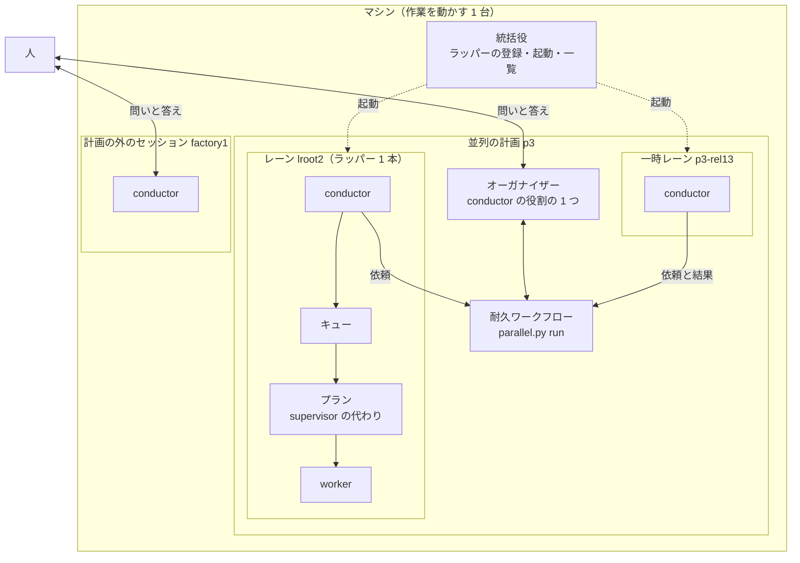
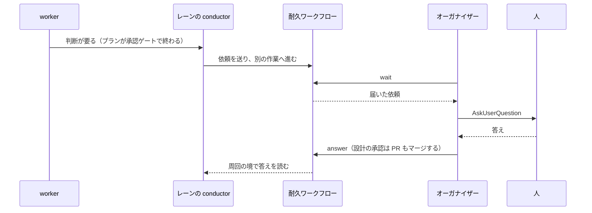

# NDF の並行開発の役割と用語

**1 台のマシンの上で、誰が何を担い、何の単位で動くかを図と表で示す。** 語の定義の正本は
[用語集](glossary.md) で、この文書は語どうしの関係だけを持つ。

## 例: 2026-11-07 の計画 p3

マシン 1 台で、次の 6 本が同時に動いていた。

| 名前 | 種類 | 動かしているもの | 担当 |
| --- | --- | --- | --- |
| `t1` | オーガナイザーのセッション | `--parallel p3` | 計画 p3 全体。人へ問う窓口。統括役も兼ねる |
| `lroot2` | レーン | ループ `lroot5` | NDF の根本解決、資源の課題 |
| `lflow` | レーン | ループ `lflow3` | 開発フローの見直し |
| `lfactory2` | レーン | ループ `lcarul3` | `carul` の根本原因 |
| `p3-rel13` | 一時レーン | リリース 13 の本番のプラン | v10.27.38 のリリース |
| `factory1` | 計画の外のセッション | `nd-factory` のスプリント | Factory のインフラ。問いは自分の画面に出る |

`lroot2` の中では、conductor がスプリントのプランをキューへ流し、プランが worker（`claude -p`）を
1 回ずつ起動する。レーンの問いは人へ届かず、オーガナイザーを通る。

## 全体の図

点線はプロセスの起動、実線は仕事の依頼と問いの流れである。**統括役とオーガナイザーは別物である。**
統括役はプロセスを起こすだけで仕事の中身を知らず、オーガナイザーは仕事を見るがプロセスの管理を持たない。

## 3 つの軸

**語の混乱の多くは、次の 3 つの軸を混ぜることから起きる。**

| 軸 | 問い | 語 |
| --- | --- | --- |
| 実行の入れ物 | どのプロセスで動くか | マシン → ラッパー → セッション → プロセス（`claude -p`） |
| 仕事の役割 | 誰が何を決めるか | オーガナイザー → conductor → supervisor（またはプラン） → worker |
| 流れの単位 | 何の流れか | ライン → レーン → ループ → 周回 → スプリント → フェーズ → 作業 |

| 役割 | 入れ物 | 持つ流れの単位 | 人へ問えるか | 起動する相手 | 寿命 |
| --- | --- | --- | --- | --- | --- |
| オーガナイザー | 人が起動したセッション 1 つ | 計画全体 | 問える（レーンの問いもまとめて問う） | 一時レーン | 計画の終わりまで。セッションは切り替わる |
| conductor（レーン） | ラッパーの中のセッション | スプリント | 問えない。オーガナイザーへ送る | プラン（キュー）、supervisor | セッションごと。引継ぎ文書で続く |
| conductor（計画の外） | 人が起動したセッション | スプリント | 問える | プラン（キュー）、supervisor | セッションごと |
| supervisor（またはプラン） | サブエージェント、または `supervise.py` | フェーズ | 問えない | worker | フェーズの間 |
| worker | `claude -p`、またはサブエージェント | 1 つの作業 | 問えない | 起動しない | 1 回 |

| 入れ物 | 1 つの何に何個あるか | 上限 |
| --- | --- | --- |
| ラッパー | マシンに複数 | 同時に動かせる数（`NDF_RELAY_MAX_NAMED`、既定 3）。オーガナイザーは数えず、一時レーンは 1 本だけ超えられる |
| セッション | ラッパーに 1 つずつ順に | 切り替えは `ndf-next` |
| プラン | レーンに複数 | 計画の `plans`（p3 は 2 本）。同時に 6 本まで |

## 問いの流れ

**レーンは問いで止まらない。** 計画の外のセッションは依頼先が無いので、自分の画面に問いを出して止まる。

## 語の混乱と整理の案

| 語 | 今の食い違い | 案 |
| --- | --- | --- |
| conductor | 用語集は「人間と対話しているセッション」だが、レーンの conductor は人と対話しない | 「スプリントを持ち、プランを流す役割」と定義し直す。人へ問えるかは置かれた場所で決まる |
| オーガナイザーとオーケストレーター | 利用者は同じ意味で使う。一方 `cross-review`・`cross-refactoring` と確定仕様のオーケストレーター（123 箇所）は、レビューや提案を駆動する役を指す | 並列の計画はオーガナイザーに統一する。cross 系の語は残すか、別の語へ替える |
| ランナー | 用語集は Factory の実行ジョブの中のプログラム。#2710 と利用者はマシンの意味で使う。ほかに CI のランナー・テストのランナーがある | 下の「決めること」 |
| ライン | 定義が無い。発表資料は「工場のライン」で工程の全体、#2710 は「ライン全体が止まる」 | 計画のレーンすべてと読む案 |
| セッション | `claude` 1 回の起動だが、「レーン」の意味で使うことがある | 用語集のまま。レーンと呼び分ける |
| 区間 | 用語集は Factory の `claude -p` 1 回だが、`relay.py ls` の列はセッションの番号を指す | `relay.py ls` の列を「セッション」へ直す |
| supervisor | 3 層の役割だが、確定仕様 `ndf-relay-multi-session-supervisor.md` の題は統括役を指す | 確定仕様の名前を統括役へ直す |
| `director` エージェント | 3 層の外の古い定義が残る | 使わないならリリース対象から外す |
| レーン名とループ名 | レーン `lfactory2` が `carul` を担当している。名前が担当を表さない | レーンは役割の名前を持たない番号にするか、役割の変更で改名する |

## レーンの動き方の規定で欠けているもの

今ある規定は `development-workflow/references/parallel.md` の「レーンの側」と、
`issue-plan-strategy/references/parallel-plan.md` の「レーンごとに決めること」である。起動と依頼の形は決まっているが、次が無い。

| 欠けている規定 | 実際に起きたこと |
| --- | --- |
| レーンの役割を途中で変える手順 | `lfactory2` を `carul` へ回したとき、手で `plan.json` と引継ぎ文書を書き換えた。`plan.md` は描画し直していない |
| ループを始め直すときの計画の更新 | `plan.json` のループ名が古いまま残った（`lflow2`）。読み手の観測がずれる |
| 優先順位の指示の届け方 | 引継ぎ文書と画面への入力の 2 つで伝えた。`loop exclude` を使うかがレーンごとに違う |
| レーンへ指示を送る手段 | 画面へ `tmux send-keys` で入れている。別のセッションの通信は権限の違いで保留になる |
| ループが止まったレーンの扱い | `mvv_changed` で止まっても `running` に見え、約 2 時間誰も気づかなかった（#2649 の範囲） |
| 手で起動したレーンの扱い | `spawn`・`restart` が立ち上がらず手で起動すると、問いの経路と上限の数え方が変わる（#2563） |
| 計画の外のセッションの扱い | `factory1` の問いはオーガナイザーへ届かず、画面を見に行っている |

## 決めること

| # | 項目 | 案 |
| --- | --- | --- |
| 1 | ランナーの意味 | **マシンの意味に統一する。** 手元も Factory も「作業を動かす 1 台」をランナーと呼び、今の Factory のプログラムは「ランナーのエージェント」と呼ぶ。`手元のランナー` を廃止語から戻す |
| 2 | ラインの意味 | 計画 1 つのレーンすべて。発表資料の比喩は別の用法として残す |
| 3 | オーケストレーターの扱い | 並列の計画では使わず、オーガナイザーへ統一する |
| 4 | レーンの名前 | 役割を名前に含めない（`lane1` など）か、役割の変更で改名する |
