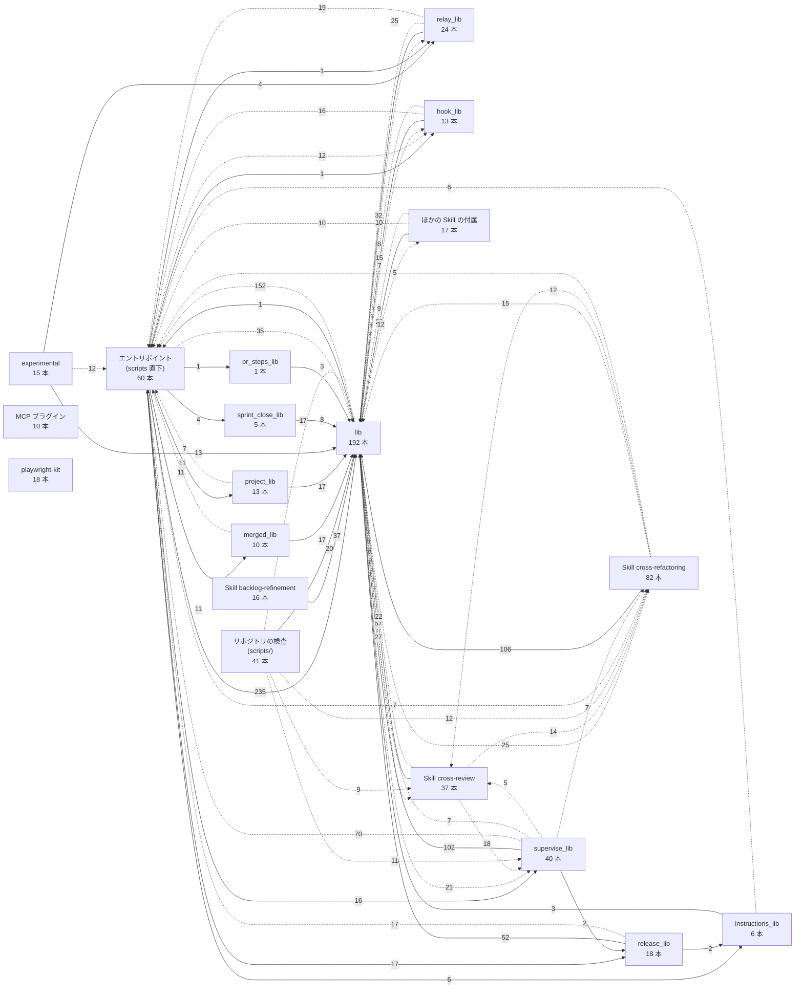
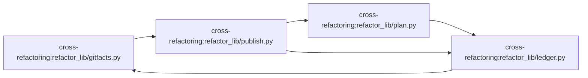

# スクリプトの全体像

リファクタリングを検討するための地図。**2026-11-10 時点の `develop`（bb77113e1）から機械で集計した**。ファイルごとの一覧は [inventory.md](inventory.md)、並べ替えて使う表は [inventory.csv](inventory.csv) にある。コードが変われば古くなる。

## 集計の範囲と読み方

- 対象: 追跡しているファイルのうち、テスト（`tests/`・`test_*`・`conftest.py`・fixtures）を除く `.py`・`.sh`・`.js`・`.mjs`。中身の無い `__init__.py` は除く
- **利用先・利用元**: Python の `import`（相対 import・`importlib.import_module` を含む）を、スクリプトが足す検索経路（自分の置き場・`plugins/ndf/scripts/`・`plugins/ndf/scripts/lib/`・Skill の `scripts/`）で解決したもの
- **名前での参照**: ファイル名（例 `supervise.py`）が他のファイルに現れた数。サブプロセスでの起動・hook の登録・CI・契約・Skill の手順書・文書を種類ごとに数える。同じ名前のファイルが複数あると両方に数える（下の「同じ名前のファイル」）
- **遅延の import**: 関数の中の import、`importlib.import_module`、`if TYPE_CHECKING:` の中の import（型注釈のためだけで実行時に読まない）。呼ばれたときだけ読むので、循環（図 3）と図の矢印には数えず、一覧の利用先に「遅延」として分けて載せる。利用元の数には含める
- `from . import x` は子のモジュール `x` への依存として数え、パッケージの入口（`__init__.py`）への依存には数えない
- 関数は最上位の関数の数、メソッドはクラスの中の関数の数。副命令は `add_parser` の数

## 数の概要

| 置き場 | ファイル | 行 | 関数 | クラス | うちメソッドを持つ | 循環に入る |
| --- | ---: | ---: | ---: | ---: | ---: | ---: |
| NDF のエントリポイント（`plugins/ndf/scripts/` 直下） | 60 | 17,655 | 806 | 22 | 12 | 0 |
| NDF の共通ライブラリ（`plugins/ndf/scripts/lib/`） | 192 | 41,201 | 2,353 | 179 | 75 | 0 |
| NDF のパッケージ `supervise_lib`（`plugins/ndf/scripts/supervise_lib/`） | 40 | 11,271 | 430 | 37 | 21 | 0 |
| NDF のパッケージ `relay_lib`（`plugins/ndf/scripts/relay_lib/`） | 24 | 6,561 | 318 | 25 | 19 | 0 |
| NDF のパッケージ `release_lib`（`plugins/ndf/scripts/release_lib/`） | 18 | 2,910 | 177 | 23 | 4 | 0 |
| NDF のパッケージ `project_lib`（`plugins/ndf/scripts/project_lib/`） | 13 | 2,139 | 104 | 42 | 3 | 0 |
| NDF のパッケージ `hook_lib`（`plugins/ndf/scripts/hook_lib/`） | 13 | 2,666 | 140 | 9 | 6 | 0 |
| NDF のパッケージ `merged_lib`（`plugins/ndf/scripts/merged_lib/`） | 10 | 1,514 | 55 | 5 | 3 | 0 |
| NDF のパッケージ `instructions_lib`（`plugins/ndf/scripts/instructions_lib/`） | 6 | 1,058 | 44 | 9 | 2 | 0 |
| NDF のパッケージ `sprint_close_lib`（`plugins/ndf/scripts/sprint_close_lib/`） | 5 | 337 | 16 | 2 | 1 | 0 |
| NDF のパッケージ `pr_steps_lib`（`plugins/ndf/scripts/pr_steps_lib/`） | 1 | 171 | 8 | 0 | 0 | 0 |
| NDF の実験版（`plugins/ndf/scripts/experimental/`） | 15 | 3,152 | 120 | 3 | 2 | 0 |
| Skill `backlog-refinement` の付属（`plugins/ndf/skills/backlog-refinement/`） | 16 | 4,457 | 211 | 12 | 8 | 0 |
| Skill `cross-refactoring` の付属（`plugins/ndf/skills/cross-refactoring/`） | 82 | 15,911 | 739 | 36 | 17 | 4 |
| Skill `cross-review` の付属（`plugins/ndf/skills/cross-review/`） | 37 | 8,632 | 343 | 14 | 2 | 0 |
| Skill `development-workflow` の付属（`plugins/ndf/skills/development-workflow/`） | 4 | 1,276 | 71 | 0 | 0 | 0 |
| Skill `external-ai` の付属（`plugins/ndf/skills/external-ai/`） | 1 | 335 | 14 | 0 | 0 | 0 |
| Skill `fix` の付属（`plugins/ndf/skills/fix/`） | 2 | 637 | 23 | 0 | 0 | 0 |
| Skill `google-workspace` の付属（`plugins/ndf/skills/google-workspace/`） | 3 | 378 | 15 | 0 | 0 | 0 |
| Skill `pr-review` の付属（`plugins/ndf/skills/pr-review/`） | 3 | 582 | 32 | 0 | 0 | 0 |
| Skill `release` の付属（`plugins/ndf/skills/release/`） | 3 | 547 | 53 | 0 | 0 | 0 |
| Skill `skill-stats` の付属（`plugins/ndf/skills/skill-stats/`） | 1 | 946 | 40 | 1 | 0 | 0 |
| MCP プラグイン `mcp-playwright` | 1 | 115 | 1 | 0 | 0 | 0 |
| MCP プラグイン `mcp-redash` | 1 | 384 | 22 | 0 | 0 | 0 |
| MCP プラグイン `mcp-serena` | 8 | 1,334 | 94 | 5 | 0 | 0 |
| playwright-kit（`plugins/playwright-kit/`） | 18 | 3,287 | 71 | 19 | 10 | 0 |
| リポジトリの検査・計測（`scripts/`。配らない） | 41 | 11,339 | 454 | 47 | 20 | 0 |
| **計** | **618** | **140,795** | **6,754** | **490** | **205** | **4** |

## 図 1: 置き場の間の依存

矢印は import の向き（利用元 → 利用先）、数字はファイルの組の数。実線は import、点線は名前での起動（サブプロセスなど、コードの中にファイル名が現れるもの）。置き場の中の依存は数えない。

点線は 5 組以上のものだけを描いた。

## 図 2: 多くのファイルから使われるモジュール（利用元の数の上位 25）

箱の数字は利用元の数。矢印はこの 25 個の間の import だけを描いた。ここを変えると影響が広い。

```mermaid
flowchart TB
  plugins_ndf_scripts_lib_step_result_py["step_result.py<br>111"]
  plugins_ndf_scripts_lib_limits_py["limits.py<br>63"]
  plugins_ndf_scripts_lib_deps_py["deps.py<br>50"]
  plugins_ndf_skills_cross_refactoring_scripts_refactor_lib___init___py["cross-refactoring:refactor_lib/__init__.py<br>43"]
  plugins_ndf_skills_cross_refactoring_scripts_refactor_lib_paths_py["cross-refactoring:refactor_lib/paths.py<br>43"]
  plugins_ndf_scripts_lib_clock_py["clock.py<br>40"]
  plugins_ndf_scripts_lib_jsonio_py["jsonio.py<br>40"]
  plugins_ndf_scripts_lib_statefile_py["statefile.py<br>37"]
  plugins_ndf_scripts_lib_repo_py["repo.py<br>35"]
  plugins_ndf_scripts_lib_md_py["md.py<br>29"]
  plugins_ndf_scripts_lib_proc_py["proc.py<br>27"]
  plugins_ndf_scripts_lib_gh_call_py["gh_call.py<br>26"]
  plugins_ndf_scripts_lib_project_mvv_py["project_mvv.py<br>24"]
  plugins_ndf_scripts_supervise_lib_paths_py["supervise_lib/paths.py<br>24"]
  plugins_ndf_skills_cross_refactoring_scripts_refactor_lib_items_py["cross-refactoring:refactor_lib/items.py<br>23"]
  plugins_ndf_scripts_relay_lib_common_py["relay_lib/common.py<br>21"]
  plugins_ndf_skills_cross_refactoring_scripts_refactor_lib_gitfacts_py["cross-refactoring:refactor_lib/gitfacts.py<br>21"]
  plugins_ndf_scripts_lib_gh_parts_py["gh_parts.py<br>20"]
  plugins_ndf_scripts_lib_state_home_py["state_home.py<br>20"]
  plugins_ndf_skills_cross_review_scripts_review_lib___init___py["cross-review:review_lib/__init__.py<br>20"]
  plugins_ndf_scripts_supervise_lib_decl_py["supervise_lib/decl.py<br>19"]
  plugins_ndf_scripts_lib_assignment_py["assignment.py<br>18"]
  plugins_ndf_scripts_lib_gh_sections_py["gh_sections.py<br>18"]
  plugins_ndf_scripts_supervise_lib_limits_py["supervise_lib/limits.py<br>18"]
  plugins_ndf_scripts_lib_locks_py["locks.py<br>17"]
  plugins_ndf_scripts_lib_step_result_py --> plugins_ndf_scripts_lib_deps_py
  plugins_ndf_scripts_lib_step_result_py --> plugins_ndf_scripts_lib_jsonio_py
  plugins_ndf_scripts_lib_step_result_py --> plugins_ndf_scripts_lib_proc_py
  plugins_ndf_skills_cross_refactoring_scripts_refactor_lib___init___py --> plugins_ndf_scripts_lib_statefile_py
  plugins_ndf_skills_cross_refactoring_scripts_refactor_lib_paths_py --> plugins_ndf_scripts_lib_proc_py
  plugins_ndf_skills_cross_refactoring_scripts_refactor_lib_paths_py --> plugins_ndf_scripts_lib_repo_py
  plugins_ndf_skills_cross_refactoring_scripts_refactor_lib_paths_py --> plugins_ndf_scripts_lib_statefile_py
  plugins_ndf_skills_cross_refactoring_scripts_refactor_lib_paths_py --> plugins_ndf_skills_cross_refactoring_scripts_refactor_lib___init___py
  plugins_ndf_scripts_lib_statefile_py --> plugins_ndf_scripts_lib_clock_py
  plugins_ndf_scripts_lib_statefile_py --> plugins_ndf_scripts_lib_jsonio_py
  plugins_ndf_scripts_lib_statefile_py --> plugins_ndf_scripts_lib_proc_py
  plugins_ndf_scripts_lib_repo_py --> plugins_ndf_scripts_lib_proc_py
  plugins_ndf_scripts_lib_project_mvv_py --> plugins_ndf_scripts_lib_state_home_py
  plugins_ndf_scripts_supervise_lib_paths_py --> plugins_ndf_scripts_lib_state_home_py
  plugins_ndf_scripts_supervise_lib_paths_py --> plugins_ndf_scripts_supervise_lib_decl_py
  plugins_ndf_skills_cross_refactoring_scripts_refactor_lib_items_py --> plugins_ndf_skills_cross_refactoring_scripts_refactor_lib___init___py
  plugins_ndf_scripts_relay_lib_common_py --> plugins_ndf_scripts_lib_clock_py
  plugins_ndf_scripts_relay_lib_common_py --> plugins_ndf_scripts_lib_jsonio_py
  plugins_ndf_scripts_relay_lib_common_py --> plugins_ndf_scripts_lib_state_home_py
  plugins_ndf_skills_cross_refactoring_scripts_refactor_lib_gitfacts_py --> plugins_ndf_skills_cross_refactoring_scripts_refactor_lib_paths_py
  plugins_ndf_scripts_lib_gh_parts_py --> plugins_ndf_scripts_lib_deps_py
  plugins_ndf_scripts_lib_gh_parts_py --> plugins_ndf_scripts_lib_gh_call_py
  plugins_ndf_scripts_lib_gh_parts_py --> plugins_ndf_scripts_lib_gh_sections_py
  plugins_ndf_scripts_lib_gh_parts_py --> plugins_ndf_scripts_lib_repo_py
  plugins_ndf_scripts_lib_gh_parts_py --> plugins_ndf_scripts_lib_step_result_py
  plugins_ndf_skills_cross_review_scripts_review_lib___init___py --> plugins_ndf_scripts_lib_clock_py
  plugins_ndf_skills_cross_review_scripts_review_lib___init___py --> plugins_ndf_scripts_lib_proc_py
  plugins_ndf_scripts_supervise_lib_decl_py --> plugins_ndf_scripts_lib_repo_py
  plugins_ndf_scripts_lib_locks_py --> plugins_ndf_scripts_lib_limits_py
```

## 図 3: 循環する import

互いに import し合うモジュールの組（強連結成分）が **1 組**ある。循環の中では、どちらかを先に分けると片方が壊れるため、リファクタリングの順序の制約になる。

| # | 置き場 | モジュール | 数 |
| ---: | --- | --- | ---: |
| 1 | Skill `cross-refactoring` の付属（`plugins/ndf/skills/cross-refactoring/`） | cross-refactoring:refactor_lib/gitfacts.py, cross-refactoring:refactor_lib/ledger.py, cross-refactoring:refactor_lib/plan.py, cross-refactoring:refactor_lib/publish.py | 4 |

遅延の import（関数の中・型注釈のためだけの import）まで含めると、さらに **10 組**が輪になる。循環を避けるために import を関数の中へ逃がした跡で、役割の分け方を見直す候補である。

| # | 置き場 | モジュール | 数 |
| ---: | --- | --- | ---: |
| L1 | NDF の共通ライブラリ（`plugins/ndf/scripts/lib/`） | project_mvv.py, project_mvv_signals.py, sprint_mvv.py, project_lib/mvv_llm.py | 4 |
| L2 | NDF の共通ライブラリ（`plugins/ndf/scripts/lib/`） | deps.py, run_core.py, step_result.py | 3 |
| L3 | NDF の共通ライブラリ（`plugins/ndf/scripts/lib/`） | parallel_answer.py, parallel_reply.py, parallel_run.py | 3 |
| L4 | NDF のパッケージ `relay_lib`（`plugins/ndf/scripts/relay_lib/`） | relay_lib/handover.py, relay_lib/run.py, relay_lib/terminal.py | 3 |
| L5 | NDF のパッケージ `supervise_lib`（`plugins/ndf/scripts/supervise_lib/`） | supervise_lib/engine.py, supervise_lib/flow.py, supervise_lib/queue.py | 3 |
| L6 | NDF の共通ライブラリ（`plugins/ndf/scripts/lib/`） | context_calibrate.py, context_decisions.py | 2 |
| L7 | NDF の共通ライブラリ（`plugins/ndf/scripts/lib/`） | parallel_files.py, parallel_homes.py | 2 |
| L8 | NDF の共通ライブラリ（`plugins/ndf/scripts/lib/`） | container_reach.py, worktree_base.py | 2 |
| L9 | NDF の共通ライブラリ（`plugins/ndf/scripts/lib/`） | parallel_external.py, parallel_lane.py | 2 |
| L10 | NDF の共通ライブラリ（`plugins/ndf/scripts/lib/`） | sprint_loop.py, sprint_loop_select.py | 2 |

最大の組（#1、4 個）の中の矢印:

## 図 4: クラス図

メソッドが 8 個以上のクラスのクラス図は [classes.md](classes.md) に分けた。

## リファクタリングの手掛かり

### 利用元の多いモジュール（上位 20）

| モジュール | 利用元 | 行 | 関数 | 役割 |
| --- | ---: | ---: | ---: | --- |
| `step_result.py` | 111 | 473 | 30 | step_result.py: Skill から呼ぶ手順のスクリプトが返す結果の共通の形（#846）。 |
| `limits.py` | 63 | 344 | 24 | 上限の宣言の読み手（#2343 の決定 1〜3。収束ループ共通層 #598 / #537 の表を含む）。 |
| `deps.py` | 50 | 227 | 14 | 外部パッケージを使うエントリポイントが最初に呼ぶ `require()`（#1142 の決定 17・不足 h）。標準ライブラリだけで書く。 |
| `cross-refactoring:refactor_lib/__init__.py` | 43 | 47 | 1 | cross-refactoring の状態管理 CLI を構成するモジュール群。 |
| `cross-refactoring:refactor_lib/paths.py` | 43 | 195 | 19 | 状態ファイルと結果ファイルの置き場所を決める。 |
| `clock.py` | 40 | 88 | 6 | 時刻の読み書き（#1142 の L0）。標準ライブラリだけを import する（ラッパーのバージョンディレクトリにも入る）。 |
| `jsonio.py` | 40 | 111 | 4 | JSON の読みと原子的な書き込み（#1142 の L0）。標準ライブラリだけを import する（ラッパーのバージョンディレクトリにも入る）。 |
| `statefile.py` | 37 | 120 | 5 | 状態ファイルの基本操作（収束ループ共通層）。 |
| `repo.py` | 35 | 179 | 16 | リポジトリの識別（#1142 の L0）: メインディレクトリ・`owner/repo`・slug・起点（宣言のベースブランチと既定ブランチ）。 |
| `md.py` | 29 | 211 | 14 | Markdown の構造の読み取りの包み（#1142 の決定 19・種類 3）。markdown-it-py を呼ぶのはこのモジュールだけである。 |
| `proc.py` | 27 | 71 | 6 | 子プロセスと git の起動・自分の終わり方（#1142 の L0）。標準ライブラリだけを import する。 |
| `gh_call.py` | 26 | 229 | 14 | GitHub の呼び出しの最下層（#1142 の L0・決定 16 と 17）。GitHub を呼ぶのはこのモジュールだけである。 |
| `project_mvv.py` | 24 | 440 | 29 | project_mvv.py: プロジェクト MVV の宣言の読み取りと、判断の地点へ渡す MVV の節（#1366）。標準ライブラリだけで書く。 |
| `supervise_lib/paths.py` | 24 | 304 | 19 | supervise.py の置き場から決まるパスと、プランの状態ディレクトリ・worktree の用意（#1142 の C1）。 |
| `cross-refactoring:refactor_lib/items.py` | 23 | 181 | 15 | 改善項目と候補の鍵・表示・見送りの記録（#933 で `rounds.py` から移した）。 |
| `relay_lib/common.py` | 21 | 207 | 20 | ラッパーのファイル名の定数と、どのモジュールも使う小さな関数（#895・#1142 の C6）。 |
| `cross-refactoring:refactor_lib/gitfacts.py` | 21 | 321 | 16 | git の出力だけを情報源にして、コミットとテストの事実を取る。 |
| `gh_parts.py` | 20 | 369 | 12 | gh_parts.py: PR / issue の取得と本文の節の差し替えの共通部品（#849）。 |
| `state_home.py` | 20 | 482 | 28 | NDF の状態の置き場（#2766）。リポジトリの外に書く状態を、持ち主ごとに 3 つの根へ分ける。 |
| `cross-review:review_lib/__init__.py` | 20 | 40 | 1 | cross-review の `state.py` の中身（#1142 の C2）。 |

### 利用先の多いファイル（上位 20）

多くのモジュールを束ねる。分けるときの境目の候補。

| ファイル | 利用先 | 行 | 関数 | 役割 |
| --- | ---: | ---: | ---: | --- |
| `release-steps.py` | 25 | 1,284 | 61 | リポジトリが宣言したリリースコマンドを、デプロイの段階に合わせて走らせる（#893）。 |
| `cross-refactoring:refactor.py` | 24 | 365 | 7 | cross-refactoring の状態管理 CLI。 |
| `cross-refactoring:refactor_lib/commands/report.py` | 24 | 416 | 24 | 実行の終わりと報告（`finalize` / `status` / `report`、#933 の F8 と AC26）。 |
| `cross-refactoring:refactor_lib/commands/setup.py` | 24 | 968 | 32 | 実行の入口。`init` と `start-phase` を持つ。 |
| `supervise_lib/engine.py` | 20 | 492 | 2 | プランを 1 本流す `Engine`（#1142 の C1）。 |
| `sprint-state.py` | 19 | 603 | 32 | スプリントの状態を sprint.json に持ち、引継ぎ文書の節・status・ndf-next を生成する（#1063）。 |
| `cross-refactoring:refactor_lib/commands/converge.py` | 19 | 429 | 23 | 検証（`verify`、#933 の F6・#2457 決定 3・4）。修正の取り込み（`merge-fix`）は `fix_intake.py` にある。 |
| `supervise_lib/sprint.py` | 18 | 501 | 23 | new sprint / close の組み立てと、pace: fast / auto と MVV の拒否の判定（#1142 の C1・#1370）。 |
| `merged-steps.py` | 17 | 483 | 25 | merged-steps.py: merged の後片付けの決まった手順。 |
| `supervise.py` | 17 | 335 | 8 | フェーズをスクリプトで駆動する。 |
| `cross-refactoring:refactor_lib/commands/implement.py` | 16 | 501 | 26 | テストの追加と実装の取り込み（`merge-tests` / `merge-implement`、#933 の F4 F5）。 |
| `sprint_loop.py` | 15 | 596 | 28 | sprint_loop.py: 開発ループの集約（#2089）。`sprint-state.py loop` の副命令だけが呼ぶ。LLM を呼ばない。 |
| `sprint_loop_record.py` | 15 | 535 | 43 | sprint_loop_record.py: 開発ループの記録・消費・止まる条件・引継ぎ文書（#2089）。`sprint-state.py loop` の副命令だけが呼ぶ。LLM を呼ばない。 |
| `sprint-close.py` | 15 | 495 | 27 | sprint-close.py: スプリントを閉じる（progress-tracking の「スプリントを閉じる」の手順）。 |
| `supervise_lib/worker_steps.py` | 15 | 341 | 6 | work と drive のステップのハンドラー（#1142 の C1）。どちらも `call_worker` で worker を起動する。 |
| `cross-refactoring:refactor_lib/commands/gate.py` | 15 | 390 | 18 | 最終ゲート（Step 7）。**起動のされ方で判定の相手が変わる**（#436 決定 7）。 |
| `cross-review:review_lib/commands/init.py` | 15 | 508 | 13 | 副命令 `init`（新規と再開）（#1142 の C2）。 |
| `parallel_run.py` | 14 | 722 | 29 | 並列の進行（#2436）: 耐久ワークフロー `parallel-<計画名>` と耐久ステップ（起動・観測・停止・リリースを組む・要約）。 |
| `mvv-gate.py` | 14 | 501 | 23 | mvv-gate.py: 承認ゲートの材料が MVV に従うかを判定し、従えば承認ゲートを省いた記録を残す（#1078）。 |
| `cross-refactoring:refactor_lib/commands/plan.py` | 14 | 346 | 17 | 改修計画の取り込み（`merge-plan`、#933 の F3）。 |

### 大きいファイル（行の上位 20）

| ファイル | 行 | 関数 | メソッド | 役割 |
| --- | ---: | ---: | ---: | --- |
| `release-steps.py` | 1,284 | 61 | 1 | リポジトリが宣言したリリースコマンドを、デプロイの段階に合わせて走らせる（#893）。 |
| `claude_accounts.py` | 1,154 | 80 | 14 | 登録済みの claude アカウント: 置き場・使用量の保存・選び方・アカウントの設定ディレクトリの用意・子の環境（#1389・#1576）。 |
| `scripts/token-usage.py` | 1,086 | 40 | 6 | ndf の版ごとのトークン消費と所要時間を集計する（#893）。 |
| `cross-refactoring:refactor_lib/commands/setup.py` | 968 | 32 | 0 | 実行の入口。`init` と `start-phase` を持つ。 |
| `skill-stats:skill-stats.py` | 946 | 40 | 0 | NDF skill usage statistics from Claude Code transcripts. |
| `scripts/check-script-structure.py` | 908 | 40 | 10 | NDF のスクリプトの構造チェック（#1142 の不変条件 I4・I5・I13・I14・I15・I16 と決定 23）。 |
| `development-workflow:lib/workflow-common.sh` | 901 | 56 | 0 | NDF plugin: 工程の飛ばしの検知（#221）と、設計 Pull Request のマージの判定（#266）。 |
| `scripts/check-skill-frontmatter.py` | 888 | 23 | 2 | Skill の frontmatter が執筆規約に適合しているかをチェックする。 |
| `glossary.py` | 867 | 52 | 1 | glossary.py: プロジェクトの用語集を扱う 7 つの副命令。 |
| `check-trigger.py` | 862 | 52 | 1 | check-trigger.py: 検査（構造改善と実装レビュー）のトリガーを判定し、検査の範囲の用意と後始末と記録を持つ（#1078）。 |
| `transcript_agents.py` | 854 | 44 | 2 | 会話の記録を conductor / supervisor / worker の層の単位で読む（#550）。 |
| `post_queue.py` | 842 | 33 | 20 | GitHub が使えない間の投稿を積む待ち行列（収束ループ共通層）。 |
| `scripts/check-doc-staleness.py` | 807 | 38 | 2 | 説明文書に書かれた Skill 数と版数を、実体・マニフェスト・plugin.json と突き合わせる。 |
| `scripts/measure/claude-p-usage.py` | 745 | 38 | 0 | claude -p（計画と作業ツリーで動いた CLI）の消費を、載った版ごとに集計する（#1142 の進め方 0・#1316）。 |
| `worktree-testenv.sh` | 730 | 37 | 0 | NDF plugin: 作業ツリーごとにテスト環境を分けて立てる。 |
| `parallel_run.py` | 722 | 29 | 26 | 並列の進行（#2436）: 耐久ワークフロー `parallel-<計画名>` と耐久ステップ（起動・観測・停止・リリースを組む・要約）。 |
| `sprint_loop_gate.py` | 661 | 43 | 0 | sprint_loop_gate.py: 開発ループの 1 回の締め・まとめのステージ・承認ゲートの扱い（#2089）。 |
| `result_posts.py` | 620 | 30 | 0 | 結果ファイルを投稿へ変える層（#730 #583）。 |
| `sprint-state.py` | 603 | 32 | 1 | スプリントの状態を sprint.json に持ち、引継ぎ文書の節・status・ndf-next を生成する（#1063）。 |
| `assignment.py` | 602 | 20 | 4 | ホスト判定と担当の決定（収束ループ共通層）。 |

### 利用元の見えないファイル

import も、コード・hook・CI・契約・Skill の手順書からの名前での参照も 0 件のもの。テストか文書からだけ参照されるか、どこからも参照されない。**消せるとは限らない**（利用者が手で打つコマンド、ファイル名を組み立てて呼ぶもの、Skill の手順書が別名で案内するものがある）。

| ファイル | 行 | テスト | 文書 | 役割 |
| --- | ---: | ---: | ---: | --- |
| `experimental/resume.py` | 178 | 1 | 2 | resume.py: 再開した会話が状態を戻す調べを 1 回で出す（試行）。 |
| `pk:body_check.py` | 119 | 2 | 0 | ページ本文の文字列マッチ検出 (PHP / SSR エラー検出, v0.4.0)。 |
| `scripts/install-dev-hooks.sh` | 13 | 0 | 3 |  |
| `scripts/measure/fix-severity.py` | 207 | 1 | 0 | `/ndf:fix` のまとめのコメントを重要度別に集計し、#1287 の前提 9 の判定を出す（受け入れ条件 8）。 |
| `scripts/measure/structure-baseline.py` | 82 | 1 | 0 | #1142 の基準: テストを除く NDF のスクリプトの行数と、同じ名前の関数の数を出す。 |
| `scripts/pytest_child_cleanup.py` | 196 | 2 | 1 | テストが起こした子孫のプロセスを、pytest が止められたとき・終わったときに残さない（#2291 の決定 4）。 |

### 同じ名前のファイル

ファイル名が同じで置き場の違うもの。名前での参照の数はこれらに重複して入る。同じ役割を別々に持っていないかの確かめの候補。

| ファイル名 | 置き場 |
| --- | --- |
| `_tmpdir.sh` | _tmpdir.sh, cross-review:_tmpdir.sh |
| `ask.py` | ask.py, relay_lib/ask.py |
| `claude.py` | relay_lib/claude.py, supervise_lib/claude.py |
| `clock.py` | clock.py, cross-refactoring:refactor_lib/clock.py |
| `collect.py` | instructions_lib/collect.py, sprint_close_lib/collect.py |
| `decl.py` | decl.py, supervise_lib/decl.py |
| `drive.py` | cross-refactoring:drive.py, cross-review:drive.py |
| `findings.py` | instructions_lib/findings.py, cross-review:review_lib/findings.py |
| `github.py` | cross-refactoring:refactor_lib/github.py, cross-review:review_lib/github.py |
| `judge.py` | cross-refactoring:refactor_lib/commands/judge.py, cross-review:review_lib/commands/judge.py |
| `launch-cli.sh` | launch-cli.sh, cross-refactoring:launch-cli.sh |
| `limits.py` | limits.py, supervise_lib/limits.py |
| `measure.py` | cross-refactoring:refactor_lib/commands/measure.py, cross-refactoring:refactor_lib/measure.py, cross-review:measure.py |
| `merge.py` | merged_lib/merge.py, project_lib/merge.py |
| `merge_fix.py` | cross-refactoring:refactor_lib/commands/merge_fix.py, cross-review:review_lib/commands/merge_fix.py |
| `model.py` | instructions_lib/model.py, project_lib/model.py, scripts/contracts_lib/model.py |
| `monitor.py` | monitor.py, cross-review:monitor.py |
| `paths.py` | supervise_lib/paths.py, cross-refactoring:refactor_lib/paths.py |
| `phases.py` | cross-refactoring:refactor_lib/commands/phases.py, cross-refactoring:refactor_lib/phases.py |
| `plan.py` | supervise_lib/plan.py, cross-refactoring:refactor_lib/commands/plan.py, cross-refactoring:refactor_lib/plan.py |
| `proc.py` | proc.py, relay_lib/proc.py |
| `publish.py` | release_lib/publish.py, cross-refactoring:refactor_lib/publish.py |
| `record.py` | relay_lib/record.py, release_lib/record.py |
| `report.py` | instructions_lib/report.py, cross-refactoring:refactor_lib/commands/report.py, cross-review:review_lib/commands/report.py |
| `state.py` | supervise_lib/state.py, cross-review:state.py |
| `verify.py` | mcp-serena:verify.py, cross-refactoring:refactor_lib/verify.py |
| `versions.py` | instructions_lib/versions.py, versions.py |
| `worktree.py` | hook_lib/worktree.py, cross-refactoring:refactor_lib/worktree.py |

## 作り方

`ast` で各ファイルを読み、import を検索経路で解決し、追跡している `.py`・`.sh`・`.json`・`.md`・`.yml` などからファイル名を数えて作った（`issues/`・`docs/metrics/`・`docs/archive/` などの記録の置き場は数えない）。動的に組み立てたパスでの起動、`sys.path` を書き換えずに `runpy` で読むものは拾えない。
