# スクリプトのクラス図

**2026-11-10 時点の `develop`（bb77113e1）から機械で集計した。** 全体像は [README.md](README.md)、ファイルごとの一覧は [inventory.md](inventory.md) にある。

クラスは全部で 490 個で、そのうち 285 個はメソッドを持たない（`dataclass`・`NamedTuple`・例外など、データの入れ物）。振る舞いを持つ大きなクラスだけを置き場ごとに描く。メソッドは先頭の 8 個まで、`_` で始まるものは数にだけ入れる。継承は基底クラスがこのリポジトリにあるときだけ線を引く。

### lib

```mermaid
classDiagram
  class claude_accounts_py_Account["Account（claude_accounts.py）"]
  claude_accounts_py_Account : +score()
  claude_accounts_py_Account : +known()
  claude_accounts_py_Account : +capacity()
  claude_accounts_py_Account : +remaining()
  claude_accounts_py_Account : +observed_until()
  claude_accounts_py_Account : +auth_held()
  claude_accounts_py_Account : +limited_until()
  claude_accounts_py_Account : +state()
  claude_accounts_py_Account : +ほか1個
  class claude_usage_py_Usage["Usage（claude_usage.py）"]
  claude_usage_py_Usage : +from_json()
  claude_usage_py_Usage : +to_json()
  claude_usage_py_Usage : +windows_known()
  claude_usage_py_Usage : +windows()
  claude_usage_py_Usage : +score()
  claude_usage_py_Usage : +weekly_score()
  claude_usage_py_Usage : +spend_reached()
  claude_usage_py_Usage : +spend_full()
  claude_usage_py_Usage : +ほか2個
  class design_results_py_DesignResults["DesignResults（design_results.py）"]
  design_results_py_DesignResults : +closes()
  design_results_py_DesignResults : +row_of()
  design_results_py_DesignResults : +host_of()
  design_results_py_DesignResults : +docs_of()
  design_results_py_DesignResults : +files_of()
  design_results_py_DesignResults : +add()
  design_results_py_DesignResults : +to_json()
  design_results_py_DesignResults : +from_json()
  class issue_items_py_Definition["Definition（issue_items.py）"]
  issue_items_py_Definition : +rep()
  issue_items_py_Definition : +is_section()
  issue_items_py_Definition : +labels_by_kind()
  issue_items_py_Definition : +kind_labels()
  issue_items_py_Definition : +required_sections()
  issue_items_py_Definition : +item_for_heading()
  issue_items_py_Definition : +is_record_heading()
  issue_items_py_Definition : +ほか1個
  class parallel_hold_py_AnswerHold["AnswerHold（parallel_hold.py）"]
  parallel_hold_py_AnswerHold : +init_answer_hold()
  parallel_hold_py_AnswerHold : +wake_lanes()
  parallel_hold_py_AnswerHold : +clear_revived()
  parallel_hold_py_AnswerHold : +keep_stopped()
  parallel_hold_py_AnswerHold : +note_answered()
  parallel_hold_py_AnswerHold : +govern_hold()
  parallel_hold_py_AnswerHold : +restore_hold()
  parallel_hold_py_AnswerHold : +ほか4個
  class parallel_ledger_py_RunState["RunState（parallel_ledger.py）"]
  parallel_ledger_py_RunState : +init_run_state()
  parallel_ledger_py_RunState : +state()
  parallel_ledger_py_RunState : +adopt()
  parallel_ledger_py_RunState : +receive()
  parallel_ledger_py_RunState : +save()
  parallel_ledger_py_RunState : +apply()
  parallel_ledger_py_RunState : +fingerprint()
  parallel_ledger_py_RunState : +ほか3個
  class parallel_reply_py_AnswerRouting["AnswerRouting（parallel_reply.py）"]
  parallel_reply_py_AnswerRouting : +replace_same()
  parallel_reply_py_AnswerRouting : +take_lanes_changed()
  parallel_reply_py_AnswerRouting : +blocking()
  parallel_reply_py_AnswerRouting : +reply_unlisted()
  parallel_reply_py_AnswerRouting : +reply_replaced()
  parallel_reply_py_AnswerRouting : +land_prior()
  parallel_reply_py_AnswerRouting : +ask_unmatched()
  parallel_reply_py_AnswerRouting : +receive_prior()
  parallel_reply_py_AnswerRouting : +ほか1個
  class parallel_run_py__Run["_Run（parallel_run.py）"]
  parallel_run_py__Run : +bump()
  parallel_run_py__Run : +pause()
  parallel_run_py__Run : +publish()
  parallel_run_py__Run : +emit_hold()
  parallel_run_py__Run : +progress()
  parallel_run_py__Run : +summary()
  parallel_run_py__Run : +stopped()
  parallel_run_py__Run : +take()
  parallel_run_py__Run : +ほか18個
  parallel_ledger_py_RunState <|-- parallel_run_py__Run
  class parallel_route_py_ReleaseRouting["ReleaseRouting（parallel_route.py）"]
  parallel_route_py_ReleaseRouting <|-- parallel_run_py__Run
  parallel_reply_py_AnswerRouting <|-- parallel_run_py__Run
  parallel_hold_py_AnswerHold <|-- parallel_run_py__Run
  class post_queue_py_Queue["Queue（post_queue.py）"]
  post_queue_py_Queue : +outcome()
  post_queue_py_Queue : +paths()
  post_queue_py_Queue : +count()
  post_queue_py_Queue : +items()
  post_queue_py_Queue : +drop()
  post_queue_py_Queue : +add()
  post_queue_py_Queue : +flush()
  post_queue_py_Queue : +ほか8個
```

### supervise_lib

```mermaid
classDiagram
  class supervise_lib_actuals_py_ActualsLog["ActualsLog（supervise_lib/actuals.py）"]
  supervise_lib_actuals_py_ActualsLog : +start()
  supervise_lib_actuals_py_ActualsLog : +step()
  supervise_lib_actuals_py_ActualsLog : +end()
  supervise_lib_actuals_py_ActualsLog : +config()
  supervise_lib_actuals_py_ActualsLog : +ほか4個
  class supervise_lib_claude_py_ClaudeRunner["ClaudeRunner（supervise_lib/claude.py）"]
  supervise_lib_claude_py_ClaudeRunner : +call()
  supervise_lib_claude_py_ClaudeRunner : +keep()
  supervise_lib_claude_py_ClaudeRunner : +note_account_dir()
  supervise_lib_claude_py_ClaudeRunner : +child_env()
  supervise_lib_claude_py_ClaudeRunner : +switch()
  supervise_lib_claude_py_ClaudeRunner : +note_limit()
  supervise_lib_claude_py_ClaudeRunner : +record_usage()
  supervise_lib_claude_py_ClaudeRunner : +ほか9個
  class supervise_lib_engine_py_Engine["Engine（supervise_lib/engine.py）"]
  supervise_lib_engine_py_Engine : +cwd()
  supervise_lib_engine_py_Engine : +tick()
  supervise_lib_engine_py_Engine : +gh_limit_wait()
  supervise_lib_engine_py_Engine : +next_of()
  supervise_lib_engine_py_Engine : +ensure_worktree()
  supervise_lib_engine_py_Engine : +keep_cwd()
  supervise_lib_engine_py_Engine : +report()
  supervise_lib_engine_py_Engine : +run()
  supervise_lib_engine_py_Engine : +ほか21個
  class supervise_lib_pr_py_PrStep["PrStep（supervise_lib/pr.py）"]
  supervise_lib_pr_py_PrStep : +git()
  supervise_lib_pr_py_PrStep : +with_appended()
  supervise_lib_pr_py_PrStep : +design_diff()
  supervise_lib_pr_py_PrStep : +with_decisions()
  supervise_lib_pr_py_PrStep : +execute()
  supervise_lib_pr_py_PrStep : +passed_stages()
  supervise_lib_pr_py_PrStep : +ほか5個
  class supervise_lib_progress_watch_py_ProgressWatch["ProgressWatch（supervise_lib/progress_watch.py）"]
  supervise_lib_progress_watch_py_ProgressWatch : +allowance()
  supervise_lib_progress_watch_py_ProgressWatch : +first_timeout()
  supervise_lib_progress_watch_py_ProgressWatch : +deadline()
  supervise_lib_progress_watch_py_ProgressWatch : +stalled()
  supervise_lib_progress_watch_py_ProgressWatch : +ほか4個
  class supervise_lib_queue_fill_py__Fill["_Fill（supervise_lib/queue_fill.py）"]
  supervise_lib_queue_fill_py__Fill : +record_path()
  supervise_lib_queue_fill_py__Fill : +observe()
  supervise_lib_queue_fill_py__Fill : +branch_of()
  supervise_lib_queue_fill_py__Fill : +log()
  supervise_lib_queue_fill_py__Fill : +write_record()
  supervise_lib_queue_fill_py__Fill : +ensure_filled()
  supervise_lib_queue_fill_py__Fill : +redecide()
  supervise_lib_queue_fill_py__Fill : +series_record()
  supervise_lib_queue_fill_py__Fill : +ほか2個
  class supervise_lib_slow_py_SlowWatch["SlowWatch（supervise_lib/slow.py）"]
  supervise_lib_slow_py_SlowWatch : +resolve_slow()
  supervise_lib_slow_py_SlowWatch : +start_watch()
  supervise_lib_slow_py_SlowWatch : +end_watch()
  supervise_lib_slow_py_SlowWatch : +slow_elapsed()
  supervise_lib_slow_py_SlowWatch : +slow_write()
  supervise_lib_slow_py_SlowWatch : +check_slow()
  supervise_lib_slow_py_SlowWatch : +handle_slow()
  supervise_lib_slow_py_SlowWatch : +probe_values()
  supervise_lib_slow_py_SlowWatch : +ほか6個
  class supervise_lib_state_py_RunState["RunState（supervise_lib/state.py）"]
  supervise_lib_state_py_RunState : +project_mvv_of()
  supervise_lib_state_py_RunState : +sprint_mvv_of()
  supervise_lib_state_py_RunState : +mvv_block_of()
  supervise_lib_state_py_RunState : +progress_write()
  supervise_lib_state_py_RunState : +attention()
  supervise_lib_state_py_RunState : +classify_worker()
  supervise_lib_state_py_RunState : +read_worker_lines()
  supervise_lib_state_py_RunState : +run_last_output()
  supervise_lib_state_py_RunState : +ほか18個
  class supervise_lib_steps_py_RunStep["RunStep（supervise_lib/steps.py）"]
  supervise_lib_steps_py_RunStep : +is_skip()
  supervise_lib_steps_py_RunStep : +no_reports()
  supervise_lib_steps_py_RunStep : +extension()
  supervise_lib_steps_py_RunStep : +run_cmd()
  supervise_lib_steps_py_RunStep : +execute()
  supervise_lib_steps_py_RunStep : +ほか3個
```

### relay_lib

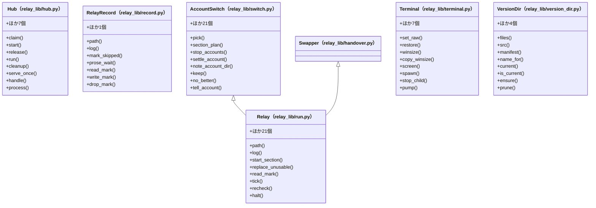

### release_lib

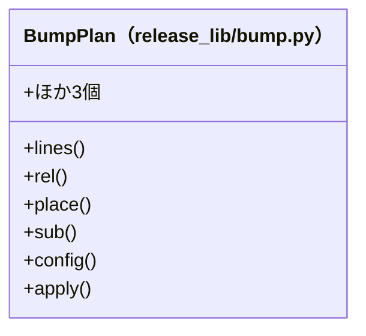

### project_lib

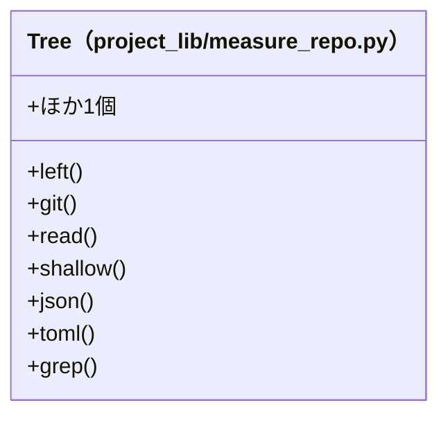

### hook_lib

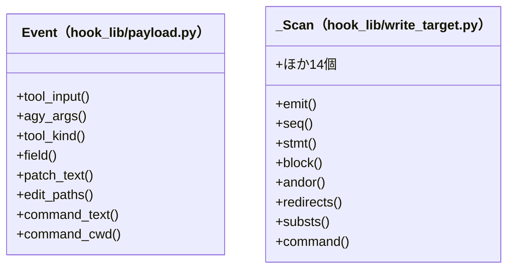

### merged_lib

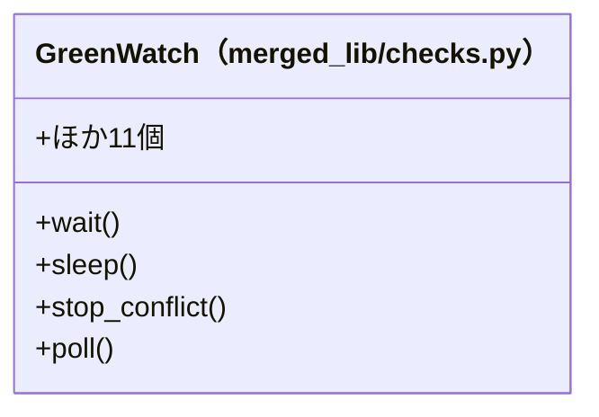

### experimental

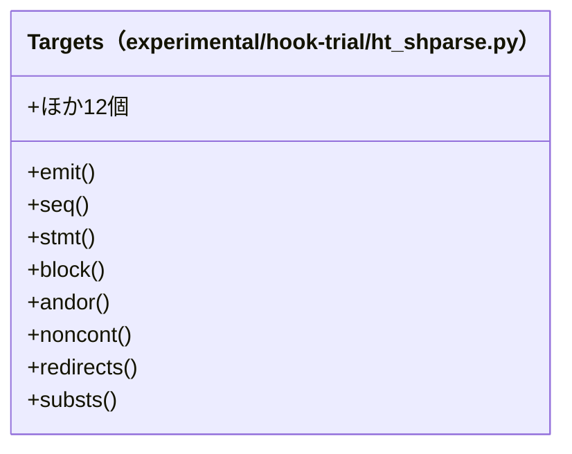

### Skill backlog-refinement

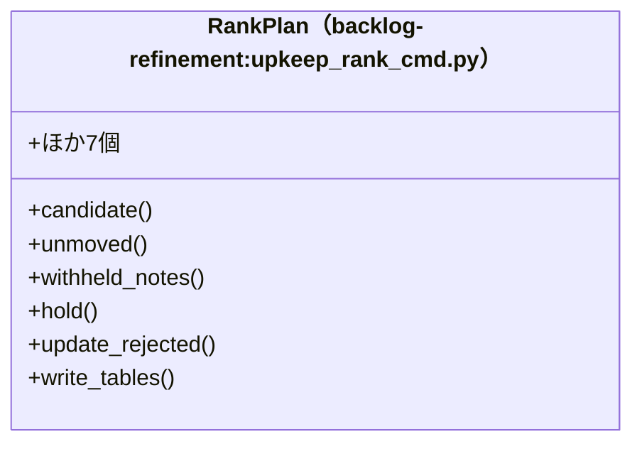

### Skill cross-refactoring

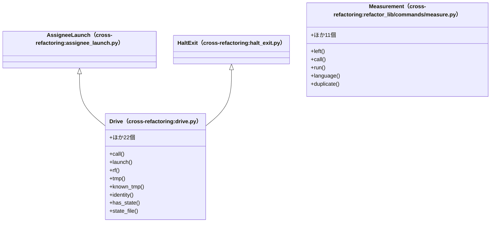

### Skill cross-review

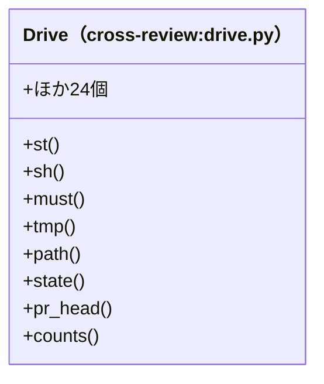

### リポジトリの検査 (scripts/)

```mermaid
classDiagram
  class scripts_check_ndf_contracts_py_Checker["Checker（scripts/check-ndf-contracts.py）"]
  scripts_check_ndf_contracts_py_Checker : +facts()
  scripts_check_ndf_contracts_py_Checker : +reached()
  scripts_check_ndf_contracts_py_Checker : +draft()
  scripts_check_ndf_contracts_py_Checker : +file_of()
  scripts_check_ndf_contracts_py_Checker : +entry()
  scripts_check_ndf_contracts_py_Checker : +match_args()
  scripts_check_ndf_contracts_py_Checker : +match_env()
  scripts_check_ndf_contracts_py_Checker : +collect_code_items()
  scripts_check_ndf_contracts_py_Checker : +ほか6個
  class scripts_contracts_lib_extract_py_py__Scan["_Scan（scripts/contracts_lib/extract_py.py）"]
  scripts_contracts_lib_extract_py_py__Scan : +visit_FunctionDef()
  scripts_contracts_lib_extract_py_py__Scan : +func_qual()
  scripts_contracts_lib_extract_py_py__Scan : +visit_Assign()
  scripts_contracts_lib_extract_py_py__Scan : +visit_Subscript()
  scripts_contracts_lib_extract_py_py__Scan : +visit_Compare()
  scripts_contracts_lib_extract_py_py__Scan : +visit_For()
  scripts_contracts_lib_extract_py_py__Scan : +visit_Call()
  scripts_contracts_lib_extract_py_py__Scan : +visit_Return()
  scripts_contracts_lib_extract_py_py__Scan : +ほか14個
  class scripts_lib_release_map_py_ReleaseMap["ReleaseMap（scripts/lib/release_map.py）"]
  scripts_lib_release_map_py_ReleaseMap : +from_repo()
  scripts_lib_release_map_py_ReleaseMap : +version_at()
  scripts_lib_release_map_py_ReleaseMap : +version_of_pr()
  scripts_lib_release_map_py_ReleaseMap : +place()
  scripts_lib_release_map_py_ReleaseMap : +prs_of()
  scripts_lib_release_map_py_ReleaseMap : +merged_pr_of_issues()
  scripts_lib_release_map_py_ReleaseMap : +window()
  scripts_lib_release_map_py_ReleaseMap : +ほか1個
  class scripts_lib_validate_manifests_py_ManifestChecker["ManifestChecker（scripts/lib/validate_manifests.py）"]
  scripts_lib_validate_manifests_py_ManifestChecker : +plugin_dir_of()
  scripts_lib_validate_manifests_py_ManifestChecker : +run()
  scripts_lib_validate_manifests_py_ManifestChecker : +check_marketplace()
  scripts_lib_validate_manifests_py_ManifestChecker : +load_version_pattern()
  scripts_lib_validate_manifests_py_ManifestChecker : +manifest_skill_count()
  scripts_lib_validate_manifests_py_ManifestChecker : +published_skill_count()
  scripts_lib_validate_manifests_py_ManifestChecker : +check_description()
  scripts_lib_validate_manifests_py_ManifestChecker : +check_versions()
  scripts_lib_validate_manifests_py_ManifestChecker : +ほか6個
```

