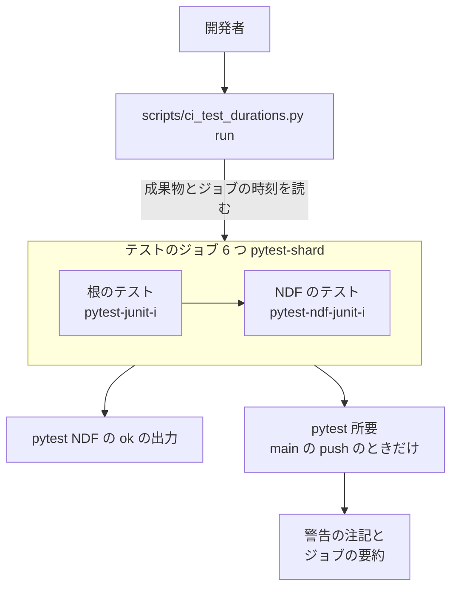

# CI のテストの所要: テスト 1 件ごとの秒を成果物に残し、main の直近の中央値が上限を超えたら知らせる

ai-plugins は、テストの量を件数でなく CI の実行時間で見る。ワークフロー `Python tests`（[.github/workflows/pytest.yml](../../.github/workflows/pytest.yml)）の
6 つのテストのジョブが、根のテストと NDF のテストの両方で JUnit XML を書いて成果物に残す。開発者は 1 回の実行の所要を
`scripts/ci_test_durations.py run` で読み、`main` への push の実行ではジョブ `pytest (所要)` が直近 10 回の中央値を上限と比べ、
超えたら警告の注記とジョブの要約で知らせる。Pull Request は所要の秒で落ちない。

例: run 45517050467 を読むと、次の合計が出る（2026-11-25）。上限 `limit_seconds` の 690 秒は、この合計の 1.25 倍を 10 秒単位で切り上げた値である。

```text
$ python3 scripts/ci_test_durations.py run 45517050467
根: 合計 130.1 秒（1855 件）
NDF: 合計 414.8 秒（10910 件）
合計: 544.9 秒（12765 件）

遅い順の上位 20 件:
  （秒・根か NDF か・テストの id が 20 行）

ジョブ  結果  全体  根のテスト  NDF のテスト（秒）
  （ジョブ 0〜5 の結果と秒が 6 行）
ジョブの所要の合計: … 秒・最も長いジョブ: …（… 秒）
```

所要の読み取りと上限は ai-plugins のスクリプトと設定ファイルに置き、NDF のコマンド・結果 JSON・設定のスキーマには置かない。
テストの件数の上限（NDF の規則 `budget` の `budget.tests`）を ai-plugins で置かないことは、
[ndf-split-tables-toolchain-and-budget.md](ndf-split-tables-toolchain-and-budget.md) にある。

## この文書での呼び方

| 呼び方 | 指すもの |
| --- | --- |
| 根のテスト | リポジトリのルートで `pytest .` を打って流すテスト（ルートの `conftest.py` と `scripts/tests` などのテスト）。`plugins/ndf` の下は集めない |
| NDF のテスト | `plugins/ndf` を起点（pytest の `rootdir`）にして流す、`plugins/ndf/tests` の下のテスト |
| テストのジョブ | ジョブ `pytest-shard`（名前 `pytest (0/6)`〜`pytest (5/6)`）。1 つのジョブが根のテストと NDF のテストを続けて流す |
| 集計 | 1 回の `main` の実行のテストの秒の合計を書いた JSON（成果物 `ci-test-duration-total`） |

## 構成

| 要素 | 責務 | 保存先 |
| --- | --- | --- |
| テストのジョブ | 根と NDF のテストを流し、それぞれの JUnit XML と試行の番号のファイルを成果物に上げる | `.github/workflows/pytest.yml` のジョブ `pytest-shard` |
| 割り当て | ファイルの一覧と実測秒から各ファイルの担当のジョブを決める。NDF のテストでは pytest のプラグインとして、持ち分でないファイルを収集の前に外す。JUnit XML から実測秒の表を作り直す | `scripts/pytest_shard.py` |
| 実測秒の表 | ファイルごとの秒。キーはリポジトリのルートから見たパスで、根と NDF のテストの両方を持つ | `scripts/pytest-shard-seconds.json` |
| 所要の読み取り | 1 回の所要を出す（`run`）。この回の集計を書き、過去の回の集計と合わせた直近の中央値を上限と比べる（`trend`） | `scripts/ci_test_durations.py` |
| 所要の設定 | 中央値に数える回数・上限の秒・遅い順に出す件数 | `scripts/ci-test-duration.json` |
| 中央値のジョブ | `main` への push の実行で `trend` を打ち、集計を成果物に上げる。ワークフローの結論に入らない | `.github/workflows/pytest.yml` のジョブ `pytest-duration`（名前 `pytest (所要)`） |
| ok の出力の記録 | `NDF_OK_TOOLS_OUT` を渡された実行は、検証済みのサブコマンドの名前を書くだけで、自分では網羅を確かめない | `plugins/ndf/tests/conftest.py` の `pytest_sessionfinish` |



## 仕様

### テストのジョブ

各テストのジョブ（番号 `<i>` は 0〜5）は、次の順に手順を流す。

1. 試行の番号 `${{ github.run_attempt }}` を `shard-attempt-<i>.txt` に書く
2. 根のテスト（手順の名前 `根のテスト`）を `--junitxml=pytest-junit-<i>.xml` で流す
3. 成果物 `pytest-junit-<i>`（根の XML と試行の番号のファイル）を上げる
4. NDF のテスト（手順の名前 `NDF のテスト`）を `-p pytest_shard --junitxml=…/pytest-ndf-junit-<i>.xml` で流す。`PYTHONPATH` に `scripts` を足し、環境変数 `SHARD_TOTAL`・`SHARD_INDEX` と `NDF_OK_TOOLS_OUT` を渡す
5. 成果物 `pytest-ndf-junit-<i>`（NDF の XML と試行の番号のファイル）と `ndf-ok-tools-<i>`（ok の出力の記録）を上げる

| 成果物 | 中身 | 上書き | 保存期間 |
| --- | --- | --- | --- |
| `pytest-junit-<i>` | `pytest-junit-<i>.xml`・`shard-attempt-<i>.txt` | `overwrite: true` | リポジトリの設定（90 日） |
| `pytest-ndf-junit-<i>` | `pytest-ndf-junit-<i>.xml`・`shard-attempt-<i>.txt` | `overwrite: true` | リポジトリの設定（90 日） |
| `ndf-ok-tools-<i>` | 検証済みのサブコマンドの名前 | `overwrite: true` | 30 日 |
| `ci-test-duration-total` | 集計の JSON | `overwrite: true` | リポジトリの設定（90 日） |

- **4 つとも上書きで上げる。** 同じ回の中で成果物の名前は 1 つにしか使えず、固定した `actions/upload-artifact` v7.0.2 の `overwrite` の既定は false である。上書きしないと、失敗したジョブだけを再実行したときに上げる手順が落ちる
- **`ndf-ok-tools-<i>` は 30 日残す。** GitHub は最初の実行から 30 日まで失敗したジョブだけの再実行を許し、そのとき成功していたジョブの記録が残っている必要がある
- 集計の成果物の名前は、NDF の CI 計測（`plugins/ndf/src/ndf/domains/project/measure_ci.py` の `JUNIT_NAME`）に当たらない `ci-test-duration-total` にする。当たる名前にすると、`ndf project measure` が XML の無い ZIP を余分に取る

### 割り当て（`scripts/pytest_shard.py`）

テストはファイル単位でジョブへ分ける。同じファイルのテストを別のジョブへ割ると、モジュールの読み込みと一時ディレクトリのファイル単位の前提が割れるためである。
重いファイルから順に、いちばん空いているジョブへ入れる（`assign_files`）。実測秒の表に秒の無いファイルは、割り当てる NDF のファイルのうち秒のあるものの中央値で数え、
秒のあるファイルが 1 つも無ければ 1 秒で数える。

| テスト | 外し方 |
| --- | --- |
| 根のテスト | ルートの `conftest.py` が全件を集めた後に、持ち分でない項目を外す |
| NDF のテスト | `-p pytest_shard` で読んだプラグインが、収集の前に持ち分でないファイルを外す。収集だけの手順は持たない |

NDF のテストのプラグインは、持ち分をテストのジョブごとに 1 回だけ決める。

- **controller**（`config` に `workerinput` が無いプロセス。xdist を使わない実行も含む）: `pytest_configure` で、設定の `testpaths` の下の `python_files` に当たるファイルの一覧を探し、実測秒の表を読み、一覧のすべてのファイルの担当のジョブを決めて `config` に保存する
- **worker への受け渡し**: xdist のフック `pytest_configure_node` で、対応を `node.workerinput` に入れる。worker は `pytest_configure` で受け取るだけで、探索・表の読み取り・割り当てをしない
- **`pytest_ignore_collect`**: ディレクトリでは何も決めず（`None`）、テストのファイルでだけ保存した対応から担当を引き、このジョブでなければ外す。表のキーと合わせるため、パスはリポジトリのルートから見たパスに直して引く
- **一覧に無いファイル**（まだコミットしていないファイルなど）を pytest が訪れたときは、ジョブ 0 が持つ。どのファイルもちょうど 1 つのジョブで流れる
- pytest はフックの中でだけ import する。pytest の無い `python3` でも `files` と `seconds` を打てる

| 起きたこと | 扱い |
| --- | --- |
| `SHARD_TOTAL`・`SHARD_INDEX` が整数でない・番号が範囲の外 | `pytest.UsageError`（終了コード 4） |
| 実測秒の表が読めない | 空の表で続ける（ファイルの数で分ける） |
| worker の `workerinput` に対応が無い | 「controller から割り当てを受け取れなかった」の `pytest.UsageError`（終了コード 4）。worker で計算し直すと 2 通りの割り当てが混ざりうるため、続けない |

### 実測秒の表の作り直し

偏りが目立ったときに開発者が手で打ち、Pull Request で直す。`main` の CI は自動でコミットしない（`main` への直接の push は ruleset が禁じる）。

```bash
gh run download <run の ID> -p 'pytest-*junit-*' -D <保存先>
python3 scripts/pytest_shard.py seconds <保存先>
```

- 使う回は、`run` が部分集計とも失敗したジョブを含むとも出さなかった回（6 つのジョブの根と NDF の XML がすべてそろい、すべて最新の試行のもので、6 つのジョブがすべて成功した回）に限る
- `seconds` は XML のパスに `pytest-ndf-junit-` を含むものを NDF の XML とみなし、`classname`（`tests.test_example.TestX` のようなドットの名前）を `plugins/ndf` を起点に実在するファイルへ解決する。キーはリポジトリのルートから見たパス（例 `plugins/ndf/tests/test_example.py`）である
- 壊れた XML があれば、そのパスを標準エラーへ書いて 1 で終わり、表を書き直さない

### 1 回の所要（`run`）

```bash
python3 scripts/ci_test_durations.py run <run の ID> [--top <件数>]
```

- 最新の試行のジョブの一覧（`actions/runs/<ID>/jobs?filter=latest`）と成果物の一覧を引き、`pytest-junit-<i>`・`pytest-ndf-junit-<i>` を一時ディレクトリへ展開して読む
- 出力: 根と NDF のそれぞれの合計の秒と件数、両方の合計、遅い順の上位（秒・根か NDF か・テストの id。件数は `--top`、省けば設定の `top`）、ジョブごとの所要（ジョブ全体・`根のテスト`・`NDF のテスト` の手順の秒と結果 `conclusion`）、最も長いジョブ
- **試行の照合**: ジョブ `pytest (<i>/6)` の `run_attempt` と 2 つの成果物の `shard-attempt-<i>.txt` が一致するジョブの XML だけを合計に入れる
- `run` は CI が落ちた回の遅いテストを調べるのにも使うので、ジョブの成否で XML を外さない

| 起きたこと | 出力 | 終了コード |
| --- | --- | ---: |
| すべてそろった | 上の出力 | 0 |
| 一部のジョブの XML が無い・古い試行の XML がある | 先頭の行に「部分集計（欠けたジョブ: <番号>、古い試行のジョブ: <番号>）」。合計は照合が通ったジョブだけ | 0 |
| 落ちたジョブがある | 先頭の行に「失敗したジョブを含む（<番号>）」 | 0 |
| 根か NDF の XML が 1 つも読めない（残す前の回・保存期間を過ぎた回・期限切れの成果物） | 無い側を標準エラーへ書く | 1 |
| 引数の誤り・`gh` を使えない | 標準エラー | 2 |

`run` には第三者の Pull Request の実行も渡せるので、成果物の名前と ZIP の中身を信用しない（`fetch_run`・`_extract`）。`ZipFile.extractall` は使わない。

| 検証するもの | 受け入れる形 | 外れたとき |
| --- | --- | --- |
| 成果物の名前 | `^pytest(-ndf)?-junit-(\d+)$` に全体が当たり、番号がジョブの総数より小さい。`expired` でない | 取りに行かない |
| 成果物の大きさ | `size_in_bytes` が `ARTIFACT_LIMIT`（16 MiB）と累積の残り（`TOTAL_LIMIT` 64 MiB から受け取った分を引いた値）の小さい方以下 | 取りに行かず、標準エラーへ「成果物 <名前> を読み飛ばした（大きさの上限 <バイト数> を超えた）」 |
| 受け取る ZIP の大きさ | 同じ上限を `Gh.raw` に渡し、超えたら受け取りを止める | 同上。受け取った分も累積に足す |
| ZIP の中のエントリ | 成果物の種類と番号に合う `pytest-junit-<i>.xml` か `pytest-ndf-junit-<i>.xml` と、`shard-attempt-<i>.txt` だけ。見出しの `file_size` の和が `ARTIFACT_LIMIT` 以下 | 名前の外れたエントリは書かない。大きさを超えたら 1 つも書かない |
| ZIP が壊れていない・書き出す先 | 書き出すエントリを 64 KiB ずつ最後まで読めて、書き先が `dest` の下にある | 「成果物 <名前> を読めない（壊れた ZIP）」を書き、その成果物のディレクトリごと消す |

読み飛ばした成果物は、部分集計の「欠けたジョブ」に出る。

### 中央値のジョブ（`pytest (所要)`）

| 項目 | 値 |
| --- | --- |
| 起動の条件 | `needs: [pytest-shard, pytest-ndf-ok-tools]`。`github.event_name == 'push'`・`github.ref == 'refs/heads/main'`・両方の `result == 'success'` のときだけ |
| 結論への影響 | `continue-on-error: true`。集約のジョブ `pytest` の `needs` に入らない。checkout・成果物の取得が失敗しても `main` のワークフローは失敗にならない |
| 権限 | `actions: read`・`contents: read`。`trend` の手順に `GH_TOKEN: ${{ github.token }}` を渡す |
| 手順 | 始めた時刻を `CI_TEST_DURATION_STARTED` に記録 → checkout → この回の `pytest-*junit-*` を `actions/download-artifact` で取る（`merge-multiple` を付けない） → `trend` → 集計を `ci-test-duration-total` に上げる（`if: always()`・`if-no-files-found: warn`） |
| 打つもの | 実行機の `python3`（`scripts/ci_test_durations.py` は標準ライブラリと `gh` だけを使う。uv は準備しない） |

`main` への push で `Python tests` が起動するのは、`on.push.paths` に当たるファイルを変えたときだけである。`docs/` 配下の文書だけを変えた push では
ワークフローが起動せず、集計も残らない。`plugins/` 配下の文書（`plugins/ndf/README.md` など）は起動対象に含まれる。

### 中央値と上限（`trend`）

```bash
python3 scripts/ci_test_durations.py trend <XML のディレクトリ> --run <run の ID> --run-number <実行番号> --attempt <試行の番号> --out <集計の JSON>
```

CI では `${{ github.run_id }}`・`${{ github.run_number }}`・`${{ github.run_attempt }}` を渡す。手で打つときは、`--attempt` にその回の最新の試行の番号
（`gh run view <run の ID> --json attempt` の `attempt`）を渡す。最新でないと、その集計は過去の回として数えられない。

主に見る量は、根と NDF の JUnit XML の `testcase` の `time` の合計である。最も長いジョブの秒は分け方と実行機で不連続に変わり、
ワークフローの所要はキューの待ちを含んでぶれる（2026-11-24 の直近 60 回で 36〜583 秒）ため、比べる量にしない。1 回の秒で比べないのも同じ理由である。

判定は次の順に行う（`cmd_trend`）。

1. **この回の集計を作る**（`current_total`）。この回のジョブの一覧を最新の試行だけ 1 回引き、テストのジョブごとに試行の番号を照合する。根と NDF の XML が 6 つずつそろい、すべて読め、6 つの組で照合が通り `conclusion` が `success` のときだけ有効にする。そろわなければ無効な集計にし、理由を `::warning title=テストの所要の読み取り::` で出して、過去の回を探さず判定もしない
2. **過去の回を探す**（`past_totals`）。この回より実行番号の小さい `main` への push で成功した実行を、実行番号の大きい順に調べる（成果物の作成時刻では並べない。並んで走る push と古い回の再実行で順序が変わるため）
3. **比べる**（`verdict`）。この回を含めて設定の `runs` 回そろえば、合計の中央値を `limit_seconds` と比べる。`runs` が 1 なら過去の回を探さず、この回だけで比べる
4. **そろわなければ保留する**。そろった回数と止めた理由を `::notice title=テストの所要::` に書く。記録を残し始めた直後の `main` では普通に起きるので警告にしない
5. **集計を書く**。有効でも無効でも `--out` へ書く。後の実行が過去の回として読む

過去の回の探し方:

- 引く一覧は 2 つで、どちらも新しい順に 1 ページ 100 件ずつ、要るページだけを読む
  - 実行の一覧: `actions/workflows/pytest.yml/runs?branch=main&event=push&status=success`
  - 成果物の一覧: `actions/artifacts?name=ci-test-duration-total`
- 候補の実行ごとに、`workflow_run.id` がその実行の ID と同じで `expired` が偽の成果物を探す。読んだ成果物の一覧の最も古い作成時刻が候補の実行の作成時刻より新しいうちは次のページを読み、古くなっても見つからなければ、その実行には集計が無い（ZIP を取らない）
- 見つかった集計は、集計の `run` がその実行の ID と同じ・`valid` が真・`attempt` が実行の一覧の `run_attempt`（最新の試行の番号）と同じ、の 3 つがそろうときだけ数える。最新の試行で集計を作り直せず前の試行の集計が残った回は、3 つ目で外れる
- 集計が壊れている・キーが足りない・`run` が違う・ZIP を取れない回は数えず、次の回へ進む。数えなかった回の ID を `::warning title=テストの所要の読み取り::` に並べる

探索は、必要な回数がそろう前でも次のどれかで打ち切る。打ち切った時点でそろっていれば判定する（18 回目の ZIP の取得で 10 回そろえば判定する）。

| 打ち切る条件 | 中身 |
| --- | --- |
| 保存期間 | 次に調べる実行が `RETENTION_DAYS`（90 日）より前に作られた |
| ページの上限 | 2 つの一覧を合わせて `PAGE_LIMIT`（10）ページを取得した |
| ZIP の取得の上限 | 過去の回の ZIP の取得を、成功と失敗を合わせて `2 ×（runs − 1）` 回（18 回）試した後に、次の ZIP が必要になった。回数は送る前に数える |
| 時間の上限 | 下の締め切りを過ぎた |
| 候補が尽きた・一覧を取れない | 実行の一覧を最後まで調べた、または一覧の取得に失敗した |

時間の予算: API の呼び出しの締め切りは、`CI_TEST_DURATION_STARTED` に `JOB_BUDGET − UPLOAD_RESERVE`（60 − 5 秒）を足した時刻である。環境変数が無いか整数でなければ、
`trend` を始めた時刻を起点にする。各 `gh` の呼び出しの待ちは `CALL_TIMEOUT`（30 秒）と締め切りまでの残りの短い方で、残りが無ければ呼ばずに止める。
`JOB_BUDGET` はワークフローの `timeout-minutes`（ジョブ 4 分・手順 1 分）とは別の値で、ジョブ全体の 60 秒は目標であって保証ではない。
この回のジョブの一覧で時間切れになれば無効な集計（理由「ジョブの一覧を取れない（時間の上限）」）を書き、過去の回の取得で時間切れになれば有効な集計を書いて保留する。

知らせの出し分け:

| 起きたこと | 注記の行 | ジョブの要約（`GITHUB_STEP_SUMMARY`） |
| --- | --- | --- |
| 中央値が上限を超えた | `::warning title=テストの所要::`（中央値・上限・超えた秒） | 数えた回・中央値・上限・差の表 |
| 中央値が上限以下（等しいときを含む） | 出さない | 数えた回・中央値・上限・差の表 |
| そろった回が `runs` に満たず判定しなかった | `::notice title=テストの所要::`（そろった回数と止めた理由） | そろった回数と止めた理由 |
| 読めないものがあった | `::warning title=テストの所要の読み取り::`（読めなかったものと回の ID） | 読めなかったもの |

標準出力には、数えた回の ID と合計の秒・中央値・上限・差と、最後にこの回の GitHub API の呼び出しの数（ジョブの一覧・一覧のページ・集計の ZIP）を書く。
上限を超えた警告が出ないことは、上限以下と判定したことを意味しない。保留した回と無効な集計の回にもその警告は出ない。
直前の実行からの増加は見ないので、上限以下での増加は知らせない。

終了コードは、引数と設定の誤りのときだけ 2 で、超えたとき・`gh` を使えないとき・読めないものに当たったときも 0 である。

| 読めないもの | 扱い |
| --- | --- |
| この回の XML（そろわない・壊れている・試行の番号が最新の試行と違う） | 無効な集計を書き、判定しない |
| この回のジョブの一覧 | 試行を照合できないので、無効な集計を書き、判定しない |
| 実行の一覧・成果物の一覧のページ | 判定しない。この回の集計は書く |
| 過去のある回の集計 | その回を数えず、次の回を取る |

1 回の `main` への push で増える GitHub API の呼び出しは、正常なとき（10 回が 1 ページ目にそろう）でジョブの一覧 1 回・一覧のページ 2 回・集計の ZIP 9 回で、
多いときは一覧のページ 10 回・ZIP 18 回である。この回の XML の成果物 12 個は `actions/download-artifact` で取り、この数に含めない。

各回の合計を集計に残し、過去の回はそれだけを読む。過去の回の XML を毎回読み直すと 1 回の push で 108 個の ZIP の取得が要り、
開発用のコンテナからの実測（2026-11-25）で約 126 秒かかるのに対し、集計を読む方式は約 16 秒である。代わりに、合計の求め方を変えると、
保存期間の内で 10 回が入れ替わるまで新旧の値が混ざる。

### ok の出力の確かめ

NDF の各サブコマンドについて、正常終了の出力を検証したテストが少なくとも 1 件あることを確かめる仕組みは、6 つのテストのジョブの記録を合わせて行う。

- `NDF_OK_TOOLS_OUT` が空でない実行は、検証済みのサブコマンドの名前を辞書順に 1 行ずつそのファイルへ書き、`exitstatus` を変えない
- 後のジョブ `pytest (NDF の ok の出力)` が 6 つの記録を合わせ、`cli.COMMANDS` を網羅していなければ失敗にする。このジョブが失敗すると必須のチェック `pytest` も失敗する
- `NDF_OK_TOOLS_OUT` が無いか空の全体の実行は、自分で確かめ、検証済みでないサブコマンドがあれば落ちる。`NDF_OK_TOOLS_OUT` を渡して手元で全体を流すと、確かめは行われない

NDF のテストは引数でファイルを渡さないので、各ジョブは全体の実行とみなされる。持ち分だけを流すジョブが自分で確かめると、ほかのジョブにしか
検証のテストが無いサブコマンドで落ちるため、記録を書くだけにしている。NDF の `conftest.py` にこのリポジトリの CI の環境変数（`SHARD_TOTAL`）は持ち込まない。

## データ・設定

所要の設定（`scripts/ci-test-duration.json`）。上限と回数を変えるのにコードの変更は要らない。

| キー | 型 | 意味 | 値（2026-11-25） |
| --- | --- | --- | ---: |
| `runs` | 整数（1 以上） | 中央値に数える回数。1 ならこの回の合計だけで判定する | 10 |
| `limit_seconds` | 数 | 中央値の上限の秒（テスト 1 件ごとの秒の、根と NDF の合計） | 690 |
| `top` | 整数 | `run` が遅い順に出す件数 | 20 |

集計の JSON（`trend` の `--out`、成果物 `ci-test-duration-total`）:

| キー | 型 | 意味 |
| --- | --- | --- |
| `run` | 整数 | この回の ID（`--run`） |
| `attempt` | 整数 | 集計を作った中央値のジョブの試行の番号（`--attempt`） |
| `shard_attempts` | 長さ 6 の配列（ジョブの番号 0〜5 の順）。要素は整数か `null` | 採ったテストのジョブごとの試行の番号。照合できなかったジョブは `null` |
| `valid` | 真偽 | 6 つのジョブの組がそろい、すべて読めたら真 |
| `root_seconds`・`ndf_seconds`・`total_seconds` | 数か `null` | 根・NDF・両方の合計の秒。`valid` が偽なら `null` |
| `reason` | 文字列か `null` | `valid` が偽の理由（欠けたジョブ・古い試行のジョブ・読めない XML・ジョブの一覧を取れない） |

成果物の名前の頭（`pytest-junit-`・`pytest-ndf-junit-`）は `scripts/pytest_shard.py` の `ROOT_JUNIT`・`NDF_JUNIT` が正で、`scripts/ci_test_durations.py` はそれを import する。
試行の番号のファイルの名前と手順の名前（`根のテスト`・`NDF のテスト`）は、ワークフローと `scripts/ci_test_durations.py` の定数が同じ値を持つ（YAML から渡す経路が無い）。

## 運用

- **上限の決め方**: `run` が部分集計とも失敗したジョブを含むとも出さなかった回の合計の 1.25 倍を、10 秒単位で切り上げる。今の 690 秒は run 45517050467 の 544.9 秒から決めた
- **上限を超えたと知らせが出たら**: その `main` の実行を `run` で読み、遅い順の上位から直すテストを選ぶ。上限を上げるなら `scripts/ci-test-duration.json` の `limit_seconds` だけを変える
- **偏りが目立ったら**: `run` のジョブごとの所要で偏りを見て、実測秒の表を作り直す
- **ジョブの数**: ワークフローのジョブは上限 `budget.ci_jobs`（40）に並んでいる。次にジョブを足す変更は、上限を上げるかジョブをまとめる
- **`ndf project measure` への影響**: このリポジトリを NDF で解析すると、JUnit の ZIP を 12 個取る。マージの前の実測（2026-11-25）で、取得の増分は 7.4 秒（6 個で 6.55 秒、12 個で 13.96 秒）で、許容の 10 秒に収まる。テストの所要の候補 `ci-junit` に NDF のテストの秒が入る
- **CI の秒の前と後**（2026-11-25）: 6 つのテストのジョブの合計は、直近の `main`（run 45495601478）の 547 秒に対し 541 秒（run 45517050467）。NDF のテストの収集とテストを合わせた秒は 353 秒から 297 秒に減った。最も長いジョブは 104 秒から 121 秒に延びた（最も長いジョブは上限の対象にしない）
- **リリースの後に確かめること**: 有効な集計が 10 回そろって判定が出た最初の `main` の実行で、全ジョブの所要の合計・ワークフローの完了時間・`trend` が出した呼び出しの数を読み、変更前の `main`（run 45495601478）と比べて [#4331](https://github.com/devbasex/ai-plugins/issues/4331) に書く。中央値のジョブの所要が 60 秒を超えるか、取得の数が上の表を超えたら、取得を減らす変更を起票する

## テスト観点

| 観点 | 確かめ方 |
| --- | --- |
| `run` が根と NDF の XML を読み、両方の合計・遅い順の上位・ジョブごとの所要を出す | `scripts/tests/test_ci_test_durations.py`（`gh` の応答を差し替える） |
| 根か NDF の XML が 1 つも無い回で 1 を返し、一部の欠け・古い試行・落ちたジョブを先頭の行で示して 0 を返す | 同上 |
| 成果物の名前・大きさ・ZIP の中身・書き出す先の検証 | 同上 |
| 中央値が上限を超えると警告の注記を出し、等しいときと下回るときは出さない。回数が足りないときは notice だけで判定しない | 同上 |
| 試行の照合で、照合の通らない組や取れないジョブの一覧から有効な集計を書かない。`valid` が偽の集計と `attempt` が最新でない集計を数えない | 同上 |
| 過去の回を実行番号の大きい順に数え、壊れた 1 回を飛ばして続け、上限で打ち切り、2 ページ目以降も読む | 同上 |
| 超えたときも `gh` を使えないときも 0 で終わる | 同上 |
| NDF のテストの持ち分が実測秒で決まり、worker は計算せず `workerinput` の対応を使い、対応が無ければ止まる | `scripts/tests/test_pytest_shard.py` |
| 6 つの持ち分の和が一覧と一致して重ならず、一覧に無いファイルも 1 つのジョブだけが持ち、ディレクトリを外さない。`files` の出力が変わらない | 同上 |
| `seconds` が根と NDF の XML から、リポジトリのルートから見たパスをキーにした表を作り、壊れた XML で 1 を返す | 同上 |
| `NDF_OK_TOOLS_OUT` を渡した実行は記録を書くだけで落ちず、渡さない全体の実行は今と同じく落ちる | `plugins/ndf/tests/test_ok_tools_record.py` |
| 成果物の上書き・保存期間、中央値のジョブの起動の条件・`continue-on-error`・集約のジョブの `needs` に入らないこと | `.github/workflows/pytest.yml` の定義と、Pull Request の CI の成果物の一覧で見る |
| 所要の秒で Pull Request を落とさない | 中央値のジョブが `main` への push でしか走らないことをワークフローの定義で見る |

## 関連リンク

- [issue #4331](https://github.com/devbasex/ai-plugins/issues/4331)
- [ndf-split-tables-toolchain-and-budget.md](ndf-split-tables-toolchain-and-budget.md) — テストの件数の上限 `budget.tests` を ai-plugins で置かないこと
- [project-decl-ci-representative-run.md](project-decl-ci-representative-run.md) — `ndf project measure` が CI の代表の実行を選ぶ規則
