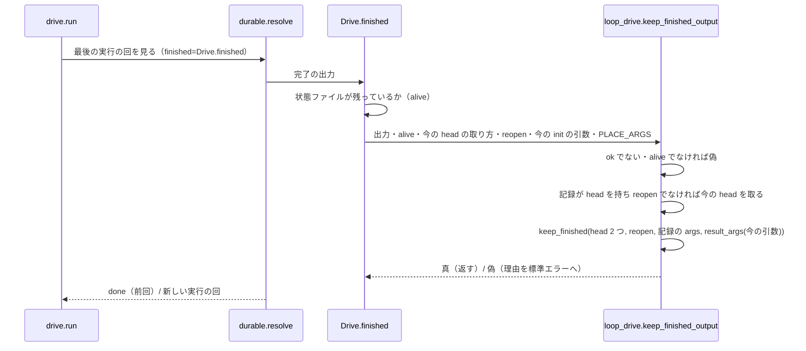
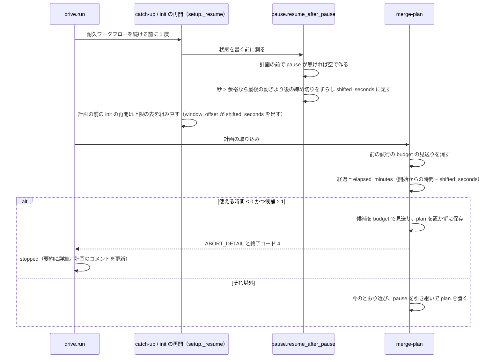
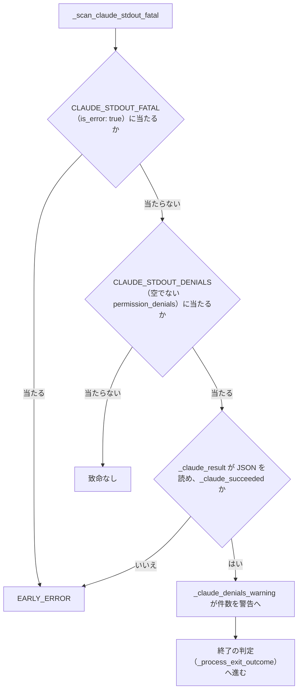

# cross 系の drive の打ち直しと時間と拒否: 引数を変えた流し直しで前回の結果や時間の無い計画が `ok` で返り、成功で終わった担当が拒否 1 回で止まっていた → 引数か head が違えば新しい実行の回を始め、計画の前の止まっていた時間を除き、時間の無い計画は中断で返し、成功で終わった後の拒否は警告にとどめる

## 概要

**cross-review と cross-refactoring の drive は、完了した実行の回を返す前に、完了の記録の PR の head と結果を変える引数を
打ち直した回の値と比べ、どちらかが違えば新しい実行の回を始める。** 判定は 2 つの drive が共有する
[`loop_drive.keep_finished_output`](../../plugins/ndf/scripts/lib/loop_drive.py) の 1 か所にある。
**cross-refactoring は、計画の前に止まった時間も想定最大時間に数えない。** 使える時間が 0 分以下で候補が 1 件以上ある計画は
`ok` で返さず中断し、時間で見送った件数を `metrics.deferred` とリファクタリング計画の件数の行へ出す。
**監視は、claude が `subtype: success`・`is_error: false` で終えた後の `permission_denials` を致命にせず、警告に残す**。

例: devbasex/devbase PR #301 の検査のプランを 1 度完走させ、`--round-test` を変えて `supervise.py run --from refactor` で流し直す。

| 時点 | 振る舞い |
| --- | --- |
| cross-refactoring の drive | 完了の記録の `args` と今の引数が `--round-test` で違うため、標準エラーへ `↻ 完了の時点と結果を変える引数が違うため（--round-test）、新しい実行の回を始める` を出し、`init` から流し直す |
| cross-review の drive | refactor が PR へ積んだ後なら head が違い、`↻ 完了の時点の head … へ進んでいるため、新しい実行の回を始める` で回り直す |
| 計画の前で止めた実行の打ち直し | 止まっていた時間が余裕を超えていれば、提案と計画の枠の締め切りがその秒だけ後ろへずれ、計画の経過時間からも引かれる |
| 計画の時点で使える時間が -3.2 分・候補 5 件 | drive は `status: stopped`（`metrics.exit` 4）、要約は `refactor.py merge-plan が終了コード 4 で止まった: 使える時間 -3.2 分に候補 5 件が入らない（すべて時間で見送った）` |

この文書は、その形に**なぜしたか**（背景・常に成り立つ条件・契約・既知の限界・テスト観点）を残す。手順と鍵の正は次にある。

| 何を | 正本 |
| --- | --- |
| `rerun_reason` / `keep_finished` の条件と標準エラーの文の表 | [cross-review-reopen-and-hook-deadline.md](cross-review-reopen-and-hook-deadline.md) の「前回の結果を返すかの判定（`loop_drive`）」 |
| cross-review の `drive.py` からの打ち直し（ラウンドを足す） | `cross-review` の [`docs/01-state-and-review.md`](../../plugins/ndf/skills/cross-review/docs/01-state-and-review.md) の「ラウンドを足す」 |
| 止まっていた時間の測り方・ずらす締め切り・ずらさないとき・`pause` の鍵 | `cross-refactoring` の [`docs/01-state-and-propose.md` の「再開」](../../plugins/ndf/skills/cross-refactoring/docs/01-state-and-propose.md#再開) |
| 計画で時間に収まる件数を選ぶ手順と、使える時間が無いときの中断 | `cross-refactoring` の [`docs/02-plan-and-implement.md`](../../plugins/ndf/skills/cross-refactoring/docs/02-plan-and-implement.md) の手順 6 |
| 結果 JSON の `status` と終了コード | `cross-refactoring` の [SKILL.md](../../plugins/ndf/skills/cross-refactoring/SKILL.md) の結果の表 |
| 見送りの件数の出どころ（`ledger.tally`） | [cross-refactoring-pr-gate-and-skip-counts.md](cross-refactoring-pr-gate-and-skip-counts.md) |
| 上限の表の起点のずれ o（`window_offset`） | [cross-refactoring-init-test-and-phase-windows.md](cross-refactoring-init-test-and-phase-windows.md) |
| 計画の後の再開で締め切りをずらす規則 | [cross-refactoring-implementation-window-and-readopt.md](cross-refactoring-implementation-window-and-readopt.md) |
| 監視の早期の致命・利用上限の照合 | [cross-review-launch-outcome.md](cross-review-launch-outcome.md) |

## 用語

「実行の回」「結果を変える引数」は用語集（[docs/glossary.md](../glossary.md)）の「NDF の開発ワークフロー（`ndf-workflow`）」、
「止まっていた時間」「最後の動きの時刻」「使える時間」「見送った改善項目」は同じ用語集の `cross-refactoring` の節が正である。

## 背景

| 課題 | 起きたこと |
| --- | --- |
| #1263 | devbasex/devbase PR #301 の検査: `--round-test` を変えて `--from refactor` で流し直すと、refactor は 1.3 秒・review は 0.1 秒で前回の結果を `ok` で返し、プランは承認ゲート 2 まで進んだ。worktree を外して流し直すと提案 14 件のうち 11 件が採用された。cross-review は head と `--reopen` しか比べず、cross-refactoring は状態ファイルがあれば前回を返していた |
| #1944 | devbasex/devbase PR #462 の検査: 計画の前に止まった実行を打ち直すと、#1491 のずらしは計画の後だけで効かず、止まっていた時間まで経過に数えた。使える時間が無いまま全候補を時間で見送って `ok` で返り、その件数は `metrics.deferred` に入らなかった |
| #1513 | PR #1573 の検査で、claude は結果ファイルを書いて `subtype: success` で終えたが、作業中の Bash の読み取り 1 回の拒否で監視が 240 秒で EARLY_ERROR にした。監視は周回ごとに早期の致命を終了の判定より先に照らし、`result_exists` を書くのは終了の判定だけのため、記録は `result_exists: false` になった |

## 対象範囲

| 含む | 含まない |
| --- | --- |
| 2 つの drive の、完了した回を返すかの判定 | `supervise.py` と `supervise_lib/` のプランの進め方（判定は drive にある） |
| cross-refactoring の計画の前の中断からの再開で、止まっていた時間を除くこと | 中断した（完了していない）回の再開で引数を比べること（#648 #782） |
| 使える時間が無い計画の中断と、時間で見送った件数 | cross-refactoring に `--reopen` を足すこと |
| 監視が claude の標準出力の `permission_denials` を致命と読む条件 | `is_error: true`・利用上限など、ほかの致命の照合 |

## 仕様

### 集約

| 集約 | 書く者 | 持つもの |
| --- | --- | --- |
| 完了の記録（耐久ワークフローの出力） | 各 drive の耐久ワークフロー（`review_drive` / `refactor_drive`）が終わりで 1 度だけ | 結果 JSON・終わりの PR の head・結果を変える引数 |
| cross-refactoring の状態 | `refactor.py` の副命令（drive は読むだけ） | 止まっていた時間の記録（`pause`）・上限の表（`limits`）・計画（`plan`）・見送りの記録（`deferred_items`） |
| 担当の起動結果 | 監視（`monitor_loop`） | 早期の致命（`EarlyFatal`）と警告の文 |

### 常に成り立つ条件

| # | 条件 | 破れたときの扱い |
| --- | --- | --- |
| I1 | 完了の記録を返すのは、結果が `ok` で状態ファイルが残り、`--reopen` が無く、比べられた head と引数がどちらも一致するときだけである | 返さずに新しい実行の回を始め、理由と違った引数の名前を標準エラーへ出す |
| I2 | 比べられない項目（記録に無い head か引数・今の head を取れない）は飛ばし、そのことを標準エラーへ出す | 前回を返すか始めるかは、比べられた項目と `--reopen` が決める |
| I3 | 2 つの drive の `finished` は `keep_finished_output` を通る。drive ごとに違うのは除く引数の集合（`PLACE_ARGS`）と、今の head の取り方と、`--reopen` の有無だけである | テストが落とす（`test_both_drives_share_the_finished_comparison`） |
| I4 | 置き場と出力の書き出し先だけを変える引数の違いでは回り直さない | — |
| I5 | 計画の経過時間（`phases.elapsed_minutes`）は、開始からの時間から締め切りをずらした止まっていた時間の和（`pause.shifted_seconds`）を引いた値である。上限の表の起点 o（`timeline.window_offset`）と最終終了時刻（`timeline.compute` の `paused_seconds`）は同じ秒を足す | テストが落とす |
| I6 | 計画の前の再開でずらす締め切りは `pause.PRE_PLAN_SHIFT_KEYS`（提案と計画の枠の終わりと、計画の後の 4 つ）のうち、最後の動きの時刻より後に来るものだけである | テストが落とす |
| I7 | 計画の時点の使える時間が 0 分以下で候補が 1 件以上あれば、計画を置かずに保存し、候補を `budget` で見送って終了コード 4 で止まる。使える時間が正なら、0 件しか入らなくても今のとおり進む | drive は `status: stopped` で返す |
| I8 | `metrics.deferred` と計画のコメントの件数の行は `ledger.tally` 1 か所が数え、時間（`budget`）で見送り項目に入っていない候補（`ledger.budget_deferred`）を含む。採り直しで項目へ戻した候補は数えない | テストが落とす |
| I9 | claude の標準出力を JSON として読めて `subtype: success`・`is_error: false` なら、`permission_denials` は致命にせず警告にする。JSON として読めないとき・ほかの終わり方のときは拒否を致命のままにする | — |

### 入出力の契約

| 契約 | 形 |
| --- | --- |
| 2 つの drive の結果 JSON | 形は変えない。完了の後に引数か head が違う打ち直しは、新しい実行の回の結果を返す |
| cross-refactoring の結果 JSON の `metrics.deferred` | 見送った改善項目の数に、時間で見送り項目に入っていない候補の数を足す。キーは変えない |
| cross-refactoring の結果 JSON の `status` | 使える時間が無い計画では `stopped`・`metrics.exit` 4。要約は `refactor.py merge-plan が終了コード 4 で止まった: <ABORT_DETAIL>` |
| `refactor.py merge-plan` | 使える時間が無いときは `ABORT_DETAIL=使える時間 <分> 分に候補 <件> 件が入らない（すべて時間で見送った）` を出して終了コード 4（`ABORT`）。ほかの終了コード（0・2・4）と出力は変えない |
| drive の `rf` | 子の終了コードが 4 か許す値の外なら、子の出力の `ABORT_DETAIL` を中断の文の末尾へ `: ` で添える |
| 計画のコメントの件数の行 | `見送り N（うち時間 M）`。M が 0 なら括弧を出さない（`plan.counts_line`） |
| drive の標準エラー | 文は `keep_finished` が出す（正本の表は上の「正本」の 1 行目）。引数が違えば `↻ 完了の時点と結果を変える引数が違うため（<鍵>・<鍵>）、新しい実行の回を始める` |
| 監視の標準エラー | `⚠️  <担当> early-error WARN (non-fatal, not killing): permission_denials N 件（subtype: success で終わったため致命にしない）`。標準エラーの記録の警告と同じ周回に出たときは ` / ` でつなぐ |
| 引数・終了コードの表 | 2 つの drive・監視とも変えない |

### 処理の流れ

#### 完了した回を返すか

| drive | `PLACE_ARGS` | 今の head の取り方 | `--reopen` |
| --- | --- | --- | --- |
| cross-review | `--worktree` | `Drive.pr_head`（状態ファイルの今の PR について `gh api repos/<repo>/pulls/<PR> --jq .head.sha`） | ある |
| cross-refactoring | `--worktree-root`・`--plan-file` | `loop_drive.pr_head`（`gh pr view <PR> --json headRefOid --jq .headRefOid`） | 無い（常に偽で渡す） |

cross-refactoring の終わりの head も `loop_drive.pr_head` で取り、結果が `ok` のときだけ記録する。

**決定**: 結果を変える引数は名前で並べず、`init` の引数のすべてから除く鍵だけを外して記録する。足し忘れても起きるのは
余計な回り直し（費用）で、前回の結果の取り違えにはならないためである。値は要約にせずそのまま記録し、違った鍵の名前を出す。

**決定**: PR の head の取得は、記録が head を持ち `--reopen` でないときだけにする。外部コマンドを増やすのはこの 1 回だけで、
引数の比較は手元の正規化だけで済む。cross-refactoring の作業の worktree の `HEAD` を使わず PR の head で比べるのは、他者が
PR へ積んだ差分を映すためである。

#### 計画の前の中断から再開して計画する

**決定**: 計画の前の止まっていた時間は、#1491 の記録（`pause`）へ積み、経過時間と上限の表の起点の両方から引く。報告の
「止まっていた時間」の行と所要の差し引きがそのまま効く。打ち直した時刻を起点にする扱い（`resumed_at`）へ寄せると、止まる前に
動いていた時間まで数えなくなり、使える時間が増えすぎる。

**決定**: 使える時間が無い計画は計画を置かずに中断する。置いたまま中断すると、打ち直しの `merge-plan` が「取り込み済み」で
同じ 0 件を返して `ok` へ進む。新しい終了コードは足さない（drive の終了コードの表と supervise の読み方が変わる）。

#### 監視の判定

`_claude_result` は標準出力の記録の末尾 200 KiB を、全体と最後の空でない行の 2 通りで JSON として読む。

**決定**: 致命にするかは拒否の中身でなく終わり方で決める。成功で終わったなら拒否は回り道で済んでおり、成否は結果ファイルの
有無（既存の終了の判定）が決める。読めない出力は致命に倒し、取りこぼさない。

## データ・設定

| 名前 | 置き場所 | 値・形 |
| --- | --- | --- |
| cross-review の完了の記録 | 耐久の記録（種類 `review`） | `{"result", "code", "tmp", "head", "args"}` |
| cross-refactoring の完了の記録 | 耐久の記録（種類 `refactor`） | `{"result", "state_file", "head", "args"}`。`head` は `ok` のときだけ値を持つ |
| `args` | 完了の記録 | `result_args` の辞書。例: `{"--round-test": [["pytest -q tests/a"]], "--model": [["claude=opus"], ["codex=gpt"]], "--no-code-metrics": [[]], "--scope": [["src/a", "src/b"]]}`。`--name=value` は鍵と値に分け、同じ鍵の繰り返しは出現の順、鍵の順は比べない。最初の `--` の語より前の語は鍵 `""` |
| `PLACE_ARGS` | 各 `drive.py` | cross-review は `{"--worktree"}`、cross-refactoring は `{"--worktree-root", "--plan-file"}` |
| `pause` | cross-refactoring の状態ファイル | `init` が新しい状態に `pause.empty()`（`seconds`・`shifted_seconds`・`legacy`・`events`）で置く。`merge-plan` は在れば引き継ぐ。鍵の意味は Skill の「再開」 |
| `SHIFT_KEYS` / `PRE_PLAN_SHIFT_KEYS` | `refactor_lib/pause.py` | 計画の後は `add_tests_end_at`・`implement_end_at`・`fix_end_at`・`final_end_at`。計画の前は `propose_end_at`・`plan_end_at` を足す |
| `deferred_items[]`（`defer_reason: budget`） | cross-refactoring の状態ファイル | 使える時間が無く中断したときも記録する。`merge-plan` は選ぶ前に前の試行の `budget` を消す |
| `Tally.deferred_budget` | `refactor_lib/ledger.py` | `deferred` のうち時間で見送り項目に入っていない候補。`as_metrics` のキーは変えない |
| `CLAUDE_STDOUT_DENIALS` | `scripts/lib/monitor_patterns.py` | `"permission_denials"\s*:\s*\[\s*\{`（`CLAUDE_STDOUT_FATAL` から分けた。`CLAUDE_STDOUT_FATAL` は `is_error: true` だけ） |

**移行**: 古い完了の記録は `args` を持たず（cross-refactoring は `head` も）、その項目を比べずに飛ばす（I2）。計画の前の古い
状態ファイルに `pause` が無ければ空で作って測り、計画の後で無ければ今のとおり `legacy` を残す。手で消す手順は無い。

## エラー処理

| 事象 | 扱い |
| --- | --- |
| 今の PR の head を取れない（gh の失敗・状態に `repo` が無い） | head を比べずに飛ばし、`ℹ head を比べられないため前回の結果を返す（足すなら --reopen）`。引数が違えば新しい回を始める |
| 完了の記録が `ok` でない・状態ファイルが消えた | 返さずに新しい実行の回を始める |
| 最後の動きの時刻が取れない | ずらさずに続ける |
| 計画の前で、枠が収まらずに止めた後の打ち直し（`window_stopped_at` がある） | 記録しない。起点を打ち直した時刻へ移す扱いが止まっていた時間を含む |
| 最終ゲートに入った後（`phase` が `final`・`done` か、`final_gate` に `status` がある） | 記録しない（意図した停止） |
| 使える時間が無い計画 | 終了コード 4 で止め、打ち直しで計画を作り直す |
| claude の標準出力が JSON として読めない | 空でない `permission_denials` は今のとおり EARLY_ERROR |

## 運用

- 引数を直して検査のプランを流し直すときは、`supervise.py run --from <ステップ>` を打ち直すだけでよい。共有の worktree を手で外す手順は要らない
- 使える時間が無い計画で止まったら、`--budget-minutes` を上げて同じ `init`（drive）を打ち直す。計画の前の予算の置き換えは Skill の「再開」の表のとおり
- 監視の `permission_denials … 致命にしない` の警告は、担当の `--allowed-tools` の不足を示す。成否は結果ファイルの有無で決まる

## テスト観点

`.md` の文言は固定しない（関連: #885）。

| 観点 | 確かめ方 |
| --- | --- |
| `result_args` が鍵ごとの値の並びにし、繰り返しを順に残し、除く鍵を落とすこと。鍵の順と `--name=value` の形の違いを違いと数えないこと（1263-4・I4） | `plugins/ndf/scripts/tests/test_lib_loop_drive.py` |
| `keep_finished` が `--reopen` → head → 引数の順に見て、記録に引数が無ければ比べずに知らせること（1263-5・I1・I2） | 同上 |
| 2 つの drive の `finished` が `keep_finished_output` を通ること（1263-6・I3） | 同上の `test_both_drives_share_the_finished_comparison` |
| cross-review の drive を完走させ、`init` の引数を変えて打ち直すと新しい実行の回が始まり、違った鍵の名前が出ること。同じ引数の別の書き方と、`args` の無い記録は前回を返すこと（1263-1・1263-4・1263-5） | `plugins/ndf/skills/cross-review/tests/test_review_drive_resume.py` |
| cross-refactoring の drive で、引数を変える・PR の head を進めると新しい実行の回が始まり、どちらも同じなら前回を返すこと（1263-2〜1263-4）。中断の文に `ABORT_DETAIL` が添わること | `plugins/ndf/skills/cross-refactoring/tests/test_refactor_drive_resume.py` |
| 計画の前の再開で `propose_end_at`・`plan_end_at` が止まっていた秒だけずれ、`pause.events` に 1 件残り、経過時間と枠から同じ秒が引かれること。`pause` の無い計画の前の状態は測り、枠で止めた後の打ち直しと最終ゲートの後は記録しないこと。組み直した上限の表がずらした最終終了時刻を残すこと（1944-1・1944-2・1944-6・I5・I6） | `plugins/ndf/skills/cross-refactoring/tests/test_time_allocation.py` |
| 使える時間が無い計画が計画を置かずに終了コード 4 と `ABORT_DETAIL` を返し、`metrics.deferred` に件数が出ること。打ち直しで計画を作り直すこと（1944-3・1944-4・I7・I8） | `plugins/ndf/skills/cross-refactoring/tests/test_merge_plan.py` |
| 計画のコメントの件数の行の見送りが `metrics.deferred` と同じ数で、時間の内訳が出ること（1944-5） | `plugins/ndf/skills/cross-refactoring/tests/test_outbound_text.py`（`plan.counts_line`） |
| 止まらずに完走した実行で、使える時間・採用の件数・`metrics` が変わらないこと（1944-7） | 既存の cross-refactoring のテストが変更なしで通る |
| `subtype: success`・`is_error: false`・拒否 1 件で EARLY_ERROR にならず警告に件数が出て、結果ファイルの有無で OK と `result_exists` が決まること。成功でない・`is_error: true`・読めない出力は致命のまま、拒否が空なら致命も警告も出ないこと（1513-1〜1513-4・I9） | `plugins/ndf/skills/cross-review/tests/test_monitor_early_error.py` |
| 全体テストが通ること | `uv run --frozen --project . --all-extras pytest . -q -n 4` |

## 既知の限界

| 項目 | 内容 |
| --- | --- |
| cross-refactoring の文の `--reopen` | `keep_finished` の文（`ℹ head を比べられないため前回の結果を返す（足すなら --reopen）`・`ℹ 完了の記録が引数を持たないため、引数を比べない（足すなら --reopen）`）は共有の関数が出すため cross-refactoring でも出るが、cross-refactoring の drive は `--reopen` を持たない。cross-refactoring で打ち直しを強いる手段を文に書くかは決めていない |
| 監視の警告は 1 回だけ | 監視は早期の警告を 1 度だけ標準エラーへ出す。同じ監視で先に標準エラーの記録の警告を出していれば、後から現れた拒否の件数は出ない |
| 引数が指すファイルの中身 | `--extra-instructions-file` などパスで渡す引数はパスだけを比べる。同じパスで中身を変えた打ち直しは前回を返す |
| drive の引数 | cross-review の `--rotate-mode`・`--result-file` は `init` の引数でないため比べない。変えても前回を返す |
| head が進んだ打ち直しの費用 | supervise が完了した refactor のステップを、review が PR へ積んだ後に同じ引数で打ち直す経路があれば、cross-refactoring が回り直す。supervise の側の経路は確かめていない |
| head の取り方が 2 つ | cross-review は状態ファイルの今の PR（`current_pr`）を `gh api` で、cross-refactoring は drive に渡した PR を `gh pr view` で引く。1 つの関数へまとめていない |

## 関連リンク

- [issue #1263](https://github.com/devbasex/ai-plugins/issues/1263)・[issue #1944](https://github.com/devbasex/ai-plugins/issues/1944)・[issue #1513](https://github.com/devbasex/ai-plugins/issues/1513) — 要求
- [PR #2052](https://github.com/devbasex/ai-plugins/pull/2052)（実装）・[PR #2053](https://github.com/devbasex/ai-plugins/pull/2053)（スプリント a2）
- [cross-review-reopen-and-hook-deadline.md](cross-review-reopen-and-hook-deadline.md) — `keep_finished` と `--reopen` の入口
- [cross-refactoring-implementation-window-and-readopt.md](cross-refactoring-implementation-window-and-readopt.md) — 計画の後の再開のずらし
- [cross-refactoring-init-test-and-phase-windows.md](cross-refactoring-init-test-and-phase-windows.md) — 提案と計画の枠と起点のずれ
- [cross-refactoring-pr-gate-and-skip-counts.md](cross-refactoring-pr-gate-and-skip-counts.md) — 見送りの件数の出どころ
- [cross-refactoring-time-budget.md](cross-refactoring-time-budget.md) — 想定最大時間の全体
- [cross-review-launch-outcome.md](cross-review-launch-outcome.md) — 監視の起動結果と致命の照合
