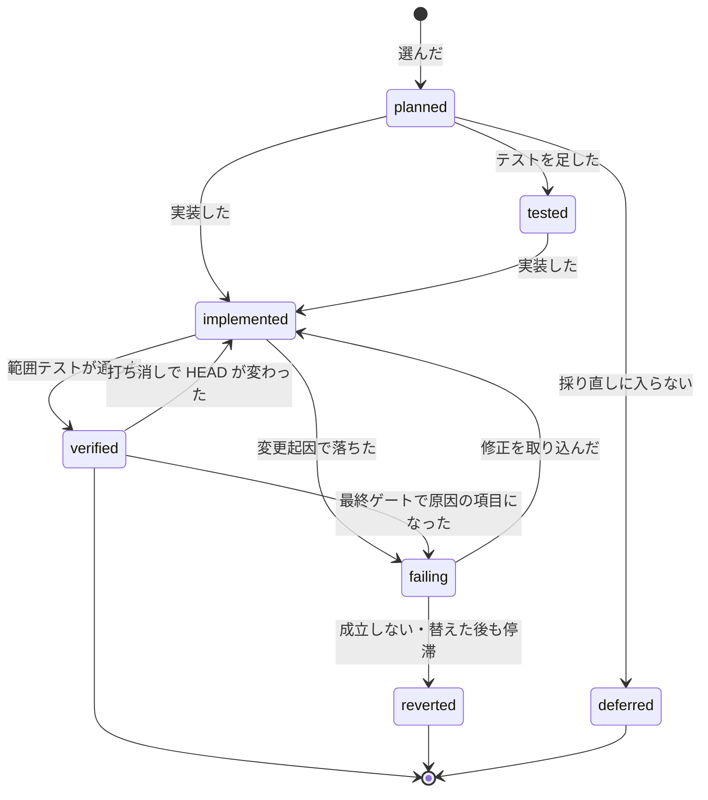

# cross-refactoring: 予算は選ぶ件数を決めるためだけに使い、選んだ改善項目を最後まで入れ切る

## 目的

PR https://github.com/devbasex/ai-plugins/pull/2452 の完了判定で、cross-refactoring は範囲テストを通した 5 項目を、
ベースブランチの取り込みで落ちた無関係なテスト 1 件のためにすべて起点の木へ戻し、採用 0 件で終わった。時間の予算が
選ぶ件数に加えて手順の上限・修正の打ち切り・最終ゲートの締め切りまでを決め、テストの失敗・範囲のはみ出し・記名の欠けが
項目を取り消す理由になっていたためである。

**実装の予算（`--budget-minutes`、既定 60 分）は「何件を選ぶか」にだけ使う。** 選んだ項目は、成立しないと判定したときと、
安全網の上限に当たったとき（取り消さずに止めて人へ渡す）を除いて止めない。

例: 既定の予算 60 分で、high の候補 3 件の見積り（テストの追加 + 実装）の和が 70 分なら、予算を 70 分へ延ばして 3 件を採る。
テストが落ちた項目は別のランタイムが成立を判定し、成立なら修正を続ける。修正の後も同じテストが落ち続ければ判定し直して
修正担当を 1 度替え、それでも同じなら、その項目のコミットだけを `git revert` で打ち消す。コーディングの CLI の起動の秒の累計が
140 分（実効の予算 × 2）に届いたら、HEAD をそのまま残して `gate`・終了コード 10 で止まる。

## 用語

| 用語 | 意味 |
| --- | --- |
| 実装の予算 | `--budget-minutes` の値（既定は `limits.json` の `cross-refactoring.default-budget` の 60 分）。採る改善項目の見積り（テストの追加と実装の和）の合計の上限で、選定にだけ使う |
| 実効の予算 | 予算の延長を当てた後の実装の予算。延ばさなければ実装の予算と同じ |
| 予算の延長 | グレード high の候補の見積りの和 S が実装の予算 B を超え 2B 以下のとき、実効の予算を `ceil(S)` 分にすること |
| 実装時間 | 改善項目のテストの追加・実装・修正で担当の CLI が動いた時間。提案・選定・テストの実行・CI の待ちは含めない |
| 安全網の上限 | コーディングの CLI（テストの追加・実装・修正・最終ゲート修正）の起動ごとの秒（監視の開始から終わり）の累計に置く上限。既定は実効の予算 × 2（`--safety-net-minutes` で上書き） |
| リファクタリングの成立 | 改善項目が、振る舞いを変えずに、計画の前提にした構造の上で直し切れる見込みがあること |
| 判定の担い手 | 成立の判定と判定し直しを行うランタイム。参加者のうち実装担当でない者を、ホスト → 参加者の順で選ぶ |
| 停滞 | 修正の後の落ちたテストの集合が、前の回と同じであること |
| 振動 | 修正の後の落ちたテストの集合が、前に見た集合へ戻ること |
| 差し戻し | 改善項目の中の手順の違反を、項目を取り消さずに担当へ直させること |
| 落ちたテストの材料 | 落ちたテストの ID・ログの置き場・走らせ直すコマンドの組 |

## 背景

| 決めたこと | 理由 |
| --- | --- |
| 見積りはテストの追加と実装の和にし、経過とバッファを引かない | 選ぶ件数がテストと CI の所要で変わらないようにするため |
| グレード high の見積りの和が予算と 2 倍の間にあるときだけ、予算をその和まで延ばす | 順位の高い候補が予算の境目で切れないようにするため |
| 成立の判定は実装担当と別のランタイムが行う | 成立しない項目だけを打ち切るため。実装担当の自己評価に頼らない |
| 修正の回数に上限を置かず、落ちたテストの集合を履歴と比べて前進・停滞・振動を判定する | 進んでいる修正を回数で切らず、空回りだけを止めるため |
| 時間の上限はコーディングの起動の秒の累計に置く安全網だけにし、当たったら取り消さずに `gate` で止める | 時間の上限を異常の検知にだけ使うため |
| 打ち消しは項目のコミットの `git revert` だけにし、衝突したら止める | 取り込んだベースブランチの変更を消さないため（共通原則の C4 に当たる履歴の書き換えをしない） |
| 無関係な失敗は比較の木で見分ける | ベースブランチ由来の失敗を変更起因と取り違えないため |
| フレーキーは見分けたテストの直しを 1 回依頼し、項目とは別のコミットで残す | フレーキーをその実行の中で直し、項目の合否と混ぜないため |
| 項目ごとの実績を、終わり方を問わず配分の履歴へ追記する | 次回の見積りの材料を失わないため |
| テストと CI の待ちの上限は共通ライブラリの予算なしの式を使う | 予算に縛られない上限を 1 つの式に揃えるため |
| 状態ファイルの版を 3 へ上げ、版 2 の実行は再開しない | 意味の変わった状態を旧い記録と混ぜないため |

## 仕様

### 常に成り立つ条件

| 条件 | 破れたときの扱い |
| --- | --- |
| 採っていて取り消していない項目（採り直しで採った項目を含む）の見積りの合計は、実効の予算以下である | 選定の単体テストが落とす |
| 予算を読むのは選定（`merge-plan`・`readopt`）だけである。選定の外で予算から導く値は安全網の上限だけである | 時間の上限の表の単体テストが落とす |
| 項目の `status` を `reverted` にする理由は `infeasible` と `stalled_after_switch` の 2 つだけである。時間・範囲・記名の欠けから `reverted` へは遷移しない | 取り消しの経路の単体テストが落とす |
| 打ち消しは、項目のコミットだけを新しい順に `git revert` する。`reset --hard` で未公開のコミットを外す経路と、起点の木へ戻すコミットを積む経路は無い | git の一時リポジトリの結合テストが落とす |
| 成立の判定と判定し直しは実装担当と別のランタイムが行い、修正担当を替えるのは 1 項目に 1 回だけである | 判定の担い手の選び方の単体テストが落とす |
| 安全網の上限に届いた後は、項目を取り消さず、新しいコーディングの CLI を起動しない | 駆動の単体テストが落とす |
| 打ち消しが衝突したら、打ち消しの前の HEAD へ戻して止まる。衝突した項目をほかの理由で外さない | git の一時リポジトリの結合テストが落とす |
| 最終ゲートは確かめを省いて `passed` を返さない | 最終ゲートの単体テストが落とす |
| push はオーケストレーターだけが行い、`--force`・`--no-verify` を使わない。送るのは状態ファイルに記録した残すコミットだけである | 公開のテストが落とす |
| フレーキーの直しは改善項目と別のコミット（トレーラー `Flaky-Fix`）で、項目の合否・停滞の判定・実装時間に数えない | 駆動の単体テストが落とす |

### 引数とコマンド

| 引数・コマンド | 中身 |
| --- | --- |
| `--budget-minutes N`（`drive.py`・`refactor.py init`） | 実装の予算。明示した値はそのまま使い、下限まで上げない |
| `--safety-net-minutes N` | 安全網の上限（分）。省けば実効の予算 × `cross-refactoring.safety-net` の倍率。止まった実行は、大きい値で同じコマンドを打ち直すと続く |
| `refactor.py judge` | 判定の担い手の答えを読み、項目の `feasibility[]` へ積む。出力は `JUDGE=continue\|infeasible\|no_judge`。答えを読めない項目は `feasible: null` として積む |
| `refactor.py merge-flaky-fix` | フレーキーの直しを取り込む。出力は `FLAKY_FIX=kept\|none\|sendback\|reverted` |

着手前のテストのハングの検知（`init-timeout`）は終了コード 6 で終わる。時間で打ち切る終了コードは持たない。

### 改善項目の状態

状態は `planned` / `tested` / `implemented` / `failing` / `verified` / `reverted` / `deferred` の 7 つである。止めたことは
実行の `safety_net.halted_at` と結果 JSON の `status` が持ち、項目の状態は止めた時点のまま残る。

### 選定（`merge-plan`・`readopt`）

| 決まり | 中身 |
| --- | --- |
| 見積り | 配分テーブルの `test`（足すテストがあるときだけ）+ `structure/<手法>`。検証・テストの実行・CI の待ち・経過時間を入れない |
| 順位 | (グレード, 賛同した者の数, 重要度) の降順、同じなら見積りの昇順 |
| 延長 | high の和 S が B < S ≤ 2B（倍率は `cross-refactoring.budget-extension` の `factor`）なら実効の予算を `ceil(S)` 分にし、`budget.extension` に `{from, to, reason, high_minutes}` を残す |
| 選び方 | 順位の順にたどり、入る候補は入れ、入らない候補は `budget` で見送って次を見る |
| 採り直し | 残り = 実効の予算 − 採っていて取り消していない項目の見積りの和。実装時間の実績は使わない |

予算から締め切りを導かない。テストと CI の待ちの上限は共通ライブラリの予算なしの式（`3·max(w, m)`・`3·c`、所要が無ければ
既定の秒。下限 60 秒）で、ハングの検知にだけ使う。

### 実装以降で取り消さない

| 起きたこと | 扱い |
| --- | --- |
| 予算を超えた | 何もしない（打ち切らない） |
| 範囲の外の既存のファイルを変えた | 取り消さず、項目の `outside_scope[]` に残して報告とコードレビューへ引き継ぐ |
| 計画に無いコミット・`Item-Id` の無いコミット | そのコミットだけを `git revert` で打ち消し、差し戻しに残す |
| 記名の欠け・テストの追加のコミットの数やテスト以外のファイル | 取り消さず、差し戻しに残して報告に出す |
| 期待値の欠け・文言を固定するテスト | 項目を `failing`（落ちた検査 `sendback`）にして修正へ差し戻す |
| 足したテストが今のコードで落ちた | 取り消さず、差し戻しに残す。実装の後の検証が修正へ回す |
| 修正の手順を外れたコミット | そのコミットだけを `git revert` で打ち消し、手順どおりのコミットは受け取る |
| 修正担当が直さなかった | 取り消さず `failing` のまま残す（停滞として数える） |

### 成立の判定と前進の判定（`verify`・`judge`）

1. 落ちた項目ごとに落ちたテストの集合 F(n) を `fix_history[]` へ積む。F(n) が空なら通過、`same_cause`（既定 2）回続けて同じなら停滞、
   前に見たどれかの集合と同じなら振動、それ以外は前進（`limits.json` の `cross-refactoring.fix-progress`）
2. 初めて落ちた項目と、停滞か振動した項目は、判定の担い手に成立を判定させる（`VERIFY=judge`）。答えは
   `{"item", "feasible", "reason", "evidence"}` で、項目の `feasibility[]` に積む
3. 成立しない項目は、その項目のコミットだけを新しい順に `git revert` で打ち消す（`revert_reason: infeasible`）
4. 停滞か振動して成立なら、修正担当を別のランタイムへ 1 度だけ替える。替えた後も停滞か振動したら打ち消す
   （`revert_reason: stalled_after_switch`）
5. 判定の担い手が居ないとき、初回は成立と同じに続ける。判定し直しで担い手が居ない・替える修正担当が居ない・打ち消しが
   衝突したときは、止めて人へ渡す（`VERIFY=halt`）
6. 前進の間は回数の上限なく修正を続ける

**危険フラグが立っても、検証の巡の中では全体テストを走らせない**（#3048）。どの戦略でも、立ったフラグと項目を
`whole_test.deferred` に書いて最終ゲートの 1 回へ寄せる。全体テスト 1 回が最大約 51 分かかる ai-plugins で、巡ごとの全体テストが
リファクタリングの工程を 4 時間超へ延ばしていたためである。範囲テストで覆えない変更の誤りは最終ゲートの全体テストが拾う。

### 落ちたテストの仕分け（`triage`・`comparison`・`flaky`）

| 分類 | 見分け方 | 扱い |
| --- | --- | --- |
| フレーキー | 今の HEAD で走らせ直すと通る | 合否に数えない。その実行の中で直す（下） |
| 無関係な失敗（既存失敗） | 比較の木でも落ちる。`init` の既存失敗に載る ID も同じ | 合否と停滞の判定に数えない |
| 変更起因 | 今の HEAD で再び落ち、比較の木では通る | 原因の項目の成立を判定して直す |

比較の木は、今の HEAD から取り消していない改善項目と最終ゲート修正のコミットを新しい順に `git revert --no-commit` で外した木を、
どのブランチにも載せないコミット（`git commit-tree`）にしたものである。着手の後に取り込んだベースブランチの変更を含むため、
取り込みで落ちたテスト（PR 2452 の形）は無関係な失敗になる。木は状態の置き場の下の一時の worktree で作って消す。
外すコミットが衝突して作れないときは着手前の HEAD で比べ、理由を `comparison_fallback` に残す。

フレーキーと見分けたテストは、1 回の実行で 1 テストにつき 1 回だけ、実装担当へ `flaky-fix` の工程で直しを依頼する
（`flaky_request`）。直しは `Flaky-Fix: <テストの ID>` を持つテストのファイルだけのコミットで、オーケストレーターが残す
コミットとして台帳に載り、`flaky_fixes[]`（`test_id`・`commit`・`by`・`result`）に残る。項目の合否と実装時間には数えず、
安全網には数える。手順の違反は 1 回だけ差し戻し、直らなければ直しのコミットを `git revert` で打ち消す。項目には触れない。
最終ゲートで見分けたときは、直してから確かめ直す（`FINAL_GATE=flaky`）。

### 最終ゲート

| 決まり | 中身 |
| --- | --- |
| 確かめ | 木が起点と同じでも確かめを省かない |
| 材料 | 落ちたら落ちたテストの材料（ID は JUnit → ログの要約の行、置き場は手元のログか CI の run の URL、コマンドは見分けのものか全体テスト）を最終ゲート修正の依頼に載せる |
| 修正の向け先 | 変更起因の失敗が出たら、本文に項目の変えたファイルのパスが現れた項目（`final_gate.culprit`。項目を外した走らせ直しはしない）と、最終ゲートへ寄せた危険フラグの項目（取り消した項目を除く）を最終ゲート修正の依頼に載せる。手元でも CI でも同じ（#3048） |
| 修正 | 前進する限り続ける。停滞か振動で修正担当を 1 度替え、替えた後も停滞か振動したら取り消さずに止めて人へ渡す（`FINAL_GATE=halt`） |

### 安全網と人へ渡す出口（`drive.py`）

`start-phase` はコーディングの手順の監視の上限を安全網の残りで切り、残りが 0 以下なら `HALT=1` を返す。駆動は監視の後に
`coding-time` でその起動の秒を足す。止めるときは項目を取り消さず HEAD をそのまま残し、採った項目ごとの実績の行を書いて
から、結果 JSON を `status: gate`・終了コード 10 で返す。`next` に止めた理由と「続けるなら `--safety-net-minutes` を
大きくして同じコマンドを打ち直す。やめるなら項目のコミットを `git revert` して `plan-comment --scan-reverts` を打つ」を書き、
`items[0].refactor_items[]` に項目ごとの状態・落ちているテスト・修正の履歴を載せる。

検査のプランでは、`refactor` のステップの `timeout` を「実装の予算 ×（1 + 安全網の倍率）」に `with_margin` を足した秒にし、
駆動と `refactor.py` が子プロセスを起動する前にステップの延長を書く。エンジンは `drive` のステップの終了コード 10〜19 も
承認ゲートとして扱う（`abort` へ進めない）。

### 結果 JSON

| 項目 | 中身 |
| --- | --- |
| `metrics` | 既存の件数に、`budget_minutes`・`effective_budget_minutes`・`budget_extension`（`{from, to, reason}` か `null`）・`safety_net_minutes`・`coding_minutes`・`judged`・`stalled`・`flaky_fixed` を足す |
| `items[0].refactor_items[]` | 項目ごとの `id`・`target`・`status`・`feasibility[]`・`failing`・`fix_history[]`・`outside_scope[]`・`estimate_minutes`・`coding_seconds`。`ok` でも `gate` でも載る |

### 項目ごとの実績の行

改善項目を採った実行は、終わり方（`final_gate` / `safety_net` / `aborted`）を問わず、採った項目ごとに 1 行（`kind: item`）を
配分の履歴（`<metrics>/<owner>--<repo>/cross-refactoring-allocation.jsonl`）へ追記する。行は `item_id`・`target`・`technique`・
`tier`・`estimate_minutes`（`test` / `implement`）・`coding_seconds`（`test` / `implement` / `fix`）・`status`・`end`・
`budget_minutes`・`effective_budget_minutes` を持つ。配分テーブルの集計は実行の行だけを読む。

## データ・設定

| 置き場 | 値 |
| --- | --- |
| `plugins/ndf/contracts/limits.json` | `cross-refactoring.default-budget`（3600 秒）・`cross-refactoring.budget-extension`（`factor: 2`）・`cross-refactoring.safety-net`（`factor: 2`）・`cross-refactoring.fix-progress`（`same_cause: 2`）・`monitor.phase.judge`（1200 秒）・`monitor.phase.flaky-fix`（3600 秒。駆動は安全網の残りを渡す） |
| 状態ファイル | `budget`（`minutes`・`source`・`effective_minutes`・`extension`）・`safety_net_minutes`・`safety_net`（`limit_minutes`・`used_seconds`・`halted_at`）・`items[].feasibility[]`・`fix_history[]`・`fixer`・`fixer_switched`・`outside_scope[]`・`sendbacks[]`・`coding_seconds`・`revert_reason`・`halt`・`feasibility_request`・`flaky_request`・`flaky_requested`・`flaky_fixes[]`。版は 3（`schema: 3`）で、版 2 の途中の状態ファイルは再開せずに止める |

## テスト観点

- `--budget-minutes` を省いた実行で、結果 JSON の `metrics.budget_minutes` が 60 であること
- 着手前のテストの秒だけを変えて選定を 2 回走らせても、採る件数が同じであること
- 採り直しの残りを、実装時間の実績ではなく見積りの和で数えること。取り消した項目の見積りは残りへ戻ること
- high の和が B と 2B の間なら `ceil(和)` に延ばして理由を残し、2B を超えれば延ばさないこと
- 予算 1 分の実行で、予算を超えた後も最終ゲートまで進むこと
- 変更起因で落ちた項目に `feasibility[]` が積まれ、成立なら修正へ回り、記名の欠けは差し戻しになること
- 範囲の外の既存ファイルを変えた項目が残り、`outside_scope` と報告に載ること
- 成立しない項目のコミットだけが打ち消され、着手の後に取り込んだベースブランチのコミットが残ること
- ベースブランチの取り込みで落ちるテストがあっても、通っていた項目が残り、失敗が無関係と記録されること
- フレーキーの直しが `Flaky-Fix` のコミットで残り、項目の合否に数えないこと
- JUnit の無い CI の失敗でも、修正の依頼に落ちたテストの材料が入ること
- 最終ゲートの通過・安全網・中断のどの終わり方でも、採った項目ごとの `kind: item` の行が書かれること
- 前進の間は回数の上限なく修正へ回り、停滞で判定し直して修正担当が 1 回だけ替わり、2 回目の停滞で打ち消すこと
- 安全網の上限で `gate`・終了コード 10 で止まり、検査のプランでは `drive` のステップが承認ゲートで止まること
- 打ち消しが衝突したら、打ち消しの前の HEAD のまま `gate` で止まること
- 木が起点と同じ再開でも、最終ゲートが確かめを走らせること
- どの戦略でも、危険フラグが立った項目の検証で全体テストのコマンドが起動されず、`whole_test.deferred` にフラグと項目が残ること
- 手元でも CI でも、最終ゲートが変更起因で落ちたとき、寄せた項目と原因の候補が最終ゲート修正の依頼に載ること

## 関連リンク

- 要求: https://github.com/devbasex/ai-plugins/issues/2457
- 危険フラグの全体テストを最終ゲートへ寄せる: https://github.com/devbasex/ai-plugins/issues/3048
- コード: `plugins/ndf/skills/cross-refactoring/scripts/refactor_lib/budget.py`・`progress.py`・`fixloop.py`・`safety_net.py`・`item_actuals.py`・`failure_material.py`・`undo.py`・`commands/converge.py`・`comparison.py`・`commands/judge.py`・`commands/flaky.py`・`commands/gate.py`
