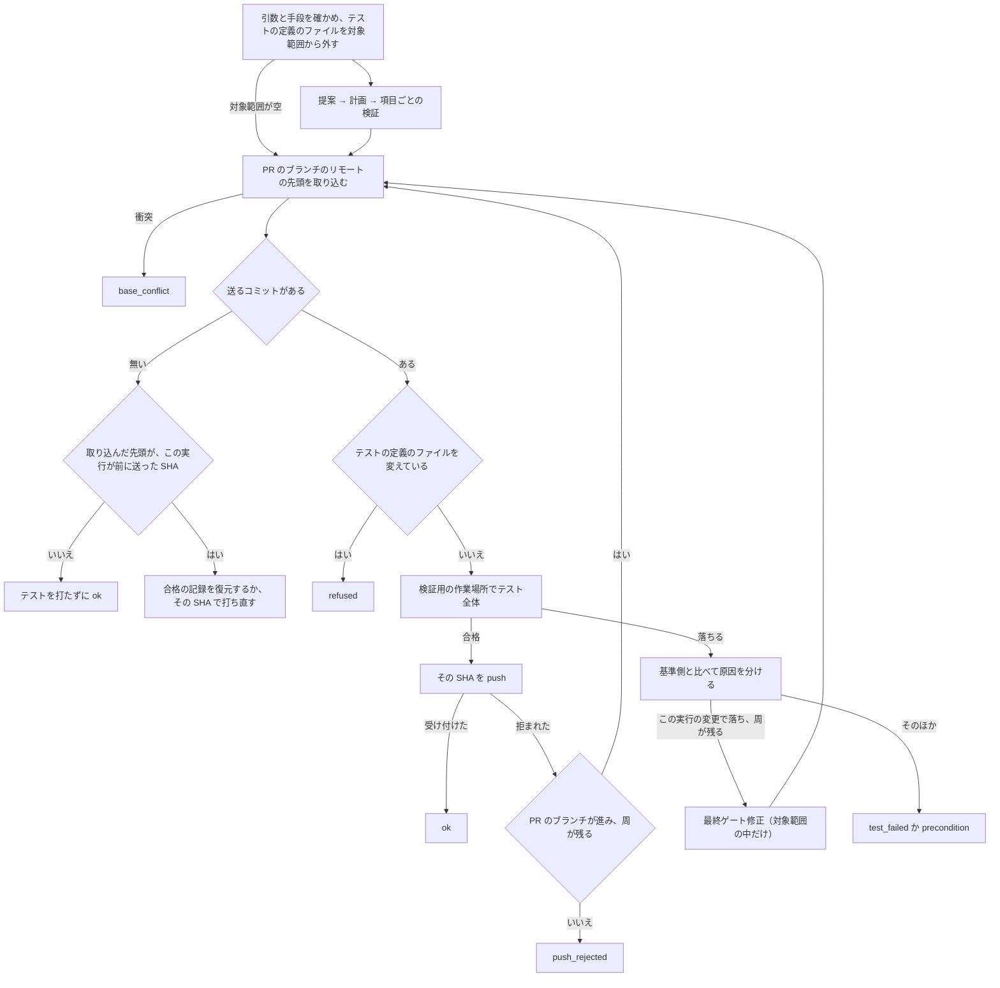

# 工程「リファクタリング」の実行条件と、手元のテストで合否を決める最終ゲート

## 概要

**工程「リファクタリング」は、差分にコードのファイルがあり、テストを確かめる手段があるときに実行する。** 手段は「必須のチェック」「手元のテスト」「無し」の 3 通りで、設定（`.ndf/project.json`）から毎回求める。CI テストの設定（`test.ci.only`）の有無だけでは決まらない。

- 手段が必須のチェックなら、`ndf refactor run --required <チェック>...` を起動し、最終ゲートは CI を待つ
- 手段が手元のテストなら、`ndf refactor run --local-test` を起動する。最終ゲートは、変更が残ったときにテスト全体を手元で打ち、合格したコミット（SHA）だけを PR のブランチへ push する
- 手段が無ければ、コードを変えずに工程を飛ばし、理由 `条件 tests_verifiable が偽` を進捗記録に残す

工程を止めたいリポジトリは、今ある設定 `workflow.stages` で無効にする。

対象の Issue: CI テストの設定が無いリポジトリでもリファクタリングを通す（ https://github.com/devbasex/ai-plugins/issues/4566 ）。

## 用語

「テストを確かめる手段」の定義は用語集の [NDF の CI とテスト](../glossary/ndf-ci-test.md) にある。この文書では次の語も使う。

| 語 | 意味 |
| --- | --- |
| テストの suite | `test.suites` のうち `kind` が `lint` でないもの（`kind` を省けば `test`。`ndf.testing.weight.is_test_suite`） |
| 担当 | `ndf refactor run` が起動して、改善の提案・実装・修正をさせる AI |
| 対象範囲 | `--scope` で渡す、この実行で直してよいファイル |
| 最終ゲート | 全項目の後に、テストの合否を確かめて終える段階 |
| 最終ゲート修正 | 最終ゲートでテストが落ちたときに担当が直すこと |
| 検証用の作業場所 | テスト全体を打つためだけに、NDF が対象のコミットから毎回新しく作る git の worktree |
| 取り込んだ先頭 | リモートから取得した、PR のブランチ（`--branch`）の最新のコミット |
| 基準側 | 取り込んだ先頭だけの状態。この実行がまだ送っていないコミットを載せない |
| 周 | 取り込み → テスト全体 → push か直し、までを 1 回とした単位。1 回の実行で `--max-fix` + 1 回（既定 3 回）まで |
| 送る | 合格したコミットを PR のブランチへ push すること。AI やサービスへ内容を渡すことは「外部へ送る」と書く |

## 背景

工程「リファクタリング」は、CI テストの設定があるリポジトリでだけ実行されていた。この工程は、リファクタリングが 2 回続けて時間の上限で打ち切られたために全リポジトリで外され（ https://github.com/devbasex/ai-plugins/issues/3051 ）、テストを CI で走らせる仕組み（ https://github.com/devbasex/ai-plugins/issues/3056 ）を入れたときに、CI テストの設定があるリポジトリに限って戻された。そのため、設定の無い利用先では、手順書の「差分にコードがあれば必ず通す」整理が一度も行われなかった。

条件を外すだけでは足りない。`ndf refactor run` は必須のチェックの名前を 1 つ以上求め、最終ゲートも CI を待つ。必須のチェックが無いリポジトリでは起動が組めない。また、必須のチェックの読み取り（`ndf.adapters.ci.read`）は名前が 0 件だと「通った」を返すので、引数を緩めるだけでは何も確かめずに合格する。

設計で決めたことと理由は次のとおりである。

| 決めたこと | 理由 |
| --- | --- |
| 実行条件の語を `ci_declared` から `tests_verifiable` へ置き換える | 手段の無いリポジトリを、今の仕組みで「飛ばした」と記録できる。`ndf refactor run` の中で何もせず終えると「完了」と記録され、飛ばしたことと区別できない |
| CI テストの設定があり必須のチェックが無いリポジトリは、手段「無し」として飛ばす | PR に付いたほかのチェックは利用者が合否の基準に定めたものではなく、通っても「テストに合格した」と読めない |
| 手元の経路は `--local-test` で明示する | `--required` を省けるだけにすると、指定の漏れが黙って手元の経路になる |
| 最終ゲートはテスト全体を打ち、項目ごとは対応するテストのまま | 手元の経路のリポジトリには、後で壊れを拾う必須のチェックが無い。項目ごとにテスト全体を打つと、項目の数だけ所要が増える |
| テスト全体は、変更が残ったときに初めて打つ | 提案の前にも打つと、採る項目が無い実行と合格する実行の両方で 1 周増える |
| 合格した SHA だけを、強制せずに push する | CI の経路の送信（`final_gate.send`）は送る直前に取り込み直すので、テストしていないコミットが送られうる |
| 古い語 `ci_declared` の値を求める処理を残す | 更新の前に作ったスプリントは、工程の定義のコピーにこの語を持つ。消すと「条件を求める手段が無い」で止まる |

必須のチェックが無いリポジトリでは、スプリントが手前の工程（設計から先のプランの組み立て）で止まる。この不具合は https://github.com/devbasex/ai-plugins/issues/4472 で扱う。直るまでは、手元の経路は `ndf refactor run --local-test` を直接打つ場合にだけ通る。

## 対象範囲

- 当たるモードは `standard` と `legacy-refactor` である。`light`・`operation`・`documentation` は工程「リファクタリング」を持たない
- CI テストの設定がほかの場面で持つ意味（実装やまとめた検証のプランが手元のテストを持たないこと、手元のテストを止める hook など）は変えない
- まとめた検証のプラン（テンプレート `check.json`）は手元の経路に対応しない（「エラー処理」）
- 項目ごとの検証（`domains/crossrefactor/verify.py`）は変えない。CI テストの設定が無いリポジトリでは対応するテストを手元で打ち、静的解析は設定の有無によらず打つ

## 仕様

### テストを確かめる手段

手段は `ndf.testing.means.decide` が決める。工程の条件の語、既定の起動の組み立て、`ndf refactor run` の引数の確かめは、すべてこの関数を通る。判定は上の行から順に当てる。

| 必須のチェック（`ci.required_checks`） | CI テストの設定（`test.ci.only`） | `command` を持つテストの suite | 手段 |
| --- | --- | --- | --- |
| 1 件以上 | 問わない | 問わない | 必須のチェック |
| 0 件 | 真 | 問わない | 無し |
| 0 件 | 偽か無し | 1 件以上 | 手元のテスト |
| 0 件 | 偽か無し | 0 件 | 無し |

手段が必須のチェックのとき、工程の完了の条件は「指定したチェックがすべて通る」である。チェックの名前から中身は分からないので、最終ゲートの記録と結果の要約には通ったチェックの名前を載せ、「テストに合格した」とは書かない。テスト全体を最終ゲートで確かめたい利用者は、テストのチェックを `ci.required_checks` に含める。

### 常に成り立つ条件

| # | 条件 | 破れそうなときの扱い |
| --- | --- | --- |
| I1 | 工程の条件と起動の組み立ては、同じ関数で手段を決める | 手段が無ければ理由を記録して飛ばす |
| I2 | 合否の確かめ先が決まらない実行では、担当の起動・コードの変更・最終ゲートの合格のどれも行わない | 提案の前に `invalid` を返す |
| I3 | 手元の経路で PR に送るのは、テスト全体に合格した SHA だけである。そのコミットまでに、この実行はテストの定義のファイルを変えていない | 直しの上限で通らなければ `test_failed`、定義のファイルを変えていれば `refused` で、どちらも送らない |
| I4 | 必須のチェックがあるリポジトリでは、テスト全体を手元で打たない | `--local-test` を `invalid` で断る |
| I5 | CI テストの設定があるリポジトリでは、テストを手元で打たない | `--local-test` を断る。項目ごとの検証は静的解析の suite だけを打つ |

### 工程の実行条件と起動

工程の定義 `contracts/workflow/stages/refactor.json` の `when` は `["code_in_diff", "tests_verifiable"]` である。`tests_verifiable` の値は `ndf.progress.command.facts_of` が「手段が無しでない」で求める。順は `code_in_diff` が先なので、文書だけの差分はその語で飛ぶ。

工程の設定と起動の指定は、次の表を上の行から順に当てる。

| 工程の設定（`workflow.stages`） | 起動の指定（`workflow.launch.refactor`） | 手段 | 結果 |
| --- | --- | --- | --- |
| 無効 | 問わない | 問わない | 実行しない。設定の `reason` が行に残る |
| 指定なし | 問わない | 無し | 飛ばす（指定があっても打たない） |
| 指定なしか有効 | あり | 上の行に当たらないもの | 指定した起動を打つ |
| 指定なしか有効 | なし | 必須のチェックか手元のテスト | 手段から起動を組む（`ndf.progress.refactor_values._default_launch`） |
| 有効 | なし | 無し | 起動が組めず `precondition` で停止する |

既定の起動の組み立ては [ndf-stage-plan-work-prompts.md](ndf-stage-plan-work-prompts.md) の「リファクタリングの既定の起動」にある。

### `ndf refactor run` の引数

`--required <チェック>...` と `--local-test`（値を持たない）のどちらか 1 つが必須である。argparse の「どちらか 1 つ必須」は使わず、`cli._check_gate` が確かめる。argparse の失敗は結果 JSON を出さずに終わるためである。

| 設定の手段 | `--required <名前>...` | `--local-test` |
| --- | --- | --- |
| 必須のチェック | 受ける。引数の名前のチェックを待つ | `invalid` |
| 手元のテスト | 受ける。引数の名前のチェックを待つ | 受ける |
| 無し | 受ける。引数の名前のチェックを待つ | `invalid` |

待つチェックの名前は常に引数から決まり、指定したチェックが現れなければ合格にしない（`missing`）。手元のテストのコマンドは引数で渡さず、PR の先頭の設定から読む（「合格をコミットに結び付ける条件」）。

手元の経路は `--pushed-out <ファイル>`（任意）で、呼び出し元の worktree を合わせる先の SHA を書き出す。CI の経路ではこの引数を無視する。

### 手元の最終ゲートの流れ

手元の経路の処理は `ndf.domains.crossrefactor.local_gate` にある。CI の経路は `final_gate.py` のままである。



- **送るコミットが無い実行は、テストも検証用の作業場所の作成も行わない。** 最終ゲートの記録と結果の要約に「変更が無いのでテストは打っていない」と残して完了する。元から落ちるテストは、この場合は検出しない
- **取り込みは 1 周に 1 回だけ取得する。** `core.converge.worktree.sync_fetched` に取得済みの先頭を渡す。リモートの先頭が担当の作業場所（`rf<PR>/work`）の `HEAD` の祖先でないときだけ、この実行のコミットを `cherry-pick` で載せ直す。祖先なら触れないので、中断の後に打ち直しても SHA が変わらず、合格の記録が使える
- **push は `git push <リモート> <SHA>:refs/heads/<ブランチ>` で、強制しない。** 合格の後、push の前には取り込み直さない。push の直前に、送る SHA と合格の組を状態ファイルに保存する。完了の記録の前に中断しても、再開で取り込んだ先頭がその SHA なら「合格して送った」結果を復元する
- **push が拒まれたら、リモートの先頭が取り込んだ時点から変わったかで理由を分ける。** 文面は読まない。変わっていれば並行の更新なので、周が残れば取り込みからやり直す。変わっていなければ認可やブランチの保護による拒否なので `push_rejected` で停止する

### 落ちた原因を分ける

テストが落ちたら、基準側の結果と suite の単位で比べてから、直すか止めるかを決める。NDF はテストの出力を解析しないので、比べるのは終了コードだけである。

基準側の結果は次の順に見つける。「組」は SHA、テストの設定の識別値、環境変数 `PATH` の値の SHA-256 の 3 つである。

1. 取り込んだ先頭の組が合格の記録にあれば、全 suite 合格として扱う。変更後に 126・127 を返した suite があるときは、この起動で記録した合格だけを使う
2. 組が、この起動で作った基準側の不合格の記録にあれば、それを使う。前の起動の不合格の記録は使わない。利用者が直した環境を確かめ直すためである
3. どちらでもなければ、取り込んだ先頭だけをテストして記録する

比べ方は次の表を上の行から順に当てる。基準側の結果が要るのは、次の周が残るときと、変更後に 126・127 を返した suite があるときだけで、どちらでもなければ確かめずに `test_failed` で停止する。

| 基準側と変更後の比較 | 扱い |
| --- | --- |
| 変更後に 126・127 を返した suite が、基準側でも 126・127 を返す | 環境かコマンドの設定の問題として `precondition`。担当は起動しない |
| 変更後に落ちた suite が、すべて基準側でも落ちる | `test_failed`。直さない。理由に両方の suite の並びと「この実行の変更が新しい失敗を足したかは確かめていない」ことを載せる |
| 基準側で合格した suite が変更後に落ち、次の周が残る | 最終ゲート修正へ進む。指示文にはその suite だけを載せ、原因が未確定であることを伝える |
| 基準側で合格した suite が変更後に落ち、周が残らない | `test_failed`。担当は起動しない |

プロセスを起動できない（`OSError`）ときは、比べずに `precondition` で停止する。

### テストを打つ場所

- テスト全体は、毎回、対象の SHA から新しく作る検証用の作業場所で打ち、打ち終えたら取り除く。作る前にパスを状態ファイルに記録し、作った後に NDF の git worktree lock を掛ける
- `--work` に渡された利用者の作業ツリーは、リポジトリを特定して設定を読むためだけに使う。そこではテストを打たず、ファイルを消さない
- 前のテストのビルド成果物は持ち越さない。依存の取得やビルドは、テストのコマンドが毎回用意する
- テストの後、作業場所の `HEAD` が対象の SHA のままで、追跡ファイルに変更が無いことを確かめる。満たさなければ `precondition` で停止する。未追跡の生成物は問わない
- 中断で残った作業場所は、PR の排他ロックを取れた実行だけが取り除く。lock が無いものと NDF の lock のものは取り除き、利用者が掛けた lock のものは残す

### 合格をコミットに結び付ける条件

テストの設定（`test.suites`・`test.protected_files`）は、この実行のコミットを含まない側の `.ndf/project.json` から読む（`local_gate.settings_at`）。担当を起動する前は着手時の PR の先頭、push の前は取り込んだ先頭である。この実行は設定を変えて保護を外せない。`.ndf/project.json` がコミットに含まれないリポジトリでは `--work` の設定を使う。読んだ設定で手段が手元のテストでなくなれば、push せずに `precondition` で停止する。

#### テストの定義のファイル

この実行の変更は、自分を合格させる基準にならない。次のファイルを、担当を起動する前に対象範囲から外し（`protected_decide.narrow`）、push の前にも変えていないかを照合する。

| 種類 | 当てるもの |
| --- | --- |
| NDF の設定 | `.ndf/` の下 |
| テストの suite が名指しするパス | `command` と `scope_command` の語を、作業場所のルートからの相対パスに正規化したもの。リダイレクト先と `--config=path` の `=` の後ろも含む。ツリーにまだ無いパス、親のディレクトリをファイルかリンクに置き換える変更、シンボリックリンクとリンク先も当たる |
| `PATH` の相対の要素から解決されうるファイル | `PATH` にリポジトリの中を指す相対の要素（空と `.` はルート）があれば、その下の、`/` を含まない語と同じ名前のパス |
| 利用先が宣言したファイル | `test.protected_files` のファイルかディレクトリ。当て方は suite の `paths` と同じ（`ndf.testing.scoped.in_scope`） |
| 決まった名前（どの階層でも） | `protected_decide.PROTECTED_NAMES`。`package.json`・`pyproject.toml`・`Makefile` などの依存とテストの定義と、`conftest.py`・`jest.setup.*` などテストランナーが自動で読むファイル |

- パスとリンクは、作業ツリーではなく PR の先頭のツリーで解決する。push の前の照合は `git diff --name-only --no-renames` で、削除したパスと改名前のパスも照らす
- テストのコマンドが `--work` の配下を絶対パスで指せば、`precondition` で停止する。そのパスは検証用の作業場所ではなく `--work` のコードを指すためである
- 外した結果、対象範囲が空になれば、担当を起動せずに取り込みへ進み、変更が無い実行として完了する
- 再開のたびに、取り込んだ先頭の設定から保護を求め直す。この実行の作業コミット（状態ファイルの「載せ直しの起点」から `HEAD` まで）が保護に当たれば、担当を起動せずに `refused` で停止する。範囲がすべて保護に当たる未実装の項目は、理由「保護するファイルになった」を付けて見送る

### テストの打ち方と時間の上限

- テスト全体は、テストの suite の `command` を設定の順にすべて打つ（`local_gate.run_suites`）。1 つでも落ちるか時間の上限を超えれば不合格である
- 起動では、判定に使った suite の宣言を `ndf.testing.slots.run_command` へ渡す。設定がコミットに無いリポジトリでも、重いテストとしてテストのスロットを取るためである
- suite 1 つの上限は、`test.local_total_minutes` が無ければ方針 `test-run.test` の秒数（今の値は 900 秒）である。あれば方針の秒数を使わず、累計の残りだけを掛ける
- テスト全体の実行の累計の上限は、`test.local_total_minutes`（分）があればその値、無ければ安全網の上限（`--safety-net-minutes`。既定は実装の予算の 2 倍）である。1 回の起動ごとに 0 から数え、状態ファイルに持ち越さない
- 累計に足すのは suite のコマンドが動いていた時間だけで、スロットの待ち（`slots.waited_since`）は引く
- 残りが尽きれば `fix_limit` で停止する。`fix_limit` は自動では打ち直さない。利用者が `ndf progress retry` を打てば、項目・作業コミット・合格の記録を引き継ぎ、新しい上限で最初の suite から打つ

## データ・設定

### 設定のキー

足したキーはどちらも任意で、書かなくても動く。形は `contracts/schemas/ndf-settings/project.schema.json` にあり、`skills/development-workflow/schemas/project.schema.json` はそのコピーである。

| キー | 型 | 意味 | 読み先 |
| --- | --- | --- | --- |
| `test.protected_files` | 文字列の並び（既定は空） | 手元の経路がこの実行で変えないテストの定義のファイルかディレクトリ | PR の先頭の設定（合否の基準なので） |
| `test.local_total_minutes` | 正の数か null（分） | 手元の最終ゲートのテスト全体の累計の上限。書けば suite 1 つの上限も累計の残りだけになる | `--work` の設定（合否の基準ではないので、コミットせずに直しても次の起動から効く） |

```json
{"test": {"protected_files": ["package-lock.json", "tests/support"], "local_total_minutes": 240}}
```

工程を止める設定の形は今のままで、`reason` が必須であり、新しく作るスプリントから効く。

```json
{"workflow": {"stages": {"リファクタリング": {"enabled": false, "reason": "手元のテストが重い"}}}}
```

### 手段の値

`ndf.testing.means.Means` は保存しない値で、`kind`（`required_checks`・`local_test`・`none`）、`required`、`suites`、`declarations`、`commands`、`digest`、`protected` を持つ。`digest`（テストの設定の識別値）は、テストの suite ごとの `name`・`command`・`scope_command`・`paths` を設定の順に並べた JSON の SHA-256 である。

### 状態ファイル

再開と、完了した結果の再利用は、状態ファイルに記録した引数の並びと今の引数の並びを比べて決める。

| 経路 | 記録する並び（この順） |
| --- | --- |
| CI（`--required`） | 起点、対象範囲、`--required` と名前、`--ci-test` と名前、`--symbols`、`--participants`、`--max-fix`、`--budget-minutes`、候補があれば `--candidates-sha256` |
| 手元（`--local-test`） | 起点、対象範囲、`--local-test`、`--symbols` 以降は CI の経路と同じ |

- テストの設定は引数の並びに入れない。設定を直した利用者が、採った項目と作業コミットを残したまま続けられるようにするためである。設定が変わって無効になるのは合格の記録だけである
- 合格の記録は「組」（SHA・識別値・`PATH` の SHA-256）を持つ。`PATH` の値そのものは保存しない
- 完了した結果の再利用は、手元の経路では、PR のブランチのリモートの先頭が完了のときの SHA と同じで、引数の並びが同じで、テストを打った実行では組が今の値と一致するときだけである。テストを打たずに完了した実行は、先頭と引数だけで決める
- 新しいキーの一覧は `ndf.domains.crossrefactor.store` のモジュールの説明にある

### ログと保存先

| 情報 | 保存する所・渡す先 |
| --- | --- |
| suite の呼び名、終了コード、起動できないときのエラーの型名 | 結果 JSON、状態ファイル、PR のコメント、標準出力と標準エラー |
| コマンドと出力の全文（伏せ字にする） | `rf<PR>/logs/` のログ。`logs/` は 0700、ファイルは 0600 で作る。外部へ送らない |
| 最終ゲート修正の指示文に載せる抜粋 | 修正担当の AI（「セキュリティ」） |

- suite の呼び名は `#<設定の順番> <名前の先頭の 100 文字>` で、名前が伏せ字の判定に当たれば `#<順番>` だけにする
- 手元の最終ゲートのログは、方針 `cross-refactoring.gate-log.keep`（2,592,000 秒 = 30 日）を過ぎると、次の `ndf refactor run` か `ndf refactor release` が消す。消すのは状態ファイルの `gate_logs` に記録があり、`st_dev` と `st_ino` が記録と一致するファイルだけである
- 状態ファイルは、`release` が `rf<PR>/` の下の worktree をすべて外し、`gate_logs` も空になった時点で消す。worktree が残れば再開のための記録を変えない
- 環境変数 `NDF_WORKTREE_BASE` で保存先を共有するときは、PR の作業場所を `<保存先>/repo-<キー>/rf<PR>/` に置く。キーは git の共通ディレクトリの実パスの SHA-256 の先頭 16 文字である。持ち主を確かめられた前の版の `<保存先>/rf<PR>/` はそのまま使う
- 同じ PR の `run` と `release` は、`<親>/locks/rf<PR>.lock` の排他ロック（`filelock`）を待たずに取る（`workspace.hold_pr`）。ロックファイルは `rf<PR>/` の外に置き、消さない

## 外部連携

### 工程のプラン

テンプレート `contracts/templates/cross-refactoring.json` は、`refactor` → `follow` → `push` → `fix-push` の順にステップを持つ。`follow` の中身は `contracts/templates/parts/steps.json` にある。`ndf.core.route` は、起動の引数に `--local-test` があるかで次のように組む。

| 経路 | 外すステップ | `refactor` のステップの扱い | 残る遷移 |
| --- | --- | --- | --- |
| CI | `follow` | 今のまま（`on_cause.incomplete` は `push`） | `refactor` → `push` → 終了。`push` の失敗は `fix-push` → `push` |
| 手元 | `push`・`fix-push` | `--pushed-out {state_dir}/pushed-sha` を足し、`on_cause.incomplete` を消す | `refactor` → `follow` → 終了 |

`follow`（`ndf refactor follow --pushed {state_dir}/pushed-sha --branch ... --remote ...`）は何も送らず、呼び出し元の worktree を `refactor` が記録した SHA へ早送りするだけである。記録する SHA は、最終ゲートの結果が `passed` なら合格して送った SHA、`skipped` なら取り込んだ先頭である。

- 呼び出し元の `HEAD` がすでにその SHA なら、取得も merge もせずに終える
- 違えば、その SHA のコミットが手元に無いときだけ取得し、`git merge --ff-only --no-overwrite-ignore <SHA>` を打ち、`HEAD` がその SHA と一致することを確かめる。`git merge --ff-only` は、呼び出し元が指定の SHA より先にあると `HEAD` を動かさずに成功するためである
- 早送りできないか一致しなければ `precondition` で停止する

### CI の経路

最終ゲートは必須のチェックを待つ。手元でテストを打つかは引数でなく設定（`test.ci.only`）で決め、CI テストの設定があれば `--ci-test` を省いても手元でテストを打たない。`--ci-test` は、落ちた CI のチェックがテストかを見分けるだけに使う。最終ゲートの記録には、通ったチェックの名前を載せる。

## エラー処理

| 場面 | 停止理由 |
| --- | --- |
| `--required` と `--local-test` の両方・どちらも無し、`--local-test` と `--ci-test` の併用、「`ndf refactor run` の引数」の表の `invalid` | `invalid`（担当を起動しない） |
| `--local-test` で設定を読めない | `precondition` |
| 終わりのテスト全体が直しの上限でも落ちる、変更後に落ちた suite がすべて基準側でも落ちる | `test_failed` |
| 1 回の起動の中で、テスト全体の実行の累計が上限に達する | `fix_limit` |
| この実行のコミットがテストの定義のファイルを変える、最終ゲート修正が対象範囲の外を変える | `refused`（push しない） |
| 同じ PR の別の `run` か `release` が動いている（CI の経路も同じ） | `precondition`（何も変えない） |
| 取り込んだ先頭の設定で手段が手元のテストでなくなる、テストのコマンドが `--work` の配下を絶対パスで指す | `precondition`（push しない） |
| プロセスを起動できない、または 126・127 を返した suite が基準側でも 126・127 を返す | `precondition`（担当を起動しない） |
| テストが追跡ファイルを書き換えた、または `HEAD` を動かした | `precondition` |
| `follow` で呼び出し元の `HEAD` を記録した SHA にそろえられない | `precondition` |
| 起動の引数に `--local-test` があるのに、まとめた検証のプラン（`check.json`）を組もうとする | `precondition`（プランを組まない） |
| `--pushed-out` の出力先がシンボリックリンク・ディレクトリ・SHA 1 行でない既存のファイル | `precondition`（変えない） |
| `--branch` のリモートの先頭を取り込むと衝突する | `base_conflict` |
| push の拒否で、PR のブランチが進んでいない、または周が残らない | `push_rejected` |

工程が停止すると、工程の行は失敗として記録され、スプリントは次の工程へ進まない。利用者は原因を直して `ndf progress retry` で打ち直すか、`ndf progress disable` で工程を外す。

再開で保護に当たって `refused` になった場合の復旧は 2 通りある。`ndf refactor release --pr <番号>` で片付けて打ち直すと、採った項目と作業コミットを捨てて新しい保護の範囲で最初からやり直す。広げた `test.protected_files` を戻して打ち直すと、採った項目と作業コミットを残したまま続く。

## セキュリティ

**テストのコマンドと出力は、伏せ字にしてからログに書き、指示文には伏せ字の後に上限で切った抜粋だけを載せる。** 修正担当の AI は NDF と同じユーザーで動き、内容を外部の LLM のサービスへ送るので、ログの権限では担当から隠せないためである。

| 指示文に載せる項目 | 上限（落ちた suite 1 件あたり） |
| --- | --- |
| suite の呼び名 | 名前の先頭の 100 文字 |
| 終了コードか時間切れの別 | — |
| コマンド | 先頭の 500 文字 |
| 出力（標準出力と標準エラー） | 末尾の 100 行、かつ 8,000 文字 |

- 指示文全体は UTF-8 で 60,000 バイト以下にする（`prompt_decide.PROMPT_BYTES`）。指示文は担当の CLI へ 1 つの引数で渡るためで、収まらない suite は件数だけを知らせる
- 伏せ字は切る前の全文に掛ける（`local_gate.redact_output`）。`ndf.adapters.run_log.redact` と `ndf.domains.project.secret.redact` の判定を使い、複数行の秘密鍵（`PRIVATE KEY` を含む `-----BEGIN` の行から `-----END` の行まで）は、行ごとの伏せ字の前に原文から伏せる
- 形に当たらない認証情報と手元の設定の値は伏せられない。指示文に載せる経路だけを止めるには `workflow.launch.refactor` に `--max-fix 0` を付けた起動を書く。担当の AI に手元の内容を渡したくなければ `workflow.stages` で工程を無効にする
- テストは隔離せず、NDF を動かすシェルの環境変数のまま打つ。テストが検証用の作業場所の外へ書くことや、担当がテストを打ち直して伏せていない内容を読むことは防げない
- 検証用の作業場所は `git worktree remove --force` で取り除く。対象は NDF が作って状態ファイルに記録したパスだけで、利用者が lock を掛けたものは残す

## 運用

- CI テストの設定が無く手段があるリポジトリでは、`standard`・`legacy-refactor` のスプリントに工程が 1 つ増え、所要・LLM の token・マシンの負荷が増える。増やしたくないリポジトリは `workflow.stages` で無効にする
- 作ったばかりの作業場所でテストが通らないリポジトリ、着手前から落ちるテストがあるリポジトリは、提案と実装の費用を使った後で最終ゲートで停止する。繰り返す場合は `workflow.stages` で無効にする
- テスト全体の 1 周がいつも上限より長い場合は、`test.local_total_minutes` を書いてから `ndf progress retry` を打つ
- 担当の出力ログには期限が無く、`rf<PR>/logs/` に残る（期限を付ける Issue: https://github.com/devbasex/ai-plugins/issues/4614 ）
- 必須のチェックが無いリポジトリでスプリントが自動でこの工程まで進むのは、 https://github.com/devbasex/ai-plugins/issues/4472 を直した後である

### 未確認のまま残ること

| 項目 | 内容 |
| --- | --- |
| 利用先での実行 | 項目ごとの手元の検証と手元の最終ゲートを、CI テストの設定が無い実機のリポジトリで通していない |
| 時間の上限が足りるか | suite 1 つが 900 秒を超える利用先と、累計が安全網の上限を超える利用先の有無は、使われるまで分からない |
| `PATH` 以外の環境の変化 | 同じ `PATH` で実行ファイルの中身を入れ替えた場合や、ほかの環境変数を変えた場合は、合格の記録を無効にしない |
| 表に当たらないテストの定義のファイル | 名指しされたスクリプトがさらに読むファイル、一覧に無い名前の支援コードは、`test.protected_files` に宣言しなければ検出しない |
| テストが作業場所の外を読み書きする場合 | 変数で組むパスやテストのプログラム内部のアクセスは検出しない |

## テスト観点

| 観点 | 縛る振る舞い |
| --- | --- |
| 実行条件 | CI テストの設定が無い・`false` で必須のチェックがあれば、`standard` と `legacy-refactor` の工程が飛ばされず `--required` の起動が組まれる。CI テストの設定と必須のチェックがあれば、手元でテストを打たない |
| 手段の判定 | 手段の表の 4 行。`kind` を省いた suite だけの設定で手元のテストになる。条件の値が真のときは起動が組まれる |
| 手段が無い | 行が飛ばされ、理由 `条件 tests_verifiable が偽` が残り、次の工程へ進む。CI テストの設定があり必須のチェックが無いときも同じで、`--local-test` は断られる |
| 工程の設定 | 無効なら理由が行に残り、有効なら定義の条件を見ずに始まる。文書だけの差分は飛び、`light`・`operation`・`documentation` に工程が無い。古い語 `ci_declared` の定義でも止まらない |
| 起動の優先順位 | 優先順位の表の 5 行。工程を有効にし、必須のチェックが空で、起動の指定にチェックの名前を書いた設定では、指定した起動が打たれる |
| 引数 | 両方・どちらも無し・`--ci-test` との併用・手段との不一致で、担当を起動せず `invalid`。`--required` は手段に関わらず受け、引数の名前を待つ |
| 手元の合否 | テストが通れば合格した SHA を push して `ok`、落ちて直せなければリモートの先頭を変えずに `test_failed`。変更が残らなければテストも作業場所の作成もせずに `ok` で、要約に打っていないことが載る |
| テストの定義のファイル | 表の各種類が対象範囲から外れ、変えれば `refused`。削除・改名・リンク先の変更、ツリーに無いパスへの新設、`./` 付きの表記、`--work` の未コミットの設定で宣言を消した場合も保護が残る。`--work` を指す絶対パスは `precondition` |
| 取り込みと push | 載せ直しが要る周でも取得は 1 回。先頭が変わらなければ SHA が変わらず、合格の記録を使う。PR のブランチが進んだ拒否はやり直し、進まない拒否はすぐ `push_rejected` |
| 中断と再開 | push の後・完了の記録の前に中断すると、合格して送った結果を復元する。設定か `PATH` が変われば、その SHA で打ち直す。最終ゲートで止まった実行は提案と実装をやり直さない。保護を広げて再開すると、未実装の項目が絞られ、作業コミットが当たれば `refused` と復旧の手順 |
| 原因の分離 | 比較の表の 4 行。基準側を記録から使っても打っても同じ比べ方。前の起動の不合格の記録は使わない。別の suite の 126・127 では止まらない |
| 作業場所と排他 | テスト全体は新しい検証用の作業場所で打ち、`--work` の未追跡ファイルは残る。ロックが取られていれば何も取り除かずに `precondition` |
| 時間の上限 | 設定が無ければ方針の秒、あれば累計の残りだけ。スロットの待ちを数えない。尽きれば `fix_limit` で、打ち直すと累計は 0 から |
| 秘密とログ | 結果 JSON・状態ファイル・PR のコメントにコマンドと出力が現れない。指示文の上限と伏せ字（境で切れるトークン、複数行の秘密鍵）。ログの権限 0700・0600、ハードリンクの元のファイルを変えない。30 日を過ぎた記録のあるログだけを消す |
| プラン | `--local-test` のプランは `refactor` の直後が `follow` で、`push`・`fix-push` を持たない。CI の経路は `follow` を持たない。`follow` は記録した SHA へだけ早送りし、無視されたファイルを上書きしない。`check` のプランは組まない |

テストは `plugins/ndf/tests/testing/test_means.py`、`plugins/ndf/tests/domains/crossrefactor/` の `test_local_gate.py`・`test_local_gate_timeout.py`・`test_protected.py`・`test_drive_local.py`・`test_workspace_gate.py`・`test_prompt_decide.py`、`plugins/ndf/tests/progress/test_refactor_condition.py`・`test_invoke_refactor.py`、`plugins/ndf/tests/route/test_refactor_gate.py` にある。

## 関連リンク

- 手順書: [development-workflow の SKILL.md](../../plugins/ndf/skills/development-workflow/SKILL.md)（工程の表の「リファクタリング」の行）、[cross-refactoring の SKILL.md](../../plugins/ndf/skills/cross-refactoring/SKILL.md)
- [ndf-stage-plan-work-prompts.md](ndf-stage-plan-work-prompts.md): リファクタリングの既定の起動
- [ndf-ci-only-tests.md](ndf-ci-only-tests.md): CI テストの設定
- [ndf-review-units-and-refactoring-timing.md](ndf-review-units-and-refactoring-timing.md): レビューの単位とリファクタリングの時機
- [cross-refactoring-verify-and-final-gate.md](cross-refactoring-verify-and-final-gate.md): 項目ごとの検証と CI の経路の最終ゲート
- コマンドの一覧: [commands.md](../../plugins/ndf/docs/contracts/commands.md)
- 用語集: [NDF の CI とテスト](../glossary/ndf-ci-test.md)
