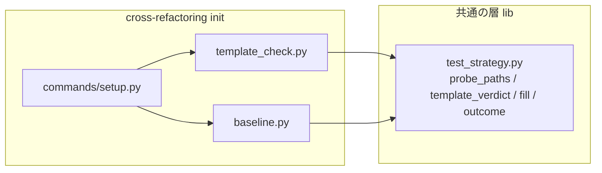

# cross-refactoring: ファイルのパスを受けない範囲テストのテンプレートで改修の範囲テストが毎回落ち、修正のラウンドを使い切っていた → `init` が着手前のテストの後にテンプレートを試走し、受けなければ直す箇所を出して止まる

## 概要

**cross-refactoring の `init` は、着手前のテストの後に、`scope_command` を持つテストの suite ごとにテストのファイルを最大 2 本
`{paths}` へ入れて 1 回走らせる（テンプレートの試走）。** 判定が `ok` の suite だけが続き、不備（`defect`）か判定できない（`undecided`）
の suite が 1 つでもあれば、状態ファイルを作らずに終了コード 4 で止まる。止まるときは当たった suite・今のテンプレート・入れたパス・
直す箇所（`.ndf/project.json` の `test.suites[<番号>].scope_command`）を標準エラーと `<tmp_dir>/template-check.json` に出す。
改修の範囲テストはそもそも走らないため、テンプレートの不備で落ちた項目が修正へ回ることは無い。

あわせて、宣言の契約（`project.schema.json` の `Suite` の説明と、手順 0 の案内 `project-analysis.md` の `test` の行）が、`{paths}` に入る
パスの種類を場所ごとに書く。

例: `scope_command` が `python3 -m unittest discover -s {paths}`、`command` が `python3 -m unittest discover -s tests`、suite の `paths` が
`["tests"]` の宣言（テストは `tests/test_x.py`・`tests/test_y.py`）で `--scope scripts/storylib` の `init` を打つと、着手前の全体テストは通り
（基準 `green`）、試走 `python3 -m unittest discover -s tests/test_x.py tests/test_y.py` が終了コード 1 で落ちて `defect` になる。

```text
⛔ 範囲テストのテンプレートが {paths} に入るテストのファイルを受けません（suite: unit）
   今のテンプレート: python3 -m unittest discover -s {paths}
   入れたパス: tests/test_x.py tests/test_y.py
   試走: python3 -m unittest discover -s tests/test_x.py tests/test_y.py → 終了コード 1（着手前のテストは通り、試走が終了コード 1 で落ちた。着手前のテスト: green）
   直す箇所: .ndf/project.json の test.suites[0].scope_command（{paths} にはテストのファイルのパスが入る。ファイルを受けるコマンドへ直すか、--round-test に {paths} を含まない全体テストを渡す）
   ログ: <tmp_dir>/template-check-0.log
```

**止まり方・終了コードの読み方と、宣言の書き方は Skill と宣言の契約が正である。** ここに書き写さない。

| 何を | 正本 |
| --- | --- |
| 終了コード 4 の理由の並び（テンプレートの試走で止まることを含む） | [`cross-refactoring` の SKILL.md](../../plugins/ndf/skills/cross-refactoring/SKILL.md) の「実行」の終了コードの表 |
| `{paths}` に入るパスの種類と、ファイルを受けないランナー（unittest）の書き方 | `development-workflow` の [references/project-analysis.md](../../plugins/ndf/skills/development-workflow/references/project-analysis.md) の `test` の行と、[`project_lib/model.py`](../../plugins/ndf/scripts/project_lib/model.py) の `Suite` の説明（公開のスキーマ `schemas/project.schema.json` は `project-decl.py schema` で作る） |
| 着手前のテストの上限と手順の枠 | [cross-refactoring-init-test-and-phase-windows.md](cross-refactoring-init-test-and-phase-windows.md) |

この文書が扱うのは、Skill に書かない決定の理由、常に成り立つ条件、判定の表と候補の選び方、記録の形、テスト観点である。

## 用語

定義は [用語集](../glossary.md) が正である（`.ndf/glossary.json` の `document`）。この文書で使う語は「テンプレートの試走」
「範囲テストのテンプレート」「範囲テスト」「着手前のテスト」「既存失敗」「テストの戦略」である。

範囲テストのテンプレートの語（`ndf-workflow`）と試走の判定の規則は `lib/test_strategy.py` の純粋な関数が持ち、cross-refactoring
（`ndf-cross-refactoring`）は走らせて結果を渡すだけにする（顧客 / 供給者の関係）。supervise・`test-run.py` も同じ関数を後から使える。

## 対象範囲

| 扱う | 扱わない |
| --- | --- |
| cross-refactoring の `init` が、改修のラウンドに入る前にテンプレートを試走して止めること | 修正担当が「コード起因の失敗なし・コミットなし」を返しても次のラウンドへ進む振る舞い（#2095） |
| `{paths}` に入るパスの種類を宣言の契約と手順 0 の案内に書くこと | `{paths}` に入れるパスの種類を揃えること（CI に任せる戦略の着手前のテストへファイルを入れるなど。#2096） |
| 試走の記録（`template-check.json` と状態ファイルの `template_checks`） | `scope_command` を持たない suite（`round-only`）と静的解析の suite（`kind: lint`）の範囲テストの組み立て（変えない） |
| | 宣言の検査（`project-decl.py check`）・戦略の解決（`test_strategy.resolve`）の振る舞い（字句の不備だけを見るまま） |

ランナーとテンプレートは宣言（`.ndf/project.json` の `test.suites[].scope_command`）か引数（`--round-test` / `--baseline-test` の
`{paths}` を含む値）で受け、ランナーの名前とコマンドの語は見ない。配布先のリポジトリでも働く。

## 背景

改修の範囲テストは、計画の `test_targets` の `::` より前のパス（テストのファイル）を `{paths}` へ入れて走らせる（`refactor_lib/targets.py` →
`test_strategy.scope_runs`）。範囲テストの成否は終了コードだけで決まり、0・126・127 以外は「落ちた」になる。そのため、テンプレートが
ファイルを受けずに 1 や 5 で終わっても、コードの失敗と同じ扱いで修正へ回った。

takemi-ohama/novel のスプリント world（PR takemi-ohama/novel#58）では、`scope_command` が `python3 -m unittest discover -s {paths}` で、
13 件の改修のうち 9 件が範囲テストで落ち、修正担当が「コード起因の失敗なし」を返すまま修正のフェーズが 10 回以上続いた。回避は
検査のプランの引数へ `--round-test "python3 -m unittest discover -s tests"` を書くことだった。

ランナーによって受けるパスの種類は違い、コマンドの語からは決められない（Python 3.14.4 の手元の実測）。

| コマンド | 結果 |
| --- | --- |
| `python3 -m unittest discover -s tests/test_x.py` | `ImportError: Start directory is not importable`、exit 1 |
| `python3 -m unittest discover -s tests/test_x.py tests/test_y.py` | 2 つ目を開始のディレクトリと読まず、exit 1 |
| `python3 -m unittest discover -s scripts/storylib`（テストの無いディレクトリ） | `NO TESTS RAN`、exit 5 |
| `python3 -m unittest discover -s tests` | exit 0 |
| `python3 -m unittest tests/test_x.py tests/test_y.py` | exit 0 |
| `python3 -m unittest tests`（`__init__.py` の無いディレクトリ） | `NO TESTS RAN`、exit 5 |

## 決定と理由

| # | 決定 | 理由 | 採らなかった案 |
| ---: | --- | --- | --- |
| 1 | 試走の場所を cross-refactoring の `init` にする | テンプレートがファイルを受けるかは走らせるしか分からず、走らせるには作業ディレクトリ・依存・テストのファイルが要る。`init` はそれを用意し、着手前のテストを走らせている | `project-decl.py check` で走らせる（純粋な検査で上限も作業ディレクトリも持たず、手順 0 の度に外部のコマンドが走る）。`test_strategy.resolve` で走らせる（純粋な層で、supervise・`test-run.py`・cross-review の解決にも実行が漏れる） |
| 2 | ファイルの選び方と判定を `test_strategy.py` の純粋な関数（`probe_paths`・`template_verdict`）にし、実行だけを cross-refactoring に置く | 範囲テストの組み立ては `test_strategy.py` に寄せている。同じ層に置けば、ほかの呼び手が後から同じ見分けを使うときに関数を分けずに済む | `refactor_lib/` の中に判定まで置く（Skill ごとに見分けの関数が分かれる） |
| 3 | 着手前のテストの後に走らせ、基準が通ったか既存失敗を除けたときだけ不備とする | 試走の失敗にはテンプレートの不備とコードの既存の失敗の 2 つの原因がありうる。着手前のテストがその suite で通っていれば、落ちる理由はテンプレートにしかない。どちらも成り立たなければ人へ戻す | 着手前のテストより先に試走する（基準が無く、既存の失敗を抱えたリポジトリでいつも取り違える）。判定できないときに続ける |
| 4 | 修正へ回す側には見分けを足さない | 不備か判定できない suite があれば `init` が状態ファイルを作らずに止まるため、改修の範囲テストはそもそも走らない | 検証で落ちた範囲テストを走らせ直して見分ける（項目ごとに走らせ直しが増え、着手前に 1 回で分かることを何度も確かめる） |
| 5 | `{paths}` に入るパスの種類は変えず、契約に場所ごとに書く | 求めるのは「入る種類が分かる」ことと「受けないなら止まる」ことで、揃えなくても満たせる。着手前のテストへ入れるパスを変えると範囲テストの所要の履歴（置き場所ごとの記録）にも効く | 改修の範囲テストと着手前のテストで入るパスを揃える（#2096 に残した） |
| 6 | 候補 0 本・上限の残り 0・打ち切りを `undecided` で止め、「判定しない」で続ける経路を持たない | 続けると、試走していない suite のテンプレートの不備で落ちた項目が修正へ回る経路が残る。候補はリポジトリ全体と suite の `paths` から選び直して試走できる場合を広げ、それでも確かめられないときだけ止める。止める文には直す箇所と `--round-test` の直し方を必ず添え、1 回で続けられるようにする | `skipped` の suite は範囲テストで落ちても修正へ回さない（修正へ回す側に見分けを足すことになり、決定 4 に反する） |
| 7 | 試走の記録を着手前のテストの記録と別の集約にし、持ち主を `template_check.py` にする | 記録を組んで `template-check.json` に書くのは `template_check.py` だけで、`setup.py` は返った値を状態ファイルの `template_checks` へそのまま置く（`baseline_test` と同じ置き方）。書く場所が割れない | `baseline.py` を経由して書く（着手前のテストの実行と記録の責務に、試走の判定と実行が入る） |

## 仕様

### 構成要素と責務

| 要素 | 責務 |
| --- | --- |
| [`lib/test_strategy.py`](../../plugins/ndf/scripts/lib/test_strategy.py) | 純粋な関数と値オブジェクト。`probe_roots(suite)`（`paths` のうち `.` と glob を除いた要素）・`probe_paths`（候補から既存失敗のファイルを除いて最大 2 本（`PROBE_MAX_FILES`）を選び、`ProbePick(paths, source, owned)` を返す）・`template_verdict`（判定の表で `ProbeVerdict(status, reason)` を返す。`stops` は `defect` か `undecided` のとき真）。プロセスもファイルも触らない |
| [`refactor_lib/template_check.py`](../../plugins/ndf/skills/cross-refactoring/scripts/refactor_lib/template_check.py) | 試走の実行と記録（集約「テンプレートの試走の記録」の持ち主）。`targets_of` で対象の suite を選び、`check_templates` が候補を集めて `probe_paths` で選び、`fill` で組んだコマンドをシェルで走らせ、`outcome` と `template_verdict` で判定して `template-check.json` を書く。入口の `enforce` は止める判定なら止める文を出して `die`（終了コード 4）、続けるなら 1 行を出して記録を返す |
| [`refactor_lib/commands/setup.py`](../../plugins/ndf/skills/cross-refactoring/scripts/refactor_lib/commands/setup.py) | `_verify_init` で、着手前のテスト・`init_test` 行の追記・打ち切りの判定の後に `template_check.enforce` を呼ぶ。返った記録を状態ファイルの `template_checks` へそのまま置く |
| [`project_lib/model.py`](../../plugins/ndf/scripts/project_lib/model.py) | `Suite` の説明に、`{paths}` に入るパスの種類を場所ごとに書き、ファイルを受けないテンプレートは `init` が試走で止めることを書く。公開のスキーマはここから作る |



| 集約 | 持ち主（書き換えてよいもの） | 根 | 値オブジェクト |
| --- | --- | --- | --- |
| テストの戦略 | `test_strategy.resolve`（`init` で 1 度解き、以後は状態ファイルの写しを読むだけ） | `Strategy`（エンティティは `Suite`） | `ScopeRun`・`Outcome` |
| 着手前のテストの記録 | `refactor_lib/baseline.py`（変えない） | 状態ファイルの `baseline_test` | suite ごとの成否・既存失敗 |
| テンプレートの試走の記録 | `refactor_lib/template_check.py` | 状態ファイルの `template_checks` と `<tmp_dir>/template-check.json` | suite ごとの入れたパス・結果・基準・判定・直す箇所 |

試走は着手前のテストの記録を読むだけで `baseline_test` を書き換えず、試走の結果でテストの戦略を書き換えない。

### 常に成り立つ条件

| # | 条件 | 破れたときの扱い |
| --- | --- | --- |
| I1 | 試走のコマンドは改修の範囲テストと同じ組み立て（`fill(scope_command, paths)`）で作る。コマンドの語・ランナーの名前を見ない | テストで落とす |
| I2 | 試走は `scope_command` を持つテストの種別の suite ごとに高々 1 回、`init` の 1 回の起動の中で、着手前のテストの上限の残りの中で走らせる。試走の対象の suite は判定が `ok` のときだけ続ける | 上限の残りが 1 秒未満・打ち切り・候補 0 本は `undecided` で止める |
| I3 | 試走に入れるパスはその suite が受け持つテストのファイルを最大 2 本で、既存失敗の ID を持つファイルを除く（下の「候補のファイル」） | 3 つの場所とも 0 本なら `undecided` で止める |
| I4 | 「不備」と判定するのは、候補の受け持ちが確定していて、基準（その suite の着手前のテスト）が通った、または既存失敗を読めて試走のファイルから除けたうえで、試走が落ちたときだけ。受け持ちが未確定の候補で落ちたら基準によらず `undecided` | テストで落とす |
| I5 | 判定が `defect` か `undecided` の suite が 1 つでもあれば、`init` は状態ファイルを作らずに終了コード 4 で止まる。改修の範囲テストは走らない | テストで落とす |
| I6 | 止まるときも続けるときも試走の記録を `<tmp_dir>/template-check.json` に書く。続けるときは状態ファイルの `template_checks` が同じ `suites` の並びになる | テストで落とす |
| I7 | 静的解析の suite（`kind: lint`。`{paths}` に変更したファイルが入る）と `scope_command` の無い suite、戦略 `round-only` は試走しない。範囲テストの組み立て（`scope_runs`）は変えない | 既存のテストで落とす |

### 判定の表（`template_verdict`）

上の行から当て、最初に当たった行の判定を返す。

| 試走の結果 | 候補の受け持ち | 基準（suite の着手前のテスト） | 既存失敗を除けたか | 判定 | `init` |
| --- | --- | --- | --- | --- | --- |
| 走らせなかった（候補 0 本・上限の残りが無い） | — | — | — | `undecided` | 止める |
| `timed_out` | — | — | — | `undecided` | 止める |
| `passed` | — | — | — | `ok` | 続ける |
| `failed` 以外（起動できなかった） | — | — | — | `undecided` | 止める |
| `failed` | 未確定 | — | — | `undecided` | 止める |
| `failed` | 確定 | `green` | — | `defect` | 止める |
| `failed` | 確定 | `red` か `none` | 除けた（JUnit を読めた） | `defect` | 止める |
| `failed` | 確定 | `red` か `none` | 除けない | `undecided` | 止める |

起動の失敗（`launch_failed`）は判定の前に、着手前のテストと同じ `launch.stop(None, …, "baseline", …)` で止まる。

### 候補のファイル（`probe_paths`）

次の順に、最初に 1 本以上見つかった場所から、既存失敗のファイル（`test_triage.by_file`）を除き、並べ替えた先頭から最大 2 本を選ぶ。
2 本にするのは、1 本は受けて 2 本目を受けないテンプレート（`discover -s a b` は 2 本目を開始のディレクトリと読まない）を見分けるためである。

| 順 | 場所 | `source` | 受け持ち |
| --- | --- | --- | --- |
| 1 | `--scope` のテストの置き場所の配下の、テストの名前の形の追跡ファイルを、`suite_groups` と同じ規則（`suite_for`、当たらなければ最初のテストの suite）でこの suite へ振り分けたもの | `scope` | 確定 |
| 2 | リポジトリの追跡ファイルでテストの名前の形のもののうち、`suite_for` がこの suite を返したものだけ（最初の suite へ寄せない） | `repo` | `paths` が `.` か空の suite では未確定、ほかは確定 |
| 3 | その suite の `paths` のうち `.` と glob を除いた要素の配下の追跡ファイル（名前の形を問わない） | `paths` | 未確定 |

- 2 で最初の suite へ寄せないのは、どの suite の `paths` にも当たらない宣言していないテスト（`e2e/login.spec.ts` など）で正しいテンプレートが
  落ち、`defect` で止まるのを防ぐためである。`paths` が `.` か空の suite には `suite_for` が全ファイルを当てるため、そうしたファイルも候補に入り
  受け持ちが未確定になる
- 3 はテストの名前が形（`test_*`・`*_test.*`・`*.test.*`・`*_spec.*`・`*.spec.*`）に当たらないエコシステム（`FooTest.java`・`FooTests.cs`・
  `UserTest.php`・`*.bats`・Rust の `tests/*.rs`）でも、suite がテストの置き場所を `paths` に宣言していれば試走できるようにする。配下にはテストで
  ないファイル（`tests/TestCase.php`・`tests/fixtures/*.json`・`tests/common/mod.rs`）が残りうるため受け持ちは未確定である
- 基準は、`source: scope` ならその suite の着手前のテストの成否、`repo` か `paths` なら着手前のテストがその suite の `command`（全体）で
  通ったときだけ `green` でほかは `none`。既存失敗を「除けた」とするのは `source: scope` で既存失敗を読めたときだけである

### 止めるときの文

suite ごとに 1 段で、「受けません」（`defect`）か「受けるかを確かめられません」（`undecided`）、今のテンプレート・入れたパス・試走の
コマンドと終了コード（走らせていなければ理由）・直す箇所を出す。直す箇所は宣言の suite なら `.ndf/project.json の test.suites[<番号>].scope_command`
（番号が引けなければ `name` で示す）、`--round-test` / `--baseline-test` の雛形の suite（`args`）なら「`--round-test` の値」のように引数の名前で出す。
直し方は判定によらず「ファイルを受けるコマンドへ直す」と「`--round-test` に `{paths}` を含まない全体テストを渡す」を必ず添え、入れたパスが
0 本なら「その suite の `paths` にテストの置き場所を宣言する」も添える。続けるときは標準エラーに
`✅ 範囲テストのテンプレートを試走: <suite>（<入れたパス>）` の 1 行を出す。

## データ・設定

`<tmp_dir>/template-check.json`（状態ファイルの `template_checks` は同じ形の `suites` の並び。旧い状態ファイルでキーが無ければ空の並びとして読む）:

```json
{
  "checked_at": "2026-10-24T12:00:00Z",
  "stopped": true,
  "suites": [
    {
      "suite": "unit",
      "index": 0,
      "fix_at": ".ndf/project.json の test.suites[0].scope_command",
      "scope_command": "python3 -m unittest discover -s {paths}",
      "paths": ["tests/test_x.py", "tests/test_y.py"],
      "source": "repo",
      "owned": true,
      "command": "python3 -m unittest discover -s tests/test_x.py tests/test_y.py",
      "code": 1,
      "outcome": "failed",
      "reference": "green",
      "verdict": "defect",
      "reason": "着手前のテストは通り、試走が終了コード 1 で落ちた",
      "log": "<tmp_dir>/template-check-0.log"
    }
  ]
}
```

| キー | 型 | 意味 |
| --- | --- | --- |
| `stopped` | bool | `init` を止めたか |
| `suites[].index` | int か null | 宣言の `test.suites` の番号。引数の雛形か引けなければ null |
| `suites[].fix_at` | str | 直す箇所 |
| `suites[].paths` | list[str] | 試走で `{paths}` へ入れたパス（0〜2 本） |
| `suites[].source` / `owned` | str か null / bool | 候補を選んだ場所（`scope` / `repo` / `paths`。0 本なら null）と受け持ちが確定しているか |
| `suites[].command` / `code` / `outcome` | str か null / int か null / str | 試走のコマンド・終了コード・`test_strategy.outcome` の結果。走らせなかったら null・null・`not_run` |
| `suites[].reference` | str | 基準（`green` / `red` / `none`） |
| `suites[].verdict` / `reason` | str / str | 判定（`ok` / `defect` / `undecided`）と理由 |
| `suites[].log` | str か null | 試走の出力のログ。走らせなかったら null |

試走が書いた JUnit は、後の手順が前の実行の結果を読まないように試走の後に消す（`test_triage.clear_junit`）。

## 運用

### 既知の限界

| 項目 | 内容 |
| --- | --- |
| 確かめられずに止まる頻度 | テストの名前が形に当たらないエコシステムで suite が `paths` を宣言していない（`.` だけ）ときは、ファイルを受けるテンプレートでも毎回 `undecided` で止まる。`paths` を宣言するか `--round-test` に全体テストを渡せば続けられる。受け持ちが未確定の候補で落ちたときも止まり、`paths` の配下の先頭にテストでないファイルが来る構成では `--round-test` でしか続けられない。どれだけ起きるかは実行で測る |
| CI に任せる戦略での止まり方 | `source` が `repo` か `paths` で着手前のテストが全体を走らせない戦略では基準が `none` になり、JUnit を書かないランナー（unittest の既定）では不備のテンプレートも `undecided` で止まる。直す箇所は出るが、不備と言い切れない文になる |
| 判定できないで止まる頻度 | 着手前のテストが落ち、JUnit を読めず、試走のファイルにコードの失敗があると止まる |
| 再開の経路 | この仕組みより前に作った状態ファイルからの再開は試走を通らない。旧い状態は `template_checks` を空として読む |
| ランナーごとの受け方 | unittest のほかに、ファイルを受けないランナーの実例は確かめていない。見分けは実行の結果だけに依るため、ランナーの種類に依らない |

## テスト観点

試走の実行と `init` の止まり方は `plugins/ndf/skills/cross-refactoring/tests/test_template_check.py`、選び方と判定は
`plugins/ndf/scripts/tests/test_lib_test_strategy.py`（`test_probe_paths_*`・`test_template_verdict_follows_the_table`）にある。

- unittest の `discover -s {paths}` の宣言を持つ再現のリポジトリ（`--scope scripts/storylib`、テストは `tests/`）で `init` が終了コード 4 で止まり、
  状態ファイルが無いこと。戦略ごとの判定: 全体を走らせる戦略で suite が `paths: ["tests"]` なら `defect`、`paths` が `.` か空なら `undecided`。
  CI に任せる戦略では基準が `none` で JUnit を読めないため `undecided`（I5）
- 止まったとき標準エラーと `template-check.json` に suite の名前・今の `scope_command`・入れたパス・`test.suites[<番号>].scope_command` が出ること。
  `undecided` でも `fix_at` を出すこと（I6）。`init` の後の工程へ進めず、修正のラウンドが 0 回であること
- このリポジトリの宣言（pytest の `scope_command`）では試走が `ok` で `init` が続き、`scope_runs` が組むコマンドが変わらないこと（I1）
- 静的解析の suite と `scope_command` の無い suite は試走されず、既存の範囲テストの組み立てのテストが通ること（I7）
- 試走が suite ごとに 1 回で、上限の残りが 0・打ち切りなら `undecided` で止まること（I2）
- 既存失敗のファイルを除き最大 2 本を選ぶこと。`--scope` に無ければリポジトリ全体から `suite_for` がその suite を返したものだけを選び、
  宣言していない `e2e/login.spec.ts` を選ばないこと。名前の形に当たらないテストだけの suite は `paths` の配下から選び、テストでないファイルで
  落ちても `undecided` になること。`paths` が `.` だけなら 0 本で止まり直し方に `paths` の宣言が出ること（I3）
- 判定の表の行どおりの判定を返すこと（I4）
- 続けるとき、状態ファイルの `template_checks` が `template-check.json` の `suites` と一致し、`baseline_test` が試走の前と同じであること（決定 7）
- `project-decl.py schema` の出力と公開のスキーマが一致すること（`test_project_decl.py` の `test_published_schema_matches_the_model`）
- 案内に書いた unittest のコマンドの終了コード（`python3 -m unittest <ファイル> <ファイル>` と `discover -s tests` が 0）は、再現のリポジトリで
  走らせて確かめた。`.md` の文言を照合するテストは書かない

## 関連リンク

- [`cross-refactoring` の SKILL.md](../../plugins/ndf/skills/cross-refactoring/SKILL.md)
- `development-workflow` の [references/project-analysis.md](../../plugins/ndf/skills/development-workflow/references/project-analysis.md)
- [`lib/test_strategy.py`](../../plugins/ndf/scripts/lib/test_strategy.py)・[`refactor_lib/template_check.py`](../../plugins/ndf/skills/cross-refactoring/scripts/refactor_lib/template_check.py)・[`project_lib/model.py`](../../plugins/ndf/scripts/project_lib/model.py)
- [cross-refactoring-init-test-and-phase-windows.md](cross-refactoring-init-test-and-phase-windows.md)（着手前のテストの上限。試走はその残りの中で走る）
- [cross-refactoring-lint-suite-and-ci-coverage.md](cross-refactoring-lint-suite-and-ci-coverage.md)（静的解析の suite の範囲テスト）
- 課題: #1630（由来 takemi-ohama/novel issue #32 / PR #58）。残した主題は #2095（修正のラウンドの止め方）・#2096（着手前のテストへ入れるパスの種類）
