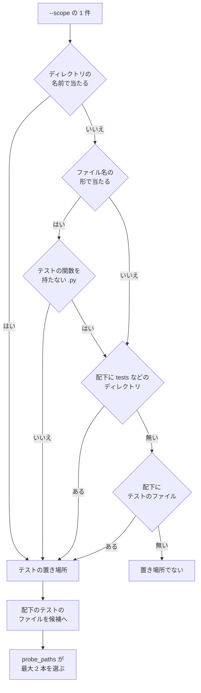

# cross-refactoring: テストのファイルの見分け方（Python は名前の形とテストの関数の定義で決める）

## 概要

**cross-refactoring は、Python のファイルを、名前の形に加えてテストの関数の定義があるときだけテストのファイルとして扱う。** 名前が
`test_` で始まっていても、テストの関数を持たない `.py` はプロダクションコードである。試走の候補・テストの置き場所・プロダクションコードの
行数・危険フラグ・コミットの事実は、同じ見分け方で同じ答えを出す。

例: `plugins/ndf/scripts/lib/test_strategy.py` はテストの関数を持たないプロダクションコードである。このファイルを変える Pull Request で
`refactor-scope.py` の出力を `--scope` に渡しても、`init` はこのファイルを範囲テストのテンプレートの試走に入れない。pytest がテストを 1 件も
集めず終了コード 5 で終わって、正しいテンプレート（`scope_command`）を直す箇所として示す、という止まり方をしない。

中身で見分けるのは拡張子 `.py` のファイルだけで、ほかの言語は名前の形とディレクトリの名前で見分ける。設定も引数も足さない。配布先の
リポジトリでも同じに働く。

## 用語

定義は [用語集](../glossary.md) が正である（`.ndf/glossary.json` の `document`）。この文書で使う語は「テストの関数」「プロダクションコード」
「テンプレートの試走」「範囲テストのテンプレート」である。

テストかどうかの判定は cross-refactoring のコンテキスト（`ndf-cross-refactoring`）の中で閉じる。テストの戦略と試走の判定の表
（`plugins/ndf/scripts/lib/test_strategy.py`）はこの見分け方に関わらない。

## 対象範囲

| 扱う | 扱わない |
| --- | --- |
| 試走の候補・`--scope` のテストの置き場所の判定 | Python 以外の言語の見分け方 |
| プロダクションコードの行数と危険フラグでのテストのファイルの見分け方 | プロダクションコードのファイルの改名（`test_strategy.py` を別名へ移すこと） |
| コミットの事実（テストを触ったか・テストの期待値の変更） | 試走の判定の表（`template_verdict`）。終了コード 5 の読み替え |
| | コードの計測の表示（名前の形のまま。#2557） |

## 構成要素と責務

| 要素 | 責務 |
| --- | --- |
| パスの判定（`refactor_lib/pathkinds.py`） | 見分け方の持ち主。`python_text_lacks_tests`・`lacks_python_tests`・`is_test_path`・`is_test_path_in_versions` を持つ |
| `--scope` とテストの置き場所の検査（`refactor_lib/scope.py`） | `test_files_under`・`_matches_by_name` が `lacks_python_tests` を呼ぶ |
| 危険フラグ（`refactor_lib/danger.py`） | D3 と D4 でテストのファイルを外すときに `is_test_path` へ作業ディレクトリを渡す |
| 行数の判定（`pathkinds.production_code_changes`） | `is_test_path` へ作業ディレクトリを渡す |
| コミットの事実（`refactor_lib/gitfacts.py`） | `commit_test_changes` が前後の版を読み `is_test_path_in_versions` で判定する。`commit_touches_tests` はその結果が空でなければ真を返し、git を起動しない |
| テストの追加のコミットの検査（`commands/implement.py` の `_test_commit_problem`） | `is_test_path` へ作業ディレクトリを渡す |
| 試走・着手前のテスト・対象の組み立て（`template_check.py`・`baseline.py`・`targets.py`） | `test_files_under` と `test_locations` の答えをそのまま使う |
| コードの計測（`codemetrics.path_role`・`codemetrics_read._clone`） | 作業ディレクトリを受けないため、名前の形で判定する |

## 仕様

### 常に成り立つ条件

| # | 条件 | 破れたときの扱い |
| --- | --- | --- |
| I1 | Python のファイルの中身でテストかどうかを決めるのは `python_text_lacks_tests` の 1 関数だけである。試走の候補・テストの置き場所・行数・危険フラグ・コミットの事実はこの関数を通る | テストで落とす |
| I2 | 名前がテストの形の `.py` で、テスト用ディレクトリの配下になく、読んだ中身がテストの関数の定義を 1 つも持たないものは、テストのファイルでない。テストの置き場所の根拠にならず、試走の候補に入らず、プロダクションコードとして数える。読む中身は作業ディレクトリのファイルで、コミットの事実だけはそのコミットの前後の版である | テストで落とす |
| I3 | `.py` 以外のファイルと、中身を読めない `.py` は、名前の形で判定する。読めないとは、作業ディレクトリでは削除済み・ディレクトリ・権限の不足・作業ディレクトリが渡されないことを指し、コミットの事実では前後の版のどちらにも無いことを指す | テストで落とす |
| I4 | ディレクトリの名前（`tests/` など）によるテストの置き場所の判定は中身を見ない。その配下の `.py` はテストの関数を持たなくても `is_test_path` が真を返す。ただし試走の候補には入らない | テストで落とす |
| I5 | 中身を読むのは、名前がテストの形の `.py` だけである | テストで落とす |

### 判定の規則

テストの関数の定義は、行頭の空白に続く `def test` か `async def test` の行である（`^[ \t]*(?:async[ \t]+)?def[ \t]+test`）。

| 入力 | `lacks_python_tests(path, work)` |
| --- | --- |
| 拡張子が `.py` でない | 偽 |
| `work` が無い・`<work>/<path>` が読めない | 偽 |
| 中身にテストの関数の定義の行がある | 偽 |
| 上のどれにも当たらない | 真 |

`lacks_python_tests` は名前の形を見ない。呼ぶ側が名前の形で当たったファイルにだけ呼ぶ（I5）。

| 判定 | 答え |
| --- | --- |
| `is_test_path(path)` | ディレクトリの印かファイル名の印があれば真 |
| `is_test_path(path, work)` | ディレクトリの印があれば真。ファイル名の印があり、`lacks_python_tests` が偽なら真 |
| `is_test_path_in_versions(path, before, after)` | ディレクトリの印があれば真。ファイル名の印がある `.py` は、読めた版（`None` でない `before` か `after`）のどちらかがテストの関数を持てば真。どちらの版も読めなければ真。`.py` 以外はファイル名の印があれば真 |
| `test_files_under(path, work)` | 名前の形で当たる追跡ファイルのうち、`lacks_python_tests` が偽のもの |
| `_matches_by_name(path, work)` | ディレクトリの名前で当たれば真。ファイル名の形で当たり、`lacks_python_tests` が偽なら真 |

名前の形の並びは 2 つあり、当たる名前が違う。

| 判定 | 名前の形の並び | 当たり方 |
| --- | --- | --- |
| 置き場所の検査 | `TEST_NAME_PATTERNS` | `fnmatch` の形（`test_*` など） |
| パスの判定 | `TEST_NAME_MARKERS` | 部分一致の印（`test_`・`spec_` など） |

### テストの置き場所から試走の候補まで

ファイル名の形で当たるがテストの関数を持たない `.py` は、次の判定へ進む。ファイルには配下が無いため、結果は「置き場所でない」になる。
「配下にテストのファイル」と「候補へ」は `test_files_under` の答えで、テストの関数を持たない `.py` を含まない。

リファクタリングの要否と危険フラグは、差分やコミットのファイルごとに `is_test_path(path, work)` を 1 回呼ぶ。

### 決定と理由

**決定 1: テストの関数の有無を行の正規表現で見分ける。** 名前がテストの形の `.py` 497 本で、構文解析（`ast`）と同じ 3 本を見分け、所要は 0.03 秒
だった。構文解析は 1.44 秒で、`init` の候補選びの延びを 1 秒以内に収める条件を超える。文字列や docstring の中の `def test` で「持つ」と誤る
場合は、名前の形でテストとする側へ倒れるため、止まる方向の誤りは増えない。pytest の収集（`--collect-only`）は使わない。候補ごとにランナーを
起動し、ランナーの語と終了コードを読むことになり、試走がコマンドの語を見ない約束から外れるためである。

**決定 2: 中身の判定をパスの判定（`pathkinds`）の 1 関数に置き、置き場所の検査と `is_test_path` の両方から呼ぶ。** 同じファイルを一方でテスト、
もう一方でプロダクションコードと数えないためである。置き場所の検査（`scope.py`）に置かないのは、行数と危険フラグの判定が `--scope` の検査に
依存する向きになるためである。

**決定 3: `is_test_path` は作業ディレクトリを任意の引数で受け、渡されなければ名前の形で判定する。** 中身を読む手段を持つ呼び出し元だけが中身で
見分けるためである。必須の引数にすると、コードの計測の読み取りの関数（`parse_ruff`・`parse_lizard`・`file_metrics`・`parse_symilar`・
`parse_jscpd`）へ作業ディレクトリを通すことになる。

コミットの事実だけは作業ディレクトリでなく、そのコミットの前後の版（`git show <sha>^:<path>` と `<sha>:<path>`）で見分け、どちらかにテストの
関数があればテストとする。作業ディレクトリの中身で見分けると、本体と同じ場所の `lib/test_z.py` からテストの関数をすべて消すコミットが
プロダクションコードと読まれ、`test_changes` から外れて、`verify.verify_test_changes` によるテストの期待値の変更の取り消しを通り抜けるためで
ある。前後の版を読むのは `commit_test_changes` の 1 か所で、ファイルごとに 1 回ずつにする。読み直すと、1 コミットのテストの名前の `.py` 1 本に
つき git の起動が 2 本から 6 本へ増えるためである。

**決定 4: 終了コード 5 を `undecided` に読み替えない。** 終了コード 5（テストが集まらない）は pytest の約束で、ほかのランナーでは別の意味を持つ。
読み替えると試走がランナーの終了コードの意味を読むことになる。テストの関数を持たないファイルは候補に入らないため、この経路で終了コード 5 は
起きない。

**決定 5: `tests/` の配下でもテストの関数を持たない `.py` は候補から外し、置き場所の判定は変えない。** `tests/test_helpers.py` のような補助の
ファイルを候補に入れると、同じく終了コード 5 で止まるためである。`is_test_path` がディレクトリの印でテスト側とする判定は変えない。補助の
ファイルを変える差分を、行数と危険フラグでプロダクションコードと数えないためである。

**決定 6: 2 つの名前の形の並びはそろえない。** そろえると `spec_helper.rb` などの判定が変わり、Python 以外の言語の見分け方が変わるためである。
部分一致の印が `latest_version.py` を名前でテストと読むことは、#2557 が扱う。

## 運用

**このリポジトリの実測**（2026-11-06）: 追跡ファイルで名前の形に当たる 554 本のうち、`test_files_under(".", ".")` が返すのは 551 本である。外れる
3 本は `plugins/ndf/scripts/lib/test_strategy.py`・`plugins/ndf/scripts/lib/test_triage.py`・`plugins/ndf/skills/cross-refactoring/scripts/refactor_lib/init_test.py` である。所要は中身を
見る形で 0.106 秒、名前の形だけで 0.096 秒だった。プロセスの最初の実行は 0.902 秒で、3 回目の 0.106 秒との差の原因は切り分けていない。
いずれも 1 回の実測である。

### 既知の限界

| 項目 | 内容 |
| --- | --- |
| pytest の設定で収集の形を変えたリポジトリ | `python_functions` を `check_*` などへ変えたリポジトリでは、テストのファイルを「テストの関数を持たない」と読み、候補から外す。外れた分は候補 0 本の `undecided` か別の候補で試走する |
| 定義の行を持たないテスト | 代入や import でテストの関数を作るファイル（`test_x = make_case()`）は「持たない」と読む。このリポジトリの `.py` 497 本には無かった |
| コードの計測の表示 | テストの関数を持たない `test_*.py` は、計測の表示ではテスト側に並ぶ（#2557） |

## テスト観点

`plugins/ndf/skills/cross-refactoring/tests/test_python_test_detection.py` と `test_template_check.py` が持つ。

- テストの関数を持たない `lib/test_x.py` は、`--scope` の置き場所の配下とリポジトリ全体のどちらから集めても試走の候補に入らないこと
- `--scope` に `lib/test_x.py` か、配下がそのファイルだけの `lib` を渡すと、テストの置き場所とみなされないこと
- プロダクションコードのモジュールが `test_` の名前を持つ構成で `init` の検証（`_verify_init`）を走らせると、試走で止まらないこと
- テストの関数を持つファイルは、`tests/` の配下でも本体と同じ場所でも候補と置き場所に入ること。`async def test` だけのファイルと
  メソッドだけのファイルも入ること
- テストの関数を持たない `lib/test_x.py` の変更が、リファクタリングの要否でプロダクションコードに数えられ、危険フラグの D3・D4 の対象に入ること
- `*.spec.ts`・`*_test.go`・`tests/` 配下の判定と、作業ディレクトリを渡さない `is_test_path` の答えが変わらないこと（`test_scope_gate.py`・
  `test_danger.py`・`test_assess.py`）
- 同じファイルについて `test_files_under` と `is_test_path(path, work)` の答えが一致すること（I1）
- 作業ディレクトリに無い `.py` は名前の形のままテストとみなされること（I3）
- `tests/test_helpers.py` は候補に入らず、`tests` は置き場所のままで、`is_test_path` は真を返すこと（I4）
- 本体と同じ場所の `test_z.py` からテストの関数をすべて消すコミットが、`touches_tests` で真になり `test_changes` に入ること。プロダクションコードの
  `lib/test_x.py` を変えるコミットはテストの変更にならないこと（決定 3）
- テストの名前の `.py` 1 本を変えるコミットで、`<sha>^:<path>` と `<sha>:<path>` を読む `git show` がそれぞれ 1 回だけ起動されること（決定 3）
- 名前がテストの形でない `.py` とテストの形の `.ts` ではファイルを読まないこと（I5）

## 関連リンク

- [`refactor_lib/pathkinds.py`](../../plugins/ndf/skills/cross-refactoring/scripts/refactor_lib/pathkinds.py)
- [cross-refactoring-scope-template-probe.md](cross-refactoring-scope-template-probe.md)（テンプレートの試走と候補の選び方）
- [cross-refactoring-round-tests-and-assess.md](cross-refactoring-round-tests-and-assess.md)（リファクタリングの要否とプロダクションコードの数え方）
- [cross-refactoring-verify-and-final-gate.md](cross-refactoring-verify-and-final-gate.md)（危険フラグ）
- 課題: #2516（関連 #2557）
