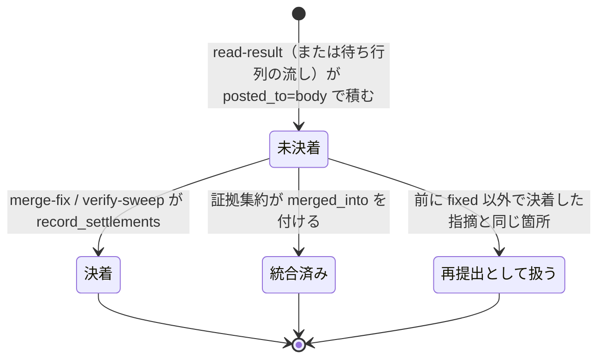

# cross-review: レビュー本文にだけ書かれた重大な指摘が修正されず件数にも入らないまま収束し、本番へ出ていた → 総評だけの指摘も修正担当が必ず振り分け、決着するまで収束せず、最終スイープの残数とまとめの件数に入る

## 目的

**担当がレビュー本文（総評）にだけ書いた指摘を、インラインのスレッドの指摘と同じく扱う**（#1980）。
修正担当が必ず振り分け、件数に入り、決着するまで収束を止める。

- **振り分けの対象に入れるかを修正担当（LLM）の読み方に任せず、スクリプトが雛形へ入れる。** 対象は
  状態ファイルの `review_findings[]` のうち `posted_to` が `body` のもので、差分の外を指す指摘と、`HTTP 422`
  （`could not be resolved`）で総評へ移した指摘を区別しない
- **振り分けの漏れは `fix-steps.py finalize` が止める。** 決着は状態ファイルの `body_settlements[]` に残る
- **決着していない重大な総評だけの指摘がある間は収束しない。** 最終スイープの残数（`REMAINING_OPEN`）と
  まとめの `unresolved` には重要度を問わず数える

例: スプリント PR 1973 のラウンド 1 の形（未解決のスレッド 0 件・CI 成功・codex が本文にだけ `major` 5 件）。

| 時点 | 変更の前 | 今 |
| --- | --- | --- |
| `judge` | 全員が通せば収束しうる | `BODY_BLOCKING=5` で終了コード 2、修正へ |
| `fix-steps.py context` | 雛形はスレッドだけで 0 件。修正担当は何も直さず `fix_commit: null` | 雛形に `thread_id: null` と `finding_id` を持つ 5 件が入り、`metrics.body_findings` が 5 |
| 修正担当が `fixed` 3・`deferred` 1・`rejected` 1 に振り分けて `merge-fix` | — | `body_settlements[]` に 5 件、まとめの「レビュー本文の指摘への返事」に見送り・却下の 2 行 |
| 駆動のまとめ | `findings 3 / fixed 3 / unresolved 0`（5 件が入らない） | `findings` 5・`fixed` 3 |

**雛形の要素・`finalize` の検査・`body_settlements[]` の鍵・`judge` と `verify-sweep` の出力の行は Skill が正である。**
ここに書き写さない。この文書が扱うのは、そこに書かない決定の理由・常に成り立つ条件・テストの観点である。

| 何を | 正本 |
| --- | --- |
| 総評だけの指摘の行き先（修正の雛形・振り分け・決着の記録・収束の判定・最終スイープ）と、`body_settlements[]` の鍵と `decision` の決まり方 | [`cross-review` の `docs/06-evidence.md`](../../plugins/ndf/skills/cross-review/docs/06-evidence.md) の「総評だけへ書いた指摘」 |
| Step 5 の修正担当の対象・取り込みでの決着の記録・`BODY_BLOCKING`・Step 7.5 の振り分けと `REMAINING_BODY` | [`docs/02-fix-and-rotation.md`](../../plugins/ndf/skills/cross-review/docs/02-fix-and-rotation.md) |
| 状態ファイルの `sweep.remaining_body` と `body_settlements` の位置づけ | [`docs/04-contracts.md`](../../plugins/ndf/skills/cross-review/docs/04-contracts.md) |
| 修正担当の手順（`finding_id` を持つ要素を消さない・`finding_id` を変えない・同じ「重要度の判定」で振り分ける）と戻り値ファイルの `finding_id` | [`fix` の SKILL.md](../../plugins/ndf/skills/fix/SKILL.md) |
| 判定の規則の実体 | `plugins/ndf/scripts/lib/body_findings.py`（cross-review と fix が共有する） |

## 用語

定義は [用語集](../glossary.md) が正である（`.ndf/glossary.json` の `document`、コンテキスト `ndf-cross-review`）。
この文書で使う語は「担当」「総評」「総評だけの指摘」「決着」「決着の記録」「修正担当」「最終スイープ」である。

## 対象範囲

| 扱う | 扱わない |
| --- | --- |
| cross-review の中で `/ndf:fix` を呼んだとき（環境変数 `CROSS_REVIEW_STATE` が状態ファイルを指すとき）の雛形と `finalize` | 単独で呼んだ `/ndf:fix`（状態ファイルを持たず、今の振る舞いのまま） |
| `merge-fix` と `verify-sweep` での決着の記録 | `HTTP 422` で要求のインラインをすべて総評へ移す振る舞いの変更（総評だけの指摘を落とさなくなれば不具合は起きない） |
| `judge`・`verify-sweep`・駆動のまとめでの数え方 | 過去の状態ファイルの書き直し |
| 待ち行列から流したレビューの指摘の `posted_to` の書き戻し | 担当へ差分の範囲を渡すこと（[レビュー範囲の確定仕様](cross-review-review-scope.md)）・2 ラウンド目以降に渡す変更（#934）・PR 1973 で落ちた指摘の中身（#1979） |

## 背景

**本文にだけ書かれた `major` 5 件が、修正も件数も通らずに本番へ出た。** スプリント m1953 の PR 1973 のラウンド 1 で、
codex が REQUEST_CHANGES とともに `major` 5 件を「差分の外を指す指摘」として本文へ書いた。修正担当は対象を未解決の
スレッドで決めるため、スレッド 0 件・CI 成功を見て何も直さず `fix_commit: null` で返した。取り込みは 5 件を次のラウンドへ
渡さず、まとめは `findings 3 / fixed 3 / unresolved 0` だった。4 件の不具合が 10.17.74 へ出た（中身は #1979）。
スプリントの振り返り（release PR 1975）で、範囲外として扱った指摘を起票と突き合わせて見つけた。

**拾うかどうかが修正担当の読み方で揺れていた。** 設計 PR 1970 では、kiro の本文だけの指摘に修正担当が
「レビュー本文の指摘への返事」を付けて直した（974e50bba）。経路によって扱いが揃っていなかった。

## 決定と理由

| 決定 | 理由 |
| --- | --- |
| 雛形へ入れるのは、最後のラウンドに限らず全ラウンドの決着していない総評だけの指摘 | 最後のラウンドだけにすると、全員が通して修正を通らなかったラウンドの `minor` と、状態ファイルを読めずに漏れた指摘が以後どこにも入らない。決着の記録があるため、全ラウンドを見ても決着済みは二度入らない |
| 状態ファイルを指しているのに読めないとき、`context` と `finalize` は止めず `items` に `body-findings: unreadable` を出してスレッドだけで進む | 読めない原因は修正担当の手元では直せず、止めるとスレッドの修正まで止まる。`judge` と `verify-sweep` が同じ状態ファイルから数え直すため、漏れは収束と残数で必ず見える |
| 収束を止めるのは、`critical` / `major` で反証に棄却されていない（`findings._classify_finding` が `rejected` でない）ものに限る（`findings.blocking_body`） | `minor` / `nit` で止めると、見送りの返事を付けるだけのために修正とレビューが 1 往復増え、振り分けは `waived` に決まっていて結果が変わらない。インラインの `minor` も収束を止めず最終スイープが片づけており、同じ扱いになる。止めない指摘も雛形と最終スイープの残数には入る |
| 決着は指摘の要素へ書き込まず、別の配列 `body_settlements[]` へ追記だけで残す | `review_findings[]` の要素は取り込みと証拠集約（統合・反証・実行検証）がすでに書いており、持ち主が増える。別の配列なら書き手は `body_findings.record_settlements` 1 つで、打ち直しでも記録の時刻と経路（`fix` / `sweep`）が上書きされない |
| 最終スイープの結果は `verify-sweep` が同じ記録の関数で決着させる | スイープの結果は `merge-fix` を通らず、`verify-sweep` が唯一の取り込み口である |
| 総評だけの指摘と戻り値ファイルの要素を結ぶ鍵は `finding_id` | `finding_id` は取り込みが採番する一意の値である。総評だけの指摘の `comment_id` はレビューの ID でその全件に共通し、`path`・`line` の組は同じ行への 2 件で一致する。戻り値ファイルへ鍵を 1 つ足すだけで、読む側は知らない鍵を読まないため互換がある |
| 同じラウンドの 2 担当の同じ指摘は、証拠集約の統合（`merged_into`）に従い、新しい重複の判定を持たない | 統合済みの要素を外せば足りる。証拠集約を通っていないラウンドでは 2 件のまま入り、修正担当がそれぞれ振り分ける（数えすぎの側へ倒す） |
| 前のラウンドで `fixed` 以外（見送り・却下）に決着した総評だけの指摘と同じ箇所の再提出は、振り分け直さない。`fixed` に決着した指摘と同じ箇所の再提出は振り分け直す | 本文の指摘への返事はまとめのコメントにしか無く、担当は同じ指摘を次のラウンドで再び書く。再提出は新しい `finding_id` になり、照合しないと総評だけの指摘は毎ラウンド収束を止める。`fixed` の再提出は直したはずの指摘が残っていることを示す |
| 再提出の照合は、新しい指摘の数え方と振動の検知が使う `match_kind`（位置・近傍・本文）をそのまま使い、`plugins/ndf/scripts/lib/finding_match.py` へ移して cross-review と fix で共有する | 照合を 2 つ持つと、片方だけが更新されたときに数え方と収束の判定が食い違う |
| 新しい出力の行と鍵（`BODY_BLOCKING=` / `REMAINING_BODY=` / `metrics.body_findings` / 文脈のファイルの節）は件数が 1 以上のときだけ出す。状態ファイルの `sweep.remaining_body` だけは常に置く | 総評だけの指摘が 0 件の PR の出力を今と変えない。`sweep.remaining_body` は標準出力ではなく後から辿る記録である |

## 仕様

### 常に成り立つ条件

| 条件 | 破れたときの扱い |
| --- | --- |
| 状態ファイルを読めるとき、`context` の時点で決着していない総評だけの指摘（`body_findings.unsettled` が返すもの）は、`finalize` の時点の `decisions[]` にすべて同じ `finding_id` で入り、`decision` が埋まっている | `finalize` が `stopped` で止まり、戻り値ファイルを書かない（消えた要素は `missing`、空の `decision` は今の検査が `invalid`） |
| 1 つの `finding_id` の決着の記録は高々 1 件で、書き換えない | `record_settlements` は既にある `finding_id` を重ねて足さない。`review_findings[]` に無い `finding_id` は記録せず、件数を標準エラーへ出す |
| 収束を妨げる総評だけの指摘が 1 件以上ある間、`judge` は収束（終了コード 0）を返さない。モデルレビュー（`stage: model`）でも `MODEL_CONFIRMED` を出さない | 修正のラウンド（終了コード 2・`changes_requested`）へ回す |
| `verify-sweep` の `REMAINING_OPEN` は、未解決のスレッドの件数（取れなければ申告）に、決着していない総評だけの指摘の件数を足した値である | 1 件以上なら終了コード 6。まとめの `unresolved` はこの値である |
| 総評だけの指摘が 0 件のとき、雛形・`finalize`・`judge`・`verify-sweep` の出力は今と同じである。スレッドの要素は `finding_id` を持たない | 新しい行と鍵は件数が 1 以上のときだけ出す |
| `posted_to` を持たない指摘は総評だけの指摘として数えない | `inline` として読む（この変更より前の状態ファイルの総評だけの指摘は数えられない） |
| 待ち行列から流して届いたレビューの指摘も、直接送ったときと同じ規則で `posted_to` を持つ | 流した直後の確かめ（`posts._confirm_flushed`）で、インラインが 0 件ならすべて `body`、そうでなければ指す位置を持つものを `inline` として書き戻す。書き戻さないと既定の `inline` と読まれ、振り分けと収束の判定から漏れる |

雛形・収束・残数の対象はどれも `unsettled` で、決着の記録を持たないまま外れる統合済みの指摘と、見送り・却下の
再提出を含めない。含めると、`finalize` が漏れとして止まり、振り分けるもののない修正のラウンドが繰り返される。

### 決着していない総評だけの指摘（`body_findings.unsettled`）

`review_findings[]` の並びの順で、次のすべてを満たす要素を返す。すべてのラウンドを見る。

| # | 条件 |
| --- | --- |
| 1 | `posted_to` が `body`（無ければ `inline` と読む） |
| 2 | `merged_into` を持たない |
| 3 | `finding_id` の決着の記録が無い |
| 4 | 前のラウンドで `fixed` 以外に決着した総評だけの指摘と同じ箇所でない。行を持つ 2 件は `finding_match.match_kind` で比べ、どちらかが行を持たなければ同じファイルで本文（正規化した先頭）が一致するときだけ同じとみる |

### 指摘 1 件の状態

決着した記録は書き換えないため、`決着` から戻る遷移は無い。`fixed` に決着した指摘と同じ箇所が次のラウンドで
再び出たときは、別の `finding_id` の新しい `未決着` として扱う。

### 構成要素の責務

| 要素 | 責務 |
| --- | --- |
| `plugins/ndf/scripts/lib/body_findings.py` | 総評だけの指摘の判定の唯一の置き場。状態ファイルの dict を受けて返す関数だけを持ち（`read_state` を除く）、終了コードも出力も持たない。止めるか・何を出すかは呼ぶ側が決める |
| `plugins/ndf/scripts/lib/finding_match.py` | 指摘どうしの照合（`normalized_body`・`match_kind` と近傍の幅などの定数）。cross-review の `review_lib/matching.py` は旧い名前で読み込む |
| `fix-steps.py`（`context` / `finalize`） | 雛形と文脈のファイルへ入れる・漏れを止める・戻り値ファイルへ `finding_id` を写す |
| `merge_fix.py` / `report.py`（`verify-sweep`） | 決着を記録する（`source` が `fix` / `sweep`） |
| `findings.blocking_body` / `judge.py` | 収束を妨げる総評だけの指摘を数え、収束させない |
| `drive.py` | 修正担当へのプロンプトで、対象に雛形の総評だけの指摘を添える。件数の数え方（`counts`）は変えない |

返事の行（「レビュー本文の指摘への返事」）は、`thread_id` の無い要素から `scripts/lib/result_posts.py` の
`_reply_items` が組む（この変更で変えていない）。

## データ・設定

状態ファイルに `body_settlements[]` が増え、`init` は空の配列を置く。**鍵の無い既存の状態ファイルは空の配列として読む。**
過去の記録は書き直さない（移行は無い）。後から「どのラウンドのどの総評だけの指摘が、どう振り分けられたか」は、
`review_findings[]` と `body_settlements[]` を `finding_id` で結べば状態ファイルだけで辿れる。設定も引数も増えない。

## 運用

**本番での振る舞いはリリース後テストで見る。** 本文にだけ `major` が残る PR の cross-review を本番の版で 1 回通し、
まとめの返事の行と `findings` / `unresolved` を見る。

**未確認のまま残っていること:**

- 再提出の照合の近傍の幅（3 行）は振動の検知の値をそのまま使っている。総評だけの指摘は差分の外を指すことが多く、
  この幅で十分かの実測は無い
- 更新前の状態ファイルで再開したとき、更新前に修正担当がまとめで返事をした総評だけの指摘は決着の記録を持たず、
  再開後の最初の修正のラウンドでもう一度振り分ける。件数は増えるが、取りこぼしは起きない

## テスト観点

`.md` の文言は固定しない。入力の PR 1973 のラウンド 1 の形は
`plugins/ndf/skills/cross-review/tests/fixtures/pr1973-round1-state.json` が持つ。テストは
`plugins/ndf/skills/cross-review/tests/test_body_findings.py` と `plugins/ndf/skills/fix/tests/test_fix_steps.py` にある。

| 観点 | どう壊したら落ちるべきか |
| --- | --- |
| PR 1973 の形で `context` を打つと、雛形に 5 件が `thread_id: null` と `finding_id`・`path`・`line`・`severity`・`summary` を持って入り、`metrics.body_findings` が 5、`metrics.unresolved` が 0、文脈のファイルに 5 件の節がある | 対象を最後のラウンドのスレッドだけにする・`severity` を空にする・総評だけの件数を `unresolved` へ足す |
| 総評だけの要素の `decision` を空にする・要素を消すと `finalize` が `stopped` で戻り値ファイルが無い。戻り値ファイルの `finding_id` は総評だけの要素にだけ出る | 漏れの検査を外す・スレッドの要素に `finding_id: null` を出す |
| `deferred` / `separate_pr` / `waived` / `rejected` の総評だけの要素を取り込むと、まとめの返事に `summary` と理由が 1 行ずつ載り、`separate_pr` の行が課題の番号を持つ | `_reply_items` が `thread_id` の無い要素を飛ばす |
| 5 件を `fixed` 3・`deferred` 1・`rejected` 1 で取り込むと、駆動の `counts` が `findings` 5・`fixed` 3 | 戻り値ファイルから総評だけの要素を落とす |
| 全員 `APPROVE`・新しい指摘 0 件・決着していない `major` の総評だけの指摘 1 件で `judge` が 2 を返す。同じ指摘が `minor` か、反証で棄却されていれば収束する。0 件なら `BODY_BLOCKING` の行が無い | `blocking_body` を外す・重要度で絞らない・0 件でも行を出す |
| スレッド 0 件・決着していない総評だけの指摘で `verify-sweep` が残数に足して終了コード 6。スレッドの残りがあれば足す。スイープの結果がすべて決着させれば 0 | 残数に足さない・スイープの結果を記録しない |
| 場所から `decision` が決まり、同じ戻り値ファイルを 2 回記録しても 1 件ずつで、前の記録は残る。知らない `finding_id` は記録しない | 追記の前に既存の `finding_id` を見ない |
| `posted_to` を持たない指摘・統合済み・決着済みは未決着に入らない。前のラウンドで `rejected` に決着した指摘と同じ箇所の再提出は入らず、`fixed` に決着した指摘と同じ箇所の再提出は入る | 既定を `body` にする・照合を外す・`fixed` も一致の対象にする |
| 待ち行列から流したレビューの指摘が、インラインの有無に応じた `posted_to` を持つ | 流した後に `posted_to` を書き戻さない |
| 振動の検知と新しい指摘の数え方の既存のテストが、照合を移した後も通る | 移した関数の振る舞いを変える |
| 全体テストが通る | `uv run --frozen --project . --all-extras pytest plugins/ndf/skills/cross-review/tests plugins/ndf/skills/fix plugins/ndf/scripts/tests -q -n 4` |

## 関連リンク

- [issue #1980](https://github.com/devbasex/ai-plugins/issues/1980) — 本文にだけ書かれた指摘が修正の対象にも件数にも入らない
- [PR #1990](https://github.com/devbasex/ai-plugins/pull/1990)（設計） / [PR #1995](https://github.com/devbasex/ai-plugins/pull/1995)（実装）
- [PR #1973](https://github.com/devbasex/ai-plugins/pull/1973) — 見つけたスプリント m1953 の検査
- [issue #1979](https://github.com/devbasex/ai-plugins/issues/1979) — PR 1973 で落ちた指摘の中身
- [レビュー範囲](cross-review-review-scope.md) — 範囲の照合と、総評だけの指摘による収束の妨げの順序
- [証拠ベースのレビュー](cross-review-evidence-based.md) — 証拠集約・反証・新しい指摘の数え方
- [`cross-review` の総評だけへ書いた指摘](../../plugins/ndf/skills/cross-review/docs/06-evidence.md)
- [`fix` の手順](../../plugins/ndf/skills/fix/SKILL.md)
