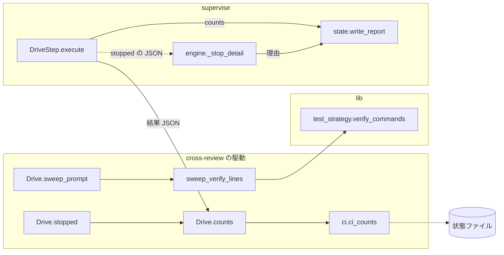
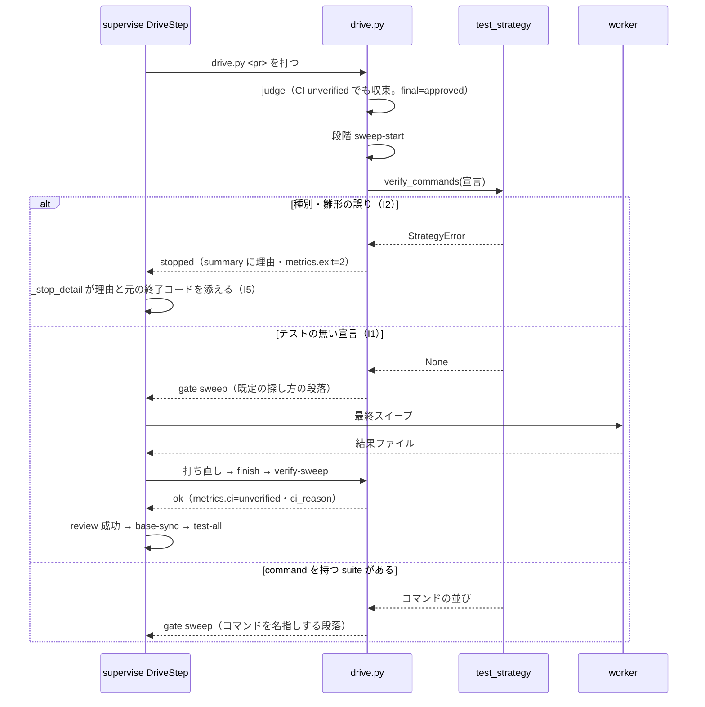

# cross-review: テストも CI も無いリポジトリで、収束した cross-review が最終スイープの手前で終了コード 2 で止まり、検査のプランが毎回止まっていた → テストの無い宣言では検証のコマンドを名指しせずに最終スイープへ進み、止まったときは元の終了コードと理由が報告の 1 行に出る

## 概要

**`.ndf/project.json` の `test` が「テストの無い宣言」（解析が測った `{"suites": []}` を含む）のとき、cross-review の最終スイープの指示は
検証のコマンドを名指しせずに組まれ、駆動は止まらずに最終スイープへ進む。** 種別か雛形に誤りのある宣言は、今までどおり終了コード 2 で止まる。

あわせて次の 2 つを足した。

- **駆動の結果の件数（`metrics`）に、最後のラウンドの継続的統合の判定 `ci` と理由 `ci_reason` が載る。** supervise の報告の件数の行へ
  そのまま写るため、継続的統合を確かめられなかったこと（`ci unverified`）が承認する人に届く
- **supervise の drive のステップが駆動の `stopped` で失敗したとき、止まった理由の 1 行に、駆動の `summary` と元の終了コード（`metrics.exit`）が載る。**

例: 継続的統合を持たず、`test` が `{"suites": []}` のリポジトリで検査のプランを流すと、cross-review が `final: approved` で収束した後、
最終スイープへ進み、駆動が `ok` を返す。`review` のステップが成功して `base-sync`・`test-all` まで流れ、報告の `review` の件数の行に
`ci unverified` と理由（「チェックジョブを照会できない（…）」）が出る。`supervise.py run --from test-all` で手で再開しなくてよい。

種別の誤りで止まる場合の、supervise の止まった理由の形（検査のプランが `abort` へ回したとき）:

```text
ステップ abort が失敗した（exit=1）: …: review: 最終スイープの指示を組めない: .ndf/project.json の test が不正: test.suites[0].kind は test か lint で書く（今: unit）（元の終了コード 2）
```

**駆動の件数の一覧と読み方、drive のステップの読み方は Skill とスクリプトの説明が正である。** ここに書き写さない。

| 何を | 正本 |
| --- | --- |
| 駆動の結果の件数（`ci`・`ci_reason` を含む）の一覧 | [`cross-review` の SKILL.md](../../plugins/ndf/skills/cross-review/SKILL.md) と [`drive.py`](../../plugins/ndf/skills/cross-review/scripts/drive.py) の docstring |
| drive のステップの読み方（件数の写し方・止まった理由に元の終了コードが添うこと） | [`supervise_lib/plan.py`](../../plugins/ndf/scripts/supervise_lib/plan.py) の docstring |
| 最終スイープが検証のコマンドを探す既定の探し方 | `cross-review` の [`docs/02-fix-and-rotation.md`](../../plugins/ndf/skills/cross-review/docs/02-fix-and-rotation.md) の Step 7.5 |
| `metrics.exit`（止めたスクリプトの元の終了コード）の共通の意味 | [`lib/drive_pause.py`](../../plugins/ndf/scripts/lib/drive_pause.py) |

この文書が扱うのは、止まっていた原因の特定、決定の理由、常に成り立つ条件、`verify_commands` の判定の順、契約、テスト観点である。

## 用語

定義は [用語集](../glossary.md) が正である（`.ndf/glossary.json` の `document`）。この文書で使う語は「テストの無い宣言」「最終スイープ」
「全体テスト」「テストの戦略」である。

`review_status` の `unverified`（最終スイープが確かめられていないこと。`lib/loop_drive.py`）と、継続的統合の照会の `unverified`
（`ci.verdict`。チェックジョブを照会できない）は別の意味である。この文書の `ci unverified` は後者を指す。

コンテキストの関係: cross-review の駆動は cross-refactoring のテストの戦略の語（全体テスト・宣言の `test`）を `lib/test_strategy.py` で
共有する（共有カーネル）。supervise は駆動の結果 JSON を `lib/step_result.py` の形で読み、`metrics` を件数として写すだけで解釈しない
（公開された言語）。例外は `metrics.exit` で、`lib/drive_pause.py` が全駆動に共通の意味を定める。

## 対象範囲

| 扱う | 扱わない |
| --- | --- |
| テストの無い宣言で、cross-review の駆動が最終スイープへ進むこと（単独の `/ndf:cross-review`・スプリントの検査・単発の検査・cross-refactoring の最終ゲートの入れ子のすべて） | cross-review の収束の判定そのもの（ラウンド・承認の数え方） |
| 駆動の件数に継続的統合の判定と理由を載せること | 継続的統合があるリポジトリでのチェックジョブの失敗の扱い（`code_failure` は今のとおり修正へ回す） |
| supervise の止まった理由に元の終了コードを添えること | `review_status` と継続的統合の照会の `unverified` の改名 |
| | 検査のプランの雛形（`templates.py`）。継続的統合の有無で分岐する値をプランへ書かない |
| | supervise の `new sprint` と cross-refactoring の全体テストの解決（`resolve`。テストの無い宣言では今のとおり止まる） |

テストの有無は宣言（`.ndf/project.json` の `test`）で受け、継続的統合の有無は宣言で受けず、実行の時点の PR の head のチェックジョブの
照会結果で受ける。配布先のリポジトリでも働く。宣言は利用者の設定で、この仕様は読む側の解釈だけを変え、宣言を書き換えない。

## 背景

CI を持たない takemi-ohama/novel のスプリント pipeline（PR takemi-ohama/novel#35）で、検査のプランの `review`（cross-review の駆動。
`on_fail: abort`）が「exit 2（unverified）」で止まり、指摘が収束していてもプランが進まなかった。続けるには `supervise.py run --from test-all` で
手で再開するしか無かった（#1426 の「プランの外の手当てをなくす」に反する）。状態ファイルは `final: approved`・`sweep: null`・最後のラウンドの
`ci.verdict` が `unverified` だった。

コードを読むと、題の「unverified（exit 2）」は止まった原因ではなかった。

| # | 読んだこと |
| --- | --- |
| 1 | supervise の drive のステップは、駆動の結果 JSON の `status` が `ok` のときだけ成功とする。`metrics.review_status` は成否に使わない |
| 2 | cross-review の駆動の終了コードは 0・1・20〜23 だけで、止まったときは止めたスクリプトの元の終了コードを `metrics.exit` へ写す。「exit 2」はこの値だった |
| 3 | 継続的統合の照会が `unverified` でも、判定は「⚠ 継続的統合を確かめられないまま収束する」を出して収束として exit 0 で返す |
| 4 | 状態の `sweep` は `verify-sweep` が書く。`final: approved` で `sweep: null` は、収束の後、`verify-sweep` より前で駆動が止まったことを示す |
| 5 | 収束の直後に最終スイープの指示を組む `sweep_verify_lines` は、宣言の `test` を解けないと `Stop`（終了コード 2）を上げる。解析はテストの手段・コマンド・記述がどれも無いリポジトリの `test` を `{"suites": []}` と書き（`project_lib/measure_repo.measure_test`）、`verify_commands` はこれを「`test.suites に command を持つ suite が無い`」の `StrategyError` にしていた |

1〜5 の 3 つの値（`final: approved`・`sweep: null`・`metrics.exit` = 2）とテストも CI も無いことに合うのは 5 である。原因は継続的統合ではなく、
解析が正しく測った「テストが無い」を不正な宣言として扱うことだった。

## 決定と理由

| # | 決定 | 理由 | 採らなかった案 |
| ---: | --- | --- | --- |
| 1 | 検査のプランの雛形を変えず、最終スイープの検証コマンドの解き方（`verify_commands`）を直す | 止めているのは `sweep_verify_lines` が `StrategyError` を終了コード 2 の `Stop` にする経路で、継続的統合の照会は収束を妨げない。単独の `/ndf:cross-review` も同じ経路を通るため、雛形で直すと単独の利用で止まりが残る | 起票時の提案（継続的統合の有無を見て `review` の `on_fail` を切り替える・`test-all` を確かめの代わりにする）。原因が継続的統合でないため直らず、雛形に継続的統合の有無の分岐を足すと「同じ雛形が通る」から外れる |
| 2 | 種別と雛形の検査をテストの有無の判定より先に当てる | 不正な宣言（種別・雛形の誤り）を `StrategyError` で止めるのは、最終スイープの既定の探し方へ黙って流さないためである。`command` の無い suite に `kind: unit` があることもあり、それまで `None` にすると黙って流れる | `resolve` の「`command` を持つ suite が無い」を全体で `None` にする（`new sprint` と cross-refactoring は全体テストを要し、そこでは止めるのが正しい） |
| 3 | 継続的統合を確かめられなかったことは駆動の件数へ最後のラウンドの判定を写して残し、`test-all` を代わりの確かめとは書かない | 状態ファイルに最後のラウンドの `ci.verdict` と理由が既にあり、写せば supervise は今の仕組み（ステップの `counts` → 報告の件数の行）のまま載せられる。`test-all` は手元の全体テストで、継続的統合が走らせるチェック（別の環境・別のジョブ）を確かめたとは言えない | `test-all` を継続的統合の代わりの確かめとして承認資料に書く（測っていないことを確かめたと示す） |
| 4 | 元の終了コードは supervise の 1 か所（`_result_summary`。`_stop_detail` が使う）で添える | `metrics.exit` は全駆動に共通の意味を持つ。1 か所で添えれば cross-review と cross-refactoring の両方の駆動に効く。駆動の側は理由文で止めた所を名指しすることだけを持つ（`sweep_verify_lines` の理由文に「最終スイープの指示を組めない」を足した） | 駆動の `summary` へ終了コードを書き足す（単独の cross-review でも読まれ、同じ値を 2 か所に持つ） |
| 5 | 宣言の不正を検査のプランの書き出しで先に見つける検査は足さない | 決定 1・2 の後で最終スイープが止まる宣言は、種別・雛形の誤りか戦略を解けない宣言である。`--test-cmd` を渡さない `new sprint` / `new check` は同じ `resolve` で宣言を解き、`DeclError` として書き出しで止まる。`--test-cmd` を渡したときだけ最終スイープで止まり、その止まりは決定 4 で報告に出る | 書き出しに同じ検査を重ねる |

## 仕様

### 構成要素と責務

| 要素 | 責務 |
| --- | --- |
| [`lib/test_strategy.py`](../../plugins/ndf/scripts/lib/test_strategy.py) の `verify_commands` | 宣言の `test` から最終スイープに名指しする全体テストのコマンドを返す。テストの無い宣言では `None`、種別・雛形の誤りは `StrategyError` |
| [`drive.py`](../../plugins/ndf/skills/cross-review/scripts/drive.py) の `sweep_verify_lines` | 最終スイープの検証の段落を組む。`verify_commands` が `None` なら既定の探し方の段落、`StrategyError` なら理由文「最終スイープの指示を組めない: .ndf/project.json の test が不正: …」の `Stop`（2） |
| `drive.py` の `Drive.counts` と [`review_lib/ci.py`](../../plugins/ndf/skills/cross-review/scripts/review_lib/ci.py) の `ci_counts` | 駆動の結果の件数を組む。最後のラウンドの `ci.verdict` を `ci`、理由を `ci_reason` として足す |
| [`supervise_lib/engine.py`](../../plugins/ndf/scripts/supervise_lib/engine.py) の `_result_summary`・`_stop_detail` | 止まった理由へ、ステップの結果の `summary` と、`abort` へ回した直前のステップの `summary` を添える。結果 JSON が `stopped` で `metrics.exit` が整数なら、要約の後ろへ「（元の終了コード N）」を添える |



| 集約 | 持ち主（書き換えてよいもの） | 根 | 値オブジェクト |
| --- | --- | --- | --- |
| 収束ループの状態 | cross-review の `state.py`（駆動は読むだけ） | 状態ファイル（`cross-review-pr<N>-state.json`。エンティティはラウンド） | 継続的統合の判定（`verdict`・`reason`）・最終スイープの記録（`sweep`） |
| 駆動の結果 | `drive.py`（`Drive.counts`・`Drive.stopped`） | 結果 JSON（1 行） | 件数（`metrics`）・止まりの理由（`summary`）・元の終了コード（`metrics.exit`） |
| ステップの記録 | supervise の `engine.py`・`worker_steps.py` | ステップの記録（`state.cur`） | 件数（`counts`）・止まった理由 |

### 常に成り立つ条件

| # | 条件 | 破れたときの扱い |
| --- | --- | --- |
| I1 | 宣言の `test` がテストの無い宣言のとき、最終スイープの指示を組む処理は止まらず、検証のコマンドを名指ししない | テストで落とす |
| I2 | 宣言の `test` に種別か雛形の誤りがあるときは、テストの有無にかかわらず終了コード 2 で止める | テストで落とす |
| I3 | 最後のラウンドに継続的統合の判定があれば、駆動の件数の `ci` にその判定が載る。判定が `unverified`・`meta_only`・`pending` なら理由（`ci_reason`）も載る | テストで落とす |
| I4 | 件数へ足すのは新しいキーだけで、既存のキー（`review_status` ほか）の値と意味を変えない（cross-refactoring の最終ゲートの判定が変わるため） | テストで落とす |
| I5 | drive のステップが駆動の `stopped` で失敗したとき、supervise の止まった理由の 1 行に駆動の `summary` と元の終了コード（`metrics.exit`）が載る | テストで落とす |
| I6 | 継続的統合の判定は駆動の成否を変えない。`code_failure` は修正へ回し（判定の終了コード 2）、`unverified` は収束を妨げない | 既存のテストで落とす |

### `verify_commands` の判定の順

上から当てる。

| # | 宣言の `test` | 返すもの |
| --- | --- | --- |
| 1 | 無い・`unknown` を持つ | `None` |
| 2 | 種別か雛形に誤りがある | `StrategyError`（I2） |
| 3 | `strategy` を書かず、どの suite も `command` と `scope_command` のどちらも持たない（suite が 0 個のときを含む。テストの無い宣言） | `None`（I1） |
| 4 | 戦略を解けない（`local-scoped-ci-whole` を宣言したのに `scope_command` が無い など） | `StrategyError` |
| 5 | 解ける | 全体テストのコマンドの並び（空なら `None`） |

2 は `resolve` が使うのと同じ種別と雛形の検査をそのまま使い、新しい検査を作らない。

### 処理の流れ



## データ・設定

駆動の結果 JSON の `metrics` へ足した 2 つのキー（既存のキーは変えない）:

| キー | 型 | いつ載るか | 値 |
| --- | --- | --- | --- |
| `ci` | 文字列か `null` | いつも（`gate`・`ok`・`stopped` のどれでも。件数を組めるとき） | 最後のラウンドの `ci.verdict`（判定の値そのもの）。最後のラウンドに `ci` が無ければ `null` |
| `ci_reason` | 文字列か `null` | いつも | `ci` が `unverified` なら `ci.reason`、`meta_only` なら `ci.note`、`pending` なら未完了のチェックジョブの名前を空白で連ねたもの。ほかは `null` |

supervise の件数の行（`counts_text`）は `null` のキーを出さないため、継続的統合の判定が無い実行の件数の行は変わらない。判定の値の集合は
`review_lib/ci.py` の `_round_ci` が持ち、件数は写すだけである。

supervise の止まった理由は `ステップ <id> が失敗した（exit=<ステップの exit>）: <要約>` の形で、要約は結果 JSON の `summary` である。結果 JSON の
`status` が `stopped` で `metrics.exit` が整数（真偽値を除く）のとき、要約の後ろへ `（元の終了コード <metrics.exit>）` を添える。検査のプランの
`abort` へ回したときの「直前のステップの要約」にも同じ規則を当てる。`status` が `ok` の結果と `metrics.exit` を持たない結果は今の形のままである。

## 運用

### 既知の限界

| 項目 | 内容 |
| --- | --- |
| novel の宣言 | takemi-ohama/novel の `test` が `{"suites": []}` だったかは記録が手元に無く確かめられない。CI もテストも無い一時リポジトリ（`project-decl.py measure` が `test` を `{"suites": []}` と測った）で、直す前の実装が同じ値（`final: approved`・`unresolved: null`・`metrics.exit` 2）で止まることを確かめた（#1593 のコメント） |
| テストの無いリポジトリでの `test-all` | テストの無い宣言で `new sprint` を流すには `--test-cmd` か `.ndf/supervise.json` の `test.command` が要る（決定 2）。`test-all` がその雛形で通るかはこの仕様の範囲外である |
| 最終スイープの探し方 | テストの無い宣言では、最終スイープは既定の探し方（Step 7.5）で検証のコマンドを探し、見つからなければ検証を走らせない。宣言が無いときと同じ振る舞いである |

## テスト観点

- `verify_commands({"test": {"suites": []}})` と、`command` も `scope_command` も無い suite だけを持つ宣言が `None` を返すこと。`strategy: local-scoped-ci-whole`
  を書いた `suites: []` は `StrategyError` のままであること。テストの無い宣言の作業ディレクトリで `sweep_verify_lines` が `Stop` を上げないこと（I1。
  `plugins/ndf/scripts/tests/test_lib_test_strategy.py`・`plugins/ndf/skills/cross-review/tests/test_drive_sweep_verify.py`）
- `command` の無い suite に `kind: unit` を書いた宣言と、`{paths}` の誤った雛形を持つ宣言で `StrategyError` が上がり、`sweep_verify_lines` が終了コード 2 の
  `Stop` を上げること（I2。判定の順の 2 と 3 を入れ替えると落ちる）
- 最後のラウンドの `ci` が `unverified`（理由つき）の状態から組んだ件数が `ci` = `unverified`・`ci_reason` = 理由になり、`ci` の無いラウンドでは両方 `null`。
  `meta_only` では `note` が理由になること。supervise の報告の件数の行に `ci unverified` が出ること（I3。`test_supervise_stop_exit.py` の `test_the_counts_line_carries_the_unverified_ci`）
- 同じ状態から組んだ件数の既存のキー（`review_status` ほか）の値が変わらないこと（I4）
- drive のステップの結果 JSON が `stopped`・`metrics.exit` = 2 のとき、止まった理由に駆動の `summary` と「元の終了コード 2」が載り、`abort` へ回したときの直前の
  ステップの要約にも載ること。`metrics.exit` が無い結果・`status` が `ok` の結果では今の形のままであること（I5。`test_supervise_stop_exit.py`）
- 継続的統合が `code_failure` のとき判定が終了コード 2 で修正へ回すこと、駆動が `stopped` を返したとき `review` のステップが失敗して `on_fail: abort` へ進むこと
  （I6。既存のテスト）
- 実機の再現（#1593 のコメント）: CI の無い一時リポジトリの PR で `new check --test-cmd 'true {paths}'` の検査のプランを `queue` で流すと、直す前の実装は
  cross-review が承認で収束したのに駆動が `stopped`・`metrics.exit` 2・理由「.ndf/project.json の test が不正: test.suites に command を持つ suite が無い」で
  止まり、`review` が `abort` へ進んだ。直した後は `review` が `ok` で `base-sync` → `test-all` へ進み、報告の件数の行に
  `ci unverified / ci_reason チェックジョブを照会できない（未 push・権限・チェックジョブ 0 件のいずれか）` が出た。`progress.jsonl` の `review` の行は件数のキーを持たず、件数は報告の側に載る

## 関連リンク

- [`cross-review` の SKILL.md](../../plugins/ndf/skills/cross-review/SKILL.md)・[`drive.py`](../../plugins/ndf/skills/cross-review/scripts/drive.py)・[`review_lib/ci.py`](../../plugins/ndf/skills/cross-review/scripts/review_lib/ci.py)
- [`lib/test_strategy.py`](../../plugins/ndf/scripts/lib/test_strategy.py)・[`lib/drive_pause.py`](../../plugins/ndf/scripts/lib/drive_pause.py)・[`lib/loop_drive.py`](../../plugins/ndf/scripts/lib/loop_drive.py)
- [`supervise_lib/engine.py`](../../plugins/ndf/scripts/supervise_lib/engine.py)・[`supervise_lib/plan.py`](../../plugins/ndf/scripts/supervise_lib/plan.py)
- [ndf-supervise-base-sync.md](ndf-supervise-base-sync.md)（検査のプランの並びと `_stop_detail` の直前のステップの要約。#1917）
- [cross-review-evidence-based.md](cross-review-evidence-based.md)（状態ファイルの契約）
- 課題: #1593（由来 takemi-ohama/novel PR #35。関連 #1426・#1340・#1483）
