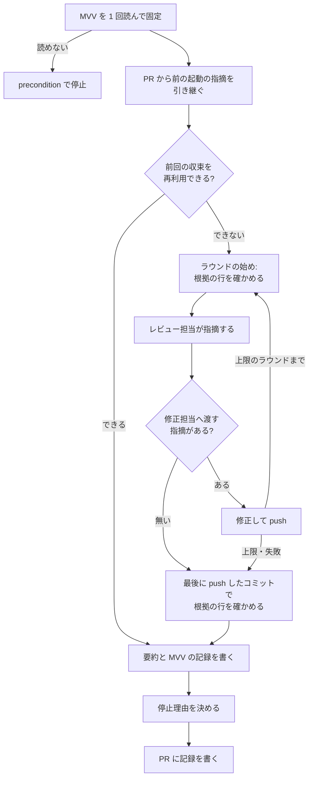

# cross-review: プロジェクト MVV に反する変更と誤った根拠の行を見つけ、解決するまで成功で終わらせない

## 概要

マージ先のブランチに承認済みのプロジェクト MVV（Mission・Vision・Value）があれば、`ndf cross-review run` は PR について次の 2 つも確かめる。

- **MVV に反する変更が無いか。** レビュー担当の AI が判断し、指摘に「どの項目に反するか」を書く
- **PR が足した「根拠の行」が正しいか。** NDF がプログラムで判断する。根拠の行とは、設計の決定がどの MVV の項目に基づくかを書いた行である（例: `- 根拠: Value 5（MVV バージョン 11）`）

どちらかの問題が未解決のまま終わると、cross-review は成功にならない。ほかの失敗（「終わり方」の表の順 1〜3）が無ければ、停止理由は `mvv_unresolved` になる。次の 2 つは止めない。

- 修正担当の AI が、理由を書いて見送った指摘（理由の中身が正しいかは、プログラムでは調べない）
- PR の変更が、必ず人の承認が要る操作（MVV の本文と NDF の共通原則の表に並ぶもの）を含むという指摘。修正せずに「人の承認を待つ」として残す

**例: 承認済みの MVV はバージョン 11 なのに、PR が設計文書 `doc.md` に `- 根拠: Value 1（MVV バージョン 1）` を足した。**

| 順 | 誰が | 何をするか |
| ---: | --- | --- |
| 1 | NDF | ラウンド 1 の始めに PR 全体の差分を調べ、「承認済みでないバージョンの MVV を引いている」という指摘 `r1-n1`（重大度 `major`）を作る |
| 2 | 修正担当の AI | 行を `- 根拠: Value 1（MVV バージョン 11）` に直してコミットする |
| 3 | NDF | コミットを push し、ラウンド 2 の始めに調べ直す。誤りが見つからないので `r1-n1` を「直した」にする |
| 4 | NDF | ほかに未解決の指摘が無いので、収束（`converged`）で終わる |

修正担当が行を直さずに「直した」「見送る」と回答しても、手順 3 で同じ誤りが見つかるので、指摘は未解決のまま残る。

承認済みの MVV が無いリポジトリでは、レビュー担当・修正担当への指示にも、指摘の扱いにも、結果 JSON にも MVV の項目は現れない。

関係する文書:

| 内容 | 文書 |
| --- | --- |
| コマンドの使い方、結果の報告のしかた | [cross-review の SKILL.md](../../plugins/ndf/skills/cross-review/SKILL.md) |
| 指摘の基準、状態ファイル、終わり方の手順書 | [docs/01](../../plugins/ndf/skills/cross-review/docs/01-state-and-review.md)、[docs/02](../../plugins/ndf/skills/cross-review/docs/02-fix-and-rotation.md) |
| 根拠の行の書き方 | [decisions.md の「根拠の行」](../../plugins/ndf/skills/design/references/decisions.md#根拠の行) |
| 承認済みの MVV の読み方、スナップショット、`--base` の決め方、MVV の記録の形 | [ndf-mvv-current-and-stage-inputs.md](./ndf-mvv-current-and-stage-inputs.md) |
| 重大度と「起きること」の 1 文（`impact`）の一般の規則 | [cross-review-impact-severity.md](./cross-review-impact-severity.md) |

## 用語

「プロジェクト MVV」「MVV のスナップショット」「レッドライン」は [ndf-loop の用語集](../glossary/ndf-loop.md)、「修正担当」「MVV に反する指摘」「根拠の行の確かめ」は [ndf-cross-review の用語集](../glossary/ndf-cross-review.md) にある。この文書では次の語も使う。

| 語 | 意味 |
| --- | --- |
| 起動 | `ndf cross-review run` の 1 回の実行。1 回の起動は、上限の数までラウンド（レビューと修正の 1 組）を繰り返す |
| レビュー担当 | cross-review がレビューさせる AI（codex・kiro など）。手順書とコードのコメントでは「相手役」、コードでは `reviewer` |
| 必ず人の承認が要る操作 | 用語集の「レッドライン」のうち、MVV の本文の表の `P<番号>` と、NDF の共通原則の表の `C<番号>`。コードでは `redline` |
| NDF の指摘 | 根拠の行の誤りについて、AI ではなく NDF がプログラムで作った指摘。指摘の `by` が `ndf` |
| ジャーナル | 1 つの PR の指摘の一覧。状態ファイルの `findings` に入る |
| 記録のコメント | cross-review が状態ディレクトリごとに、PR に 1 つだけ書くコメント。ラウンドと指摘の表を持つ |
| MVV の分類 | 指摘が反する項目、重大度を固定したか、人の承認を待つかの組。ジャーナルの指摘が持つ |
| MVV の記録 | 指摘がどう終わったかを手元に残す 2 つのファイル（`mvv-validation.jsonl` と `mvv-signals.jsonl`）。後者は、修正担当が「MVV に反しない」と見送った指摘を、MVV の文の見直しを考える材料（改訂の兆候）として残す |
| NDF の共通原則 | どのプロジェクトにも当てはまる決まり。NDF のプラグインの中のファイル（[ndf-common-principles.md](../../plugins/ndf/contracts/data/ndf-common-principles.md)）にある |
| MVV の識別子 | どの MVV で分類したかを表す文字列。承認済みなら `approved:<バージョン>:<本文の sha256>:<共通原則の sha256>`。設定が無ければ `absent:::`、設定はあるが承認の記録が無ければ `unapproved:::` |
| 重点 | `.ndf/review.json` の `focus` に書く、レビューで特に見る点 |
| 最後に push したコミット | 起動の始めに取得した PR のブランチの先頭。その起動で修正を push したら、push したコミットに変わる |

「根拠の行」は、レビュー担当・修正担当への指示と cross-review の結果では「根拠の記述」と表示される。

## 背景

MVV に反する設計が、cross-review の 3 ラウンドと設計の承認資料を通過したことがある（[#4049](https://github.com/devbasex/ai-plugins/issues/4049) の最初の設計。背景の監視が終わるまで引継ぎを始めない形で、ai-plugins の MVV の Value 5「待つ間も待つだけで止まらない」に反していた）。レビュー担当に MVV を渡していなかったためである。根拠の行に違うバージョンを書いた誤りも、行を読む処理が無いので止まらなかった（[#4076](https://github.com/devbasex/ai-plugins/issues/4076)）。

MVV を渡して「反するものを指摘する」と求めるだけでは足りなかった。同じ設計を読ませた 2026-11-24 の試行で、レビュー担当は引継ぎの待ちを、作業を失わないための正しい待ち（別の Value と共通原則に沿う振る舞い）と読み、Value 5 とは比べなかった（[記録](https://github.com/devbasex/ai-plugins/pull/4419#issuecomment-7127514486)）。そのため指示は、比べる手順まで書く。

## 対象範囲

| 項目 | 内容 |
| --- | --- |
| 対象 | `ndf cross-review run` を実行する、承認済みの MVV を持つすべてのリポジトリの PR。設計の PR とコードの PR の両方。新しい設定は無い |
| 対象外 | 承認資料の根拠の行と、人の承認を受ける所（承認ゲート）での MVV 判定の見直し（[#3959](https://github.com/devbasex/ai-plugins/issues/3959)）、PR の本文の根拠の行、スプリント MVV との突き合わせ、すでにマージされた文書の根拠の行 |

## 仕様

### 構成要素

コードは `plugins/ndf/src/ndf/domains/` の下にある。

| ファイル | 役割 |
| --- | --- |
| `crossreview/drive.py` | 起動の始めに MVV を読む。ラウンドの始めと終わりに根拠の行を確かめる。結果と記録を書く |
| `crossreview/criteria_decide.py`、[review-criteria.json](../../plugins/ndf/contracts/data/review-criteria.json) | MVV の基準（基準 5）を含む指示の文と、NDF の指摘の文を組み立てる |
| `crossreview/journal.py` | 指摘を分類し、重大度を固定・復元する。前の起動の指摘を引き継ぐ |
| `crossreview/changes.py` | PR の差分から根拠の行を拾う |
| `records/mvv_decide.py`、`records/mvv.py` | 根拠の行を 1 行ずつ解析する。コードブロックと決定の見出しの範囲を求める |
| `crossreview/fixer.py` | 修正担当へ指示を渡し、修正を push する |
| `crossreview/finish_decide.py` | 終わり方と停止理由を決める |
| `crossreview/scope_decide.py` | 前回のレビュー結果と差分の起点を使えるかを決める |
| `crossreview/report_decide.py`、`crossreview/prior_decide.py` | 結果 JSON と記録のコメントを組み立てる。記録のコメントを読み戻す |

### 処理の流れ

一部のレビュー担当が差分を読めなかったときと、消えた指摘が戻る状態（振動）で止まるときも、最後に push したコミットで確かめてから終わる。振動のときの停止理由は、残った欠けで決まる（「終わり方」の表の順 4〜6）。

### 常に成り立つ条件

テストのファイル名は `test_crossreview_` を省いて書く。

| # | 条件 | 破れたときの扱い | テスト |
| --- | --- | --- | --- |
| 1 | 1 回の起動は、始めに取得したコミットの MVV だけを使う。PR の head の MVV は使わない | 読めない・本文が承認の記録と合わないときは、AI を 1 つも起動せずに `precondition` で止まる | `mvv` |
| 2 | Mission・Vision・Value に反する指摘は、重大度が `major` 以上である | 軽い重大度や `impact` の無い指摘でも `major` 以上に固定する | `journal` |
| 3 | 必ず人の承認が要る操作に当たる指摘は、修正担当へ渡らず、収束を止めず、修正担当の回答で閉じない | 修正担当が結果に書いても、理由を `fixer_reason` に残すだけで、指摘の終わり方を変えない | `journal`・`mvv` |
| 4 | 承認済みの MVV がある起動では、NDF の指摘が解決したかは、根拠の行を確かめた結果だけが決める | 修正担当の「直した」「見送る」、スレッドの resolve、push のやり直しでは未解決のまま残す | `journal`・`citations`・`run` |
| 5 | 最後に push したコミットで根拠の行を確かめられなければ、成功で終わらない | 指摘が 0 件でも `mvv_unresolved` で止まる（`work_stopped` などが先に決まるときを除く） | `citations`・`finish` |
| 6 | NDF の指摘になるのは、push 済みのコミットで見つけた誤りだけである | push していないコミットの誤りは状態ファイルだけに残し、件数だけを終わり方に使う | `citations` |
| 7 | 結果と MVV の記録に載る指摘は、今回の MVV の識別子で分類したか、確かめたもの（NDF の指摘）だけである | 識別子が違う分類は指摘から外し、`mvv_history` に残す | `journal`・`mvv_records` |
| 8 | 前回の収束と差分の起点に使うのは、識別子が今回と同じラウンドだけである。承認済みの MVV があるときは、根拠の行を確かめ終えたラウンドであることも要る | 全差分を読み直す | `scope`・`mvv`・`citations` |
| 9 | 承認済みの MVV が無ければ、指示・指摘の重大度・結果 JSON の `outputs` に MVV の項目が現れない | レビュー担当が `mvv` を書いても無視する | `criteria`・`run`・`citations` |
| 10 | 承認済みの MVV があれば、レビュー担当への指示は基準 5 の指摘の書き方（`mvv.reviewer`）を持ち、MVV の本文はコピーせず場所だけを渡す | テストが失敗する | `mvv` |

### MVV を読んで指示に入れる

起動の始めに PR のブランチとマージ先のブランチを 1 回で取得し、マージ先の先頭のコミットから MVV を読む。`--base` にコミットの SHA を渡したときは、差分の起点はその SHA のままで、MVV だけを PR のマージ先のブランチから読む。詳しくは [ndf-mvv-current-and-stage-inputs.md](./ndf-mvv-current-and-stage-inputs.md) にある。

承認済みのときだけ、指示に次を足す。本文は書き写さず、スナップショットのパスを渡す。

| 渡す先 | 足す内容 |
| --- | --- |
| レビュー担当 | 基準 5（Mission・Vision・Value に反する、または必ず人の承認が要る操作に当たる）。次の「振る舞いを MVV の文と比べる手順」。指摘の JSON に反する項目を 1 つ書くこと。必ず人の承認が要る操作の指摘は、見送り済みの一覧にあっても書くこと |
| 修正担当 | 同じ基準 5。MVV の本文と共通原則を読み、本当に反しているかを確かめてから、直すか見送るかを決めること |

#### 振る舞いを MVV の文と比べる手順

レビュー担当への指示は、基準 5 を次の順で調べるよう求める。設計の PR とコードの PR は同じ文を受け取る。文の正本は `review-criteria.json` の `mvv.reviewer` で、修正担当への指示（`mvv.fixer`）にはこの手順を入れない。

1. 差分が足す・変える振る舞いを挙げる（例: 何かの終わりを待つ・止める・やり直す・承認を省く・人へ問う・資源や費用を使う・作ったものを消す）
2. MVV の本文をラウンド中に 1 回だけ読み、挙げた振る舞いを 1 つずつ、Mission・Vision とすべての Value の文と比べる
3. ある Value に沿う振る舞いでも、別の Value の文に反すれば指摘する

手順 3 は次の条件を持つ。

| 場合 | 扱い |
| --- | --- |
| 比べた後 | NDF の共通原則の優先順位（上位の原則 > 利用者の承認 > プロジェクトの MVV > スプリントの MVV > 効率）を当てる。スプリントの MVV はレビュー担当へ渡らないので、その順位は飛ばす |
| 上位の原則や人の承認が求める制約に従う振る舞い（必ず人の承認が要る操作の承認を待つことなど） | 下位の Value の違反にしない |
| 制約が求める範囲を超えて止めている部分（承認を待つ間に、承認の要らない並行できる作業まで止めることなど） | 指摘する |
| 1 つの振る舞いが 2 つ以上の Value に反する | Value ごとに指摘を分け、`text` にその Value に固有の違反を書く。同じ `text` の指摘は、ジャーナルが 1 件にまとめるためである |

指示の文は、どのリポジトリでも使えるように、特定の MVV の番号や文を持たない。相手役が出す指摘の JSON の形は、この手順で変わらない。

指示が増える量は、MVV の本文を読む分（レビュー担当 1 つ・1 ラウンドあたり 1 回分）と、書き方の文の分に分けて抑える。手順の文の上限は UTF-8 で 3,000 バイトで、実装した時点の書き方の文の増分は 1,653 バイトである（404 バイトから 2,057 バイト）。この上限を確かめるテストは無いので、文を変えるときに測る。

#### 指摘の項目の書き方

レビュー担当は、指摘の JSON に `"mvv": "Value 5"` のように書く。書けるのは、MVV の本文と共通原則に実在する項目だけである（`Mission`・`Vision`・`Value <番号>`・`P<番号>`・`C<番号>`）。前後の空白を除いて一覧と完全に一致したときだけ、有効な項目とみなす。

### 指摘の分類

| `mvv` に書かれた項目 | 重大度 | 修正担当へ渡すか | 未解決のまま残ったとき |
| --- | --- | --- | --- |
| `Mission`・`Vision`・`Value <番号>` | `major` 以上に固定。レビュー担当が `critical` を付けていれば `critical` | 渡す。修正担当は、直すか、理由を書いて見送る | `mvv_unresolved` で止まる |
| `P<番号>`・`C<番号>` | 固定しない。`impact` が無くても下げず、重大度も無ければ `major` | 渡さない | 収束を止めない。要約に「人の承認を待つ <件数>」、記録のコメントに「人の承認を待つ（直さずに残した）」と出る |
| 実在しない項目、文字列でない値 | 一般の規則のまま | 一般の規則のまま | MVV の無い指摘として扱い、指摘の id を `warnings` に載せる |
| 空、キーが無い | 一般の規則のまま | 一般の規則のまま | MVV の無い指摘として扱う |

- **`impact` の無い指摘**: 上の 2 種類は重大度を下げずに扱い、指摘の id を `warnings` に載せる
- **同じ指摘を、複数のレビュー担当やラウンドが違う項目で出したとき**: `P`・`C` が 1 つでもあれば、挙がった順によらず「人の承認を待つ」にし、番号をすべて残す。このとき `Value` などの項目と重大度の固定は外す（条件 2 は当てはまらない）。`Value` などだけなら、MVV の項目の一覧で先に出るものを残す
- **見送った指摘が、同じ MVV で初めて `P`・`C` として挙がったとき**: 未解決へ戻し、人の承認を待つ
- **Mission・Vision・Value に反する指摘を、修正担当が理由を書いて見送ったとき**: 理由の中身によらず止めない。修正担当への指示は、本当に反しているかを確かめてから決めるよう求めるが、理由の中身は調べない。結果の `disputed` と、MVV の記録（改訂の兆候）に残す。理由の無い見送りは、一般の規則どおり `incomplete` で止まる
- **NDF の指摘と本文が同じ指摘をレビュー担当が出したとき**: NDF の指摘に MVV の分類を付けない

### MVV が変わったとき

指摘には、分類に使った MVV の識別子（`judged_mvv`）を残す。次の起動で識別子が変わっていれば、最初のラウンドの前に次を行う。レビュー担当が同じ指摘を出し直したかどうかは関係ない。

1. 反する項目、重大度の固定、「人の承認を待つ」の分類を外し、外した内容を `mvv_history` に足す
2. 固定した重大度を、固定する前の値（`unpinned_severity`）へ戻す。固定している間に出し直されていれば、その中の重い方へ戻す
3. 指摘の終わり方（直した・見送った・未解決）は変えない。NDF の指摘は、この後の確かめの結果で決まる

分類を外した未解決の指摘は、MVV の無い指摘として扱う。重大度が `major` 以上なら修正担当へ渡り、収束を止める。出し直されれば、今の MVV で分類し直す。

見送った指摘は、見送ったときの識別子（`skipped_mvv`）も持つ。「出し直さない」一覧としてレビュー担当へ渡すのは、今と同じ識別子で見送った指摘だけである。違う識別子で見送った指摘が出し直されたら、未解決へ戻す。識別子の無い見送り（古い状態ファイル）は、今も MVV の設定が無い（`absent`）ときだけ同じとみなす。

### 根拠の行の確かめ

#### 確かめる時点と対象

| 時点 | 対象のコミット |
| --- | --- |
| 各ラウンドの始め（レビュー担当を起動する前） | そのラウンドの head。push 済みでなければ、結果を指摘にせず状態ファイルだけに残す |
| 終わり方を決める前 | 最後に push したコミット。作業場所にそれと違うコミットが残っていれば、そのコミットも別に確かめる |

前回の収束をそのまま返す起動では、確かめ直さない。

対象の差分は、いつも merge-base から対象のコミットまでの PR 全体である。レビュー担当へ渡す差分を前の head からに狭めたラウンドでも変えない。git の設定（接頭辞・前後の行数・改名の検出など）によって結果が変わらないように、差分の形を引数で固定する。

結果は 1 回の起動の中で（merge-base・head・MVV の識別子）ごとに使い回す。確かめるファイルの数が増えても、git の起動回数は増えない。失敗した結果は使い回さない。

#### 対象になる行

次のすべてに当てはまる行を、根拠の行とみなす。

| 条件 | 内容 |
| --- | --- |
| ファイル | 差分にあるすべてのテキストのファイル（Markdown に限らない）。削除したファイルとバイナリは除く。改名したファイルは改名前と対応させる |
| 差分での位置 | PR が足した行。または、変わっていないが、コードブロックの囲みを変えたので本文になった行（ベースの同じ行はコードブロックの中） |
| 本文での位置 | コードブロック（囲み・インデント）の外。文書全体を CommonMark として解析して決める |
| 書き出し | 先頭の空白と `- ` を除いて `根拠:` で始まる。引用（`>`）、表の中、`**根拠**:` は当たらない |
| 内容 | 行に `MVV` を含む。または、`### 決定 <数>` の見出しの下（次の見出しまで）にある |

2 つ目の「囲みを変えた」は、囲みの行（リストや引用の中も含む）を足したか消したファイルだけで調べる。前からある本文の行は対象にならない。

#### 行の読み方

`- 根拠: Value 7「<引用文>」・Value 11（MVV バージョン 11）。STD1` を例にする。

| 部分 | 読み方 |
| --- | --- |
| `「<引用文>」` | 入れ子も含めて取り除く。閉じの `」` が無ければ行末まで取り除く |
| `（MVV バージョン 11）` | 最初の `（MVV` からがバージョンの表記。`（MVV バージョン <数>）` か `（MVV バージョン <数>・スプリント MVV <16 進 8 桁>）` のときだけバージョンを読む |
| `。STD1` | 閉じ括弧の後ろは読まない |
| `Value 7・Value 11` | バージョンの表記の前を ` / ` と `・` で区切り、項目にする。`根拠なし` と、`スプリント` で始まる項目は突き合わせない |

#### 誤りの種類

1 行から出る誤りは 1 件で、上から順に当てはまるものになる。

| 種類（`kind`） | 当てはまる行 |
| --- | --- |
| `format` | バージョンを読み取れない。例: `（MVV ver 11）`、`（MVV バージョン 11x）`、`（MVV なし）`、決定の見出しの下でバージョンを書かない行 |
| `version` | 承認済みの今のバージョンと違う番号を書いている |
| `unknown` | そのバージョンに無い項目を書いている |

#### NDF の指摘

- 誤りは、id `r<ラウンド>-n<番号>`・`by: ndf`・重大度 `major` の指摘になり、修正担当へ渡る。引いた項目が `P`・`C` でも「人の承認を待つ」にはしない
- 同じ誤りかどうかは、ファイルのパス・引いた項目・誤りの種類の 3 つの組（`citation_key`）で決める。行がずれても同じ指摘のままで、同じ誤りが 2 行にあれば最初の行を指す 1 件になる
- 確かめて見つからなければ「直した」、見つかれば未解決にする。「直した」指摘がまた見つかれば未解決へ戻し、resolve 済みの古いスレッドから切り離す
- 承認済みの MVV が無くなった起動では、前の起動が残した NDF の指摘を「直した」にする
- 最後の修正で増えた誤りも、その起動の終わりに指摘にし、未解決なので `mvv_unresolved` で止める。id には次の起動の最初のラウンドの番号を使い、PR のスレッドだけは次の起動が作る

#### 確かめられなかったとき

git の失敗や、差分のファイルを読めないことで確かめられなければ、NDF の指摘を変えず、`warnings` に載せる。push 済みのコミットなら理由も載せ、push していないコミットなら決まった文だけを載せて、理由は状態ファイルだけに残す。ラウンドは続け、終わり方を決める前にもう一度確かめる。そこで成功すれば、その結果を使う。失敗すれば `mvv_unresolved` で止まる。

### 終わり方

cross-review は、成功で終われない理由を「欠け」（`gaps`）の一覧にする。次の 4 つの欠けは、どれも種類（`kind`）が `mvv_unresolved` である。停止理由が `invalid`・`work_stopped` にならないときは、この種類の欠けが 1 つでもあると `mvv_unresolved` になる。

| 欠けの名前 | 内容 |
| --- | --- |
| 指摘の id | Mission・Vision・Value に反する指摘が未解決 |
| 指摘の id | NDF の指摘が未解決。文書のパスと行の中身は載せず、記録のコメントを見るよう案内する |
| `citation_check` | 最後に push したコミットか、push していない手元のコミットで、根拠の行を確かめられなかった |
| `unsent_citations` | push していない手元のコミットに根拠の行の誤りがある。件数だけを載せる |

停止理由は、次の表の上から順に決まる。

| 順 | 条件 | 結果 |
| ---: | --- | --- |
| 1 | レビュー全体か指摘の終わり方の値が想定外 | `invalid` |
| 2 | 1 ラウンドも終わらずに失敗した | `work_stopped` |
| 3 | 一部のレビュー担当が、起動し直しても差分を読めなかった | `work_stopped`（種類 `mvv_unresolved` の欠けが残っていても同じ） |
| 4 | 種類 `mvv_unresolved` の欠けがある（`converged` で終わったときも含む） | `mvv_unresolved` |
| 5 | ほかの欠けがある | `incomplete` |
| 6 | 欠けが無い | `ok` |

レビュー担当の全員が読めなかったときは、この判定へ来る前に `precondition` で止まる。

`mvv_unresolved` の終了コードは失敗で、次の工程へ進まない。呼び出し元の AI（conductor）が人へ戻す（[mvv_unresolved.json](../../plugins/ndf/contracts/causes/mvv_unresolved.json)）。欠けは最上位の `gaps` でなく `outputs.gaps` に入る。最上位の `gaps` を持てるのは `incomplete` だけだからである。「人の承認を待つ」指摘は、どの欠けにもならない。

### 前回のレビュー結果を使う条件

次の 2 つは、ほかの条件（merge-base・レビュー担当・重点が同じなど）に加えて必要な、MVV の条件である。前回の収束をそのまま返すときも、レビュー担当へ渡す差分を前の head からに狭めるときも同じ条件を使う。満たさなければ全差分を読み直す。

1. そのラウンドの MVV の識別子が今回と同じ。識別子の記録が無い古いラウンドは、MVV の設定が無いとき（`absent:::`）と同じとみなす
2. 今回の MVV が承認済みなら、そのラウンドの `mvv_checked` が真

`mvv_checked` は、ラウンドの記録を作るときに決める。ラウンドの head で根拠の行を確かめ終えていて、その head がその時点で push 済みの最後のコミットなら真になる。その後に修正を push しても偽へ戻さない。承認済みの MVV が無ければいつも真になる。ラウンドの中で失敗しても、終わり方を決める前に同じ head で成功すれば真に書き換える。

共通原則が NDF の更新で変わると、承認済みの MVV を持つリポジトリだけ識別子が変わり、読み直しになる。設計の PR は、変わったセクションのすべてが 1 回はレビューを通るまで全差分を読む決まりで、違う MVV で読んだセクションは通っていないとみなす。`ndf cross-review review-scope` も、リモートから取得せずに同じ条件で範囲を決める。MVV を確かめられなければ全差分にする。

### 結果 JSON の `outputs.mvv`

承認済みの MVV があるときだけ出る。載るのは、今回の識別子で分類した指摘と、今回の識別子で確かめた NDF の指摘だけである。

| キー | 中身 |
| --- | --- |
| `version`・`sha256`・`head` | MVV のバージョン、本文の sha256、最後に push したコミット |
| `findings` | Mission・Vision・Value に反する指摘のうち、直したものと未解決のもの（`id`・`item`・`by`・`outcome`） |
| `disputed` | 同じ指摘のうち、修正担当が見送ったもの（`id`・`item`・`reason`） |
| `redlines` | 人の承認を待つ指摘（`id`・`item`・`text`）。番号が複数なら `P1・C7` の形。その指摘の終わり方によらずここに載る |
| `citations` | NDF の指摘（`id`・`path`・`line`・`cited`・`unknown`・`outcome`） |

指摘ごとの項目と終わり方は、MVV の記録にも書く（形は [ndf-mvv-current-and-stage-inputs.md](./ndf-mvv-current-and-stage-inputs.md)）。書けなくても終わり方は変えず、固定の文を `warnings` に載せ、次の起動で書く。原因は状態ファイルだけに残す。

### PR への記録と、別の起動への引き継ぎ

**書くもの。** 指摘のスレッドの本文には MVV の分類を書かない。分類は、記録のコメントの末尾に HTML コメントとして埋める一覧（`<!-- ndf:cross-review-open [...] -->`）だけが持つ。一覧に載せるのは未解決の指摘だけで、重大度が `major` 以上のもの（NDF の指摘はすべて当たる）と、重大度によらず「人の承認を待つ」指摘である。

**伏せ字。** `outputs.mvv` の `reason`・`text`・`path`・`cited`・`unknown`、記録のコメントの一覧、MVV の記録の自由記述は、同じ処理（`Hub.clean`）に通す。秘密は常に伏せる。書き先が公開か、公開範囲を読めなければ、非公開リポジトリへの参照・ホームのパス・メール・アカウント名も伏せる。結果と MVV の記録の両方に書く値も、伏せる処理は 1 回だけ行って結果を使い回す。ジャーナルには元の値を残す。

参照先の公開範囲を GitHub に問い合わせられなければ、結果では固定の文「（参照先の公開範囲を確かめられず伏せた）」にし、MVV の記録では自由記述を書かずに `withheld` を置く。この失敗を知らせる `warnings` には、例外のメッセージを載せず、決まった文だけを載せる。

**二重に書かないための決まり。**

| 場面 | 決まり |
| --- | --- |
| 記録のコメント | 状態ディレクトリごとに、PR に 1 つだけ書き、次からは書き換える。前回の収束を返す起動では、指摘などの状態と、MVV の記録を書けなかったという注意の両方が前回と同じなら、書き直さない |
| 自分の状態ディレクトリが書いた記録のコメントを読んだとき | 状態ファイルが持つ id の指摘は戻さない。本文を伏せてあり、本文では同じ指摘と分からないためである |
| 引き継ぐ指摘と同じ本文の指摘がすでにあるとき | 新しく足さず、MVV の分類だけを重ねる |
| 状態ファイルが追うスレッドの指摘 | 記録のコメントにある同じスレッドの分類を重ねる。閉じた指摘には、スレッドが開いていると読めたときだけ重ねる |

**引き継ぎ（別の `--state-dir` で始めたとき）。** 今の認証と同じ login が書いた記録のコメントだけを読む。別の状態ディレクトリの起動が別の記録のコメントを書いていて複数あれば、最終更新が最も新しいものを使う。

1. スレッドから引き継ぐ指摘には、一覧にある同じスレッドの分類を重ねる。スレッドの無い指摘は一覧から戻す（id は `p-<元の id>`）
2. NDF の指摘は、スレッドが resolve 済み・書き換え・削除のどれでも一覧から戻す
3. 分類を戻すのは、識別子が今と同じときだけである。違えば「MVV が変わったとき」と同じに扱う。同じ識別子なのに項目が実在しなければ、分類を外して `warnings` に載せる
4. 状態ファイルがスレッドを追っていない指摘は、閉じていても、一覧で「人の承認を待つ」と初めて分かったときは未解決へ戻す

`citation_key` は状態ファイルだけが持つ。そのため、引き継いだ NDF の指摘と同じ誤りが見つかると、引き継いだ指摘は「直した」になり、新しい指摘が 1 回だけ足される。

### 決めたことと理由

| 決めたこと | 理由 |
| --- | --- |
| MVV をレビューの基準の 1 つにし、専用のラウンドを作らない | 同じ差分を同じ AI が読むので、基準を足せば足りる。ラウンドを足すと AI の起動が倍になる |
| 比べる手順を `mvv.reviewer` に書き、基準の文（`mvv_criterion`）に書かない | 基準の文は修正担当への指示にも載る。修正担当の役割は指摘が本当かを確かめることで、差分全体を調べ直すことではない |
| 振る舞いを挙げ、Value を 1 つずつ比べさせる | 「MVV に反するか」だけを問うと、先に当てはまった Value で振る舞いを正当と読み、別の Value と比べない。考える手順を具体に書く指示と、原則を 1 つずつ問う批評の形に倣う |
| 特定の Value（番号や「待ち」の例の名指し）を指示に書かない | MVV はリポジトリごとに番号も文も違う |
| MVV の Value の文を指示にコピーしない | 相手役とラウンドごとに本文の分の入力が増える。場所を渡せば 1 回読めば足りる |
| 比べた過程を返すキーを相手役の出力に足さない | 公開している出力の形を変えずに済む |
| `.ndf/review.json` の重点に書く形にしない | 設定しないリポジトリでは働かず、反する項目を返させる形も無い |
| 根拠の行は AI でなくプログラムで確かめる | バージョンと項目の一致は機械で決まる。設計を書いた AI の申告だけで通さない |
| cross-review の中で確かめ、工程の別の検査にしない | 直す担当と、直るまで続ける仕組みがすでにある |
| 文書全体でなく、PR が足した行だけを見る | 過去のバージョンを引いた既存の行が毎回誤りになる |
| 囲みを外して本文になった行も見る | 見ないと、コードブロックの中に書いてから囲みを外すだけで誤りを通せる |
| 書き方を広く受け、決定の見出しの下では `MVV` の無い行も見る | 意味の同じ書き方の違いを誤りにしない。対象になる行では、バージョンの表記を崩しても誤りが消えないようにする |
| MVV を変える PR でも、PR の新しいバージョンを受け付けない | 承認されていない本文を根拠に、自分の変更を通すことになる |
| Value などに反する指摘の見送りは止めず、記録に残す | AI の誤った指摘まで直させないため。食い違いの数は MVV の文が曖昧かどうかの材料になる |
| 未解決は `incomplete` にしない | `incomplete` は次の工程へ進む道がある。スプリントの PR を集めるブランチへ入る PR は人の承認を通らず、反したままマージされ得る。理由の無い見送りは、MVV の指摘でも一般の規則のまま `incomplete` になる |
| 確かめの失敗を指摘にせず、成否として持つ | 指摘にすると、修正担当への指示や PR のスレッドに、直せないものが混ざる |
| MVV が変わったら分類を消さずに外して履歴に残す | 古い MVV の分類を新しい MVV の結果に載せず、以前に人の承認を待っていた事実も残す |
| 分類をスレッドの本文に書かない | 人と AI が読む文に機械の値を混ぜない。記録のコメントは書き手を確かめて 1 件だけ読むので、確かめやすい |
| `citation_key` を公開しない | 公開すると、キーと突き合わせて、伏せた秘密を推測できる |

## データ・設定

新しい設定ファイルやキーは無い。状態ファイル（`cross-review-pr<番号>-state.json`）の MVV に関わる項目は次のとおり。

| 場所 | 項目 | 内容 |
| --- | --- | --- |
| `rounds[]` | `mvv` | `id`（識別子）と `mvv_branch`（MVV を読んだブランチ） |
| `rounds[]` | `mvv_checked` | その head で根拠の行を確かめ終えたか（決め方は「前回のレビュー結果を使う条件」） |
| `findings[]` | `mvv`・`mvv_pinned`・`unpinned_severity` | 反する項目、重大度を固定したか、固定する前の重大度 |
| `findings[]` | `redline`・`redline_items` | 人の承認を待つか、当たる操作の番号 |
| `findings[]` | `judged_mvv`・`mvv_history`・`skipped_mvv` | 分類した識別子、外した分類の履歴、見送ったときの識別子 |
| `findings[]` | `cited`・`unknown`・`citation_key` | NDF の指摘だけ。引いた項目、実在しない項目、同じ誤りかを見分ける値 |
| `findings[]` | `fixer_reason` | 終わり方を変えない指摘（NDF の指摘と、人の承認を待つ指摘）へ修正担当が返した理由 |
| 最上位 | `reviewed_mvv` | `reviewed_sections` を読んだときの識別子 |
| 最上位 | `unsent_citations` | push していないコミットの確かめの結果（`head`・`errors`・`detail`） |
| 最上位 | `mvv_record_error` | MVV の記録を書けなかった原因。書けたら消す |

承認済みの MVV が無いリポジトリでも、`rounds[].mvv`・`mvv_checked`・`reviewed_mvv` は書く。

記録のコメントの一覧に足す項目は `mvv`・`mvv_pinned`・`redline_items`・`judged_mvv`・`unpinned_severity` の 5 つである。要約 `summary.json` は `mvv_checked` と `unsent_citations`（件数）を持ち、`ndf cross-review finish` が同じ終わり方を出し直せる。

## エラー処理

| 起きたこと | 扱い |
| --- | --- |
| MVV を読めない、本文が承認の記録と合わない、スナップショットを書けない、PR のマージ先を読めない | AI を起動せずに `precondition` で止まる |
| 根拠の行を確かめられない | 「確かめられなかったとき」のとおり |
| 修正を push できない | 修正担当が直した指摘を未解決へ戻す。手元のコミットの根拠の行に誤りがあれば `mvv_unresolved`。次の起動は、始めに push し直してから進む |
| 伏せ字のための問い合わせに失敗した | 終わり方は変えない。固定の文にして、次の起動で MVV の記録を書き直す |
| PR へ記録を書けない | 終わり方は変えず、書き足すコマンドを `warnings` に載せる |
| MVV の記録や、その失敗の原因を書けない | 終わり方は変えず、固定の文を `warnings` に載せる |

## セキュリティ

- MVV の本文とその項目はマージ先のブランチから、共通原則と `C<番号>` は実行中の NDF のプラグインから読む。PR は、自分を確かめる基準を書き換えられない
- push していないコミットの文書名・行の中身・失敗の原因は、PR にも結果 JSON にも載せない。状態ファイルは所有者だけが読める権限（0600）で書く
- 引き継ぎに使うのは、今の認証と同じ login が書いた記録のコメントとスレッドだけである。ほかの人が同じ書式で書いても読まない
- 実在しない項目を書いた指摘の注意には、AI が書いた文を載せず、指摘の id だけを載せる

## 運用

**既知の限界。**

| 項目 | 内容 |
| --- | --- |
| 人の承認を待つ指摘が承認の資料に載らない | 結果・記録のコメント・MVV の記録に残るだけで、承認の資料へ自動では載らない。[#3959](https://github.com/devbasex/ai-plugins/issues/3959) で扱う |
| 自由記述を伏せた記録があっても、設計の承認が省かれ得る | 注意（`warnings`）の文は、自由記述を書き直すまで「設計承認ゲートは省かない」と書くが、省かないようにする処理はまだ無い。#3959 で扱う |
| 人の承認を待つ指摘のスレッドを resolve すると「直した」になる | 同じ状態ディレクトリの次の起動で、ほかの指摘と同じく閉じる。`outputs.mvv.redlines` には、指摘の終わり方によらず載る |
| 修正担当が結果を書かずに終わり、手元に残したコミット | `ndf cross-review run` を打ち直した 1 回目ではコミットが push されず、根拠の行の誤りが未解決のまま失敗に終わることがある（[#4425](https://github.com/devbasex/ai-plugins/issues/4425)） |
| push し直した修正の指摘 | 前の起動で「直した」と記録した指摘は、push し直すと内容を確かめずに「直した」へ戻る。NDF の指摘と人の承認を待つ指摘は戻さない。残りは [#4109](https://github.com/devbasex/ai-plugins/issues/4109) で扱う |
| 手順 2 は、必ず人の承認が要る操作の表との照合を名指ししない | 手順が読ませて比べさせるのは MVV の Mission・Vision・Value である。`P`・`C` の表への参照は基準の文（`mvv_criterion`）にだけあり、レビュー担当が表の確認を飛ばし得る。飛ばす割合は測っていない |
| 手順を書いても、指摘が毎回出るとは限らない | レビュー担当の AI の判断に依る。CI は指示に手順の文が届くことまでを確かめる |
| MVV の項目が付かない重い指摘 | `impact` が無ければ `minor` へ下がる（[#4045](https://github.com/devbasex/ai-plugins/issues/4045)） |
| 壊れた MVV を直す PR | マージ先の本文が承認の記録と合わない間は、直す PR も cross-review を通せない（[#4155](https://github.com/devbasex/ai-plugins/issues/4155)） |
| 一部の表記の GitHub の URL を伏せられない | ホスト名の大文字、ポートの明示、パーセントエンコードを含む URL が残る（[#4165](https://github.com/devbasex/ai-plugins/issues/4165)） |
| 拾えない根拠の行 | 囲みに触れずに本文になった行（インデントのコードブロックの前に段落を足したときなど）と、決定の見出しを足しただけで対象になる既存の行は調べない |
| 外部の調査だけを根拠にする決定 | 決定の見出しの下では `根拠: 根拠なし（MVV バージョン <番号>）。STD1` の形で書く（`STD1` は外部の調査の番号）。バージョンが無いと誤りになる |
| AI の判断の質 | 反する変更を見つけられる割合と、誤って指摘する割合は測っていない。見送りの数（MVV の改訂の兆候）は、誤った指摘や曖昧な MVV の文の目安になるが、見逃した変更の数は分からない |

**指示の効果を実物の設計で確かめる。** 基準 5 の指示の効果は CI で確かめられないので、指示を変えたときと配った後に、Value 5 に反していた #4049 の最初の設計を cross-review に読ませる。

1. codex と kiro のログインと、codex の学習の設定（`ndf training check --runtime codex`）を確かめる。マージ先の承認済みの MVV のバージョンも確かめる（合否の基準はバージョン 11 で定めた）
2. コミット `3daeda927`（当時の設計書・詳細設計書・要求仕様書）に空のコミットを 1 つ重ねた一時ブランチを、`main` 宛ての一時の PR にする。当時の作業ツリーをそのまま読ませるためである
3. `ndf cross-review run --pr <一時の PR> --base 0682abefe --worktree <一時ブランチの worktree> --state-dir <新しいディレクトリ> --reviewer codex --reviewer kiro --max-rounds 1` を流す。`0682abefe` は `3daeda927` の親である
    - 起動する `ndf` は、配布前なら指示の変更を含む worktree の `plugins/ndf/bin/ndf`、配布後なら配布された版の `ndf` である
    - どちらの場合も、`--worktree` には一時ブランチの worktree を渡し、`--state-dir` にはその外の新しいディレクトリを渡す
4. 判定には codex と kiro の採用された出力だけを使う。採用された出力とは、結果 JSON の `process` で「指摘 <件数> 件」と出た相手役の元の出力（状態の保存先の `round1-<相手役>.out`。起動し直した場合は `round1-<相手役>-retry.out`）である。指摘をまとめた一覧と、代わりに埋めた Claude の出力は使わない
5. 次の 2 つを満たす指摘（対象の指摘）があるかで判定する。別の振る舞いに対する Value 5 の指摘は数えない
    - `mvv` が `Value 5` である
    - `text` と `impact` が、背景の監視の終了を待つために新しいセッションへの引継ぎが止まることと、それが Value 5 の「背景の作業・CI を待つ間も待つだけで止まらない」に反することを示している

    | 結果 | 当てはまるとき | 次にすること |
    | --- | --- | --- |
    | 合格 | 採用された出力に、対象の指摘が 1 件以上ある（採用された出力が 1 つだけでもよい） | 結果を記録する |
    | 不合格 | codex と kiro の出力が両方とも採用され、どちらにも対象の指摘が無い | 指示を変えた課題を閉じずに、基準 5 の指示を直す |
    | 判定保留 | 対象の指摘が無く、採用された出力が 2 つ未満である | 基準 5 の指示は直さない。原因を解消できる場合は、一時の PR を作り直して再試行する |

    - 再試行は、配布前と配布後のそれぞれで 2 回までとする
    - 原因が分からない場合、利用者の設定を変えないと解消できない場合、2 回再試行しても判定保留の場合は、理由を添えて人に報告する
6. 状態ファイルの MVV の識別子（`mvv.id`）を結果と一緒に記録し、一時の PR・ブランチ・worktree を消す
    - 再試行と配布後の確認では、`mvv.id` の全体がマージ前の最初の試行と一致するかを確かめる。共通原則の部分だけが違っても不一致とする
    - `mvv.id` が違う試行と、MVV がバージョン 11 以外の試行の結果は、同じ条件の再現とせず、参考として記録する。その結果を受け入れ条件の判定に使う場合は、どの文への違反を合格とするかを先に利用者に確認する

`--max-rounds 1` でも、指摘が出れば修正担当が一時ブランチへ push する。やり直すときは一時ブランチから作り直す。2026-11-26 のマージ前の試行は合格で、codex が指摘し、kiro は指摘しなかった（[記録](https://github.com/devbasex/ai-plugins/pull/4544#issuecomment-7178432691)）。

## テスト観点

テストは `plugins/ndf/tests/domains/` の `crossreview/`（`test_crossreview_*.py`）と `records/` にある。

| 観点 | テスト |
| --- | --- |
| 承認済みのときだけ基準 5 と MVV の文が指示に足され、項目の一覧と一致した値だけを受け取ること | `test_crossreview_criteria.py` |
| 基準 5 の書き方の文が codex と kiro の指示の両方に届き、MVV の本文がコピーされないこと | `test_crossreview_mvv.py` |
| 振る舞いを MVV の文と比べる手順があること、増分が上限の内であること | 組み立てた指示を読み、文のバイト数を測る。指摘が出るかは「運用」の手順で確かめる |
| マージ先の承認済みの本文のスナップショットが両方の担当へ渡り、読めなければ AI を起動せずに止まること。起動中にブランチが動いても使う MVV が変わらないこと | `test_crossreview_mvv.py` |
| 重大度の固定と復元、`P`・`C` の優先、無効な項目の注意、MVV が変わったときの分類の外し方 | `test_crossreview_journal.py` |
| 必ず人の承認が要る操作の指摘を修正担当へ渡さず、収束を止めず、件数を表示すること | `test_crossreview_mvv.py`・`test_crossreview_finish.py` |
| 根拠の行の文法、コードブロックの内外、決定の見出しの範囲、3 種類の誤り | `test_mvv_citations.py` |
| 差分の読み方（改名・改行・git の設定）、囲みを外した行、git の起動回数 | `test_crossreview_citations.py` |
| 修正担当の回答・スレッドの resolve・push のし直しで NDF の指摘が閉じないこと | `test_crossreview_citations.py`・`test_crossreview_journal.py`・`test_crossreview_run.py` |
| 確かめの失敗、最後の修正、push の失敗での終わり方と、未公開の内容が外へ出ないこと | `test_crossreview_citations.py`・`test_crossreview_finish.py` |
| 差分を読めないレビュー担当がいれば `work_stopped` になること | `test_crossreview_finish.py` |
| 前回の収束と差分の起点を使う条件 | `test_crossreview_scope.py`・`test_crossreview_mvv.py`・`test_crossreview_citations.py` |
| 結果と記録の中身、伏せ字、記録を書けないときの扱い | `test_crossreview_mvv_records.py`・`test_crossreview_report.py` |
| 別の状態ディレクトリへの引き継ぎと、二重に足さないこと | `test_crossreview_carry.py`・`test_crossreview_prior.py` |
| MVV の設定が無いリポジトリで指摘と `outputs` が変わらないこと | `test_crossreview_run.py`・`test_crossreview_citations.py` |

## 関連リンク

- [工程で MVV に従い、従ったかを確かめる要求（#4076）](https://github.com/devbasex/ai-plugins/issues/4076)
- [本文の場所・再開・伏せ字などの設計の誤り（#4090）](https://github.com/devbasex/ai-plugins/issues/4090)、[囲みを外した行と、壊れた MVV の設計の誤り（#4099）](https://github.com/devbasex/ai-plugins/issues/4099)
- [実装の PR #4419](https://github.com/devbasex/ai-plugins/pull/4419)、振る舞いを MVV の文と比べる手順の [設計の PR #4511](https://github.com/devbasex/ai-plugins/pull/4511) と [実装の PR #4544](https://github.com/devbasex/ai-plugins/pull/4544)
- [project-mvv.md](../../plugins/ndf/skills/development-workflow/references/project-mvv.md) — MVV の承認、工程での読み方、改訂の兆候
- [cross-review-fixer-sessions.md](./cross-review-fixer-sessions.md) — 修正担当の会話を続ける仕様
