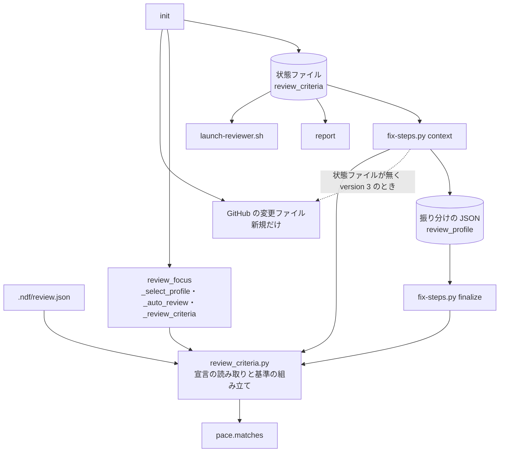

# レビューのプロファイル: プロジェクトが `.ndf/review.json` で指摘の基準・見送り・自動レビュー観点を差し替え、`version: 3` では変更ファイルのパスで 1 つを選び、外せない基準だけは残す（cross-review・/ndf:fix）

## 概要

**プロジェクトは `.ndf/review.json` に `version: 2` の `profile` を書くと、cross-review のレビュー担当・修正担当へ渡す
「指摘の基準」の節、見送りの種類と見送りの返信、自動レビュー観点を差し替えられる。** システム開発以外の成果物
（例: Markdown の小説の原稿）の PR も、cross-review の収束ループ（2 者がレビューし、1 者が直し、新しい指摘が出なくなるまで
回す）で通すためである。書いた鍵だけが既定を差し替え、`profile` を書かないリポジトリでは出力も状態ファイルも 1 字も
変わらない。**基準 2（秘密・認証認可・利用者のデータ・戻せない操作）は外せない基準で、プロファイルがあっても番号 2 のまま残る。**
`version: 3` では `profiles` に名前つきのプロファイルを複数書き、PR の変更ファイルのパスで 1 つを選ぶ。選んだ 1 つは
`version: 2` の `profile` と同じに効き、この文書の決定・条件・境界はそのまま当てはまる。`version: 3` の最上位に書いた
`criteria`・`not_written` は、選んだ組（選ばなかった PR では既定の組）へ足され、番号がどれかの組と重なる宣言は壊れたものとして捨てる。

この文書は、その形に**なぜしたか**（背景・決定と理由・常に成り立つ条件・境界・既知の限界・テスト観点）を残す。
**宣言の鍵と規則・状態ファイルの項目・修正担当の手順の正は Skill とスクリプトにある。**

| 何を | 正本 |
| --- | --- |
| 宣言（`.ndf/review.json`）の鍵と規則・宣言の例・状態ファイルの `profile_status` / `profile` / `profile_error` / `profile_name` / `profile_others`・`init` の出力の `REVIEW_PROFILE=` / `REVIEW_PROFILE_NAME=`・`version: 3` のプロファイルの選び方と最上位の `criteria`・`not_written`・再開で組み直す条件 | `cross-review` の [docs/02-fix-and-rotation.md](../../plugins/ndf/skills/cross-review/docs/02-fix-and-rotation.md) の「レビューの宣言（`.ndf/review.json`）」の節 |
| 自動レビュー観点の分類の一覧と、プロファイルの分類・`replace_auto_categories` の効き方・`auto_review_categories` | `cross-review` の [docs/04-contracts.md](../../plugins/ndf/skills/cross-review/docs/04-contracts.md) |
| 指摘の基準の方針（基準 1〜4 とプロファイルで差し替えられる範囲） | `cross-review` の [references/design-principles.md](../../plugins/ndf/skills/cross-review/references/design-principles.md) の「指摘の基準」の行 |
| 修正担当の振り分け（`criterion` / `waive_kind` の許す値・見送りの返信・「対象のファイル」の語） | [`fix` の SKILL.md](../../plugins/ndf/skills/fix/SKILL.md) と [`fix-steps.py`](../../plugins/ndf/skills/fix/scripts/fix-steps.py) の冒頭の説明 |
| 既定の基準・書かないもの・見送りの種類・返信の雛形の文、`reviewer` / `fixer` の打ち方 | [`scripts/lib/review_criteria.py`](../../plugins/ndf/scripts/lib/review_criteria.py) の冒頭の説明と定数 |

決定の番号は設計の番号である（「プロファイルの形」は #1910、「複数のプロファイルと選択」は #1942 の設計）。コードの説明に
残る「#1942 の決定 6」などは、下の「複数のプロファイルと選択」の表の同じ番号を指す。

## 用語

「レビューのプロファイル」「指摘の基準」「外せない基準」「見送りの種類」「見送りの返信」「自動レビュー観点」の定義は
用語集（[docs/glossary.md](../glossary.md) の `ndf-cross-review`）が正である。語はすべて NDF の cross-review
（`ndf-cross-review`）の 1 つのコンテキストに収まり、`/ndf:fix` を単独で使うときも同じ語と同じ部品（`review_criteria.py`）で読む。

## 背景

指摘の基準・書かないもの・見送りの種類・見送りの返信・自動レビュー観点は、ndf 10.17.70 まですべて NDF の定数で、
プロジェクトからは `.ndf/review.json` の `focus`（基準 3）と `--focus` / `--extra-instructions-file` で**足すことしかできなかった**。
利用者のプロジェクトで「小説の原稿を 10 話ごとに PR にまとめて cross-review したい」という求めが出たが、原稿の主な指摘
（言い回し・文の自然さ・人物の口調・設定との食い違い）は既定の「書かないもの」（字句や言い回し）に当たり、書かれても修正担当が
`wording` で見送った。観点を足しても「書かないもの」と食い違う指示が同じプロンプトに並び、プロジェクトは同じ形のループを
自前の Skill で組んでいた。

`version: 2` のプロファイルはリポジトリに 1 つで、どの PR にも同じものが効いた。性質の違う 2 種類の PR（`works/*/chapters/*/text.md`
を変える原稿の PR と、`scripts/`・`tests/`・`docs/` を変える仕組みの PR）を同じリポジトリで回す利用者は、両方の基準を 1 つの
`criteria` に並べて文の頭で書き分け、レビュー担当の読み分けに頼っていた。そのため、当たらない基準で指摘が出る・当たる指摘が
抜ける・「書かないもの」と返信が両立しない・原稿の指摘を仕組みの見送りの種類（`wording`）で見送れてしまう、が起きた。
`version: 3` は、PR の変更ファイルのパスで 1 つのプロファイルを選ぶことでこれを分ける。

## 決定と理由

### プロファイルの形

| # | 決定 | 理由 | 採らなかった案 |
| ---: | --- | --- | --- |
| 1 | 基準 2 を外せない基準にし、番号 2 と 3 をプロファイルの `criteria` に使わせない（書けば壊れたプロファイル） | プロファイルは PR の head から読むため、基準 2 を消せると PR の作り手がその PR の安全の基準を外せる。原稿のリポジトリでも実在の人物の個人情報や秘密の混入は起こりうる。番号 2 を固定すると、どのリポジトリでも `criterion: 2` が同じ意味になり、振り分けの記録を横断して数えられる。番号 3 は重点が後から足されても衝突しないよう、重点が無いときも予約する。承認ゲート 1（2026-10-11）で利用者が決めた | プロファイルが基準 2 も差し替える（課題の「提案」の例の形）。外せない基準を末尾へ別の番号で足す（既定の出力と番号の意味がプロファイルの有無で変わる） |
| 2 | プロファイルの `paths` は `.ndf/pace.json` の `areas` と同じ規則で照らし、`scripts/lib/pace.py` の `matches` を使う（`*` と `?` は `/` をまたがず、`**` はまたぐ） | `.ndf/` の宣言のパスの書き方が鍵ごとに違うと、書き手が覚え分ける。`fnmatch` は `*` が `/` をまたぎ、`works/*/chapters/*/text.md` が `works/a/x/chapters/011/text.md` にも当たる | `fnmatch` や `PurePath.match` で別に照らす（同じ役割の関数が 2 つになる） |
| 3 | 修正担当の語はプロファイルの有無だけで「対象のファイル」に切り替え、成果物の呼び名の鍵を足さない。`/ndf:fix` の手順は常にコードに限らない語で書く | 切り替わるのは修正担当の節の見送りの句 1 か所で、呼び名を変えても指示の意味は変わらない。`SKILL.md` は宣言を読まない | プロファイルに呼び名の鍵（例: `artifact`）を足す（使い道が 1 句だけで、検査する鍵が増える） |
| 4 | 壊れたプロファイルは丸ごと捨てて既定で続け、終了コードを変えない。知らない鍵があるときも丸ごと捨てる。重点（`focus`）はプロファイルと独立に読む | 鍵ごとに捨てると、`waive_kinds` だけ既定で `reply` はプロファイルのまま、のような書き手の意図に無い組み合わせが生まれる。丸ごと捨てれば、出るのは既定かプロファイルかのどちらかで、報告の 1 行で状態が分かる。鍵の打ち間違い（`waive_kind` など）を黙って無視すると、意図に無い既定が効く | 壊れた鍵だけ既定に戻す。宣言を止める（今の重点の宣言の扱い〈止めない〉と食い違う） |
| 5 | `review_kind`（設計 / コード）とラウンドの段は既定の分類から決め、観点を渡す分類の列（`auto_review_categories`）とは分ける | `replace_auto_categories` が真のとき観点の列から `design` が外れ、この列で決めると設計 PR が実装 PR の上限（12 ラウンド）で回る。プロファイルの分類の名前が既定の名前と同じときは、列では 1 つにまとめ、観点の文は既定の後ろにプロファイルの文を足す | 既定の分類の列を状態ファイルに別に持つ（再開で `changed_files` から組み直せる） |
| 6 | 新規・再開とも worktree を同期した後に宣言を読み、再開では保存した `changed_files` から観点と基準を組み直して、保存した値と違うときだけ状態ファイルを書く | 宣言は PR の head の worktree にあるため、新規でも worktree を用意してから観点を組む。再開で組み直さなければ、プロファイルの書き換えが次のラウンドに効かない。組み直しに GitHub を呼び直さない | 再開ごとに PR の変更ファイルを GitHub から取り直す（今の再開の範囲を超える） |
| 7 | `fix-steps.py context` がプロファイルを振り分けの JSON（`review_profile`）へ写し、`finalize` はその写しで検査して返信を組む | `finalize` が宣言を読み直すと、`context` の後に宣言が変わったとき、修正担当が見た基準で使った種類を拒む。重点（`review_focus`）と同じ経路で写す | `finalize` が状態ファイルか宣言を読み直す |
| 8 | 見送りの返信の重点の句（「。レビューの重点（…）にも当たりません」）は既定の雛形のときだけ足す | 重点の句は既定の雛形の括弧の中に合わせた文で、プロファイルの `{inner}` に入れると「好みの文体。レビューの重点（…）にも当たりませんに当たるためです。」のように崩れる | 重点の名前の置き場（`{focus}`）を足す（要求に無い） |
| 9 | 状態ファイルと振り分けの JSON には、プロファイルがあるときだけ項目を置く | 常に置くと、古い状態ファイルからの再開で `review_criteria` の値が変わり、宣言を変えていないのに書き直しが起きる。項目が無いことを「プロファイルなし」と読む | 項目を常に置く |

### 複数のプロファイルと選択

| # | 決定 | 理由 | 採らなかった案 |
| ---: | --- | --- | --- |
| 1 | 宣言を `version: 3` にし、`profiles` を配列で書く | `version: 2` に `profiles` を足すと、古い NDF は知らない鍵を無視して `profile`（または既定）をすべての PR に効かせ、原稿の PR に仕組みの基準が効く。`version: 3` なら古い NDF は宣言全体を読めないとして既定で続く（止まらない）。配列にするのは選ぶ順を書いた順として形に持たせるためで、`.ndf/pace.json` の `areas`（名前とパスの組の配列）と同じ形になる | 名前を鍵にしたオブジェクト（選ぶ順が JSON で保証されない鍵の並びに頼る）。`version: 2` の `profile` を当たらないときのものとして残す（古い NDF がそれを全 PR に効かせる） |
| 2 | 2 つ以上のプロファイルに当たる PR では、宣言に書いた順で最初に当たったものを選び、止めない | 選び方を宣言だけから読め、書き手は「先に書いたものが勝つ」だけを覚えればよい。原稿のパスを 1 つでも変えた PR を原稿のプロファイルで見たいなら原稿を先に書く。ほかにも当たったことは知らせるので、意図しない選択に気づける。止めると収束ループが人の操作を待つ | 当たった変更ファイルの多いもの（同数の決め方が別に要り、原稿 10 話に文書 1 つを足しただけで選び方が変わりうる）。すべての変更ファイルが当たるものに限る（原稿の PR がスクリプトを 1 行直すと、原稿が仕組みのプロファイルで見られ、言い回しが `wording` で見送られる） |
| 3 | 当たらないときのプロファイルを別の鍵にせず、`paths` を持たない要素を末尾に 1 つだけ置ける形にする | `paths` を持たない要素はどの PR にも当たるので、決定 2 の規則 1 つで受け皿になり、選び方の規則が分かれない。末尾以外に置くと後ろの要素が永久に選ばれないため壊れた宣言にする。NDF は `default` のような名前を予約しない | 別の鍵（例: `default_profile`。同じ形のプロファイルを 2 か所で検査することになる） |
| 4 | 壊れたプロファイルが 1 つでもあれば、`profiles` を全部捨てて既定で続ける | 壊れたものだけを捨てると、選ばれるはずだったものが消えて次に当たるもの（多くは受け皿）が選ばれ、原稿の PR が仕組みのプロファイルで黙って見られる。全部を捨てれば、出るのは既定かプロファイルかのどちらかで、#1910 の決定 4 と同じ読み方になる | 壊れたものだけを捨てる。宣言を止める |
| 5 | 選んだ名前を状態ファイルの `review_criteria.profile_name` に置き、`version: 3` のときだけ置く | `review_criteria` は再開のたびに組み直して保存した値と比べるので、名前もここに置けば選び直したときだけ書き直しが起き、比べ方を足さない。`version: 1`・`2` で置かないのは #1910 の決定 9 と同じ理由。選ばなかったときは空文字にし、項目が無い（`version: 1`・`2`）と区別する | 状態ファイルの最上位に置く（再開の比べ方が 1 つ増える）。写し（`profile`）の中へ入れる（振り分けの JSON の `review_profile` へ渡り、知らない鍵として拒まれる） |
| 6 | 単独の `/ndf:fix` は、`version: 3` の宣言のときだけ変更ファイルを REST（`gh api …/pulls/<PR>/files --paginate`）で取る | `version: 1`・`2` と宣言の無いリポジトリでは GitHub の呼び出しが変わらない。取るのは cross-review の `changed_files` と同じ集合（新しい名前と前の名前）で、同じ PR なら cross-review の中と外で同じプロファイルが選ばれる | `gh pr view --json files` に足す（呼び出しは増えないが GraphQL の `files` は 100 件で打ち切られ、cross-review と選ぶ結果が食い違いうる） |
| 7 | `version: 3` の最上位の `criteria`・`not_written` を選んだ組（選ばなかった PR では既定の組）へ足し、番号が選びうる組と重なれば壊れた宣言にする | どの種類の PR にも効かせたい基準（例: 取得したデータを公開の置き場へ出す）をプロファイルごとに写すと、直し忘れたとき黙ってずれる。最上位の 1 か所を基準 2 の延長（宣言の側で外せない基準）として扱えば、選んだどの組にも同じ文が効き、写しに入るので `finalize` も通す。重なりは、どちらの文が効くかが PR の種類で変わり書き手が気づけないため、選ばれた PR でだけ壊れる宣言を作らないよう、選びうるすべての組と比べる。2026-10-12 に利用者が決めた | 番号が重なればプロファイルの側を勝たせる |
| 8 | 選んだ名前とほかに当たった名前（`profile_others`）を `report` の要約の 1 行に出す | 利用者の多くは最後の報告（`report` の要約と、それを写した PR のコメント）しか読まず、`init` の出力の `REVIEW_PROFILE_NAME=` は目に入らない。名前は保存した `changed_files` と宣言だけで決まるので再開の比べ方は変わらず、ほかに当たらない状態ファイルは項目を置かず形が変わらない | 状態ファイルの最上位に置く（決定 5 と同じ理由） |

## 仕様

### 構成要素と責務

| 要素 | 責務 |
| --- | --- |
| `plugins/ndf/scripts/lib/review_criteria.py` | 既定の基準・書かないもの・見送りの種類・返信の雛形の唯一の置き場。宣言を 1 回読み（`load_review_decl` → `ReviewDecl(focus, profile, profiles, shared, others)`。例外を上げない。`version: 3` は `select_profile` で 1 つを選び、最上位の基準（`shared`）を足す）、写しからプロファイルを組み直し（`profile_from` / `state_profile` / `context_decl`）、節（`reviewer_block` / `fixer_block`）・返信（`waiver_reply`）・許す値（`criterion_numbers` / `waive_kinds`）・分類の照合（`profile_categories`）・状態の `review_criteria`（`as_state`）を組む |
| `plugins/ndf/scripts/lib/review_criteria_decl.py` | プロファイル（`version: 2` の `profile`・`version: 3` の `profiles` の各要素）の形の検査と `Profile` の型。既定の基準・節の組み立て・選択は持たない（`review_criteria.py` を 500 行の上限に収めるため形の検査だけを分けた） |
| `cross-review` の `review_lib/review_focus.py` | 宣言の読み取り（`_read_review_decl`）、`review_criteria` の組み立て（`_review_criteria`）、既定の分類とプロファイルの分類を合わせた観点の組み立て（`_auto_review`・再開の組み直し `_apply_auto_review`）。新規と再開の両方の経路が同じ部品を呼ぶ。`version: 3` の選択（`_select_profile`）と、ほかにも当たったときの知らせ（`info`）を出す |
| `cross-review` の `review_lib/commands/init.py` | 新規は worktree を用意した後に、再開は同期した後に宣言を読み、`review_kind` を既定の分類から、観点と `review_criteria` をプロファイル込みで組んで状態ファイルへ書く。新規は取った変更ファイルで、再開は先に状態ファイルを読んで保存した `changed_files` でプロファイルを選び、`REVIEW_PROFILE=` と `REVIEW_PROFILE_NAME=` を出す |
| `cross-review` の `review_lib/commands/report.py` | プロファイルが `unreadable` のとき理由を出す。`version: 3`（`profile_name` がある）では選んだプロファイルの名前（選ばなかったときは「既定」）と、ほかに当たった名前（`profile_others`）の 1 行を出す |
| `fix` の `scripts/fix-steps.py` | `context` で状態ファイルの写し（無ければ `--root` の宣言。`version: 3` では PR の変更ファイルで選んだプロファイル）から節を書き、`review_profile` を振り分けの JSON へ写す。`finalize` は写しで `_decision_problems` / `_criterion_problems` を検査し、返信を組む |

`launch-reviewer.sh` は変えない。状態ファイルの `review_criteria.reviewer_block` と `review_instructions` を読むだけで、
差し替えはどちらも `init` が済ませている。

`launch-reviewer.sh`・`fix-steps.py finalize`・`report` は写しを読むだけで、宣言を読み直さず、選択もしない。選択と最上位の
基準の足し込みは、`init`（単独の `/ndf:fix` では `context`）が写しを書く前に済ませる。

### 常に成り立つ条件

| # | 条件 | 破れたときの扱い |
| --- | --- | --- |
| I1 | プロファイルが無い（`none`）とき、レビュー担当・修正担当への節、見送りの返信、自動レビュー観点、状態ファイルの `review_criteria` は変更前と 1 字も変わらない | テストが落とす |
| I2 | 外せない基準（基準 2）は、プロファイルがあっても両方の節に出て、振り分けで `criterion: 2` が許される | `criteria` に `"2"` を書いたプロファイルは壊れたものとして捨てる（I4） |
| I3 | プロファイルの鍵は個別に効く。書いた鍵だけが既定を差し替え、書かない鍵は既定の値のまま | テストが落とす |
| I4 | 壊れたプロファイルは丸ごと捨てて既定で続け、終了コードを変えない。理由を標準エラー（cross-review では報告）に出す。重点はプロファイルと独立に読む | 止めない |
| I5 | `finalize` が許す `criterion` と `waive_kind` は、`context` が修正担当へ渡した節と同じプロファイル（振り分けの JSON の写し）から組んだ集合である | 許さない値は `finalize` が `invalid` で止める |
| I6 | `review_kind` とラウンドの段は既定の分類から決め、プロファイル（`replace_auto_categories` を含む）で変わらない | テストが落とす |
| I7 | 再開で状態ファイルの `review_criteria` と自動レビュー観点を書き直すのは、宣言から組んだ値が保存した値と違うときだけである | テストが落とす |
| I8 | 見送りの返信は、雛形の `{inner}` を見送りの種類の名前に置き換えた文である（`str.format` は使わず、ほかの波括弧は残す）。重点の句は既定の雛形のときだけ足す | テストが落とす |
| I9 | 1 回の cross-review（とその中の `/ndf:fix`）で効くプロファイルは 1 つで、2 つ以上のプロファイルの鍵を混ぜた組（和）を作らない。選ばなかったプロファイルの分類は、パスが当たっても自動レビュー観点に足さない | テストが落とす |
| I10 | `version: 1`・`2` の宣言では、選択に関わる項目（`profile_name`・`profile_others`・`report` のプロファイルの名前の行）を置かず、出力と状態ファイルは `version: 3` を足す前と 1 字も変わらない | テストが落とす |
| I11 | 同じ PR なら、cross-review の `init` と単独の `/ndf:fix` の `context` は同じパスの集合（新しい名前と前の名前）で同じ規則によって選び、同じプロファイルになる | テストが落とす |

### 境界の決まり

- **変わるのはレビュー担当と修正担当へ渡す文と、見送りの返信と、自動レビュー観点だけである。** 収束の判定・投稿の形・
  状態ファイルでの再開・参加者の選び方・ラウンドの数は変えない
- **許す `criterion` の番号には 3 が常に含まれる。** `criterion_numbers(profile)` は既定の `CRITERION_NUMBERS` と同じく
  3 を含め、重点が無いときの 3 は `fix-steps.py` の `_criterion_problems` が別に拒む（重点の検査を 1 か所に残す）
- **`--focus` と `--extra-instructions-file` は、プロファイルがあっても自動レビュー観点の後ろに足される。**
- **プロファイルの分類の名前が既定の自動カテゴリの名前と同じときは**、`auto_review_categories` では 1 つにまとめ、
  観点の文は既定の後ろにプロファイルの文を足す（決定 5）
- **`version: 2`・`3` の宣言を、それを知らない古い NDF が読むと**、宣言全体を読めないとして基準 1・2・4 で続ける（止まらない）
- **プロファイルを選ぶ手がかりは PR の変更ファイルのパスだけである。** PR の題・本文・ラベル・ブランチ名では選ばない
- **レビューの重点（`focus`）はリポジトリに 1 つのまま**で、どのプロファイルを選んでも効く
- **選択のために cross-review の GitHub の呼び出しを増やさない。** GitHub から変更ファイルを取り足すのは、状態ファイルが無く宣言が
  `version: 3` のときの単独の `/ndf:fix` だけである（決定 6）
- `cross-refactoring` は最終ゲートとして cross-review を呼ぶため、その中ではプロファイルがそのまま効く。`pr-review`
  （単発のレビュー）の基準は差し替えない（[pr-review-steps-script.md](pr-review-steps-script.md) の決定 4 で、外部 AI に
  `review_criteria.py reviewer` の節を渡していない）

## セキュリティ

プロファイルは PR の head から読むため、PR の作り手が基準を変えられる。今の重点の宣言と同じ扱いで、新しい危険は足さない。
PR の作り手が変えられるのは、基準の追加と、基準 1・4・書かないもの・見送りの種類と返信・自動レビュー観点の差し替えまでで、
外せない基準（基準 2）は消せない（決定 1）。`version: 3` では、PR の作り手が宣言の順と `paths` を変えて選ばれるプロファイルを
変えられるが、どれが選ばれても基準 2 は残り、この範囲を超えない。

## 運用

### 既知の限界

| 項目 | 内容 |
| --- | --- |
| 実際の原稿の PR での効き目 | プロファイルの基準でレビュー担当が言い回し・口調の指摘を書くか、収束までのラウンド数、原稿の PR と仕組みの PR でレビュー担当の指摘・修正担当の見送りが PR の種類に合うかは、リリース後テストでしか分からない |
| 名前を変えたファイルの前の名前で当たる場合 | 選択の入力には前の名前も含める（cross-review の `changed_files` と同じ集合）。前の名前だけが原稿のパスに当たる PR（原稿を外へ移す PR）は原稿のプロファイルになるが、利用の実例は無い |
| 選び方の知らせが届く先 | ほかのプロファイルにも当たった知らせは cross-review では `info` と `report` の行、単独の `/ndf:fix` と `review_criteria.py` の CLI では標準エラーにだけ出る。単独の `/ndf:fix` の利用者が標準エラーを読まないと、意図しない選択に気づけない |
| 既定の観点名との重なり | プロファイルの分類の名前が既定の自動カテゴリの名前（例: `code`）と同じときの扱い（決定 5）は、利用の実例が無い |
| `/ndf:fix` の手順の語 | `SKILL.md` の「対象のファイル」の語は `.md` の文言のテストを書かない方針のため、レビューで見る |
| 課題の「提案」の例 | 課題の本文の「提案」の JSON は `criteria` の番号 2 に原稿の基準を書いている。この形は壊れたプロファイルとして既定で続く。番号 2 の基準は 5 など別の番号へ移して書く（正しい例は `docs/02-fix-and-rotation.md`） |

## テスト観点

テストは `plugins/ndf/scripts/tests/test_review_criteria.py`、`cross-review` の `tests/test_review_profile.py`・
`tests/test_review_criteria_flow.py`、`fix` の `tests/test_fix_steps.py` にある。

- 宣言の無い根と `version: 1` だけの根で、`reviewer` / `fixer` の出力・`waiver_reply` の全種類・自動レビュー観点・`as_state` が変更前と一致すること（I1）
- `criteria` と `not_written` を書いた根の `reviewer` 出力に、プロファイルの基準が番号つきで並び、基準 2 の文があり、既定の基準 1・4 の文と「字句や言い回し」が無いこと
- `waive_kinds` と `reply` を書いた振り分けで、`finalize` の返信が `{inner}` に種類の名前を入れた文になり、重点があっても重点の句が無いこと。既定の雛形では重点の句が付くこと（I8）
- 写しを持つ振り分けで、プロファイルに無い `wording` と `criteria` に無い番号を `finalize` が `invalid` で止め、`criterion: 2` と（重点があるとき）`3` は通すこと（I5）
- `works/*/chapters/*/text.md` の分類が `works/novel-a/chapters/011/text.md` に当たり、`works/novel-a/x/chapters/011/text.md` には当たらないこと
- `replace_auto_categories` が真なら観点の列に `common` / `docs_only` が無く文はプロファイルの分だけ、偽か無ければ既定の文の後ろにプロファイルの文が付くこと
- プロファイルがある根の `fixer` 出力と `context` の文脈のファイルに「コードを変え」が無く「対象のファイルを変えずに」があること
- `reply` に `{inner}` が無い宣言・知らない鍵のある宣言で、`review_criteria.py` が終了コード 0・既定の節・標準エラーに理由を出し、`init` の状態ファイルが `profile_status: unreadable` と既定の `reviewer_block` を持ち、`report` が理由を出し、同じ宣言の `focus` は効くこと（I4）
- 再開の前にプロファイルを書き換えると `reviewer_block` と `review_instructions` が新しい値になり、書き換えなければ状態ファイルが書き直されないこと（I7）
- プロファイルがあっても `--focus` と `--extra-instructions-file` の文が観点の後ろに付くこと
- `criteria` に `"2"` か `"3"` を書いた宣言が `unreadable` になること（I2）。`criteria` だけの宣言で「書かないもの」・見送りの種類・返信が既定のままであること（I3）
- `replace_auto_categories` が真で設計文書だけを変えた PR の `review_kind` が `design`、ラウンドの上限が 3 であること（I6）

`version: 3`（複数のプロファイルと選択）の観点。例の宣言は、原稿のプロファイル（`paths` が `works/*/chapters/*/text.md`、
見送りの種類 `taste`）を先に、仕組みのプロファイル（`paths` なし、見送りの種類 `wording`）を後に書く。

- 原稿のパスだけを変えた PR で、`init` の `reviewer_block` と `context` の文脈のファイルに原稿の基準・`taste` があり、仕組みにしか無い基準・`wording` が無いこと。仕組みのパスだけを変えた PR でその逆になること（I9）
- 原稿の PR の振り分けで、`finalize` が `wording` と原稿の `criteria` に無い番号を `invalid` で止め、`taste` と `criterion: 2` を通し、返信が原稿の `reply` の文になること（I2・I5）
- 原稿の PR で、仕組みのプロファイルの分類のパスが当たっても観点に足されないこと（I9）
- 両方のパスを変えた PR で先に書いた原稿が選ばれ、`init` が 0 で終わり、`REVIEW_PROFILE_NAME=manuscript` と知らせが出て、状態ファイルに `profile_others` があること。順を入れ替えた宣言では仕組みが選ばれること（決定 2）
- 原稿に当たらない PR で `paths` の無い仕組みが選ばれること。`paths` の無い要素を持たない宣言で当たらない PR の節・返信が、宣言が無いとき（`focus` を書けばそれを含む）と一致し、`profile_name` が空文字であること（決定 3）
- `version: 1` と `version: 2`（`profile` あり・なし）で、`reviewer` / `fixer`・返信・観点・`as_state` が変わらず、`profile_name` が無く、`report` にプロファイルの名前の行が出ないこと（I10）
- 宣言と `changed_files` を変えずに再開すると状態ファイルが書き直されず（ほかに当たった PR でも）、宣言の順を入れ替えて再開すると保存した `changed_files` で選び直され、再開で GitHub の変更ファイルを取らないこと（I7）
- 状態ファイルの無い `context` が、`version: 3` の宣言で変更ファイルを 1 回取って同じ規則で選び、取得が失敗しても終了コードを変えず変更ファイルなしで選ぶこと。`version: 2` の宣言では変更ファイルを取らないこと（決定 6・I11）
- 名前の重複・`paths` の無い要素が末尾以外・知らない鍵・`profile` を書いた `version: 3` のそれぞれで、`review_criteria.py` が終了コード 0・既定の節・標準エラーに理由を出し、`init` の状態ファイルが `profile_status: unreadable`・`profile_name: ""` を持ち、`focus` は効くこと（決定 4）
- 最上位の基準が原稿の PR・仕組みの PR・どれも選ばない PR の両方の節に出て `finalize` がその番号を通し、`not_written` が最上位 → プロファイルの順の和で同じ文が 1 つになること。番号がプロファイルの `criteria`・既定の 1・4（選ばれうるとき）・基準 2 と重なる宣言で、プロファイルも最上位の基準も捨てて既定で続くこと（決定 7）
- `report` の要約に `## レビューのプロファイル: <名前>`・`既定`・ほかに当たった名前つきの行が出ること（決定 8）
- 名前と `paths` だけの要素を選ぶと、`profile_status` が無く、`fixer` の見送りの句が既定のまま、`profile_name` に名前が残ること

## 関連リンク

- [`scripts/lib/review_criteria.py`](../../plugins/ndf/scripts/lib/review_criteria.py)・[`scripts/lib/pace.py`](../../plugins/ndf/scripts/lib/pace.py)・[`fix-steps.py`](../../plugins/ndf/skills/fix/scripts/fix-steps.py)
- `cross-review` の [docs/02-fix-and-rotation.md](../../plugins/ndf/skills/cross-review/docs/02-fix-and-rotation.md)・[docs/04-contracts.md](../../plugins/ndf/skills/cross-review/docs/04-contracts.md)・[references/design-principles.md](../../plugins/ndf/skills/cross-review/references/design-principles.md)
- [cross-review-evidence-based.md](cross-review-evidence-based.md)（指摘区分と収束の判定。プロファイルはこれを変えない）
- [`review_criteria_decl.py`](../../plugins/ndf/scripts/lib/review_criteria_decl.py)
- 用語集の「レビューのプロファイル」「プロファイルの選択」（[docs/glossary.md](../glossary.md) の `ndf-cross-review`）
- #1910（プロファイルの形を決めた課題）・#1942（複数のプロファイルと選択を決めた課題）
