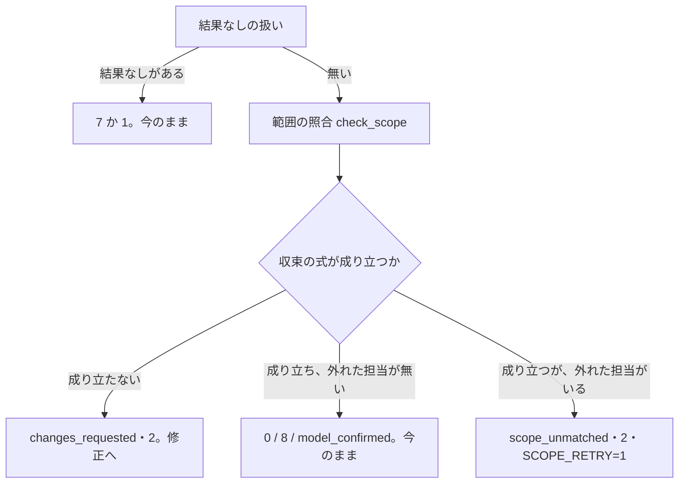

# cross-review: 担当がレビュー範囲を推測してスプリント PR の末尾のコミットだけを見て承認し、全差分を見ないまま収束していた → 担当へ base・head・ファイル数を渡し、読んだファイル数が足りない承認では収束しない

## 目的

**cross-review の収束（新しい指摘 0 件・全員が通した）を、担当が Pull Request の全差分を見た結果に限る。**
担当が範囲を推測して末尾のコミットだけを見た承認では、収束したと数えない（#1702）。

- **担当へのプロンプトに、そのラウンドのレビュー範囲を載せる。** base の SHA・head の SHA・3 点の
  `git diff <base>...<head>` のコマンド・その範囲のファイル数である。2 ラウンド目以降は head をそのラウンドの
  head へ更新し、ファイル数も数え直す
- **担当は結果ファイルに読んだファイル数（`read_files`）を書く。** 判定は、通した担当の読んだ数を
  範囲のファイル数と突き合わせる（範囲の照合）
- **読んだ数が範囲の半分（切り上げ）に満たない・測れない承認は収束に数えない。** そのラウンドは修正を挟まずに
  次のラウンドへ進み、席の輪番で別の担当が全範囲を見る

例: スプリント PR（base から 16 ファイルを変える複数のコミットの末尾に、1 ファイルだけを変える cross-refactoring の
コミットが 2 件付く形）の round 1。

| 担当 | 結果ファイル | 範囲の照合 | ラウンドの扱い |
| --- | --- | --- | --- |
| codex | `APPROVE`・`read_files: 16` | 数える（8 以上） | — |
| kiro | `APPROVE`・`read_files: 1` | 数えない（`too_few`） | 収束の式は成り立つが外れた担当がいるため、`scope_unmatched`・終了コード 2・`SCOPE_RETRY=1` で修正を挟まずに round 2 へ |

判定の出力は `SCOPE_CHECK=checked` と `SCOPE_UNMATCHED='kiro=1/16'` になる。

**レビュー範囲の欄・`unavailable` の値・`read_files` の検証・判定の出力の行・`scope_check` の形は Skill が正である。**
ここに書き写さない。この文書が扱うのは、そこに書かない決定の理由・常に成り立つ条件・テストの観点である。

| 何を | 正本 |
| --- | --- |
| `rounds[].review_scope` の欄と `unavailable` の値、プロンプトに範囲の節を載せる条件、`read_files` / `read_files_reason`、判定での照合の規則、照合しない理由、`SCOPE_CHECK` / `SCOPE_UNMATCHED` / `SCOPE_RETRY` と `rounds[].scope_check` | [`cross-review` の `docs/05-pool-and-convergence.md`](../../plugins/ndf/skills/cross-review/docs/05-pool-and-convergence.md) の「範囲の照合」 |
| 判定の出口の表（`scope_unmatched` の行）と、記録なしで次のラウンドを開けること | [`docs/01-state-and-review.md`](../../plugins/ndf/skills/cross-review/docs/01-state-and-review.md) の「判定の出口」 |
| 状態ファイルの鍵の一覧・担当が書く結果ファイルの項目（`{event, by_severity, read_files}`） | [`docs/04-contracts.md`](../../plugins/ndf/skills/cross-review/docs/04-contracts.md) |
| プロンプトの節の文言 | `plugins/ndf/skills/cross-review/scripts/launch-reviewer.sh`（スクリプトが正） |

## 用語

定義は [用語集](../glossary.md) が正である（`.ndf/glossary.json` の `document`、コンテキスト `ndf-cross-review`）。
この文書で使う語は「担当」「席」「総評」「結果なし」「レビュー範囲」「読んだファイル数」「範囲の照合」である。

## 対象範囲

| 扱う | 扱わない |
| --- | --- |
| cross-review の担当へのプロンプトにレビュー範囲を載せること | cross-refactoring の提案担当・実装担当のプロンプト（現象は cross-review の担当で起きた） |
| 結果ファイルの `read_files` と、判定での範囲の照合 | 担当が実際に読んだファイルを、Tool の呼び出しの記録から数えること（読んだ数は自己申告で受ける） |
| 照合で外れた承認を収束に数えず、修正を挟まずに次のラウンドへ進めること | 総評の文への読んだファイル数の記載（機械は結果ファイルの数値で受ける） |
| | 最終スイープ（Step 7.5）・反証（critique）・検証（`verify-findings`）の担当への範囲の受け渡し |
| | ラウンドの上限・振動の判定の変更 |

## 背景

**担当が範囲を末尾のコミットへ狭めて承認し、その round が収束していた。** devbasex/devbase のスプリント m7d の
Pull Request（#421、16 ファイル・+973 / -441、4 課題分）の cross-review である（2026-10-03。#432 でも再発）。

| round | 担当 | 見た範囲 |
| --- | --- | --- |
| 1 | codex / kiro | kiro は末尾の 2 コミットだけ。codex は総評から範囲が読めない |
| 2（`--reopen`） | claude / kiro | 2 者とも末尾の 2 コミット（cross-refactoring が足したもの）だけ。claude は「変更は manager.py だけ」と書いた |
| 3（`--reopen --focus` で `git diff <base>...<head>` を読むよう指示） | claude / codex | 2 者ともスプリントの全差分 |

スプリントの Pull Request は、検査のプランで cross-refactoring の後に cross-review が走るため、末尾にリファクタリングの
コミットとリファクタリング計画のコメントが付く。プロンプトには head の SHA だけがあり base が無かったため、担当は
それを手がかりに範囲を推測した。round 1 の「全員 APPROVE・指摘 0」は全差分を見た結果ではなかった。

**範囲をプロンプトで渡せば狭めない。** round 3 で範囲のコマンドを渡すと、2 者とも全差分を見た。範囲を狭めた担当の
読んだファイルの数は差分の数より大きく少なく（16 に対して 1〜2）、数の照合で見分けられる。

## 決定と理由

| 決定 | 理由 |
| --- | --- |
| base の SHA は、head を取る同じ REST の応答（`GET /repos/{repo}/pulls/{pr}`）の `base.sha` から読む（`PrMetadata.base_sha` → `HeadRef.base_oid`） | 毎ラウンド打っている応答に入っており、GitHub の API の呼び出しは増えない。`init` で 1 度だけ取ると、巻き直し（`rotate-pr`）で Pull Request が替わったときに base がずれる。`origin/<base_branch>` をworktree で解くと、base のブランチが進んだときに Pull Request の base と一致しなくなる |
| 範囲は `start-round` が Python（`review_lib/review_scope.py` の `compute_scope`）で求めて状態ファイルへ書き、起動スクリプトは写すだけにする | 範囲の規則（`classifications.diff_scope`）を 1 か所に置き、2 つの席の起動と判定が同じ値を読む。起動スクリプトで数えると、判定が照らす値と担当が見た値を揃えるために 2 度数えることになる。設計 PR の前のラウンドからの差分の節（`PREV_SHA` / `DIFF_SCOPE_BLOCK`）はこの節へ統合して消した |
| しきい値は「差分のファイル数の半分（切り上げ）」の比（`READ_FILES_MIN_RATIO = 0.5`）。読んだ数が差分の数を上回るのは外さない | 観察された狭め方は差分の 1 割前後（16 に対して 1〜2）で、半分なら余裕をもって拾い、ロックファイルや生成物を読み飛ばす担当は外さない。差の絶対値は、2 ファイルの差分で 0 を申告しても外せず、100 ファイルでは数ファイルの読み飛ばしで外れる。値はプロジェクトの形ではなく担当の振る舞いで決まるため、設定（`.ndf/review.json`）にしない |
| 照合で外れた担当は起動し直さず、修正を挟まない次のラウンド（`scope_unmatched`）で別の席に見させる | 外れた担当は結果ファイルを残しており「結果なし」に当たらない。結果なしの経路（終了コード 7・振り替え）へ載せると、2 度外れた担当が実行の残りから外れる。範囲の節が載ったプロンプトで狭めた担当へ同じプロンプトを渡し直しても結果が変わる見込みは無く、起動し直しの記録が 2 種類になる。修正するものが無いため、設計 PR のモデルレビューの承認（`model_confirmed`）と同じ形で修正の工程を通さない |
| 設計 PR のモデルレビュー（`stage: model`）は照合しない（`unchecked:model_stage`）。範囲の節は載せる | モデルレビューはドメインモデルの節と用語集の差分だけを見るよう指示されており、読んだ数が少ないのは指示どおりである。モデルレビューの承認では収束しない（詳細レビューへ進む）ため、照合しなくても全差分を見ないまま収束することは起きない |
| 設計 PR の前のラウンドからの範囲も 3 点の `git diff <前の head>...<head>` にする | 前の head が今の head の祖先なら 2 点と同じ差分になる。巻き直しで祖先でなくなったとき、2 点は前の head の側の変更を逆向きに混ぜる。1 つの形にそろえれば、プロンプトとファイル数を数えるコマンドが範囲の種類に関わらず同じになる |
| 読んだファイル数は結果ファイルの整数で受け、総評の文からは読まない | 機械が総評の文から数を読むと、書き方の揺れで外れる |
| `plugins/ndf/scripts/lib/` へ置かず、cross-review の `review_lib/` に置く | cross-refactoring の担当は範囲を Pull Request から受けないため、同じ役割を両方が使う形にならない |

## 仕様

### 常に成り立つ条件

| 条件 | 破れたときの扱い |
| --- | --- |
| プロンプトに載る base・head・ファイル数は、そのラウンドの `review_scope` と一致し、`review_scope.head_sha` はそのラウンドの `head_sha` と一致する | `launch-reviewer.sh` は、`unavailable` が無く、`head_sha` が一致し、`base_sha` が文字列で `files` が数のときだけ範囲の節と `read_files` の指示を載せる。それ以外は今の形（範囲なし）で起動する |
| 範囲を求められないラウンドは止まらずに担当を起動し、照合しなかったことと理由が判定の出力と状態ファイルに残る | `compute_scope` は例外や終了コードで止めず、理由（`unavailable`）を返す。base のコミットが無ければ `git fetch origin <base>` を 1 度だけ試す |
| 範囲の照合を行うラウンドで、外れた担当の「通した」は「全員が通した」にも「新しい指摘 0 件」にも寄与しない | 収束の式を今のまま評価し、成り立ったうえで `unmatched` が空でなければ `scope_unmatched` で収束させない |
| 範囲の照合は指摘を捨てない。`REQUEST_CHANGES` の担当の指摘は読んだファイル数に関わらず取り込まれる | 照合は判定（`judge`）の中だけで行い、取り込み（`read-result`）は `read_files` を記録するだけで止まらない。通していない担当は照らさない |
| `read_files` が `null`（鍵が無い・整数でない）なのは「測れない」で、「0 件読んだ」ではない | 測れない担当の「通した」も数えない（測れないことを一致として扱わない） |
| 照合で外れただけのラウンドの後は、修正の記録なしで次のラウンドを開け、ラウンドの上限（`max_rounds`）は今のまま効く | `start-round` の後始末のチェックは `changes_requested` だけに修正の記録を求める。`drive.py` の `after_judge` は `SCOPE_RETRY=1` を `MODEL_CONFIRMED=1` と同じく修正を挟まない次のラウンドへ回す |
| `review_scope` を持たない前の版のラウンドから再開しても止まらない | 起動では範囲の節を載せず、判定では `unchecked:legacy` として照合しない。次に開くラウンドは `start-round` が範囲を求め直す |

### 判定の中の順序

範囲の照合は、結果なしの扱い（終了コード 7 / 1）を抜けた後、収束の評価の前に置く。

**決着していない重大な総評だけの指摘があるラウンドは、収束の式が成り立たない側へ入る**（[総評だけの指摘の確定仕様](cross-review-body-findings.md)）。
そのため照合で外れた担当がいても `scope_unmatched` にならず、`changes_requested` で修正へ回る。
`scope_unmatched` の出口は、投稿キューの残り（終了コード 8）の判定より先に来る。

### 範囲の種類

| `range` | いつ | base |
| --- | --- | --- |
| `full` | code の Pull Request の全ラウンドと、設計 PR の 1 ラウンド目 | PR の `base.sha` |
| `since_previous` | 設計 PR の 2 ラウンド目以降（`classifications.diff_scope`） | 同じ PR の 1 つ前のラウンドの `head_sha`。無いか今の head と同じなら `full` へ落とす |

`since_previous` の前のラウンドは、最後にラウンドを足した時点（`--reopen`）より後のラウンドから探す。
`round_in_pr` と同じ数え方である。

## 運用

**しきい値 0.5 は実測で見直す。** 正当に読み飛ばす担当の割合は測っていない。状態ファイルに残る席の `read_files` と
`review_scope.files` の組を、リリース後のスプリント PR で集めて見直す。

**読んだファイル数は自己申告である。** 担当が読まずに差分の数を書けば通る。プロンプトに範囲が載ることで狭める誘因は
減るが、申告の水増しは防がない。

**未確認のまま残っていること:**

- REST の `base.sha` が base のブランチの進みにどの時点で追随するか。base のブランチを head へ取り込んだ Pull Request で、
  `files` と応答の `changed_files` が一致するかの実測は無い
- フォークの Pull Request で base のコミットを `origin` から取れるか。base は base のリポジトリにあるため取れる見込みだが、実測は無い

## テスト観点

`.md` の文言は固定しない。入力のスプリント PR の形は、一時の git リポジトリ（bare の origin と worktree）に base から
16 ファイルを変える複数のコミットと、その後に 1 ファイルだけを変える 2 コミットを積んで作る。テストは
`plugins/ndf/skills/cross-review/tests/test_review_scope.py` にある。

| 観点 | どう壊したら落ちるべきか |
| --- | --- |
| スプリント PR の形で `start-round` を打つと `review_scope` が base・head・`files = 16` を持ち、プロンプトに base・head・`git -C <worktree> diff <base>...<head>`・16・`read_files` の指示が載る | 末尾の 2 コミットだけを数える・base を載せない・2 点の diff にする |
| round 1 の head A から round 2 の head B へ進めると、round 2 のプロンプトの head は B で、ファイル数は B で数え直した値であり、A は head として載らない | `rounds[0]` の head や前のラウンドのファイル数を使う |
| 設計 PR の 2 ラウンド目は、同じ PR の前の head から今の head までの範囲とそのファイル数が載る。前の head と今の head が同じなら全範囲 | 設計 PR でも全範囲を出す・別の PR のラウンドの head を前の head にする |
| `read_files` を書いた結果ファイルを取り込むと、席の記録に同じ整数が残る | 席の記録へ写さない |
| 差分 16 で、`read_files = 1` と `2` の `APPROVE` は数えずに終了コード 2・`SCOPE_RETRY=1`・`SCOPE_UNMATCHED` に席と `1/16` が出る。`16` の `APPROVE` 2 者は収束し、半分の 8 でも数える | しきい値を差分の数そのものにする・外れた担当を新しい指摘 0 件の経路で収束させる |
| `read_files` が無い・`"16"`・`true`・`-1` の `APPROVE` は数えず、`missing` か `not_integer` が出る | 測れない値を 0 か一致として扱う |
| 照合で外れただけのラウンドの後、修正の記録なしで `start-round` が次のラウンドを開き、`drive.py` は修正の段階を通らない。上限のラウンド数で `final = max_rounds` になる | `scope_unmatched` の後に修正の記録を求める・駆動が修正へ回す・上限を数えない |
| `read_files = 1` の `REQUEST_CHANGES` の指摘が今と同じ件数取り込まれ、判定は `changes_requested` で修正へ回る | 照合で外れた担当の指摘を捨てる |
| base のコミットが取れない worktree で、`start-round` は 0 で終わり `unavailable = base_missing`、プロンプトに範囲の節と `read_files` の指示が無く、判定は `SCOPE_CHECK=unchecked:base_missing`。worktree に base が無くても origin から取れれば範囲を求める | 範囲を求められないときに止める・照合しなかったことを出さない |
| `review_scope` の無いラウンドの状態ファイルで起動と判定を打つと止まらず `SCOPE_CHECK=unchecked:legacy`。別の head の範囲は載せない | 欄が無いと例外で落ちる・head の一致を見ない |
| `stage = model` のラウンドでは `read_files = 1` の `APPROVE` でも照合しない | モデルレビューで照合する |
| `start-round` が GitHub へ打つ呼び出しは 1 ラウンドに 1 回のまま | base を別の呼び出しで取る |
| cross-review の既存のテストが通る | `uv run --frozen --project . --all-extras pytest plugins/ndf/skills/cross-review/tests -q -n 4` |

## 関連リンク

- [issue #1702](https://github.com/devbasex/ai-plugins/issues/1702) — 担当へ差分の範囲を渡さず、末尾のコミットだけを見て APPROVE する
- [PR #1988](https://github.com/devbasex/ai-plugins/pull/1988)（設計） / [PR #1993](https://github.com/devbasex/ai-plugins/pull/1993)（実装）
- [issue #631](https://github.com/devbasex/ai-plugins/issues/631) — round 1 の収束で外れた担当が未見
- [issue #934](https://github.com/devbasex/ai-plugins/issues/934) — 2 ラウンド目以降に渡す変更
- [総評だけの指摘](cross-review-body-findings.md) — 決着していない重大な総評だけの指摘が収束を止める
- [レビューのラウンドの入力](cross-review-round-inputs.md) — 担当が受け取るスナップショットと指示
- [`cross-review` の収束と範囲の照合](../../plugins/ndf/skills/cross-review/docs/05-pool-and-convergence.md)
- [`cross-review` の手順](../../plugins/ndf/skills/cross-review/SKILL.md)
