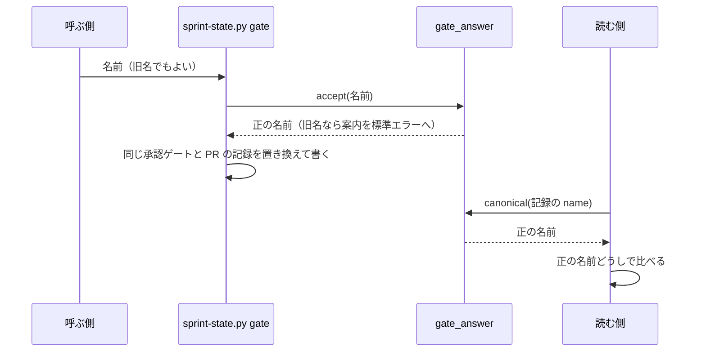

# 承認ゲートの呼び名: 2 つの承認ゲートを「設計承認ゲート」「リリース承認ゲート」と呼ぶ

## 概要

NDF が人の承認を求める 2 つの点を、番号ではなく中身の分かる名前で呼ぶ。承認を求められた人が、
設計を承認するのか本番へのリリースを承認するのかを名前だけで判断できるようにするためである。

| 名前 | 承認する対象 | documentation モードでの呼び名 |
| --- | --- | --- |
| 設計承認ゲート | 設計 Pull Request のマージ | 企画承認 |
| リリース承認ゲート | 本番系へ届く操作（本番へのリリース・`operation` の実行・自動反映の本番チャネルへのマージ） | 制作物承認 |

総称は「承認ゲート」で、承認ゲートはこの 2 つだけである。承認ゲートの数・置き場所・掛かる操作・承認の
判定は [ndf-workflow-unit-and-gates.md](ndf-workflow-unit-and-gates.md) が持ち、この文書は呼び名と、
呼び名を記録に書く・読むときの規則だけを扱う。

番号つきの呼び名（記録の旧名 `関門 1` / `関門 2` と、同じ点を番号で呼ぶ語）は使わない。用語集
（[docs/glossary.md](../glossary.md)）では、これらを新しい 2 語の廃止した語として引ける。

## 用語

語の定義は用語集（`.ndf/glossary.json` の `document`、[docs/glossary.md](../glossary.md) ）が正である。
この文書で使う語のうち、用語集にあるものは次のとおり。

- 設計承認ゲート・リリース承認ゲート・承認ゲート
- 人へ出す文: Skill・references・エージェントの定義の本文と、スクリプト・hook が人へ見せる文
- 機械が読む識別子: スクリプトが値の一致で読む文字列

## 対象範囲

- NDF を入れたすべてのリポジトリで、人へ出す文と承認ゲートの記録の読み書きに効く。呼び名はプロジェクトの設定で変えない
- このリポジトリの Factory の画面と契約の説明文に効く
- 書いた日の記録（発表資料・記事・アーカイブ・開発履歴・`CHANGELOG.md` の出した版の項）は旧い呼び名のまま残す
- 「最終ゲート」（cross-refactoring の最後の手順）・「品質ゲート」など、承認ゲートでない「ゲート」の語は対象外である

## 仕様

### コンテキスト

| コンテキスト | 何の語が 1 つの意味に決まるか |
| --- | --- |
| NDF の工程（`ndf-workflow`） | 承認ゲート・設計承認ゲート・リリース承認ゲート・承認ゲートの記録・人へ出す文・機械が読む識別子 |
| Factory | 承認の依頼とその種類（`gate1` / `gate2` / `decision`）・画面の表示 |

Factory は NDF の工程に対して腐敗防止層を置く。ランナー（`factory/runner/src/translate.ts`）が Factory の
承認の依頼の種類を NDF の承認ゲートの記録の名前へ翻訳し、`sprint-state.py gate` を呼ぶ。Factory の種類の
値は NDF の呼び名に引きずられず、翻訳の層だけが NDF の名前を知る。

### 集約

| 集約 | 持ち主（書き換えてよいもの） | 根 | エンティティ | 値オブジェクト |
| --- | --- | --- | --- | --- |
| スプリント状態 | `sprint-state.py gate`（`mvv-gate.py`・開発ループ・並列の計画・Factory のランナーはこのコマンドを呼んで書く） | スプリント状態ファイル | 承認ゲートの記録（`gates[]`）・取り消しの記録（`withdrawals[]`） | 承認ゲートの名前 |
| 差し戻しの記録 | `sprint-state.py gate --outcome rejected` と `gate-rejections.py record`（どちらも `lib/gate_rejections.py` の書き込みを使う） | `gate-rejections.jsonl` の 1 行 | — | 承認ゲートの名前 |
| スプリントの目録 | `supervise.py new sprint`（`supervise_lib/sprint.py`） | 目録の `sprint.json` | ステージ（`ステージ[]`） | ステージの名前（承認ゲートのステージは承認ゲートの名前を使う） |

承認ゲートの名前は値オブジェクトとして扱う。正の名前は「設計承認ゲート」「リリース承認ゲート」と、MVV の
承認の記録の `MVV` である。旧名（`関門 1` / `関門 2`）は読むときに正の名前へ寄せ、正の名前どうしで比べる。

### 常に成り立つ条件

| # | 条件 | 破れたときの扱い |
| --- | --- | --- |
| I1 | NDF は承認ゲートの旧名を記録へ書かない。旧名で呼ばれたら正の名前へ寄せて書く。旧名でも正の名前でもない名前（`MVV` を含む）は受けてそのまま書く | テストが落ちる |
| I2 | 旧名の記録は、正の名前の記録と同じ承認ゲートとして読む。承認済みの判定・差し戻しの件数・改訂の兆候の件数・取り消しの判定・続きの queue の組み立てが、名前を正の名前に書き換えた記録と同じ結果になる | テストが落ちる |
| I3 | 同じ承認ゲート・同じ Pull Request の利用者の承認の記録は 1 件に置き換わる。旧名の記録も置き換えの対象になる | テストが落ちる |
| I4 | スクリプトの中で、正の名前は `lib/gate_answer.py`、旧名との対応は `lib/legacy_names.py` の 1 か所にだけ書く。Factory のランナーは NDF を読み込めないため、対応を `translate.ts` の 1 か所に持つ | テストが落ちる |
| I5 | 機械が読む識別子のうち、問いの区分 `ndf-gate:1` / `ndf-gate:2`、Factory の種類 `gate1` / `gate2`、承認ラベル `design-approved`、報告の結果の値 `関門` は値を変えない | hook・Factory・再開の既存のテストが落ちる |
| I6 | Factory の承認の依頼は、API・ランナー・画面で同じ種類の値（`gate1` / `gate2` / `decision`）を使う | 契約のテストが落ちる |

### 名前を寄せる仕組み

| 要素 | 責務 |
| --- | --- |
| `plugins/ndf/scripts/lib/gate_answer.py` | 正の名前の定数 `DESIGN_GATE` / `RELEASE_GATE` と、名前を正の名前へ寄せる `canonical()`、呼び出しで受けた名前を寄せて旧名なら案内を出す `accept()` を持つ。`approved()` と `replaces()` は `canonical()` で比べる |
| `plugins/ndf/scripts/lib/legacy_names.py` | 旧名の表 `GATE_NAMES`（`design` → `関門 1`、`release` → `関門 2`）と、案内の文 `gate_rename_notice()` を持つ。旧名の読み取りと受け付けは `MODE` に関わらず続け、終了コード 2 で止めない |
| 読む側（`sprint-state.py`・`gate-rejections.py`・`lib/gate_rejections.py`・`lib/sprint_mvv.py`・`lib/project_mvv_signals.py`・`lib/sprint_loop_gate.py`・`lib/sprint_loop_gate2.py`・`lib/sprint_loop_record.py`・`lib/parallel_external.py`） | 記録の名前を `canonical()` で寄せてから比べる |

旧名で書かれた記録に、同じ Pull Request の正の名前の承認を書くと、旧い記録は置き換わる（I3）。

### 識別子の値を変えない理由

- **記録の名前は正の名前で書く。** 記録の名前は `sprint-state.py gate <状態> "設計承認ゲート"` のように手順書のコマンドにも現れ、人と AI が打つ値でもある。表示だけを変えると、人が打つコマンドと人が読む文の語が食い違う
- **旧名の記録は書き換えず、読むときに寄せる。** 既存の記録の書き換えは利用者のデータの変更（共通原則の C3）に当たり、移行の操作を利用者に求めることにもなる。旧名の表は、旧名の記録を読む必要が無くなるまで持ち続ける
- **ASCII の識別子（`ndf-gate:1/2`・`gate1/gate2`・`design-approved`）は値を変えない。** 問いの区分は hook（`hook_lib/ask_guard.py`）が値の一致で許し、Factory の種類は API・ランナー・画面と進行のイベントの契約が共有する。人へ出す説明（`ask_policy.py` の区分の説明、hook の案内）だけを新しい名前で書く
- **報告の結果の値 `関門` は値を変えない。** フェーズレポートの `結果: 関門` と queue の記録の `result: "関門"` は、`supervise_lib/` の queue・再開・流し直しの判定と、開発ループと並列の計画が値の一致で読み、実行中の queue の記録にも保存されている。値を説明する文だけを「承認ゲート」と書く
- **旧い版の NDF が新しい名前の記録を読む場合は互換の対象にしない。** 一部のセッションだけを更新した状態は、すべてのセッションを更新して再起動すれば解ける

### 旧い呼び名が残ってよい箇所

`git grep -nE '(承認ゲート|ゲート|関門) ?[12]'` と `git grep -n '関門'` を対象範囲に当てたとき、ヒットしてよいのは次の箇所だけである。

| # | 残す箇所 | 理由 |
| --- | --- | --- |
| X1 | `plugins/ndf/scripts/lib/legacy_names.py` の旧名の表と、旧いフェーズの値を読み替える表（`plugins/ndf/scripts/data/legacy-values.json`・`factory/runner/src/legacy-phases.ts`） | 旧い記録を読むため |
| X2 | `factory/runner/src/translate.ts` の `sprint-state.py gate` へ渡す名前と表示用の名前の対応、それらの期待値を持つテスト | どの版の NDF でも承認を記録するため（「外部連携」） |
| X3 | 報告の結果の値 `関門` を値として書く・比べるコードと、値をコードの記法（`` `結果: 関門` ``）で示す文書の行、値を入力や期待値に持つテスト | 機械が読む識別子のため |
| X4 | 旧名と旧いフェーズの値を入力にした互換のテスト | I2・I3 を確かめるため |
| X5 | 用語集の廃止した語の欄（`docs/glossary/glossary.json` と `docs/glossary.md`） | 旧い呼び名を引けるようにするため |
| X6 | `.ndf/mvv.json` の版の `reason` | MVV の過去の版を承認した時点の記録のため |
| X7 | `CHANGELOG.md` の改名を知らせる版の項 | 改名のアナウンスに旧い語が要るため |

`plugins/ndf/scripts/lib/lock-common.sh` のロックの排他は「排他の判定」と書き、`関門` を使わない。

## データ・設定

スキーマは変えず、値の集合だけを持つ。

| 記録 | 欄 | 書く値 | 読む値 |
| --- | --- | --- | --- |
| スプリント状態ファイルの `gates[]`・`withdrawals[]` | `name` | `設計承認ゲート` / `リリース承認ゲート` / `MVV` | 書く値に加えて `関門 1` / `関門 2` |
| `gate-rejections.jsonl` | `gate` | `設計承認ゲート` / `リリース承認ゲート`（ほかの名前は受けて `other` に数える） | 書く値に加えて `関門 1` / `関門 2` |
| スプリントの目録 `sprint.json` の `ステージ[]` | `name`（承認ゲートのステージ） | `設計承認ゲート` / `リリース承認ゲート` | 書く値に加えて `関門 1` / `関門 2` |
| `mvv-gate.jsonl` | `gate` | `design` / `release` | 同左 |

旧名として読むのは `関門 1` / `関門 2` だけである。既存の記録にある `"name": "承認ゲート 2"`・`"name": "ゲート 2"`
は承認ゲートの記録として読まない。寄せる対象に足すと、承認済みの判定と件数が改名の前と変わるためである。

### `sprint-state.py gate <状態> <名前>`

| 項目 | 内容 |
| --- | --- |
| 入力 | `<名前>` に `設計承認ゲート` / `リリース承認ゲート` / `MVV` / 旧名 `関門 1` / `関門 2`。ほかの名前は受けてそのまま書く |
| 出力 | 結果 JSON の形は変わらない。`summary` の名前は正の名前で出す |
| 旧名で呼ばれたとき | 標準エラーへ `関門 1 は 設計承認ゲート へ改名した。設計承認ゲート で呼ぶ` の形の案内を 1 行出し、正の名前で書く。期限を書かず、終了コード 2 で止めない |

`gate-rejections.py record --gate <名前>` と `count` も同じ扱いで、旧名を受けて正の名前で書き、件数は `canonical()` で仕分ける。

## 外部連携

### Factory

Factory のランナーは、ジョブごとに指定された版の NDF を入れる（`factory/runner/src/main.ts` の `installNdf`）。
**ランナーは `sprint-state.py gate` へ旧名を渡し続ける。** この呼び名を持たない前の版の NDF も旧名なら読め、
新しい版の NDF は旧名を受けて正の名前で書くためである。旧名を渡すのをやめるのは、Factory が前の版の NDF を
ジョブで入れなくなったときとする。

| 関数（`factory/runner/src/translate.ts`） | 返すもの |
| --- | --- |
| `gateRecordName(kind)` | 種類（`gate1` / `gate2`）から、記録に書く旧名（`関門 1` / `関門 2`） |
| `gateDisplayName(recordName)` | 記録用の名前から、人へ出す正の名前。旧名でない名前はそのまま返す |
| `rejectionDirective(displayName, body)` | 差し戻しを再開する conductor への指示の文。表示用の名前で書く |

旧名と正の名前の対応は `translate.ts` の `GATE_NAMES` の 1 か所にだけ置き、インストールした NDF の
`canonical()` は呼ばない。`runtime.ts` は記録用の名前（`answer.gate`、無ければ `gateRecordName(answer.kind)`）と
表示用の名前（`gateDisplayName(記録用の名前)`）を分けて持つ。

Factory の契約（`factory/contracts/openapi/runs.yaml`・`organizer.yaml`・`progress-event.schema.json`）は、
種類の値と形を変えず、説明文だけを新しい呼び名で書く。画面（`factory/web/src/i18n/ja.json`）の表示は次のとおり。

| キー | 表示 |
| --- | --- |
| `sprintDetail.gate1` | 設計承認ゲート |
| `sprintDetail.gate2` | リリース承認ゲート |
| `loopStop.gate2_returned` | リリース承認ゲートで差し戻された |

## 運用

- 新しく書く文書・Skill・スクリプトの文は「設計承認ゲート」「リリース承認ゲート」で書く。用語チェック（`glossary.py check`）は旧い呼び名を廃止した語として当て、置き換え先を出す
- 確定仕様（`docs/specifications/`）も新しい呼び名で書く。確定仕様は主題ごとの今の仕様で、用語チェックが語の出所として読む（`.ndf/glossary.json` の `source_paths`）
- 実行中の queue に書かれたプランの文（`question` など）は旧い呼び名のまま残ることがある。再開の判定は結果の値で行うため振る舞いは変わらない

## テスト観点

- 旧名の記録を入れたスプリント状態ファイルで、承認済みの判定・差し戻しの件数・改訂の兆候の件数・取り消しの判定・続きの queue の組み立て・開発ループのリリース承認ゲートの答え・並列の計画の MVV 判定の通過が、正の名前の記録と同じ結果を返すこと
- `sprint-state.py gate` と `gate-rejections.py record` に旧名を渡すと、書いた JSON の名前が正の名前になり、標準エラーに案内が 1 行出ること
- 旧名で書かれた同じ PR の承認の記録がある状態で正の名前の承認を書くと、承認の記録が 1 件になること
- スクリプトの中で、正の名前の文字列が `gate_answer.py` の外に定数として現れず、旧名の文字列が X1〜X3 の外に現れないこと
- hook のテスト（`plugins/ndf/scripts/tests/test_ask_guard.py`）が `ndf-gate:1` / `ndf-gate:2` の問いを通すこと
- Factory の契約と画面のテストが種類 `gate1` / `gate2` で通り、画面の表示が新しい名前になること
- 対象範囲の `git grep` のヒットが X1〜X7 だけであること（`.md` の文言を照合するテストは書かない）

## 関連リンク

- [ndf-workflow-unit-and-gates.md](ndf-workflow-unit-and-gates.md) — 承認ゲートの数と置き場所
- [ndf-deploy-and-release-terms.md](ndf-deploy-and-release-terms.md) — 「デプロイ」と「リリース」の呼び分け（リリース承認ゲートの「リリース」の意味）
- [ndf-ubiquitous-language.md](ndf-ubiquitous-language.md) — 用語集と用語チェック
- [docs/glossary.md](../glossary.md) — 用語集
