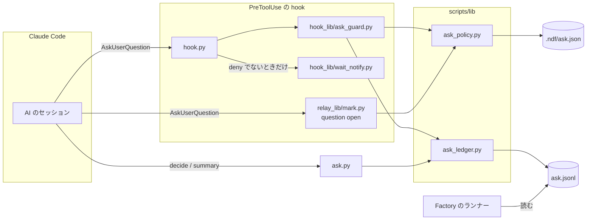
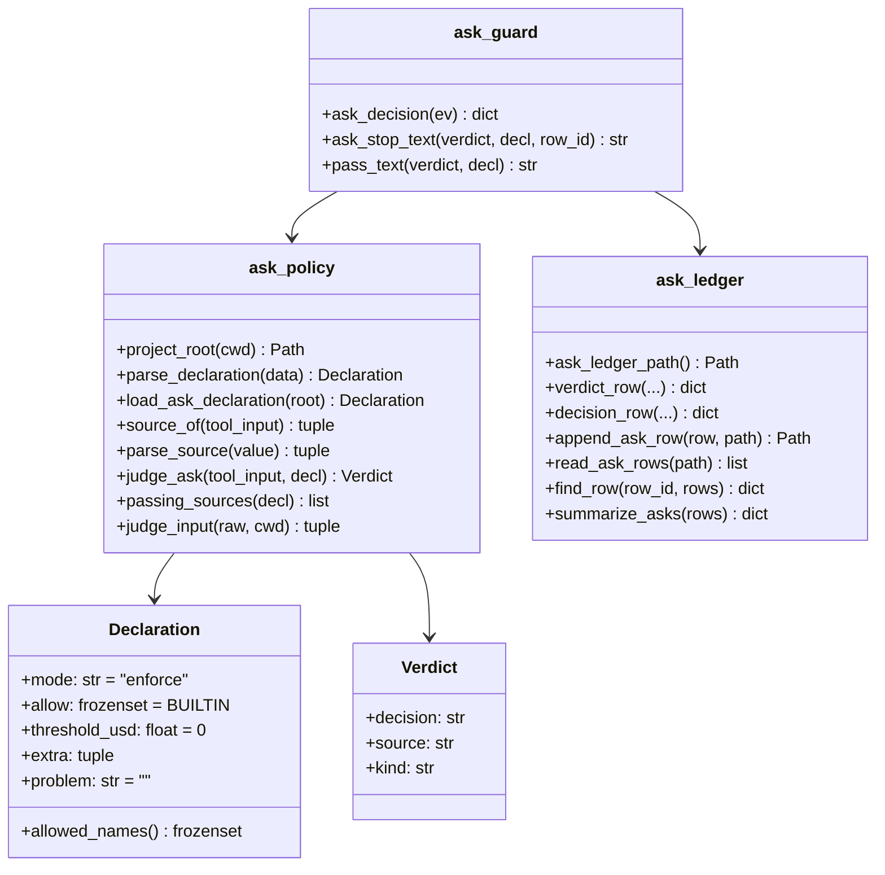
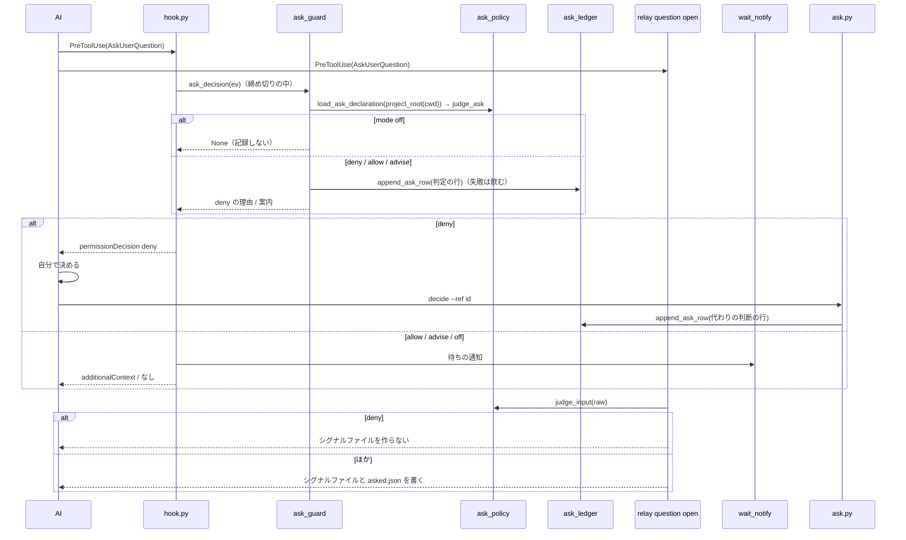
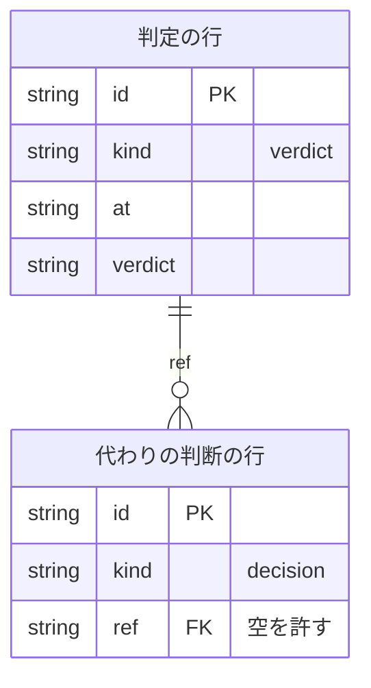

# 問い合わせの guard: 承認ゲートの外の `AskUserQuestion` を hook で止め、AI に決めさせて記録する

Claude Code の `AskUserQuestion` を PreToolUse の hook（問い合わせの guard）で判定し、人へ回してよい区分の問いだけを
利用者へ出す。区分の無い・許されていない問いは止め、AI は止めた理由を受け取って自分で決め、問い・答え・理由を
問い合わせの記録へ残して続ける。人へ回してよい区分と hook の働き方は、プロジェクトごとに宣言 `.ndf/ask.json` で変える。

例: 設計の途中で AI が「ライブラリ A と B のどちらを使うか」を `metadata` を付けずに `AskUserQuestion` で問おうとした。

| 順 | 起きること |
| --- | --- |
| 1 | `hook.py` が PreToolUse で問い合わせの guard を打つ。宣言が無いので既定（`enforce`・組み込みの 4 区分・しきい値 `0`）で判定し、区分が無いので `deny` |
| 2 | 問い合わせの記録 `ask.jsonl` に判定の行（`verdict: deny`・`reason: missing`・`id: ae1533b36fcd`）が 1 行足される |
| 3 | 問いは利用者に出ず、AI へ止めた理由・「自分で決め、理由を記録して続ける」案内・記録のコマンド（`ask.py decide --ref ae1533b36fcd …`）・人へ回してよい区分の一覧・費用のしきい値が返る。Slack の待ち通知は送らない |
| 4 | relay の `question open` も同じ判定で `deny` を得て、質問のシグナルファイルを作らない |
| 5 | AI は A を選び、`ask.py decide --ref ae1533b36fcd --answer A --reason "…"` で代わりの判断の行を足して作業を続ける |

設計 Pull Request のマージの承認は、入力に `"metadata": {"source": "ndf-gate:1"}` を付ければ、どの宣言でも利用者へ出る。

**手順・区分の当てはめ方・宣言の書き方は Skill が正である。** ここに書き写さない。

| 何を | 正本 |
| --- | --- |
| 人へ問うか AI が決めるかの原則・区分の表と当てはめの優先・止められたときの手順・宣言の書き方・記録の数え方 | [`development-workflow` の `references/asking.md`](../../plugins/ndf/skills/development-workflow/references/asking.md) |
| 承認ゲートの問いの出し方（区分の付け方を含む） | [`references/approval-request.md`](../../plugins/ndf/skills/development-workflow/references/approval-request.md) |
| 利用者向けの説明とランタイムごとの扱いの表 | [docs/ndf-plugin-reference.md の「承認ゲートの外の問い合わせ」](../ndf-plugin-reference.md#承認ゲートの外の問い合わせ) |
| 判定の規則・区分の形の定数 | [`scripts/lib/ask_policy.py`](../../plugins/ndf/scripts/lib/ask_policy.py) の冒頭の説明と定数 |
| 記録の列 | [`scripts/lib/ask_ledger.py`](../../plugins/ndf/scripts/lib/ask_ledger.py) の冒頭の表 |

この文書が扱うのは、決定の理由、構成要素の責務と契約、常に成り立つ条件、データの形である。

## コンテキスト

| コンテキスト | 何の語が 1 つの意味に決まるか |
| --- | --- |
| NDF の開発ワークフロー（`ndf-workflow`） | 問い合わせの区分・問い合わせの宣言・代わりの判断・問い合わせの記録・承認ゲート・レッドライン |
| Neural Development Factory（`ndf-factory`） | 判断（`gate.reached` の種類）・ランナー・実行ジョブ |

`ndf-workflow` が上流、`ndf-factory` が下流で、関係は**公開された言語**である。下流のランナーは問い合わせの記録の 1 行の形
（「データ・設定」）を読むだけで、`ndf-workflow` は下流の要求を受けて形を変えない。Claude Code は外部の系で、`ndf-workflow` が
**順応者**として `AskUserQuestion` の入力と PreToolUse の出力の形をそのまま使う。

## 用語

定義は [用語集](../glossary.md) が正である（`.ndf/glossary.json` の `document`。文脈 `ndf-workflow`）。この文書で使う語は
「問い合わせの区分」「問い合わせの宣言」「代わりの判断」「問い合わせの記録」「承認ゲート」「レッドライン」「conductor」である。

## 背景

利用者の依頼（#2206、2026-10-31）は「承認ゲート以外のユーザー問い合わせは原則hookで止めてAIが判断するように強制する」
「どうしても判断が不可能な場合(金銭的コストがかかるなど)の場合のみ、AskUserQuestionを出して判断を求めます」である。
それまで `hook.py` は `AskUserQuestion` を待ちの Slack 通知にだけ使い、判定していなかった。AI が自分で決められる問いで
セッションが止まり、Factory のランナーでは問い合わせ 1 件ごとに実行ジョブが終わる（[ndf-factory-service-boundary.md](ndf-factory-service-boundary.md) の I8）ため、
人の答えまでスプリントが止まっていた。

前提として確かめたこと（Claude Code 2.1.314、2026-10-31）:

- `AskUserQuestion` の入力は `metadata.source`（任意の文字列。説明 `Optional identifier for the source of this question`。利用者に表示しない）を持つ
- PreToolUse の hook が `permissionDecision: "deny"` と理由を返すと Tool は実行されず、理由が AI へ返る（token の guard が同じ形で止めている）

## 対象範囲

| 扱う | 扱わない |
| --- | --- |
| Claude Code の PreToolUse の `AskUserQuestion` の判定（止める・通す・案内） | 質問の中身から区分を推し量ること |
| 宣言 `.ndf/ask.json` の形・既定値・壊れたときの扱い | 本文で問いを書いてターンを終える応答の検出（relay の差し戻しが別に扱う） |
| 判定と代わりの判断の記録、数え方（`ask.py`） | Factory の画面（判断の画面・代わりの判断の表示・宣言の表示） |
| relay の `question open` が同じ判定に従うこと、差し戻しの文の区分の案内 | 承認ゲートの数と置き場所、`pace` の承認の委任（`.ndf/pace.json`） |
| Codex・Kiro CLI・agy での扱い | Codex・agy の問い合わせの Tool を hook の matcher に足すこと（「運用」の制約） |

**働く範囲は配布先のリポジトリを含む**（hook は NDF の配布物）。宣言が無いリポジトリでも既定で働く。

## 決定と理由

| # | 決定 | 理由 |
| ---: | --- | --- |
| 1 | 区分は AI が `metadata.source` に付け、hook は区分の形と宣言だけを見る。問いの文も選択肢も読まない | 語の一致で中身から区分を推すと誤判定が避けられず、止めた理由を AI が直せない。誤った区分で通った問いは記録に残り、`summary` の区分ごとの件数で振り返りが見直す |
| 2 | レッドラインの問いは外せない区分 `ndf-ask:redline:<番号>` にし、`allow` の値にしない | 共通原則の承認は「AI の解釈で緩めない」。`allow` の値にすると宣言から外せるように見える。番号を区分に入れ、どの行の承認かを記録の列で数えられるようにする |
| 3 | 記録は状態の置き場の `ask.jsonl` 1 本にし、判定の行と代わりの判断の行を同じファイルに持つ | hook はプランの状態ディレクトリを知らず、スプリントの外の問い（単発の Skill・対話）も数えたい。リポジトリの中（`.ndf/`）に書くと差分に混ざり、利用者の設定の置き場を機械が書くことになる |
| 4 | 判定は `lib/ask_policy.py` の純粋な関数に置き、hook の guard と relay の `question open` の両方が呼ぶ | 止めた問いに relay がシグナルファイルを残すと、本文の待ちの差し戻しが抑えられる。relay の hook は system の `python3` で別に動くため、まとめずに同じ関数を読む（relay の複製の `LIB_FILES` に入れる） |
| 5 | `deny` の問いでは Slack の待ち通知を送らない | 出ない問いで利用者を呼ばない。`allow`・`advise`・`off` とほかの事象の通知は変えない |
| 6 | 宣言は 1 か所でも形が誤れば全体を既定に置き換え、最初の誤りの箇所を案内に出す | 正しい項目だけを読むと、どの区分を許すかが書き手の意図と食い違ったまま動く。既定は止める側（`enforce`）で、箇所が次の問いの理由に出るため書き手が気づく |
| 7 | hook で止めるのは Claude Code だけにし、ほかの 3 つのランタイムは手順の規則（`asking.md`）で守る | 発火と理由の届き方を確かめていない経路を配ると、止まらない・理由が届かず同じ問いを繰り返すのどちらかを利用者の環境で初めて知る |
| 8 | 宣言のある根は `git` を呼ばずに、作業ディレクトリから親へ辿って `.git`（worktree ではファイル）を持つ最初のディレクトリにする | hook の締め切り 3.5 秒を worktree の guard と分け合い、子のプロセスの起動の費用を毎回払わない |
| 9 | `ask.py decide` は `--ref` を省いて `--question` で書ける | Skill の手順が「AI が決める」とした場面は hook に止められる前に決める。作業の報告の無い単発の Skill と対話でも、同じ記録で数える |
| 10 | 区分の付け方の正本を `development-workflow/references/asking.md` に置き、`approval-request.md`・`decision-request`・`AUTHORING.md` から指す | 宣言の形と `decide` のコマンドは開発ワークフローの規約である。区分の表を写さず 1 か所で持つ |

## 仕様

### 集約

| 集約 | 持ち主（書き換えてよいもの） | 根 | エンティティ | 値オブジェクト |
| --- | --- | --- | --- | --- |
| 問い合わせの宣言 | 利用者（`.ndf/ask.json` を手で書く）。NDF は読むだけ | 宣言（`Declaration`） | — | 働き方（`mode`）・許す組み込みの区分（`allow`）・費用のしきい値（`threshold_usd`）・足す区分（`extra`）・読めなかった箇所（`problem`） |
| 問い合わせの判定（1 回の `AskUserQuestion` への判定） | `lib/ask_policy.py` の `judge_ask` | 判定（`Verdict`） | — | 区分（`source`）・判定の値（`decision`）・理由の種類（`kind`） |
| 問い合わせの記録 | `lib/ask_ledger.py`（追記だけ） | 記録のファイル | 判定の行・代わりの判断の行（`id` で識別） | 時刻・セッション・作業ディレクトリ・問いの文 |

判定は宣言を値として受け取り、宣言を書き換えない。代わりの判断の行は判定の行を `ref`（判定の行の `id`）でだけ指す。
1 回の hook の起動が書き換えるのは記録への 1 行の追記だけである。

### 構成要素

| 要素 | 責務 |
| --- | --- |
| `plugins/ndf/scripts/lib/ask_policy.py` | 宣言の読み取りと検証（`load_ask_declaration`・`parse_declaration`）、根の決定（`project_root`）、区分の取り出しと解析（`source_of`・`parse_source`）、判定（`judge_ask`）、hook の入力からの判定（`judge_input`）、人へ回してよい区分の一覧（`passing_sources`）。標準ライブラリだけで書き、ファイルを読む以外の副作用を持たない |
| `plugins/ndf/scripts/lib/ask_ledger.py` | 記録の置き場（`ask_ledger_path`）、行の組み立て（`verdict_row`・`decision_row`）、1 行の追記（`append_ask_row`）、読み出し（`read_ask_rows`）、判定の行の引き当て（`find_row`）、集計（`summarize_asks`）。標準ライブラリだけで書く |
| `plugins/ndf/scripts/hook_lib/ask_guard.py` | `ask_decision(ev)` が判定から hook の出力（`deny` の理由・`additionalContext` の案内）を作り、判定の行を追記する。追記の失敗は飲み、どの失敗も `None`（通す）を返す |
| `plugins/ndf/scripts/hook.py` の `_guards`・`dispatch` | `--runtime claude`・PreToolUse・`AskUserQuestion` のときだけ、締め切りの中で `ask_guard.ask_decision` を打つ（`Deadline.current` は `ask-guard`）。出力に `deny` があれば待ちの通知（`wait_notify.hook`）を打たない |
| `plugins/ndf/scripts/ask.py` | 副命令 `decide`（代わりの判断の行を書く）と `summary`（数える）。出力は統一の JSON レポート（`lib/step_result.py`） |
| `plugins/ndf/scripts/relay_lib/mark.py` | `question_denied(raw)` が入力を `judge_input` に掛け、`cmd_question("open")` は `deny` の問いにシグナルファイル（`question`）と時刻（`asked.json`）を書かない。差し戻しの文 `WAIT_REASON` が区分の付け方を案内する |
| `plugins/ndf/scripts/relay_lib/version_dir.py` | relay の複製へ写す `LIB_FILES` に `lib/ask_policy.py` を含める |
| `plugins/ndf/hooks/claude.json` | PreToolUse の matcher に `AskUserQuestion` を含め、`hook.py` と relay の `question open` の両方を起動する |





`Declaration` と `Verdict` は凍結した dataclass である。`extra` は `(name, description)` の組の tuple、`allowed_names()` は
`allow` と `extra` の名前の和である。

### 判定の規則（`judge_ask`）

区分の形は 3 つで、`parse_source` が形と名前に分ける。

| `metadata.source` | `parse_source` | `Verdict.kind` |
| --- | --- | --- |
| 無い・`null`・空 | `("missing", "")` | `missing` |
| `ndf-gate:1`・`ndf-gate:2` | `("gate", "1")` など | `gate` |
| `ndf-ask:redline:<番号>`（`<番号>` は `^(C[1-8]\|P[0-9]+\|R[0-9]+)$`） | `("redline", "C4")` など | `redline` |
| `ndf-ask:<名前>`（`<名前>` は `^[a-z0-9][a-z0-9-]*$` で `redline` でない） | `("ask", "cost")` など | 名前が `allowed_names()` にあれば `allowed`、無ければ `not-allowed` |
| 上のどれにも合わない（`ndf-gate:3`・`ndf-ask:redline`・`ndf-ask:redline:C9`・文字列でない値など） | `("malformed", <値>)` | `malformed` |

| `mode` | `kind` が `gate`・`redline`・`allowed` | `kind` が `missing`・`malformed`・`not-allowed` |
| --- | --- | --- |
| `enforce` | `decision: allow` | `decision: deny` |
| `advise` | `decision: allow` | `decision: advise` |
| `off` | `decision: off`・`kind: off`（区分を解析しない） | 同左 |

文字列でない `source` は `str()` にした値を `source` に持ち、形を問わず `malformed` とする。

### 常に成り立つ条件

| # | 集約 | 条件 | 破れたときの扱い |
| --- | --- | --- | --- |
| I1 | 問い合わせの判定 | 区分が `ndf-gate:1`・`ndf-gate:2` なら、どの宣言でも `deny` にならない | テストが落ちる |
| I2 | 問い合わせの判定 | 区分が `ndf-ask:redline:<番号>`（`C1`〜`C8`・`P<数>`・`R<数>`）なら、どの宣言でも `deny` にならない | テストが落ちる |
| I3 | 問い合わせの判定 | `mode` が `enforce` のとき、区分が無い・形に合わない・許す区分（`allow` と `extra[].name`）に無い問いは `deny`、ある問いは `allow` になる | テストが落ちる |
| I4 | 問い合わせの宣言 | 宣言が無い・読めない・形が誤っているとき、`enforce`・組み込みの 4 区分・しきい値 `0` で判定し、読めなかったときはその箇所（`problem`）を判定の出力と記録に添える | テストが落ちる |
| I5 | 問い合わせの判定 | `mode` が `off` なら hook は何も出さず記録も書かない。`advise` なら `deny` を出さない | テストが落ちる |
| I6 | 問い合わせの判定 | 判定は問いの文と選択肢を読まない。区分と宣言が同じなら、問いの文が違っても判定は同じ | テストが落ちる |
| I7 | 問い合わせの判定 | 同じ入力と宣言に対し、hook の判定と relay の `question open` の判定は同じ値になる（`deny` の問いに relay はシグナルファイルと `asked.json` を作らない） | テストが落ちる |
| I8 | 問い合わせの判定 | 宣言の読み込み・記録の書き込み・判定の内部のどの失敗でも、締め切りを過ぎても、hook は終了コード 0 で `deny` を出さない | テストが落ちる |
| I9 | 問い合わせの記録 | hook の判定 1 回（`off` を除く）につき判定の行が 1 行だけ追記され、既にある行は書き換えない | テストが落ちる |
| I10 | 問い合わせの記録 | 代わりの判断の行は、`ref` が記録にある判定の行の `id` を指すか、問いを持つ。問い・答え・理由を空にしない | `ask.py decide` が `stopped` と終了コード 1 で行を書かない |
| I11 | 問い合わせの記録 | 行が持つ項目は「データ・設定」の表の列だけで、hook の入力のほかの欄（`transcript_path`・環境変数・選択肢・`metadata` のほかの鍵）を写さない | テストが落ちる |
| I12 | 問い合わせの判定 | `deny` の問いでは Slack の待ち通知を送らない。`allow`・`advise`・`off` の問いと、ほかの事象の通知は変えない | テストが落ちる |
| I13 | 問い合わせの判定 | 問い合わせの guard が判定するのは `--runtime claude` の PreToolUse の `AskUserQuestion` だけで、ほかの Tool・ランタイムの判定（worktree の guard・token の guard）を変えない | テストが落ちる |

### ドメインイベント

| # | イベント | 発生元 | 受け手 | 失敗したとき |
| --- | --- | --- | --- | --- |
| E1 | AI が `AskUserQuestion` を呼んだ | AI（Claude Code のセッション） | `hook.py` と relay の `question open`（PreToolUse） | — |
| E2 | hook が宣言を読んだ | `ask_policy.load_ask_declaration` | `judge_ask` | 無い: 既定。読めない・誤り: 既定と箇所（I4） |
| E3 | hook が問い合わせを通した（`allow`・`advise`） | `ask_guard.ask_decision` | Claude Code（問いを出す）・待ちの通知・relay（シグナルファイルを作る） | — |
| E4 | hook が問い合わせを止めた（`deny`） | `ask_guard.ask_decision` | AI（理由と案内を受け取る） | 内部の失敗は通す側へ倒す（I8） |
| E5 | hook が判定を記録に書いた | `ask_ledger.append_ask_row` | 振り返り・Factory のランナー | 書けなくても判定は変えない |
| E6 | AI が止めた理由を受け取り、自分で判断した | AI | （E7 で記録に残る） | 区分を付け替えて出し直したら、hook は区分だけを見て判定する |
| E7 | AI が判断と理由を記録した | `ask.py decide` | 振り返り・Factory のランナー | 記録しないまま進むと、E5 の止めた行だけが残り `unanswered` に数えられる |
| E8 | 利用者が通った問い合わせに答えた | 利用者 | AI・relay の `question close`（PostToolUse） | — |
| E9 | 振り返りで区分の使い方を見直した | `ask.py summary` を読む振り返り | 宣言の書き手（利用者） | — |

### hook の入出力（PreToolUse・`AskUserQuestion`・Claude Code）

| 項目 | 内容 |
| --- | --- |
| 入力 | 標準入力の JSON。読む欄は `tool_name`・`tool_input.metadata.source`・`tool_input.questions[].question`・`session_id`・`cwd` だけ。`cwd` が実在しなければ hook のカレントで根を決める |
| 出力（`deny`） | `{"hookSpecificOutput": {"hookEventName": "PreToolUse", "permissionDecision": "deny", "permissionDecisionReason": <理由>}}` |
| 出力（`allow`・`advise`） | `{"hookSpecificOutput": {"hookEventName": "PreToolUse", "additionalContext": <案内>}}`。`permissionDecision` を書かない（利用者の許可の扱いを変えない） |
| 出力（`off`・失敗・締め切り超過） | 問い合わせの guard からは何も出さない（ほかの guard の出力は `_merge` の規則のまま） |
| 終了コード | 常に 0 |
| 互換性 | 区分の無い問いが止まる。`.ndf/ask.json` に `{"version": 1, "mode": "off"}` を書けば判定の前の振る舞いへ戻る |

`deny` の理由は次の行をこの順に持つ。

1. `ndf: この AskUserQuestion を止めた。理由: <止めた理由>。`（区分が無い / 区分「`<source>`」が形に合わない / 宣言が許していない）
2. 自分で決め、理由を記録して続ける案内（迷い・情報不足・好みの違いは人へ回す理由にならない）
3. 記録の手段: `python3 "<scripts の絶対パス>/ask.py" decide --ref <判定の行の id> --answer "<選んだ答え>" --reason "<理由>"`
4. 人へ回してよい区分の一覧（`passing_sources`: `ndf-gate:1`・`ndf-gate:2`・`ndf-ask:redline:<番号>`・`allow` にある組み込みの区分・`extra` の `name` と `description`）と、正本 `asking.md` の絶対パス
5. `<しきい値> USD 以下の費用は AI が決める（.ndf/ask.json の cost.threshold_usd）。`
6. 宣言を読めなかったときだけ `.ndf/ask.json を読めなかった（<箇所>）。既定（enforce・組み込みの 4 区分）で判定した。`

`advise` の案内は、先頭に `ndf: mode が advise のため止めていない。` を足した `deny` の理由と同じ文である。
`allow` の案内は 5 と 6 で、`kind` が `allowed`（宣言が許した区分）のときだけ先頭に「区分 `<source>` で人へ回した。区分の
当てはめが誤っていれば取り下げて自分で決める」を足す。承認ゲートとレッドラインにはこの 1 行を付けない。

### `ask.py`

| 副命令 | 入力 | 出力（標準出力の 1 行の統一 JSON レポート。`tool: ask`） | 終了コード |
| --- | --- | --- | --- |
| `decide` | `--answer`（必須）・`--reason`（必須）・`--ref <id>`・`--question <文>` | `status: ok`、`items` に書いた行 1 件、`metrics.path` に記録のパス | 0 |
| `decide`（拒む） | 引数の誤り・答えか理由が空白だけ・`--ref` も `--question` も無い・`--ref` の判定の行が記録に無く `--question` も無い・問いが空・書けない | `status: stopped` と理由（`summary`）。行を書かない | 1 |
| `summary` | `--since <ISO 8601>`（任意。`at` の文字列の比較で以後）・`--cwd <パス>`（任意。`cwd` の前方一致） | `status: ok`、`metrics` に `verdict`（`deny`・`allow`・`advise` の件数）・`source`（区分ごとの件数。区分が無い行は空文字の鍵）・`decision`（`ref`・`no_ref` の件数）・`unanswered`（`deny` の判定の行のうち、その `id` を `ref` に持つ代わりの判断が無いもの） | 0。記録が無ければすべて 0 件 |

`decide` の値は 1 つの引数として受け、改行を含んでよい。空かどうかは前後の空白を除いて見るが、書く値は渡されたままである。

| `decide` の場合 | `ref` | `question` | `session`・`cwd` |
| --- | --- | --- | --- |
| `--ref` が記録の判定の行を指す | その `id` | `--question` があればそれ、無ければ判定の行の `questions` を改行でつないだもの | 判定の行から写す |
| `--ref` が記録に無く `--question` がある | 渡された値をそのまま残す | `--question` | `session` は空、`cwd` は `ask.py` を打った作業ディレクトリの実パス |
| `--question` だけ（手順が AI に決めさせた場面） | 空 | `--question` | 同上 |

### 処理の流れ



hook と relay の hook は Claude Code が並べて起動するため、順序は保証されない。どちらも同じ宣言と入力から同じ判定を出す（I7）
ため、順序に依らない。relay の `question open` は `NDF_RELAY_DIR` の下（ラッパーの直接の子）でだけ働き、入力が `AskUserQuestion`
でない・判定が例外のときは `deny` でないものとして今のまま合図を作る。

## データ・設定

### 宣言 `.ndf/ask.json`

置き場は、作業ディレクトリから親へ辿って `.git`（ファイルかディレクトリ）を持つ最初のディレクトリの `.ndf/ask.json` である
（worktree では worktree の中）。見つからなければ作業ディレクトリを根とする。

```json
{
  "version": 1,
  "mode": "enforce",
  "allow": ["cost", "irreversible", "human-action", "legal"],
  "cost": {"threshold_usd": 0},
  "extra": [
    {"name": "customer-contact", "description": "顧客の担当者へ連絡するかどうか"}
  ]
}
```

| 項目 | 型 | 無いとき | 検証（誤りの箇所） |
| --- | --- | --- | --- |
| `version` | 整数 | 読めない扱い | `1` だけを受ける。真偽値は不可（`version`） |
| `mode` | 文字列 | `enforce` | `enforce` / `advise` / `off`（`mode`） |
| `allow` | 文字列の配列 | 4 つすべて | `cost`・`irreversible`・`human-action`・`legal` の部分集合（`allow`・`allow[<i>]`）。空配列は「組み込みの区分を 1 つも許さない」で、無いときと区別する |
| `cost.threshold_usd` | 0 以上の数 | `0` | 真偽値は不可（`cost`・`cost.threshold_usd`）。hook は額を比べず、案内に載せる |
| `extra[]` | `{name, description}` の配列 | 無し | `name` は `^[a-z0-9][a-z0-9-]*$` で、組み込みの 4 つと `redline` に重ならない（`extra`・`extra[<i>]`・`extra[<i>].name`）。`description` は空白だけでない文字列（`extra[<i>].description`） |

検証は `version` → `mode` → `allow` → `cost` → `extra` の順に行い、最初の誤りで宣言全体を既定に置き換えて `problem` に箇所を持つ。
ファイルとして読めないときは `（ファイルを読めない）`、JSON として読めないときは `（JSON として読めない）`、全体がオブジェクトで
ないときは `（全体がオブジェクトでない）` を `problem` に持つ。ファイルが無いときは `problem` を空にした既定である。

### 問い合わせの記録 `ask.jsonl`

置き場は `${NDF_MVV_STATE_DIR:-~/.local/state/ndf}/ask.jsonl`（承認ゲートの差し戻しの記録 `gate-rejections.jsonl` と同じ置き場）。
1 行 1 件の JSON で、1 行を 1 回の `write`（`O_APPEND`。ロックは取らない）で追記し、行を書き換えない。ディレクトリが無ければ作り、
ファイルは `0600` で作る。読み出しでは JSON として読めない行を飛ばす。



| 列 | 型 | 判定の行（`kind: verdict`） | 代わりの判断の行（`kind: decision`） | 意味 |
| --- | --- | --- | --- | --- |
| `v` | 整数 | `1` | `1` | 行の形の版 |
| `kind` | 文字列 | `verdict` | `decision` | 行の種類 |
| `id` | 文字列 | 持つ | 持つ | 12 桁の 16 進（`uuid4` の先頭） |
| `at` | 文字列 | 持つ | 持つ | UTC の ISO 8601（秒まで。`+00:00`） |
| `session` | 文字列 | 空を許す | 空を許す | hook の入力の `session_id`。代わりの判断の行は `ref` の判定の行から写し、無ければ空 |
| `cwd` | 文字列 | 持つ | 持つ | 作業ディレクトリの絶対パス |
| `runtime` | 文字列 | `claude` | — | 判定したランタイム |
| `source` | 文字列 | 空を許す | — | `metadata.source` の値。空は「区分が無い」 |
| `verdict` | 文字列 | `deny` / `allow` / `advise` | — | 判定の値（`off` は行を書かない） |
| `reason` | 文字列 | `Verdict.kind` | AI の理由の文 | 判定の行は理由の種類、代わりの判断の行は理由 |
| `mode` | 文字列 | 持つ | — | 判定に使った働き方 |
| `decl_problem` | 文字列 | 空を許す | — | 宣言を読めなかった箇所。空は「読めた・無かった」 |
| `questions` | 文字列の配列 | 持つ | — | `questions[].question` の文だけ（選択肢は写さない） |
| `ref` | 文字列 | — | 空を許す | 指す判定の行の `id`。空は手順が AI に決めさせた場面 |
| `question` | 文字列 | — | 持つ | 決めた問い |
| `answer` | 文字列 | — | 持つ | 選んだ答え |

`—` はその種類の行に列を置かないことを表す。保存の期間は決めず、消すのは利用者である（ほかの状態の記録と同じ）。
Factory のランナーは実行ジョブの中で同じパスを読み、`session` と `at` で自分の実行の行を選ぶ（事象への翻訳は
[ndf-factory-service-boundary.md](ndf-factory-service-boundary.md) の `decision.delegated`）。

| 名前 | 置き場所 | 値・形 |
| --- | --- | --- |
| `NDF_MVV_STATE_DIR` | 環境変数 | 記録のディレクトリ。無ければ `~/.local/state/ndf` |
| `DEADLINE_SECONDS` | `plugins/ndf/scripts/hook_lib/deadline.py` | `3.5`。問い合わせの guard も worktree の guard・token の guard と同じ締め切りの中で打つ（[cross-review-reopen-and-hook-deadline.md](cross-review-reopen-and-hook-deadline.md) の「hook の締め切り」） |
| `LIB_FILES` | `plugins/ndf/scripts/relay_lib/version_dir.py` | `lib/ask_policy.py` を含む |

## 運用

### ランタイムごとの扱い

手元の版（2026-10-31）で確かめた結果である。表の正本は [docs/ndf-plugin-reference.md](../ndf-plugin-reference.md#承認ゲートの外の問い合わせ) にある。

| ランタイム | 問い合わせの Tool | 扱い |
| --- | --- | --- |
| Claude Code 2.1.314 | `AskUserQuestion`（`metadata.source` を持つ） | hook で止める |
| Codex CLI 0.164.0 | `request_user_input`（既定で無効・開発中の機能） | 対象外。手順の規則（`asking.md`）だけで守る |
| agy 1.4.7 | `ask_question` | 対象外。手順の規則だけで守る |
| Kiro CLI 2.34.0 | 組み込みの Tool に無い（MCP の elicitation だけ） | 対象外（止める対象が無い） |

Skill の本文は 4 つのランタイムで同じものが配られるため、`asking.md` の規則（区分に当たらない問いは出さず、決めて
`ask.py decide --question` で記録する）はどのランタイムでも同じ手順として読まれる。hook の無いランタイムでは、区分に当たる問いを
本文か各ランタイムの問い合わせの Tool で出し、区分の名前を問いの先頭に書く。

### Skill とエージェントの問いの当て方

NDF の Skill とエージェントの本文で利用者へ問う手順は、次の規則で区分を付けるか AI が決めるかに分けてある。箇所ごとの当てはめは
各 Skill の本文と、正本の [`asking.md`](../../plugins/ndf/skills/development-workflow/references/asking.md) にある。

| 問いの種類 | 当て方 |
| --- | --- |
| 承認ゲート 1・2 の承認と、その委任の承認（スプリント MVV・設計の承認・本番系へ届く操作・リリース・制作物承認・マージの承認） | `ndf-gate:1` / `ndf-gate:2` を付けて問う |
| レッドライン（共通原則の C1〜C8・プロジェクトの P・スプリントの R）に当たる操作の承認（例: `.ndf/` の書き換えは `C7`、`-D` や退避先の削除は `C4`、他のリポジトリへの起票や push は `C5`） | `ndf-ask:redline:<番号>` を付けて問う |
| 費用・レッドラインに当たらない取り消せない外部への操作・人にしかできない操作・規約と契約への同意 | `ndf-ask:cost` / `irreversible` / `human-action` / `legal` を付けて問う |
| どの区分に当たるかが中身で変わる問い | 区分ごとに場合を分け、どれにも当たらなければ AI が決める |
| 上のどれにも当たらない問い（設計・Tool の選択・課題の扱い・曖昧な依頼の解釈・コンフリクトの解消など） | 問わずに AI が決め、`ask.py decide --question` で記録して続ける |
| 問わずに止めて報告する手順 | 変えない |

既定の宣言（`enforce`・4 区分）で、この規則どおりに動いて hook に止められ続けて先へ進めない手順は無い。止められるのは区分を
付けなかった問いだけで、その問いは「AI が決める」に当たる。

### 制約

| 項目 | 内容 |
| --- | --- |
| `deny` の後の画面 | 対話のセッションで `AskUserQuestion` を `deny` したとき問いの画面が出ずに理由が AI へ返ることは、token の guard の振る舞いからの推しである。リリース後テストで見る |
| `deny` の後の PostToolUse | `deny` した Tool では relay の `question close` が起きない前提である。起きてもシグナルファイルを消すだけで害は無い |
| 締め切りを過ぎたとき | hook は問い合わせの guard の結果を捨てて通すが、relay の側は締め切りを持たずに判定し、`deny` ならシグナルファイルを作らない。そのとき問いは出るが、Esc で取り消した問いと同じ扱いになり、本文の待ちの差し戻しが 1 回余分に起こりうる |
| 区分の当てはめの誤り | AI が区分を広く付けると問いが人へ回り続ける。件数は `ask.py summary` の `source` で見え、振り返りで見直す |
| Codex・agy の問い合わせの Tool | `request_user_input`・`ask_question` で PreToolUse が発火するか、拒否の理由がモデルへ届くかを確かめていない。確かめるまで matcher に足さない（決定 7） |
| 記録の並行の追記 | ロックを取らず、1 行を 1 回の `write` で書く。行は短いため `O_APPEND` で混ざらない前提である |

## テスト観点

hook の判定は PreToolUse の入力 JSON を `hook.py` へ標準入力で渡したときの標準出力で確かめる。`.md` の文言は固定しない
（Skill の書き換えと利用者向けの文書はレビューで見る）。単体と hook の結合は
[`tests/test_ask_guard.py`](../../plugins/ndf/scripts/tests/test_ask_guard.py)、relay の結合は
[`tests/test_relay.py`](../../plugins/ndf/scripts/tests/test_relay.py) にある。

| 観点 | 満たすこと |
| --- | --- |
| 区分の無い問いを止める（I3） | 宣言が無い・`enforce` のとき、`metadata` の無い入力で `deny` を出し、理由に止めた理由・自分で決める案内・`decide --ref <id>` のコマンド・人へ回してよい区分の一覧が入ること |
| 承認ゲート（I1） | `allow: []` の `enforce` で `ndf-gate:1`・`ndf-gate:2` が `deny` にならず、`ndf-gate:3` は `deny` になること |
| レッドライン（I2） | `allow: []` でも `ndf-ask:redline:C4`・`ndf-ask:redline:P1` が通り、`ndf-ask:redline`（番号なし）・`ndf-ask:redline:C9` は `deny` になること |
| 宣言の区分（I3） | `allow: ["cost"]` で `ndf-ask:cost` と `extra` の名前が通り、`ndf-ask:legal` と未知の名前が `deny` になること |
| 既定の 4 区分（I4） | `allow` を省いた宣言で 4 区分が通ること |
| 費用のしきい値 | `deny` の理由と `allow` の案内に `cost.threshold_usd` の値（既定 `0`）が入ること |
| 壊れた宣言（I4） | JSON でない・`version` が `2`・`allow` に未知の値のとき既定で判定し、理由に箇所が入ること |
| `off`・`advise`（I5） | `off` で出力が空・記録が増えないこと。`advise` で `deny` を出さず、`deny` になる入力に同じ案内を `additionalContext` で返すこと |
| 中身を読まない（I6） | 区分と宣言が同じで問いの文だけが違う 2 つの入力が同じ判定になること |
| relay と同じ判定（I7） | 同じ入力と宣言で、`deny` のとき relay の `question open` がシグナルファイルと `asked.json` を作らず、`ndf-gate:1` のとき作ること |
| 失敗を通す（I8） | 宣言の読み込み・追記・判定のそれぞれで例外を起こしても、記録を書けなくても、締め切りを過ぎさせても、終了コード 0 で `deny` が出ないこと |
| 1 回 1 行（I9） | 判定 1 回で記録が 1 行増え、`at`・`session`・`cwd`・`source`・`verdict`・`questions` を持ち、前の行が変わらないこと |
| 代わりの判断（I10） | `decide --ref <id>` が `ref` と問い・答え・理由を持つ行を書くこと。`--question` だけでも書けること。記録に無い `id` で `--question` も無い・答えか理由が空のときは終了コード 1 で書かないこと |
| 写さない（I11） | `transcript_path`・選択肢・`metadata` のほかの鍵を入れた入力で、判定の行の鍵が表の列だけであること |
| 待ちの通知（I12） | `deny` の問いで `wait_notify.hook` が呼ばれず、`allow` で呼ばれること |
| ほかのランタイム（I13） | `--runtime codex` などの入力で問い合わせの guard が判定しないこと。既存の hook・relay・待ち通知のテストが変更なしで通ること |
| 差し戻しの文 | relay の `WAIT_REASON` が `ndf-gate:` を含むこと |
| 数える | `summary` が判定ごと・区分ごと・`ref` の有無ごとの件数と `unanswered` を返すこと |
| 全体テスト | `uv run --frozen --project . --all-extras pytest plugins/ndf/scripts/tests -q -n 4` が通ること |
| 手動 | リリース後テストで、Claude Code の対話のセッションで区分の無い `AskUserQuestion` が出ずに AI が続けること、`ndf-gate:1` の問いが出ること |

## 関連リンク

- [issue #2206](https://github.com/devbasex/ai-plugins/issues/2206) — 要求
- [PR #2249](https://github.com/devbasex/ai-plugins/pull/2249) — 実装
- [`development-workflow` の `references/asking.md`](../../plugins/ndf/skills/development-workflow/references/asking.md) — 区分と手順の正本
- [docs/ndf-plugin-reference.md の「承認ゲートの外の問い合わせ」](../ndf-plugin-reference.md#承認ゲートの外の問い合わせ)
- [ndf-factory-service-boundary.md](ndf-factory-service-boundary.md) — Factory の実行ジョブ（I8）と `decision.delegated` の事象
- [cross-review-reopen-and-hook-deadline.md](cross-review-reopen-and-hook-deadline.md) — hook の締め切り
- [ndf-relay-goal-skill-and-prose-wait.md](ndf-relay-goal-skill-and-prose-wait.md) — 本文で承認を待って終えた応答の差し戻し（`WAIT_REASON`）
- [ndf-gate-rejections-and-filer-assumptions.md](ndf-gate-rejections-and-filer-assumptions.md) — 同じ置き場の差し戻しの記録
- [`lib/ask_policy.py`](../../plugins/ndf/scripts/lib/ask_policy.py) / [`lib/ask_ledger.py`](../../plugins/ndf/scripts/lib/ask_ledger.py) / [`hook_lib/ask_guard.py`](../../plugins/ndf/scripts/hook_lib/ask_guard.py) / [`ask.py`](../../plugins/ndf/scripts/ask.py) / [`relay_lib/mark.py`](../../plugins/ndf/scripts/relay_lib/mark.py)
