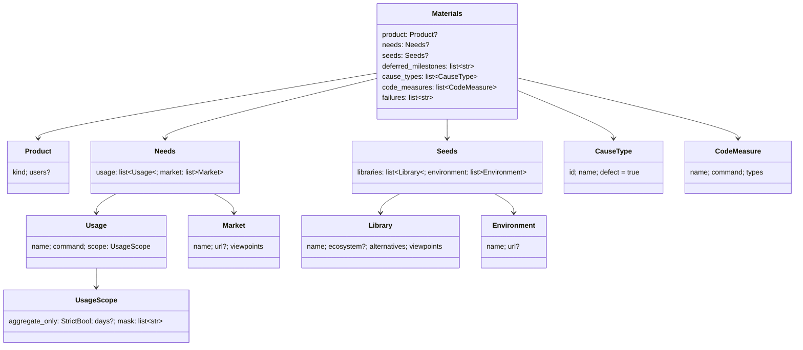

# 棚卸しを 3 つの深さで回し、ニーズとシーズの調査から課題を足す

課題の棚卸し（`backlog-refinement`）には 3 つの深さがある。毎スプリントの差分の棚卸し（`diff`）、数回に 1 回の
見直し（`review`）、十数回に 1 回の大整理（`overhaul`）である。見直しは、プロジェクトが宣言した材料をもとに
ニーズとシーズを調べて起票する。大整理は、未完了の課題を原因の型で分けて根本原因を探し、課題を組み直す。
見直しと大整理を起動するかは、まとめのプランの中でスクリプトが判定する。見直し・大整理・待ち時間の調査は、1 つのセッション
（見直しの持ち主）だけが行う。この文書は、`upkeep.py` の副命令の契約と受け渡しのファイル、それぞれをそう決めた理由を残す。

**手順は各 Skill の文書が正である。** 深さの表・見直しの 7 つの手順・大整理の 6 つの手順・報告の形をここへ書き写さない。

| 何を読むか | 正本 |
| --- | --- |
| 深さの表・引数 `--depth`・手順 1 の経路の深さごとの違い | `plugins/ndf/skills/backlog-refinement/SKILL.md` の「深さ」 |
| 起動の条件の表・見直しの持ち主の決まり・`.ndf/backlog/` の記録 | `plugins/ndf/skills/backlog-refinement/references/depths.md` |
| 見直しの 7 つの手順（`order` の値）・起票の決まり・報告の `metrics` | `plugins/ndf/skills/backlog-refinement/references/review.md` |
| 材料の宣言のキーと調査の項目・利用の記録を読む範囲・待ち時間の調査の決まり | `plugins/ndf/skills/backlog-refinement/references/research.md` |
| 大整理の 6 つの手順・付け直しと戻し・後回しの再評価・報告に足すキー | `plugins/ndf/skills/backlog-refinement/references/overhaul.md` |
| plan に足すキー（`depth`・`owner`・`create`・`reparent`・`policy_verdict`） | `plugins/ndf/skills/backlog-refinement/scripts/upkeep_actions.py` の冒頭 |
| 材料の宣言の形 | `plugins/ndf/skills/development-workflow/schemas/project.schema.json`（`materials`） |
| 材料の宣言の案を出す手順 | `plugins/ndf/skills/development-workflow/references/project-analysis.md` |
| 周回の打つ順に待ち時間の調査を並べること | `plugins/ndf/skills/development-workflow/references/loop.md`・`references/waiting.md` |

## 概要

**例（ai-plugins の開発ループ、2026-11-01 時点の値）。** open は 185 件で、そのうち 80 件が後回しのマイルストーンにあった。
周回ごとの棚卸しは 206〜224 秒・1.41〜1.61 ドルかかり、1 回 10 件では持ち越しが約 160 件まで溜まった。今の形では、周回のまとめは次のように動く。

| 時点 | 振る舞い |
| --- | --- |
| 課題を閉じた（`close` が 0） | `refine` が `/ndf:backlog-refinement --depth diff` を通す。候補は差分の経路だけで、順位の表・前倒しと後ろ倒し・マイルストーンの設定・やらない・起票・付け直しは `apply` が `wrong_depth` で退ける |
| 差分の棚卸しを終えた | `refine-record` が `depths.jsonl` に `diff` の `ran` の行を足す。持ち越し 160 件は行の `values.carry` に入る |
| 大整理の判定（`overhaul-due`） | 前の大整理から 12 回に満たず、溜まり具合の条件にも当たらない。`not_due` の行を残し、終了コード 3 で `review-due` へ飛ぶ |
| 見直しの判定（`review-due`） | 持ち越し 160 件が上限 10 件の 10 倍を超えるので、`carry` で起動する（`due` の行を残して 0） |
| 持ち主の宣言（`review-claim`） | `owner claim --what review --keepalive 5400 --pid $PPID` が宣言を取る。別のセッションの有効な宣言があれば 10 を返し、`review-skipped` が `skipped` の行を残して終わる |
| 見直し（`review`） | 後回しを除く open の 105 件を、更新の古い順に上限なしで見る。起票は出典つきで 5 件まで。MVV 判定が「従う」でない課題には `needs-decision` が付く |
| 見直しを終えた | `report --depth review` が報告の土台を組み、`depth record --depth review` が行を足す。`review-release` が宣言を手放す |
| 次の周回の待ち | conductor は `supervise.py wait` と並べて、`loop sprint` が返す `metrics.research` の 1 行を背景で打つ。調査は記録を書くだけで、課題には触らない |

**コンテキストは 2 つで、関係は顧客 / 供給者である。** 開発ワークフロー（`ndf-workflow`）が顧客で、周回・まとめ・止まる条件・予算を持つ。
課題の棚卸し（`ndf-issue-upkeep`）が供給者で、深さ・候補・調査の項目・付け直し・大方針を持つ。開発ループが読むのは、棚卸しの
起動の判定の終了コードと、深さの記録・調査の費用の記録だけで、深さの中身は知らない。

## 用語

棚卸しの深さ・差分の棚卸し・見直し・大整理・後回しの再評価・ニーズの調査・シーズの調査・調査の記録・調査の項目・材料の宣言・
見直しの持ち主・大方針・柱・付け直しの記録・原因の型・寿命の窓の定義は、設定の用語集（`.ndf/glossary.json` の `document` が指す
[docs/glossary.md](../glossary.md)）にある。

## 決定と理由

| 決定 | 理由 |
| --- | --- |
| 見直しと大整理は、別の Skill にせず `backlog-refinement` の深さ（`--depth review` / `overhaul`）にする | 区分・見積の段階・`apply` を 1 か所から使え、起票の上限と MVV 判定も 1 つの Skill の中で守れる。入口は `/ndf:backlog-refinement --depth overhaul` |
| `--depth` を省いたら差分の棚卸しにする | 既存の呼び出し（まとめの `refine`・人の呼び出し）が、そのまま軽い棚卸しで動く。省いたときに 5 つすべてを行うと、指示を直し忘れた呼び出しが重いまま残る |
| 差分の棚卸しではマイルストーンを設定しない。`no-milestone`・`closed-milestone` の経路は見直しだけが拾う | どのマイルストーンに入れるかは、全体を見ない回では決められない。周回の中で起票した課題は次の周回まで選ばれず、課題が尽きる前に見直しが入るので、着手は止まらない |
| 回数と溜まり具合は、深さの記録（`depths.jsonl`）から数える | 棚卸しのたびに 1 行足すので、`--loop` を使わない進め方でも同じ数え方になる。起動しなかった判定も残る |
| 起動の判定はスクリプト（`depth due`）が行う。まとめのプランでは、大整理と見直しを実行条件つきのステップとして `refine` の後ろに置く | 回数を比べるだけの判断を LLM に任せず、判定の記録の形もそろえる。大整理を先に置くのは、両方が起動したときに組み直した後の課題で順位を付けるため |
| 持ち主の宣言は、既存の `run_owner`（寿命の窓は引数）と `locks` の上に作る。寿命の窓 900 秒・生きている印 120 秒 | 同じ役割の部品を 2 つ作らない。窓を 24 時間にすると、中断した持ち主の引き取りまでが長すぎる |
| queue の work ステップの持ち主は `--pid "$PPID"`（`supervise.py`）で宣言し、`--keepalive` の見張りに `touch` させる | run ステップのシェルはすぐ終わるので、その pid で宣言すると次のステップの前に無効になる。work ステップの中には `touch` を打つ手順が無い |
| 見直し・大整理の本体の成否によらず、`release` のステップを通す | 宣言が残ると見張りが打ち切りまで `touch` し続け、続く見直しの `claim` と他のループの調査が `not_owner` で締め出される |
| 待ち時間の調査はスクリプト（`research run`）が 1 項目ずつ `claude -p` を起こす | 止める時点・空きの判定・上限・記録の形をスクリプトが持ち、LLM には 1 項目の調べと要約だけを任せる |
| 課題の一覧への書き込み（起票・付け直し）は `apply` に寄せる | 深さ・持ち主・件数の上限・出典と MVV の当たる所とラベル・前の状態の記録を 1 か所で確かめられる |
| 利用の記録は、スクリプトが宣言のコマンドを打ち、マスクと `secret_redact` を通した集計値だけを LLM へ渡す。宣言が無ければ何も読まない | 範囲の外を読まないことを、手順の文ではなくコードで守る。何を集計値とみなすかは、プロジェクトごとに機械で決められない |
| 1 回の見直しの起票は既定 5 件まで。MVV 判定が「従う」でない課題には既存の `needs-decision` を付ける | 見直しの間の 3 周回で着手するのは 6〜9 件なので、起票が着手を上回らない。順位付けと選定は `needs-decision` をすでに外すので、新しい除外は要らない |
| 見直しの候補は上限で切らず、更新の古い順に並べる | 持ち越しが約 160 件あり、10 件ずつでは追いつかない |
| 選べる課題が尽きたら、止まる前に見直しを 1 回だけ挟む（`review_first`）。答えを待つ作業（保留の周回か、オーガナイザーへ送って答えの無い設計の承認）が残るときは挟まず `waiting_only` で止まる | 調査からの起票を試してから止まる。1 回に限るのは、起票が `needs-decision` に回り続けると見直しと選定の間を回り続けるため |
| 溜まり具合の閾値は open の増加 30%・持ち越しが上限の 10 倍・型の割合 30%・3 回の連続 | 1 本のループ（4 周回）と 2026-11-01 の分類（最多の型 A が不具合の 31%）から置いた値で、最初の 3 回の見直しの `depths.jsonl` で見直す |
| 材料は `.ndf/project.json` の `materials`、頻度と上限は `.ndf/backlog.json` の `depths` に置く | 材料の宣言は解析の 3 手（measure → 答え → write）と「手で書いた値を変えない」規則を使える。頻度は `candidate_limit` と同じ棚卸しの調整の値である |
| ライブラリは `seeds.libraries` に宣言したものだけを調べ、1 行を「変化」と「競合」の 2 つの項目にする | すべての依存を調べると、費用が依存の数に比例して増える |
| 付け直しでは、最初の書き込みの前に対象の全件の前の状態を `before.json` に書き、戻しは 1 つのコマンドにする | 1 件ずつ書くと、書き込みの途中で落ちたときに前の状態の無い課題が残る |
| 調査の記録のファイル名は、英数字でない名前に元の名前のハッシュを足す | 英数字以外を `_` に置き換えるだけでは、日本語の名前どうしが同じファイル名になり、記録が上書きされる |
| 調査の費用は、結果を捨てた呼び出しも含めて呼び出しごとに `calls.jsonl` へ残す | 支払った費用を予算に数える。背景の調査は周回を締めた後にも終わるので、記録から数え直して精算する |
| 大整理の固定の入力は、2026-11-01T04:23Z 時点の open の一覧を作り直したもので、`count` の値だけを試験で縛る | 大方針（#2335）のときの分類の記録はリポジトリに無い。分類は LLM の判断で、同じ文字列は返らない |

## 仕様

### 常に成り立つ条件

- **有効な持ち主の宣言は、同時に 1 つだけである。** 宣言は錠（`owner.json.lock`）の中でだけ作る・書き換える
- **宣言が有効なのは、次の 3 つがそろうときだけである。** 終わった時刻が無い。最後に動いた時刻から寿命の窓（`depths.owner.ttl`）の内にある。
  同じホストなら pid が生きている（別のホストの宣言は窓だけで決める）。生きていて窓の内の宣言を、別のセッションは引き取らない
- **深さが `review` / `overhaul` の `apply` が書くのは、plan の `owner` が有効な宣言の `run` と一致するときだけである**
- **差分の棚卸しの `apply` は、前倒し・後ろ倒し・やらない・マイルストーンの設定・順位の表・退けた移動・起票・付け直しを反映しない**
- **1 回の見直しで作る課題（`kind: policy` を除く）は、`depths.review.issue_limit` 件以下である。** 起票には出典が 1 つ以上と
  MVV の当たる所があり、区別のラベルが付く。`mvv_verdict` が `follow` でなければ `needs-decision` も付く
- **付け直しは、大方針の MVV 判定が `follow` で、深さが `overhaul` のときだけ行う。** 最初の書き込みの前に、対象の全件の前の状態が `before.json` にある
- **調査の記録は、出典と調べた日時がそろった結果だけである。** 調査は課題を起票・クローズせず、ラベル・マイルストーン・順位も変えない
- **利用の記録は、`scope.aggregate_only: true` の宣言の行のコマンド出力だけを、マスクを通してから読む。** 宣言が無ければ読まない
- **待っていたプランが終わった後と、並列の上限に空きが無いときには、調査は新しい項目を始めない**
- **見直しの候補に、後回しのマイルストーン（`materials.deferred_milestones`）の課題は入らない。** 差分の棚卸しの候補には入る
- **`depths.jsonl` と `causes.jsonl` は行を足すだけで、書き換えない**

### 集約

| 集約 | 書き換えてよいもの | 根（置き場） | 値オブジェクト |
| --- | --- | --- | --- |
| 深さの記録 | `upkeep.py depth due` / `depth record` | `.ndf/backlog/depths.jsonl` | 深さ・事象・起動した条件・判定の値・open の前後 |
| 型の記録 | `upkeep.py causes record` | `.ndf/backlog/causes.jsonl` | 主の型・従の型 |
| 見直しの持ち主の宣言 | `upkeep.py owner`（`run_owner` と `locks` の上） | `.ndf/backlog/owner.json` | 持ち主（`run`・`pid`・`host`・`loop`）・最後に動いた時刻・引き取り元 |
| 調査の記録 | `upkeep.py research run` | `.ndf/backlog/research/<側面>--<対象>.item.json` | 出典・調べた日時・見つけたこと・費用と秒 |
| 課題の一覧（GitHub） | `upkeep.py apply`（深さが見直し・大整理なら持ち主の実行だけ）・`upkeep.py revert` | 課題 | 本文・ラベル・マイルストーン・親 |
| 付け直しの記録 | `upkeep.py apply`（`reparent`） | `.ndf/backlog/overhaul/<run>/before.json` | 課題ごとの親・マイルストーン |
| 材料の宣言 | 人（`project-decl.py write` は欠けたキーへ案を書くだけ） | `.ndf/project.json` の `materials` | 側面ごとの読む先と範囲 |

### ドメインイベント

| イベント | 発生元 | 受け手 |
| --- | --- | --- |
| 差分の棚卸しを終えた | まとめの `refine` → `refine-record`（`depth record --depth diff`） | 深さの記録 |
| 見直し・大整理の起動を判定した | `depth due review\|overhaul`（`due` / `not_due` の行） | まとめのプラン・深さの記録・`report --depth` の `trigger` |
| 持ち主になった / 引き取った | `owner claim`（`taken_from`） | 調査・見直し・大整理 |
| 持ち主になれず飛ばした | `<深さ>-skipped`（`depth record --event skipped`） | 深さの記録 |
| 調査の項目を 1 つ調べ終えた | `research run` | 調査の記録・`calls.jsonl`・宣言の `seen_at` と `item` |
| 待っていたプランが終わり、調査を止めた | `research run`（`--until` のファイルを見た） | 宣言の `finished_at` |
| 宣言の無い側面を飛ばした | `research plan` / `report --depth` の `skipped_aspects` | 見直しの報告・深さの記録 |
| 課題を起票した | `apply`（`create`） | `apply` の結果の `created`・見直しの報告 |
| 課題を柱の子へ付け直した | `apply`（`reparent`） | 付け直しの記録・大整理の報告 |
| 付け直しを戻した | `revert --run` | 課題の一覧 |
| 見直し・大整理を終え、持ち主を手放した | `depth record --depth review\|overhaul`・`owner release` | 深さの記録・周回の記録 |

### `upkeep.py` の副命令

結果はどれも `lib/step_result.py` の形の 1 行の JSON である。終了コードは、既存の表（0 = ok / 10 = 判断が要る / 20 = 続きがある /
1 = 失敗 / 2 = 読めない / 3 = 前提が無い、または正常な否定の結果）の値を使う。

| 副命令 | 引数 | 成功 | 失敗・否定 |
| --- | --- | --- | --- |
| `candidates` | 既存の引数に `--depth diff\|review`（既定 `diff`） | `diff`: 経路 `diff-path`・`diff-identifier`・`sub-issue`・`commit-subject`・`manual`・`unscored`（と `--all`）。`review`: 上の経路に `no-milestone`・`closed-milestone` と、後回しを除く open の全件（`all`）を足す。上限で切らず、`updated_at` の古い順に並べる（`metrics.limit` は `null`、`metrics.depth` に深さ） | 既存 |
| `depth due review\|overhaul` | `--loop`・`--lap`・`--no-issue`・`--manual`・`--open N`（省くと GitHub から数える） | 0。`metrics.trigger` と `values`。`due` の行を足す | 3。起動しない（`not_due` の行と判定の値）。記録や設定が読めないときも 3 で、`values.reason: unreadable` の行を残す |
| `depth record` | `--depth diff\|review\|overhaul`（必須）・`--event ran\|not_due\|skipped`（既定 `ran`）・`--trigger a,b`・`--run`・`--report <統一 JSON レポート>`・`--loop`・`--lap`・`--sprint`・`--cost`・`--seconds` | 0。1 行を足す | 2 = `--trigger` の値が条件の一覧に無い |
| `causes record` | `--classes <[{number, type, sub}]>`（必須）・`--depth review\|overhaul`（既定 `review`） | 0。行を足す | 2 = 配列でない・型が `cause_types` に無い |
| `owner claim` | `--what research\|review\|overhaul`（必須）・`--loop`・`--pid`（省くと呼び出し元）・`--keepalive <秒>` | 0（`run`・`taken_from`・`what`、見張りを起こしたら `keepalive_pid`） | 10 = 他の有効な持ち主がいる（`reason: not_owner`・`owner`）/ 3 = 錠を 5 秒で取れない |
| `owner keepalive` | `--run`・`--pid`・`--seconds`（すべて必須） | 0（止まった理由 `released` / `owner_gone` / `expired`） | — |
| `owner touch` | `--run`（必須）・`--item` | 0 | 10 = 宣言が別の実行のもの（引き取られた） |
| `owner release` | `--run`、または `--pid` と `--what` の組 | 0（`--pid --what` は、宣言の pid・ホスト・`what` が一致するときだけ手放す。手放し済みでも 0） | 10 = 別の持ち主の宣言 / 3 = どちらの組も無い |
| `owner status` | — | 0（`owner`・`alive`・`seen_at`・`path`・`error`） | — |
| `research plan` | `--since <前の見直しの at>` | 0（`items`・`todo`・`fresh`・`skipped_aspects`） | 2 = 材料の宣言が読めない |
| `research run` | `--until <完了のファイル>`・`--run <持ち主の run>`・`--since`・`--queue <done>.plans.json`・`--max`（既定 6）・`--max-items`（既定 3）・`--lap`・`--loop`・`--pid` | 0（`run`・`taken_from`・`items`・`cost`・`seconds`・`lap`・`stopped`）。空きが無い・項目が無いときも 0 で `items` が空 | 10 = 他の持ち主がいる（`not_owner`）。項目の失敗はその項目を書かずに次へ進み、3 回続いたら止まる（終了コードは 0、理由は `stopped`） |
| `apply` | plan に `depth`・`owner`・`create`・`reparent`・`policy_verdict` を足す（キーは `upkeep_actions.py` の冒頭） | 既存の `metrics` に `depth`・`wrong_depth`・`created`・`not_created`・`rejected_create`・`create_failed`・`reparented`・`not_reparented`・`reparent_failed`・`revert_command`・`reason` を足す | 3 = 深さが見直し・大整理で持ち主が一致しない（1 件も書かない）/ 2 = `depth` が 3 つのどれでもない / 1 = 起票の失敗、または付け直しの途中の失敗（`revert_command` を必ず載せる） |
| `revert` | `--run`（必須） | 0（`reverted`） | 1 = 戻せなかった課題（`items` と `failed`）/ 3 = `before.json` が無い・読めない・記録のリポジトリと書き込み先が合わない |
| `overhaul snapshot` | `--out <dir>`（必須） | 0（`path`・`open`）。`snapshot.json` を書く | 既存（GitHub の読み取り） |
| `overhaul count` | `--snapshot`・`--classes`（必須）・`--out` | 0（`issues`・`unclassified`・`by_type`・`defects`・`defect_share`・`components`・`milestones`・`months`）。`--out` があれば `counts.json` も書く | 2 = 入力が読めない・形が違う |
| `overhaul measure` | `--out` | 0（`items` に宣言ごとの値、`metrics.declared`）。宣言が無ければ飛ばしたと要約に書く | — |
| `report` | 既存の引数に `--depth diff\|review\|overhaul`・`--run`（省くと、宣言の `what` が同じ深さならその `run`）・`--order prune,rank,...` | `--depth` を渡したときだけ `depth`・`run`・`trigger`（最後の `ran` より後の `due` の行）・`order`・`open_before`・`open_after`（常に `null`。手で埋める）・`closed`・`created`・`not_created`・`skipped_aspects`・`research`（`items`・`researched`・`sources`）・`root_cause`・`revert_command` を足す | 既存 |

- **起票（`create`）は、`kind`・題名・出典・`mvv_basis` のどれかが欠けたら `rejected_create` に並べて作らない。** 本文には `apply` が
  「## 出典」と「## MVV の当たる所」の節を足す。ラベルには `depths.labels` の区別のラベルを足す。打ち直しのときは、記録（`ledger.json`）にある起票を 2 度作らない
- **付け直しの対象は、大方針を同じ plan で起票するならその `mvv_verdict`、前の回に起票したなら `policy_verdict` で決まる。** どちらも
  `follow` でないときは `not_reparented` に並べる
- **`revert` は、記録したリポジトリへ書き戻す。** 別のリポジトリを整理した後に、今のリポジトリの同じ番号を書き換えない

### `project-mvv.py vet --kind issue`

`--kind` に `issue` を足した。課題の本文（`--body F`）を、プロジェクト MVV の本文と照合する。従うなら 0、
反する疑いか判定できないなら 10 を返す。見直しのニーズ・シーズと、大整理の大方針がこれにかける（`mvv_verdict` に結果を書く）。

### `project-decl.py measure` の `materials`

測る項目に `materials` を足した（`project_lib/measure_materials.py`。解析器の版 `ANALYZER` は 3）。候補は `question` の項目で返す。
根拠にするのは README の冒頭 8 行・直接の依存（15 件まで、`alternatives` は空）・解析の SDK の依存（アクセス解析・エラーの監視・製品の分析）である。
`product` と `needs.usage` の読むコマンド・範囲は人が書く。`write` は手で書いた値を変えない（既存の規則）。

### まとめのプランの深さのステップ

`supervise_lib/sprint_close_steps.py` の `refine_steps` は、`refine`（差分の棚卸し。キーは
[棚卸しを工程表の行にする仕様](ndf-backlog-refinement-stage.md) の「スプリントの終わりのプランの `refine` ステップ」）の後ろに、次のステップを足す。

| `id` | 種類 | 中身 | 遷移 |
| --- | --- | --- | --- |
| `refine-record` | run | `depth record --depth diff --sprint <名前>` | → `overhaul-due` |
| `<深さ>-due` | run | `depth due <深さ>` | 3 なら `skip_to` で後へ。0 なら → `<深さ>-claim` |
| `<深さ>-claim` | run | `owner claim --what <深さ> --keepalive 5400 --pid "$PPID"` | 10 なら → `<深さ>-skipped`。0 なら → `<深さ>` |
| `<深さ>` | work（`full: true`、`stage` は `棚卸し`、`timeout` 5400） | `/ndf:backlog-refinement --depth <深さ>` を無人で通す。持ち主の実行は `owner status`、起動した条件は `depths.jsonl` から読む。最後に `depth record` と `owner release` を打つ | 成否によらず（`on_fail` も）→ `<深さ>-release` |
| `<深さ>-release` | run | `owner release --what <深さ> --pid "$PPID"` | 0 でも 10 でも後へ |
| `<深さ>-skipped` | run | `depth record --depth <深さ> --event skipped` | 後へ |

深さは `overhaul` → `review` の順で、`overhaul` の「後」は `review-due`、`review` の「後」は `end` である。

### 開発ループ

- **`loop select` の `review_first`** は [開発ループの仕様](ndf-workflow-development-loop.md) の選定の手順 6 にある。挟んだ周回は、ループの記録の `review_first`（その時点の周回の数）に残る
- **`loop sprint` は `metrics.research` を返す。** 中身は `upkeep.py research run --root <メインディレクトリ> --until <done> --queue <done>.plans.json --max 3 --lap <n> --loop <名>`
  の 1 行で、`--max` はまとめの queue の並列の上限 `QUEUE_MAX`（`lib/sprint_loop_gate.py`）と同じ値である。conductor は `wait` と並べて背景で打つ
- **周回を締めるとき（`close_lap` → `backlog_summary`）**、周回が始まってからの `depths.jsonl` の行を `lap.depths`（`depth`・`event`・`trigger`・`cost`・`seconds`）に写す。
  `calls.jsonl` のうちこのループのその周回の行を集め、`lap.research`（成功した項目の `items`・`cost`・`seconds`）に入れる。すでに締めた周回も数え直す
- **予算の消費（`consumed`）の費用には、`lap.research.cost` も足す**
- **`loop status` は「見直しの持ち主」の行と `metrics.review_owner` を出す**（終わった宣言・宣言なしは「なし」）

## データ・設定

すべて、メインディレクトリの `.ndf/backlog/` に置く（`upkeep_depth.backlog_dir`）。複数の worktree とセッションが同じ場所を見るので、
持ち主の取り合いはここで決まる。別の clone のセッションとは取り合えない。

### `depths.jsonl`

| 列 | 意味 |
| --- | --- |
| `at` | UTC の時刻 |
| `depth` | `diff` / `review` / `overhaul` |
| `event` | `ran`（行った）/ `due`（起動を判定した）/ `not_due`（起動しない）/ `skipped`（持ち主になれず飛ばした） |
| `trigger` | 起動した条件の配列（`count`・`open_growth`・`carry`・`no_issue`・`manual`・`created_over_closed`・`open_rising`・`cause_share`）。`not_due` は空 |
| `values` | 判定の行は判定に使った値（`count`・`open`・`open_growth`・`carry`・`cause_share: {type, share}`、読めなければ `reason`・`detail`）。`diff` の `ran` の行は `carry`（`candidates.json` の `deferred` の件数） |
| `loop`・`lap`・`sprint` | 空は `--loop` の外 |
| `run` | 持ち主の実行。差分の棚卸しと判定の行は空 |
| `open_before`・`open_after`・`closed`・`created` | `--report` の `metrics` から写す。`diff` の `ran` は `candidates.json` の `open` と `apply.json` の `closed` から写す |
| `skipped_aspects`・`order`・`research` | `--report` の `metrics` にあれば写す |
| `cost`・`seconds`・`report` | 引数の値 |

回数は「最後のその深さの `ran` の行より後にある、`diff` の `ran` の行の数」で数える。`open_growth` は、前の見直しの `ran` の行の `open_after` と比べる。
`carry` は、最後の `diff` の `ran` の行の `values.carry` と、候補の上限 × `carry_factor` を比べる。`created_over_closed` / `open_rising` は、
前の大整理より後の見直しの `ran` の行の、最後の `streak` 件を見る。

### `causes.jsonl`

`{number, type, sub, at, depth}` の行。同じ番号の行が複数あれば最後の行を採る。`cause_share` は、型の記録のうち open の課題で、
不具合の型（`defect: false` を除く）の中で最も多い型の割合を数える。

### `owner.json`（錠は `owner.json.lock`）

`version: 1`・`kind: review-owner`・`run`（UUID）・`pid`・`host`・`loop`・`what`（`research` / `review` / `overhaul`）・`item`（今の調査の項目）・
`started_at`・`seen_at`・`finished_at`・`taken_from`（`{run, loop, seen_at}`。終わっていない宣言を引き取ったときだけ）。
有効さの判定は `lib/run_owner.py` の `alive`（`window` に `depths.owner.ttl`）と `owner_pid_alive` が行う（[実行をまたいで残る状態の仕様](ndf-run-state-owner-and-sweep.md)）。

### `research/`

| ファイル | 中身 |
| --- | --- |
| `<側面>--<対象>.item.json` | `id`（`<側面>:<対象>`）・`checked_at`・`sources`（`{kind: url\|path\|command, value}` が 1 つ以上）・`findings`（`{title, summary, kind: needs\|seeds\|prune\|quality}`）・`cost`・`seconds`・`lap`・`by: {run, loop}`。対象の名前が英数字・`_.-` だけでなければ、名前の SHA-256 の先頭 10 桁を足す。足す前の版の名前の記録は、`id` が一致するときだけ読む（`read_research_item`） |
| `calls.jsonl` | 呼び出しごとの `{id, at, ok, cost, seconds, lap, by}`。結果を捨てた呼び出しも残す |

側面は `needs.usage`・`needs.market`・`seeds.library`・`seeds.alternatives`・`seeds.environment`・`method.unused`・`method.hotspot`・`method.failures` の 8 つである。
`materials` が無い（`{"unknown": ...}` を含む）と、8 つすべてを `材料なし（未宣言）` で飛ばす。Web を読む側面（`needs.market`・`seeds.*`）には
`WebFetch,WebSearch` を、手元を読む側面には `Read,Grep,Glob` を渡す。

### `overhaul/<run>/`

| ファイル | 中身 |
| --- | --- |
| `before.json` | `[{number, repo, parent, milestone, at}]`。同じ `run` の打ち直しでは、最初に書いた前の状態を残し、無い番号だけを足す。別のリポジトリの行があれば書かずに止める |
| `snapshot.json` | `{at, open: [{number, title, labels, milestone, body（先頭 2500 字）, created_at}], closed: [{number, created_at, closed_at}]}`（`overhaul snapshot --out` の置き場） |
| `counts.json`・`measures.json` | `overhaul count` / `measure` の `--out` に渡したときの値 |

受け渡しのファイル（`before-json`・`snapshot-json`・`counts-json`・`measures-json`・`research-item-json`・`research-calls-jsonl`）は
`plugins/ndf/contracts/files/` に宣言してある。

### 材料の宣言（`.ndf/project.json` の `materials`）

型は `project_lib/model.py` の `Materials` で、この変更で足した。

`cause_types` が無ければ、既定の A〜I（`upkeep_depth.DEFAULT_CAUSE_TYPES`。G 機能と方針・H 文書は `defect: false`）を使う。利用の記録のコマンドには、
期間 `scope.days` を環境変数 `NDF_USAGE_DAYS` で渡す。出力は `scope.mask` の正規表現に当たる所を `***` にし、`secret_redact` で 400 行・2 万字までに伏せて切る。

### 棚卸しの設定（`.ndf/backlog.json` の `depths`）

キーごとに既定（`upkeep_depth.DEFAULTS`）へ重ねる。知らないキーやオブジェクトでない値は、終了コード 2 になる。

| キー | 既定 | 読むところ |
| --- | --- | --- |
| `review.every` / `overhaul.every` | 3 / 12 | `depth due` の `count` |
| `review.open_growth` | 0.3 | `depth due` の `open_growth` |
| `review.carry_factor` | 10 | `depth due` の `carry`（候補の上限との積） |
| `review.issue_limit` | 5 | `apply` の起票の上限 |
| `review.usd` / `review.seconds` | 6 / 1800 | 既定に置いた値。今のスクリプトはこの値で止めない（見直しのステップの打ち切りは 5400 秒） |
| `overhaul.streak` | 3 | `depth due` の `created_over_closed`・`open_rising` |
| `overhaul.cause_share` | 0.3 | `depth due` の `cause_share` |
| `research.item_usd` / `research.item_seconds` | 1 / 900 | 1 項目の上限。超えた結果は書かない |
| `research.grace` | 300 | 完了のファイルが出た後、調べている項目を待つ秒数 |
| `owner.ttl` / `owner.beat` | 900 / 120 | 寿命の窓と、生きている印の間隔（秒） |
| `labels` | `{needs: "needs", seeds: "seeds", policy: "policy"}` | 起票の区別のラベル |

## エラー処理

| 場面 | 振る舞い |
| --- | --- |
| `depth due` が設定・記録・open の件数を読めない | 起動せず 3 を返し、`not_due` の行に `reason: unreadable` を残す。プランは飛ぶ |
| 持ち主になれない | `claim` は 10 を返す。まとめのプランは `skipped` の行を残して先へ進み、`research run` は何もせずに終える |
| 持ち主が中断した | 次の `claim` が、寿命の窓を過ぎた宣言、または同じホストで pid の止まった宣言を引き取り、`taken_from` を書く。調査は記録の無い項目から続く |
| 調査の途中で持ち主でなくなった | `touch` が理由を返したら、新しい項目を始めずに終える |
| 調査の項目が失敗した・上限を超えた・出典が無い | 項目を書かずに次へ進む（費用は `calls.jsonl` に残す）。3 回続いたら止まる |
| 待っていたプランが終わった | 新しい項目を始めない。調べている項目は `research.grace` 秒を過ぎたら止め、書かない |
| 起票が失敗した | `create_failed` に並べ、付け直しへ進まずに `stopped`・1 で返す |
| 前の状態を書けない | 1 件も付け直さず、`reparent_failed` と理由を返す |
| 付け直しの途中で失敗した | そこで止め、`revert_command`（`upkeep.py revert --run <run>`）を結果と `next` に載せて `stopped`・1 で返す |
| 戻しの一部が失敗した | 戻せた番号を `reverted`、戻せなかった課題を `items` に載せて 1 を返す |
| 材料の宣言が無い・側面の宣言が無い | 止まらずに、その側面を `skipped_aspects` に「材料なし（未宣言）」で載せる。見直しは既定の回数で起動する |

## テスト観点

| 観点 | 確かめ方 |
| --- | --- |
| 回数は前のその深さの `ran` から数え、溜まり具合（open の増加・持ち越し・課題なし・人の呼び出し）でも見直しが起動する | `plugins/ndf/skills/backlog-refinement/tests/test_upkeep_depths.py`（`test_review_fires_on_count_and_counts_from_the_last_review` / `test_review_fires_on_growth_carry_no_issue_and_manual`） |
| 大整理は回数・3 回の連続・型の割合で起動する | 同上の `test_overhaul_fires_on_count_streak_and_cause_share` |
| 起動しない判定は `not_due` の行を残して 3 を返す。宣言の無いリポジトリでは回数だけで起動する | 同上の `test_depth_due_records_not_due_and_returns_skip_code` / `test_depth_due_without_declarations_counts_only` |
| `cause_types` に無い型を型の記録へ足さない | 同上の `test_causes_record_rejects_unknown_types` |
| 2 つのプロセスが同時に `claim` すると、片方だけが持ち主になる | 同上の `test_only_one_of_two_concurrent_claims_wins` |
| pid の止まった宣言と窓を過ぎた宣言は引き取り、`taken_from` を書く。別のホストは窓だけで決める | 同上の `test_dead_or_expired_owner_is_taken_over_with_taken_from` / `test_other_host_owner_is_judged_by_the_window_only` |
| `release --pid --what` は自分の宣言だけを手放す。見張りは手放す・持ち主が止まるまで `touch` し、切り離して起こされる | 同上の `test_release_by_pid_and_what_only_releases_its_own_claim` / `test_keepalive_touches_until_released_or_owner_gone` / `test_claim_with_keepalive_spawns_a_detached_watcher` |
| 調査の項目は宣言からだけ並ぶ。出典のある結果だけを書き、利用の記録はマスクを通す | 同上の `test_plan_lists_items_from_the_declaration_only` / `test_run_writes_only_sourced_items_and_masks_usage` / `test_run_discards_unsourced_or_over_budget_results` |
| 完了のファイルの後と空きが無いときは項目を始めず、猶予を過ぎた呼び出しを止める。他の持ち主がいれば何もしない | 同上の `test_run_starts_nothing_after_the_plan_ends_or_without_a_slot` / `test_run_stops_a_call_after_the_grace_once_the_plan_ends` / `test_run_does_nothing_when_another_owner_is_alive` |
| 見直しの持ち主は宣言を手放さずに古い項目を調べる | 同上の `test_review_owner_researches_stale_items_without_releasing` |
| 名前の違う項目は違うファイルになり、日本語の名前どうしが上書きし合わない。前の版の記録は `id` が一致するときだけ読む | 同上の `test_item_paths_differ_for_names_that_differ` / `test_research_records_of_japanese_names_do_not_overwrite_each_other` / `test_old_record_of_a_non_ascii_name_is_read_only_when_its_id_matches` |
| `overhaul count` が型・部品・マイルストーン・月を数え、2026-11-01 の固定の入力（`tests/fixtures/overhaul-20261101.json`）を読む | 同上の `test_count_types_components_milestones_and_months` / `test_count_reads_the_20261101_snapshot` |
| 性質の違う 4 つのプロジェクト（novel・carul・bi-tools・ai-plugins）の宣言から、項目・飛ばした側面・報告が出る | `tests/test_upkeep_depth_report.py`（`test_four_declarations_give_items_skipped_aspects_and_the_report`、入力は `tests/fixtures/materials-four-projects.json`） |
| `report` は `--depth` が無ければ出力を変えない。`--depth` があれば apply の記録から起票・閉じた・大方針・戻すコマンドを読む | 同上の `test_report_without_depth_keeps_its_output` / `test_report_depth_reads_apply_created_closed_root_cause_and_revert` |
| 差分の棚卸しは見直しの作業を反映しない。見直しの `apply` は持ち主が要る | `tests/test_upkeep_script.py`（`test_diff_depth_does_not_reflect_review_work` / `test_review_apply_needs_the_owner`） |
| 起票は上限まで、ラベルと `needs-decision` つき | 同上の `test_review_creates_up_to_the_limit_with_labels_and_decision` |
| 付け直しの前に前の状態を書き、戻せる。途中で失敗したら戻すコマンドを返す。大方針が従うまで付け直さない | 同上の `test_reparent_writes_before_state_and_reverts` / `test_reparent_failure_reports_the_revert_command` / `test_reparent_waits_for_a_following_policy` |
| 選べる課題が尽きた最初の選定は `review_first`、見直しの後も 0 件なら `no_issue` で止まる。答えを待つ作業が残れば `waiting_only` で止まる | `plugins/ndf/scripts/tests/test_sprint_loop.py`（`test_no_candidates_is_no_issue_and_all_excluded_is_outside_mvv`） |
| 周回の記録に深さの行と調査の費用が入り、調査の費用が予算に数えられる | 同上の `test_lap_records_depths_and_research_and_counts_research_in_the_budget` |
| まとめのプランで、`refine` の次が `refine-record`、大整理 → 見直しの判定は 3 で飛び、持ち主になれないと `skipped`、本体の成否によらず `release` を通る | `plugins/ndf/scripts/tests/test_supervise_pace.py`（`test_close_runs_spec_retro_and_close_once_each_in_order`）・`test_supervise_pace_verify.py` |
| `vet --kind issue` が課題の本文をプロジェクト MVV と照合する | `plugins/ndf/scripts/tests/test_project_mvv.py`（`test_vet_issue_judges_an_issue_body_against_the_project_mvv`） |
| `measure` が直接の依存から材料の案を問いで出す | `plugins/ndf/scripts/tests/test_project_decl.py`（`test_measure_proposes_materials_from_direct_dependencies_as_a_question`） |
| 毎スプリントの棚卸しの所要（秒・ドル）が、206〜224 秒・1.41〜1.61 ドルより短い | 手動確認（リリース後テスト）。変更の後の周回の `depths.jsonl` の `diff` の行の `cost`・`seconds` と比べる |
| 大整理の分類・柱・付け直しの一覧が #2335 と同じ形になる | 手動確認。固定の入力で大整理の手順 1 をやり直し、件数の差を報告に書く |

## 運用

- **頻度と閾値（見直し 3・大整理 12・open の増加 30%・型の割合 30%）は、最初の 3 回の見直しの `depths.jsonl` で見直す**
- **持ち主の部品は、#2342 が持ち主の部品（`lib/lease.py`）を入れたら、その鍵の 1 つへ移す**
- **`.ndf/backlog/` はコミットしない。** ループの記録（`.ndf/loop/`）と同じく、メインディレクトリの手元の記録である

## 関連リンク

- [#2315](https://github.com/devbasex/ai-plugins/issues/2315) — 要求と受け入れ条件（2026-11-01 の利用者の依頼。2026-11-02 の承認ゲート 1 で、置き場・利用の記録の既定・試すプロジェクトを利用者が決めた）
- [#2335](https://github.com/devbasex/ai-plugins/issues/2335) — 2026-11-01 の大整理で立てた大方針（大整理の手順の元になった実例）
- [#2342](https://github.com/devbasex/ai-plugins/issues/2342) — 持ち主の部品 `lib/lease.py`（持ち主の宣言の移り先）
- [棚卸しを工程表の行にし、1 回の件数と書き込む先に上限を置く](ndf-backlog-refinement-stage.md) — `refine` ステップ・候補の上限・書き込む先の照合
- [開発ループ（`--loop`）](ndf-workflow-development-loop.md) — 選定の `review_first`・周回の記録・予算
- [課題を根本原因の場所で直す区分（ルートコーズ）](ndf-issue-upkeep-root-cause.md) — 大整理が課題の集まりへ広げた区分
- [実行をまたいで残る状態: 持ち主と寿命を記録し、終わった実行の残骸を片付ける](ndf-run-state-owner-and-sweep.md) — `run_owner` の寿命の窓と pid の判定
- [スプリント課題を最終工程の記録を確かめてから閉じる](ndf-sprint-close-final-stage.md) — まとめのプランの並び
