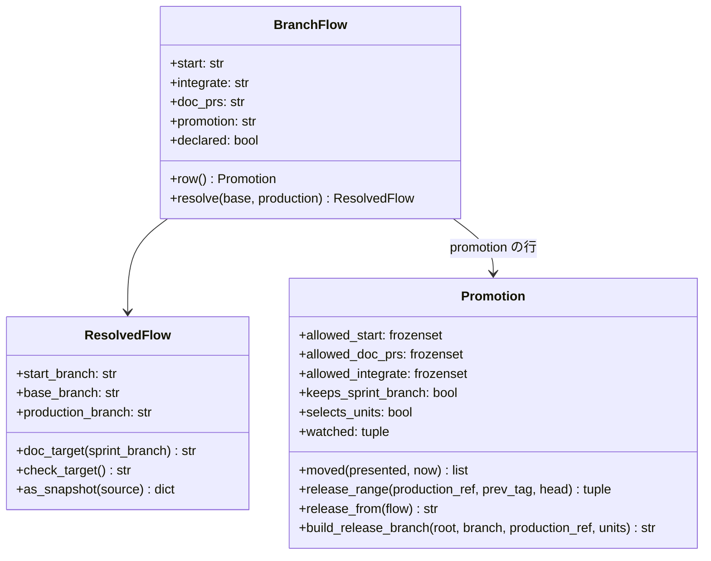
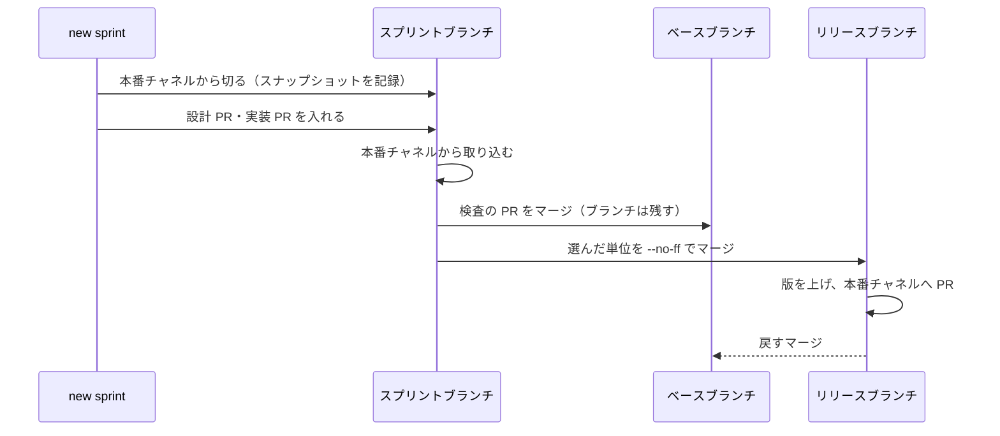

# ブランチ運用の宣言（スプリントの起点・文書の宛先・本番への取り込み方）

## 概要

NDF は、スプリントブランチをどこから切り、設計 PR と確定仕様化の PR をどこへ出し、本番チャネルへ何を入れるかを、
リポジトリのブランチ運用の宣言（`.ndf/worktree.json` の `branch_flow`）から決める。ブランチ運用はリポジトリの事情で
決まるため、NDF は特定のブランチ名と特定の運用を前提にしない。

- 宣言は任意である。宣言の無いリポジトリは、ベースブランチから切り、ベースブランチを丸ごと本番チャネルへ出す既定の振る舞いで動く
- 宣言を選んで集める取り込み方（`promotion: selected`）にすると、スプリントブランチは本番チャネルから切られる。リリースは、本番チャネルから組んだリリースブランチへ、選んだスプリントブランチだけを集めて出す
- スプリントは、開始時に解いた宣言の値（スナップショット）で最後まで進む。途中で宣言を変えても、動いているスプリントには効かない
- `project-decl.py` は、既存のリポジトリのブランチの使い方を測って宣言の案を根拠つきで出す。宣言と実際の使い方のずれも検出する

## 用語

語の定義は用語集 [docs/glossary.md](../glossary.md) の `ndf-workflow` の語（ベースブランチ・ブランチ運用の宣言・スプリントの起点・
文書の Pull Request の宛先・本番への取り込み方・リリースブランチ・リリースの単位）が持つ。この文書は定義をコピーしない。

## コンテキスト

開発の工程（`ndf-workflow`）が供給者、リリース（`ndf-release`）が顧客の関係にある。リリースは、開発の工程がスプリントの
開始時に記録したスナップショットだけを読み、宣言のファイルを読み直さない。

## 背景

並列の計画で複数のスプリントが同じベースブランチへ入ると、ベースブランチを丸ごと出すリリースには、承認していないスプリントも
載る（2026-11-12 のまとめたリリースに、計画の外のスプリントが入った）。承認したスプリントだけを出す運用を選べるよう、
運用をリポジトリの宣言で受け、NDF の側は宣言どおりに起点・宛先・リリースの範囲を選ぶ。

選んで集める取り込み方は、git 本家の運用（gitworkflows(7) の Graduation と Throw-away integration）に倣う。トピックブランチは
取り込む先のうち一番古いブランチ（本番チャネル）から切り、結合を試すブランチ（ベースブランチ）は本番へ流さない。

## 構成要素

| 要素 | 責務 |
| --- | --- |
| `plugins/ndf/scripts/lib/branch_flow.py` | 宣言の読み分け・既定値・取り込み方の表・スナップショットの形。特定のブランチ名（既定ブランチの候補・測る候補）の唯一の置き場 |
| 宣言の契約とスキーマ（`plugins/ndf/contracts/settings/worktree.json.json`・`plugins/ndf/skills/worktree/schemas/worktree.schema.json`） | `branch_flow` のキーと置き場（メインディレクトリ）。スキーマの `branch_flow` は取り込み方の表から作る |
| `plugins/ndf/scripts/lib/repo.py` | worktree の起点をスナップショットか宣言から解く。後片付けでスプリントブランチを残すかを決める。マージで消えたブランチを push し直す（`restore_branch`） |
| `plugins/ndf/scripts/supervise_lib/`（`decl.py`・`sprint_waves.py`・`sprint.py`・`templates.py`・`release_flow.py`・`release_templates.py`） | スナップショットを目録へ記録し、起点・文書の宛先・ベースブランチの取り込みの元・リリースの組み方をスナップショットから組む |
| `worktree-setup.sh`・`lib/worktree-branch.sh` | `create` の既定の起点をスプリントの起点にする |
| `release-steps.py`・`release_lib/promotion.py` | 選んで集める取り込み方のリリースブランチを組み（`release-branch`）、本番チャネルへの Pull Request を承認したコミットと照合してマージし、戻すマージを入れる |
| `lib/pr_mode.py`・`pr-steps.py` | Pull Request の宛先の区分を `sprint` / `base` で返す |
| `project-decl.py`・`project_lib/measure_branch_flow.py` | 測定（`measure`）・ずれの検出（`drift`）・書き出し（`write`）・形の検査（`check`） |
| `scripts/check-skill-repo-assumptions.py` | Skill の本文・手順書・スクリプト・エージェントの本文に、特定のブランチ名の決め打ちが入ると落とす |
| `scripts/check-pr-base.sh`・`scripts/ci-heavy-skip.py`・`.github/workflows/pr-base-guard.yml` | ai-plugins の本番チャネル宛の検査と全体テストの省略の判定を、宛先のブランチの宣言で選ぶ |

## 仕様

### 集約

| 集約 | 持ち主（書き換えてよいもの） | 根 | エンティティ | 値オブジェクト |
| --- | --- | --- | --- | --- |
| ブランチ運用の宣言 | `project-decl.py write` と利用者の手の編集 | `.ndf/worktree.json` の `branch_flow` | — | 4 項目の値・レビューの単位（`reviews`） |
| スプリント | `supervise.py new sprint`（開始時に 1 回だけ書く） | スプリントの目録（`sprint.json`） | スプリントブランチ | スナップショット（解決済みのブランチ名つき） |
| リリース | リリースのプラン | 承認資料と承認したコミット | リリースブランチ | 選んだリリースの単位と本番チャネルの、組んだ時点のそれぞれの先頭 |



`Promotion` は取り込み方の表の 1 行である。呼ぶ側は行の属性とメソッドだけを読み、取り込み方の名前で分岐しない。
取り込み方を足すときは、表に行を 1 つ足し、行のメソッドを実装する。

### 常に成り立つ条件

| 集約 | 条件 | 破れたときの扱い |
| --- | --- | --- |
| 宣言 | 4 項目の値は、取り込み方の表の行が許す組み合わせだけを取る | `FlowError`（直すキーと許す値つき）。`new sprint` は終了コード 2、`project-decl.py write` は書かずに 1 で止まる。既定値へ倒さない |
| 宣言 | `branch_flow` が無いときは、既定値の行で、宣言の仕組みが無いときと同じ起点・宛先・範囲を出す | — |
| スプリント | 開始後の工程（設計・実装・検査・開発版・本番・まとめ）は、目録のスナップショットだけを読む | スナップショットの無い目録は、宣言の無いリポジトリのスナップショットとして読む |
| スプリント | 選んで集める取り込み方のスプリントブランチには、ベースブランチにだけあるコミットが入らない | ベースブランチの取り込みのステップは、取り込みの元をスプリントの起点（本番チャネル）にする |
| リリース | 選んで集める取り込み方のリリースブランチは、本番チャネルの先頭と、選んだリリースの単位の `--no-ff` のマージだけからなる | 衝突が rerere の記録で解けなければマージを取り消して止め、承認資料を出さない |
| リリース | 選んで集める取り込み方では、ベースブランチが動いてもリリースを組み直さない。選んだ単位の先頭か本番チャネルの先頭が動いたときだけ組み直す | — |

### 宣言の読み方と既定値

宣言はメインディレクトリの `.ndf/worktree.json` から読む（`production_branch` と同じ置き場）。Pull Request の変更だけでは、
リリースの範囲の決め方を変えられない。`supervise.py new sprint` の `--base` はベースブランチの名前だけを上書きする。

起点と文書の宛先はブランチ名を写さず、チャネル（`base` / `production`）で指す。名前は `base_branch`・`production_branch` から解く。
本番チャネルの名前を変えても、宣言を 2 か所直さずに済む。

### 取り込み方の表

| `promotion` | 許す `start` | 許す `doc_prs` | 許す `integrate` | スプリントブランチを残すか | 承認資料の範囲 | 組み直す条件 | リリースブランチを切る元 |
| --- | --- | --- | --- | --- | --- | --- | --- |
| `whole` | `base` | `base` | `check` | 残さない | 本番チャネル..提示したコミット | ベースブランチの先頭が動いた | ベースブランチ |
| `selected` | `production` | `sprint` | `check` | 本番チャネルに含まれるまで残す | 前の本番のタグ..リリースブランチの先頭 | 選んだ単位か本番チャネルの先頭が動いた | 本番チャネル |

`integrate: check` は、スプリントブランチを検査の Pull Request のマージでベースブランチへ入れることを表す。

### スプリントの流れ（選んで集める取り込み方）



- **起点と宛先**: 設計のプランの起点は `origin/<本番チャネル>`、設計 PR と確定仕様化の PR の宛先は `sprint/<名前>` になる。宣言の無いリポジトリでは起点 `origin/<ベースブランチ>`、宛先 `<ベースブランチ>` のまま
- **ベースブランチとの衝突**: 検査の Pull Request のマージで現れ、止めて人へ戻す。人はスプリントブランチを変えず、ベースブランチから一時の結合用のブランチを切って衝突を解き、そこから検査の Pull Request を出し直す（手順は `development-workflow` の `references/parallel-work.md`）。解き方は `git rerere` が記録し、リリースブランチを組むときに再利用される
- **検査の Pull Request のマージ**: マージの前に `gh pr list --base <スプリントブランチ> --state open` を打ち、1 件でもあればマージせず一覧を出して止める。マージで origin からスプリントブランチが消えた（GitHub の `delete_branch_on_merge`）ときは、ローカルの先端を push し直す。強制 push はしない
- **リリースブランチ**: 開発版のデプロイの後、承認資料の前に `release-steps.py release-branch --production <本番チャネル> --units <スプリントブランチ>` で組む。一時の作業ツリーで detached HEAD に組み、呼び手の作業ツリーに触れない。origin に既にあれば（組み直し）、その先頭から本番チャネルと単位をマージで足し、強制 push をしない
- **リリースブランチの PR のレビュー**: レビューの単位の `release` が `none` でなければ、`release-branch` と承認資料の間で `release-steps.py review-open` → cross-review → `review-close` を通す。承認資料はレビューの直しを移した後の先頭で作る。使い方は `release` の [references/release-steps.md](../../plugins/ndf/skills/release/references/release-steps.md) にある
- **本番チャネルへの Pull Request**: リリースブランチから本番チャネルへ直接出す。先頭が、承認したコミットに版上げ・変更履歴などのマージでないコミットだけを積んだものであるときだけマージする。承認の後にマージで足した単位は承認の外として止め、組み直しへ戻す
- **戻すマージ**: 本番チャネルへ入れてタグと GitHub Release を作った後、開発版と同じ `release/v<版>-sync` のブランチでリリースブランチをベースブランチへ戻す。版数の衝突は本番の版を取る。失敗は本番の完了と分けて報告する。ベースブランチの作り直し（強制 push が要る）はしない
- **後片付け**: スプリントブランチは `git merge-base --is-ancestor <スプリントブランチ> origin/<本番チャネル>` が真になるまで消さない。確定仕様化の PR はスプリントブランチへ入り、次のリリースの単位になる

### 組み合わせの制限

| 組み合わせ | 振る舞い |
| --- | --- |
| `selected` と `pace: fast` | `pace: fast` はスプリントブランチを作らないため組めない。プランを組む時点で理由を出して止まる |
| `selected` と並列の計画のまとめたリリース | まとめたリリースは組まない。各レーンが自分のリリース承認ゲートと本番のプランで出す |
| `selected` で単位が無い | リリースのプランを組まずに止まる |

依存するスプリントは、後のスプリントブランチへ前のスプリントブランチをマージする（並列の計画の `after` と同じ関係）。後のスプリントを
選ぶと前のスプリントのコミットも範囲に入り、承認資料に前のスプリントの PR が並ぶ。

### Pull Request の宛先の区分

`pr_mode.pr_target(base)` は、宛先がスプリントブランチなら `sprint`、それ以外は `base` を返す。区分の名前はブランチ名に依らない。
`pr-steps.py` の結果の `target` にこの値が出る。

## データ・設定

### 宣言の形

`.ndf/worktree.json` の任意のキー `branch_flow`。キーが無ければ既定値の行を使う。

| キー | 値 | 既定 | 意味 |
| --- | --- | --- | --- |
| `start` | `base` / `production` | `base` | スプリントの起点 |
| `integrate` | `check` | `check` | スプリントブランチをベースブランチへ入れる時点 |
| `doc_prs` | `base` / `sprint` | `base` | 設計 PR と確定仕様化の PR の宛先 |
| `promotion` | `whole` / `selected` | `whole` | 本番への取り込み方 |
| `reviews` | PR の種類（`impl`・`sprint`・`release`・`design`・`spec`）ごとの `checks` と `diff` | 書かない種類は既定値 | PR の種類ごとに掛けるレビューと対象の差分（レビューの単位）。`release` は取り込み方の行がリリースの単位を選ぶときだけ書ける。実装の差分がどの PR でも cross-review されない宣言と、既定値と重なって同じ実装の差分を 2 回 cross-review する宣言は `FlowError` で止める |

書き方の例と、レビューの単位の許す値・既定値の表は `worktree` の [references/declaration.md](../../plugins/ndf/skills/worktree/references/declaration.md) が持つ。

### スナップショットの形

`new sprint` は目録 `sprint.json` のキー `ブランチ運用` に、解決済みの値を書く。

```json
{
  "ブランチ運用": {
    "start": "production", "integrate": "check", "doc_prs": "sprint", "promotion": "selected",
    "start_branch": "main", "base_branch": "develop", "production_branch": "main",
    "source": ".ndf/worktree.json の branch_flow",
    "reviews": {"release": {"checks": ["cross-review"], "diff": "resolution"}}
  }
}
```

`reviews` は宣言に書いた種類だけを写し、書いた種類が無ければ `{}` にする。書いていない種類は、プランを組む時点で課題のまとまりの記録の有無から既定値で解く。`reviews` の無い目録は `{}` として読み、宣言を読み直さない。

### 宣言の作成と変更

| 操作 | 宣言 | スナップショット |
| --- | --- | --- |
| 宣言を書く・変える | `project-decl.py write` か手の編集 | 次に始めるスプリントから効く |
| 宣言を外す | 既定値の行へ戻る | 動いているスプリントは開始時の値のまま |
| スプリントを始める | 読む | 書く（1 回だけ） |
| スプリントの後の工程・リリース | 読まない | 読む |

宣言の変更は利用者の設定の書き換え（共通原則 C7）である。振り返りと棚卸しは更新の案を示すだけで、自分では書き換えない。

## 外部連携

### 測定（`project-decl.py measure`）

既存の出力に `branch_flow` の項目を足す。4 項目それぞれに `{value, confidence, evidence[]}` か `{unknown: 理由}` を出す。
レビューの単位は項目の `reviews.<種類>` に、PR の種類ごとに直近のマージ済みの PR（最大 10 件）のレビューの印の有無から推した値を出す。この推定は `write` の書き出しへ渡さない。

- 標本は直近のマージ済みの Pull Request（最大 100 件。`gh api repos/<R>/pulls?state=closed&per_page=100`）と origin のスプリントブランチ
- 確からしさは、推した値に合う標本の割合が 0.9 以上で `高`、0.6 以上で `中`。標本が 3 件未満か 0.6 未満なら値を出さず `unknown` と理由を出す
- ルールセットと CI の宛先の検査は、根拠の行としてだけ出す
- `gh` の出力は既存の伏せ字（`project_lib/secret.py`）を通す
- ベースブランチか本番チャネルを決められない・origin が GitHub でない・`gh` を使えないときは、`unknown` と理由を出す

### ずれの検出（`project-decl.py drift --measure FILE`）

宣言（無ければ既定値の行）と `measure` の結果を項目ごとに比べる。ずれた項目ごとに `items` の行（項目・宣言の値・測った値・根拠・更新の案）を出す。
レビューの単位は `branch_flow.reviews.<種類>` の行で出す。書いていない種類は、既定値の 2 列（課題のまとまりの記録の有無）のどちらとも違うときだけ出す。
ずれが無ければ `items` は空で終了コード 0、宣言が壊れていれば 3。`check` は `gh` を呼ばず、`branch_flow` の形の誤りだけを見る。
`retrospective` と `backlog-refinement` が `measure` → `drift` を打つ。

### ai-plugins の本番チャネル宛の検査

必須のステータスチェック `guard`（`.github/workflows/pr-base-guard.yml`）が `scripts/check-pr-base.sh` を走らせる。宣言は Pull Request の変更で
緩められないよう、宛先のブランチの `.ndf/worktree.json`（`git show origin/<宛先>:.ndf/worktree.json`）から読む。

`branch_flow.promotion` が `selected` のとき、本番チャネル宛の Pull Request は次をすべて満たすときだけ通す。

| # | 条件 | 確かめ方 |
| --- | --- | --- |
| 1 | head が `release/v<版>` である | ブランチ名 |
| 2 | head が `origin/<宛先>` の子孫である | `git merge-base --is-ancestor` |
| 3 | `origin/<宛先>..<head>` のコミットは、head の first-parent の列か、origin のいずれかの `sprint/*` の祖先である | `git rev-list` |

ベースブランチにだけあるコミット（別のスプリントの PR・開発版の版上げ）は条件 3 で落ちる。どのスプリントを承認したかは CI では分からない。
承認したスプリントだけが入ることは、承認資料の範囲と、承認したコミットとの照合（「スプリントの流れ」の本番チャネルへの Pull Request）が保証する。
`whole` か `branch_flow` が無いときは、head がベースブランチか、先頭が `origin/<ベースブランチ>` の祖先の `release/v<版>` であるときに通す。

`scripts/ci-heavy-skip.py` の規則 3（本番の Pull Request で、ベースブランチへの push で通ったコミットから版数と説明しか変えていなければ全体テストを省く）は、
宛先の宣言が単位を選ぶ行のときは当てない。リリースブランチはベースブランチと違う組み合わせだからである。宣言を読めないときも当てない。
規則 1（版上げだけの差分）と規則 2（文書だけの差分）は取り込み方に依らず当てる。

## エラー処理

| 状況 | 振る舞い |
| --- | --- |
| 宣言の形の誤り・表に合わない組 | `FlowError`。`new sprint` は終了コード 2 と直すキー。スナップショットを書けなければスプリントを作らない |
| リリースブランチを組めない（衝突・単位が無い） | `ReleaseBuildError`。止めて人へ戻し、承認資料を出さない |
| スプリントブランチ宛ての開いた Pull Request がある | 検査の Pull Request をマージせず、一覧を出して止める |
| 承認の後にリリースブランチの中身が変わった | 本番チャネルへの Pull Request をマージせず、組み直しへ戻す |

## セキュリティ

- 宣言はメインディレクトリから読み、CI の検査は宛先のブランチの宣言を読む。Pull Request の変更で範囲の決め方と検査を緩められない
- 強制 push をしない（共通原則 C4）。マージで消えたブランチは、origin に無いときだけ通常の push で戻す
- 本番チャネル宛の検査の判定を変えることは認証・認可の変更（共通原則 C2）にあたり、設計承認ゲートで人が見る

## テスト観点

- 形の誤り・知らないキー・表に合わない組を読むと `FlowError` になり、`new sprint` が終了コード 2 で止まること
- `branch_flow` の無い宣言と外した宣言で、設計の起点・設計 PR の宛先・用語チェックの比べる元・スプリントブランチの起点・検査の宛先・開発版の範囲の比べる元が、ベースブランチを使う値のままであること
- 宣言の無いリポジトリで、まとめたリリースの組み直しの判定（ベースブランチの先頭が動いたら組み直す）が変わらないこと
- 選んで集める宣言で、設計のプランの起点が `origin/<本番チャネル>`、設計 PR の宛先が `sprint/<名前>`、ベースブランチの取り込みの元が `origin/<本番チャネル>` であること
- 選んだ単位だけをマージしたリリースブランチに、選ばない単位の先頭が `--is-ancestor` で含まれないこと
- 承認資料の範囲が前の本番のタグ..リリースブランチの先頭になり、ベースブランチだけを進めても組み直さず、選んだ単位か本番チャネルを進めると組み直すこと
- 宣言を変えた後も、変える前に始めたスプリントの後の工程が開始時のスナップショットで動くこと
- 本番チャネルに含まれないスプリントブランチを後片付けが消さず、含まれたものは消すこと
- 合成した履歴で `measure` が 4 項目に値・確からしさ・根拠を出し、標本の足りない項目は `unknown` と理由を出すこと。ずれた宣言で `drift` が行を出し、合った宣言では `items` が空であること
- 特定のブランチ名を例外リストの外のファイルへ足すと `check-skill-repo-assumptions.py` が落ちること
- `worktree` の手順書の `branch_flow` の例がスキーマに通ること
- 宛先の宣言が `selected` のとき、`check-pr-base.sh` がベースブランチからの Pull Request とベースブランチにだけあるコミットを含む head を 1 で落とし、条件を満たす `release/v<版>` を 0 で通すこと。`ci-heavy-skip.py` が規則 3 で省かないこと

テストは `plugins/ndf/scripts/tests/test_branch_flow.py`・`test_sprint_branch_flow.py`・`test_project_decl_branch_flow.py`・`test_pr_mode.py`、
`scripts/tests/test_pr_base_guard.py`・`test_ci_heavy_skip.py` にある。

## 運用

### 確かめていないこと

| 項目 | 内容 |
| --- | --- |
| `measure` の確からしさの閾値（0.9・0.6・3 件） | ai-plugins 以外の履歴での妥当性は未確認。NDF の外のリポジトリで `measure` を打った結果で分かる |
| 選んで集める取り込み方での衝突の頻度と rerere の効き | 実測が無い。選んで集める取り込み方で出した最初の 3 回のリリースで分かる |
| ブランチ運用を宣言で受ける既存のツール | 調べていない。見つかれば、取り込み方の表の読み分けを置き換えられるかを棚卸しで比べる |

## 関連リンク

- `worktree` の宣言の書き方: [plugins/ndf/skills/worktree/references/declaration.md](../../plugins/ndf/skills/worktree/references/declaration.md)
- 本番のリリースの手順: [plugins/ndf/skills/development-workflow/references/production-merge.md](../../plugins/ndf/skills/development-workflow/references/production-merge.md)
- 測定と宣言の作成: [plugins/ndf/skills/development-workflow/references/project-analysis.md](../../plugins/ndf/skills/development-workflow/references/project-analysis.md)
- 版とリリースの方針: [docs/versioning-and-distribution.md](../versioning-and-distribution.md)
- gitworkflows(7): https://git-scm.com/docs/gitworkflows
- git-rerere: https://git-scm.com/docs/git-rerere
