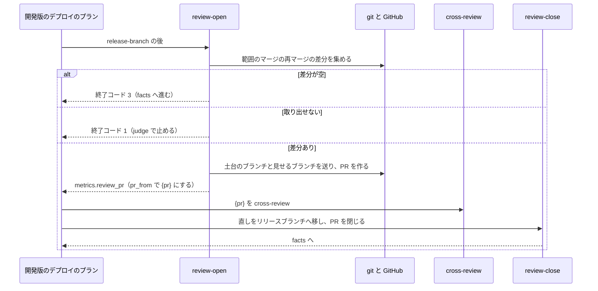

# ブランチ運用の宣言のレビューの単位: PR の種類ごとに掛けるレビューと対象の差分を選ぶ

## 概要

リポジトリは、ブランチ運用の宣言（`.ndf/worktree.json` の `branch_flow`）の `reviews` に、PR の種類ごとに掛けるレビューと対象の差分（レビューの単位）を書ける。NDF のスプリントのプランは、その値のとおりにレビューのステップを置く・外す。宣言の無いリポジトリのプランは、`reviews` を持たない版の NDF と同じステップを組む。

- どの PR でも cross-review されない実装の差分が出る宣言は、スプリントを作る前に止まる
- リリースブランチの PR には、衝突の解消の差分だけを見せる一時の PR を作ってレビューを掛けられる
- 既存のリポジトリの PR からレビューの単位を推し、宣言とのずれを出せる

ブランチ運用の宣言の 4 項目（起点・取り込み・文書の宛先・本番への取り込み方）は [ndf-branch-flow-declaration.md](ndf-branch-flow-declaration.md) が持つ。この文書は `reviews` だけを扱う。

## 用語

この文書の語（レビューの単位・掛けるレビュー・PR の種類・対象の差分・スプリントの PR・未検査の差分・リリースブランチの PR・衝突の解消の差分・衝突の解消のレビューの PR）の定義は、用語集 [docs/glossary.md](../glossary.md) にある。

説明文の語とコードの値の対応は次のとおりである。

| 説明文の語 | コードの値 |
| --- | --- |
| PR の種類（実装 PR・スプリントの PR・リリースブランチの PR・設計 PR・確定仕様化の PR） | `impl`・`sprint`・`release`・`design`・`spec` |
| 掛けるレビュー（cross-refactoring・cross-review・振る舞いの確認） | `cross-refactoring`・`cross-review`・`behavior` |
| 対象の差分（PR の差分全体・未検査の差分・衝突の解消の差分・掛けない） | `pr`・`unchecked`・`resolution`・`none` |

## コンテキスト

| コンテキスト | 何の語が 1 つの意味に決まるか |
| --- | --- |
| プロジェクトの宣言（`lib/branch_flow.py`・`project-decl.py`） | レビューの単位・掛けるレビュー・PR の種類・対象の差分。宣言の読み分け・検査と、既存の PR からの測定 |
| 開発の工程（`ndf-workflow`） | スプリントの PR・未検査の差分・目録のスナップショット |
| リリース（`ndf-release`） | リリースブランチの PR・衝突の解消の差分・衝突の解消のレビューの PR |

プロジェクトの宣言は、許す値の表（`lib/branch_flow.py`）を公表された言語として開発の工程とリリースへ渡す。開発の工程はスプリントの開始時に宣言を目録へ書き込み、リリースは目録のスナップショットだけを読んで宣言のファイルを読み直さない。

## 背景

ブランチ運用の規則はリポジトリの事情で決まる。レビューの置き場を NDF のテンプレートに決め打ちせず、リポジトリが宣言で選べるようにした。主要なコード管理の製品（GitHub のルールセット・GitLab の承認の規則）も、レビューの要否を宛先のブランチごとの規則として宣言させる。

宣言は、PR の種類をキーにした行を並べる形にした。運用の型の名前を 1 つ選ぶ形は、型を足すたびに NDF の変更が要り、リポジトリが自分の規則を書けないためである。キーを `branch_flow` の中に置くのは、取り込み方と合わせた検査を同じ読み分けで行うためである。

## 仕様

### 集約

| 集約 | 持ち主（書き換えてよいもの） | 根 | 値オブジェクト |
| --- | --- | --- | --- |
| ブランチ運用の宣言 | リポジトリの管理者（手の編集と `project-decl.py write`） | `.ndf/worktree.json` の `branch_flow` | レビューの単位（PR の種類ごとの掛けるレビューの組と対象の差分） |
| スプリント | `supervise.py new sprint`（開始時に 1 回だけ書く） | 目録（`sprint.json`） | スナップショット（レビューの単位を含む） |
| リリース | `release-steps.py` のサブコマンド | 承認資料と承認したコミット | 衝突の解消の差分 |

NDF のプランとテンプレートは宣言を書かず、目録のスナップショットを読むだけである。リリースの集約へ書くサブコマンドは次の表に限る。

| サブコマンド | 呼ぶプラン | 書くもの |
| --- | --- | --- |
| `release-branch` | 開発版のデプロイ | リリースブランチへ、本番チャネルとリリースの単位のマージ。組み直しは origin のリリースブランチの先頭から積む |
| `review-open` | 開発版のデプロイ | 衝突の解消のレビューの PR と一時のブランチ（土台のブランチと見せるブランチ）。リリースブランチは書かない |
| `review-close` | 開発版のデプロイ | リリースブランチへ、衝突の解消のレビューで入った直しのコミット |
| `release` | 本番のリリース | リリースブランチへ、承認したコミットの後のマージでないコミット（版上げ・変更履歴など）だけ |

### 常に成り立つ条件

| # | 集約 | 条件 | 破れたときの扱い |
| --- | --- | --- | --- |
| I1 | 宣言 | PR の種類ごとに、掛けるレビューと対象の差分は「PR の種類ごとに許す値」の表の値だけを取る | 直すキー（`branch_flow.reviews.<種類>.<checks か diff>`）と許す値を出して止める。既定値へ倒さない |
| I2 | 宣言 | 対象の差分が `none` なら掛けるレビューは空、それ以外なら 1 つ以上 | I1 と同じ |
| I3 | 宣言 | `release` の行は、取り込み方の行がリリースの単位を選ぶ（`promotion: selected`）ときだけ書ける | I1 と同じ。理由に `promotion = <行>` を添える |
| I4 | 宣言 | 実装の差分は、実装の差分を覆う行の 1 つ以上で cross-review される。課題のまとまりの記録が有るときと無いときの両方で成り立つ | 直すキーと理由を出して止める |
| I5 | 宣言 | `reviews` の無い宣言・書いていない種類は既定値の表の値になり、`reviews` を持たない版と同じステップを組む | 退行のテストが落ちる |
| I6 | スプリント | 動いているスプリントは目録のスナップショットのレビューの単位でプランを組む。開始の後に宣言を変えても、打ち直しで組むステップは変わらない | 打ち直しのテストが落ちる |
| I7 | スプリント | リファクタリングを止める条件（`refactor_suspended`・リファクタリングの無いモード）は宣言より先に効き、cross-refactoring を選んでも外す | テストが落ちる |
| I8 | リリース | 衝突の解消の差分が空なら、レビューを打たずに次のステップへ進む。差分を取り出せない・レビューの PR を組めないなら止めて人へ戻す | テストが落ちる |
| I9 | リリース | 衝突の解消のレビューで入った直しは、リリースブランチへ移してから承認資料を作る。直しは組み直しでも消えない | テストが落ちる |
| I10 | リリース | 承認資料を作る時点のリリースブランチのマージは、すべて衝突の解消のレビューを通っている | テストが落ちる |
| I11 | リリース | 衝突の解消のレビューの PR と一時のブランチは、版ごとに開いているものが 1 組までである。閉じて消してよいのは、直しがすべてリリースブランチへ移った組だけである | テストが落ちる |
| I12 | 宣言 | 書いていない種類の既定値と書いた行が、同じ実装の差分に cross-review を掛ける組み合わせは生じない。同じ差分を 2 回 cross-review するのは、利用者が両方の行を書いたときだけである | 書いていない種類のキーと重なる行を出して止める |

実装の差分を覆う行は、`impl` の `diff: pr`・`sprint` の `diff: unchecked`・`release` の `diff: pr` の 3 つだけである（`COVERING`）。`release` の `diff: resolution` は衝突の解消の差分しか見ないため数えない。設計 PR と確定仕様化の PR の文書の差分も数えない。

I4 と I12 は読み分けの時点で検査する。そのため `supervise.py new sprint` だけでなく `project-decl.py check / write` も同じ誤りで止まる。

### PR の種類ごとに許す値

| 種類 | 許す `checks` | 許す `diff` | 書ける条件 |
| --- | --- | --- | --- |
| `impl` | 3 つすべて | `pr` / `none` | 常に |
| `sprint` | 3 つすべて | `unchecked` / `none` | 常に |
| `release` | `cross-review` | `pr` / `resolution` / `none` | 取り込み方の行がリリースの単位を選ぶとき |
| `design` | `cross-review` | `pr` / `none` | 常に |
| `spec` | `cross-review` | `pr` / `none` | 常に |

設計 PR・確定仕様化の PR・リリースブランチの PR は文書かマージだけを持つため、cross-refactoring と振る舞いの確認を許さない。スプリントの PR は 1 スプリントに 1 回だけ検査するため、未検査の差分が PR の差分全体と同じになる。pace `fast` の検査の PR は未検査の差分で作るため、スプリントの PR には `unchecked` だけを許す。

表は `lib/branch_flow.py` の `REVIEW_ALLOWED` に 1 つだけ置き、スキーマの断片（`schema_fragment()`）・読み分けの検査・測定の候補はそこから作る。

### 既定値の表

| 種類 | まとまりの記録あり | まとまりの記録なし |
| --- | --- | --- |
| `impl` | `cross-review` / `pr` | 掛けない |
| `sprint` | `cross-refactoring`・`behavior` / `unchecked` | 3 つすべて / `unchecked` |
| `release` | 掛けない | 掛けない |
| `design` | `cross-review` / `pr` | `cross-review` / `pr` |
| `spec` | 掛けない | 掛けない |

書いていない種類だけを、プランを組む時点の課題のまとまりの記録の有無でこの表から解く（`ReviewUnits.row`）。書いた種類は、まとまりの記録の有無に依らずその値で組む。「まとまりの記録があれば」を表す特別な値は宣言に置かない。利用者が書けるのに、意味が宣言の外で決まる値になるためである。

既定値で解く行と書いた行は、実装の差分への cross-review が重なりうる。たとえば `impl` だけに `cross-review / pr` を書くと、まとまりの記録が無いスプリントで `sprint` の既定値も cross-review を掛ける。この重なりは宣言を読んでも見えないため I12 で止め、利用者がその種類を書いて決める。利用者が両方の行に書いた重なりは、意図したものとして通す。

### プランへの置き方

`supervise_lib/review_units.py` が、解いた行（`ReviewRow`）を受けてステップを差し込む・外す。ステップの並びは常にリファクタリング → cross-review → 振る舞いの確認（`CHECKS` の順）で、中身は既存の検査の部品（`templates._inspect_steps`・`review_step`・`BEHAVIOR_STEPS`）から作る。

| プラン | 当たる種類 | 置く・外す所 |
| --- | --- | --- |
| 実装（`plan_sprint_impl`・`plan_fast_impl`） | `impl` | `ready` の前に、手元の送信 → 選んだレビューのステップ → 手元の早送りを置く（`apply_impl`） |
| 検査（`plan_sprint_check`） | `sprint` | assess・refactor・review・振る舞いの確認から、選ばないステップを外して行き先を付け替える（`apply_check`） |
| pace `fast` の検査・コードレビュー・最後の検査（`plan_fast_check`） | `sprint` | 同上。cross-review を選ばなければコードレビューのステージを置かない |
| 設計（`plan_sprint_design`・`plan_mvv_design`・`plan_advise_design`） | `design` | `none` なら設計のレビューのまとまりを外し、`requirements-recheck` へつなぐ（`apply_design`） |
| 確定仕様化（`_spec_pr_steps`） | `spec` | `pr` なら `pr` と `ready` の間に文書の cross-review を置く（`spec_review_steps`） |
| 開発版のデプロイ（`plan_release_package_plugin`） | `release` | `release-branch` と `facts` の間に `review-open` → `review` → `review-close` を置く（`release_flow.review_range_steps`） |

リファクタリングのステップは、宣言で選んでも I7 の条件に当たれば外す。外す判定は `chosen_checks` と、検査のプランでは今の `trim_check_steps` が持つ。

### リリースブランチの PR のレビュー



**衝突の解消の差分は、git の再マージの差分（`git log --first-parent --remerge-diff`）で取り出す。** 範囲は前回のレビュー済みの先頭（無ければ本番チャネル）からリリースブランチの先頭までである。衝突したマージと、マージのコミットで足した変更だけが差分を持つ。この差分を先頭へ逆に当てた tree を土台のコミット（親は先頭）にし、その子に先頭と同じ tree のコミットを置く。土台を宛先、子を head にした PR の差分は、衝突の解消の差分そのものになる。cross-review は PR の番号だけを入力に取るため、駆動を変えずに使える。Gerrit がマージのコミットを自動のマージの結果と比べて見せる形に倣ったものである。

- `diff: pr` のときは、土台を範囲の始まり、見せるブランチをリリースブランチの先頭にして同じ経路を通る
- 逆に当てられない（後のマージが同じ行を変えた）ときは推定で縮めず、終了コード 1 で止めて人へ戻す
- レビューを承認資料より前に置くのは、承認する人がレビュー済みの内容を見るためである。本番チャネルへの PR は承認の後に作るため、そこでレビューすると承認した内容と直した後の内容が食い違う

**直しと範囲の受け渡しは、レビューの PR の本文の印で行う**（`release_lib/review_range.py`）。

| 印 | 書く時点 | 値 |
| --- | --- | --- |
| `<!-- ndf:shown-head {sha} -->` | `review-open` | 見せるブランチの先頭 |
| `<!-- ndf:range-end {sha} -->` | `review-open` | 範囲を決めた時点のリリースブランチの先頭 |
| `<!-- ndf:reviewed-head {sha} -->` | `review-close` | レビュー済みの先頭。範囲の終わりから直しを移した後の先頭までが直しだけならその先頭、直し以外のコミットがあれば範囲の終わり |

- `review-close` は、見せる先頭より後の直しのうち origin のリリースブランチへまだ移していないもの（`git cherry` の `+` の行）だけを cherry-pick して送る。打ち直しで同じ直しを移し直さない
- 範囲の終わりから先頭までに直し以外のマージがあれば、移して閉じた後に終了コード 1 で止まり、「`review-open` から打ち直す」と出す。足したマージは次の `review-open` が範囲の終わりからの範囲で拾う（I10）
- 直しは、組み直し（`release-branch` は origin の先頭から積む）でも、本番へ入れた後の戻すマージでも失われない（I9）

**レビューの PR と一時のブランチ（`review/release/v<版>` と土台の `review/release/v<版>-base`）を片付けるのは `release-steps.py` である。**

| 時点 | 片付けるもの |
| --- | --- |
| `review-close` の成功 | その版のレビューの PR を閉じ、一時のブランチを消す |
| `review-open` の始め | 開いたまま残った組のうち、直しを移し終えたものを版に依らず閉じて消す。移していない直しを持つ組が、同じ版で範囲の終わりがリリースブランチの先頭と同じなら使い直して `review` から続ける。それ以外の移していない直しを持つ組・比べるリリースブランチを origin から取得できない組があれば、何も閉じずに止める |
| `review-close` の打ち直し | 移せずに止まった後（cherry-pick の衝突・push の拒否）は、人が原因を直して `review-close` から打ち直す。`release-branch` からは打ち直さない（直しは PR にだけあり、次の `review-open` が止まる） |
| 本番のリリースのプランの後片付け（`cleanup`） | その版の一時のブランチが残っていれば消す |

止まった直後は PR を開いたままにし、止まった理由を人が PR の上で見られるようにする。

## データ・設定

### 宣言の形

```json
{
  "branch_flow": {
    "start": "production",
    "integrate": "check",
    "doc_prs": "sprint",
    "promotion": "selected",
    "reviews": {
      "impl": {"checks": ["cross-review"], "diff": "pr"},
      "sprint": {"checks": ["cross-refactoring", "behavior"], "diff": "unchecked"},
      "release": {"checks": ["cross-review"], "diff": "resolution"},
      "design": {"checks": ["cross-review"], "diff": "pr"},
      "spec": {"checks": [], "diff": "none"}
    }
  }
}
```

| キー | 値 | 意味 |
| --- | --- | --- |
| `reviews.<種類>` | `impl`・`sprint`・`release`・`design`・`spec` | 書いていない種類は既定値 |
| `reviews.<種類>.checks` | `cross-review`・`cross-refactoring`・`behavior` の重複の無い並び | 掛けるレビュー。並びの順は意味を持たない |
| `reviews.<種類>.diff` | `pr`・`unchecked`・`resolution`・`none` | 対象の差分 |

スキーマは `plugins/ndf/skills/worktree/schemas/worktree.schema.json` の `branch_flow.reviews` で、`branch_flow.schema_fragment()` の出力と一致する。書き方の例は `worktree` の [references/declaration.md](../../plugins/ndf/skills/worktree/references/declaration.md) にある。`reviews` を持たない版の NDF は `additionalProperties: false` のため、`reviews` を書いた宣言を終了コード 2 で止める。

### 目録のスナップショット

`sprint.json` の `ブランチ運用` に `reviews` を置き、宣言に書いた種類だけをそのまま写す（`ReviewUnits.as_dict()`）。既定値で埋めた形は写さない。

| 場面 | 書く・読む値 |
| --- | --- |
| スプリントの開始 | `ブランチ運用` を宣言の有無に依らず書く。`reviews` も必ず書き、書いた種類が無ければ `{}` にする |
| 打ち直し・後の工程 | `ブランチ運用` のスナップショットが有れば、その中の `reviews` だけを読み、宣言を読まない |
| `ブランチ運用` は有るが `reviews` が無い目録 | `reviews` を持たない版で始めたスプリントの目録である。`{}` と同じに読む |

### 定数

| 名前 | 置き場 | 値 |
| --- | --- | --- |
| `REVIEW_KINDS`・`CHECKS`・`DIFFS` | `lib/branch_flow.py` | 上の表の値。`CHECKS` の並びがステップを置く順の唯一の置き場 |
| `REVIEW_ALLOWED`・`REVIEW_DEFAULTS`・`COVERING` | `lib/branch_flow.py` | 許す値・既定値・実装の差分を覆う行の表 |
| `REVIEW_PREFIX`・`REVIEW_BASE_SUFFIX` | `lib/branch_flow.py` | `review/release/v`・`-base` |
| `STEP_IDS`・`DESIGN_REVIEW_IDS` | `supervise_lib/review_units.py` | 掛けるレビューごとのステップの `id`、設計のレビューのまとまりの `id` |
| `REVIEW_SAMPLES` | `project_lib/measure_branch_flow.py` | `10` |

## 外部連携

### コマンドの契約

| エントリポイント | 振る舞い |
| --- | --- |
| `supervise.py new sprint` | I1〜I4・I12 に反する宣言では、直すキーと理由を 1 件 1 行で出して終了コード 2。プランを作らない |
| `project-decl.py check / write` | 同じ誤りで終了コード 3 |
| `release-steps.py review-open --version <版> --diff pr\|resolution [--production <ブランチ>]` | 片付け → 範囲 → 差分 → ブランチの送信 → PR の作成。`metrics.review_pr` に番号を出して 0。差分が空なら 3（打たずに進む）。取り出せない・組めない・片付けで止まるなら 1 |
| `release-steps.py review-close --version <版>` | 直しを移し、レビュー済みの先頭を本文へ書き、PR を閉じて一時のブランチを消して 0。直し以外のコミットが範囲の後にあれば閉じた後に 1。移せなければ 1 で、リリースブランチを動かさず PR とブランチを残す |
| `project-decl.py measure` | 結果の `branch_flow` の項目に `reviews.<種類>` の推定（値・確からしさ・根拠、測れなければ `unknown` と理由）を足す。この推定は `write` の書き出しへ渡さない |
| `project-decl.py drift` | `branch_flow.reviews.<種類>` のずれの行を足す |

使い方は `release` の [references/release-steps.md](../../plugins/ndf/skills/release/references/release-steps.md) にある。

### 測定の推し方

`measure` は直近のマージ済みの PR を種類ごとに最大 10 件読み、PR に残るレビューの印の有無を数える。手元に残る検査の記録は別のマシンから測れず、実装 PR と設計 PR の分を持たないため使わない。

| 掛けるレビュー | 印 |
| --- | --- |
| cross-review | レビューの本文の頭が `## 🤖 cross-review` |
| cross-refactoring | コメントの `<!-- cross-refactoring plan` |
| 振る舞いの確認 | コメントの `<!-- ndf:behavior-check` |

| head と宛先 | PR の種類 |
| --- | --- |
| head が `feat/issue-` | 実装 PR |
| head が `sprint/`、宛先がベースブランチ | スプリントの PR |
| head が `release/v`、宛先が本番チャネル | リリースブランチの PR |
| head が `review/release/v` | リリースブランチの PR（その衝突の解消のレビューの PR） |
| head が `design/` / `spec/` | 設計 PR / 確定仕様化の PR |

- 確からしさの基準（標本 3 件・割合 0.9 と 0.6）は既存の `confidence` を使う。標本が 3 件に満たない種類は `unknown`
- 対象の差分は、掛けるレビューが空なら `none`。リリースブランチの PR は、印が衝突の解消のレビューの PR にあれば `resolution`、本番チャネル宛の PR にあれば `pr`。それ以外は種類が許す `none` 以外の 1 値
- `drift` は、書いていない種類について既定値の 2 列（まとまりの記録の有無）の両方と比べ、どちらとも違うときだけずれとして出す

## エラー処理

| 場面 | 扱い |
| --- | --- |
| `reviews` の形の誤り（オブジェクトでない・知らない種類・知らないキー・表に無い値・`checks` の重複） | 形の指摘だけを返し、組み合わせ・I4・I12 は見ない |
| I2・I3 の誤り | I4・I12 を見ずに返す（誤った行で覆いを数えない） |
| 再マージの差分を取り出せない（git が古い。`--remerge-diff` は git 2.36 から） | `review-open` が終了コード 1 と git の標準エラーの末尾 |
| 前回のレビュー済みの先頭がリリースブランチの先頭の祖先でない | 本番チャネルから範囲を取り、結果の `items` に理由を出す |
| PR を作れない・送れない | 終了コード 1。送ったブランチは次の `review-open` の片付けが消す |
| `review-close` の時点で開いたレビューの PR が無い | 終了コード 1。開発版のデプロイのプランを `review-open` から打ち直す |

## セキュリティ

- レビューの単位はメインディレクトリの設定から読み、引数では受けない。PR の変更でレビューを外せないようにするためである
- 測定の結果には PR の本文とコメントの中身を載せず、印の有無だけを数える

## 運用

| 確かめていないこと | 分かる時点 |
| --- | --- |
| 再マージの差分を逆に当てられない頻度。手元の実測は 1 つのマージが 1 つの衝突を持つ形だけで行った | `promotion: selected` の宣言で流す最初のリリースで、`review-open` の終了コードを見る |
| `measure` が種類ごとに最大 10 件 × 2 回の API の取得で締め切りに収まるか | `measure` を打ち、所要の秒と `unknown` の理由を見る |
| 土台を宛先にした PR の差分が、GitHub の画面と cross-review の取得で手元の `git diff <土台> <head>` と一致するか | 最初の `review-open` の PR を見る |

## テスト観点

- 5 種類それぞれに書いた値が `BranchFlow.reviews.row(<種類>)` で返り、スナップショットへ出して読み直しても同じであること
- 種類ごとに 1 つずつ選んだ宣言で、実装・検査・pace `fast` の検査・設計・確定仕様化・開発版のデプロイのプランの `steps` に、選んだレビューの `id` だけが現れること
- 宣言の無いリポジトリと `reviews` の無い宣言で、各プランの `steps` の `id` と `drive` の並びが `reviews` を持たない版と等しいこと（I5）
- 衝突したマージを含むリリースブランチで `review-open` の PR の差分が衝突の解消の差分だけになり、衝突の無いマージだけなら終了コード 3、逆に当てられない範囲なら 1 になること（I8）
- `review-close` の後と組み直しの後も、リリースブランチの先頭が直しのコミットを含み、cherry-pick の衝突ではリリースブランチを動かさないこと（I9）
- 組み直しで足したマージだけが次の `review-open` の範囲に入り、収束した直しだけで新しいレビューの PR を作らないこと（I10）
- 開いているレビューの PR が版ごとに 1 組までで、移していない直しを持つ組を閉じないこと（I11）
- 実装の差分がどの PR でも cross-review されない宣言と、既定値と重なる宣言が終了コード 2 で止まり、両方の行に書いた重なりは通ること（I4・I12）
- 種類に合わない値・知らないキー・表に無い値で、直すキーと許す値を出して止まること（I1〜I3）
- `declaration.md` の宣言の例がスキーマと読み分けの両方を通り、スキーマが `schema_fragment()` と一致すること
- 開始時と違う `reviews` を宣言へ書いて打ち直しても、組むレビューのステップが変わらないこと（I6）
- cross-refactoring を選んでも、CI テストの宣言の無いリポジトリとリファクタリングの無いモードでは assess・refactor が現れないこと（I7）
- `measure` が標本から推した値と確からしさを出し、標本が 3 件に満たない種類は `unknown` になり、`drift` が既定値の 2 列のどちらとも違う種類だけを出すこと

テストは `plugins/ndf/scripts/tests/` の `test_branch_flow.py`・`test_sprint_branch_flow.py`・`test_review_units.py`・`test_release_review_range.py`・`test_project_decl_branch_flow.py` にある。

## 関連リンク

- [ndf-branch-flow-declaration.md](ndf-branch-flow-declaration.md) — ブランチ運用の宣言の 4 項目と、選んで集める取り込み方
- `worktree` の [references/declaration.md](../../plugins/ndf/skills/worktree/references/declaration.md) — 宣言の書き方
- `release` の [references/release-steps.md](../../plugins/ndf/skills/release/references/release-steps.md) — `review-open`・`review-close` の使い方
- [docs/glossary.md](../glossary.md) — 用語集
- git log の `--remerge-diff`: https://git-scm.com/docs/git-log
