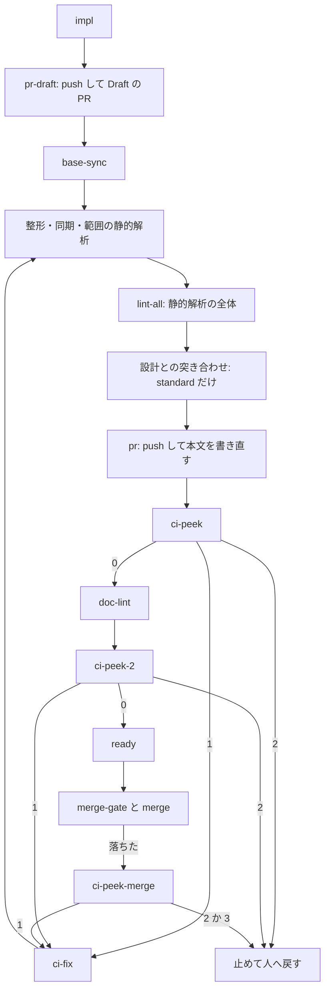

# CI テストの宣言: 宣言のあるリポジトリでは手元でテストを走らせず、PR の CI の結果で合否を決めて直す

## 概要

CI（GitHub Actions）でテストが走るリポジトリでは、NDF は作業しているマシンでテストを走らせず、PR の CI の結果だけで合否を決める。

- 解析は、CI でテストが走ることを検知すると、`.ndf/project.json` に CI テストの宣言（`test.ci.only: true`）を書く
- 宣言のあるリポジトリのプランは、手元のテストのステップを持たない。実装の直後に Draft の PR を出し、push のたびに CI を走らせる
- プランは CI の結果を待たずに 1 回だけ読む。落ちていれば上限の回数まで直して push し、上限に当たれば止めて人へ戻す
- マージは、テストのチェックがすべて現れて通ったときだけ行う
- 手元でテストのコマンドを打つと hook が止める。cross-refactoring も手元でテストを走らせず、CI の結果で点検する

宣言の無いリポジトリの振る舞いは変えない。静的解析（`kind: lint` の suite）は宣言の有無に関わらず手元で走らせる。

## 用語

この仕様で使う語（CI テストの宣言・手元のテスト・CI の結果の監視・CI の失敗の改修・テストのチェック）の定義は、
用語集 [docs/glossary.md](../glossary.md) にある。

## 背景

並列のレーンが範囲テスト・全体テスト・cross-refactoring の点検を同時に手元で走らせると、8 コアの負荷が 30〜60 になり、検査の工程が何時間も延びていた。CI で同じテストが走るリポジトリでは、手元で走らせる必要が無い。

早めの Draft の PR と、CI の失敗を起点にした同じ PR への修正は、GitHub Copilot の coding agent も採る形である。

## 対象範囲

| 対象 | 宣言のあるリポジトリでの振る舞い |
| --- | --- |
| 解析（`project-decl.py write`） | 条件を満たせば宣言を書き、満たさなければ解析が書いた宣言を消す |
| プランのテンプレート（`supervise.py new impl` / `fix` / `check`） | 手元のテストのステップを外し、Draft の PR・CI の監視・CI の失敗の改修のステップを入れる |
| `test-run.py scope` | テストの suite を走らせず、静的解析だけを走らせる |
| マージ（`merge-when-green`） | テストのチェックがすべて現れて通ったときだけマージする |
| hook（PreToolUse のシェルの Tool） | テストの suite の起動の形に当たるコマンドを拒む |
| cross-refactoring | テストを走らせず、最終ゲートで CI の結果を 1 回だけ読む |
| cross-review | 最終スイープの指示で、手元のテストではなく PR の CI の結果を読ませる |
| worker の指示文・Skill・エージェント定義 | 「テストを手元で打たない。合否は PR の CI の結果で読む」を書く |

宣言を読む側は、すべて `plugins/ndf/scripts/lib/test_strategy.py` の `declares_ci_only` と `ci_checks` を通す。

## 仕様

### 集約

| 集約 | 持ち主（書き換えてよいもの） | 根 | エンティティ | 値オブジェクト |
| --- | --- | --- | --- | --- |
| プロジェクトの宣言 | 解析の書き出し（`project-decl.py write`） | `.ndf/project.json` | テストの suite | CI テストの宣言（`test.ci.only`）・テストのチェックの名前 |
| CI の監視ログ | CI の監視のステップ（`ci-watch.py peek`） | プランの状態ディレクトリの `work/ci-watch.jsonl` | 見た 1 回（head の SHA ごと） | 結論（`passed` / `failed` / `pending` / `unknown`）・改修の回数 |
| プラン | プランのテンプレート（`supervise.py new`） | プランのファイル | ステップ | テストの戦略（`ci_only` を含む） |

CI の監視ログは追記だけで持ち、改修の回数は記録から数える。過去の行は書き換えない。

### 常に成り立つ条件

| # | 集約 | 条件 | 破れたときの扱い |
| --- | --- | --- | --- |
| I1 | プロジェクトの宣言 | 解析が `test.ci.only: true` を書くのは、`kind` が `test`（未指定を含む）の suite のうち 1 つ以上が `ci_jobs` を持ち、その `ci_jobs` のファイル（`#` より前）がリポジトリにあるときだけである | 条件を満たさなければ書かない。前の解析が書いた値は消す。人が書いた値（指紋が一致しない値）と `false` はそのまま残す |
| I2 | プラン | 宣言のあるリポジトリのプランは、手元のテストのステップ（`test-limited`・`test-all`）を持たない | `supervise.py new` のテストが落ちる |
| I3 | プラン | 宣言のあるリポジトリの実装のプランは、実装のステップの直後に Draft の PR を出すステップ（`pr-draft`）を持つ | 同上 |
| I4 | プラン | マージのステップより前に、CI の結果を待って止まるステップが無い。監視のステップも cross-refactoring の最終ゲートも、CI の結果を 1 回読むだけである | 同上 |
| I5 | CI の監視ログ | 改修を起こす回数は上限（`contracts/limits.json` の `supervise.ci-fix` の `attempts`、既定 3）を超えない | 上限に当たったら改修を起こさず、理由を添えてプランを止める |
| I6 | CI の監視ログ | CI の結果を取得できないとき、監視のステップは `unknown` を記録して次へ進む | — |
| I7 | プロジェクトの宣言 | 宣言のあるリポジトリのマージは、テストのチェックがすべて現れて通った（成功・中立・飛ばした）ときだけ行う | マージのステップが `stopped` を返す |
| I8 | プロジェクトの宣言 | 宣言の無いリポジトリでは、プラン・hook・cross-refactoring・cross-review の振る舞いを変えない。検査のプランにリファクタリング（`assess`・`refactor`）を入れるのは宣言のあるリポジトリだけである | 既存のテストが落ちる |
| I9 | プロジェクトの宣言 | 宣言のあるリポジトリで、テストの suite の起動の形に当たるシェルのコマンドは hook が拒む。静的解析の suite のコマンドは拒まない | — |

### 解析の書き出し

`project-decl.py write` は、宣言の合成の後に `project_lib/ci_tests.py` の `declare` を呼び、I1 で `test.ci.only` を決める。宣言は conductor の答えではなく書き出しが条件から決める。答え手によって宣言の有無が変わらないようにするためである。

| 前の値 | 条件を満たす | 条件を満たさない |
| --- | --- | --- |
| 無し | `true` を書く（`書いた`） | 書かない |
| 解析が書いた `true`（`analysis.written` の指紋が一致） | 変えない | 消す（`消した`） |
| 人が書いた `true`・`false` | 変えない（`人が書いた値`） | 変えない |

書き出しの出力に `CI テストの宣言: <書いた / 消した / 変えない（理由）>` の 1 行を出す。解析の答えの形（`development-workflow` の `references/project-analysis.md`）は `suites[].ci_jobs` を持ち、`only` は答えない。

### テストの戦略

`test_strategy.Strategy.ci_only` は、宣言があれば戦略の値（`local-full`・`local-scoped-ci-whole`・`round-only`）に関わらず真になる。宣言を `test.strategy` の新しい値にせず真偽値にしたのは、範囲テストを選べない `round-only` と同時に表せるようにし、戦略の値ごとの分岐を増やさないためである。

`ci_only` のとき:

- `whole_on_ci` は真になる
- `verify_commands` はテストの suite を返さず、範囲の実行の組み立てはテストの suite を組まない
- `test-run.py scope` は静的解析だけを走らせ、テストを CI に任せた旨を結果の `notes` に書く。走らせるものが無くても通す

テストのチェックの名前は `test.ci.check` → `ci.required_checks` の順で決める。どちらも無ければ空の並びで、読む側が head のすべてのチェックとして読む。照合は名前の完全一致（ラベルかジョブの名前）である。

### 実装のプラン

宣言の無いリポジトリの並びは変えない。宣言のあるリポジトリの並びは次のとおりである（`supervise_lib/verify_steps.py` の `ci_only_to_merge`）。



- `pr-draft` は `pr` の種類のステップで、本文を機械のテンプレート（`body: template`）で作り、LLM を呼ばない。PR が既にあれば何もしない。起点の取り込みより前に置き、CI の 1 回目を最も早く起こす。push の前の検査で拒まれたら `base-sync` へ進み、後の `pr` のステップが push する
- `lint-all` は、`command` を持つ `kind: lint` の suite があるときだけ置く。静的解析の全体を手元で走らせ、落ちたら `fix-lint-all` が直す
- `ci-peek`・`ci-peek-2` は待たない。CI が走っている間は 0 で次へ進む
- `ci-fix` は修正の worker で、入力は落ちた監視のステップの出力（落ちたチェックとログの末尾）である。直してコミットし（push しない）、整形から流れ直して `pr` のステップが push する
- `merge` が落ちたら `ci-peek-merge` が読み直す。CI の失敗なら `ci-fix`、上限に当たったか CI 以外の理由なら止める。マージの失敗を judge へ回さないのは、改修を監視ログで数え、上限から漏らさないためである
- 設計との突き合わせが「設計と違う点」の節を欠いて `pr` が止まったときは、judge が突き合わせのやり直しか停止を選ぶ

監視の担い手をプランのステップにしたのは、遷移の上限の計算・耐久ワークフローの再開・進捗の記録がそのまま効き、プロセスが落ちても監視が消えないためである。

### 検査のプラン

対象は `new check --pr` と `new check --since-last` である（`verify_steps.check_ci_watch`）。

- `whole_on_ci` が真のため、`test-all` と、それだけを入力に持つ judge・fix が外れる
- `review` の後、`ready`（差分の検査では `finish`）の前に `ci-peek` を置く。`ci-fix` は直してコミットし、`git push` して `ci-peek` へ戻る
- `merge` が落ちたら `ci-peek-merge` へ進む
- リファクタリング（`assess` → `refactor`）を入れる

リファクタリングを外す条件は `supervise_lib/templates.py` の `refactor_suspended(a) = CROSS_REFACTORING_SUSPENDED or not ci_only(a)` の 1 つである。`CROSS_REFACTORING_SUSPENDED` は `False` で、宣言の無いリポジトリでは `refactor_suspended` が真になる。次の 3 か所はすべてこの条件を読む。

- `assess`・`refactor` を外す判定（`trim_check_steps`）
- 検査の記録をレビューだけの回にする `--review`
- 差分の検査の `no_refactor`

宣言の無いリポジトリでは検査の記録がレビューだけの回のまま残り、リファクタリングを通していない差分が次のリファクタリングの範囲から外れない。

### CI の結果の監視（`ci-watch.py peek`）

PR の head のテストのチェックを 1 回だけ読む。読み方は `merged-steps.py probe` と同じ（`merged_lib/reading.read_checks`）で、SKIPPED は通過として読む。監視とマージで読み方をそろえ、監視が通したものをマージが止めないようにするためである。Runner が付かなかった取り消しは、落ちたものに数えず未完了として扱う。

| 結論 | 条件 |
| --- | --- |
| `failed` | テストのチェックのどれかが落ちた |
| `pending` | 未完了・現れないテストのチェックがある、または通ったものが無い |
| `passed` | テストのチェックがすべて通った |
| `unknown` | 取得できない（`gh` の失敗など） |

改修の回数は、記録のうち `verdict: failed` の行の `head` の異なる数である。同じ head を何度覗いても 1 回と数える。上限の 3 は、「2 回直しても同じ失敗なら止める」既存の規則に、別の原因の失敗が 1 回続く余地を足した値である。

落ちたときは、落ちたチェックの名前・リンクと、失敗したジョブのログの末尾（`gh run view --log-failed` の最後の 200 行。認証情報は伏せる）を出す。ログは run ごとに 1 回だけ取る。

### マージ（`merge-when-green`）

宣言のあるリポジトリだけ、次のように判定する（`merged_lib/merge.test_checks_of`・`merged_lib/checks.py`）。リリースの PR を本番へ進める操作には当てない。

| 状態 | 宣言の無いリポジトリ | 宣言のあるリポジトリ |
| --- | --- | --- |
| テストのチェックがすべて SUCCESS / NEUTRAL / SKIPPED | マージする | マージする |
| テストのチェックのどれかが現れない | 現れたチェックだけで判定する | 未完了として待ちの上限まで待ち、現れなければマージせず `stopped` |
| チェックが 1 件も載らない | 完了として扱う | マージせず `stopped` |
| 取得できない | マージしない | マージしない |

宣言のあるリポジトリでは手元で一度もテストを走らせないため、CI のテストが走らなかった変更をマージすると、テストを通らない変更がベースブランチへ入る。これを防ぐための判定である。

### hook の拒否

`hook_lib/ci_test_guard.py` が、PreToolUse のシェルの Tool（Claude Code と Codex）のコマンドを判定する。

| 項目 | 内容 |
| --- | --- |
| 対象 | 作業場所から上へ辿って最初の `.ndf/project.json` が `test.ci.only: true` のときだけ |
| 照合の単位 | コマンドを `&&`・`\|\|`・`;`・`\|` で区切った各部分。包み（`env`・`timeout` など）と変数の代入は飛ばす |
| 起動の形 | `kind: test` の suite の `command` の語のうち、`runner` と同じ語まで。`runner` が語に無ければ `scope_command` の `{paths}` の前まで。前置きが 1 語だけで 2 語目がサブコマンド（`go test`・`npm test`・`make test`）なら 2 語目まで含める。2 語目がオプションか作業場所のパスなら広げない |
| 当たり | 起動の形の前置きで始まる。またはランナーから後の語の並びがあり、それより前の語がすべて起動の形の語かオプションである。`python -m <ランナー>` はランナーの直接の起動と同じに読む |
| 拒否の理由 | 「手元でテストを走らせない。結果は `gh pr checks <PR>` か `merged-steps.py probe --pr <PR>` で読む。静的解析は `test-run.py scope --paths <パス>` で走らせる」 |
| 拒まないもの | `kind: lint` の suite のコマンド・`test-run.py`・宣言の無いリポジトリのすべて |

宣言の `command` との完全一致ではオプションやパスを変えた打ち方を止められず、ランナーの名前の 1 語だけでは `npm` のような起動の語で無関係なコマンドまで止める。起動の形の前置きで照合するのは、この 2 つを両立させるためである。人が自分の端末で打つコマンドは hook の対象外のため、例外の手段は設けない。

### cross-refactoring

| 場面 | 宣言の無いリポジトリ | 宣言のあるリポジトリ |
| --- | --- | --- |
| 着手前のテスト（`baseline.py`） | 手元で全体テストか範囲テストを走らせる | 静的解析だけを走らせる |
| テンプレートの試走（`template_check.py`） | テストのファイルを入れて試走する | 試走しない |
| 項目ごとの点検（`scope_verdict.py`） | 範囲テストを手元で走らせる | 静的解析だけで点検する。テストの合否は最終ゲートへ回す |
| 足したテストの試走（`commands/implement.py`） | 手元で走らせる | 走らせない |
| 最終ゲート（`gate_ci.py`） | CI に任せる戦略なら CI を待つ（`ci_gate`）、無ければ手元 | push 済みの HEAD のチェックを 1 回だけ読む（`ci_peek_gate`）。待たない |
| 最終ゲートが落ちた | CI の JUnit で見分け、変更起因なら最終ゲート修正へ | 同じ |
| 最終ゲートの時点で CI が未完了・取得できない | — | 「CI 未完了」と記録して通過にする。後の失敗は検査のプランの `ci-peek`・`ci-peek-merge` が拾い、`ci-fix` が同じ上限で直す |

項目ごとに CI を往復させないのは、1 往復約 15 分（このリポジトリの `pytest.yml` の壁時計 922 秒）が項目の数だけ掛かり、予算に収まらないためである。着手前のテストを走らせないため、既存失敗の見分けは着手時の head の CI の JUnit で行う。

### 静的解析

静的解析は手元に残す。範囲を絞れば数秒で終わり、CI の往復（このリポジトリの静的解析のワークフローで 19〜113 秒）より速く、push の前に落とせるためである。範囲の静的解析（`lint-limited`）・`lint-all`・cross-refactoring の公開前の静的解析は手元で走らせる。

## データ・設定

### CI テストの宣言（`.ndf/project.json`）

```json
{"test": {"ci": {"only": true, "check": null, "junit_artifacts": null}, "suites": ["…"]}}
```

| 項目 | 型 | 意味 |
| --- | --- | --- |
| `test.ci.only` | `true` / `false` / 無し | `true` で CI テストの宣言。`false` は人が明示して手元で走らせる指定で、解析は書き換えない。無しは宣言なし |

型は `project_lib/model.py` の `TestCi` が持ち、スキーマ（`development-workflow/schemas/project.schema.json`）はそこから生成する。このリポジトリ（ai-plugins）の `.ndf/project.json` は `test.ci.only: true` を持つ。

### 上限

| キー | 値 | 意味 |
| --- | --- | --- |
| `contracts/limits.json` の `supervise.ci-fix` の `attempts` | 3 | CI の失敗の改修を起こす回数の上限。数えるのは落ちた head の数 |

### CI の監視ログ

`<状態ディレクトリ>/work/ci-watch.jsonl` に、`peek` のたびに 1 行を足す。

| 項目 | 内容 |
| --- | --- |
| `at` | 読んだ時刻（UTC、ISO 8601） |
| `head` | PR の head の SHA。取得できなければ `null` |
| `verdict` | `passed` / `failed` / `pending` / `unknown` |
| `failed` | 落ちたテストのチェックの名前 |
| `after_merge` | マージが落ちた後に読んだか |

## 外部連携

### `ci-watch.py peek`

```bash
python3 plugins/ndf/scripts/ci-watch.py peek --pr <PR番号> --state <状態ディレクトリ> [--after-merge] [--root <dir>]
```

| 項目 | 内容 |
| --- | --- |
| 出力 | 1 行の結果 JSON（`lib/step_result.py` の形）。`items` に見たチェック（名前・結論・リンク）と現れないチェック（`absent`）、`metrics` に `head`・`verdict`・`fixes`・`limit`・`log` |
| 使う GitHub の API | `gh pr view --json headRefOid,statusCheckRollup`・`gh run view <run> --log-failed` |

| 終了コード | 意味 | プランの行き先 |
| --- | --- | --- |
| 0 | 進めてよい（通った・未完了・チェックがまだ無い・取得できなかった） | `next` |
| 1 | テストのチェックが落ちた。改修の回数は上限の内 | `on_fail` → `ci-fix` |
| 2 | 落ちたが改修の回数が上限に当たった。または同じ head の失敗が既に記録されている（前の改修が head を変えずに終わった） | `on_exit` → `stop` |
| 3 | `--after-merge` で、落ちたテストのチェックが無い（マージが CI 以外の理由で落ちた） | `on_exit` → `stop` |

GitHub Actions は、条件で飛ばしたジョブを成功として報告し、Draft の PR でも `pull_request` の既定の種類（opened・synchronize・reopened）で走る。衝突のある PR では走らないため、起点の取り込み（`base-sync`）は残す。

## エラー処理

| 場面 | 扱い |
| --- | --- |
| 監視が CI の結果を取得できない | `unknown` を記録して 0 で返す。フローは止めない |
| 改修の回数が上限に当たった | 2 で返し、プランを止めて人へ戻す。`next` に `gh pr checks <PR>` を載せる |
| 改修が head を変えずに終わった | 同じ head の失敗をもう一度読んだ時点で 2 を返し、改修を起こし直さない |
| マージが CI 以外の理由で落ちた | `ci-peek-merge` が 3 を返し、judge を通さず止める |
| マージの時点でテストのチェックが現れない・1 件も載らない | マージせず `stopped`。`next` に CI が走ったかの確かめ方を載せる |
| cross-refactoring の最終ゲートで CI が未完了 | 「CI 未完了」と記録して通過にし、合否を後続の監視とマージへ渡す |

## セキュリティ

失敗したジョブのログの末尾は、出力する前に `secret_redact` で認証情報を伏せる。

## 運用

- 既存のリポジトリは、次に手順 0 の解析（`development-workflow` の `references/project-analysis.md`）を通したときに宣言が書かれる。書かれるまでは今の振る舞いのまま動く
- 宣言を外して手元で走らせたいリポジトリは、`test.ci.only` に `false` を書く。解析はこの値を書き換えない
- `.ndf/project.json` に宣言を足すことは利用者の設定の書き換え（共通原則の C7）に当たり、リリース承認ゲートで人が見る
- 監視の結果と改修の回数はプランの状態ディレクトリの `work/ci-watch.jsonl` に残り、`ci-fix` の push は PR のコミットとして残る
- 規則は `development-workflow`・`quality-gates`・`cross-review`・`cross-refactoring` の SKILL.md と、`plugins/ndf/agents/worker.md`・`supervisor.md` に書く

## テスト観点

| 観点 | 満たすこと |
| --- | --- |
| 宣言の書き出し（I1） | テストの suite が実在する `ci_jobs` を持てば `true` が入る。`ci_jobs` が無い・ファイルが無い・静的解析の suite だけが持つときは書かれない。前に解析が書いた `true` は消え、人が書いた値と `false` は残る |
| プランのステップ（I2・I3） | 宣言のあるリポジトリの `new impl` / `new fix` / `new check` / `new check --since-last` に `test-limited`・`test-all` が無い。実装のプランで `impl` の次が `pr-draft` で、その `body` が `template` である |
| 待たないこと（I4） | `merge` より前のステップに CI を待つコマンドが無い。`ci-peek` は CI が未完了のとき 0 を返す。cross-refactoring の最終ゲートは未完了のとき照会 1 回で通過を返し「CI 未完了」を記録する |
| 改修の上限（I5） | 落ちた head を 1 つ記録した `peek` は 1 を返し、異なる 3 つの head の失敗の後は 2 を返す。同じ head を 2 回覗いても回数は 1 である。`ci-fix` の後は `ci-peek` を通って進む |
| 取得の失敗（I6） | `gh` が失敗したとき `unknown` を記録して 0 を返す |
| マージ（I7） | テストのチェックが現れない・1 件も載らない・落ちたときはマージしない。SKIPPED は通過である |
| 宣言の無いリポジトリ（I8） | プラン・hook・cross-refactoring・cross-review の既存のテストがそのまま通る。検査のプランに `assess`・`refactor` が無く、`record` と差分の検査の `eval` に `--review` が付く |
| hook（I9） | suite の `command`・パスを入れた `scope_command`・オプションを足した前置きを拒み、理由に CI の結果の見方が入る。静的解析の suite のコマンドと `test-run.py` は拒まない |
| 手元のテストを走らせないこと | `ci_only` の戦略で `verify_commands` がテストの suite を返さない。cross-refactoring の着手前のテスト・項目ごとの点検・足したテストの試走・テンプレートの試走がテストのコマンドを起動しない。cross-review の最終スイープの指示に手元のテストのコマンドが載らない |

テストの全体に効く fixture（`plugins/ndf/scripts/tests/conftest.py` の `_refactor_route_on`）は `refactor_suspended` を常に偽へ差し替え、リファクタリングの道を確かめる既存のテストを通す。`suspended_refactor` の印のテストはこの差し替えを受けず、宣言の無いリポジトリの振る舞いを確かめる。

未確認のまま残ることは次の 3 つで、リリースの後にこのリポジトリで 1 スプリントを回して確かめる。

| 項目 | 確かめ方 |
| --- | --- |
| hook の照合が worker の実際の打ち方をすべて拾うか | 進捗の記録の拒否の行とプロセスの記録 |
| 区切りの `ci-peek` の時点で CI が終わっている頻度と、監視が実際の失敗から改修を起こすか | `ci-watch.jsonl` の `failed` の行と、`ci-peek-merge` の行の数 |
| cross-refactoring が CI の結果で予算の中で最後まで進むか | 検査のプランの `refactor` の結果 |

## 関連リンク

- [cross-refactoring-verify-and-final-gate.md](cross-refactoring-verify-and-final-gate.md): 最終ゲートと最終ゲート修正、CI の JUnit での見分け
- [ndf-ci-wait-superseded-failures-and-infra-wait.md](ndf-ci-wait-superseded-failures-and-infra-wait.md): マージの待ちのチェックの数え方と基盤待ち
- [cross-review-no-test-declaration-sweep.md](cross-review-no-test-declaration-sweep.md): cross-review の最終スイープの指示
- GitHub Docs: [Control jobs with conditions](https://docs.github.com/en/actions/how-tos/write-workflows/choose-when-workflows-run/control-jobs-with-conditions) / [Events that trigger workflows](https://docs.github.com/en/actions/reference/workflows-and-actions/events-that-trigger-workflows)
- 課題: https://github.com/devbasex/ai-plugins/issues/3056
