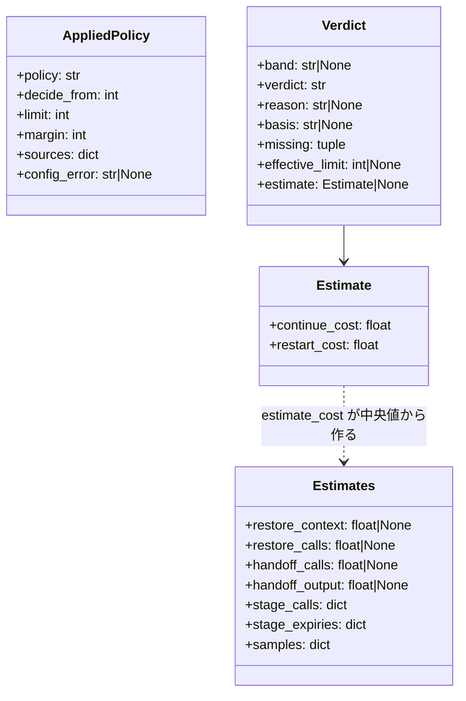

# 再起動の方針を選べるようにし、工程境界で継続か再起動かを容量と費用で決める

conductor が工程境界で会話を切るかを決める規則の組（再起動の方針）を、現行方式と試行方式の 2 つから選べるようにする。
既定は現行方式で、文脈が 200,000 を超えたら次の工程を止め、4 つのカットポイントでは文脈の量に関わらず `ndf-next` を出す。
試行方式を選ぶと、カットポイントは「再起動を判断できる境界」になり、hook が帯・容量・費用の見込みで継続か拒否かを決める。
どちらの方針でも、工程の起動 1 回ごとの判定と、引継ぎ・復元の区間の印を記録に残し、作業ごとに費用・秒・再起動を集計できる。
この文書は、適用値の解決・判定・記録・集計の契約と、それぞれをそう決めた理由を残す。

**規約は Skill の文書が正である。** 方針の選び方・帯の表・費用の式・印を打つ時点をここへ書き写さない。

| 何を読むか | 正本 |
| --- | --- |
| 2 つの方針、選び方と優先順位、試行方式の帯の表、自分で切ってよい理由、どちらの方針でも変わらないこと、Codex での扱い、判定と再起動の記録、statusline の色と hook の止める値の意味の違い | `plugins/ndf/skills/development-workflow/references/context-window.md` の「再起動の方針」「判定と再起動を記録する」 |
| 現行方式の hook の止め方（1 度だけ通す・ラッパーの下は止め続ける） | `plugins/ndf/skills/development-workflow/references/context-window.md` の「上限を超えたら hook が止める」 |
| 判断帯の費用の式と記号、倍率の正本 | `plugins/ndf/skills/development-workflow/references/work-vessels.md` の「会話を替えて続けるか（試行方式の判断帯）」「倍率の正本」 |
| 「引継ぎ開始」「復元完了」の印を打つ手順、`sprint-state.py next --reason` | `plugins/ndf/skills/development-workflow/references/relay.md` |
| 承認待ち・質問待ちを引継ぎ文書に保留として残す規則 | `plugins/ndf/skills/development-workflow/references/handoff.md` |
| statusline の試行方式の色 | `plugins/ndf/skills/statusline/SKILL.md` |
| skill-stats の「割る候補」の上限 | `plugins/ndf/skills/skill-stats/SKILL.md` |
| `context-policy.py` の副命令と終了コードの一覧 | `plugins/ndf/scripts/context-policy.py` の docstring |

## 概要

**例（`.ndf/context.json` に `{"version": 1, "policy": "trial"}` を置いたリポジトリで `#829 #830` を進める）。**

| 時点 | 振る舞い |
| --- | --- |
| セッションを始めた | SessionStart の `context-policy.py publish` が適用値（試行方式・判断開始の値 200,000・運用上限 400,000・余白 50,000）を `sessions/<セッション>.applied.json` へ書く。statusline は窓の大きさ（例: 1,000,000）を `sessions/<セッション>.window.json` へ書く |
| 文脈 150,000 で設計を終え、カットポイントに着いた | conductor は `ndf-next` を出さずに次の工程（`/ndf:implementation-plan #829`）を起動する。hook は継続帯として通し、判定「継続」・`basis: 判断開始の値以下` を 1 行記録する |
| 文脈 260,000 で次の工程を起動した | 判断帯。較正した見込みがあれば続ける費用と再起動の費用を比べ、再起動のほうが安ければ理由「費用」で拒否する。見込みが無ければ継続（`basis: 見込みなし`、`missing` に `estimate`） |
| 文脈 410,000 で次の工程を起動した | 上限超。理由「運用上限」で拒否する。ラッパーの下では判定が変わるまで止め続け、外では同じ起動の 2 度目を 1 度だけ通す |
| 拒否を受けて切る | ラッパーの直接の子なら hook が拒否と同時に「引継ぎ開始」の印を書く（ラッパーの外では、conductor が引継ぎ文書を書き始める前に `context-policy.py record --event 引継ぎ開始 --work "#829 #830"` を打つ）。`sprint-state.py next` が直前の拒否の理由を引き継いで判定「再起動」を記録し、見込みを較正し直す |
| 再開した | 引継ぎ文書で始まったセッションで、エントリポイントの Skill を除く最初の工程を起動したときに、hook が「復元完了」の印を書く（Codex では conductor が状態を確かめ終えた直後に `record --event 復元完了` を打つ）。`context-policy.py report --work "#829 #830"` で区分ごとの token・秒・費用・再起動の回数が見える |

設定を置かない利用者は現行方式のままで、200,001 で拒否・200,000 以下で通す判定と拒否の文面は変わらない。

**200,000 / 400,000 / 50,000 は比較実験の初期値で、品質が落ちる境目の実測ではない。** 値は設定で変えられる。

**コンテキストは 2 つで、関係は公開された言語である。** 開発ワークフロー（`ndf-workflow`）が方針・判定・記録を持ち、
ラッパー（`ndf-relay`）へは `ndf-next` のブロックだけを渡す。ラッパーは方針を知らず、hook はラッパーの直接の子かどうか
（`relay_notice`）だけを今のまま使う。

## 用語

再起動の方針・現行方式・試行方式・判断開始の値・運用上限・容量の余白・再起動の理由・境界の判定・適用値・作業の識別子・
費用の見込み・引継ぎの区間・復元の区間の定義は、設定の用語集（`.ndf/glossary.json` の `document` が指す
[docs/glossary.md](../glossary.md)）にある。復元の区間を測るときの終わりは「復元完了」の印である。

## 決定と理由

| 決定 | 理由 |
| --- | --- |
| 既定は現行方式で、試行方式は設定か環境変数で選んだときだけ働く。モデル名と窓の大きさは方針を選ばない | 選ばない利用者の判定を変えずに、2 つの方式を同じ物差しで比べてから既定を決めるため。1M の窓のモデル名だけで緩和すると未検証の環境へ広がる |
| 方針は `.ndf/context.json`（置き場 `worktree`、チーム）と環境変数 `NDF_CONTEXT_POLICY`（個人）で受ける | 比較はリポジトリ単位で回すためチームで条件を揃える形が要り、個人はチームの設定を書き換えずに試せる。`pace.json` へ足すと進め方の許可と意味が混ざる |
| 優先順位は CLI 引数 > 環境変数 > 設定 > 既定。`NDF_CONTEXT_LIMIT` は適用中の方針の運用上限を上書きする | 現行方式では今と同じ意味のまま、試行方式でも同じ変数で上限を変えられる。判断開始の値が上回れば同じ値へ下げ、判断開始の値 ≤ 運用上限を保つ |
| 容量の余白は窓に対する比でなく固定の 50,000 | 余白で受けたいのは次の工程の起動・Tool の結果・引継ぎ文書の作成で、窓でなく作業の量で決まる。比にすると 1M の窓で大きすぎ、200K の窓で足りない |
| 容量と費用の判定は試行方式だけに当てる | 現行方式に当てると窓 200K のモデルで 150,000 から止まり、既定の振る舞いが変わる |
| 判断帯は LLM を呼ばず、次の工程までの費用を記録から較正した中央値で比べる | 判定のたびの LLM 呼び出しを無くす。`work-vessels.md` の委譲の式は会話全体を替えるときの引継ぎと復元の費用を持たないため、別の式にした |
| 見込みの標本が 3 未満なら判断帯は継続にする | 品質の側は運用上限が守る。標本が無いときに再起動へ寄せると、試行方式が初回から現行方式と同じになり比べる材料が溜まらない |
| hook は較正したファイルを読むだけにし、較正は `sprint-state.py next`（再起動の記録のたび）と手で打つ `calibrate` が行う | 見込みには会話の記録の全体の走査が要り、hook で行うと起動のたびに遅くなる。SessionStart で行うと起動のたびに数十の記録を読む |
| 作業の識別子は課題番号の昇順・空白区切り（`#829 #830`） | hook は起動の引数から、`sprint-state.py next` はスプリントの課題から同じ形で作れる。引継ぎ文書の名は最初の再起動まで無く、ラッパーのセッションの組はラッパーを使わない利用者に無い |
| statusline とは状態ディレクトリのファイルで窓と適用値を受け渡す | statusline は `~/.claude/ndf-statusline.sh` に写して動き、プラグインのライブラリを読めない。窓は statusline の入力にしか無い。statusline が設定を読むと優先順位の解決が 2 か所になる |
| 状態ディレクトリは `CLAUDE_PLUGIN_DATA` に依らず `NDF_CONTEXT_DIR` → `XDG_STATE_HOME` → `~/.local/state` で決める | `CLAUDE_PLUGIN_DATA` は statusline に渡らず、書き手と読み手で置き場が分かれる |
| 現行方式の statusline の色（500K / 窓 200K 以下は 150K）とサブエージェントの行は変えない。試行方式だけ判断開始の値で黄・実効の上限で赤にする | 現行方式の色は窓に対して危険な水準の表示で、hook の止める上限とは意味が違う。試行方式は試す値が見えないと比較の材料にならない |
| 換算の単価の正本をデプロイする `plugins/ndf/scripts/lib/token_rates.py` へ移し、`scripts/token-usage.py` は import する | デプロイしない `scripts/token-usage.py` の単価を hook は読めず、写すと正本が 2 つになる |
| 試行方式では conductor はカットポイントで `ndf-next` を出さず、次の工程を起動して hook に判定させる。自分で切るのは独立性と手動だけ | conductor は自分の文脈の量を読めない。次の工程の起動は必ず hook を通るため、判断が 1 か所に集まる |
| 集計の区分は時刻で排他に割り当て、同じ `message.id` は 1 回、帳簿にあるセッションの会話の記録は読まない | 会話の記録は 1 回の応答を複数の行に分けて同じ `usage` を持ち、`claude -p` のセッションは帳簿と会話の記録の両方に現れる |
| 「割る候補」の上限はセッションの判定の記録の運用上限で決め、`--window-limit` を渡したときだけ全記録へ当てる | 測る側と止める側の上限を食い違わせない。今の `--window-limit` の使い方は保つ |

## 仕様

### 常に成り立つ条件

- 方針を指定しないとき、適用値は現行方式（判断開始の値 = 運用上限 = 200,000）で、hook の判定と拒否の文面は方針の導入前と同じである
- 適用値を解決する関数は `lib/context_policy.py` の `resolve_policy` 1 つで、hook・`publish`・`resolve`・`sprint-state.py next`・`record` が使う。statusline は `publish` と hook が書いた受け渡しのファイルを読み、skill-stats は判定の記録に残った運用上限を読む
- `NDF_CONTEXT_GUARD=0` なら、方針に関わらず hook は判定も記録もしない
- `agent_id` を持つ呼び出し（サブエージェント）と、`transcript_path` に `/subagents/` を含む呼び出しは判定も記録もしない。supervisor のスイッチポイント（`guard_supervisor_cut`）は方針に依らない
- 判定（`decide_boundary`・`estimate_cost`）は LLM もネットワークも子プロセスも使わない純粋関数である。hook が読むのは会話の記録の末尾 200 行・`.ndf/context.json`・見込みと窓の小さな JSON と `git rev-parse` 1 回だけである
- 取れない値を推測で埋めない。文脈の量が取れなければ止めない。窓が取れなければ容量を見ない。見込みが出せなければ判断帯は継続にする。取れなかった値は `missing` に名前で残る
- 記録の書き込みに失敗しても判定（止める / 通す）は変わらない
- ラッパーの直接の子では、拒否の理由（運用上限・容量・費用）に関わらず判定が変わるまで止め続ける。外では同じ起動の 2 度目を 1 度だけ通す
- 判定の記録は追記だけで、既存の行を書き換えない。方針の列（`policy`）の無い行は現行方式（200,000）として読み、その数を出力に示す
- 集計で 1 回の API 呼び出しを 2 つの区分へ数えない
- 取れなかった品質の値と自動圧縮の回数を 0 にせず「不明」と出す
- 承認ゲートの前に `ndf-next` を出さない、動いているプランと supervisor の報告を待ってから引継ぎ文書を作る、承認待ち・質問待ちを保留として残す規則は、どちらの方針でも変わらない。拒否の文面（ラッパーの下）も「承認待ちと質問待ちは『次にやること』に保留として残す」を含む

### 適用値の解決（`resolve_policy`）

既定 < `.ndf/context.json` < 環境変数 < CLI 引数の順に重ねて `AppliedPolicy` を返す。

| 段 | 方針 | 判断開始の値 / 運用上限 | 余白 |
| --- | --- | --- | --- |
| 既定 | `current` | 200,000 / 200,000 | 50,000 |
| 設定 | `policy` | 試行方式なら `trial.decide_from` / `trial.limit`（無ければ 200,000 / 400,000） | `margin`（無ければ 50,000） |
| 環境変数 | `NDF_CONTEXT_POLICY` が `current` / `trial` なら上書き。ほかの値は無視して `sources.ignored` に `NDF_CONTEXT_POLICY=<値>` を残す | `NDF_CONTEXT_LIMIT`（正の整数）が運用上限を上書き | — |
| CLI 引数 | `--policy`（`context-policy.py resolve`） | `limit`（skill-stats の `--window-limit` は解決を通さず `record_limits` が全記録へ当てる） | — |

- 現行方式では判断開始の値を運用上限と同じ値にする。試行方式で判断開始の値が運用上限を上回れば、判断開始の値を運用上限へ下げる（出所も運用上限の出所に揃える）
- `sources` は `policy`・`decide_from`・`limit`・`margin` ごとの出所（`default` / `config` / `env` / `cli`）を持つ。`margin` の出所が `config` になるのは試行方式のときだけである
- 設定が壊れていれば設定全体を読まず、`config_error` に理由を持たせた上で残りの段（環境変数・CLI 引数）を重ねる

### 判定（`decide_boundary`）

C は会話の記録の最後の assistant 呼び出しの `input_tokens + cache_read_input_tokens + cache_creation_input_tokens`。

| 条件（上から順に見る） | 帯 | 判定 | 理由 / 根拠 | 実効の上限 |
| --- | --- | --- | --- | --- |
| C が取れない | `null` | 継続 | `basis: 値なし`、`missing: ["context"]` | 運用上限 |
| 現行方式で C > 運用上限 | 上限超 | 拒否 | 運用上限 | 運用上限 |
| 現行方式で C ≤ 運用上限 | 継続帯 | 継続 | `basis: 判断開始の値以下` | 運用上限 |
| 試行方式で窓が取れ、窓 − 余白 < 運用上限、C > 窓 − 余白 | 容量超 | 拒否 | 容量 | 窓 − 余白 |
| 試行方式で C > 運用上限 | 上限超 | 拒否 | 運用上限 | 運用上限か 窓 − 余白 の小さいほう |
| 試行方式で C ≤ 判断開始の値 | 継続帯 | 継続 | `basis: 判断開始の値以下` | 同上 |
| 試行方式の判断帯で見込みが無い | 判断帯 | 継続 | `basis: 見込みなし`、`missing` に `estimate` | 同上 |
| 試行方式の判断帯で 再起動 < 続ける | 判断帯 | 拒否 | 費用 | 同上 |
| 試行方式の判断帯で 再起動 ≥ 続ける | 判断帯 | 継続 | `basis: 費用` | 同上 |

試行方式で窓が取れなければ `missing` に `window` が入る。初期値での境界は、200,000 が継続帯、200,001 と 400,000 が
判断帯、400,001 が上限超である。

### 費用の見込み（`estimate_cost`）

式と記号は `work-vessels.md` の「会話を替えて続けるか」が正である（続ける `k·r·C + m·w·C`、再起動
`h·r·C + 5·H + w·Q + q·r·Q + k·r·Q + m·w·Q`）。単位は入力の単価を 1 とした換算で、r は `token_rates.read_rate(model)`、
w は `WEIGHTS["w1h"]`（2.0）、H の係数は `WEIGHTS["out"]`（5.0）である。

- hook は試行方式の判断帯（判断開始の値 < C ≤ 運用上限）のときだけ見込みのファイルを読む
- k と m は工程（`stage`）ごとの中央値で、その工程の標本が 3 未満なら全工程（`*`）の値を使う。それも足りなければ見込みを出さない
- 復元の標本（`samples.restore`）と引継ぎの標本（`samples.handoff`）のどちらかが 3 未満か、Q・q・h・H のどれかが `null` なら見込みを出さない
- 記録へは `{"continue": <整数に丸めた値>, "restart": <同>}` で残す

### 較正（`calibrate`）

直近 `--days`（既定 30）日の判定の記録と会話の記録から中央値を作り、見込みのファイルを上書きする。

| 値 | 標本 |
| --- | --- |
| `restore_context` / `restore_calls` | 最初の非メタの user の入力が `.ndf/handoff/` を含むセッションで、最初の「復元完了」の印までの最後の呼び出しの文脈の量と、そこまでの呼び出し数 |
| `handoff_calls` / `handoff_output` | 最後の「引継ぎ開始」の印から後の呼び出し数と出力 token の合計 |
| `stage_calls` / `stage_expiries` | 判定「継続」の行で区切った工程ごとの呼び出し数と、間隔が 3,600 秒を超えた回数（1 時間のキャッシュが切れたとみなす）。最後の区間と空の区間は除く |
| `samples` | `restore`・`handoff`・`stage:<工程>` ごとの標本数 |

`restore_*`・`handoff_*` は標本が 3 未満なら `null`。`session_id` の無い印は、`at` を時間の範囲に含むセッションへ割り当てる。

### hook の判定と記録（`token_guard.guard_context`）

1. `NDF_CONTEXT_GUARD=0`・`agent_id` あり・サブエージェントの記録・工程の起動でない（工程 Skill・フェーズの Agent・プランの起動のどれでもない）なら何もしない
2. 会話の記録の末尾から C とモデルを読み、`resolve_policy(git の根)` で適用値を得る。試行方式なら窓のファイルを、判断帯なら見込みのファイルも読む
3. `decide_boundary` で判定し、1 度だけ通す印（`guards/` の `context-<セッション>.json`）とラッパーの下の止め続けを当てる
4. 判定の記録へ 1 行を追記し、適用値の受け渡しのファイルを更新する（中身が同じなら書かない）
5. セッションの排他の中で印を書く（`hook_lib/context_marks.py`）。ラッパーの直接の子を止めたら「引継ぎ開始」をそのセッションで 1 回だけ書く（`sessions/<セッション>.handoff.json` で覚える）。会話の記録の先頭から最初の利用者の発言だけを 1 セッションに 1 回読み、`.ndf/handoff/` を指せば復元の状態を「待ち」、指さなければ「対象外」にする。「待ち」のセッションで、エントリポイントの Skill（`development-workflow`・`issue-plan-strategy`）を除く最初の起動のときに状態を「済み」にして「復元完了」を書く。先頭が読めなければ未判定のまま次の起動で読み直す。印や状態を書けなくても判定と拒否の文面は変えない
6. 通すときは、設定が壊れていればそのセッションで 1 度だけ（`guards/` の `context-config-<セッション>.json` で覚える）`additionalContext` で知らせる

工程の列（`stage`）は起動の鍵から作る: `skill:<名>` / `agent:<description の先頭語>` / `plan`。作業の識別子は起動の引数か
`description` の課題番号から作る（日付・版数・小数は除く）。

### カットポイントと再起動の記録

| 方針 | カットポイントで conductor がすること | 記録 |
| --- | --- | --- |
| 現行方式 | 引継ぎ文書を書き始める前に `record --event 引継ぎ開始` を打ち（ラッパーの下で hook に止められたときは hook が書いたので打たない）、`sprint-state.py next` で `ndf-next` を出す | 印の後、`next` が判定「再起動」を書く |
| 試行方式 | `ndf-next` を出さずに次の工程を起動する。拒否されたときと、独立性・手動で自分で切るとき（`next --reason 独立性\|手動`）だけ、印を打ってから `next` で切る（ラッパーの下で hook に止められたときは hook が「引継ぎ開始」を書いたので打たない） | hook が「継続」か「拒否」を書き、切ったら `next` が「再起動」を書く |

`sprint-state.py next` の理由は、`--reason` を渡せばその値、渡さなければ直前 1,800 秒以内の同じ作業の識別子の拒否の理由、
それも無ければ現行方式は「カットポイント」・試行方式は「手動」である。記録の後に較正し直す。記録と較正に失敗しても
`ndf-next` は出す。

並列の計画のオーガナイザーは、`parallel.py wait` の切り替えの判定が「切り替える」のときに、`metrics.switch.record` の 1 行
（`record --verdict 再起動 --reason 待ち --work "parallel <計画名>"`）を打ってから `ndf-next` を出す。理由「待ち」は既定の理由にならず、
この 1 行でだけ書かれる。判定の規則は `plugins/ndf/skills/development-workflow/references/parallel.md` の「長い待ちの状況報告と切り替え」にある。

Codex には hook が無く、conductor は文脈の量を読めないため、試行方式を選んでいても現行方式のカットポイントで切る。
印と再起動の記録は Bash で打つため、`--runtime codex` で同じ形に残せる。

### 作業ごとの集計（`report`）

| 区分 | どの呼び出しか |
| --- | --- |
| `restore`（復元の区間） | 最初の非メタの user の入力が `.ndf/handoff/` を含むセッションで、最初の行から最初の「復元完了」の印まで |
| `handoff`（引継ぎの区間） | 最後の「引継ぎ開始」の印から、そのセッションの最後の行まで |
| `conductor` | 作業に結ばれたセッションの会話の記録の、上の 2 つに入らない呼び出し |
| `ndf`（NDF が起動した分） | そのセッションの `subagents/*.jsonl` と、使用量の帳簿の行（`parent_session_id` が一致するか、親が無くセッションの時間の範囲にあるもの） |

- 作業の識別子が空の行は、同じセッションの前の行の値で補う。同じセッションで作業が替わったら、その作業の行が続いた時間の区間の呼び出しだけを数える
- 同じ `message.id` は 1 回だけ数え、最後の `usage` を採り、時刻は最初の行のものを使う。使用量の帳簿に `session_id` があるセッションとサブエージェントの会話の記録は読まず、帳簿の行で数える
- 秒は呼び出しの間隔の合計で、1 つの間隔を 1,800 秒で打ち切る（利用者の返答待ちを入れない）
- 自動圧縮は会話の記録の `type: system`・`subtype: compact_boundary` で `compactMetadata.trigger` が `auto` の行を数える。記録が読めなければ「不明」
- 印が無い区間は判定の位置から推して埋めず、その呼び出しを `conductor` に数え、`unknown_parts` に印の無かったセッションの数を出す（`restore` は `ndf-next` で始まったのに「復元完了」が無いセッション、`handoff` は再起動を記録したのに「引継ぎ開始」が無いセッション）
- 品質の値: `rework` は同じ `stage` の判定「継続」が 2 度以上ある工程の数（判定が無ければ「不明」）。`review_fixes` と `missed_requirements` は判定の記録から取れないため常に「不明」

### statusline

- 入力の `context_window.context_window_size` とモデル ID を `sessions/<セッション>.window.json` へ書く（値が変わったときだけ）。セッションは入力の `session_id`、無ければ `transcript_path` のファイル名から作る
- `sessions/<セッション>.applied.json` の `policy` が `trial` なら、メインの使用量を判断開始の値を超えたら黄、実効の上限（運用上限か 窓 − 余白 の小さいほう）を超えたら赤にする。それ以外とサブエージェントの行は方針の導入前と同じ

### skill-stats の「割る候補」（`context_decisions.record_limits`）

`--window-limit` を渡せば全記録の上限にする。渡さなければ、判定の記録のうちそのセッションの最後の行の `limit`
（`policy` の列が無い行なら 200,000）を上限にし、判定の記録が無いセッションは 200,000 にする。JSON の `meta` に
`window_limit`・`window_limit_source`（`cli` / `records`）・`records_without_decisions` を出す。

## データ・設定

### `context-policy.py`

| 副命令 | 入力 | 出力 | 終了コード |
| --- | --- | --- | --- |
| `resolve [--root <dir>] [--policy current\|trial]` | 作業ディレクトリ・環境変数 | 統一 JSON（`tool: context-policy`、`status: ok`、`items` に適用値 1 件、`metrics` に `policy`・`limit`）。設定が壊れていても `ok` で、`summary` と `config_error` に理由が載る | 0 / 2 引数の誤り |
| `publish` | 標準入力の JSON（SessionStart の `session_id`・`cwd`） | `session_id` があれば適用値の受け渡しのファイルを書く。設定が壊れていれば 1 行を標準出力へ出す | 常に 0 |
| `record --verdict 再起動 --reason <理由> --work <識別子> [--runtime claude\|codex] [--context <n>]` | 理由（7 つ）と作業の識別子 | 1 行（`source: record`・`stage: cut`）を追記し、統一 JSON で返す | 0 / 1 書けない / 2 `--verdict` が `再起動` でない・理由が 7 つ以外・`--verdict` と `--event` が両方か両方なし |
| `record --event 引継ぎ開始\|復元完了 --work <識別子> [--runtime claude\|codex]` | 印と作業の識別子 | 印の 1 行（`event` が印、`verdict`・`stage`・`band` は `null`）を追記し、統一 JSON で返す。Claude Code では hook が打たない場面（カットポイント・独立性・手動で自分で切るとき）で使い、Codex では両方の印で使う | 0 / 1 書けない / 2 印が 2 つ以外 |
| `calibrate [--days 30]` | 判定の記録・会話の記録 | 見込みのファイルを書き、`metrics.samples` に標本数を返す | 0 / 1 書けない |
| `report --work <識別子> \| --all [--since YYYY-MM-DD] [--from <ISO 8601>] [--until <ISO 8601>] [--format json\|table]` | 判定の記録・会話の記録・使用量の帳簿 | 作業ごとに `work`・`sessions`・`parts`（4 区分ごとの `inp`・`out`・`read`・`w5`・`w1h`・`calls`・`seconds`・`cost`）・`unknown_parts`・`restores`（セッションごとの復元の量 `context` と復元の区間の呼び出し数 `calls`。セッションの識別子は持たない）・`restarts`（理由ごと）・`restart_count`・`auto_compacts`・`quality`・`no_policy_rows`。`--from`・`--until`（両端を含む）を渡すと、その間の呼び出し（会話・サブエージェント・使用量の帳簿）と判定の記録の行だけを数える。`table` は Markdown の表と作業ごとの 1 行を出す | 0（0 件でも 0）/ 2 `--work` と `--all` が両方か両方なし・`--since`・`--from`・`--until` の形の誤り |

`record` のセッション ID は `--runtime claude` のときだけ `CLAUDE_CODE_SESSION_ID` から取り、無ければ `null` にする。
`record --work` は課題番号を含めば `#<番号>` の昇順の並びに直して書く。含まずセッション ID があれば空で書き、集計が同じセッションの前の行の作業で補う。どちらでもなければ渡した文字のまま書く（拒むと印が欠けるため拒まない）。`report --work` も同じ形に直してから引く。

### 状態ディレクトリ

`NDF_CONTEXT_DIR` → `${XDG_STATE_HOME}/ndf/context` → `~/.local/state/ndf/context` の順に決める（`context_decisions.context_state_dir`）。
`<owner>__<repo>` は `usage_ledger.repo_key` で作り、git の外は `_local` にする。

| ファイル | 中身 | 書く | 読む | 保持 |
| --- | --- | --- | --- | --- |
| `decisions/<owner>__<repo>.decisions.jsonl` | 判定の記録（1 行 1 件、追記だけ） | hook・`record`・`sprint-state.py next` | `report`・`calibrate`・skill-stats・`sprint-state.py next` | 消さない |
| `estimates/<owner>__<repo>.cost-estimates.json` | 費用の見込み（`Estimates` の形と `at`） | `calibrate`・`sprint-state.py next` | hook | 上書き |
| `sessions/<セッション>.window.json` | `{"window": <int>, "model": "<id>", "at": "<UTC>"}` | statusline | hook | 適用値のファイルを書くときに 7 日より古い `sessions/*.json` を消す |
| `sessions/<セッション>.applied.json` | 適用値（`AppliedPolicy` の JSON） | `publish`・hook | statusline | 同上 |
| `sessions/<セッション>.restore.json` | 復元の状態 `{"state": "待ち" \| "済み" \| "対象外"}`（無ければ未判定） | hook | hook | 同上 |
| `sessions/<セッション>.handoff.json` | hook がそのセッションで「引継ぎ開始」を書いた印 `{"at": "<UTC>"}` | hook | hook | 同上 |

### 判定の記録の 1 行

| 列 | 値 | 空の値の意味 |
| --- | --- | --- |
| `schema` | 1 | — |
| `at` | UTC の ISO 8601 | — |
| `runtime` | `claude` / `codex` | — |
| `source` | `hook` / `record` / `sprint-state` | — |
| `session_id` / `transcript` | 文字列 | `null`: 書き手がセッションを知らない |
| `model` | 文字列 | `null`: 記録の末尾にモデルが無い・hook 以外 |
| `work` | 作業の識別子 | `""`: 課題番号が取れない（集計は同じセッションの前の行で補う） |
| `event` | `判定` / `引継ぎ開始` / `復元完了` | — |
| `stage` | `skill:<名>` / `agent:<先頭語>` / `plan` / `cut` | `null`: 印 |
| `policy` / `decide_from` / `limit` / `margin` / `sources` / `config_error` | 適用値 | `config_error` の `null`: 設定は正しいか無い |
| `context` / `window` / `effective_limit` | 整数 | `null`: 取れない・判定しない |
| `band` | `継続帯` / `判断帯` / `上限超` / `容量超` | `null`: 判定しない（`record`・`sprint-state`）か C が取れない |
| `verdict` | `継続` / `拒否` / `再起動` | `null`: 印 |
| `reason` | `容量` / `運用上限` / `費用` / `独立性` / `手動` / `カットポイント` / `待ち` | `null`: 継続 |
| `basis` | `判断開始の値以下` / `費用` / `見込みなし` / `値なし` | `null`: 継続でない |
| `estimate` | `{"continue": <int>, "restart": <int>}` | `null`: 見込みを使っていない |
| `missing` | 取れなかった値の名前（`context` / `window` / `estimate`） | `[]` |
| `relay` / `passed_once` | 真偽（ラッパーの下だったか / 1 度だけ通したか） | — |

### 型

`lib/context_policy.py` が持つ。`AppliedPolicy`・`Verdict`・`Estimate` は `dataclass(frozen=True)`、`Estimates` は見込みのファイルの中身をそのまま持つ。



### `.ndf/context.json`

置き場は `worktree`（チームの設定。契約は `plugins/ndf/contracts/settings/context.json.json`）。

```json
{"version": 1, "policy": "trial", "trial": {"decide_from": 200000, "limit": 400000}, "margin": 50000}
```

| キー | 型 | 無いとき | 壊れているとき |
| --- | --- | --- | --- |
| `version` | 1 | 1 とみなす | 1 以外はファイル全体を壊れたものとする |
| `policy` | `"current"` / `"trial"` | `"current"` | 同上 |
| `trial` | オブジェクト | 下の既定 | オブジェクトでなければ同上 |
| `trial.decide_from` / `trial.limit` | 正の整数 | 200000 / 400000 | 同上。`decide_from > limit` も同じ |
| `margin` | 0 以上の整数 | 50000 | 同上 |

現行方式の運用上限は設定に持たず、`NDF_CONTEXT_LIMIT` だけで変える。

### 環境変数と CLI 引数

| 名前 | 意味 |
| --- | --- |
| `NDF_CONTEXT_POLICY` | `current` / `trial`。設定より強い。ほかの値は無視して `sources.ignored` に残す |
| `NDF_CONTEXT_LIMIT` | 適用中の方針の運用上限。試行方式で判断開始の値がこれを上回れば同じ値へ下げる（既定と互換の扱いは [ndf-token-waits-and-context-cut.md](ndf-token-waits-and-context-cut.md) の「環境変数」） |
| `NDF_CONTEXT_GUARD=0` | 判定も記録もしない |
| `NDF_CONTEXT_DIR` | 状態ディレクトリ |
| `CLAUDE_CODE_SESSION_ID` | `record` と `sprint-state.py next` が行の `session_id` に使う |
| `skill-stats --window-limit <n>` | 渡したときだけ全記録の「割る候補」の上限にする |
| `sprint-state.py next --reason <理由>` | 再起動の理由（7 つ） |

### hook の出力

| 場面 | 出力 |
| --- | --- |
| 現行方式で上限超 | 方針の導入前と同じ拒否の文面（ラッパーの下と外の 2 通り）。「上限 {limit} を超えた」 |
| 試行方式で上限超 | 「上限 {limit}（再起動の方針: 試行方式、理由: 運用上限）を超えた」を入れた同じ形の拒否 |
| 試行方式で容量超 | 「容量（窓 {window} − 余白 {margin} = {effective}）を超えた（再起動の方針: 試行方式、理由: 容量）」 |
| 試行方式の判断帯で再起動が安い | 「判断開始の値 {decide_from} を超え、再起動のほうが安い（再起動の方針: 試行方式、理由: 費用（続ける {continue} / 再起動 {restart}、入力の単価に換算））」 |
| 設定が壊れていて通す | そのセッションで 1 度だけ `additionalContext` に「{理由}。再起動の方針の設定を読まずに現行方式の既定で判定している」 |

SessionStart には `context-policy.py publish` が登録されている（`plugins/ndf/hooks/claude.json`）。

## エラー処理

| 場面 | 扱い |
| --- | --- |
| `.ndf/context.json` が壊れている・読めない | 設定を読まずに現行方式の既定で解決し、`config_error` に理由を持つ。`publish` が 1 行、hook が 1 度だけ知らせる |
| 判定の記録・受け渡しのファイルに書けない | 判定は変えず、そのまま通す / 止める。`record` は終了コード 1 |
| 見込みのファイルが無い・壊れている・標本不足 | 見込みを出さず、判断帯は継続 |
| 窓のファイルが無い・形が違う | 窓を使わず `missing` に `window` |
| `sprint-state.py next` の記録・較正の失敗 | 投げずに `ndf-next` を出す |
| `publish` の内部の例外 | 標準エラーへ 1 行を出し、終了コード 0 |
| 使用量の帳簿が読めない（`report`） | NDF が起動した分は会話の記録の分だけで数える |
| 判定の記録の壊れた行 | 飛ばす |

## テスト観点

| 観点 | 確かめ方 |
| --- | --- |
| 設定が無ければ現行方式・200,000 で、拒否の文面が導入前と同じ | `plugins/ndf/scripts/tests/test_context_policy.py`（`test_without_setting_the_policy_is_current_with_200k`）、`test_context_policy_hook.py`（`test_default_policy_keeps_todays_text`）、既存の `test_token_guard*.py` |
| 優先順位（CLI 引数 > 環境変数 > 設定 > 既定）と出所、知らない方針の値の無視 | `test_context_policy.py`（`test_priority_cli_over_env_over_setting` / `test_unknown_env_policy_is_ignored_and_recorded`）、`test_context_policy_hook.py`（`test_resolve_cli_shows_sources`） |
| `NDF_CONTEXT_LIMIT` が現行方式で今の意味のまま、試行方式で判断開始の値も下げる | `test_context_policy.py`（`test_env_limit_keeps_current_meaning` / `test_env_limit_lowers_decide_from_in_trial`）、`test_context_policy_hook.py`（`test_trial_limit_from_env`） |
| 壊れた設定で現行方式になり、1 度だけ知らせる | `test_context_policy.py`（`test_broken_setting_falls_back_to_current`）、`test_context_policy_hook.py`（`test_broken_setting_is_told_once`） |
| 窓とモデル名が方針を選ばない | `test_context_policy.py`（`test_window_and_model_do_not_choose_the_policy`） |
| 帯の境界の値（200,000 / 200,001 / 400,000 / 400,001）と、仕様の初期値と定数が同じ | `test_context_policy.py`（`test_trial_band_edges` / `test_current_band_edges` / `test_initial_values_are_the_constants`） |
| 小さい窓で理由「容量」の拒否、窓が無ければ `missing` に残す、C が取れなければ通す | `test_context_policy.py`（`test_small_window_denies_by_capacity` / `test_missing_values_are_not_filled`）、`test_context_policy_hook.py`（`test_trial_small_window_denies_by_capacity` / `test_trial_without_window_records_missing` / `test_unreadable_context_passes_and_records`） |
| 費用の式・標本 3 未満で見込みなし・全工程の値への寄せ・判定が外部を触らない | `test_context_policy.py`（`test_cost_follows_the_formula` / `test_cost_needs_three_samples` / `test_cost_falls_back_to_all_stages` / `test_cost_decides_the_judgement_band` / `test_decide_and_cost_do_not_touch_the_outside`） |
| 試行方式で判断開始の値未満ならカットポイントの次の工程を通す | `test_context_policy_hook.py`（`test_trial_passes_cut_point_below_decide_from`） |
| ラッパーの下で費用の拒否が続く間は止め続ける | `test_context_policy_hook.py`（`test_trial_cost_denial_keeps_denying_under_relay`） |
| `NDF_CONTEXT_GUARD=0` とサブエージェントは判定も記録もしない | `test_context_policy_hook.py`（`test_guard_off_and_subagent_neither_judge_nor_record`） |
| 起動 1 回で 1 行が増え、必要な列を持つ。書けなくても判定は同じ | `test_context_policy_hook.py`（`test_one_row_per_launch_with_the_columns` / `test_unwritable_record_does_not_change_the_verdict`） |
| hook・`publish`（statusline が読む）・skill-stats が同じ設定から同じ値を読み、設定を消すと 3 つとも現行方式へ戻る。statusline が窓を書く | `test_context_policy_hook.py`（`test_three_readers_follow_the_same_setting` / `test_statusline_writes_the_window`） |
| 印と再起動の記録、知らない印・理由は終了コード 2 | `test_context_policy_hook.py`（`test_record_marks_and_restart`） |
| `sprint-state.py next` が再起動を記録し、見込みを較正する | `test_context_policy_hook.py`（`test_sprint_state_next_records_restart`） |
| 同じ `message.id` と帳簿にあるセッションを 1 回だけ数える。最後の `usage` を採る | `test_context_policy_hook.py`（`test_same_message_and_ledger_are_counted_once` / `test_subagent_in_the_ledger_is_not_read_from_its_transcript` / `test_same_message_takes_the_last_usage`） |
| 同じセッションで作業が替わったら、その作業の区間だけを数える | `test_context_policy_hook.py`（`test_work_report_counts_only_the_calls_while_the_work_is_current`） |
| 印の位置で復元・引継ぎの区間が区切られ、印が無ければ「不明」と数える | `test_context_policy_hook.py`（`test_marks_split_restore_and_handoff` / `test_missing_marks_are_unknown_and_counted`） |
| 方針の列の無い行を 200,000 で読み、その数を出す。`--window-limit` が記録より強い | `test_context_policy_hook.py`（`test_rows_without_policy_are_read_as_current` / `test_skill_stats_window_limit_overrides_records`） |
| 較正の標本の下限と、工程・印・キャッシュ切れ・期間の扱い | `test_context_policy_hook.py`（`test_calibrate_needs_three_samples` / `test_calibrate_characterizes_*`） |
| テストが利用者の状態ディレクトリへ書かない | `plugins/ndf/scripts/tests/conftest.py` が `NDF_CONTEXT_DIR` と `XDG_STATE_HOME` を一時ディレクトリへ向ける |
| 承認ゲートを越えない・保留を残す規則が拒否の文面と引継ぎの手順から辿れる | 文書と拒否の文面を `grep -n` で読んで確かめる（文言を照合するテストは書かない） |

## 運用

- **初期値（200,000 / 400,000 / 50,000）は比較実験の値である。** 試行方式を選んだ conductor で `report` を取り、現行方式と比べてから既定を変えるかを決める。既定を変えるのは別の課題として扱う
- **品質の値のうちレビュー後の修正量と要件の漏れは `report` が常に「不明」を出す。** 比較するときは出所を別に決める
- **作業の識別子は起動の引数とスプリントの課題の組から作るため、両者が食い違うと同じ作業が 2 つに分かれる。** `report --all` で分かれた作業を見る

## 関連リンク

- [#2262](https://github.com/devbasex/ai-plugins/issues/2262) — 要求と決定（2026-11-02 利用者が設計と初期値を承認）
- [待つ間の問い合わせを止め、conductor の会話をカットポイントで切る](ndf-token-waits-and-context-cut.md) — hook の判定の全体、現行方式の止め方、環境変数の一覧
- [会話の記録から context window を 3 層で測る](ndf-context-window-metrics.md) — skill-stats の「割る候補」の目印
- [#827](https://github.com/devbasex/ai-plugins/issues/827) — conductor の文脈・持ち越し量の実測
- [#1785](https://github.com/devbasex/ai-plugins/issues/1785) — 引継ぎ文書の肥大化（復元の費用に効く条件）
