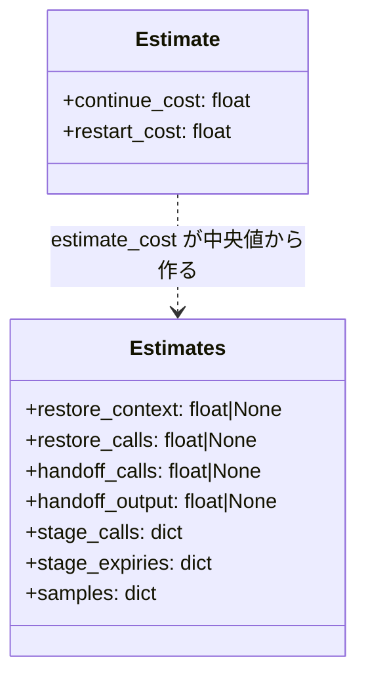

# 工程境界の判定の記録・費用の見込み・作業ごとの集計（10 系の再起動の方針の記録）

**この文書は 10 系の `context-policy.py` の時点（[#2262](https://github.com/devbasex/ai-plugins/issues/2262)、2026-11-02 承認）の記録である。**
11.0.20 の次の版で入った [#3995](https://github.com/devbasex/ai-plugins/issues/3995) が、再起動の方針（現行方式と試行方式）・その値
（200,000・400,000・容量の余白 50,000）・設定 `.ndf/context.json`・環境変数 `NDF_CONTEXT_POLICY` と `NDF_CONTEXT_GUARD` を消した。
**文脈の切り替えの閾値（判断開始の値 250,000・運用上限 500,000）、その置き場と読み手、guard `context-limit` の知らせと止め方、
`NDF_CONTEXT_LIMIT` と止める口は [ndf-context-thresholds.md](ndf-context-thresholds.md) が正である。**

この文書に残すのは、方針に依らない判定の記録・印・費用の見込み・較正・集計の契約と、そう決めた理由である。
コマンドと状態の置き場は 10 系の名前（`context-policy.py`・`sprint-state.py`・`lib/context_policy.py`）で書いてある。11 系の
コマンドは `ndf relay context`（`resolve`・`record`・`calibrate`・`report`）で、記録と集計は `plugins/ndf/src/ndf/domains/relay/context_records.py`・
`context_report.py` が持つ。

| 何を読むか | 正本 |
| --- | --- |
| 2 つの閾値・guard の振る舞い・値を変える口・止める口 | [ndf-context-thresholds.md](ndf-context-thresholds.md)、`plugins/ndf/skills/development-workflow/references/context-window.md` の「運用上限で hook が止める」 |
| 廃止した設定（`.ndf/context.json`・`NDF_CONTEXT_POLICY`）から移る手順 | `context-window.md` の「廃止した設定から移る」 |
| 判定と再起動の記録、「引継ぎ開始」「復元完了」の印を打つ手順 | `context-window.md` の「判定と再起動を記録する」、`plugins/ndf/skills/development-workflow/references/relay.md` |
| 承認待ち・質問待ちを引継ぎ文書に保留として残す規則 | `plugins/ndf/skills/development-workflow/references/handoff.md` |

## 概要

工程の起動と会話の切り替えのたびに 1 行を判定の記録へ残し、引継ぎと復元の区間に印を打つ。記録から費用の見込みを較正し、
作業ごとに費用・秒・再起動の回数を集計する。

例（`#829 #830` を進める会話）:

| 時点 | 振る舞い |
| --- | --- |
| 切りどころで切る | conductor が引継ぎ文書を書き始める前に「引継ぎ開始」の印を打ち、会話を切るときに判定「再起動」の行を書く |
| 再開した | 引継ぎ文書で始まったセッションが、状態を戻し終えた時点で「復元完了」の印を書く |
| 集計する | `report --work "#829 #830"` で、区分（復元・引継ぎ・conductor・NDF が起動した分）ごとの token・秒・費用と再起動の回数が見える |

**コンテキストは 2 つで、関係は公開された言語である。** 開発ワークフロー（`ndf-workflow`）が判定と記録を持ち、
ラッパー（`ndf-relay`）へは `ndf-next` のブロックだけを渡す。

## 用語

判断開始の値・運用上限・容量の余白・再起動の理由・境界の判定・作業の識別子・費用の見込み・引継ぎの区間・復元の区間の定義は、
設定の用語集（`.ndf/glossary.json` の `document` が指す [docs/glossary.md](../glossary.md)）にある。復元の区間を測るときの
終わりは「復元完了」の印である。

## 決定と理由

方針の選び方・優先順位・容量の余白・試行方式の判断帯に関する決定は #3995 で消えた。今の値と口を決めた理由は
[ndf-context-thresholds.md](ndf-context-thresholds.md) の「背景」にある。

| 決定 | 理由 |
| --- | --- |
| 判断帯の見込みは LLM を呼ばず、次の工程までの費用を記録から較正した中央値で比べる | 判定のたびの LLM 呼び出しを無くす。`work-vessels.md` の委譲の式は会話全体を替えるときの引継ぎと復元の費用を持たないため、別の式にした |
| 較正は再起動の記録のたびと手で打つ `calibrate` が行う | 見込みには会話の記録の全体の走査が要り、hook で行うと起動のたびに遅くなる |
| 作業の識別子は課題番号の昇順・空白区切り（`#829 #830`） | 起動の引数からもスプリントの課題からも同じ形で作れる。引継ぎ文書の名は最初の再起動まで無く、ラッパーのセッションの組はラッパーを使わない利用者に無い |
| 状態ディレクトリは `CLAUDE_PLUGIN_DATA` に依らず `NDF_CONTEXT_DIR` → `XDG_STATE_HOME` → `~/.local/state` で決める | `CLAUDE_PLUGIN_DATA` は statusline に渡らず、書き手と読み手で置き場が分かれる |
| 換算の単価の正本をデプロイするライブラリへ置き、集計のスクリプトは import する | デプロイしないスクリプトの単価を hook は読めず、写すと正本が 2 つになる |
| 集計の区分は時刻で排他に割り当て、同じ `message.id` は 1 回、帳簿にあるセッションの会話の記録は読まない | 会話の記録は 1 回の応答を複数の行に分けて同じ `usage` を持ち、`claude -p` のセッションは帳簿と会話の記録の両方に現れる |

## 仕様

### 常に成り立つ条件

- 取れない値を推測で埋めない。取れなかった値は `missing` に名前で残る
- 記録の書き込みに失敗しても、guard の判定（止める / 通す）は変わらない
- 判定の記録は追記だけで、既存の行を書き換えない
- 集計で 1 回の API 呼び出しを 2 つの区分へ数えない
- 取れなかった品質の値と自動圧縮の回数を 0 にせず「不明」と出す
- 承認ゲートの前に `ndf-next` を出さない、動いているプランと supervisor の報告を待ってから引継ぎ文書を作る、承認待ち・質問待ちを保留として残す規則は、閾値に依らず変わらない

### 閾値・判定・hook の振る舞い

適用値の解決（方針と優先順位）、帯の判定（継続帯・判断帯・上限超・容量超）、hook の判定と記録、カットポイントでの切り方、
statusline の試行方式の色は #3995 で消えた。今の閾値の解き方と guard の振る舞いは [ndf-context-thresholds.md](ndf-context-thresholds.md) の「仕様」に、
カットポイントは `context-window.md` の「context window はカットポイントで切る」にある。

### 費用の見込み（`estimate_cost`）

式と記号は `work-vessels.md` の「会話を替えて続けるか」が正である（続ける `k·r·C + m·w·C`、再起動
`h·r·C + 5·H + w·Q + q·r·Q + k·r·Q + m·w·Q`）。単位は入力の単価を 1 とした換算で、r は `token_rates.read_rate(model)`、
w は `WEIGHTS["w1h"]`（2.0）、H の係数は `WEIGHTS["out"]`（5.0）である。

- k と m は工程（`stage`）ごとの中央値で、その工程の標本が 3 未満なら全工程（`*`）の値を使う。それも足りなければ見込みを出さない
- 復元の標本（`samples.restore`）と引継ぎの標本（`samples.handoff`）のどちらかが 3 未満か、Q・q・h・H のどれかが `null` なら見込みを出さない
- 記録へは `{"continue": <整数に丸めた値>, "restart": <同>}` で残す

### 較正（`calibrate`）

直近 `--days`（既定 30）日の判定の記録と会話の記録から中央値を作り、見込みのファイルを上書きする。

| 値 | 標本 |
| --- | --- |
| `restore_context` / `restore_calls` | 最初の非メタの user の入力が `.ndf/handoff/` を含むセッションで、最初の「復元完了」の印までの最後の呼び出しの文脈の量と、そこまでの呼び出し数 |
| `handoff_calls` / `handoff_output` | 最後の「引継ぎ開始」の印から後の呼び出し数と出力 token の合計 |
| `stage_calls` / `stage_expiries` | 判定「継続」の行で区切った工程ごとの呼び出し数と、間隔が 3,600 秒を超えた回数（1 時間のキャッシュが切れたとみなす）。最後の区間と空の区間は除く |
| `samples` | `restore`・`handoff`・`stage:<工程>` ごとの標本数 |

`restore_*`・`handoff_*` は標本が 3 未満なら `null`。`session_id` の無い印は、`at` を時間の範囲に含むセッションへ割り当てる。

### 再起動の記録

会話を切るときに判定「再起動」を 1 行書く。理由は 7 つ（容量・運用上限・費用・独立性・手動・カットポイント・待ち）で、
容量と費用は過去の行を読むために残り、今は書かない。

並列の計画のオーガナイザーは、長い待ちの切り替えのときに `record --verdict 再起動 --reason 待ち --work "parallel <計画名>"` を
打ってから `ndf-next` を出す。理由「待ち」は既定の理由にならず、この 1 行でだけ書かれる。判定の規則は
`plugins/ndf/skills/development-workflow/references/parallel.md` の「長い待ちの状況報告と切り替え」にある。

Codex には hook が無いため、印と再起動の記録は Bash で打ち、`--runtime codex` で同じ形に残す。

### 作業ごとの集計（`report`）

| 区分 | どの呼び出しか |
| --- | --- |
| `restore`（復元の区間） | 最初の非メタの user の入力が `.ndf/handoff/` を含むセッションで、最初の行から最初の「復元完了」の印まで |
| `handoff`（引継ぎの区間） | 最後の「引継ぎ開始」の印から、そのセッションの最後の行まで |
| `conductor` | 作業に結ばれたセッションの会話の記録の、上の 2 つに入らない呼び出し |
| `ndf`（NDF が起動した分） | そのセッションの `subagents/*.jsonl` と、使用量の帳簿の行（`parent_session_id` が一致するか、親が無くセッションの時間の範囲にあるもの） |

- 作業の識別子が空の行は、同じセッションの前の行の値で補う。同じセッションで作業が替わったら、その作業の行が続いた時間の区間の呼び出しだけを数える
- 同じ `message.id` は 1 回だけ数え、最後の `usage` を採り、時刻は最初の行のものを使う。使用量の帳簿に `session_id` があるセッションとサブエージェントの会話の記録は読まず、帳簿の行で数える
- 秒は呼び出しの間隔の合計で、1 つの間隔を 1,800 秒で打ち切る（利用者の返答待ちを入れない）
- 自動圧縮は会話の記録の `type: system`・`subtype: compact_boundary` で `compactMetadata.trigger` が `auto` の行を数える。記録が読めなければ「不明」
- 印が無い区間は判定の位置から推して埋めず、その呼び出しを `conductor` に数え、`unknown_parts` に印の無かったセッションの数を出す
- 品質の値: `rework` は同じ `stage` の判定「継続」が 2 度以上ある工程の数（判定が無ければ「不明」）。`review_fixes` と `missed_requirements` は判定の記録から取れないため常に「不明」

### skill-stats の「割る候補」

10 系の skill-stats は、判定の記録のうちそのセッションの最後の行の運用上限を「割る候補」の上限にした（`context_decisions.record_limits`）。
11 系の skill-stats は、`--window-limit` で渡した値、無ければ 200,000 を上限にする（正本は `plugins/ndf/skills/skill-stats/SKILL.md` の「引数」）。
この上限は 3 層の context window の計測（`--agents`）で使う値で、文脈の切り替えの閾値とは別である。

## データ・設定

### `context-policy.py`（10 系）

11 系の `ndf relay context` の各サブコマンドが引き継いだ。`resolve` の入出力は [ndf-context-thresholds.md](ndf-context-thresholds.md) の
「`ndf relay context resolve` の結果」が正で、SessionStart の `publish` は無い。

| 副命令 | 入力 | 出力 | 終了コード |
| --- | --- | --- | --- |
| `record --verdict 再起動 --reason <理由> --work <識別子> [--runtime claude\|codex] [--context <n>]` | 理由（7 つ）と作業の識別子 | 1 行（`source: record`・`stage: cut`）を追記し、統一 JSON で返す | 0 / 1 書けない / 2 `--verdict` が `再起動` でない・理由が 7 つ以外・`--verdict` と `--event` が両方か両方なし |
| `record --event 引継ぎ開始\|復元完了 --work <識別子> [--runtime claude\|codex]` | 印と作業の識別子 | 印の 1 行（`event` が印、`verdict`・`stage`・`band` は `null`）を追記し、統一 JSON で返す | 0 / 1 書けない / 2 印が 2 つ以外 |
| `calibrate [--days 30]` | 判定の記録・会話の記録 | 見込みのファイルを書き、`metrics.samples` に標本数を返す | 0 / 1 書けない |
| `report --work <識別子> \| --all [--since YYYY-MM-DD] [--from <ISO 8601>] [--until <ISO 8601>] [--format json\|table]` | 判定の記録・会話の記録・使用量の帳簿 | 作業ごとに `work`・`sessions`・`parts`（4 区分ごとの `inp`・`out`・`read`・`w5`・`w1h`・`calls`・`seconds`・`cost`）・`unknown_parts`・`restores`・`restarts`（理由ごと）・`restart_count`・`auto_compacts`・`quality`。`--from`・`--until`（両端を含む）を渡すと、その間の呼び出しと判定の記録の行だけを数える。`table` は Markdown の表と作業ごとの 1 行を出す | 0（0 件でも 0）/ 2 `--work` と `--all` が両方か両方なし・`--since`・`--from`・`--until` の形の誤り |

`record` のセッション ID は `--runtime claude` のときだけ `CLAUDE_CODE_SESSION_ID` から取り、無ければ `null` にする。
`record --work` は課題番号を含めば `#<番号>` の昇順の並びに直して書く。含まずセッション ID があれば空で書き、集計が同じセッションの前の行の作業で補う。どちらでもなければ渡した文字のまま書く（拒むと印が欠けるため拒まない）。`report --work` も同じ形に直してから引く。

### 状態ディレクトリ

`NDF_CONTEXT_DIR` → `${XDG_STATE_HOME}/ndf/context` → `~/.local/state/ndf/context` の順に決める。
`<owner>__<repo>` は `usage_ledger.repo_key` で作り、git の外は `_local` にする。

| ファイル | 中身 | 書く | 読む | 保持 |
| --- | --- | --- | --- | --- |
| `decisions/<owner>__<repo>.decisions.jsonl` | 判定の記録（1 行 1 件、追記だけ） | `record` | `report`・`calibrate` | 消さない |
| `estimates/<owner>__<repo>.cost-estimates.json` | 費用の見込み（`Estimates` の形と `at`） | `calibrate` | — | 上書き |

`sessions/<セッション>.window.json`（窓の大きさとモデル）は 11 系でも statusline が書く。10 系の hook が書いた適用値・復元の状態・引継ぎの印の `sessions/<セッション>.*.json` は、11 系に書き手が無い。

### 判定の記録の 1 行

形は `plugins/ndf/contracts/schemas/internal/context-records.schema.json` が持ち、書く前と読んだ後に確かめる（`ndf.contracts.internal`）。

| 列 | 値 | 空の値の意味 |
| --- | --- | --- |
| `version` | 1（行の形のバージョン） | — |
| `schema` | 1。`version` を持たない旧い行だけが持つ。読むときに外す | — |
| `at` | UTC の ISO 8601 | — |
| `runtime` | `claude` / `codex` | — |
| `source` | `hook` / `record` / `sprint-state` | — |
| `session_id` / `transcript` | 文字列 | `null`: 書き手がセッションを知らない |
| `model` | 文字列 | `null`: 記録の末尾にモデルが無い・hook 以外 |
| `work` | 作業の識別子 | `""`: 課題番号が取れない（集計は同じセッションの前の行で補う） |
| `event` | `判定` / `引継ぎ開始` / `復元完了` | — |
| `stage` | `skill:<名>` / `agent:<先頭語>` / `plan` / `cut` | `null`: 印 |
| `decide_from` / `limit` / `sources` | その時点の 2 つの値と出所 | — |
| `policy` / `margin` / `config_error` | 10 系の行だけが持つ。#3995 の後の行は持たず、集計と較正は読まない | — |
| `context` / `window` / `effective_limit` | 整数 | `null`: 取れない・判定しない |
| `band` | `継続帯` / `判断帯` / `上限超` / `容量超` | `null`: 判定しない（`record`・`sprint-state`）か C が取れない |
| `verdict` | `継続` / `拒否` / `再起動` | `null`: 印 |
| `reason` | `容量` / `運用上限` / `費用` / `独立性` / `手動` / `カットポイント` / `待ち` | `null`: 継続 |
| `basis` | `判断開始の値以下` / `費用` / `見込みなし` / `値なし` | `null`: 継続でない |
| `estimate` | `{"continue": <int>, "restart": <int>}` | `null`: 見込みを使っていない |
| `missing` | 取れなかった値の名前（`context` / `window` / `estimate`） | `[]` |
| `relay` / `passed_once` | 真偽（ラッパーの下だったか / 1 度だけ通したか） | — |

### 型

`Estimate` と `Estimates`（見込みのファイルの中身）を持つ。10 系の `AppliedPolicy` は #3995 の `Thresholds`（[ndf-context-thresholds.md](ndf-context-thresholds.md)）に替わった。

### 環境変数と CLI 引数

| 名前 | 意味 |
| --- | --- |
| `NDF_CONTEXT_LIMIT` | 運用上限。意味と読み手は [ndf-context-thresholds.md](ndf-context-thresholds.md) の「上限の設定と環境変数」 |
| `NDF_CONTEXT_DIR` | 状態ディレクトリ |
| `CLAUDE_CODE_SESSION_ID` | `record` が行の `session_id` に使う |
| `skill-stats --window-limit <n>` | 「割る候補」の上限（既定 200,000。文脈の切り替えの閾値とは別） |

## エラー処理

| 場面 | 扱い |
| --- | --- |
| 判定の記録・見込みのファイルに書けない | `record`・`calibrate` は終了コード 1。guard の判定は変わらない |
| 見込みのファイルが無い・壊れている・標本不足 | 見込みを出さない |
| 使用量の帳簿が読めない（`report`） | NDF が起動した分は会話の記録の分だけで数える |
| 判定の記録の壊れた行・形の違う行 | 飛ばして `metrics.skipped` に数える |
| 判定の記録に新しいバージョンの行がある | `report`・`calibrate` は `stopped`（`precondition`） |

## テスト観点

閾値と guard のテストは [ndf-context-thresholds.md](ndf-context-thresholds.md) の「テスト観点」にある。記録・較正・集計は
`plugins/ndf/tests/domains/relay/test_context_report.py` が確かめる。

| 観点 |
| --- |
| 印と再起動の記録、知らない印・理由は終了コード 2 |
| 同じ `message.id` と帳簿にあるセッションを 1 回だけ数え、最後の `usage` を採る |
| 同じセッションで作業が替わったら、その作業の区間だけを数える |
| 印の位置で復元・引継ぎの区間が区切られ、印が無ければ「不明」と数える |
| 方針の列を持つ過去の行と持たない行を混ぜても、集計と較正が同じ結果を返す |
| 較正の標本の下限と、工程・印・キャッシュ切れ・期間の扱い |
| テストが利用者の状態ディレクトリへ書かない |

## 運用

- **品質の値のうちレビュー後の修正量と要件の漏れは `report` が常に「不明」を出す。** 比較するときは出所を別に決める
- **作業の識別子は起動の引数とスプリントの課題の組から作るため、両者が食い違うと同じ作業が 2 つに分かれる。** `report --all` で分かれた作業を見る
- 閾値を実測で見直すのは [#2908](https://github.com/devbasex/ai-plugins/issues/2908) が持つ

## 関連リンク

- [文脈の切り替えの閾値](ndf-context-thresholds.md) — 今の 2 つの値・guard・ラッパー・`resolve`
- [#2262](https://github.com/devbasex/ai-plugins/issues/2262) — 10 系の要求と決定（2026-11-02 利用者が設計と初期値を承認）
- [待つ間の問い合わせを止め、conductor の会話をカットポイントで切る](ndf-token-waits-and-context-cut.md) — 10 系の hook の判定の全体
- [会話の記録から context window を 3 層で測る](ndf-context-window-metrics.md) — skill-stats の「割る候補」の目印
- [#827](https://github.com/devbasex/ai-plugins/issues/827) — conductor の文脈・持ち越し量の実測
- [#1785](https://github.com/devbasex/ai-plugins/issues/1785) — 引継ぎ文書の肥大化（復元の費用に効く条件）
