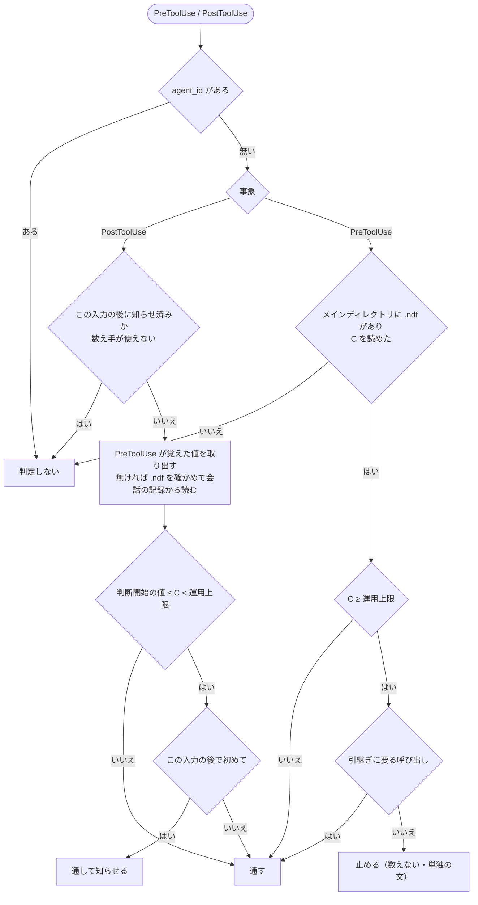

# 文脈の切り替えの閾値: 判断開始の値 450,000 で知らせ、運用上限 600,000 で止める

## 概要

**conductor の会話を文脈の量で切り替える閾値は 2 つで、上限の設定（`plugins/ndf/contracts/limits/`）の 1 か所にだけ置く。**
文脈の量の guard（`context-limit`）・中継のラッパー・`ndf relay context resolve` と判定の記録の行は、同じ 1 つの関数で同じ値を読む。

| 値 | 上限の設定の行 | 既定 | 振る舞い |
| --- | --- | --- | --- |
| 判断開始の値（タイミングを見て再起動） | `context.decide-from` | 450,000 | guard が Tool の実行の後に、超えたことと役ごとの切りどころを利用者の入力ごとに 1 度知らせる。Tool は止めない。conductor は次の切りどころで引継ぎ文書を書いて切る |
| 運用上限（速やかに再起動） | `context.limit` | 600,000 | guard が引継ぎに要る呼び出しを除くすべての Tool の呼び出しを止め続ける。中継のラッパーは、子が静かで、バックグラウンドの作業が残っていなければ、子を止めて引継ぎを頼む文で起動し直す |

例（オーガナイザーが計画 p12 の `ndf lanes wait` を背景で張っている会話）:

| 文脈の量 | 起きること |
| --- | --- |
| 449,999 | 何も起きない |
| 450,000 | 次の Tool の実行の後に、超えたことと切りどころ（知らせを処理し終えて次の `wait` を張る前か、利用者への報告を終えた時点）を書いた案内が 1 度だけ会話へ入る。同じ入力の間の 2 回目以降は出ない |
| 600,000 | Bash・Skill・Agent などの呼び出しが止まる。止める理由の文が、背景の `wait` を TaskStop で止め、`.ndf/handoff/parallel-p12.md` を書いて `ndf records handoff check` で確かめ、`ndf-next` のブロックを出す手順を示す。引継ぎ文書の Read・Write・Edit と TaskStop と確かめの Bash は通る |

値は個人の環境変数 `NDF_CONTEXT_LIMIT` で運用上限だけを替えられ、guard を止める口は `NDF_HOOK_OFF=context-limit` だけである。
Codex には guard を置かず、手順書のカットポイントで守る。

## 用語

「判断開始の値」「運用上限」「再起動の理由」の定義は用語集（[docs/glossary.md](../glossary.md) の `ndf-context`）が正である。
「引継ぎに要る呼び出し」は、運用上限以上でも guard が通す呼び出し（「仕様」の「運用上限で通す呼び出し」の表）を指す。

## 背景

閾値はかつて 3 か所（guard とラッパーの 800,000、再起動の方針の 200,000 / 400,000）にあり、手順書の値と実際に止める値が
食い違い、手順書の止める口 `NDF_CONTEXT_GUARD` には読み手が無かった。2026-11-21 に利用者が値を 250,000 と 500,000 の
2 つに決め、対象をオーガナイザーとレーンの conductor の両方にした（[#3995](https://github.com/devbasex/ai-plugins/issues/3995)）。
この値では会話の再起動が多すぎたため、2026-11-24 に利用者が 450,000 と 600,000 へ上げた。

決定の要点:

| 決定 | 理由 |
| --- | --- |
| 現行方式と試行方式の 2 つの方針を消し、振る舞いを 1 通り（知らせる・止める）にする。`.ndf/context.json`・`NDF_CONTEXT_POLICY`・`resolve` の `--policy`・`--root` も消す | 2 つの方針の既定を同じ値にすると名前を変えても振る舞いが変わらない。試行方式の判断帯（費用の見込み）と容量の帯は guard に実装しない（閾値の実測の見直しは #2908 が持つ） |
| `NDF_CONTEXT_GUARD` は作らず、既にある `NDF_HOOK_OFF=context-limit` を止める口にする | 同じことをする口を 2 つにしない |
| 判断開始の値の知らせは PostToolUse の案内（`additionalContext`）で、利用者の入力ごとに 1 度だけ出す | PreToolUse で出すと、同じ呼び出しをほかの guard が止めたときに文が捨てられる。呼び出しごとに出すと同じ文で文脈を増やす。statusline の色は会話に入らず、ラッパーからの送信は中継の外に届かない |
| 運用上限でも引継ぎに要る呼び出しを通し、オーガナイザーを見分けずに役ごとの手順を止める理由の文に書く | 引継ぎ文書の更新には Read と確かめの Bash が要り、オーガナイザーは背景の `wait` を TaskStop で止める必要がある。セッションの役を見分ける状態を増やさずに済む |
| 値は上限の設定の 2 つの行に置き、環境変数を重ねる規則を 1 つの関数にする | 値をコードの定数に置くと上限の設定の規約から外れ、読み手ごとに重ね方を持つと食い違いが戻る |
| 運用上限の拒否は数えず、案内へ下げずに止め続ける（表の `deny_key` を `none` にする） | 理由の文が Tool に依らず同じなので、数えると 3 回目から通る |
| サブエージェントは hook の入力の `agent_id` で外す | `agent_type` は `--agent` で起動したメインの会話にも付く。会話の記録のパスはサブエージェントの中で何を指すかが公式の文書に無い |

## 対象範囲

- 2 つの値の置き場と読み方（`plugins/ndf/src/ndf/domains/relay/context_thresholds.py`）
- guard `context-limit` の知らせと拒否（`plugins/ndf/src/ndf/domains/hooks/guards/context_limit.py`）と、拒否を数えない dispatch の扱い
- 中継のラッパーが引継ぎを頼む値と文（`plugins/ndf/src/ndf/domains/relay/cli.py` の `wrapper_settings`・`switch_decide.py`）
- `ndf relay context resolve`・`record` が出す値

判定の記録の集計（`report`）と較正（`calibrate`）の区分、statusline の色の閾値（500,000、窓 200K 以下は 150,000）、
supervisor のスイッチポイント、Codex の扱いは含まない。

## 仕様

### 構成要素と責務

| 要素 | 責務 |
| --- | --- |
| `plugins/ndf/contracts/limits/` | `context.decide-from`（`count` 450,000）と `context.limit`（`count` 600,000）の 2 つの方針。文脈の切り替えの値はここだけにある |
| `context_thresholds.thresholds(environ, value)` | 2 つの値に `NDF_CONTEXT_LIMIT` を重ね、`Thresholds(decide_from, limit, sources)` を返す唯一の関数。上限の設定の引き方 `value` は呼び手が渡す。判定の記録の語（継続・拒否・再起動と再起動の理由）もここに置く |
| guard `context-limit`（`guards.json` の行、`order` 20、`events` は PreToolUse と PostToolUse、`deny_key` は `none`、`fail_closed` は偽） | PostToolUse で知らせ、PreToolUse で止める。上限の設定は `hooks.tables.policy_value` で読む |
| `hooks/dispatch.py` | `deny_key` が `none` の行の拒否を数えず、案内へ下げない。`sole` の付いた拒否があれば、まとめた判定の文をその文だけにする |
| `hooks/counter.py` の `Counter.remember`・`Counter.take` | PreToolUse が読んだ文脈の量を `tool_use_id` ごとに覚え、同じ呼び出しの PostToolUse が取り出す |
| guard `script-chain`（`hooks/guards/chain.py`） | 引継ぎに要る `ndf` のコマンドだけをつないだ Bash を、`context_limit.handoff_bash` で見分けて止めない |
| 中継のラッパー | 起動の時に `thresholds(environ, contracts.limits.value).limit` を 1 度読み、子の文脈の量がそれ以上で子が静かになり、バックグラウンドの作業が残っていないと確かめたら、1 セグメントに 1 度、子を止めて `HANDOVER_PROMPT` で起動し直す |
| `ndf relay context resolve`・`record`（`cli_context.py`） | `thresholds(os.environ, tables.policy_value)` の値を出す・判定の記録の行へ書く |

### 常に成り立つ条件

| 条件 | 破れたときの扱い |
| --- | --- |
| 判断開始の値 ≤ 運用上限 | 環境変数か上限の設定で判断開始の値が運用上限を上回れば、判断開始の値を運用上限へ下げ、出所も運用上限の出所にそろえる |
| 閾値の値ちょうどは「超えた」側に数える（guard・ラッパーとも `>=`） | — |
| 文脈の量が読めなければ、知らせも止めもしない | — |
| サブエージェント（入力に `agent_id`）と、メインディレクトリに `.ndf` の無い会話（Git の外・`.ndf` の無いリポジトリ・管理ディレクトリを外に置いたリポジトリの linked worktree）は判定せず、会話の記録も読まない | — |
| 環境変数の誤りで guard とラッパーを落とさない | 正の整数でない `NDF_CONTEXT_LIMIT` は無視し、出所の `ignored` に変数名だけを書く（生値は残さない） |

### 2 つの値の解き方

1. 上限の設定から `context.decide-from` と `context.limit` の `count` を読む。行が無ければ `value` の例外をそのまま上げる
2. `NDF_CONTEXT_LIMIT` が ASCII の数字だけで 0 より大きければ運用上限をその値にし、出所を `env` にする。空でない別の値なら無視して `sources.ignored` に `NDF_CONTEXT_LIMIT` を書く
3. 判断開始の値が運用上限を上回れば同じ値へ下げる（例: `NDF_CONTEXT_LIMIT=200000` なら 200,000 / 200,000）

`sources` は `decide_from`・`limit` ごとの出所（`default`・`env`）と、あれば `ignored` を持つ。判断開始の値を替える環境変数は無い。

### guard `context-limit` の判定

- 文脈の量 C は会話の記録の末尾の最後の応答の `usage`（`input_tokens + cache_read_input_tokens + cache_creation_input_tokens`）である
- PreToolUse は、この入力の後にまだ知らせていなければ、C と作業ディレクトリのダイジェストを `tool_use_id` ごとに覚える（同じ入力の中で 16 個まで。超えたら古い順に消し、次の利用者の入力で入れ替える）。PostToolUse は同じ ID・同じ作業ディレクトリの値を取り出して使い、会話の記録を読み直さない。知らせ済みの入力と数え手が使えないときは、リポジトリを探さず記録も読まない
- 知らせの回数は数え手の `context-limit:notice` で数え、利用者の入力で数え直す。中継が送る入力では数え直さない
- 判断開始の値の手前から運用上限以上へ一度に越えたときと、2 つの値が同じときは知らせが出ず、止める理由の文が知らせを兼ねる

### 運用上限で通す呼び出し

`guards.json` の `context-limit` の `params` が持つ。

| Tool | 通す条件 |
| --- | --- |
| Read・Write・Edit | リンクと `..` を解いた実際の先の親が、作業ディレクトリを含むリポジトリのメインディレクトリの `.ndf/handoff`（`handoff_dir`）である。worktree の中からもメインディレクトリの文書に当たる。worktree と別のリポジトリの `.ndf/handoff` は止める |
| `pass_tools`（TaskStop） | いつでも |
| Bash | 前景で、単純なコマンドがどれも `pass_ndf` の `ndf records handoff check`（位置引数 1・`--trim`・`--history`）か `ndf relay context record`（`--work`・`--event`・`--verdict`・`--reason`）の形。`--cwd` は 1 つまでで、作業ディレクトリと同じメインディレクトリを指す。`handoff check` の本体と `--history` は上の引継ぎディレクトリの直下 |

Bash は `&&`・`;`・パイプでつないでも、つないだ単純なコマンドを 1 つずつ照らす。変数の代入・展開・コマンド置換・プロセス置換・
グロブ・ヒアドキュメント・背景（`&` と `run_in_background`）・ファイルへのリダイレクトを含めば止める。許すリダイレクトは
記述子の複製（`2>&1`）と `/dev/null` へ向けるものだけである。

### 知らせと止める理由の文

| 文 | 中身 |
| --- | --- |
| 知らせ（`_notice`） | 判断開始の値・今の文脈の量・運用上限と、役ごとの切りどころ。レーンの conductor は次のカットポイント（ドキュメントレビューのマージの後・リファクタリングとコードレビューの前後・スプリントの Pull Request を出した後・マージのフェーズを終えた後）、オーガナイザーは知らせを処理し終えて次の `wait` を張る前か利用者への報告を終えた時点 |
| 止める理由（`_reason`） | 先頭に、引継ぎ文書を書き前景で `ndf records --cwd <メインディレクトリ> handoff check` で確かめ、通れば終える手順（中継の下は次のセグメントのブロック、外は `ndf-next` で新しいセッション）。通らなければブロックを出さない。続けて、オーガナイザーの文書名（`parallel-<計画>`）、背景の監視（`ndf lanes wait`・Monitor）を TaskStop で止めること、supervisor・`ndf plan queue` は止めずに待つこと、止める前に `wait` が戻ったら結果を処理せず「現在地」の `wait` の行を残すこと。文脈の量は書かない |
| ラッパーの `HANDOVER_PROMPT` | ラッパーが子を止めて起動し直したこと、オーガナイザーは「現在地」に打ち直す `ndf lanes wait` の行を残すこと、引継ぎ文書を更新して `handoff check` で確かめ、通ったときだけ次のセグメントのブロックを出すこと。背景の作業の終わりについては書かない |

止める理由の文は `sole` の拒否で、ほかの guard の拒否と同時でもこの文だけが会話へ届く。

### 拒否と締め切り

- 拒否は数えず、違う Tool の呼び出しを続けても止め続ける。数え手が使えなくても止める
- `context-limit` は PreToolUse の dispatch の並びの先頭なので、`dispatch.run` の中の締め切りで飛ばされない
- プロセス全体の締め切り（起動から 1 秒）を過ぎた 1 回は、`fail_closed` でない guard の判定がすべて失われて通る。次の呼び出しで改めて止める

## データ・設定

### 上限の設定と環境変数

| 名前 | 意味 |
| --- | --- |
| `context.decide-from`（`contracts/limits/`） | 判断開始の値。既定 450,000 |
| `context.limit`（`contracts/limits/`） | 運用上限。既定 600,000 |
| `NDF_CONTEXT_LIMIT` | 運用上限（正の整数）。guard・ラッパー・`resolve`・`record` の 4 つに効く。ラッパーは子へ同じ環境を渡すので、子の guard とラッパーは同じ値になる |
| `NDF_HOOK_OFF=context-limit`（か `all`） | guard が判定も知らせもしない。動いている会話には効かず、claude を起動し直して効かせる |

プロジェクトごとの設定は持たない。`.ndf/context.json`・`NDF_CONTEXT_POLICY`・`NDF_CONTEXT_GUARD` は読まれない。
旧い設定から移る手順は `plugins/ndf/skills/development-workflow/references/context-window.md` の「廃止した設定から移る」が正である。

### `ndf relay context resolve` の結果

統一 JSON の `items[0]` が `{"decide_from": <int>, "limit": <int>, "sources": {"decide_from": "default|env", "limit": "default|env", "ignored"?: "NDF_CONTEXT_LIMIT"}}`、
`metrics` が `decide_from`・`limit`、`summary` が「判断開始の値 <n> / 運用上限 <n>」である。`--policy`・`--root` は引数の誤りで断る。

### 判定の記録の行

`ndf relay context record` が書く行は、2 つの値（`decide_from`・`limit`・`sources`）を `thresholds` から書き、方針の列
（`policy`・`margin`・`config_error`）を持たない。集計（`report`）と較正（`calibrate`）は方針の列を読まないので、方針の列を持つ
過去の行と混ぜても結果は変わらない。行の残りの列と保存先は [ndf-context-restart-policy.md](ndf-context-restart-policy.md) の「判定の記録の 1 行」「状態ディレクトリ」にある。

## エラー処理

| 場面 | 扱い |
| --- | --- |
| `NDF_CONTEXT_LIMIT` が正の整数でない（`0`・`-1`・`abc`・`1.5`・`²`） | 無視して既定を使い、`sources.ignored` に変数名を書く |
| 上限の設定に 2 つの行が無い | `thresholds` が例外を上げる。guard では例外が通す側へ倒れる |
| 会話の記録の `usage` が読めない | 知らせも止めもしない |
| 数え手が使えない（排他を取れない） | 知らせない。運用上限の拒否は続ける |

## 運用

- 手順（役ごとの切りどころ・止められた後の引継ぎ・値を変える口）は `plugins/ndf/skills/development-workflow/references/context-window.md` の「運用上限で hook が止める」が、オーガナイザーの切り替えは `references/parallel.md` の「セッションの切り替え」が正である
- いま効く 2 つの値と出所は `ndf relay context resolve` で見る
- ラッパーは起動の時に 1 度だけ値を読むので、動いているラッパーの下で `NDF_CONTEXT_LIMIT` を変えても値は変わらない
- ラッパーは、supervisor などのバックグラウンドの作業が残る子を止めずに待つ。監視（`ndf lanes wait` など）だけが残る子は待たない（[ndf-relay-background-wait.md](ndf-relay-background-wait.md)）

## テスト観点

| 観点 | テスト |
| --- | --- |
| 上限の設定の値を差し替えると、guard・ラッパー・`resolve` が差し替えた値を使う | `plugins/ndf/tests/domains/relay/test_context_thresholds.py`（`test_values_follow_the_given_table`・`test_resolve_follows_the_limits_table`）、`tests/domains/hooks/test_guards.py`（`test_context_limit_reads_the_limit_from_the_limits_table`）、`tests/domains/relay/test_relay_decide.py`（`test_wrapper_settings_read_the_limit_from_the_limits_table`） |
| 旧い行・旧いモジュール・旧い設定の形が残っていない | `test_context_thresholds.py`（`test_the_limits_table_has_no_old_rows`・`test_the_restart_policy_module_is_gone`・`test_the_restart_policy_setting_schema_is_gone`） |
| 既定で 450,000 / 600,000 を返し、`--policy`・`--root` を断る | `test_context_thresholds.py`（`test_resolve_returns_the_two_defaults`）、`test_relay_cli_parse.py`（`test_context_resolve_refuses_the_removed_options`） |
| `NDF_CONTEXT_LIMIT` が運用上限を替えて判断開始の値を下げ、誤った値を無視する | `test_context_thresholds.py`（`test_env_overrides_the_limit_and_lowers_the_decide_from`・`test_env_that_is_not_a_positive_integer_is_ignored`・`test_reversed_table_lowers_the_decide_from_to_the_limit`） |
| 449,999 / 450,000 / 599,999 では止めず 600,000 で止める。環境変数の値でも同じ | `test_guards.py`（`test_context_limit_stops_at_the_operating_limit`） |
| 引継ぎに要る呼び出しだけを通し、リンク・別のリポジトリ・リダイレクト・連結を見分ける | `test_guards.py`（`test_passes_*`・`test_context_limit_passes_the_handoff_calls_at_the_operating_limit`） |
| 違う呼び出しを続けても止め続ける | `test_guards.py`（`test_context_limit_keeps_denying_different_calls`） |
| 止める理由の文が手順を含み、文脈の量を含まず、ほかの拒否と同時でも単独で届く | `test_guards.py`（`test_context_limit_reason_*`） |
| 判断開始の値で入力ごとに 1 度知らせ、記録の読み取りが呼び出しごとに 1 回以内 | `tests/domains/hooks/test_context_notice.py` |
| 作業の残っていない子に、ラッパーが 600,000 で 1 度だけ引継ぎを頼み、599,999 では頼まない | `test_relay_decide.py`（`test_context_over_the_limit_asks_for_a_handover_once`・`test_wrapper_settings_hand_the_operating_limit_to_the_handover`・`test_handover_prompt_asks_to_keep_the_wait_line_and_check_the_document`） |
| サブエージェント・NDF の外・`usage` の無い会話は判定しない。`agent_type` だけなら判定する | `test_guards.py`（`test_context_limit_skips_a_subagent`・`test_context_limit_judges_with_only_the_agent_type`・`test_context_limit_passes_without_usage`・`test_context_limit_skips_conversations_outside_ndf_without_reading`） |
| `NDF_HOOK_OFF=context-limit` で判定も知らせもしない | `test_guards.py`（`test_hook_off_context_limit_neither_judges_nor_notifies`） |
| `context-limit` が dispatch の並びの先頭で、締め切りで判定を失わない | `tests/domains/hooks/test_dispatch.py`（`test_context_limit_is_the_first_guard_selected`・`test_context_limit_verdict_survives_the_deadline_inside_run`） |

テストは文脈の量の境界の値と呼び出しの回数で判定し、時間で区切らない。

## 関連リンク

- [#3995](https://github.com/devbasex/ai-plugins/issues/3995) — 要求と利用者の決定（2026-11-21）
- [ndf-context-restart-policy.md](ndf-context-restart-policy.md) — 判定の記録・較正・集計（10 系の再起動の方針の記録）
- [ndf-context-continue-or-cut-measurement.md](ndf-context-continue-or-cut-measurement.md) — 続けるか切るかの計測
- [#2908](https://github.com/devbasex/ai-plugins/issues/2908) — 切る閾値を実測で見直す調査
- [ndf-relay-background-wait.md](ndf-relay-background-wait.md) — バックグラウンドの作業が残る子をラッパーが止めずに待つ扱い（[#4049](https://github.com/devbasex/ai-plugins/issues/4049)）
