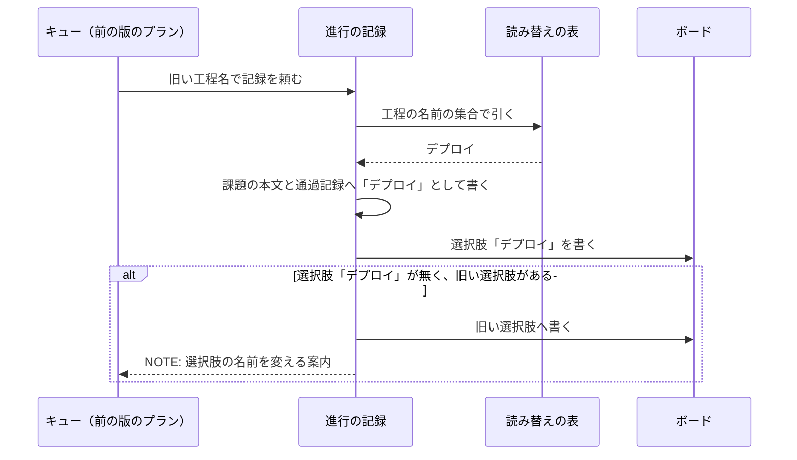

# デプロイとリリースの呼び分け: 環境へ届ける操作を「デプロイ」、本番へのデプロイを「リリース」と呼ぶ

## 概要

環境へ変更を届ける操作を 2 つの語で呼び分ける。承認が要るのは本番へ届く操作だけであり、どちらの操作かを
語から読み取れるようにするためである。

| 語 | 意味 |
| --- | --- |
| デプロイ | 開発・本番を問わず、環境へ変更を届けること。工程の名前でもある |
| リリース | 本番へのデプロイ。フェーズの名前でもある |
| 開発版のデプロイ | 開発版のチャネルへ版を出すことと、検証の環境への反映。フェーズの名前でもある |

2 つの語に置き換えた旧い語は使わない。旧い語は、用語集で上の語の廃止した語として引ける。
このリポジトリは旧い語を禁止語に宣言しており（`.ndf/glossary.json` の `check.banned.words`）、禁止語を新しく
書き足した Pull Request は継続的統合の用語チェックが落とす。この文書も検査する範囲にあるため、旧い語と旧い値を
本文に書き写さず、置き場を指す。

## 用語

語の定義は用語集（`.ndf/glossary.json` の `document`、[docs/glossary.md](../glossary.md) ）が正である。
この文書で使う語のうち、用語集にあるものは次のとおり。

- デプロイ・リリース・開発版のデプロイ・デプロイなし・リリース待ち・リリースの依頼・リリースの実行・まとめたリリース
- リリース対象・アーティファクト・導入先のランタイム・利用先のリポジトリ・利用者向けの変化なし
- 旧い値の読み替え: 版を上げる前に書かれた記録の値を、読む時点で新しい値へ変換すること
- 禁止語: 用語集の設定が、検査する範囲で新しく書くことを禁じた語
- 書いた日の記録: 書いた日時点の内容を残し、以後の構成変更に追随しない文書

## 背景

業界ではデプロイを「環境へ変更を入れること」、リリースを「利用者が使える状態にすること」と分けて呼ぶ
（Thoughtworks Technology Radar の「Decoupling deployment from release」、Octopus Deploy の
「Deployments vs. releases」）。NDF の本番チャネルは利用者が使うチャネルであり、この区別と一致する。
版は「版」と呼び、名詞の「リリース」を版の意味に使わない（「リリース済み版」は既存の語のまま使う）。

## 対象範囲

- このリポジトリの文書・Skill・スクリプト・Factory と、NDF を使うすべてのリポジトリでスクリプトが書く記録の値に効く
- 禁止語の検査は、用語集の設定に禁止語を書いたリポジトリだけで働く。禁止語と検査する範囲はプロジェクトごとに `.ndf/glossary.json` で受ける
- Skill の名前（`release` など）・スラッシュコマンド・スクリプトのファイル名と副命令の名前は変えない。対象は日本語の語だけである
- 版の付け方・チャネル・工程・承認ゲートは変えない
- 書いた日の記録（発表資料・記事・アーカイブ・開発履歴・`docs/changelog/`・`CHANGELOG.md` の出した版の項・`issues/`）は直さない

## 仕様

### コンテキスト

| コンテキスト | 何の語が 1 つの意味に決まるか |
| --- | --- |
| NDF のリリース（`ndf-release`） | デプロイ・リリース・開発版のデプロイ・リリース記録の段階・リリース対象・アーティファクト・導入先のランタイム |
| NDF の開発ワークフロー（`ndf-workflow`） | 工程の名前・フェーズの名前・ループの 1 回の結果・リリースの依頼・旧い値の読み替え |
| NDF の Factory（`ndf-factory`） | リリースの実行・まとめたリリース |

`ndf-release` と `ndf-workflow` は共有カーネルの関係にあり、同じ用語集（`docs/glossary/glossary.json`）と
旧い値の読み替えの表を共同で持つ。Factory は NDF の出す値に対して腐敗防止層を置き
（`factory/runner/src/translate.ts` が NDF のフェーズの名前を Factory の段の名前へ変換する）、
サービスの境界の規則によって NDF の読み替えの表を参照しないため、自分の層に旧い値を持つ。

### 集約

| 集約 | 持ち主（書き換えてよいもの） | 根 | エンティティ | 値オブジェクト |
| --- | --- | --- | --- | --- |
| 用語集 | `glossary.py`（`render` が文書を作る。語の追加・廃止は用語集の JSON を直す変更） | 用語集 | 語 | 意味・廃止した語・コンテキスト |
| 旧い値の読み替えの表 | NDF のスクリプト（`plugins/ndf/scripts/data/legacy-values.json`） | 表 | 値の集合 | 旧い値 → 新しい値の組 |
| 禁止語の宣言 | 利用者の設定（`.ndf/glossary.json` の `check.banned`） | 宣言 | — | 禁止語・検査する範囲・外す範囲 |
| Factory のフェーズの変換 | Factory のランナーのエージェント（`factory/runner/src/translate.ts` と `legacy-phases.ts`） | 変換の表 | — | NDF のフェーズの名前 → Factory の段 |

### 語を選ぶ規則

届け先で語を選ぶ。

| 届け先 | 書く語 |
| --- | --- |
| 本番チャネル・本番環境 | リリース |
| 開発版のチャネル・検証の環境だけ | 開発版のデプロイ |
| 開発版と本番の両方にまたがる操作、届け先を問わない操作 | デプロイ |

リリースはデプロイの一部であり、両方にまたがる操作を「リリース」と書くと、開発版だけで終わった場合も
本番へ届いたと読めるためである。

**工程の名前は「デプロイ」である。** 工程（`release` を起動する行）は開発版のデプロイと本番へのリリースの
両方を含み、進め方によっては開発版のデプロイまでで記録が付く。フェーズの名前は届け先が 1 つに決まるため、
`開発版のデプロイ` と `リリース` に分ける。

デプロイにもリリースにも当たらない意味は、次の語で書く。

| 意味 | 語 |
| --- | --- |
| リリースで利用者へ届くファイル（ai-plugins では `plugins/` と `.claude-plugin/`） | リリース対象 |
| ビルドや署名で作り、公開操作で届ける生成物 | アーティファクト |
| Pull Request の本文の `## 利用者向けの変化` が「無し」だけを持つこと | 利用者向けの変化なし |
| マーケットプレイスのプラグインを導入できる形で届けるランタイム | 導入先のランタイム |
| NDF を導入して使うリポジトリ | 利用先のリポジトリ |
| プラグインの取得元・上流 | 取得元（マーケットプレイスの登録を指すとき）/ 上流リポジトリ |
| `.ndf/` のリリースの設定とその中身 | リリースの設定・リリースの形・リリースの経路・リリースの手順 |
| 本番へのリリースを頼む・行う・まとめる・待つ | リリースの依頼・リリースの実行・まとめたリリース・リリース待ち |
| 版の付け方とチャネル | 版とリリース |

`配る` は禁止語にしない。`release` の Skill の説明文の起動の語は「デプロイする」と書く。

### 常に成り立つ条件

| # | 条件 | 破れたときの扱い |
| --- | --- | --- |
| I1 | スクリプトが記録・報告・課題の本文の「進行」へ書く値は、どの値の集合でも新しい値だけである | 全体テストが落ちる |
| I2 | 旧い値を読んだ処理は、対応する新しい値を読んだときと同じ結果を返す | 単体テストが落ちる |
| I3 | 読み替えの表の 1 つの値の集合で、旧い値は新しい値の 1 つだけへ変換され、新しい値は旧い値の欄に現れない | 表を読む時点で `StepError`（終了コード 2）で止まる |
| I4 | 検査する範囲に足した行に禁止語があれば、用語チェックは失敗してファイルと行を出す。外す範囲の行では失敗しない | 継続的統合のジョブ `glossary-check` が落ちる |
| I5 | 新しい語はそれぞれ 1 つの意味で用語集に載り、旧い語は廃止した語として置き換え先を引ける。用語集の語と意味の欄に禁止語を書かない | `glossary.py check` の構造の検査が落ちる |
| I6 | Skill の名前・スラッシュコマンド・スクリプトの副命令の名前は変わらない | `plugins/ndf/manifests/` と契約の差分で分かる |
| I7 | 書いた日の記録に差分が無い | 禁止語の検査の外す範囲と、差分の確認で分かる |

### 旧い値の読み替え

既存の記録は書き換えず、読む時点で旧い値を新しい値へ変換する。Pull Request と課題の本文、利用者の手元の
見積もりの記録と通過記録は利用者のデータで、すべてを書き換える手段も戻す手段も無いためである（共通原則の C3）。
旧い値は読み替えの表の 1 か所にだけ置き、読み手ごとに持たない。

**読み替えは外さずに持ち続ける。** リリース記録・課題の本文の「進行」・見積もりの記録・判断の記録は消えずに
残って後から読まれ、外した版の後に古い記録を読んだ処理が退行するためである。持ち続ける費用は 1 つの表と
1 つのテストである。

| 要素 | 責務 |
| --- | --- |
| `plugins/ndf/scripts/data/legacy-values.json` | 値の集合ごとに旧い値 → 新しい値を持つ。旧い値を持つ NDF のファイルはこの表だけである |
| `plugins/ndf/scripts/lib/legacy_values.py` | 表を読んで I3 を確かめる。`to_current(<値の集合>, <値>)` が変換し、`current_plan()` がプランのフェーズを、`normalize_laps()` がループの記録のループの 1 回の結果と失敗の種類を、`old_values()` が旧い値の一覧を返す |
| シェルの読み手（`lib/projects-common.sh`・`projects-sync.sh`） | 同じ表を `jq` で引く |
| `lib/dist_record.py` | 見出し `## リリース記録` と旧い見出しの両方を記録の始まりとして読み、段階の値を変換する。最後の記録 1 つを選ぶ規則は変えない |

### ボードの工程の選択肢

ボードの単一選択のフィールドの選択肢は利用者が作った設定である。`projects-sync.sh` は新しい工程名の選択肢が
無いとき、読み替えの表で同じ新しい値へ変換される旧い選択肢があればそこへ書き、次の案内を標準エラーへ返す。
両方とも無ければ「選択肢が無い」と返す。スクリプトは選択肢の名前を変えない。

```text
NOTE: フィールド「<フィールド>」の選択肢「<旧い工程名>」へ書いた。工程の名前は「デプロイ」に変わったため、ボードの設定で選択肢の名前を「デプロイ」へ変える
```



ボードの作り方の手順（`progress-tracking` の `references/board.md`）は新しい名前で書く。

### 禁止語の検査

`glossary.py check` の規則 `banned` が、禁止語を書き足した変更を落とす。足した行を集める処理と、廃止した語から
置き換え先を出す処理は `glossary.py` が既に持ち、規則 `banned` は検査する範囲と照らす場所だけを足す。宣言の
読み取りと照合は `plugins/ndf/scripts/lib/glossary_banned.py` が持ち、特定のプロジェクトの語を持たない。

| 項目 | 内容 |
| --- | --- |
| 起動 | `glossary.py check --diff <基点>`（継続的統合のジョブ `glossary-check`）と `--file <パス>`。専用の引数は無い |
| 対象 | `check.banned.paths` に一致し `exclude` に一致しないファイルの、足した行（`--file` ではすべての行）。ファイルの種類を問わず、コードのコメント・文字列・Markdown のコードブロックとインラインのコードも照らす |
| 一致 | 語の部分一致（禁止語を含む複合語も当たる） |
| 出力 | 標準エラーに `ERROR: <パス>:<行>: banned: <語>`、結果 JSON の `items` に `{"rule": "banned", "path", "line", "term", "detail"}`。`detail` は用語集の廃止した語の対応から置き換え先を出す |
| 終了コード | 既存の規則と同じ（指摘があれば違反の終了コード） |
| 宣言が無いとき | 規則 `banned` を走らせない |
| 宣言の形の誤り | `words`・`paths`・`exclude` が文字列の配列でない、`words` か `paths` が空のときは、設定を読めない誤りとして止まる |

用語集の構造の検査は、語と意味の欄に禁止語がある語を指摘する。廃止した語の欄は置き換え先を引くために禁止語を
持ってよい。`check.paths`（要求と設計の文書で用語の表を見る範囲）と `check.banned.paths` は別に持つ。

Vale・textlint-rule-prh は使わない。どちらも Pull Request で足した行だけを見る形を持たず、Python・TypeScript・
シェルのコメントと文字列を見ないうえ、継続的統合に新しいランタイムと用語集とは別の辞書が要るためである。

## データ・設定

### 旧い値の読み替えの表

旧い値の正本は `plugins/ndf/scripts/data/legacy-values.json` で、形は `{"version": 1, "sets": {<値の集合>: {<旧い値>: <新しい値>}}}` である。
値の集合ごとの新しい値は次のとおり。

| 値の集合（表の鍵） | 新しい値 |
| --- | --- |
| `stage` | `デプロイ` |
| `record_heading` | `## リリース記録` |
| `record_stage_prefix` | `デプロイなし` で始まる値 |
| `phase` | `開発版のデプロイ`・`リリース`・`リリースの依頼`・`リリース（提示）`・`リリース（本番チャネルへのマージ）`・`リリース（リリース承認ゲート）`・`デプロイ（導入の確認）` |
| `lap_outcome` | `リリース待ち` |
| `failure_kind` | `リリース`・`リリースの失敗` |
| `pipeline_stage` | `デプロイ` |

`phase` の集合は、承認ゲートの旧い呼び名を持つフェーズの名前も `リリース（リリース承認ゲート）` へ読み替える
（[ndf-approval-gate-names.md](ndf-approval-gate-names.md) ）。

`record_stage_prefix` だけは前方一致で変換する（段階の値は `デプロイなし（<理由>）` の形で理由を後ろに持つ）。
ほかの集合は値全体の一致で変換し、表に無い値はそのまま返す。

| 値の集合 | 書き手 | 読み手 |
| --- | --- | --- |
| 工程の名前（`stage`） | プランのステップの `stage`・`progress-record.sh`・`sprint-close.py --final-stage` | `progress-record.sh`・`lib/projects-common.sh`・`projects-sync.sh`・`lib/stage_skills.py`・`context-policy.py`・`sprint_close_lib/final_stage.py`・`lib/transcript_agents.py` |
| リリース記録の見出し（`record_heading`） | `release-steps.py record`・`release` の手順 | `lib/dist_record.py` |
| リリース記録の段階（`record_stage_prefix`） | `sprint-close.py`・`release` の手順 | `lib/dist_record.py` |
| フェーズの名前（`phase`） | `supervise_lib/release_templates.py`・`lib/parallel_release.py` | `sprint-state.py`・`supervise_lib/queue.py`・`estimate.py`・`lib/estimate_records.py`・`lib/slow_step.py`・`lib/sprint_loop_gate.py`・Factory の `legacy-phases.ts` |
| ループの 1 回の結果（`lap_outcome`）・失敗の種類（`failure_kind`） | `lib/sprint_loop_names.py`・`lib/sprint_loop_gate2.py` | `lib/sprint_loop_record.py`・`lib/parallel_repo.py`（`normalize_laps()` を通す） |
| パイプラインのステージの名前（`pipeline_stage`） | `supervise_lib/sprint.py` | 表が持つだけで、`to_current("pipeline_stage", …)` を呼ぶ読み手は無い（2026-11-08 の `git grep -n pipeline_stage -- plugins/ndf/scripts` のヒットは `legacy-values.json` の 1 件と `tests/test_legacy_values.py` の 2 件だけ） |

リリース記録の段階の残りの値（`検証`・`本番`）は変えない。`検証` は開発版のデプロイまでを終えた記録の値として読む。

### スクリプトの引数で受ける値

| 引数 | 新しい値 | 旧い値を渡したとき |
| --- | --- | --- |
| `progress-record.sh <課題> <工程名>`・`projects-sync.sh <課題> stage <工程名>` | `デプロイ` | 新しい値として記録する |
| `sprint-close.py --final-stage` | `デプロイ`・`リリース後テスト`・`振り返り` | 工程の名前の旧い値を `デプロイ` として受ける |

前の版の NDF が組んだプランは、ステップの `stage` に旧い値を持ったまま流れる。キューが流すときに上の引数へ
旧い値が渡るため、引数の側で受ける。

### 禁止語の宣言

このリポジトリの `.ndf/glossary.json` の `check.banned` は次のとおり（`words` の値はこの文書に書き写さない）。形は
`requirements-design` の [references/glossary-format.md](../../plugins/ndf/skills/requirements-design/references/glossary-format.md) が正である。

```json
{
  "check": {
    "banned": {
      "words": ["<旧い語>"],
      "paths": ["plugins/**", "factory/**", "docs/**", ".github/**", "AGENTS.md", "CLAUDE.md", "README.md", "KIRO.md", ".ndf/**"],
      "exclude": [
        "docs/presentations/**", "docs/articles/**", "docs/archive/**", "docs/development-history/**", "docs/changelog/**",
        "docs/metrics/**", ".ndf/mvv.md", ".ndf/mvv.json", ".ndf/glossary.json",
        "docs/glossary/glossary.json", "docs/glossary.md",
        "plugins/ndf/scripts/data/legacy-values.json", "plugins/ndf/scripts/tests/test_legacy_values.py",
        "plugins/ndf/scripts/tests/test_estimate_predict.py",
        "factory/runner/src/legacy-phases.ts", "factory/runner/src/legacy-phases.test.ts"
      ]
    }
  }
}
```

外す範囲の理由は次のとおり。

| 外す範囲 | 理由 |
| --- | --- |
| 発表資料・記事・アーカイブ・開発履歴・`docs/changelog/` | 書いた日の記録 |
| `docs/metrics/` | 版ごとの計測の記録で、集計した日の時点の見出しを持つ。新しく書く記録の見出しには禁止語を出さない |
| `.ndf/mvv.md`・`.ndf/mvv.json` | 利用者が承認した MVV の本文と版の履歴。書き換えるとハッシュが合わなくなり、MVV 判定が承認ゲートを省かなくなる。MVV の語は、利用者が次に MVV を改訂するときに直す |
| `.ndf/glossary.json` | 禁止語の宣言そのもの |
| `docs/glossary/glossary.json`・`docs/glossary.md` | 廃止した語の欄が禁止語を持つ |
| 読み替えの表とそのテスト、`legacy-phases.ts` とそのテスト、`test_estimate_predict.py` | 旧い値を持つ互換のコードと、旧い値を入力にするテスト |

## 外部連携

### Factory

Factory はサービスの境界の規則によって `plugins/` を読まないため、フェーズの名前の旧い値だけを
`factory/runner/src/legacy-phases.ts` に持つ。中身は読み替えの表の `phase` の集合と同じで、`normalizePhase()` が
変換する。`translate.ts` は新しいフェーズの名前を持つ。

Factory の画面・API・OpenAPI とスキーマの説明は、この文書の語で書く。

## 運用

- 新しく書く文書・Skill・スクリプトの文は、「語を選ぶ規則」で語を選ぶ。禁止語を書き足すと継続的統合の `glossary-check` が落ち、置き換え先（デプロイ / リリース）が出る
- 新しい値の集合を読み替える必要が出たら、`legacy-values.json` に集合を足し、読み手は `legacy_values.to_current()` を通す。旧い値を読み手ごとに書かない
- ボードの工程の選択肢を旧い名前のまま使っている利用者は、`NOTE:` の案内に従って選択肢の名前を変える
- `release` の説明文の起動の語を「デプロイする」に置き換えたため、利用者が旧い語で頼んだときに Skill が起動するかは未確認である

## テスト観点

- 禁止語の宣言を置いた一時のリポジトリで、検査する範囲のファイル（Markdown・Python のコメント・TypeScript の文字列）へ禁止語の行を足すと、規則 `banned` がファイルと行を出して失敗すること。外す範囲のファイルへ足した行では失敗しないこと。宣言が無いリポジトリでは走らないこと
- `glossary.py check --file` が、用語集で「デプロイ」「リリース」「開発版のデプロイ」の廃止した語にした語を含む文書で廃止した語を指摘し、置き換え先の語を出すこと。禁止語を含む語・意味を構造の検査が指摘すること
- 書き手（プランのテンプレート・ループの 1 回の締め・リリース記録・見積もりの行・パイプラインの組み立て）が出す値に、読み替えの表の旧い値が含まれないこと
- 値の集合ごとに、旧い値の記録と新しい値の記録を同じ読み手へ渡すと同じ結果になること。`lap_outcome` の旧い値のループの 1 回を持つループの状態でループの次の 1 回を選ぶと、保留したループの 1 回として扱って選び直さないこと。旧い見出しのリリース記録を `sprint-close.py` が読み、同じ判定を出すこと
- 表の 1 つの集合で旧い値を 2 つの新しい値へ変換する形、新しい値を旧い値の欄に置く形を読むと、例外で止まること
- 新しい選択肢が無く旧い選択肢があるボードへ工程を書くと、旧い選択肢へ書き、`NOTE:` に案内が出ること
- `plugins/ndf/manifests/` と `plugins/ndf/contracts/entrypoints/` の副命令の名前が変わらないこと
- 禁止語を `git grep -nF` で `plugins` `factory` `docs` `.github` `AGENTS.md` `CLAUDE.md` `README.md` `KIRO.md` `.ndf` に当てたとき、ヒットが禁止語の宣言の外す範囲のファイルだけであること

## 関連リンク

- [ndf-approval-gate-names.md](ndf-approval-gate-names.md) — 承認ゲートの呼び名（リリース承認ゲート）
- [ndf-ubiquitous-language.md](ndf-ubiquitous-language.md) — 用語集と用語チェック
- [ndf-production-release-record.md](ndf-production-release-record.md) — リリース記録
- [docs/versioning-and-distribution.md](../versioning-and-distribution.md) — 版とリリース
- [docs/glossary.md](../glossary.md) — 用語集
- Thoughtworks Technology Radar「Decoupling deployment from release」 https://www.thoughtworks.com/en-au/radar/techniques/decoupling-deployment-from-release
- Octopus Deploy「Deployments vs. releases」 https://octopus.com/devops/continuous-delivery/deployments-vs-releases/
