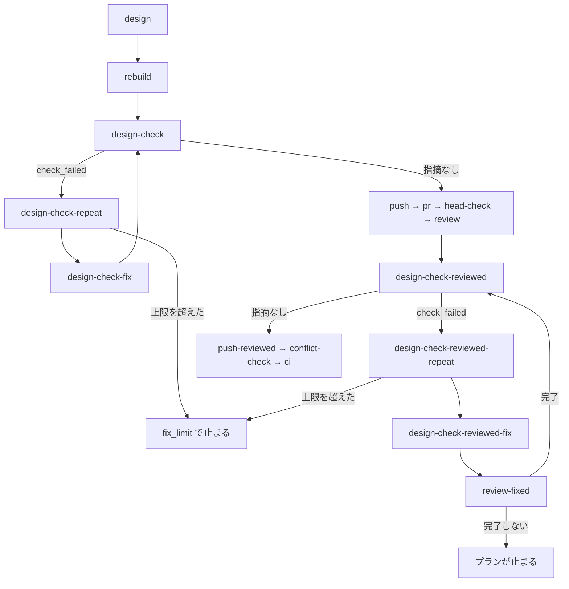

# 設計の判断と MVV 判定: 番号の無い「人へ残す判断」を設計の検査で止め、表にレッドラインがある設計は承認を省かない

## 概要

設計の判断（作り方・範囲の取り方・既定値・扱いの選択）は設計者（AI）が決め、設計文書の「決定の記録」に結論・理由・採らなかった案で書く。
人が承認ゲートで決める判断は、レッドライン（共通原則の `C<番号>`・プロジェクト MVV の `P<番号>`・スプリント MVV の `R<番号>`）に当たるものだけである。
その判断は設計文書の `## 人へ残す判断` の表に、当たる番号となぜ当たるかの 1 行を添えて置く。

この決まりを、次の 2 つの機械の確かめで守る。

1. **設計の検査**（`ndf records design check`）が、レッドラインの番号を示さずに判断を人に任せる行（番号の無い委ね方）と、欄を欠く表の行を指摘し、終了コード 1 で止める。設計文書を push するプラン（`design`・`design-detail`・`document-review`）は、push の前に毎回この検査を打つ
2. **MVV 判定**（`ndf records mvv gate`）が承認ゲートを省ける結果になったとき、PR の差分にある設計文書の head の本文から「人へ残す判断」の表を読む。レッドラインの番号を持つ行が 1 つでもあれば、判定者（LLM）の回答にかかわらず省かない

`pace: fast` / `pace: auto` で、レッドラインの無い設計が人を待たずに進み、レッドラインのある設計は必ず人の承認へ戻るためである。

**書き方の正本は Skill の側にある。** この文書は、そこに書かない決定の理由・契約・常に成り立つ条件・テスト観点を持つ。

| 中身 | 正本 |
| --- | --- |
| 設計の手順 5（検査を打つ）・手順 6（詳細設計の後に打つ） | [`design` の SKILL.md](../../plugins/ndf/skills/design/SKILL.md) |
| 判断の書き場所の分け方と、委ねる行の書き方 | [decisions.md の「人へ委ねない」](../../plugins/ndf/skills/design/references/decisions.md#人へ委ねない) |
| `## 人へ残す判断` の節のテンプレート | [design-template.md](../../plugins/ndf/skills/design/references/design-template.md) |
| 検査の引数 | [commands.md](../../plugins/ndf/docs/contracts/commands.md) の `ndf records design check` |
| 起票者の推定の節の書き方と運び方 | [ndf-gate-rejections-and-filer-assumptions.md](ndf-gate-rejections-and-filer-assumptions.md) |
| MVV 判定が承認ゲートを省く条件と pace ごとの扱い | [pace.md](../../plugins/ndf/skills/development-workflow/references/pace.md) |
| 設計工程そのものの規約 | [ndf-design-phase.md](ndf-design-phase.md) |

## 用語

語の定義は用語集（ [docs/glossary.md](../glossary.md) ）が正である。この文書で使う主な語は次のとおり。

| 用語 | この文書での使い方 |
| --- | --- |
| 人へ残す判断 | 設計文書の `## 人へ残す判断` の表の 1 行。判断・当たるレッドラインの番号・なぜ当たるかを持つ |
| 設計の検査 | `ndf records design check`。言語モデルを呼ばない決まった検査で、設計・詳細設計・文書レビューのプランのステップ `design-check` が打つ |
| 委ねる語 | 判断の主語を人に置き、まだ決まっていない判断を書く言い回し。`design_check_rules.DELEGATE` の 1 か所に正規表現で置く |
| 番号の無い委ね方 | 委ねる語を含み、下の「番号を名指しした行」でない行 |
| 設計成果物 | NDF が設計書と詳細設計書に使う名前（`issues/issue-<番号の並び>-design*.md`。`ndf.core.issue_docs.DESIGN_FILE`）に当たるファイル |
| 起票者の推定 | 要求の `## 起票者の推定` の節の行。扱い（受け入れ条件・前提・含まない・採らない）が書かれた行は、設計者が決めた判断として読む |

## 背景

判断を人へ残した設計は MVV 判定で省けないと判定され、人の回答を待って止まっていた。10 系では検査のスクリプト（`design-survey.py` の規則 `unnamed_redline`）と指示文の緩和で解こうとしたが、リリース後テストでレッドラインを含む設計まで承認を省ける不合格が出た（[リリース記録 PR #3013](https://github.com/devbasex/ai-plugins/pull/3013)、[#3017](https://github.com/devbasex/ai-plugins/issues/3017)）。11 系にはその検査が無く、設計者が文書を読んで確かめるだけだった。

| 決めたこと | 理由 |
| --- | --- |
| 検査を `ndf records design check` に置く。判定は純粋な関数（`design_check_rules`）に分け、Markdown の解析は依存済みの markdown-it-py を `ndf.adapters.markdown` 経由で使う | 設計者とプランの両方が同じ入口から打てる。`ndf check` は NDF 自身のコードを検査する開発者向けのもので、利用先の設計文書を対象にしない。textlint・Vale は Node か別の実行ファイルを利用先へ要求し、表の欄の判定は結局自分で書く |
| 判定のモジュールの名前を `design_check_rules` にする（`_decide` にしない） | `_decide` で終わるモジュールは `ndf.adapters` を読まない規則（`ndf check` の decide-pure）があり、表を読むアダプターを使う判定がこれに反する |
| `--base` では、設計成果物の足した・変えた行だけを指摘する | コードの変更に含まれる運用文書や、今回触れていない行で push を止めず、直しの worker に関係の無い記述を書き換えさせない |
| 委ねる行は、番号と表の 1 行の「判断」の文を両方含むときだけ通す | 番号がどこかにあれば通す形では `C2 には当たらないため、利用者が決める` が通る。番号が表にあれば通す形では、AI が決めるべき判断が別の判断の番号を添えるだけで人へ残る |
| 設計文書を push するプランは、自分が打つ push の前に毎回検査を打つ。コードレビューのプラン（`cross-review`）には置かない | 手順書の指示だけでは打ち忘れても PR が出る。レビューや CI の直しで委ね方が戻ることがある。設計文書を扱わないコードレビューで起動を増やさない |
| レビューの後の検査で直した版は、直した後のレビュー（`review-fixed`）が完了したときだけ push へ進める | 直しの worker が書き換えた判断が、レビューを通らずに設計承認ゲートへ届かないようにする。検査は委ね方の書き方しか見ない |
| MVV 判定は、省ける結果のときだけ表を読み、番号を持つ行があれば省かない。前の PR で人が承認した行かは問わない | 判定者へ渡すのは差分で、変更行の周りに無い表は届かない。届いても回答に挙がるかは LLM しだいである。前に承認した行を見分けるには、行ごとに PR と承認の証跡をたどる仕組みが要り、それで省けるのは表のある設計を後の PR が直す場合だけである |
| 表は承認の対象（`target`）を作るマージ先の設定の読み取りと同じ GraphQL の要求で読む | 省ける結果のときに今も打つ要求に相乗りさせ、読み取りを増やさない。1 件ずつ読むと設計成果物の数だけ直列に待つ |
| 起票者の推定の扱いを足す指示文の変更は入れていない | 実装の前に、レッドラインを挙げた過去の設計 PR（対照）を変更後の指示文で判定し直したところ、20 件中 11 件で期待の番号が欠けた（10 件は変更前の指示文でも欠けた）。レッドラインを落としたまま指示文を出さないため、変更を外した（[#3017 のコメント](https://github.com/devbasex/ai-plugins/issues/3017#issuecomment-7208992101)） |

## 対象範囲

- 設計の検査・プランのステップ・MVV 判定の表の確かめは、NDF を使うすべてのリポジトリで働く。プランを流せばモードを問わず自動で働き、流さなければ設計者が手順書に沿ってコマンドを打つ
- レッドラインは番号の形（`C`・`P`・`R` と数字）だけを見るので、プロジェクトが足す番号も設定なしで通る
- MVV 判定の引数・結果の形・終了コード・記録の行の形、承認ゲートの数は変えていない
- MVV 判定の指示文（`mvv_material_decide.SYSTEM`）は変えていない。差分の大きさで判定を打てずに人へ戻る場合も範囲の外である
- 詳細設計の検査の規則は [#3664](https://github.com/devbasex/ai-plugins/issues/3664) が扱う

## 仕様

### 構成要素

| 要素 | 置き場 | 責務 |
| --- | --- | --- |
| 判定ロジック | `ndf.domains.records.design_check_rules` | 本文を受け、番号の無い委ね方の行、欄を欠く表の行、表の番号を返す。ファイル・git・GitHub を読まない。委ねる語・番号・見る範囲の定数はここにだけ置く |
| 文書の集め方 | `ndf.domains.records.design_check` | 引数のファイルか、分岐点からの差分の設計成果物と見る行を集め、統一 JSON の結果を作る |
| CLI | `ndf.domains.records.cli` の `_design_check` | 入力の排他の確かめ、`--result` への書き込み |
| 表の読み取り | `ndf.adapters.markdown.gfm_tables` | 表の見出しの欄と行の欄を、行番号つきで返す |
| 起点の解決 | `ndf.core.start_point.resolve` | ベースブランチとリモート名から起点の参照と SHA を決める。ドキュメント再構成と設計の検査が共有する |
| MVV 判定の表の確かめ | `ndf.domains.records.mvv_gate._bound` | 省ける結果のときだけ、差分の設計成果物の head の本文を読み、番号を持つ行があれば省かない |
| 本文の一括読み取り | `ndf.adapters.github.GitHub.branch_file_with` | マージ先の設定 1 件と、設計成果物の本文を GraphQL のエイリアスで同じ要求に載せる |
| プランのステップ | `contracts/templates/parts/steps.json` の `design-check`・`design-check-repeat`・`design-check-fix` | 検査・同じ原因の数え・直しの 3 つのステップ |
| 直しの作業 | `contracts/worker/kinds.json` の `design-check-fix` | 検査の結果のファイルの指摘を読み、決定の書き方に従って直してコミットする |

### 常に成り立つ条件

| 条件 | 破れたときの扱い |
| --- | --- |
| 見る範囲のセクションに、番号の無い委ね方の行と、欄を欠く `## 人へ残す判断` の表の行を置かない | 検査が行を指摘し、終了コード 1 で止まる |
| 設計文書を push するプランでは、push へ向かうどの分岐も先に検査を通る | プランを歩くテストが落ちる |
| MVV 判定が省ける結果のとき、差分の設計成果物の表に番号を持つ行があるか、本文を読めない設計成果物があれば、承認ゲートを省かない | `skip` を偽にし、`target` を外して `why` に理由を足す |
| 省かない結果は `target` を持たない | 呼び出し側が、人の承認待ちと自動の承認の対象を同時に受け取らない |
| 省けない判定では、設計成果物の本文を読まない | 読み取りが増えたことをテストが見つける |
| MVV 判定の引数・結果の形・終了コード・記録の行の形は変わらない | 記録の行のキーの集合を見るテストが落ちる |
| 既定で動くコードと Skill の本文から、実験版（`experimental/ndf/`）を参照しない | `ndf check` の規則 `experimental` が落とす |

### 設計の検査

```text
ndf records design check [--result <ファイル>] <ファイル>...
ndf records design check [--result <ファイル>] --base <ブランチ> [--remote <リモート名>]
```

| 項目 | 決まり |
| --- | --- |
| 入力 | ファイルの指定と `--base` のどちらか一方が必須。どちらも無い・両方ある呼び出しは原因 `invalid`（終了コード 2） |
| `--base` の起点 | `refs/remotes/<remote>/<ブランチ>`。`--remote` を省けば `.ndf/worktree.json` の `remote`。リモート追跡ブランチを読めないときは、求めた名前のリモートが登録済みか、リモートが 1 つも無いときだけ `refs/heads/<ブランチ>` を使う。取得（fetch）はしない |
| `--base` の対象のファイル | 起点と HEAD の分岐点（`git merge-base`）から作業ツリーまでに、足した・変えた・名前を変えた設計成果物。未コミットの変更と未追跡のファイルを含み、削除したファイルとマージ先だけの変更は含まない。内容は作業ツリーから読み、シンボリックリンクはたどらない |
| `--base` の対象の行 | 分岐点からの差分で足した・変えた行（新しいファイルは全行）。次のファイルは全行を見る: 分岐点の表で対応付けに使えた（判断, 番号）の組が作業ツリーの表から失われたファイル、見出しの行を足した・変えた・消したファイル、hunk の見出しを読めないファイル |
| ファイルを指定した場合 | 名前を問わず全行を見る。設計成果物でない文書（`light` の受け入れ条件のファイル、`operation` の実行の記録）を確かめるときに使う |
| 見る範囲 | 見出しが「決定の記録」「未確認のまま残ること」「人へ残す判断」で始まるセクションと、その下位（`SECTIONS`）。コードブロックの中の行は数えない |
| 指摘する行（地の文・箇条・表） | 委ねる語を含み、番号を名指しした行でない行。委ねる語はインラインコードを除いた文から探す |
| 番号を名指しした行 | 打ち消されていないレッドラインの番号と、同じ文書の表の 1 行の「判断」の文を両方含み、その表の行が同じ番号と実質空でない「判断」「なぜ当たるか」を持つ。文の比較では空白と `` ` `` `*` `_` を除く。直後に「に当たらない」「には当たらない」「に該当しない」が続く番号は数えない |
| 指摘する行（`## 人へ残す判断` の表） | 「判断」が実質空、番号の欄にレッドラインの番号が無い、「なぜ当たるか」が実質空、のどれかに当たる行。実質空は、空白と `` ` `` `*` `_` `-` `—` を除くと何も残らないこと。番号の欄の `` `C2` `` は番号があると数える |
| レッドラインの番号 | `(?<![A-Za-z0-9])[CPR][0-9]+(?![0-9])`（`REDLINE_NO`） |
| 終了コード | 0 = 指摘なし（`--base` の対象が 0 件を含む） / 1 = 指摘あり（原因 `check_failed`） / 2 = `invalid` / 3 = ファイルや起点を読めない・分岐点を求められない（`precondition`） |
| `--result` | 標準出力と同じ結果を書く。シンボリックリンク・通常ファイルでないもの・検査した文書と同じファイル・前の検査の結果でない既存のファイルには書かず、`invalid` で止まる。書くときは 0600 の一時ファイルを作って名前を置き換える |

指摘は `items` に次の形で加わる。

```json
{"name": "issues/issue-1-design.md:42", "rule": "unnamed_redline", "text": "| 既定値を 3 にするか | 利用者が決める |"}
```

委ねる語の式は次のとおりである（`design_check_rules.DELEGATE`）。済んだ記録（過去形）と否定・打ち消しには当たらず、丁寧形と名詞の言い回しの未決には当たる。

```text
主語 = (?:利用者|(?<![一-龠々])人)
否定 = (?:必要|こと|まで|の)(?:では|で|は|が|も)?(?:ない|無い|なく|なし|ありません|しない|せず)(?!か)
済み = (?:た|ました|んだ|びました|定した|定しました|択した|択しました)(?!まま)
打ち消し = (?:択|定)?(?:し|せ|び|ば)?(?:ず|ない|なく|ません)(?!か)

主語 が(?:後で|あとで|後から|別途|改めて)?(?:決める|決めます|選ぶ|選びます|選択する|選択します|確かめる|確かめます|確認する|確認します|判断する|判断します|承認する|承認します)(?!否定)
|主語 (?:へ|に)委ね(?:られ)?(?:る(?!否定)|ます|ている|ています|ておく|ておきます|たまま)
|主語 の(?:判断|決定|確認|選択|回答|承認)を待(?:つ(?!否定)|ちます|っている|っています)
|承認ゲート(?:\s*\d+\s*)?で 主語 が(?:決め|選|確かめ)(?!済み|打ち消し)(?![ぁ-ん]*否定)
```

| 行の例 | 判定 |
| --- | --- |
| `利用者が決めた` `利用者に委ねた結果、A を採った` `利用者の判断を待った` `人が承認した` | 当たらない（済んだ記録） |
| `利用者が決める必要はない` `利用者に委ねるのではなく AI が決める` `承認ゲートで人が選びません` | 当たらない（否定・打ち消し） |
| `利用者が決める` `利用者が決めます` `利用者に委ねたままにする` `利用者の判断を待つ` `承認ゲート 1 で利用者が選定する` `利用者が決めることはないか確かめる` | 当たる（未決） |

表に「判断」が `認可の役割を足す`、番号が `C2` の行があるとき、委ねる行の判定は次のとおりである。

| 行の例 | 判定 |
| --- | --- |
| `認可の役割を足すかは C2 に当たるため、利用者が決める` | 指摘しない |
| `一覧の表示順は C2 を参照し、利用者が決める` | 指摘する（別の判断の番号を借りている） |
| `認可の役割を足すかは C2 には当たらないため、利用者が決める` | 指摘する（番号が打ち消されている） |
| `認可の役割を足すかは C6 に当たるため、利用者が決める` | 指摘する（表の行の番号と違う） |

未決の判断を過去形だけで書いた行と、式に無い言い回しは拾えない。番号がその判断に本当に当たるかも確かめない。

### プランのステップ

設計文書を push する 3 つのプランが検査を持つ。push へ向かう分岐は、すべて手前の検査へ向く。



| プラン | 検査の位置 | 戻る分岐 |
| --- | --- | --- |
| `design` | 組み直し（`rebuild`）の後の `design-check` と、レビューの後の `design-check-reviewed` | `fix-push` → `design-check`。`review`（`incomplete` を含む）・`ci-fix`・`base-sync`・`fix-base`・`fix-push-reviewed` → `design-check-reviewed` |
| `design-detail` | 詳細設計の worker の後、push の前 | `fix-push` → `design-check` |
| `document-review` | レビュー（`incomplete` を含む）の後、push の前。直した版は `review-fixed` を経て検査へ戻る | `fix-push` → `design-check` |

- 工程の定義では、設計の工程の設計レビュー（`design-review`）とドキュメントレビューの工程の `docs-review` が `document-review` を使う。コードレビューは `cross-review` のままで検査を打たない
- `review-fixed` は最初のレビューと同じ cross-review を同じ引数で打ち（`design` では `--findings {state_dir}/rebuild.json`）、同じ状態の置き場を使う。完了しなければプランが止まり、push へ進まない
- 繰り返しの打ち切りは `ndf route repeat` で、同じ検査の `check_failed` が `supervise.step-rerun` の `same_cause`（2）を超えると `fix_limit` で止まる。記録のファイルは検査のステップごとに分ける
- 直しの作業（`design-check-fix`）は検査を打ち直さず、`{state_dir}/design-check.json` の `items` を読んで直す。直した後の確かめはプランの次の検査が行う
- `precondition` と `invalid` は文書の直しでは解けないため、直しへ回さずプランを止める
- 2 つのテンプレート（`design-detail`・`document-review`）は値 `base` を受ける。省くと `ndf.core.route.derived_locally` が `.ndf/project.json` の `branch_strategy` から決め、決められなければ `RouteError` で止まる。単発のプランでは `--set base=<ブランチ名>` で渡せる
- ドキュメント再構成のプランと、ドキュメントレビューの工程の `docs-pr`（汎用の `pr` のプラン）には置かない。どちらも検査より先に push するが、工程は `docs-review` の検査に合格するまで `docs-merge` へ進まない

### MVV 判定の表の確かめ

`ndf records mvv gate` は、手順 (8) で承認ゲートを省ける結果（機械の検査と判定の回答が通り、記録を書けて、進め方が `pace: fast` / `pace: auto`）になったときだけ、`_bound` で次を確かめる。

| 項目 | 決まり |
| --- | --- |
| 読むもの | PR の差分にある設計成果物（削除したファイルを除く）の、判定した head の SHA の本文の全体。作業ツリーとマージ先の本文は読まない。差分に設計成果物が無い PR は読まない |
| 省かない条件 | 「人へ残す判断」で始まるセクションの表に、番号の欄にレッドラインの番号を持つ行が 1 つでもある（`design_check_rules.redline_numbers`）。差分の外にある表の行も数え、判定の回答の `boundary` が空でも省かない |
| 読めない場合 | 本文が無い・`isTruncated` が真・読み取りが失敗した設計成果物があれば省かない |
| 出力 | 省かないときは `skip` を偽にして `target` を外し、`why` に理由とパスと番号を足す。判定の回答（`verdict`）は書き換えない |
| 本文の読み方 | `GitHub.branch_file_with` が、マージ先の `.ndf/project.json` 1 件と、`object(expression: "<head の SHA>:<パス>")` のエイリアスを同じ GraphQL の要求に載せる。1 回の要求の件数の上限（`github.graphql-batch`）を超えた分は `GitHub.aliased` で上限ごとに読む |
| 要求が失敗した場合 | 最初の要求が失敗すれば、設定とすべての設計成果物を読めなかったとして省かない。後続の要求だけが失敗すれば、その要求に載せた設計成果物だけを読めなかったものとする。どちらも、診断の記録は要求ごとに 1 件だけ書き、どの理由からも同じ識別子を指す |
| 増える呼び出し | 省ける結果のときに今も打つ要求に相乗りするので、普通は増えない。設計成果物が上限より 1 件少ない件数を超えた分だけ増える |

`why` に足す文の頭は次のとおりである（`mvv_gate.TABLE_KEPT`・`TABLE_UNREADABLE`）。

```text
設計文書の『人へ残す判断』の表に、レッドラインに当たる判断がある: issues/issue-1-design.md（C7）
設計文書の本文を読めないため、『人へ残す判断』の表を確かめられない: issues/issue-1-design.md（本文が無い）
```

読み取りの失敗の定型文は `contracts/data/mvv-stop-reasons.json` の `table_unreadable` にある。前の設計 PR で人が承認した表を残したまま誤字だけを直す設計 PR も、表に番号を持つ行があるので人の承認へ戻る。

比較の API の認証情報に Contents の読み取りが無い非公開のリポジトリでは、承認の対象を読めずに止まるので、表も読めないまま今までと同じく人の承認へ戻る。

### MVV 判定の指示文

指示文（`mvv_material_decide.SYSTEM`）は、「設計者（AI）が判断を決め、決定の記録に結論と理由を書いているなら、人が見ていないことだけを理由に unknown にしない」と、「その緩和は verdict にだけ掛け、レッドラインに当たる操作は boundary に書く」を持つ。起票者の推定の扱いを定める行は持たない（背景の最後の行）。

`patch_material(files, limit=PATCH_LINES)` は差分を `limit` 行で切り、`None` なら切らない。本番の呼び出しは既定の 200 行のままで、`None` を渡すのは実験版の判定の比較だけである。

## データ・設定

| 置き場 | 中身 |
| --- | --- |
| `plugins/ndf/contracts/templates/parts/steps.json` | ステップ `design-check`（結果 `{state_dir}/design-check.json`）・`design-check-repeat`（記録 `{state_dir}/design-check-causes.jsonl`）・`design-check-fix` |
| `plugins/ndf/contracts/templates/design.json`・`design-detail.json`・`document-review.json` | 検査を持つ 3 つのプラン。`design` のレビューの後の検査は記録を `{state_dir}/design-check-reviewed-causes.jsonl` に分ける |
| `plugins/ndf/contracts/workflow/stages/design.json`・`document-review.json` | 文書のレビューの項目が `document-review` のプランを使う |
| `plugins/ndf/contracts/worker/kinds.json` | 作業 `design-check-fix`（入力 `branch`・`base`・`remote`、読む Skill `design`・`document-style`） |
| `plugins/ndf/contracts/data/mvv-stop-reasons.json` | 定型文 `table_unreadable` |
| `plugins/ndf/contracts/schemas/io/records.args.schema.json`・`records.result.schema.json` | `design check` の引数と、`items` の `rule`・`text` |
| `plugins/ndf/src/ndf/adapters/git.py` の `FIXED_DIFF` | 差分の形を利用者とプロジェクトの Git の設定（外部 diff・textconv・色など）に左右されない形に固定する引数。設計の検査・MVV 判定の手元の差分・cross-review の差分が共有する |

## 運用

- プランを使わずに設計するときは、設計者が手順 5 で `ndf records design check --base <マージ先のブランチ名>` を打つ。プランを使わずに詳細設計を書いたときも、追記の後、push の前に打つ。プランから呼ばれた設計者は打たない
- 説明のつもりで委ねる語を地の文に書くと指摘される。インラインコードで囲めば指摘されない
- 直しの worker とレビューのやり直しは言語モデルの費用がかかる。検査のステップ 1 つあたり、止まるまでの直しの worker は 2 回で、`design` は最大 4 回、`design-detail` と `document-review` は最大 2 回である
- レビュー中の設計 PR と、ドキュメントレビューの工程の PR には、検査していない版が一時的に載りうる。MVV 判定と設計承認ゲート・マージは検査より後なので、そこへは届かない

### 判定の比較（実験版）

指示文の効果を測る手段として、実験版 `experimental/ndf/mvv_replay.py` を置く。PR のコメントと判定の記録は書かず、結果は指定したファイルへ書く。単体テストは持たず、手元で打って確かめる。

| サブコマンド | すること |
| --- | --- |
| `material` | PR ごとの材料を 1 回だけ組んで保存する（差分は切らない）。PR 本文とその SHA-256、変えたファイル、表の確かめの結果（番号あり・番号なし・未確認）、本番のゲートが差分を載せられないとして戻すか（`incomplete_patches`）も保存する。`--case` で作り物の材料（`mvv_replay_cases/`）を組む |
| `judge` | 保存した材料を、指定したモデルと指示文（`--prompt-commit` で過去のコミットから読む）で判定し、モデル ID・Claude Code の版・指示文のコミットとハッシュ・材料のハッシュを残す |
| `bodies`・`tally` | 本文の確認の材料を書き出し、判定上・確認後・経路全体の件数と割合を集計する。`tally` は LLM も GitHub も呼ばない |
| `gate`・`guard-check` | 導入した版（`--plugin-root`）のゲートを確認用 PR に打つ。GitHub へは読み取りだけを送り、確認用 PR へのコメントの投稿だけを捕まえ、ほかの書き込みは送る前に拒む。判定の記録は一時ディレクトリへ隔離する。`guard-check` は GitHub へ何も送らずに、この差し替えが働くことを確かめる |

比べる PR の番号、前の指示文のコミット（`c93e690ed`）、対照で挙がるべき番号はこのリポジトリだけの値で、実験版へ引数で渡す。

## テスト観点

- 3 つの見る範囲のセクションのどれでも、番号の無い委ね方の行がある文書は終了コード 1 と行番号つきの `unnamed_redline` を返すこと（`test_design_check.py`）
- 委ねる語の式が、済んだ記録・否定・打ち消しを指摘せず、丁寧形・名詞の言い回し・承認ゲートの文脈・疑問・否定の後ろの未決を指摘すること
- 番号を含む委ねる行は、同じ文書の表の 1 行の「判断」と番号を両方含み、その行に理由があるときだけ通ること。打ち消した番号・表に無い番号・別の判断の番号を借りた行・「判断」が空の行との対応付けを通さないこと
- 見る範囲の外のセクション・コードブロック・インラインコードの中の語では指摘しないこと
- 表の「判断」が空か `**` だけ、番号の欄が空か `要確認` だけ、理由の欄が空か `—` だけの行を指摘し、`` `C2` `` を番号として数えること
- `--base` がリモート追跡ブランチとの分岐点から作業ツリーまでを読み、未コミットと未追跡を含み、削除とマージ先だけの変更を除くこと
- `--base` が変えた行だけを指摘し、表の対応付けの相手を失ったファイル・見出しに触れたファイル・件数を省いた hunk の見出しを正しく扱うこと。表に行を足しただけのファイルで触れていない行を指摘しないこと
- 入力が無い・両方ある呼び出しが 2、読めないファイルや ref が 3 を返すこと。`--result` がリンク・検査した文書・前の結果でないファイルに書かないこと
- 単体テストでは git を起動せず、Git のアダプターを差し替えた偽物で確かめること
- `design`・`design-detail`・`document-review` のプランで、push へ入るどの分岐も先に検査を通り、指摘は直しの後に検査へ戻り、上限で止まること。レビューの後の検査で直した版は `review-fixed` が完了してから検査へ戻り、完了しなければ止まること。`precondition` を直しへ回さないこと（`test_flows.py`）
- コードレビューのプランが検査を持たず、`base` を渡さずに組んだプランが宣言のマージ先を持つこと（`test_templates.py`）
- MVV 判定で、回答が `follow` で `boundary` が空でも、表に番号を持つ行があれば省かず、`target` を持たず、`why` にパスと番号が載ること。マージ先にすでにある行・差分の外の行・`` `C2` `` も数えること。本文を読めない・切り詰められた設計成果物があれば省かないこと。番号を持つ行の無い表・表の無い設計成果物・設計成果物の無い差分では省けること。設計成果物が 2 件でも読み取りは 1 回で、省けない判定では本文を読まないこと。承認の対象を読めないときは表を読まずに今と同じく止まること（`test_mvv_gate_table.py`・`test_mvv_gate_bound.py`）
- `patch_material` が既定で 200 行で切り、`limit=None` で切らないこと（`test_mvv_material.py`）
- 起点の解決を移した後も、ドキュメント再構成の起点の振る舞いが変わらないこと（`test_docrebuild_run.py`）
- リリース後に、導入した版で `guard-check` に合格してから、確認用 PR の表の無い head と表（`C7`）を足した head で、判定の代役を使ってゲートを 1 回ずつ打つ。表の無い head では省き、表を足した head では `skip` が偽で `why` に表の理由・パス・`C7` があり、どちらも拒んだ要求が 0 件で、PR にコメントが付かないこと
- 既存のテスト（`uv run --frozen --project . --all-extras pytest . -q -n 4`）がすべて通ること

## 関連リンク

- [`design` の SKILL.md](../../plugins/ndf/skills/design/SKILL.md)・[decisions.md](../../plugins/ndf/skills/design/references/decisions.md)・[design-template.md](../../plugins/ndf/skills/design/references/design-template.md)
- [ndf-design-phase.md](ndf-design-phase.md)・[ndf-gate-rejections-and-filer-assumptions.md](ndf-gate-rejections-and-filer-assumptions.md)・[ndf-design-representative-repos.md](ndf-design-representative-repos.md)
- 課題: https://github.com/devbasex/ai-plugins/issues/2912 、レッドラインを落とす判定の不具合: https://github.com/devbasex/ai-plugins/issues/3017
- 10 系の実装: 設計 https://github.com/devbasex/ai-plugins/pull/2938 、実装 https://github.com/devbasex/ai-plugins/pull/2958
- 11 系の実装: 設計 https://github.com/devbasex/ai-plugins/pull/4583 、実装 https://github.com/devbasex/ai-plugins/pull/4610
