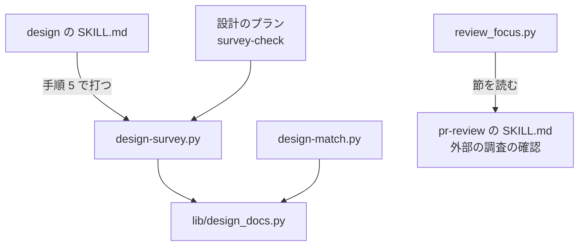

# design: 外部の調査と、自前で作る決定に比べた候補の検査・レビューの観点

## 概要

**`design` は、設計の判断の前に、触る領域の業界の標準・仕様、主要な製品の解き方、使える既存のライブラリと
サービスを一次情報で調べ、設計文書の `## 外部の調査` の節に出典つきで残す。** 決定の記録には、機能をどう得るかを
`作り方:`（自前で作る / ライブラリやサービスを使う / 標準に倣う）で、何と比べたかを `比べた候補:`（外部の調査の表の
行の番号）で書く。作り方に「自前で作る」を含む決定に比べた候補が無いと、`plugins/ndf/scripts/design-survey.py` が
設計承認ゲートの前に止める。設計 PR と実装 PR のレビュー（`pr-review` と `cross-review` の担当）も、同じ観点で
比べた候補の欠け・出典の欠けと古さ・設計の作り方との食い違いを指摘する。プロジェクトの MVV に調査の項目が
無くても同じに働く。

この文書は、その形に**なぜしたか**（背景・決定と理由・常に成り立つ条件・テスト観点・既知の限界）を残す。
**手順・節の形・上限の値・観点の文の正は Skill とスクリプトにある。**

| 何を読むか | 正本 |
| --- | --- |
| 外部の調査の手順（3 種類の対象の決め方・省ける条件・上限・取得できないときの書き方） | [`design` の `references/external-survey.md`](../../plugins/ndf/skills/design/references/external-survey.md) |
| 手順の位置（手順 2）と検査を打つ時期（手順 5） | [`design` の SKILL.md](../../plugins/ndf/skills/design/SKILL.md) |
| `作り方:` と `比べた候補:` の書き方 | [`design` の `references/decisions.md`](../../plugins/ndf/skills/design/references/decisions.md) |
| 節の置き場所と要否 | [`design-template.md`](../../plugins/ndf/skills/design/references/design-template.md)・[`deliverables.md`](../../plugins/ndf/skills/design/references/deliverables.md) |
| 検査の引数・判定の規則・終了コード | [`design-survey.py`](../../plugins/ndf/scripts/design-survey.py) の冒頭の説明と、エントリポイントの契約（`plugins/ndf/contracts/entrypoints/plugins__ndf__scripts__design-survey.py.json`） |
| レビューの観点の文 | [`pr-review` の SKILL.md](../../plugins/ndf/skills/pr-review/SKILL.md) の `### 外部の調査の確認` |

決定の番号は #2519 の設計の番号である。コードのコメントの「#2519 の決定 7」などは同じ設計の決定を指す。

## 用語

「外部の調査」「自前で作る決定」「確かめられなかったこと」「作り方」「比べた候補」の定義は
用語集（[docs/glossary.md](../glossary.md)）が正である。

## 背景

`design` には、設計の前に外部を調べる手順が無く、設計は手元のコードと要求の文だけから組み立てられていた。
そのため、比べないまま「自前で作る」「乗り換え元の古い形に寄せる」と決まり、利用者が後から気づいて設計を
やり直した。代表は volareinc/carul の 2 件である。

| 実物 | 何が起きたか |
| --- | --- |
| carul #102（権限のモデル） | 最初の設計は「管理者の役職なら全店舗」という固定の規則で、IAM の形や Cedar・Amazon Verified Permissions と比べていなかった。2 回目の設計は、ライブラリの候補 6 つと競合 6 製品を出典つきで比べた |
| carul #117（自前で作る判断） | UI の部品・データの読み込み・オフラインの同期・認可などを、shadcn/ui・TanStack Query・PowerSync などと比べないまま自前で作ると決め、確定仕様にした |

carul はプロジェクトの MVV に調査の項目を足して補ったが、MVV を持たないプロジェクトでは同じことが起きる。
そのため手順を `design` の側に持たせた。

## 構成要素と責務

| 要素 | 責務 |
| --- | --- |
| `design` の SKILL.md の手順 2 | 外部の調査を通すか省くかを決め、調べた結果を設計文書に残す |
| `design` の `references/external-survey.md` | 外部の調査の手順と上限の値の正本 |
| `design-survey.py check` | 設計文書を読むだけで、自前で作る決定の比べた候補を検査する |
| `plugins/ndf/scripts/lib/design_docs.py` | 設計文書の名前の規則と、課題の番号から HEAD の文書を読む処理。番号でつながる文書を選ぶ処理（`connected_docs`）は、設計の結果のステージも使う。`design-survey.py` と `design-match.py` が共有する |
| `supervise_lib/procedures.py` の `survey_steps` | スプリントの設計のプランに `survey-check` / `fix-survey` / `survey-recheck` を置く |
| `pr-review` の SKILL.md の `### 外部の調査の確認` | レビューの観点の正本。`pr-review` の委譲のプロンプトは `## 観点` を丸ごと写すため、ここに置けば届く |
| `cross-review` の `review_lib/review_focus.py` | 上の節を読み、分類 `design` か `code` を持つ PR の自動レビュー観点の後ろに足す |

## 仕様

### 常に成り立つ条件

| 条件 | 破れたときの扱い |
| --- | --- |
| 設計文書の外部の調査の節は 1 つで、`省く: <理由>` の 1 行か、3 種類（標準・仕様 / 主要な製品 / ライブラリとサービス）の調べるかの表のどちらかを持つ。「調べない」とした種類は理由を持つ | 設計 PR のレビューで指摘する |
| 調べた結果の行は出典（URL・パス・コマンドのどれかと取得日）を持つ。出典を持てない対象は「確かめられなかったこと」へ移り、推定で埋めない | 設計 PR のレビューで指摘する |
| 種類ごとの候補と取得の試みは上限以下で、上限で止めた対象は「確かめられなかったこと」へ理由「上限」で載る | 設計 PR のレビューで指摘する |
| 作り方に「自前で作る」を含む決定は、比べた候補を 1 つ以上持つ。決定の属するまとまりのどれかの文書が外部の調査を `省く:` で省いたときは除く | `design-survey.py` が終了コード 1（`no_candidates`）で止める |
| 比べた候補の番号は、決定の属するまとまりの外部の調査の表の 1 列目（`STD<数>` / `PRD<数>` / `LIB<数>`）のどれかである | 同上（`unknown_candidate`） |
| 作り方の値は 3 語のどれか、またはその組み合わせ（`・` か `/` で分ける）である | 同上（`unknown_method`） |
| レビューの観点の正本は 1 か所で、`pr-review` と `cross-review` の担当は同じ文を受け取る | `review_focus.py` が節を読めなければ `init` を止める |
| 観点は分類 `design` か `code` を持つ PR に載り、ドキュメントだけの PR には載らない。設計 PR ではモデルレビューに載らず、詳細レビューにだけ載る | `review_focus.py` の単体テストが落ちる |

**まとまり**は、ファイル名の番号の並びで課題の番号を 1 つでも共有する文書をつなぎ、つながりをたどって閉じた
集まりである。`issue-7-design.md`・`issue-7-8-design.md`・`issue-8-design.md` は 1 つのまとまりになり、
`--issue 7`・`--issue 8`・`--issue 7 8` のどれでも同じ 3 ファイルを読んで同じ判定を返す。名前に番号を持たない
文書（`--file` で渡す受け入れ条件のファイルなど）は 1 ファイルで 1 つのまとまりになる。

### 決定と理由

| 決定 | 理由 |
| --- | --- |
| 外部の調査は `design` の手順 2 に独立して置き、以後の手順を繰り下げた（決定 1） | 調べた結果は設計文書の中身と決定の材料になるため、判断より先に要る。手順 1 は読む参照を決める手順で、一次情報の取得とは性質が違う。手順の番号を参照するのは SKILL.md の中だけで、繰り下げの費用が小さい |
| 上限は種類ごとの候補 6 件と取得の試み 30 回で、`external-survey.md` の 1 か所に置く（決定 2） | 候補の数は carul #102 の 2 回目の設計が比べ切った量に合わせた。試みは 3 種類 × 6 件に余りを足した量で、設計のステップの時間の上限に収まる。時間を上限にしないのは、経過の秒を測る手段がランタイムごとに違うためである。節の最後の「調べた量」の 1 行から、上限が足りたかを実測できる |
| 外部の調査の節は、通しても省いても必ず作る（決定 3） | 節を見るだけで、通したか省いたかをレビューと検査が判定できる。省く判断は成果物を書かない理由ではなく手順の判断なので、仕様の「対象範囲（含まない）」には置かない |
| 決定の中に `作り方:` と `比べた候補:` の 2 行を置き、候補を表の番号で指す（決定 4） | 本文の語から機械で推定すると語の揺れで漏れと誤検知が両方出る。2 つの欄を分ける形は決定の記録の事実上の標準（MADR 4.0.0 の Considered Options と Decision Outcome）に倣う。番号の頭を種類ごとに分けるのは、不変条件（`I1`）・イベント（`E1`）の番号と取り違えないためである。作り方の行は機能をどう得るかを選んだ決定にだけ書く |
| 比べた候補の欠けは、機械の検査と設計 PR のレビューの両方で見る（決定 5） | 検査は行を書いた決定を確実に見るが、行を書かなければ通る。レビューだけだと、ラウンドの上限で指摘が残ったまま設計承認ゲートへ渡りうる |
| 検査は新しいエントリポイント `design-survey.py` にし、設計文書の探し方だけを `design-match.py` と `lib/design_docs.py` で共有する（決定 6） | `design-match.py` は完了判定の検査で、打つ時期と読み手が違う。Markdown は markdown-it-py を包む `lib/md.py` で読み、自前で書かない |
| 検査はスプリントの設計のプランと `design` の手順 5 から打ち、継続的統合には置かない（決定 7） | プランのステップと Skill の手順は NDF を使うすべてのリポジトリで同じに通るが、継続的統合はこのリポジトリにしか効かない。プランではレビューの直しで決定が変わった後に確かめるため `requirements-recheck` の後に置き、直しは 1 回だけ試みて、残れば止める |
| 出典の項目だけを棚卸しのシーズの調査と揃え、記録の置き場と形式は揃えない（決定 8） | 設計文書は人が読む Markdown で、シーズの調査は機械が積む JSON であり、読み手が違う。同じ対象のシーズの調査の記録（`.ndf/backlog/research/`）があれば、そのパスと調べた日時を出典として引いてよい |
| `legacy-refactor` の設計文書を 4 節（現状の構造・変更後の構造・外部の調査・決定の記録）にした（決定 9） | 自前の実装をライブラリへ置き換えるリファクタリングは、外部の調査が最も効く変更の 1 つである。振る舞いを変えないリファクタリングの多くは 1 行で省ける |
| 観点の正本を `pr-review` の SKILL.md の節に置き、`cross-review` はその節を読む（決定 10） | Claude 自身のレビューは SKILL.md を読んで進み、委譲のプロンプトは `## 観点` の節だけを写す。`cross-review` の定数に文を写すと 2 か所を揃える手間と食い違いが生まれる。2 つの Skill は両方のランタイムの manifests に載っており、`cross-review` を配る先には必ず節がある |
| 観点は既定の分類（プロファイルの前）が `design` か `code` の PR に載せ、プロファイルの `replace_auto_categories` でも外さない（決定 11） | 外部の調査の確認は、プロジェクトの MVV やレビューの宣言に依らず働く。設計 PR のモデルレビューはドメインモデルの外の指摘を書かせないため、観点を足さない。`.md` だけを変える Skill の実装 PR は `docs_only` になり観点が載らないが、手順の文の変更でライブラリを足すことはないため受け入れる |
| 出典を古いと見る基準は、取得日が設計 PR を出した日より 90 日以上前か、取得日の後に新しい版か終了のアナウンスが出ていることにする（決定 12） | 90 日は OpenSSF Scorecard の Maintained が保守の活動を見る期間で、ライブラリの保守の判定と同じ物差しになる。取得日は決定の記録の見直しの日の目印として使う（Zimmermann の ADR のレビューの観点） |
| レビューの担当の取得の試みは 1 ラウンドに 10 回までで、`design` の上限とは別の値にする（決定 13） | 担当がするのは自前で作る決定・新しい依存・古い出典の行に絞った確認で、調査のやり直しではない。`cross-review` は 2 担当を並べるため、1 ラウンド 20 回で設計の上限を下回る。取得の回数は担当のランタイムごとに記録が違い、機械では数えない |
| 実装 PR の担当は、PR の題・本文・ブランチ名の課題の番号から worktree の設計文書を探す（決定 14） | `cross-review` の状態ファイルは課題の番号を持たない。NDF の外のリポジトリの worktree には NDF のスクリプトが無いため、担当に `design-survey.py` を打たせない。見つからないときは設計を通さないモードがあるため指摘にせず、総評に書く |

### 検査のステップ（スプリントの設計のプラン）

| ステップ | 種類 | 中身 | 失敗したとき |
| --- | --- | --- | --- |
| `survey-check` | run | `design-survey.py check --issue <番号>`。詳細設計を通るモード（`standard`・`legacy-refactor`）では `--require-detail` を付け、詳細設計の文書の欠けと形も確かめる | `fix-survey` へ |
| `fix-survey` | work（修正） | 指摘の行の作り方・比べた候補を直すか、表へ出典つきの候補の行を足してコミットする（push しない）。比べずに直せない指摘は「判断が要る」と報告する | — |
| `survey-recheck` | run | `survey-check` と同じ | `on_fail` を持たず、プランが止まる |

3 ステップは `requirements-recheck` の次、`glossary-check` の前に置く。push は後の `push-glossary` が行う。
`design` の手順 5 は `--file` でコミット前の文書を読み、`--issue` は HEAD だけを読むためプランで使う。

## 互換性

作り方の行を持たない既存の設計文書は、検査で終了コード 0 になる。実装 PR のレビューでも、設計に作り方の行が
1 つも無い課題では、行が無いこと自体を指摘にしない。

## テスト観点

- 作り方が「自前で作る」で比べた候補の行が無い決定に、`check` が 1 と `no_candidates` を返すこと
- `省く:` の行を持つまとまりの自前で作る決定に 0 を返すこと。`省く:` と決定が分けたファイルや、番号を 2 つ含む文書を介してつながる文書にあっても、`--issue` に渡す番号に依らず 0 を返し、同じ決定の指摘を重ねないこと
- 表に無い番号に `unknown_candidate` を返し、同じまとまりの別のファイルの表にある番号では返さないこと。ほかのまとまりの表では解決しないこと
- 3 語に無い作り方の値に `unknown_method` を返し、「自前で作る・標準に倣う」を自前で作る決定として扱うこと
- コードブロックの中の `作り方: 自前で作る` に当たらないこと
- このリポジトリの `issues/` の既存の設計文書と受け入れ条件のファイルに、`check --file` が 0 を返すこと
- `.ndf/` を持たないリポジトリでも同じ結果を返すこと（MVV の宣言を読まない）
- `--issue` に文書の無い番号を渡すと 3 を返すこと
- `lib/design_docs.py` への移動の後も、`design-match.py` の既存のテストが変えずに通ること
- 設計のプランの期待値（`plugins/ndf/scripts/tests/fixtures/supervise-contract/plans/sprint/1-design-16.json`）で、3 ステップが `requirements-recheck` と `glossary-check` の間にあり、`survey-recheck` が `on_fail` を持たないこと
- 設計文書だけの PR と `.py` を含む PR の自動レビュー観点に、`pr-review` の SKILL.md の節を読んだ文が含まれること。`replace_auto_categories` のプロファイルでも、設計 PR の詳細レビューでも含まれること
- `docs/` の `.md` だけの PR と、設計 PR のモデルレビューの観点に含まれないこと
- 節を持たない SKILL.md を読ませると、観点を組む処理が 1 で終わること

テストは `plugins/ndf/scripts/tests/test_design_survey.py` と
`plugins/ndf/skills/cross-review/tests/test_review_focus_external_survey.py` にある。手順と観点の文は文言のテストを
持たない。

## 既知の限界

| 項目 | 内容 |
| --- | --- |
| 上限の値 | 候補 6 件・取得の試み 30 回・担当の 10 回は、carul の 1 例と設計上の計算から決めた。NDF の外のプロジェクトで設計文書の「調べた量」の行と、担当の総評で上限に当たった件数を数えて見直す |
| 作り方の行の書き漏れ | 行を書かずに自前で作る決定は検査に掛からず、レビューだけが拾う |
| 取得の手段 | 手順は Web 検索・URL の取得・`gh` のどれかを使うとだけ書く。Codex で `design` を通したときと、`cross-review` の codex の担当が Web 検索を使えるかは未確認。担当の起動の引数は変えていない |
| 実装 PR の設計文書の探索 | 題・本文・ブランチ名に課題の番号を持たない PR では設計文書が見つからない。その割合は数えていない |

## 関連リンク

- [quality-gates-design-match.md](quality-gates-design-match.md): 完了判定で設計と実装を突き合わせる検査（`lib/design_docs.py` を共有する）
- [ndf-design-phase.md](ndf-design-phase.md): 設計工程を置いた経緯と決定
- [cross-review-review-profile.md](cross-review-review-profile.md): `cross-review` のレビューのプロファイルと自動レビュー観点
- 外部の一次情報: MADR 4.0.0（ https://adr.github.io/madr/ ）、OpenSSF Scorecard の checks（ https://github.com/ossf/scorecard/blob/main/docs/checks.md ）、Zimmermann「How to review Architectural Decision Records」（ https://ozimmer.ch/practices/2023/04/05/ADRReview.html ）
