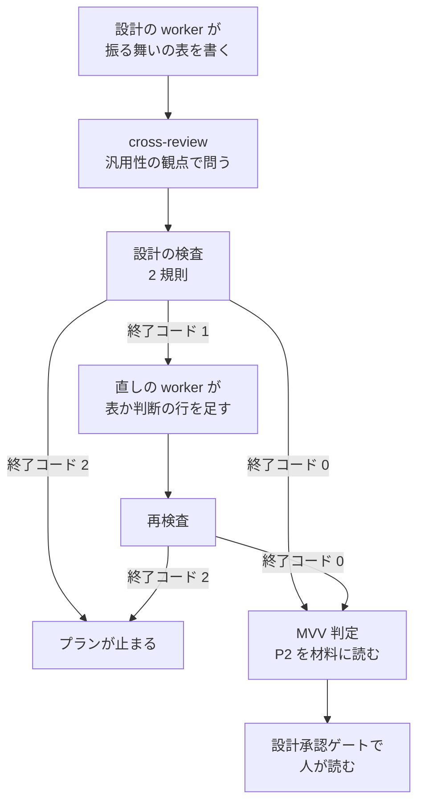

# 設計の汎用性の守り: 代表のリポジトリの種類を扱えなくする設計を、設計承認の前に人へ届ける

## 概要

NDF を使う利用者のリポジトリは、言語・テストのツール・ブランチの運用・リリースの方法がそれぞれ違う。
NDF を変える設計が、そのうちのある種類のリポジトリを NDF で扱えなくすること（汎用性の後退）を、
設計承認ゲートの前に設計者・機械の検査・レビュー・MVV 判定が見つけ、承認する人へ届ける。

汎用性の後退を含む設計は、次の順で人に届く。

1. 設計を書く時点で、頭の設計文書の「適用範囲」にある代表のリポジトリでの振る舞いの表の、「この種類で扱えなくなること」の列に現れる
2. 設計の検査（`design-survey.py check`）が、その行を「人へ残す判断」の表へ結ぶまで通さない
3. 設計承認ゲートで、人がその行を読む

**止めないもの。** 普及のフェーズに入るまで、NDF は後方互換を求めない。設定のキーの改名・値の作り直し・
旧い形のサポートの打ち切り・既定の変更は、同じ種類のリポジトリが別の形で扱えるなら汎用性の後退に当たらず、人へ戻さない。

**書き方の正本は Skill の側にある。** この文書は、そこに書かない決定の理由・契約・常に成り立つ条件・テスト観点を持つ。

| 中身 | 正本 |
| --- | --- |
| 振る舞いの表と「このリポジトリだけの事情」の欄の書き方 | [design-template.md](../../plugins/ndf/skills/design/references/design-template.md) の「適用範囲」 |
| 要求の「方針の分け方」の節 | [spec-template.md](../../plugins/ndf/skills/requirements-design/references/spec-template.md) |
| 設計の検査の引数・規則・終了コード | [`design-survey.py`](https://github.com/devbasex/ai-plugins/blob/30f9608fda36c712afac43fc3893ac6c038a0145/plugins/ndf/scripts/design-survey.py) の冒頭の説明 |
| 代表のリポジトリの設定の形 | [design.schema.json](https://github.com/devbasex/ai-plugins/blob/30f9608fda36c712afac43fc3893ac6c038a0145/plugins/ndf/skills/design/schemas/design.schema.json) |
| cross-review の `design` の観点 | [08-review-categories.md](../../plugins/ndf/skills/cross-review/docs/08-review-categories.md) |
| 人へ残す判断の表と規則 `unnamed_redline` | [ndf-design-ai-decisions-and-mvv-gate.md](ndf-design-ai-decisions-and-mvv-gate.md) |
| 設計の検査のステップの並び | [ndf-design-external-survey.md](ndf-design-external-survey.md) |

## 用語

語の定義は用語集 [docs/glossary.md](../glossary.md) が持つ。この文書が使う語は、汎用性の後退・サポートする選択肢・
代表のリポジトリの種類・代表のリポジトリ・代表のリポジトリの設定・このリポジトリだけの事情・ai-plugins だけの事情・
製品の約束・設計の検査である。

この文書の中だけで使う語は次のとおり。

| 語 | この文書での意味 |
| --- | --- |
| 頭の設計文書 | `issues/issue-<番号>-design.md`（文書の種類の契約で種類が `design` のもの）。決定の記録と詳細設計の文書は含まない |
| 2 規則 | 設計の検査の規則 `repo_scope_missing`（振る舞いの表と事情の欄が無い）と `repo_loss_unrouted`（扱えなくなることが人へ残す判断へ届かない） |

## 背景

ai-plugins（NDF 自身を開発するリポジトリ）の運用の事情が、汎用の振る舞いとして NDF に入り込む事例が続いた。
代表例の #3596 の設計は、リリース方式の表から develop を経て本番へ出す運用の行を外す決定を含んでいた。
この決定は、develop を使う Web サービスのリポジトリを代わりの形なしに扱えなくする。それでも設計の検査は終了コード 0、
助言の MVV 判定は「従う」で通った。影響は「未確認のまま残ること」の 1 行に回り、人へ残す判断の表に載らなかった。
起点は、利用者の「ai-plugins は GitHub flow にする」という運用の方針を、NDF の製品の仕様として書いたことである。

この仕組みは次の判断で作られている。

- **判断の基準は ai-plugins の MVV の Value 4 に置き、共通原則には置かない。** 共通原則は NDF を使うすべてのリポジトリの MVV 判定に入る。製品の約束をそこへ移すと、NDF を作らないリポジトリの判定の基準まで変わる
- **レッドラインは各リポジトリのプロジェクト MVV に置く。** どの種類を扱えることを保つかは作るものごとに違い、共通原則の 1 行では名指せない。ai-plugins は P1（取得元・版の規則）の隣に P2 を置く
- **守る単位は値ではなくリポジトリの種類である。** 値の単位で守ると、普及のフェーズまで求めない後方互換の崩れが毎回人へ戻り、汎用性の後退が埋もれる。SemVer と Kubernetes の非推奨ポリシーの後方互換の規則は、普及のフェーズまで当てない
- **振る舞いの表は、作るものを使う側のリポジトリがあるときだけ求める。** 全リポジトリの設計に求めると、書くことの無い欄が増える。表を求めること自体を設定で有効にする
- **決まった検査が見るのは、表があることと、`無し` 以外の行が人へ残す判断に結ばれていることだけである。** 代わりの形があるかは言語モデルでなければ判定できないため、その中身は cross-review と MVV 判定が見る

前例として、使う側の多数のリポジトリで後退を確かめる Rust の crater、作り手自身の利用がまれな経路を見落とす問題を論じた
Intercom の dogfooding の記事、プロジェクトの種類ごとに道を用意する Spotify の Golden Paths を参照した。

## 対象範囲

| 仕組み | 働く範囲 |
| --- | --- |
| 設計の検査の 2 規則 | 代表のリポジトリの設定（`.ndf/design.json` の `representative_repos`）を置いたリポジトリの、頭の設計文書のうち、設計の結果の「触るファイル」のどれかが設定の `paths` に当たるもの。触るファイルを読めない設計（`legacy-refactor` の書式の設計と、設計の結果の表を読めない設計）には `paths` に依らず当てる。`paths` を省いた設定ではすべての頭の設計文書に当てる |
| 設計文書のテンプレートの欄 | 設定を置いたリポジトリで書く該当時の欄 |
| cross-review の汎用性の観点 | 設定に依らず、設計 Pull Request の cross-review を通るすべてのリポジトリ・モード |
| 要求と起票の方針の分け方 | 設定に依らず、要求を書くすべてのリポジトリ・モード |
| MVV 判定の P2 | ai-plugins の MVV（版 8）を読む判定 |

2 規則を当てるモードは、頭の設計文書を書く `standard` と `legacy-refactor` である。`light` と `operation` は頭の設計文書を書かないため当たらず、
それらの設計は汎用性の観点と MVV 判定が見る。

**境界。** 代表のリポジトリの種類に要るサポートする選択肢を、代わりの形なしに無くす実装の差分を落とす CI の検査は #3617 が持つ。
この仕組みは設計文書の側の欄と語の定義を持ち、同じ事実を 2 か所で判定しない。代表のリポジトリでの試走の実行は #3411 が持つ。

## 仕様

### 集約

| 集約 | 持ち主（書き換えてよいもの） | 根 | エンティティ | 値オブジェクト |
| --- | --- | --- | --- | --- |
| 代表のリポジトリの設定 | 利用者（ai-plugins では実装の Pull Request でコミットし、リリース承認ゲートで人が見る。C7） | `.ndf/design.json` | — | 種類の名前・名指すレッドラインの番号 |
| 設計文書 | 設計の worker と直しの worker | 頭の設計文書 | 代表のリポジトリでの振る舞いの行・人へ残す判断の行 | この種類で扱えなくなること（`無し` か中身） |
| プロジェクト MVV | 利用者（`project-mvv.py approve` で改訂する） | MVV の版 | Value・レッドラインの行 | 版の sha256 |
| cross-review の観点 | `cross-review` の Skill | `review_focus.py` の `CATEGORY_TEMPLATES` | `design` の観点の文 | 汎用性の 1 行 |
| 起票の項目 | `backlog-refinement` の Skill の起票の項目 | `issue-items.json` | 項目 `policy_split` | 項目の要否（`need`） |

上流は開発のワークフローで、設計文書の節の形・要求の方針の分け方の節・設定のスキーマを公開された言語として固める。
MVV 判定・cross-review・課題の棚卸しは下流で、それぞれその形式だけを読む。

### 設計文書の「適用範囲」の形

設定があり 2 規則が当たる頭の設計文書は、`## 適用範囲` の中に次の 2 つの `###` の節を持つ。

- `### 代表のリポジトリでの振る舞い`: 次の列を持つ表
- `### <名前>だけの事情`（「このリポジトリだけの事情」「ai-plugins だけの事情」など）: そのリポジトリの運用で決め、作るものの既定や振る舞いへ入れずに `.ndf/` へ置く値。無ければ `- 無し（<理由>）` と書く

| 列 | 書くこと |
| --- | --- |
| 代表のリポジトリ | 設定の種類の名前で始める（括弧で実物を添えてよい） |
| 設定の要点 | そのリポジトリの言語・テスト・ブランチの運用・リリースの設定 |
| 直した後に起きること | 設計・設計の検査・cross-review・MVV 判定で何が起きるか |
| この種類で扱えなくなること | `無し` か、この種類で扱えなくなる運用・リリースの形・テストのツール・CI と、代わりの形が無い理由。値を改名・作り直しても同じ種類が別の形で扱えるなら `無し` |

`無し` 以外の行があれば、「人へ残す判断」の表に設定の `redline` の番号を持つ行を置く。

### 2 規則の判定

セルの字面は両端の空白と `` ` ``・`*`・`_` を外してから比べる。種類の名前との比べ方は前方一致で、
`Web サービス・設定なし（…）` は種類 `Web サービス` の行として数える。

| 条件 | 指摘 |
| --- | --- |
| `## 適用範囲` の節が無い | `repo_scope_missing` 1 件（ほかは見ない） |
| 節の中に `### 代表のリポジトリでの振る舞い` が無い | `repo_scope_missing` 1 件 |
| 小見出しの中に、`代表のリポジトリ` と `この種類で扱えなくなること` の列を持つ表が無い | `repo_scope_missing` 1 件 |
| 設定の種類のどれかで始まる 1 列目のセルが無い | 種類ごとに `repo_scope_missing` |
| 「この種類で扱えなくなること」が空の行がある | 行ごとに `repo_scope_missing` |
| `直した後に起きること` の列が無い | `repo_scope_missing` 1 件 |
| `直した後に起きること` が空の行がある | 行ごとに `repo_scope_missing` |
| 題が `だけの事情` で終わる `###` の節が無いか、コードブロックとデータ行の無い表を除いて本文が空 | `repo_scope_missing` 1 件 |
| 「この種類で扱えなくなること」が `無し` で始まらない行があり、人へ残す判断の表の番号に設定の `redline` が無い（`P2` と `P20` は別の番号） | その行ごとに `repo_loss_unrouted` |

振る舞いの表が見つからないときは `repo_loss_unrouted` を判定しない。指摘は `name`（`<パス>:<行>`）・`rule`・`text` を持ち、文書の行の順に並ぶ。

### 常に成り立つ条件

| # | 条件 | 破れたときの扱い |
| --- | --- | --- |
| I1 | 2 規則が当たる頭の設計文書は、振る舞いの表を持ち、設定の種類ごとに行があり、どの行も「直した後に起きること」と「この種類で扱えなくなること」が空でない | 設計の検査が終了コード 1 で `repo_scope_missing` を出す |
| I2 | 同じ前提で、`無し` で始まらない行があれば、人へ残す判断に設定が名指す番号の行がある | 設計の検査が終了コード 1 で `repo_loss_unrouted` を出す |
| I3 | 設定が無いか、設計の触るファイルが `paths` に当たらなければ、設計の検査の終了コードと指摘は設定を置く前と同じである | 既存の設計の検査のテストが落ちる |
| I4 | 設定がスキーマに合わなければ（種類が空の配列を含む）、設計の検査は推して進めずに止まる。種類を求めないリポジトリは設定を置かない | 設計の検査が終了コード 2 で止まる |
| I5 | 承認されていない改訂の文は `.ndf/mvv.md` に入らない | `project-mvv.py check` が承認と一致しないと返し、MVV 判定が承認ゲートを省かない |
| I6 | 承認ゲートは設計承認ゲートとリリース承認ゲートの 2 つのまま。この仕組みは承認の工程を足さない | 工程の定義の既存のテストが落ちる |
| I7 | 2 規則が当たる頭の設計文書は、「このリポジトリだけの事情」の欄を持つ | 設計の検査が終了コード 1 で `repo_scope_missing` を出す |

### 処理の流れ



設定が無いリポジトリと、触るファイルが `paths` に当たらない設計では、2 規則は空の指摘を返し、流れは設定を置く前と同じになる。

**捕まえる範囲の限り。** 扱えなくなることを `無し` と書いた表は設計の検査を通る。設計者が書いた表なら cross-review の汎用性の観点と
MVV 判定が捕まえる。設計の検査は cross-review の後に走るため（レビューの直しで変わった後の設計文書を確かめるため）、
直しの worker が検査の指摘を受けて足した表は cross-review を通らず、捕まえるのは MVV 判定と承認ゲートで表を読む人になる。
直しの worker への指示（`procedures.py` の `survey_steps` の `fix-survey`）は、扱えなくなることを `無し` へ書き換えて指摘を消すことを禁じ、
`無し` と書いてよいのは同じ種類が改名後の設定か別の選択肢で同じ運用を続けられるときだけとする。
MVV 判定が走らなかった設計承認では、`pace: auto`・`fast` も判定の記録がそろわないため承認ゲートを人の承認へ戻す。
そのため判定の記録を承認ゲートの前に確かめるステップは置かない。

**終了コード 2 は直しの worker へ回さない。** 設計のプランの `survey-check` と `survey-recheck` は `on_exit: {"2": "stop"}` を持ち、`on_fail` より先に照合される。
直しの worker が利用者の設定（`.ndf/design.json`）を書き換えないため（C7）である。利用者が設定を直してプランを再開すれば、検査から打ち直す。

**設定を後から置いても、進行中の設計のプランは止まらない。** 設定のマージの後に打ち直した検査は、表が無ければ終了コード 1 になり、
既存の直しのラウンドで直しの worker が表を足す。進行中の設計を検査から外す扱いは持たない。外すと、サポートする選択肢を変える並行の設計が
検査を通らずに設計承認へ届くためである。マージ済みの設計文書は検査し直さない。

### cross-review の汎用性の観点

`review_focus.py` の `DESIGN_REVIEW_TEMPLATE` が、`design` の分類の観点に次の 1 行を持つ。設定に依らず働き、分類・ラウンド・起動する CLI の数は変えない。

> 汎用性: この設計の後に、代表のリポジトリの種類（作るものを使う側のリポジトリの種類）のうち、扱えなくなるもの（代わりの形の無い運用・リリースの形・ツール）があるか。あれば設計文書の人へ残す判断に載っているか。代表のリポジトリの設定があるときは、種類ごとに確かめる。設定のキーと値の改名・作り直し・既定の変更は、同じ種類が別の形で扱えるなら指摘しない。

改名・作り直しを指摘しない一文は、レビュー担当が値の減少を一律に指摘してラウンドを増やすことを防ぐ。
観点の対象は NDF の設定に限らず、その設計の作るものを使う側のリポジトリの種類である（OpenAPI の利用者・アプリのリリースの形など）。

### 要求と起票の方針の分け方

依頼に運用の方針（ブランチの運用・リリースの形など）が含まれるとき、要求の書き手と起票者は方針を「このリポジトリの運用の決まり（設定の値）」と
「作るものの振る舞い」の 2 列の表に分けて書く。列名を「NDF の振る舞い」にしないのは、利用者のリポジトリでも同じ形で使えるためである。

起票の項目は `issue-items.json` の `policy_split`（名前「方針の分け方」）で、`need` は「運用」「機能」が `該当時`、「不具合」「調査」が `不要` である。

### ai-plugins の MVV（版 8）

ai-plugins の `.ndf/mvv.md` は次の 2 か所を持つ。共通原則は変えない。

- Value 4「どのプロジェクトでもそのまま使える」に、代表のリポジトリの種類（Web サービス・モバイルアプリ・業務文書だけ）のどれも扱えることを保ち、
  ある種類を代わりの形なしに扱えなくする設計だけを人の承認に回す（P2）1 行と、普及のフェーズまで後方互換を求めない 1 行を持つ。
  2 行目は、1 行目を「値を減らさない」と読み広げて改名や作り直しを人へ戻す解釈を防ぐ
- 「このプロジェクトが足す操作」の表に P2「代表のリポジトリの種類のどれかを、NDF で扱えなくする」を持つ。既定の変更と、代わりの形のある値の削除・改名は当たらない

`mvv-gate.py` のコードは変えず、改訂した MVV を材料として読む。`boundary` が空でない判定は、`verdict` に依らず承認ゲートを省かない。

## データ・設定

### 代表のリポジトリの設定（`.ndf/design.json`）

無ければ 2 規則は働かない。`representative_repos` を持たない設定も同じ扱いである。

```json
{
  "version": 1,
  "representative_repos": {
    "kinds": ["Web サービス", "モバイルアプリ", "業務文書だけ"],
    "paths": ["plugins/ndf/**", "plugins/ndf-next/**", ".claude-plugin/marketplace.json"],
    "redline": "P2"
  }
}
```

| キー | 形 | 意味 |
| --- | --- | --- |
| `version` | `1` | 設定の形の版 |
| `representative_repos.kinds` | 空でない文字列の配列（1 個以上・重複なし） | 振る舞いの表に行を求める種類の名前 |
| `representative_repos.paths` | 省略可。空でない glob の配列（1 個以上） | 2 規則を当てる設計の範囲。git の wildmatch（`lib/pathmatch.py`）で、リポジトリの根から照らし合わせる |
| `representative_repos.redline` | `^[CPR][1-9][0-9]*$` | 扱えなくなる種類があるときに、人へ残す判断の行が名指す番号。中身はそのリポジトリのプロジェクト MVV か共通原則に置く。検査は MVV を読まず番号の形だけを確かめる |

知らない項目はスキーマに合わない。スキーマの正本は `lib/design_repos.py` の型で、公開するスキーマは
`design-survey.py schema --out plugins/ndf/skills/design/schemas/design.schema.json` で作り直す。

ai-plugins では上の例がそのまま値である。`plugins/mcp/`・`plugins/playwright-kit/` だけを触る設計は表を求められない。
ai-plugins の外のリポジトリが設定を置くときは、名指す番号を自分のプロジェクト MVV の「このプロジェクトが足す操作」の表に足す。

### 設計の検査の結果に足すもの

設定があるとき、`items` の `rule` に `repo_scope_missing`・`repo_loss_unrouted` が加わり、`metrics` に同じ名前の件数が加わる。
設定が無いときは `metrics` にこの 2 つの鍵を持たない。終了コードの意味は変わらない（0 = 指摘なし / 1 = 指摘あり / 2 = 読めない）。

`design-survey.py` は起動の最初に、`lib/design_repos.py` の `dep_groups` で要る依存のグループを決め、`deps.require` を 1 回だけ呼ぶ。
設定の無いリポジトリでは `md` だけを求め、設定があれば `schema`・`pathmatch` を足す。

## エラー処理

| 失敗 | 利用者に見える出力と終了コード |
| --- | --- |
| `.ndf/design.json` を読めない（権限・UTF-8 でない） | `status: stopped` と「`.ndf/design.json` を読めない: <理由>」で終了コード 2 |
| JSON として読めない | 「`.ndf/design.json` を JSON として読めない: <行>:<列>」で終了コード 2 |
| 形が合わない（知らない項目・`version` が 1 でない・`kinds` か `paths` が空の配列・`redline` の形が違う） | 「`.ndf/design.json` の形が合わない: <項目>: <理由>」で終了コード 2 |
| 種類が重なる | 「`.ndf/design.json` の種類が重なる: <名前>」で終了コード 2 |
| 文書の種類の契約を読めない | 契約の誤りの 1 行で終了コード 2 |
| `schema --out` に書けない | 終了コード 2 |
| 依存が入らず uv も使えない | `deps` の既存の案内と終了コード |

どの失敗でも、設計の検査は何も書かない。原因を直せば再実行できる。設計のプランでは終了コード 2 でプランが止まり、検査の `summary` が止まった理由として残る。
節や表が無いことは例外ではなく指摘として返す。

## 運用

- **ndf-next への引き継ぎ。** Skill の本文（設計と要求のテンプレート・分類の説明）は ndf-next のコピーにも同じ内容を持つ。
  スクリプトの分は直しの棚卸し（`plugins/ndf-next/src/ndf/parity/fixes.json`）の 3 行が移す子へ渡す。
  `fix:3618-survey`（設計の検査・設定のスキーマ・直しのステップ）は M7、`fix:3618-focus`（汎用性の観点）は M5、`fix:3618-items`（起票の項目）は M6 へ行く
- **作り直しの子の表。** `plugins/ndf-next/src/ndf/checks/children.json` は子 G1（#3618・順番 9・レーン lguard・`needs` は S1a と X3）を持ち、
  11.0 の入れ替え S2 の `needs` に G1 を含む。`ndf check` の規則 `child-deps` が順番と依存を照らす
- **代表のリポジトリでの振る舞いの確かめ先。** NDF を変える ai-plugins の設計は、Web サービス（設定の有る実物・設定の無い実物・develop を経て本番へ出す運用）、
  モバイルアプリ、業務文書だけのリポジトリを行に書く。代表のリポジトリの設定を置かない利用者のリポジトリでは、
  2 規則は働かず、cross-review の観点と方針の分け方だけが加わる

## テスト観点

- 設定に 3 種があり、触るファイルが `paths` に当たる設計文書で、表が無い・種類の行が欠ける・「直した後に起きること」の列が無いか空欄の行がある・
  事情の欄が無いか空のときに終了コード 1 と `repo_scope_missing` を返し、表と欄がそろえば 0 を返すこと（`test_design_repos.py`）
- 扱えなくなることがある行を持ち、人へ残す判断に `P2` が無い（`P1` だけ・`P20` だけ）ときに `repo_loss_unrouted` を返し、`P2` の行があれば
  インラインコードで書いていても返さないこと。すべての行が `無し` の設計文書（改名だけの設計）には返さないこと
- 触るファイルが `paths` に当たらない設計文書は表が無くても 0、触るファイルを読めない設計文書には `paths` に依らず当たること
- 設定が無いリポジトリで、既存の設計の検査のテスト（`test_design_survey.py`）の期待値が変わらないこと（I3）
- 壊れた設定（読めない・JSON の誤り・知らない項目・空の `kinds`・空の `paths`・`redline` が `X1`・種類の重なり）で終了コード 2 と `status: stopped` を返すこと（I4）
- 公開した `design.schema.json` が `design_json_schema()` の出力と一致すること
- 設計のプランの `survey-check`・`survey-recheck` が終了コード 2 を `stop` へ送り、終了コード 1 は `fix-survey` へ送ること（`test_supervise.py` と設計のプランの契約の期待値）
- 起票の項目 `policy_split` が該当時の項目として読めること（`test_issue_items.py`）
- P2 の行を持つ MVV で、MVV 判定の指示に P2 の行の中身が入り、`boundary` に P2 を名指す要素がある判定は `verdict` が `follow` でも承認ゲートを省かないこと（`test_mvv_gate.py`）
- テンプレートの節と観点の文は、文言の照合で縛らない
- 言語モデルの判定（MVV 判定が扱えなくする設計に P2 を挙げること・改名だけの設計に P2 を挙げないこと・汎用性の観点が #3596 の設計の決定に指摘を出すこと）は
  単体テストで縛れない。#3596 のやり直す前の設計文書（コミット `4faa3a04` の `issues/issue-3572-design*.md`）を入力に、リリース後テストで確かめる

## 関連リンク

- [ndf-design-ai-decisions-and-mvv-gate.md](ndf-design-ai-decisions-and-mvv-gate.md): 人へ残す判断とレッドラインの番号の規則
- [ndf-design-external-survey.md](ndf-design-external-survey.md): 設計の検査のステップと外部の調査の規則
- [ndf-issue-items.md](ndf-issue-items.md): 起票の項目
- [docs/glossary.md](../glossary.md): 用語集
- #3618（課題）・#3627（設計 Pull Request）・#3645（実装 Pull Request）
