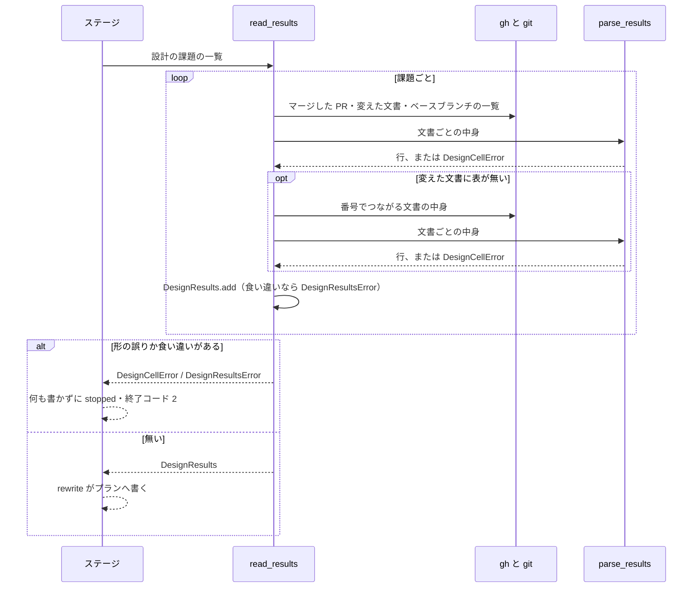

# 設計の結果のステージ: 課題の設計文書をすべて載せ、触るファイルのセルの形の誤りと食い違いを 1 行の要約で止める

スプリントの「設計の結果」のステージ（`supervise.py design-results`）は、マージ済みの設計 PR の設計文書から「設計の結果」の表を読み、
実装のプランと指示文を書き直す。このステージは次の 3 つを持つ。

- 実装のプランの `設計文書` と、指示文の「設計文書:」の行に、課題の設計文書をすべて載せる（分割した文書を含む）
- 「実装する」の行の触るファイルのセルが書式から外れていれば、実装の前に止まる
- 同じ課題に 2 本の設計文書が違う設計の結果を書いていれば止まり、違う項目・両方の値・2 本の設計文書のパスを示す

止まったときは、どの設計文書のどの項目かセルを直すかが、結果の `summary` の 1 行だけで分かる。

例 1: 設計を `issues/issue-7-design.md` と分割した文書 `issues/issue-7-design-loop.md` に分け、先頭の表の触るファイルのセルに
`` `a.py`。残りは [issue-7-design-loop.md](issue-7-design-loop.md) にある `` と書いた。ステージは次の `summary` で止まり、
実装のプランと `design-results.json` を書かない。

```text
設計の結果を書けない: #7（issues/issue-7-design.md）の触るファイルのセルを読めない: 。残りは / issue-7-design-loop.md / にある。パスをバッククォートで囲んで直に列挙し、直した文書をマージしてから打ち直す。人へ戻す
```

先頭の表へパスを直に列挙した文書をマージして打ち直すと通り、プランの `設計文書` には 2 本が載る。

例 2: `#2336` の設計の結果を 2 本の設計文書が書き、扱いは同じ「実装する」で触るファイルだけが違う。

```text
設計の結果を書けない: #2336 の設計の結果が 2 本の設計文書で違う（先: issues/issue-2335-design.md / 後: issues/issue-2336-design.md ）。触るファイル: 2 個 / 4 個（後にだけある: pkg/c.py, pkg/d.py ）。人へ戻す
```

ステージの結果の表・`rewrite` が触る項目・指示文の項目の正本は
[ndf-supervise-impl-prompt-format-and-transient-failures.md](ndf-supervise-impl-prompt-format-and-transient-failures.md) にある。
設計文書の「設計の結果」の書き方は `design` の `references/design-template.md` が正である。
この文書が扱うのは、セルの書式・設計文書の一覧の組み方・止まったときのメッセージの形・決定の理由である。

## コンテキスト

| コンテキスト | 何の語が 1 つの意味に決まるか |
| --- | --- |
| NDF の開発ワークフロー（`ndf-workflow`） | 設計の結果・扱い・取り込み先・触るファイル・食い違い・設計文書・分割した文書・セルの形の誤り |

1 つのコンテキストに収まる。

## 用語

用語の定義は用語集 [docs/glossary.md](../glossary.md) が正である。この文書で使う語は「扱い」「取り込み先」「触るファイル」「食い違い」「分割した文書」「セルの形の誤り」。

## 対象範囲

- NDF のスプリントの「設計の結果」のステージ。利用先のリポジトリでも同じスクリプトが動く
- ベースブランチは引数 `--base` で受ける。設計文書の置き場（`issues/`）と名前の規則（`issue-<番号>-design.md`・分割した文書は `issue-<番号>-design-<名前>.md`）は設定で変えない

## 仕様

### 集約と常に成り立つ条件

| 集約 | 持ち主（書き換えてよいもの） | 根 | エンティティ | 値オブジェクト |
| --- | --- | --- | --- | --- |
| 設計の結果 | `plugins/ndf/scripts/lib/design_results.py`（行を足すのは `DesignResults.add` だけ） | `DesignResults` | 行（`Row`。課題の番号で識別する） | 扱い・取り込み先・触るファイル・設計文書のパス・ベースブランチの設計文書の一覧（`base_docs`）・セルの形の誤り（`CellProblem`） |
| 実装のプラン | 設計の結果のステージ（`supervise_lib/design_stage.py` の `rewrite`） | プランの JSON | 実装のステップ | `触るファイル`・`設計文書`・指示文のテンプレートの部分 |

実装のプランは設計の結果を、課題の番号を通して読むだけで書き換えない。

| # | 条件 | 破れたときの扱い |
| --- | --- | --- |
| I1 | 1 つの課題の行は 1 つだけである。同じ課題の行の扱い・取り込み先・触るファイルのどれかが違えば、行を足さずに `DesignResultsError` で止まる | `stopped`・終了コード 2 |
| I2 | 触るファイルは順序を問わずに比べる。並びだけが違う 2 行は食い違いにしない | — |
| I3 | 食い違いのメッセージは、違う項目をすべて扱い → 取り込み先 → 触るファイルの順で載せ、同じ値の項目は載せない。値とパスは先 / 後の順で並ぶ | テストが落ちる |
| I4 | 行の `files` は、セルの括弧の外のコードスパンの中身だけである | テストが落ちる |
| I5 | 「取り込む」「閉じる」の行の触るファイルのセルは読まない | — |
| I6 | 表を読んだ文書のどれかにセルの形の誤りがあるとき、または食い違いがあるとき、実装のプランと `design-results.json` のどちらも書かない | `stopped`・終了コード 2 |
| I7 | 表の行を持つ課題の `設計文書` は、行を読んだ文書と、それと番号でつながるベースブランチの設計文書のすべてである。表を持つ文書が先頭で、残りはパスの昇順である | テストが落ちる |
| I8 | 課題が「読めなかった」（`unread`）になるのは、PR が変えた文書にも、番号でつながるベースブランチの設計文書にも、読める表が無いときだけである | テストが落ちる |

### 触るファイルのセルの書式

「実装する」の行のセルを、Markdown のパーサー（`lib/md.py` の `md_tokens`）の `inline` トークンの子を順に見て読む。

| 子のトークン | 括弧の外 | 括弧の中 |
| --- | --- | --- |
| コードスパン（`code_inline`） | 中身をパスとして `files` へ入れる | 読まない |
| 文字列（`text`）の全角・半角の丸括弧 | 開きで括弧の中へ入る | 入れ子を数え、閉じで戻る |
| 文字列の読点 `、`・`,`・空白・改行 | 区切りとして読み飛ばす | 読み飛ばす |
| 文字列のそれ以外 | 読めなかった部分 | 注記として読み飛ばす |
| リンク（`link_open`） | 読めなかった部分（リンク先を出す） | 読めなかった部分 |
| その他（`html_inline` など） | 読めなかった部分 | 読み飛ばす |

閉じていない括弧と、開きの無い閉じ括弧も読めなかった部分である。セル全体が空か `—` か `-` のときは `files` を空とし、誤りにしない。

| セル | `files` | 読めなかった部分 |
| --- | --- | --- |
| `` `a.py`（新設）、`b/` `` | `a.py`・`b/` | 無し |
| `` `app/(g)/p.tsx` `` | `app/(g)/p.tsx` | 無し |
| `` `a.py`（[x](x.md)） `` | `a.py` | `x.md` |
| `` `a.py`, b.py `` | `a.py` | `b.py` |
| `` `a`・`b` `` | `a`・`b` | `・` |

表の読み取り（`parse_results`）は表の最後まで読んでから、誤りを `DesignCellError`（`DesignResultsError` の派生）で返す。
設計文書の読み込み（`design_stage.py` の `read_results`）は、課題と文書をまたいで誤りを集めてから止まる。
一時的な失敗（`ReadFailed`）が先に起きたときは、それで止まる。

### 設計文書の一覧の組み方

ステージは PR の場面ごとにベースブランチの `issues/` の直下にある設計文書の一覧を読み、`DesignResults.base_docs` に持つ。
番号のつながりは `lib/design_docs.py` の `connected_docs` の 1 か所で求める。`design-survey.py` のまとまりと同じ規則である。

表を探す順:

1. PR が変えた設計文書から表を読む
2. どれにも表が無いとき（PR が `issues/` の文書を変えていないときを含む）、課題の番号と番号でつながるベースブランチの設計文書を読み、そこから表を探す
3. それでも表が無ければ、課題を `unread` に入れて今のまま流す

`DesignResults.docs_of(issues)` が実装のプランの `設計文書` を組む:

1. 課題の行の `doc` を課題の順に並べ、重なりを除く（先頭の文書）。行を持つ課題が無ければ空を返し、`設計文書` を書かない
2. 先頭の文書の名前の番号と、その文書に行を持つすべての課題の番号を起点にする
3. `base_docs` のうち起点と番号を共有する文書を選び、選んだ文書の名前のほかの番号を起点へ足して、増えなくなるまで繰り返す
4. 先頭の文書の後に、残りをパスの昇順で続ける

手順 2 により、`#1` と `#2` の行を持つ表では、どちらのプランも同じ一覧になる。同じ入力なら同じ並びになるため、打ち直しても
指示文の「設計文書:」の行は 1 行のままで、conductor が足した補正の行も残る。

指示文の行は `設計文書: <パス>、…（載せた文書をすべて読んでから実装する）`（`supervise_lib/templates.py` の `DESIGN_DOCS_LINE`）である。
読む範囲を節で絞らないのは、「決定の記録」と「設計の結果」の節を持たない分割した文書が読む範囲から外れないようにするためである。

### 止まったときのメッセージ

前後の `設計の結果を書けない: ` と `。人へ戻す` は `cmd_design_results` が付ける。どちらも 1 行である。

**セルの形の誤り**（`DesignCellError`）:

```text
#<番号>（<文書のパス>）の触るファイルのセルを読めない: <読めなかった部分>。…。パスをバッククォートで囲んで直に列挙し、直した文書をマージしてから打ち直す
```

1 つのセルの読めなかった部分は ` / ` でつなぎ、1 件あたり先頭の 120 文字まで（`PART_MAX`）を出す。複数のセルは `。` でつなぎ、直し方の案内は最後に 1 回だけ置く。

**食い違い**（`DesignResultsError`）:

```text
#<課題> の設計の結果が 2 本の設計文書で違う（先: <先のパス> / 後: <後のパス> ）。<項目の文>。<項目の文>…
```

| 部分 | 中身 |
| --- | --- |
| `先` / `後` | すでに設計の結果に足してあった行が先、新しく足そうとした行が後 |
| `<先のパス>` / `<後のパス>` | 行の設計文書のパス（`Row.doc`）。空なら `パスの記録なし` |
| `<項目の文>` | 違う項目ごとに 1 つ。扱い → 取り込み先 → 触るファイルの順。同じ値の項目は出さない |

| 項目 | 形 |
| --- | --- |
| 扱い | `扱い: <先> / <後>`（`実装する` / `取り込む` / `閉じる`） |
| 取り込み先 | `取り込み先: <先> / <後>`。`#<番号>`。取り込み先を持たない行は `—` |
| 触るファイル | `触るファイル: <先の個数> 個 / <後の個数> 個（先にだけある: <ファイル>, … / 後にだけある: <ファイル>, … ）`。個数は行の一覧の長さ（重なりを含む）。片方にしか無いファイルは、その設計文書に書かれた順ですべて並べる。無い側の部分は出さない |

パスとファイルの直後には半角スペースか半角の記号を置き、メッセージを開いた画面でパスをそのまま開けるようにする。

### 処理の流れ



## データ・設定

`design-results.json` はキー `base_docs`（文字列の配列。ベースブランチの `issues/` の直下の設計文書のパス）を持つ。
読む側は無いキーを空として扱うため、キーを持たない古い JSON も読める。`pr_materials.py` は `rows`・`unread`・`design_prs` だけを読む。

## 背景

- **セルを Markdown のパーサーのインラインのトークンで読む。** GFM は表のセルをインラインとして解釈する。リポジトリは `lib/md.py` を唯一のエントリポイントとして markdown-it-py を使っており、依存は増えない。括弧を含むパスと括弧の中のリンクの両方を区別できる。正規表現の読み取りを延長すると、コードスパンを除いてから括弧を見る処理と、リンクを注記と区別する処理を自前で持つことになる
- **括弧の中はリンクだけを止める。** 括弧の中の語を解釈して別の文書へ委ねているかを判定すると、語を見分ける基準が定まらず、無害な注記を承認の後に止めることになる
- **形の誤りはすべての文書から集めて止まる。** 直しは文書の PR のマージと打ち直しを伴い、最初の 1 件で止まると誤りの数だけ往復が増える
- **設計文書の一覧はベースブランチの一覧から組む。** PR の変更一覧だけを見ると、先頭の文書だけを直した修正 PR で分割した文書が抜ける。一覧は `DesignResults` に持たせ、書いた `design-results.json` から同じ一覧を再現できるようにする
- **分割しても先頭の表のセルへ直に列挙する。** 分割した文書の「触るファイル」の節に別の書式を定めず、手順書の決まりを増やさない
- **食い違いのメッセージは 1 行で組む。** ステージが止まる他の場合の `summary` はどれも 1 行で、食い違いだけを複数行にすると形が分かれる。項目は `。` で区切り、値を先 / 後の順で並べて 1 行でも対応を読めるようにする
- **触るファイルの差は重なりを数えて取る。** 比較は並べ替えた一覧どうしで行うため、同じファイルが片方に 2 回書かれていても違いになる。集合の差では違うと判定したのに差が空のメッセージが出る
- **パスを持たない行は `パスの記録なし` と出す。** パスが空になるのはテストなどで行を直接組んだときだけで、`—` は取り込み先を持たない印として同じメッセージの中で使うため採らない
- **片方にしか無いファイルは数を切らずにすべて出す。** 一部を省くと、残りを知るために設計文書を開いて突き合わせることになる

## テスト観点

テストは `plugins/ndf/scripts/tests/test_design_results_rewrite.py`。

- ベースブランチに 3 本ある課題で、プランの `設計文書` と指示文の「設計文書:」の行に 3 本が載り、表を持つ文書が先頭で残りが昇順であること
- PR が先頭の文書だけを変えても、分割した文書が載ること。表が分割した文書にあるとき両方が載ること
- PR が分割した文書だけを変えた課題と、`issues/` の文書を変えなかった課題が `unread` に入らないこと。つながる文書のどれにも表が無い課題は `unread` のままであること
- 要求のコピー・番号を共有しない文書・ベースブランチから消えた文書が載らないこと
- `#1`・`#2` の行を持つ表で、両方のプランが同じ一覧になること。分割していない課題の `設計文書` は 1 本で、行を持たない課題には書かれないこと
- 2 回打っても `設計文書` と指示文が変わらず、補正の行が残ること
- リンク（括弧の中を含む）と括弧の外の語のセルで `stopped`・終了コード 2 になり、プランと `design-results.json` が変わらないこと
- 2 つの文書の誤りが 1 つの `summary` に番号・パス・部分・案内つきで載ること
- 読点・`,`・注記・空・`—` のセルが止まらず、`files` がコードスパンの中身だけであること。「取り込む」「閉じる」の行のセルに語があっても止まらないこと
- 食い違いで、違う項目だけが扱い → 取り込み先 → 触るファイルの順に載り、値とパスが先 / 後の順で並ぶこと。パスが空の行では `パスの記録なし` が載ること
- 触るファイルの順序だけが違う 2 本と、すべてが同じ 2 本は止まらないこと。同じファイルを片方で 2 回書いた 2 本では、多く書いた側の「にだけある」に載ること
- 食い違いを返す読み出しで `cmd_design_results` を通すと、`stopped`・終了コード 2 で、プランと `design-results.json` が書き換わらないこと

## 未確認・残リスク

| 項目 | 内容 |
| --- | --- |
| 括弧の中の語で委ねる形 | `` `a.py`（残りは別の文書） `` は止まらず、抜けが残る |
| 「扱い」の列の外れ | 文書ごと「読めなかった」（`unread`）のまま流れる |
| 分割した文書と先頭の表の一致 | 列挙の抜け自体は機械で確かめない。設計 PR のレビューが見る |
| 止まる位置 | 設計承認ゲートの後である |
| 版をまたぐ打ち直し | 古い版で書いた指示文を新しい版で打ち直すと、古い括弧書きの行が補正の行として残り、「設計文書:」の行が 2 行になる |
| 要約を見せる画面の折り返し | 片方にしか無いファイルが多いとき、1 行の `summary` を conductor の報告や進捗記録がどう折り返すかは確かめていない |

## 関連リンク

- [ndf-supervise-impl-prompt-format-and-transient-failures.md](ndf-supervise-impl-prompt-format-and-transient-failures.md): ステージの結果の表と指示文の項目
- [ndf-design-external-survey.md](ndf-design-external-survey.md): `design_docs.py` の名前の規則と `design-survey.py`
- [design-template.md](../../plugins/ndf/skills/design/references/design-template.md): 「設計の結果」の書き方
