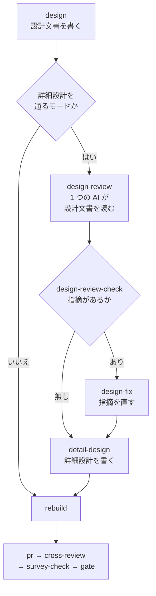

# 詳細設計の工程と設計単体のレビュー

開発の工程で、設計の直後に詳細設計の工程を置き、その手前で設計文書だけを 1 つの AI がレビューする。
この文書は、工程の位置・設計のプランの段・詳細設計の検査の規則・設計文書の種類の契約と、それぞれを
そう決めた理由を持つ。

**書き方と手順は Skill が正である。** ここに書き写さない。

| 何を | どこが正か |
| --- | --- |
| 10 の項目の書き方・省く書き方・既存の参照との分担 | [design の references/detailed-design.md](../../plugins/ndf/skills/design/references/detailed-design.md) |
| 節の見出しと表の列 | [design の references/detail-template.md](../../plugins/ndf/skills/design/references/detail-template.md)（唯一の置き場） |
| 詳細設計を書く手順と、進行を記録する契機 | [design の SKILL.md](../../plugins/ndf/skills/design/SKILL.md) |
| 工程表と工程ごとの決まり | [development-workflow の SKILL.md](../../plugins/ndf/skills/development-workflow/SKILL.md) |
| 設計 Pull Request の詳細設計の 6 観点 | `cross-review` の `review_lib/review_focus.py` の `DETAIL_REVIEW_TEMPLATE` と [08-review-categories.md](../../plugins/ndf/skills/cross-review/docs/08-review-categories.md) |
| 対象ファイルを詳細設計から引き写す手順 | [implementation-plan の SKILL.md](../../plugins/ndf/skills/implementation-plan/SKILL.md) |
| 実装が詳細設計から外れた箇所の突き合わせ | [quality-gates の references/design-match.md](../../plugins/ndf/skills/quality-gates/references/design-match.md) |

## 概要

設計の工程が決めるのは、構成要素・データ構造・入出力の契約・処理の流れまでである。ファイルの置き場・
関数の分け方・関数ごとの責務と失敗の扱いは、詳細設計の工程が実装の前に決める。詳細設計の文書は設計
Pull Request に載り、`cross-review` と設計承認ゲートで、責務の混在・重複・置き場の誤り・失敗の扱いの
抜けを実装の前に止める。

- 通るモードは `standard`・`legacy-refactor` である。`light`・`operation`・`documentation` は通らない
- 承認ゲートは増やさない。設計と詳細設計は設計承認ゲートで 1 回にまとめて見る
- 詳細設計は実装の後に追随させない。実装との違いは完了判定の設計との突き合わせが並べる

## 用語

用語の定義は、用語集の設定（`.ndf/glossary.json` の `document`）が指す [docs/glossary.md](../glossary.md) にある。
この文書で使う語は「詳細設計」「異常系の処理」である。ほかに次の語を使う。

| 用語 | 意味 |
| --- | --- |
| 設計単体のレビュー | 詳細設計の段の前に、設計文書と要求のコピーだけを 1 つの AI が読むレビュー |
| 設計文書の種類の契約 | 設計文書の置き場と、種類ごとの名前の末尾・扱いを持つ JSON（`plugins/ndf/contracts/design-docs.json`） |
| 頭の設計文書 | 課題ごとの `issues/issue-<番号>-design.md`。詳細設計の検査は、ここの「設計の結果」と照らす |

## 背景

ファイル配置と関数の責務が設計承認ゲートの後に決まると、構造の問題は実装の後に `cross-refactoring` が
拾うことになる。拾った時点では実装とテストが書き終わっており、直す費用が高い。詳細設計の工程は、この
判断を設計レビューの側へ移す。

詳細設計の 10 の項目は、設計記述の標準（IEEE 1016）の視点（構成・依存・構造・インタフェース・
アルゴリズム・資源）と、手続きを事前条件・事後条件・例外で書く通例に倣う。誤りの扱いは標準の視点に
無いため、異常系の処理を独立した項目にした。並行と排他は、NDF が並列のレーンとプランを持つことから
足した。範囲を変える関数に絞るのは、arc42 が詳細化を重要な要素に絞り、C4 モデルがコードの粒度の図を
長く保守する文書に勧めないためである。

## 仕様

### 工程の位置

| 工程 | `light` | `operation` | `legacy-refactor` | `standard` | `documentation` |
| --- | --- | --- | --- | --- | --- |
| 設計 | 条件付き | 条件付き | 必須 | 必須 | 必須 |
| 詳細設計 | 対象外 | 対象外 | 必須 | 必須 | 対象外 |

工程の分類（`development-workflow/scripts/lib/workflow-common.sh` の `WF_STAGE_MATRIX`）は「設計」の
直後に `詳細設計\t-\t-\tR\tR\t-` を持つ。工程の名前は次の置き場で同じ字の「詳細設計」を持つ。

| 置き場 | 持つもの |
| --- | --- |
| `development-workflow/SKILL.md` の工程表 | 行「詳細設計」。呼ぶ Skill は `design` |
| `projects-tracking.md` の対応表 | 記録する Skill `design`・`stage` の値 `詳細設計` |
| `scripts/lib/transcript_agents.py` の `STEP_PHASES` と `agent-layers.md` の表 | 工程「詳細設計」→ フェーズ「設計」 |
| `scripts/lib/stage-skills.json` | 工程「詳細設計」に `document-style` |

進捗記録（`projects-sync.sh <課題> stage "詳細設計"`）は `wf_is_stage` が工程の分類から行名を読むため、
この値を受ける。ボードの単一選択の値「詳細設計」は、ボードを使うリポジトリの利用者が足す。

### 設計のプランの段

`supervise.py new sprint --design` は、プランを作るときに `design_steps.detail_design_runs(mode)` で
詳細設計を通るモードかを決める。この関数は bash で `wf_stage_class <mode> 詳細設計` を打ち、区分が `R`
のときだけ真を返す。モードを Python の定数に持たない。



| 段 | 種類 | 工程（`stage`） | 次 |
| --- | --- | --- | --- |
| `design` | work | 設計 | `design-review`（詳細設計を通るモード）/ `rebuild`（ほか） |
| `design-review` | work | 設計 | `design-review-check` |
| `design-review-check` | run | 設計 | 終了コード 0 なら `detail-design`、1 なら `design-fix` |
| `design-fix` | work | 設計 | `detail-design` |
| `detail-design` | work | 詳細設計 | `rebuild` |

- 詳細設計を通るモードでは、`design` の段の指示に「詳細設計は後の段が書く」が加わる。`detail-design` の段は `/ndf:design #<番号> 詳細設計` で書く
- 外部の調査の検査（`procedures.survey_steps`）は、詳細設計を通るモードで `survey-check`・`survey-recheck` に `--require-detail` を付ける
- 設計 Pull Request の本文には、`pr` の段の `append` で設計単体のレビューの結果（`{state_dir}/work/design-review.md`）が足される。ファイルが無いモードでは足さない
- 出し直しの指摘の入力があれば、`sprint_revise.with_revise_note` は `detail-design` の段の指示にも指摘を入れる

設計単体のレビューは 1 回だけ流し、直した後に打ち直さない。直した設計は、詳細設計と合わせて後の
`cross-review` がもう一度見る。

### 設計単体のレビューの結果

置き場はプランの作業ディレクトリ（`{state_dir}/work/design-review.md`）で、コミットしない。

| 行 | 形 |
| --- | --- |
| 1 行目 | `## 設計単体のレビュー` |
| 指摘があるとき | `\| # \| 箇所 \| 指摘 \| 扱い \|` の表。箇所は設計文書の節の見出し。扱いは `未` で書かれ、`design-fix` が `直した` か `直さない: <理由>` に替える |
| 指摘が無いとき | `- 無し` の 1 行だけ |

`design-review-check` は `grep -qx -- '- 無し' {state_dir}/work/design-review.md` を打つ。終了コード 0 は
指摘なし、1 は指摘あり、2 はファイルが無いことを表す。2 は run の段の失敗の扱い（判定の段が直し・
やり直し・止めるを選ぶ）に従う。

レビューの観点は `cross-review` の `review_focus.py` の `MODEL_REVIEW_TEMPLATE` と `DESIGN_REVIEW_TEMPLATE`
を、指示の文（`supervise_lib/prompts.py` の `DESIGN_REVIEW_PROMPT`）がファイルから読ませる。詳細設計の
6 観点（`DETAIL_REVIEW_TEMPLATE`）はこの段に渡さない。

### 詳細設計の検査の規則

`design-survey.py check` は、既存の 4 規則に次の 5 規則を足す。結果の形と終了コードは既存のまま
（0 = 指摘なし / 1 = 指摘あり / 2 = 読めない / 3 = 文書が無い）。判定は `scripts/lib/design_detail.py`
が持つ。

| 規則 | 指摘する条件 | 指摘の `name` |
| --- | --- | --- |
| `detail_section` | 雛形の節の見出しが無い。節が表の行も `省く: <理由>`（理由が空でない）も持たない。関数の仕様の表に「種類」「副作用」の列が無い | `<パス> <節の見出し>` |
| `detail_failure` | 関数の仕様の表で副作用が `無し` でない関数が、異常系の処理の表の 1 列目に無い | `<パス>:<行> <関数>` |
| `detail_reuse` | 関数の仕様の表で種類が `新設` の関数が、既存の部品の再利用の表の 1 列目に無い | `<パス>:<行> <関数>` |
| `detail_file` | ファイル配置の表のパスが、頭の設計文書の「設計の結果」で扱いが「実装する」の行の触るファイルに無い | `<パス>:<行> <ファイルのパス>`。照らす先を読めないときは `<パス> 設計の結果` の 1 行 |
| `detail_missing` | `--require-detail` を渡したのに、まとまりに詳細設計の文書が無い | `#<番号>` |

- 節の一覧は雛形の `##` 見出しを読んで作る（`design_detail.detail_sections`）。雛形に節を足せば、検査もその節を求める
- 関数とパスの照合は、インラインコードの記号を外して前後の空白を除いた字で行う。節の見出しは `##` の後の字の完全一致である
- `--require-detail` を渡さないときは、詳細設計の文書があるまとまりにだけ 4 規則を当てる
- `metrics` に、詳細設計の文書の数 `detail_docs` と規則ごとの件数が加わる

**`detail_file` の照らす先は、頭の設計文書の書式で決まる。**

| 頭の設計文書 | 照らす先 | `detail_file` |
| --- | --- | --- |
| 「設計の結果」の表を読める（`standard` の書式） | その表の触るファイル | 集合に無いパスごとに 1 行 |
| 「設計の結果」が無く、「現状の構造」と「変更後の構造」の節がある（`legacy-refactor` の書式） | 無い。詳細設計のファイル配置の表が触るファイルの正本になる | 当てない |
| 頭の設計文書が無い・表を読めない・どちらの書式でもない | 読めない | 1 行 |

### 常に成り立つ条件

| # | 条件 | 破れたときの扱い |
| --- | --- | --- |
| 1 | 工程の分類の「詳細設計」の行は「設計」の直後にあり、`legacy-refactor`・`standard` が必須、ほかが対象外である | 工程の分類のテストが落ちる |
| 2 | 工程表・対応表・工程とフェーズの対応・工程ごとの規則の Skill が、工程の分類と同じ字の「詳細設計」を持つ | 工程の名前を突き合わせるテストが落ちる |
| 3 | 詳細設計の文書は雛形の節をすべて持ち、各節は表の行か `省く: <理由>` を持つ | `detail_section`（終了コード 1） |
| 4 | 副作用のある関数は、異常系の処理の表に 1 行以上ある | `detail_failure`（終了コード 1） |
| 5 | 新設の関数は、既存の部品の再利用の表に行がある | `detail_reuse`（終了コード 1） |
| 6 | `standard` の書式では、ファイル配置のパスは「設計の結果」の触るファイルに含まれる | `detail_file`（終了コード 1） |
| 7 | 設計単体のレビューと詳細設計の段は、工程の分類で「詳細設計」が必須のモードの設計のプランにだけあり、`design` の後・`rebuild` の前に立つ | 設計のプランのテストが落ちる |
| 8 | 設計のプランの判定の段は `gate` の 1 つだけである（承認ゲートは 2 つのまま） | 設計のプランのテストが落ちる |
| 9 | 設計文書の種類と名前の末尾は契約の 1 か所だけが持ち、読む側はそこから引く | `test_doc_kinds.py` が落ちる |

## データ・設定

### 設計文書の種類の契約

`plugins/ndf/contracts/design-docs.json` が、設計文書の置き場と種類ごとの名前の末尾・扱いを持つ。
読み手は `scripts/lib/doc_kinds.py` の 1 つだけで、プラグインの根からの相対で探す（`contracts/limits.json`
と同じ探し方）。

```json
{
  "version": 1,
  "dir": "issues",
  "kinds": [
    {"kind": "requirements", "suffix": "-requirements.md", "line_limit": false, "glossary": true, "review": true},
    {"kind": "design", "suffix": "-design.md", "line_limit": true, "glossary": true, "review": true},
    {"kind": "decisions", "suffix": "-design-decisions.md", "line_limit": true, "glossary": true, "review": true},
    {"kind": "detail", "suffix": "-design-detail.md", "line_limit": true, "glossary": true, "review": true,
     "template": "skills/design/references/detail-template.md"}
  ]
}
```

| 鍵 | 意味 | 読む側 |
| --- | --- | --- |
| `dir` | 設計文書の置き場（リポジトリの根からの相対） | `doc_kinds.patterns`・`doc_kinds.doc_kind` |
| `kind`・`suffix` | 種類の名前とファイル名の末尾。末尾は最も長く一致するものを選ぶ | `design_detail.is_detail` |
| `line_limit` | 1,000 行の上限を見るか | `classifications.py`（行数の検査・ドメインモデルの有無） |
| `glossary` | 用語チェックの宣言を作るときの既定の対象か | `glossary.py` の `DEFAULT_PATHS` |
| `review` | 設計 Pull Request の文書として分類するか | `review_lib/categories.py` |
| `template` | 雛形のパス（プラグインの根からの相対）。`detail` だけが持つ | `design_detail.detail_sections` |

読めない契約（ファイルが無い・JSON でない・同じ種類が 2 つ・`version` が違う・真偽の値が真偽でない）は
`DocKindsError` で止める。

### 用語チェックの宣言

`.ndf/glossary.json` の `check.paths` はリポジトリごとの宣言で、契約から引かない。このリポジトリの宣言は
`issues/*-design-detail.md` を持つ。宣言の無いリポジトリで宣言を作るときは、契約の `glossary` から導いた
`DEFAULT_PATHS` が入る。

## エラー処理

| 場面 | 扱い |
| --- | --- |
| プランを作るときに工程の分類を引けない（bash を起動できない・`workflow-common.sh` が無い・行が無い・知らないモード・区分が `R`・`C`・`-` 以外） | `DeclError` で止め、プランを作らない。`light` の並びへ倒さない |
| `design-survey.py check` が契約か雛形を読めない | `stopped`・終了コード 2 |
| `cross-review` の行数の検査・分類が契約を読めない | 例外のまま止める（設計文書の一部を黙って検査から外さない） |
| `design-review` の worker が失敗した | 既存の work の段の失敗の扱いでプランが止まる。`--from design-review` で打ち直せる |
| `design-fix` が直せない指摘 | 扱いに `直さない: <理由>` を書いて詳細設計の段へ進む。その行は設計 Pull Request の本文に載り、人が設計承認ゲートで見る |
| 詳細設計の文書が 1,000 行を超える | 設計を 2 本に分けると報告して止まる（設計の段と同じ） |

## 決定と理由

| 決定 | 理由 |
| --- | --- |
| 工程の名前を「詳細設計」にする | 決める中身（ファイル・クラス・関数・責務・失敗の扱い）が、業界で詳細設計と呼ばれる範囲と一致する。「構造設計」は `design` の参照「構造と振る舞い」と、「実装設計」は `implementation-plan` と紛れる |
| Skill を新設せず、`design` の参照と手順の 1 つとして足す | 用語集の確認・外部の調査・決定の記録・突き合わせの手順を 2 つの Skill で持たないため |
| 詳細設計は別の文書 `issue-<番号>-design-detail.md` に書く | 設計文書の 1,000 行の上限を守り、設計の段と詳細設計の段が同じファイルを書き換えないため。既存の探索の規則（`design_docs.DESIGN_NAME`）とドキュメント再構成の対象（`issue-{n}-design-*.md`）にそのまま当たる |
| `design` の段と `detail-design` の段を分ける | `detail-design` の段の `stage` が「詳細設計」になり、進捗記録とボードが工程に入った時点で書かれる。1 段にまとめると、必須の工程が「記録なし」と出る |
| 設計単体のレビューを詳細設計の段の前に置く | 詳細設計が誤った設計の上に立つと、直すときに 2 つの文書を書き直すことになる |
| 設計単体のレビューは 1 つの AI の軽いレビューにし、`cross-review` にしない | `cross-review` は Pull Request を要り、設計単体に当てると Pull Request とレビューの組がもう 1 つ要る。設計のプランの `review` の段の実績（2026-11-09〜11-13 の 22 件）で、`cross-review` は中央値 518.9 秒・外部の AI の起動 5〜10 回だった。設計文書は後の `cross-review` がもう一度見る |
| 詳細設計を通るモードは工程の分類から引く | モードを Python の定数に写すと、同じ事実を 2 か所に持つ。工程の分類の行を変えればプランも変わる |
| 詳細設計の検査は `design-survey.py check` の規則として足す | 設計の Skill の手順と設計のプランの `survey-check` の段がすでに打つため、新しい段も手順も要らない。文書の形をレビューだけで見ると、同じ見落としが実行ごとにばらつく |
| パッケージ・モジュール構成のツリーは詳細設計の文書に書き、クラス図は設計文書に残す | ツリーはファイル配置と同じ事実を持つ。クラス図は `legacy-refactor` の「現状の構造・変更後の構造」の節が使う |
| 実装が詳細設計から外れたかは、完了判定の設計との突き合わせが見る | 既存の突き合わせが設計文書の決定を実装と照らしている。`cross-refactoring` に持たせると、構造を直す工程が「設計と違う」を判定することになり責務が混ざる。突き合わせを入れるモードは `standard` のままにする |
| 実装計画の対象ファイルは詳細設計のファイル配置から引き写す | 対象ファイルの出所を 1 つにするため。表に無いファイルを足すときは理由を書く |
| 同じ事実は 1 か所のデータに置き、読む側はそこから引く | 設計文書の名前は契約、詳細設計を通るモードは工程の分類、節の見出しは雛形が持つ。定数を 2 か所に置いてテストで一致を縛る形は、片方の足し忘れでテストを直す手間を生み、置き場は 2 つのまま残る |
| 契約の読み手は標準ライブラリの `json` で書く | 確かめる形は種類の重複・`version`・真偽の値の型の 3 つである。pydantic（任意の依存のグループ `schema`）を使うと、読む側の `classifications.py`・`categories.py`・`glossary.py` のすべてに依存の要求が増える |

## テスト観点

| 観点 | 置き場 |
| --- | --- |
| 工程の分類で「詳細設計」が「設計」の直後にあり、モードごとの区分が `-`・`-`・`R`・`R`・`-` であること | `development-workflow/tests/test_stage_check.py` |
| 工程表の行名の並びが工程の分類と一致し、対応表の工程名と `stage` の値が工程の分類に含まれること | 同上 |
| 5 規則がそれぞれの条件で指摘を出し、`省く: <理由>` の節・`変更` の関数・`legacy-refactor` の書式では出さないこと。雛形に節を足すと検査も求めること。雛形を読めなければ終了コード 2 であること | `scripts/tests/test_design_survey.py` |
| `standard`・`legacy-refactor` の設計のプランが 4 段を正しい遷移で持ち、`light`・`operation`・`documentation` は持たないこと。判定の段が `gate` の 1 つだけであること | `scripts/tests/test_supervise_new.py`・`test_supervise_limits.py` |
| 工程の分類の写しで区分を変えるとプランの並びが変わり、引けないときは `DeclError` で止まること | `scripts/tests/test_supervise_new.py` |
| `design-review-check` の `cmd` が 3 通りのファイルで終了コード 0・1・2 を返すこと | 同上 |
| 詳細設計の 6 観点が設計 Pull Request の観点に含まれ、設計単体のレビューが読む 2 つの定数に含まれないこと | 同上 |
| 契約の読み取り・種類の判定、読む側（用語チェック・行数の検査・設計 Pull Request の分類）が契約から引くこと。読めない契約で `DocKindsError` になること | `scripts/tests/test_doc_kinds.py` |

## 関連リンク

- [設計工程の規約](ndf-design-phase.md)
- [設計の判断を AI が決めて記録する](ndf-design-ai-decisions-and-mvv-gate.md)
- [設計の外部の調査](ndf-design-external-survey.md)
- [設計の結果の文書とセルの書式](ndf-design-results-docs-and-cell-format.md)
- 課題 #3144・Pull Request #3177
