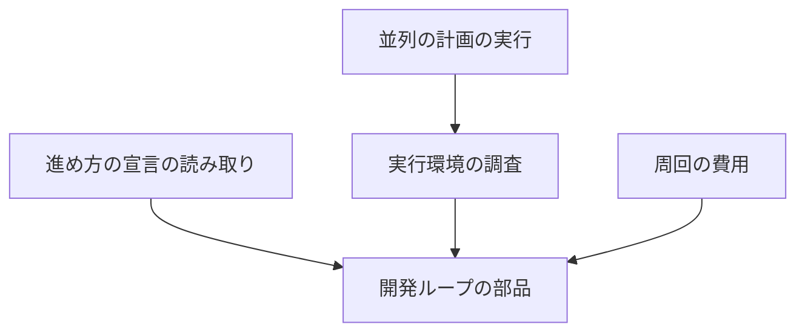
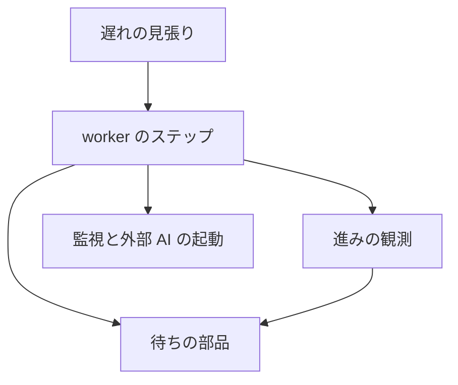
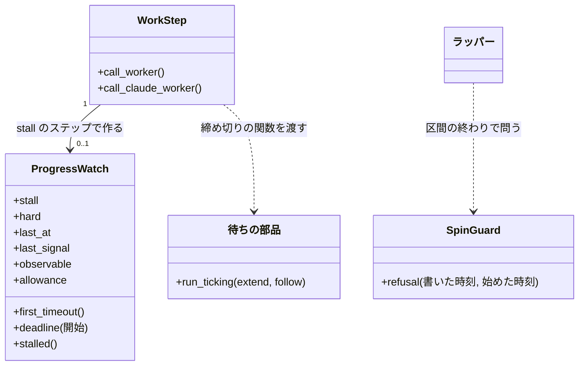
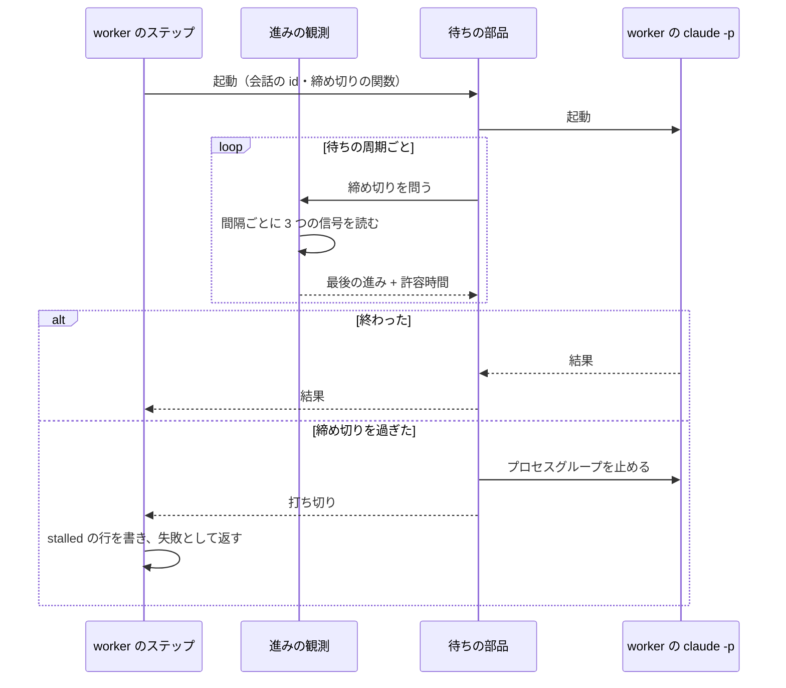
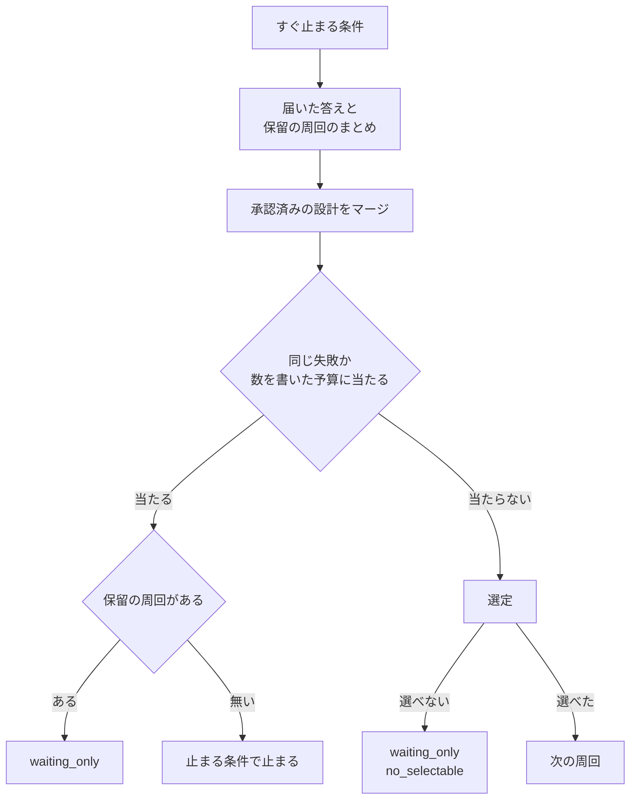

# 開発ループの上限: 回数と時間の固定の上限で止めず、止まる理由を人の判断・費用と資源の限界・壊れて回り続ける状態に絞る

## 概要

**開発ループ（`--loop`）は、レーンを増やしても回数と時間の固定の上限では止まらない。** 止まる理由は、人の判断が要る状態、費用と資源の限界、壊れて回り続ける状態の 3 つである。実装のステップは進んでいる間は打ち切られず、1 周回で選ぶ課題の数は、実行環境の調査が出す候補を見て人が決める。

例: 3 レーンの並列の計画を、8 コア・30 GiB のコンテナで 1 日回すと、次のように動く。

| 順 | 起きること |
| --- | --- |
| 1 | `parallel.py start` が実行環境の調査を通し、プラン 6 本・ラッパー 3 本・課題 2 件（6 ÷ 3 レーン）を候補として結果に載せる。宣言は書かない。課題の数の既定は 3 のままで、変えるなら人が `.ndf/pace.json` を Pull Request で直す |
| 2 | ラッパーは 1 日に何回でも次の区間を起動する。止まるのは、区間が 3 つ続けて 120 秒未満のときだけである |
| 3 | 宣言に周回の数・時間・費用を書いていなければ、どの予算でも止まらない。数を書いた単位だけが効く |
| 4 | リリース待ちや質問待ちの保留の周回がいくつあっても、選べる課題が残っていれば次の周回へ進む。選べなければ `waiting_only`（理由 `no_selectable`）で止まる |
| 5 | 2 時間かかる実装のステップも、会話の記録が伸び続けている間は打ち切られない。1800 秒進みが途絶えると打ち切られ、進捗ログに `stalled` の行が残る |

この文書は、開発ループの中で働く上限の全体と、それぞれをなぜその扱いにしたかを持つ。

| 何を | 正本 |
| --- | --- |
| 上限の全体の表・ラッパーの起動の判定・実行環境の調査・周回の費用 | この文書 |
| 予算の宣言の項目・止まる条件と再開の規則・ループの記録の全体 | [ndf-workflow-development-loop.md](ndf-workflow-development-loop.md) と `development-workflow` の `references/pace.md`・`references/loop.md` |
| 実装の上限・無進捗の許容時間の決め方と無進捗の打ち切りの振る舞い | [ndf-supervise-step-budgets.md](ndf-supervise-step-budgets.md) |
| ラッパーの区間と再起動ループの記録 | [ndf-relay-segment-restart.md](ndf-relay-segment-restart.md) |
| 並列の計画の起動の断りと動かないレーンの問い | [ndf-parallel-organizer.md](ndf-parallel-organizer.md) |

決定の番号（決定 1〜17）と不変条件の番号（I1〜I9）は #2505 の設計の番号で、コードのコメントが指す。

## 用語

語の定義は用語集（[docs/glossary.md](../glossary.md)）が正である。この文書では、ループの予算・実装の上限・無進捗の打ち切り・無進捗の許容時間・進みの観測・周回の費用の内訳・実行環境の調査を、そこで定めた意味で使う。

## 背景

並列の計画でレーンが加わると、開発ループを回す本数と時間が増える。そのため、1 日の起動回数のように全レーンで分け合う数や、周回の数のように固定の数は、レーンの数に比例して先に尽きる。無制限を書けない宣言には、周回 1000・時間 10000 のように上限の意味を失った数が書かれていた。

2026-11-06 に集計した実測は次のとおりである。

| 対象 | 実測 | 読み取れること |
| --- | --- | --- |
| ラッパーの記録（`~/.local/state/ndf/relay/*/log.jsonl`） | 1 日の起動は 2026-11-04 に 30 回、11-05 に 37 回 | 1 日 20 回の数は運用の約 2 分の 1 だった |
| 使用量の帳簿の実装のステップの呼び出し 77 回 | 3 回が 3600 秒で打ち切り、4 回が 3000 秒以上 | 長い実装が固定の秒で切られていた |
| `full` のステップの会話の記録 313 本 | 記録の間隔の最大は中央値 57 秒・99 パーセンタイル 590 秒・最大 706 秒。900 秒以上は 0 本 | 進みの途絶は許容時間で判定できる |
| プランの実行 37 本の進捗ログ | 行の間隔の最大は中央値 954 秒・最大 6479 秒 | 進捗ログの行は単独の信号に使えない |
| ループの止まり 37 回 | `waiting_only`（`no_selectable`）16・`outside_mvv` 10・`gate2_returned` 4・`refused` 3・`waiting_only`（保留の周回の数）2・`budget_laps` 1・`user_stop` 1 | 止まる回数の大半は人の判断待ちで、上限の扱いでは減らない。この仕様は、レーンを増やして当たり始める上限を当たる前に外すためのものである |

## 決定と理由

| # | 決定 | 理由 |
| ---: | --- | --- |
| 1 | ラッパーの次の区間の可否を、停止シグナルファイルと再起動ループの検出だけで決める。起動回数を数えず、数えを守る排他も持たない | 暴走止めは「短い時間に何回」で止める形が標準である（systemd の `StartLimitIntervalSec`）。値を増やす形は、上限の意味を失った数が残るため採らない |
| 2 | 周回の数と経過時間は書いたときだけ効く。無制限を `null` で表し、判定は 1 つの関数（`pace.over_budget`）に置く | 大きな数の代用は値から意図が読めない。`--budget-*` に `none` のような語を足さなくても、`default` で宣言へ戻せば足りる |
| 3 | 保留の周回の数を止まる条件にしない | 保留の周回の課題は選定から外れるので、増えれば選べる課題が減り、尽きれば `waiting_only`（`no_selectable`）で止まる。待ちを抱えたまま進める |
| 4 | 実装のステップの進みは、会話の記録の伸び・進捗ログの worker の行・コミットの増加で見る | 手元で実測できる信号だけを使う。標準出力は `--output-format json` が完了まで何も出さず、worktree の変更は会話の記録以上の情報が無く、子プロセスの CPU 時間はテストの待ち合わせと固まった状態を区別できない |
| 5 | 無進捗の打ち切りは、待ちの部品の締め切りの移動で動かし、打ち切りの経路を時間切れと 1 つにする。`stall` を持つステップでは遅れの見張りが打ち切らない | 見張りの判定役は進んでいるステップにも `retry` / `stop` を返せるため、「進み続けている間は打ち切らない」と両立しない。理由だけを記録で分ける |
| 6 | 実装の上限は書いたときだけ効く。実績からの見込みを持たない | ループの予算と同じ規則である。打ち切りを決めない見込みには読み手が無い |
| 7 | 無進捗の許容時間の既定は 1800 秒、会話の記録を読めないときは 7200 秒 | 誤った打ち切りは数時間分の実装を捨て、待ちすぎの費用は LLM を使わない 15 分である。7200 秒は行の間隔の実測の最大 6479 秒を上回る。読めないときに打ち切らない形は、固まった worker が無限に残るため採らない |
| 8 | 外部のランタイムは監視の無進捗の許容へ渡し、`--timeout 0` を「経過時間の上限が無い」として受ける | 監視は既にログの大きさで無進捗を見ている。Codex などのプロジェクトでも同じ規則で動く |
| 9 | 実行環境の調査は読むだけの部品にし、`loop start` と `parallel.py start` で必ず通す。宣言へ書くのは人である | 1 秒未満で LLM を使わないので、時点を絞る理由が無い。毎回通せば実行環境の変化も拾える。`.ndf/` の書き換えは必ず人の承認が要る操作（C7）である |
| 10 | 候補は 8 コア・30 GiB でプラン 6 本の実測の比から導く | 実測のある 1 点から伸縮できる。人の読める量は式に入らないので、理由の行に「承認で読める量は別に見る」と添える |
| 11 | 費用の予算も書いたときだけ効く。周回の費用は使用量の帳簿の和とスプリントの報告の和の大きい方にする | 周回と時間と同じ規則にそろえた。歯止めは同じ失敗の回数と利用プランの上限である。報告の和を残すのは、Factory の実行ジョブの再開で帳簿の行が欠けるためである。帳簿はホームの下にあって復元されず、報告は `.ndf/` の下にあって復元される |
| 12 | 同じ失敗の繰り返しの既定 2 回を残す | レーンの数で増えず、止まりの記録は 37 回中 0 回である。止めないと失敗の費用だけが増える |
| 13 | merge から取り込みへ戻る回数 3 とリリースの入れ直し 3 回を残す | 前者はプランのステップの上限の中にあり、外しても同じ回数でプランの上限に当たる。後者は尽きると承認ゲートで人へ戻すだけで、失敗で止まらない |
| 14 | Factory の区間の上限 20 はこの仕様の範囲に含めない | `factory/` は volareinc/nd-factory へ移すため、移した先の課題（nd-factory の #12）で扱う |
| 15 | 耐久ワークフローの止まりの待ち 30 日を残す | `durable.pause()` は cross-review と cross-refactoring の駆動が呼ぶ。`DBOS.recv` は `timeout_seconds` に数を取り、上限の無い待ちの指定が文書に無い。待ちが上限を過ぎた記録は 0 件である |
| 16 | `loop status` は `relay_max_starts` を出さない | 起動回数で止まらないので、説明する対象が無い |
| 17 | 起動の断りを問う回数は環境変数 `NDF_PARALLEL_SPAWN_REFUSALS` で変える | 同じ部品の `NDF_PARALLEL_STALL_MINUTES` と同じ読み方にそろえる |

長い処理の打ち切りを経過時間でなく進みの途絶で判定する形は、Kubernetes の `progressDeadlineSeconds`、Temporal の Heartbeat、AWS Step Functions の `HeartbeatSeconds` と同じである。経過時間の上限を書いたときだけ効かせる形は Kubernetes の Job の `activeDeadlineSeconds` と同じである。

## 仕様

### 構成要素と責務

| 要素 | 責務 |
| --- | --- |
| 起動の判定（`relay_lib/record.py` の `SpinGuard`） | 再起動ループの検出だけで次の区間の可否を返す |
| 進め方の宣言の読み取り（`lib/pace.py`） | 予算の `null` を受け、予算の判定 `over_budget` を持つ。`loop.release_pending_max` を読まない |
| 開発ループの部品（`lib/sprint_loop*.py`） | 周回の境の判定と再開の判定で同じ `over_budget` を読む |
| 周回の費用（`lib/lap_cost.py`） | 帳簿の和と報告の和を比べて周回の費用を決め、内訳を導く |
| 実行環境の調査（`lib/run_environment.py`） | 実行環境を読み、候補を返す。ファイルへ書かない |
| 進みの観測（`supervise_lib/progress_watch.py`） | 信号を読み、無進捗の締め切りを返す |
| 待ちの部品（`supervise_lib/claude.py`） | 締め切りの関数を受け、待ちの周期ごとに締め切りを動かす |
| worker のステップ（`supervise_lib/worker_steps.py`） | `stall` のステップへ進みの観測を付け、打ち切りの理由を残す |
| 遅れの見張り（`supervise_lib/slow.py`） | `stall` のステップでは所要の履歴だけを残す |
| 監視（`lib/monitor.py`）と外部 AI の起動（`external-ai.py`） | `--timeout 0` を「経過時間の上限が無い」として受ける |
| 並列の計画の実行（`lib/parallel_repo.py`・`lib/parallel_run.py`・`parallel.py`） | 起動の断りの回数の上書きを読み、開始で実行環境の調査を載せる |





変更が属するコンテキストは、開発の工程（`ndf-workflow`）と中継（`ndf-relay`）である。Factory は `--budget-<単位>` の引数でループの予算を渡す顧客で、開発の工程の既定に従う（顧客 / 供給者）。

### 集約

| 集約 | 持ち主（書き換えてよいもの） | 根 | エンティティ | 値オブジェクト |
| --- | --- | --- | --- | --- |
| ループの記録 | 開発ループの部品 | ループ | 周回 | 予算・消費・止まる条件・周回の費用の内訳・実行環境の報告 |
| プランの実行 | supervise のエンジンとステップのハンドラー | 実行の状態 | ステップの結果 | 進みの観測・打ち切りの理由 |
| ラッパーの記録 | ラッパー（`relay_lib`） | ラッパー | 区間 | 再起動ループの判定 |
| 進め方の宣言 | 人。部品は読むだけ | 宣言 | — | ループの節 |

### 常に成り立つ条件

| # | 集約 | 条件 | 破れたときの扱い |
| --- | --- | --- | --- |
| I1 | 進め方の宣言 | ループの予算の値は `null` か正の数である | `PaceError` でループを断る |
| I2 | ループの記録 | `null` の単位では予算の止まる条件が立たない。数を書いた単位は消費が値以上で立つ | 境の判定と再開の判定は同じ関数で読むので、片方だけ違う結果にならない |
| I3 | ループの記録 | 保留の周回の数は止まる条件にならない。選べる課題があれば選ぶ | 選べなければ `waiting_only`（`no_selectable`）で止まる |
| I4 | ラッパーの記録 | 次の区間の可否は停止シグナルファイルと再起動ループの判定だけで決まる | 再起動ループなら `spin` で止まる |
| I5 | プランの実行 | 実装のステップは、実装の上限を書いていなければ、最後の進みの観測から許容時間を越えるまで打ち切られない | 許容時間を越えたら無進捗の打ち切りになる |
| I6 | プランの実行 | 無進捗の打ち切りは、進捗記録で時間切れと区別できる | `stalled` の行とステップの結果の `stalled` が残る |
| I7 | 進め方の宣言 | 実行環境の調査は宣言を書き換えない | 書く経路を持たない |
| I8 | ループの記録 | 実行環境の調査の失敗で開発ループが止まらない | 読めない項目を `unreadable` に載せて進む |
| I9 | ループの記録 | 周回の費用は締めた時点の帳簿の Claude の行の和とスプリントの報告の和の大きい方で、USD の無い起動を足さない | 帳簿を読めなければ報告の和を使う。どちらを採ったかを内訳の `source` に残す |

### ドメインイベント

| イベント | 発生元 | 受け手 | 引き金 |
| --- | --- | --- | --- |
| ラッパーが次の区間を起動してよいと判定した | ラッパー | ラッパーの記録（`start`） | セッションが `ndf-next` を出して終わった |
| 開発ループが周回の境で止まる条件を判定した | 開発ループの部品 | ループの記録・conductor | 周回を締めた |
| 開発ループが保留の周回を抱えたまま次の周回を選んだ | 開発ループの部品 | conductor | 境の判定が止まらなかった |
| 実装のステップの進みを観測した | 進みの観測 | 待ちの締め切り | 実装のステップの待ちの中で一定の間隔（60 秒と許容時間の 3 分の 1 の短い方） |
| 実装のステップを無進捗で打ち切った | 進みの観測 | 進捗ログ・`on_fail` と判定役 | 進みの観測が許容時間を越えて途絶えた |
| 実行環境を調べた | 実行環境の調査 | ループの記録・conductor・オーガナイザー | `loop start` と `parallel.py start` のたび |
| 課題の数の候補を人へ示した | `loop start`・`parallel.py start` の結果 | conductor の報告を読む人 | 候補と今の値が違う |
| レーンの起動の断りが規定の回数続いて問うた | 並列の計画の実行 | 人 | `relay.py spawn` が続けて断った |

### 実装のステップの打ち切りの構造

振る舞いの表は [ndf-supervise-step-budgets.md](ndf-supervise-step-budgets.md) の「実装のステップの無進捗の打ち切り」にある。ここには型の関係と流れだけを置く。





### 周回の境



### 実行環境の調査

`sprint-state.py loop environment` が単独で出力し、`loop start` と `parallel.py start` が同じ部品を呼んで結果に載せる。候補と今の値が違うときは結果の 1 項目で示す。候補が違うか読めない項目があるときは、ループの記録の `environments` にも足す。

| 値 | 読み方 |
| --- | --- |
| 動く場所 | `factory`（`NDF_FACTORY_RUN` がある）・`container`（`/.dockerenv` がある、または cgroup の階層がコンテナの形）・`host`。読めなければ `unknown` |
| CPU | `sched_getaffinity` と cgroup の `cpu.max` の小さい方。NDF のスクリプトは Python 3.10 で動くため `os.process_cpu_count()` を使わない |
| メモリ | マシンの合計と cgroup の `memory.max` の小さい方 |
| レーンの数（`parallel.py start`） | 開始する計画の `lanes` の数。まだ動いていないため、計画の値を引数で部品へ渡す |
| レーンの数（`loop start`・`loop environment`） | `.ndf/parallel/` の計画のうち動いているものの `lanes` の数の和。無ければ 1 |
| 動いているプランの数 | `supervise.py queue` のプロセスの数 |

レーンの数の読み先を計画にするのは、ラッパーの一覧には計画と関係のないラッパーと一時レーンが混ざり、Factory の実行ジョブではハブが動かないためである。

| 候補 | 式 |
| --- | --- |
| プランの本数の合計 | `max(1, min(floor(コア × 6 / 8), floor(メモリ GiB × 6 / 30)))`。メモリは整数へ丸めてから計算する |
| 同時に動かすラッパーの数 | `max(1, floor(プランの本数の合計 / 2))` |
| 1 周回で選ぶ課題の数 | `max(1, floor(プランの本数の合計 / max(1, レーンの数)))` |

CPU かメモリを読めないときは、今の値をそのまま候補にする。課題の数をレーンの数で割るのは、1 周回が課題ごとに 1 本のプランを同時に流すためである。

### 周回の費用

周回を締めるときに 1 回だけ読む。帳簿の和は、Claude の行のうち周回のプランのパスを指すものの和で、cross-review・MVV 判定を含む。USD は定価の見積もりで、請求額ではない。

| 状況 | 周回の費用 | 内訳の `source` |
| --- | --- | --- |
| 帳簿の和が報告の和以上 | 帳簿の和 | `ledger` |
| 報告の和が大きい（再開で帳簿の行が欠けた場合など） | 報告の和 | `reports` |
| 帳簿の読み取りが失敗した | 報告の和。内訳の `unreadable` に理由を残す | `reports` |
| 周回にプランの出力先が無い | 報告の和 | `reports` |

Codex と Kiro は USD を持たないため和に足さず、内訳の `unpriced` に呼び出しの数とトークンを残す。conductor の会話は和に入らない。周回を締める時点で conductor の会話を指す手段が無いためである（ラッパーの記録の `from_session` は区間が終わった後に書かれる）。

### 上限の全体の表

開発ループの中で働く上限を種類ごとに並べる。扱いの列の「残す」は、値も振る舞いもこの表のとおりであることを指す。

**持たない上限。** ラッパーの 1 日の起動回数、保留の周回の上限、実績からの実装の上限の見込み、実装のステップの固定の打ち切りは持たない。`NDF_RELAY_MAX_STARTS` と `loop.release_pending_max` は読まず、設定されていても誤りにしない。

#### 開発ループを回数・時間で止めうるもの

| 上限 | 値 | 定義の場所 | 働き方 |
| --- | --- | --- | --- |
| ループの予算: 周回の数・経過時間 | 既定は無制限 | `lib/pace.py` | 書いたときだけ効く |
| 実装のステップの打ち切り | 無進捗の許容 1800 秒。実装の上限は既定で無し | `supervise_lib/verify_steps.py`・`supervise_lib/progress_watch.py` | 進みが途絶えたときだけ打ち切る |
| レーンの起動の断りを問う回数 | 3 回 | `lib/parallel_repo.py` | `NDF_PARALLEL_SPAWN_REFUSALS` で変える |
| 答えを待つ依頼の閾値 | 計画全体 8・レーン 3 | `lib/pace.py`・`.ndf/pace.json` | 超えるとレーンが区切りで止まり、閾値以下へ戻ると再開する（`ndf-parallel-organizer.md`） |
| 同じ失敗の繰り返し | 2 回 | `lib/pace.py` | 残す（決定 12） |
| merge から取り込みへ戻る回数 | 3 回 | `merged_lib/base_sync.py` | 残す（決定 13） |
| リリースで先端が動いたときの入れ直し | 3 回 | `release-steps.py` | 残す（決定 13） |
| 耐久ワークフローの止まりの待ち | 30 日 | `lib/durable.py` | 残す（決定 15） |
| Factory の区間の上限 | 20（`RUNNER_SECTION_LIMIT`） | `factory/runner/src/sections.ts` | この仕様の範囲の外（決定 14） |
| 1 周回で選ぶ課題の数 | 3 | `lib/pace.py` | 残す。実行環境の調査が候補を出す |
| 動かないレーンを問うまで | 60 分 | `lib/parallel_repo.py` | 残す。止めずに問うだけ |

#### 費用とリリースの重複止め

| 上限 | 値 | 定義の場所 | 働き方 |
| --- | --- | --- | --- |
| ループの予算: 費用 | 既定は無制限 | `lib/pace.py`・`.ndf/pace.json` | 書いたときだけ効く（決定 11） |
| 一時レーンの同時の数 | 1 本 | `relay_lib/hub.py` | 残す。リリースの工程が重なって走るのを防ぐためで、回数の制限ではない |

#### 暴走止め: 壊れて回り続ける状態を止める

| 上限 | 値 | 定義の場所 |
| --- | --- | --- |
| 再起動ループの検出 | 3 区間続けて 120 秒未満（`NDF_RELAY_SPIN`） | `relay_lib/record.py` |
| プランのステップの上限（修正のループと戻りの輪の想定回数・手書きのプランの既定） | 3 回・30 | `supervise_lib/limits.py` |
| 駆動の段階の数 | 1000 | `skills/cross-review/scripts/drive.py` |
| 検証と修正の繰り返しの上限 | 100 | `skills/cross-refactoring/scripts/assignee_launch.py` |

#### 資源と安全: マシンとアカウントの限界

外すと OOM や利用停止になる。開発ループの回数の制限ではないので残す。

| 上限 | 値 | 定義の場所 |
| --- | --- | --- |
| 同時に動かすラッパーの数 | 3（`NDF_RELAY_MAX_NAMED`。実行環境の調査が候補を出す） | `relay_lib/hub.py`・`lib/parallel_plan.py` |
| プランの本数の合計 | 6（実行環境の調査が候補を出す） | `lib/parallel_plan.py` |
| 並列の計画の外の `queue --max` の既定 | 3 | `lib/parallel_lane.py` |
| 文脈の量の運用上限 | 200,000（試行は 400,000） | `lib/context_policy.py` |
| 利用上限の待ちの最大・リセット時刻が読めないときの待ち | 10800 秒・900 秒 | `supervise_lib/claude.py` |
| GitHub のレート上限の待ちの最大 | 3600 秒 | `lib/gh_quota.py` |
| 判定で倍々にする GitHub の待ちの上限 | 3600 秒 | `supervise_lib/engine.py` |
| 担当 1 本の見込み・予備のメモリ | 1536 MiB・1024 MiB | `parallel-measure.py` |
| 基盤待ちの再実行の回数 | 3 回 | `lib/design_pr_merge.py` |

#### 品質の収束: 当たっても残りを記録して先へ進む

| 上限 | 値 | 定義の場所 |
| --- | --- | --- |
| cross-review のラウンドの上限 | 設計 3・コード 12 | `skills/cross-review/scripts/classifications.py` |
| cross-review が読む設計文書の行数 | 1000 行 | `skills/cross-review/scripts/classifications.py` |
| 振動の検知 | 検知で止まる | `lib/drive_pause.py` |
| cross-refactoring の時間予算の既定 | 30 分 | `skills/cross-refactoring/scripts/refactor_lib/vocabulary.py` |
| 監視の上限（工程ごと） | 1200 秒・3600 秒。実装のステップを外部のランタイムで動かすときは実装の上限が無ければ渡さない | `lib/limits.py` |
| 無進捗の許容（担当ごと） | 180〜900 秒。実装のステップは引数で渡す | `lib/limits.py` |
| 駆動が pause で止まってよい回数 | 12 回 | `supervise_lib/worker_steps.py` |
| 遅れの見張りの判定・待ち直し・打ち直しの回数 | 2 回・3 回・1 回。`stall` のステップには働かない | `lib/slow_step.py` |
| 報告が無い Skill のステップの起こし直し | 3 回 | `supervise_lib/worker_steps.py` |

#### 状態の変化: 上限ではなく人の判断が要る状態

| 止まる条件 | 何が起きたか | 定義の場所 |
| --- | --- | --- |
| `mvv_changed` | MVV が改訂された | `lib/sprint_loop_record.py` |
| `outside_mvv` | MVV の外の判定 | `lib/sprint_loop*.py` |
| `gate2_returned` | 本番のリリースの承認が差し戻された | `lib/sprint_loop*.py` |
| `waiting_only` | 選べる課題が無く、答えを待つ作業だけが残る | `lib/sprint_loop_record.py`・`lib/sprint_loop_select.py` |
| `user_stop` | 利用者が止めた | `lib/sprint_loop_record.py` |
| `answer_hold` | 答えを待つ依頼が人の読める量を超えた（並列の計画のレーン） | `lib/parallel_hold.py` |
| `refused` | 使ってよい条件に当たらない | `lib/sprint_loop.py` |
| 同じ分類の検査の失敗が 3 周続く | 人へ戻す | `lib/sprint_loop_select.py` |

#### 打ち直せばよいもの、開発ループを止めないもの

| 上限 | 値 | 定義の場所 |
| --- | --- | --- |
| `supervise.py wait` | 10800 秒 | `supervise.py` |
| `parallel.py wait` | 3600 秒 | `parallel.py` |
| 耐久の記録を消すまでの日数 | 30 日 | `lib/durable.py` |
| 実装以外の worker の 1 回の上限 | 1800 秒 | `supervise_lib/worker_steps.py` |
| Skill のステップの上限 | 3600 秒 | `supervise_lib/templates.py`・`supervise_lib/sprint_waves.py` ほか |
| 見直し・大整理の work のステップ | 5400 秒 | `supervise_lib/sprint_close_steps.py` |
| テストの上限の既定（範囲・全体・CI の待ち） | 900 秒・1800 秒・3600 秒 | `lib/test_strategy.py` |
| 走っているプランが「まだ動いている」を書く間隔 | 600 秒 | `supervise_lib/state.py` |
| ラッパーの入れ替えの用意の待ち | 600 秒 | `relay_lib/handover.py` |
| worktree の lock のやり直し | 5 回 | `supervise_lib/paths.py` |
| 設計の結果の取得のやり直し | 合計 120 秒 | `supervise_lib/design_stage.py` |
| hook の締め切り | 3.5 秒 | `hook_lib/deadline.py` |

表の範囲は `plugins/ndf/` の定数の検索で拾い、開発ループを止めるものと、止めない理由を示す必要があるものを載せた。数値のリテラルをすべて載せたものではない。

## データ・設定

JSON のファイルだけで、スキーマの移行は無い。読む側が古い値も受ける。

| ファイル | 項目 | 型 | 空の値 |
| --- | --- | --- | --- |
| `.ndf/pace.json` | `loop.budget.laps` / `hours` / `usd` | 正の数か `null` | `null` と省略は無制限 |
| `.ndf/pace.json` | `parallel.answer_limit.plan` / `lane` | 正の整数 | 省略は 8 と 3 |
| `.ndf/supervise.json` | `impl_stall_seconds` | 1 以上の整数か `null` | `null` と省略は 1800。無進捗の打ち切りは外せない |
| `.ndf/supervise.json` | `impl_timeout` | 1 以上の整数か `null` | 無ければ経過時間の上限が無い |
| ループの記録（`loop.json`） | `budget.<単位>` | 数か `null` | `null` は無制限 |
| ループの記録 | `environments[]` | 実行環境の報告の配列（`at` を持つ） | 無ければ空。追記だけで、過去の行を書き換えない |
| ループの記録の周回 | `cost` | 数 | 帳簿の和と報告の和の大きい方。締めた周回の値は変えない |
| ループの記録の周回 | `cost_parts` | `{source, plans, others, unpriced}`（読み取りの失敗では `unreadable` も持つ） | 内訳を持たない古い周回もある |
| プランのステップ | `stall` | 秒 | 無ければ `timeout` だけで動く |
| プランのステップ | `timeout` | 秒 | 実装のステップは実装の上限を書かなければ置かない |
| 進捗ログ | `{"kind": "stalled", "step", "stall", "last_at", "last_signal"}` | 行 | 無進捗で打ち切ったときだけ |
| ステップの結果 | `stalled` | `{seconds, last_signal}` | 無進捗で打ち切ったときだけ |

周回の費用の内訳の項目は次のとおりである。`plans` と `others` は帳簿の値なので、`source` が `reports` のとき 2 つの和は `cost` と一致しない。

| 項目 | 意味 |
| --- | --- |
| `source` | `ledger` か `reports` |
| `plans` | `supervise` の起動の和（USD） |
| `others` | cross-review・MVV 判定ほかの Claude の起動の和（USD） |
| `unpriced` | ランタイムごとの `{"calls", "tokens"}`。USD を持たないため和に足さない |
| `unreadable` | 帳簿の読み取りが失敗したときだけある。理由の文（200 文字まで） |

実行環境の報告の形は次のとおりである。

```json
{
  "at": "2026-11-06T04:00:00Z",
  "place": "container",
  "cpus": 8,
  "memory_gib": 30,
  "lanes": 1,
  "plans": 0,
  "candidates": {"max_issues": 6, "max_plans": 6, "max_named": 3},
  "current": {"max_issues": 3, "max_plans": 6, "max_named": 3},
  "reason": "8 コア・30 GiB からプラン 6 本。レーン 1 本で割って課題 6。承認で読める量は別に見る",
  "unreadable": []
}
```

## 外部連携

| 名前 | 入力 | 出力 | 失敗の形 |
| --- | --- | --- | --- |
| `sprint-state.py loop start` | — | 結果の `metrics.environment` に実行環境の報告。候補と今の値が違えば `items` に 1 項目 | 調査の失敗では止まらない |
| `sprint-state.py loop environment [--root] [--json]` | なし | 実行環境の報告 | 読めない項目は `unreadable`。終了コードは 0 |
| `parallel.py start` | — | 結果に `environment` | 調査の失敗では止まらない |
| `sprint-state.py loop start --budget-<単位> default` | — | 宣言の値へ戻す。宣言が無ければ `null`。予算の履歴に 1 行残す | — |
| `supervise.py new impl` / `new sprint` | `--impl-stall SECONDS`・`--impl-timeout SECONDS` | 実装のステップの `stall` と任意の `timeout` | 1 未満は引数の誤り |
| `external-ai.py run` / `monitor.py` | `--timeout 0` | 経過時間の上限が無い | — |
| 環境変数 `NDF_PARALLEL_SPAWN_REFUSALS` | 1 以上の整数 | 起動の断りを問う回数 | 不正なら既定の 3 |

## エラー処理

| 状況 | 振る舞い |
| --- | --- |
| 予算の値が 0・負の数・文字列・真偽値 | `PaceError` でループを断る |
| 答えを待つ依頼の閾値が正の整数でない | その値だけ既定へ戻し、`parallel.py check`・`start` が警告を出す。計画は止めない |
| `loop.release_pending_max` に不正な値が書かれている | 読まないので断らない |
| 実行環境の項目を読めない | `unreadable` に載せて進む |
| 帳簿を読めない | 報告の和で周回を締める |
| 会話の記録が起動から 60 秒たっても見つからない | 進捗ログの行とコミットだけを見て、許容時間を 7200 秒と無進捗の許容時間の大きい方にする |

## 運用

宣言に数を書いているプロジェクトでは、その値が効く。ai-plugins の `.ndf/pace.json` の周回 1000・時間 10000・費用 200 ドルも宣言なので効く。実行環境の調査の候補を反映するときは、人が `.ndf/pace.json` の `loop.max_issues` と環境変数（`NDF_RELAY_MAX_NAMED` など）を直す。

版を戻すと、`null` が入ったループの記録を古い版が読んで予算の比較で例外になる。戻した後は新しいループを始める。

動いているラッパーは起動の時の版で動く。新しい版の判定は、ラッパーの入れ替えの後に効く。

### 費用の実測

開発ループ lroot3 の周回 19（2026-11-05 22:24〜11-06 01:43 UTC）の内訳である。

| 範囲 | USD | 周回の費用に入るか |
| --- | ---: | --- |
| スプリントの報告に載った `claude -p`（プラン 4 本） | 23.93 | 入る |
| 帳簿にあり報告に載らない Claude の起動（cross-review 1.84・MVV 判定 0.40・検査のプラン 0.33・接続の確認 0.03） | 2.59 | 入る |
| conductor の会話 2 本（同じ時間帯のメッセージを単価で換算） | 20.98 | 入らない |
| Codex の起動 9 回（155 万トークン） | USD なし | 内訳の `unpriced` に残す |
| Kiro の起動 11 回（使用量の記録なし） | 不明 | 内訳の `unpriced` に残す |

周回の費用は分かる範囲の合計 47.50 ドルのうち 26.52 ドルを数える。帳簿まで数えると報告の和の約 1.1 倍になるので、費用の予算を書いたプロジェクトでは止まる時点がその分早まる。実測は 1 周だけで、比は周回で変わる。

### 既知の限界

| 項目 | 内容 |
| --- | --- |
| 再起動ループの検出を抜ける暴走 | 区間が 120 秒以上かかる空回りは検出を抜け、ループの外のラッパーには止める仕組みが無い。`NDF_RELAY_SPIN=0` の環境も同じである。実際の発生は未確認 |
| 答え待ちの閾値と読む量 | 並列の計画では、答えを待つ依頼が閾値（既定は計画全体 8・レーン 3）を超えるとレーンが止まる（`ndf-parallel-organizer.md`）。区切りまでの間に依頼は閾値より増えることがあり、人が読める量との関係は止まった回数の履歴で確かめる。未確認 |
| 許容時間の実測の範囲 | 313 本は `full` のステップの値で、実装のステップの会話の実測ではない。リリース後の記録で確かめる。未確認 |
| 費用の実測の標本 | 1 周だけで、conductor の 2 本の会話は同じ時間帯の別の作業を含むかもしれない |
| 会話の記録の場所と書き込みの時点 | 公開の文書では確かめられず、手元の CLI の実測に基づく。読めないときの扱いは「エラー処理」のとおりである |
| agy の実装のステップ | CLI の `--print-timeout` は外せず、工程 `implement` の上限で止まる |
| 上限の宣言への集約 | 上限の値を 1 つの宣言へ集めること（#2343）は別の課題が持つ。この文書の定義の場所はその時点で変わりうる |
| Factory の画面 | 空の予算の表示は「リポジトリの既定」で、宣言の無いリポジトリでは無制限を指す |

## テスト観点

- 同じ日の起動の記録が 20 件以上でも次の区間を起動し、`max-starts` を書かないこと。`NDF_RELAY_MAX_STARTS=1` でも可否が変わらないこと
- 区間が 3 つ続けて 120 秒未満なら `spin` で止まること
- 周回の数と時間を書かない宣言で、4 周・25 時間を越えても止まらないこと
- `null` の宣言で、開始・境・再開・状態の表示・`laps.md` が例外なく動くこと
- 周回の数 2 で 2 周の境に `budget_laps` で止まること
- 無制限のループで `--budget-laps 5` は 5 に、`default` は宣言の値へ戻り、履歴に 1 行ずつ残ること
- 0・負の数・文字列・真偽値の予算を断ること
- 答えの無い保留の周回が 3 つでも次の周回を選ぶこと。選べる課題が無ければ `waiting_only`（`no_selectable`）で止まること
- `loop.release_pending_max` を書いた宣言でも開始できること
- 許容時間を越える長さでも、信号が出続けるステップが完走すること。途絶えると打ち切られ、`stalled` の行が残ること
- 実装の上限を書くと、進んでいても上限と無進捗の締め切りの早い方で止まること
- 会話の記録を読めないときは、行とコミットで見て長い許容時間を使うこと
- 遅れの見張りが `stall` のステップを打ち切らないこと
- 外部のランタイムへ許容時間が渡り、上限を渡さないこと。`items[0].result` が `stalled` のときだけ `stalled` の行とステップの結果が残ること
- `impl_stall_seconds` の `null` が省略と同じ 1800 秒になること
- cross-review と cross-refactoring の駆動が止まりから再開へ進むこと。`KEEP_DAYS` が 30 のままであること
- 起動の断りの上書きに 5 を渡すと 5 回で問い、渡さなければ 3 回で問うこと
- `loop.max_issues` を書かなければ 3 であること
- 実行環境の調査が 4 項目と候補を理由つきで出し、`cpu.max` の制限を反映すること
- `parallel.py start` の課題の数の候補を計画のレーンの数で割ること（プラン 6 本・3 レーンで 2、動いている計画が無い `loop start` で 6）
- 調査の前後で `.ndf/pace.json` の sha256 が同じであること。読めなくても開始が進むこと
- ラッパーの数 3・一時レーン 1 本・プランの本数 6 が変わらないこと
- 周回の費用が帳簿の和になり、USD の無い起動を足さないこと。帳簿を読めなければ報告の和と `source: reports` になること。再開をまたぐ周回は報告の和が大きければそちらを採ること

## 関連リンク

- [ndf-workflow-development-loop.md](ndf-workflow-development-loop.md)・[ndf-supervise-step-budgets.md](ndf-supervise-step-budgets.md)・[ndf-supervise-plan-limits-and-slow-watch.md](ndf-supervise-plan-limits-and-slow-watch.md)・[ndf-relay-segment-restart.md](ndf-relay-segment-restart.md)・[ndf-parallel-organizer.md](ndf-parallel-organizer.md)
- [Linux cgroup v2](https://docs.kernel.org/admin-guide/cgroup-v2.html)・[Kubernetes Deployment](https://kubernetes.io/docs/concepts/workloads/controllers/deployment/)・[Kubernetes Job](https://kubernetes.io/docs/concepts/workloads/controllers/job/)・[Temporal の活動の失敗の検知](https://docs.temporal.io/encyclopedia/detecting-activity-failures)・[AWS Step Functions の Task](https://docs.aws.amazon.com/step-functions/latest/dg/state-task.html)・[systemd.unit](https://www.freedesktop.org/software/systemd/man/latest/systemd.unit.html)
