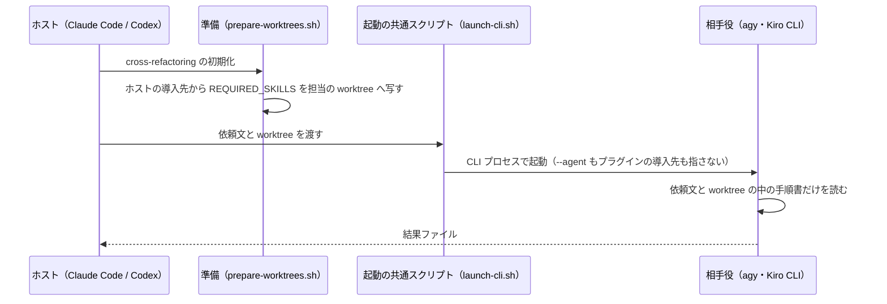
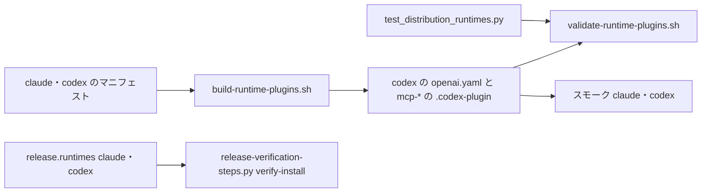

# 配布先は Claude Code と Codex で、agy・Kiro CLI は cross 系の相手役としてだけ起動する

マーケットプレイスのすべてのプラグイン（ndf・playwright-kit・mcp-* 10 個）を、Claude Code と Codex へすべての Skill で
配る。agy と Kiro CLI へは何も配らず、cross-review / cross-refactoring の相手役として、ホスト（Claude Code・Codex）から
CLI プロセスで起動するだけにする（#2231）。

**この文書が配布先の正本である。** 次の確定仕様に残る agy・Kiro CLI への配布・導入物（`dev.agy/`・`dev.kiro/`・
`agy-skills.txt`・`kiro-skills.txt`）・その生成と検査・スモークの記述は、配布先を 4 つにしていた時点のもので、
配布先についてはこの文書が優先する。

| 確定仕様 | 配布先を 4 つにしていた時点の記述 |
| --- | --- |
| [runtime-plugin-distribution.md](runtime-plugin-distribution.md) | Kiro CLI・agy の名前空間ディレクトリ、manifest、agy のエージェント定義の生成 |
| [runtime-plugin-container-smoke.md](runtime-plugin-container-smoke.md) | Kiro の像・adapter・確認 |
| [ndf-knowledge-and-kiro.md](ndf-knowledge-and-kiro.md) | Kiro CLI の導入（installer・symlink・steering） |

## 概要

| ランタイム | 役割 | 届けるもの |
| --- | --- | --- |
| Claude Code | 配布先・ホスト | すべてのプラグイン。NDF は `plugins/ndf/manifests/claude-skills.txt` の Skill |
| Codex | 配布先・ホスト | すべてのプラグイン。NDF は `plugins/ndf/manifests/codex-skills.txt` の Skill |
| agy | 相手役 | 何も配らない |
| Kiro CLI | 相手役 | 何も配らない |

agy・Kiro CLI のためだけに保っていた導入物・その生成と検査・スモークテスト・リリース後の導入の確認を外し、
agy・Kiro CLI だけで起きる不具合（Skill の本文の切り詰めなど）の置き場を無くした。相手役の起動経路は配布物を
読まないため、配布を止めても相手役の振る舞いは変わらない。

## 用語

配布先のランタイム・相手役・マニフェスト・ホストの定義は、用語集（[docs/glossary.md](../glossary.md)）にある。

## 背景

利用者の指示（2026-10-31）は「claude と codex のみ、すべての plugin を配布する。agy、kiro は配布せず、cross 系で
呼ばれるだけ」である。agy・Kiro CLI へ cross 系をホストとして回せる Skill だけを配る案は採らない。ホストとしての
使い方を残さないため、相手役に要る Skill は 0 本になる。マニフェストを空のファイルにして導入物の枠を残す案も
採らない。中身の無い導入物のために生成・検査・スモークを保つことになる。

この変更は配布物の取得元を変える操作（プロジェクト MVV の P1）に当たり、承認ゲート 1 の指示と承認ゲート 2 の承認で行った。

## 仕様

### 常に成り立つ条件

| # | 条件 | 破れたときの扱い |
| --- | --- | --- |
| I1 | どのプラグインにも `manifests/agy-skills.txt`・`manifests/kiro-skills.txt`・`dev.agy/`・`dev.kiro/` が無く、`.ndf/supervise.json` の `release.runtimes` は `claude`・`codex` の部分集合である | `scripts/tests/test_distribution_runtimes.py` が落ちる |
| I2 | Claude Code と Codex の配布物（両マニフェスト・各 `.codex-plugin/plugin.json`・`plugins/ndf/hooks/codex.json`・codex 向けの生成物）は配布先を絞った前と同じである | `build-runtime-plugins.sh --check`・`validate-runtime-plugins.sh`・既存の pytest |
| I3 | agy・Kiro CLI を相手役にする起動（`plugins/ndf/scripts/lib/launch-cli.sh` の `agy` / `kiro` の分岐、`cross-refactoring/scripts/prepare-worktrees.sh` の手順書の写し先）は配布先と関わらずに動く | 起動の既存の pytest |
| I4 | 前の版で Kiro CLI へ入れた手元の hook が呼ぶ共通のスクリプト（`plugins/ndf/scripts/hook.py` の `--runtime kiro`・`worktree-guard.sh`・`worktree-session.sh`・`wait-notify.py`）が残る | `worktree/tests/test_guard.py` の Kiro の入力のテスト |
| I5 | ワークフローのジョブと ruleset の必須のチェックが一致する | `required-checks-check`（`scripts/check-required-checks.py`） |

### 相手役として起動されるとき

- cross-review のレビュー担当の依頼文は Skill を読まずに完結する（`cross-review/scripts/launch-reviewer.sh` の `render_review_prompt`）
- cross-refactoring は `REQUIRED_SKILLS`（`refactoring`・`tdd-cycle`・`quality-gates`）を**ホストの導入先**から担当の worktree
  （Kiro CLI は `.kiro/skills`、agy は `.agents/skills`）へ写す
- 起動の形の正本は `plugins/ndf/skills/external-ai/references/cli-kiro.md`・`cli-agy.md` にある。相手役に使えるかは
  `.ndf/runtimes.json` と各 CLI の認証で決まる。cross-review の既定の参加者（claude・codex・kiro とホスト、agy は `--include agy`）は変わらない

### 配布物を組み立てて確かめる流れ

## データ・設定

| 置き場 | 値 |
| --- | --- |
| `plugins/ndf/manifests/` | `claude-skills.txt`・`codex-skills.txt` だけ（行数は manifests が持つ） |
| `plugins/playwright-kit/manifests/` | `claude-skills.txt`・`codex-skills.txt` だけ |
| `.ndf/supervise.json` の `release.runtimes` | `["claude", "codex"]` |
| `.ndf/pace.json` の `verify` | `release-verification-steps.py verify-install --ref develop --runtimes claude,codex` |
| `release-verification-steps.py` の `--runtimes` | 既定 `claude,codex` |
| `.ndf/project.json` の `required_checks` | スモークは `runtime-smoke (claude)`・`runtime-smoke (codex)` |
| `.github/workflows/runtime-plugin-smoke.yml` の matrix | `runtime: [claude, codex]`。`runtime-plugin-authenticated-smoke.yml` の選択肢も `all`・`claude`・`codex` |
| `tests/runtime-smoke/` | `Containerfile.{base,claude,codex}`・`adapters/{claude,codex}.sh` |

`.ndf/worktree.json` の `.kiro/`（相手役の設定を置く場所）と、`scripts/token-usage.py` の kiro・agy の使用量の読み取り
（相手役の使用量）は相手役の経路として残る。

## 運用

### 前の版で agy・Kiro CLI へ入れた利用者の手元

こちらから手元を消す操作はしない（共通原則 C6）。最後に配った版は v10.27.4 である。残し方と消し方の正本は
`plugins/ndf/README.md` の「agy・Kiro CLI への配布の終了」にある。

| ランタイム | 配布を止めた後 |
| --- | --- |
| agy | 導入の写し（`~/.gemini/config/plugins/ndf/`）の絶対パスを指すため、そのまま動く。新しい版は届かない |
| Kiro CLI | `.kiro/agents/ndf.json` の hook は clone の共通のスクリプトを呼び、それが残る（I4）ため、clone を進めても動く。installer は無くなる |

共通のスクリプトの Kiro の分岐は消さない。消すと clone を進めた Kiro CLI の利用者で、プロンプトを送るたびに hook が失敗する。
いつ消すかは棚卸しで利用の実態を見て決める。

### 範囲の外に残したもの

Claude Code・Codex へ配る Skill の本文とスクリプトに残る、ホストとしての Kiro CLI・agy の分岐（例: `plugins/mcp/mcp-redash/scripts/redash-mcp-config.js`
の `syncKiroAgent`、cross-review の `docs/01-state-and-review.md` のホストの導入先の候補）は消していない。相手役としての記述
（担当の worktree の `.kiro/skills`・`.agents/skills`）と同じファイルに並び、取り違えると相手役の経路を壊すためである。
棚卸しで扱う。

`KIRO.md` は指示書のチェック（`.ndf/instructions.json`）が読む指示書として残し、相手役としての Kiro CLI の説明だけを持つ。

### 確かめていないこと

| 項目 | 内容 |
| --- | --- |
| プロジェクト MVV との食い違い | Mission は 4 つのランタイムを挙げる。改訂は #2296 で扱う |
| 相手役が配布を止めた後も同じ結果を返すか | 起動の経路をコードで読んで判断した。実物はリリース後テストで確かめる |

## テスト観点

- `scripts/tests/test_distribution_runtimes.py` が、`plugins/` の下の agy・Kiro CLI の導入物とマニフェストの不在と、
  `release.runtimes` が `claude`・`codex` に収まることを確かめること。`plugins/mcp/mcp-notion/dev.kiro/` を 1 つ戻すと落ち、
  `release.runtimes` に `kiro` を足すと落ちること
- `build-runtime-plugins.sh --check`・`validate-runtime-plugins.sh` が agy・Kiro CLI の生成物を求めずに通ること
- Codex のマニフェスト・`.codex-plugin`・`hooks/codex.json` が配布先を絞った前と同じであること
- 相手役の起動の pytest（`test_lib_launch_cli_runtimes.py`・`cross-review/tests/test_launch_cli_runtimes.py`・`test_launch_agy.py`・
  `cross-refactoring/tests/test_launch_agy_phases.py`・`test_prepare_worktrees.py`）が通ること
- `worktree/tests/test_guard.py` の Kiro の入力のテストが通ること
- スモークの matrix が `[claude, codex]` で通り、`required-checks-check` が通ること
- リリース後に、新しい版を入れた環境から `/ndf:cross-review <PR> --include agy` と `/ndf:cross-refactoring <PR>` を回し、
  agy・Kiro CLI の結果ファイルが揃うこと

## 関連リンク

- [runtime-plugin-distribution.md](runtime-plugin-distribution.md): Claude Code・Codex の配布の形
- [cross-review-participants-and-seats.md](cross-review-participants-and-seats.md): 参加者プール
- [docs/versioning-and-distribution.md](../versioning-and-distribution.md): 版と配布の正本
- #2231
