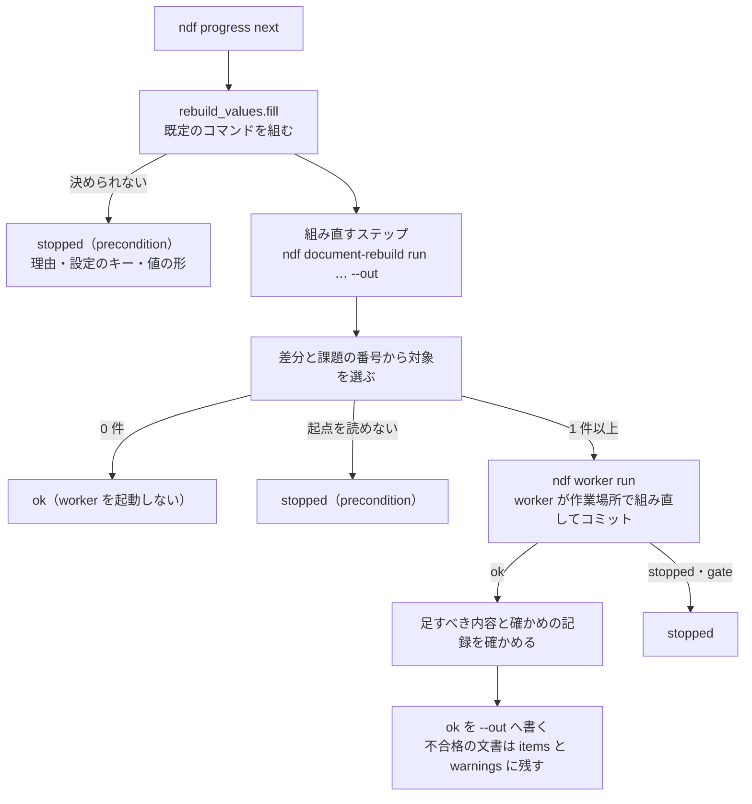

# 文書の組み直しの既定のコマンド: 設定が無いリポジトリでも、設計とドキュメント再構成が流れる

## 概要

**`.ndf/project.json` に組み直しのコマンド（`workflow.launch.rebuild`）を持たないリポジトリでも、工程「設計」と「ドキュメント再構成」のプランが組める。** 工程を始める前の準備（`ndf progress next`）が既定のコマンド `ndf document-rebuild run` を組み、組み直すステップでこのサブコマンドが、差分と課題の番号から文書を選んで worker を 1 回起動する。worker はプランの作業場所で組み直してコミットし、サブコマンドは worker の結果を確かめてから結果ファイル（`--out`）を書く。設定があれば、今までどおり設定のコマンドだけを使う。

例: 課題 4337・ベースブランチ `main` の工程「設計」では、準備が次のコマンドを組む。`{state_dir}` はプランの実行がステップを打つときに絶対パスへ置き換え、`--out <ファイル>` はテンプレートが後ろに足す。

```text
ndf document-rebuild run --base main --remote origin --issue 4337 --kind design --state-dir {state_dir}
```

組み直しの手順そのもの（参照の選び方・読み手役の確かめ・報告の形）は [document-rebuild の SKILL.md](../../plugins/ndf/skills/document-rebuild/SKILL.md) が正で、その形にした理由は [ndf-document-rebuild.md](ndf-document-rebuild.md) にある。この文書は、工程からその手順を起動する既定のコマンドを扱う。

## 用語

「文書形式」「読み手役」など文書の組み直しの語の定義は、用語集（[docs/glossary.md](../glossary.md)）の「NDF の文書の組み直し（`ndf-document`）」が正である。この文書では、次の語を次の意味で使う。

| 語 | 意味 |
| --- | --- |
| 設計書 | `issues/issue-<番号の並び>-design` で始まる Markdown（設計書・決定の記録・詳細設計書） |
| 要求仕様のコピー | `issues/issue-<番号>-requirements.md`。正は課題の本文なので、どの工程でも組み直さない |
| 設計書を省いた実装計画 | `issues/issue-<番号>-plan.md` のうち、最初の `##` より前に、行頭が `省いた文書: 設計書` で直後が `（` か行末の行を持つもの |
| 原稿 | 差分にある、`issues/` の外の Markdown。組み直すのは `documentation` モードのときだけ |
| 起点 | 差分を測る基準のコミット。ベースブランチのリモート追跡ブランチを先に使う（「起点の決め方」） |
| 差分 | 起点と `HEAD` の分岐点から `HEAD` までに足すか変えたファイル。消したファイルは含まない |
| 確かめの記録 | 対象の文書ごとに、誰がどう確かめたかを worker が結果ファイルの `metrics.readers` に書いたもの |

## 背景

工程「設計」と「ドキュメント再構成」のプランは、差し込み `rebuild` に組み直しのコマンドを入れる。レビュー（`review`）とリファクタリング（`refactor`）は設定が無ければ既定のコマンドを組むが、`rebuild` だけは設定（`workflow.launch.rebuild`）が唯一の出所だった。そのため、NDF を導入しただけのリポジトリの `standard` のスプリントは、工程「設計」の始めで `stopped`（`precondition`）になり、2 つの工程を手で済ませて `ndf progress finish` で閉じるしかなかった（[#4337](https://github.com/devbasex/ai-plugins/issues/4337)）。

ai-plugins は、既定ができるまでの代わりにスクリプト `scripts/launch-document-rebuild.sh` を設定に置いていた（PR [#4379](https://github.com/devbasex/ai-plugins/pull/4379)）。このスクリプトには、PR [#4367](https://github.com/devbasex/ai-plugins/pull/4367) のレビューで 3 つの問題が見つかった。差分の起点が `origin/main` に固定されていること、`issues/*.md` をすべて worker へ渡すこと、`issues/` の外の原稿を見ないことである。既定のコマンドは、この 3 つを起こさない形にした。

設計の主な判断と理由は次のとおりである。

| # | 決定 | 理由 |
| ---: | --- | --- |
| 1 | 工程の前の準備はコマンドだけを組み、対象の文書は組み直すステップを打つときにサブコマンドが選ぶ | 準備の時点では設計書がまだ無い。シェルの 1 文で書くと、課題の番号の照合・実装計画の頭の読み取り・結果の確かめを単体テストで確かめられない |
| 2 | 起点はどの `doc_prs` でもベースブランチにし、設計書は名前の番号で絞る | 作業場所がスプリントブランチそのものでも空にならず、マージ済みの別の課題の設計書を組み直さない |
| 3 | 起点はリモート追跡ブランチを先に使う | 手元のベースブランチの古さや未 push のコミットで対象が変わらない。スプリントの PR の差分はリモートのマージ先に対して決まる |
| 4 | 原稿は差分から選び、`documentation` モードだけに限る | 原稿のパスを書く工程の出力が無いので、入力で受けると conductor が毎回手で入れることになる |
| 5 | `ndf worker run` が起動する組み直しの worker に限り、読み手役のサブエージェントを立ててよい例外を作り、記録が無ければ済んだとしない | 起動指示の書き方ひとつで確かめが省かれた前例がある（PR #4379） |
| 6 | 結果ファイル（`--out`）は worker でなくサブコマンドが書く | `text` の無い項目や記録の欠けをそのままレビューへ渡さない |
| 7 | `rebuild` を差し込み `base` より先に決め、決められなければ理由・設定のキー・値の形を同じ行に載せる | `base` の誤りが先に出ると、設定を置けば始まることが結果から読めない |
| 8 | ai-plugins の代わりの設定とスクリプトは、既定を持つ版のリリース後テストが通った後の別の PR で消す | 既定を持たない版で動いているスプリントを止めない |
| 9 | 設計書を省いた実装計画は、差分でなく課題の番号で選ぶ | 設計 PR がマージコミットで入ると差分が空になり、実装計画がどちらの工程でも組み直されない |

## 対象範囲

含む:

- 設定が無いときの、工程「設計」「ドキュメント再構成」の `rebuild` の既定のコマンド
- サブコマンド `ndf document-rebuild run`（対象の選び方・worker の起動・結果の確かめ）
- 既定を決められないときに `ndf progress next` が返す内容
- `ndf document-rebuild run` が起動する worker に限った、読み手役の起動の例外

含まない:

- 工程の外でテンプレートを使う経路（`ndf route render`・`run`）の既定。`rebuild` は今のとおり引数で渡す
- 設計 PR のマージ先の決め方（`branch_strategy.sprint.doc_prs` は読まない）
- `document-rebuild` の手順と、工程表の工程の増減
- 工程「ドキュメント再構成」で読み手役が不合格とした文書を、ドキュメントレビューとリリース承認へ渡すこと（[#4459](https://github.com/devbasex/ai-plugins/issues/4459)）

## 仕様

### 構成要素と責務

パスは `plugins/ndf/` からの相対で書く。

| 要素 | 責務 |
| --- | --- |
| 既定の組み立て（`src/ndf/progress/rebuild_values.py`） | 設定が無いときに既定のコマンドを組む。工程とモードから文書の種類を決める対応（`KINDS`）を持つ。ベースブランチとリモートの名前を 1 回だけ決め、テンプレートが使うならまだ値の無い `base`・`remote` にも同じ値を返す。決められなければ `Undecided`（理由）を返す |
| 差し込みの値を集める処理（`src/ndf/progress/invoke.py` の `template_values`） | `rebuild_values.fill` を `route.derived_locally` より先に呼ぶ。`Undecided` なら `TemplateValuesMissing` の `rebuild` の行に `reason`・`setting`・`shape` を足して上げる |
| サブコマンドの入口（`src/ndf/domains/docrebuild/cli.py`） | `ndf document-rebuild run` の引数を定義し、`drive` を呼ぶ。結果を共通の結果スキーマと専用の結果スキーマで確かめ、`--out` と標準出力へ同じ結果を書く |
| 組み直しの駆動（`src/ndf/domains/docrebuild/drive.py`） | 起点を決め、差分を読み、対象を選び、起動指示を組み、`ndf worker run` を 1 回打ち、worker の結果を確かめる。コミット・push・GitHub への書き込みを持たない |
| 対象の選択（`src/ndf/domains/docrebuild/select_decide.py`） | 差分のパス・実装計画の頭・通常ファイルかどうかから対象を選ぶ。ファイルも git も読まない |
| 課題の文書の名前（`src/ndf/core/issue_docs.py`） | 設計書のパスの正規表現（`DESIGN_FILE`）・名前に含む課題の番号（`design_issues`）・実装計画のパスの書式（`PLAN_FILE`）。`ndf loop design-tests`・リファクタリングの既定・組み直しの選択がここを読む |
| 起動指示のテンプレート（`contracts/worker/document-rebuild.md`） | 組み直す worker への指示。差し込みは `string.Template` の `$targets`・`$skill` |
| 工程の定義（`contracts/workflow/stages/document-rebuild.json`） | 入力に `mode` を持つ。値はスプリントの文脈の `mode`（`ndf progress new --mode` が書く） |

**`ndf.domains.docrebuild` は `ndf.progress` を読まない。** 工程とモードから文書の種類を決める対応は、下流の `rebuild_values` が持つ。サブコマンドは引数（ベースブランチ・リモート・課題・種類）だけを受けるので、工程やモードを足しても組み直しの側は変わらない。



### 常に成り立つ条件

| # | 条件 | 破れたときの扱い |
| --- | --- | --- |
| I1 | worker に渡す文書は、引数の種類と課題に合う、作業場所の通常ファイル（リンクでないもの）だけである。設計書と原稿は差分にあるものに限る（設計書を省いた実装計画は差分によらない） | 選ばない |
| I2 | 起点を決められなければ、対象を 0 件とみなさない | `stopped`（`precondition`） |
| I3 | `ok` の結果は足すべき内容を 1 件ずつ `id` と `text` で持つ。worker の足すべき内容は、どの対象の文書のものか（`doc`）を持つ | `stopped`（`bad_report`） |
| I4 | worker を起動した `ok` の結果は、対象の文書ごとに確かめの記録をちょうど 1 件持つ | `stopped`（`incomplete`。欠けた文書を `gaps` に挙げる） |
| I5 | 読み手役が不合格（`fail`）とした文書は、`items` と `warnings` に 1 件ずつ現れる | 項目はサブコマンドが記録から組むので、worker の報告では破れない |
| I6 | `items` の `id` は 1 つの結果の中で重ならない | `id` はサブコマンドが振る（worker の `id` は使わない） |
| I7 | worker が作業を残した・判断を求めた組み直しは、`ok` にも `gate` にもならない | `stopped` |

### 既定のコマンドを組む（工程を始める前）

`rebuild_values.fill` は、テンプレートが `rebuild` を使い、設定のコマンドがまだ入っておらず、テンプレートの名前が下の表にあるときだけ働く。設定 `workflow.launch.rebuild` があれば何もせず、`base` も今のとおり求める。

| テンプレート | モード | `--kind` |
| --- | --- | --- |
| `design` | すべて | `design` |
| `document-rebuild` | `documentation` 以外 | `design`・`plan` |
| `document-rebuild` | `documentation` | `design`・`plan`・`manuscript` |

値は次の順に決める。

1. 工程の入力に課題が無ければ、`Undecided`（`工程の入力に課題が無い`）を返す
2. ベースブランチ: `base` にまだ値が無ければ、読み込み済みの設定から `branch_strategy.of_project(project).pr_target("sprint")` で決める。失敗（`StrategyError`）なら、その理由で `Undecided` を返し、リモートは求めない
3. リモートの名前: `remote` にまだ値が無ければ `Git(cwd).remote()` で求める。メインディレクトリの `.ndf/worktree.json` の `remote` を読み、無ければ既定値（今は `origin`）を使う。作業場所の worktree の設定は読まない。失敗（`GitError`）なら `Undecided` を返す
4. `ndf document-rebuild run --base … --remote … --issue …（課題ごと） --kind …（種類ごと） --state-dir {state_dir}` を組む

決めたベースブランチとリモートの名前は、テンプレートが `base`・`remote` を使えばその値にも入れる。`route.derived_locally` は値のある `base`・`remote` を求め直さないので、設計のプランの `rebuild` の `--base` と差し込み `base` は同じ値になる。ブランチ戦略の設定の読み込みと `Git.remote()`（中で `git worktree list --porcelain -z` を打つ）は、準備の中でそれぞれ 1 回である。

### 起点の決め方（組み直すステップ）

`HEAD` を `git rev-parse` で解決した後、起点の参照を次の表で決める。`Git.remote()` は名前の形だけを確かめるので、リモート追跡ブランチが読めないときだけ、登録済みのリモートの一覧（`git remote`）を読んで分ける。

| リモート追跡ブランチ `refs/remotes/<リモート>/<ベース>` | 登録済みのリモート | 起点の参照 |
| --- | --- | --- |
| 読める | 読まない | リモート追跡ブランチ |
| 読めない | 求めた名前がある（ベースブランチを取得していない） | 手元の `refs/heads/<ベース>`。これも読めなければ `stopped`（`precondition`） |
| 読めない | 1 つも無い（リモートの無いリポジトリ） | 同上 |
| 読めない | ほかの名前だけがある（設定の誤記・設定漏れ） | 手元へ切り替えず `stopped`（`precondition`）。登録済みの名前と、直す設定 `.ndf/worktree.json の remote` を示す |

差分は `git diff --name-only -z --diff-filter=d <起点の SHA>...<HEAD の SHA> --`（3 ドット差分）で読む。`git merge-base` を別に打たない。分岐点が無いと git は終了コード 128 で終わるので、`stopped`（`precondition`）にして起点の参照の名前と git の文を示す。手元とリモート追跡の 2 つの参照を分岐点の計算に渡さないのは、リモートに入っていない手元のコミットまで起点の側に数え、PR の差分にある原稿が選ばれなくなるためである。

ステップ 1 回が打つ git の子プロセスは、対象を選ぶまでに 3 回（`HEAD` とリモート追跡ブランチの `git rev-parse`・`git diff`）、リモート追跡ブランチが読めないときは 5 回（加えて `git remote` と手元の参照の `git rev-parse`）である。ネットワークと GitHub は使わない。

### 対象の選び方

差分のパスごとに種類を決め、`--kind` にある種類だけを候補にする。

| `--kind` | 選ぶ文書 |
| --- | --- |
| `design` | 差分にある設計書のうち、`issue_docs.DESIGN_FILE`（`^issues/issue-(\d+(?:-\d+)*)-design[^/]*\.md$`）の番号の並びを `-` で分けた整数のどれかが `--issue` に当たるもの（課題 433 は `issue-4337-design.md` に当たらない） |
| `plan` | `--issue` の番号ごとの `issues/issue-<番号>-plan.md` のうち、設計書を省いた行を持つもの。差分にあるかは見ない |
| `manuscript` | 差分にある、`issues/` の外の `*.md` |

要求仕様のコピーと、省いた行を持たない実装計画は、どの種類にも当たらない。省いた行の照合は行全体でなく行頭で行う。`implementation-plan` の手順が書く行は、後ろに満たした条件が続くからである（`省いた文書: 設計書（課題 1・…）` は当たり、`省いた文書: 実行計画（…）` や `省いた文書: 詳細設計書（…）` は当たらない）。

候補は作業場所で `lstat` し、通常ファイルだけを対象にする（I1）。実装計画の頭は、通常ファイルと確かめたものだけを UTF-8 で読む。次のものは対象から外し、`<パス>: <理由>` の形で結果の `warnings` に 1 件ずつ載せる。

| 外す場合 | 理由の文 |
| --- | --- |
| シンボリックリンク・サブモジュールなど | `通常ファイルでない` |
| 差分にあるが作業場所に無い | `作業場所に無い` |
| `lstat` が失敗した | `確かめられない（<例外>）` |
| 実装計画を UTF-8 で読めない・読み取りが失敗した | `UTF-8 で読めない` など |

作業場所に無い実装計画（その課題が実装計画を書かない）と、省いた行を持たない実装計画は、選ぶ条件に合わないだけなので `warnings` に載せない。

### worker の起動

対象が 0 件なら worker を起動せず、`ok` で `summary` を `組み直す文書が無い（種類: …・起点: …）`、`items` を空、`metrics.targets` を空にして返す。

1 件以上なら、起動指示のテンプレートに対象と手順書のパスを差し込み、`<--state-dir>/document-rebuild.prompt.md` へ書く。次に `ndf worker run --kind document-rebuild --prompt-file … --result-file <--state-dir>/document-rebuild.result.json --cwd <作業場所> --state-dir …` を 1 回打つ。worker はプランの作業場所で動き、組み直した文書を自分でコミットする。サブコマンドが起動する子プロセスは、git の読み取りと `ndf worker run` だけである。

起動指示には次のことを書く。

- 対象のパスと種類。設計書には、その設計書と組になる要求仕様のコピー（作業場所にある通常ファイル）を添える。組になるのは設計書のファイル名に含まれる課題の番号すべての要求仕様で、`--issue` には限らない（`--issue 7` で `issue-7-8-design.md` を選べば、課題 7 と 8）。読み手役には、その設計書に添えたコピーだけを渡させる
- 作業場所でコミットし、push も Pull Request もしないこと。要求仕様のコピーと対象の外の文書を変えないこと
- 対象の外で直すべきことは、当たる対象の `doc` を添えて足すべき内容（`items`）に書くこと
- 文書ごとに確かめの記録を `metrics.readers` に書くこと

**誰が確かめるか**は、`document-rebuild` の「読み手役に読ませる」の「対象」の行に従う。設計書と、対象に当たる種類の原稿（ビジネス文書・変更履歴・README・利用者への案内など）は読み手役が確かめる。実装計画と、対象に当たらない種類の原稿（AI への手順書など）は、組み直した worker 自身が読み直す。原稿がどちらに当たるかは worker が文書を読んで決め、コードは確かめない。

**読み手役の起動の例外**: worker は別のサブエージェントを起動しない（[agent-layers.md](../../plugins/ndf/skills/development-workflow/references/agent-layers.md)）。この原則の例外は、`ndf document-rebuild run` が `ndf worker run` で起動した組み直しの worker だけである。読み手役の対象の文書 1 件につき最大 2 回（1 回目が不合格のときだけ 2 回目）、読み手役のサブエージェントを立ててよい。`ndf worker run` は `Permission.FULL` で起動し、許す Tool に `Agent` を含む。supervisor がサブエージェントとして起動する `ndf:worker` は、定義（`agents/worker.md`）が `Agent` を外しているので立てられず、例外は当たらない。組み直しの起動指示は、規則 1 で起動を禁じる `contracts/worker/prompt.md` からは作らない。

立てられなかったときは、worker は自分で読み直して代えず、記録に `not_run` と理由を書く。ステップは `stopped`（`precondition`）で止まる。従来は、自分で読み直して `ok` で進んでいた。記録の中身が事実かどうか（本当に読ませたか）は、コードは確かめない。

`ok` のときは、読み手役が読んだ文書を、作業場所のブランチと blob を付けて `reading-docs.jsonl` に記録する。承認の前の確認が、この記録と比べて変わった部分だけを読ませる（[ndf-reading-check-before-approval-gate.md](ndf-reading-check-before-approval-gate.md)）。

### worker の結果の読み方

`ndf worker run` の標準出力と worker の結果ファイルは中身が違うので、次の順に読む。

1. 標準出力の最後の空でない行の結果 JSON（`result.last_line`）を読む。無いか形が違えば `stopped`（`bad_report`）にする
2. `status` が `ok` でなければ、結果ファイルを読まずに `stopped` を返す（I7）。`gate` は `work_stopped` にする。ほかは worker の `cause.kind` を引き継ぎ、`incomplete` なら `gaps` も載せる
3. `ok` のときだけ worker の結果ファイルを読み、`items` と `metrics.readers` を確かめる。標準出力の `items` はセッションの情報なので、足すべき内容として読まない

`gate` を `stopped` にするのは、ステップが `gate` を返すと、プランの実行（`runner._result_of`）が `routes` を見ずに `approved` の行き先（push の側）を次のステップにするからである。そのまま返すと、承認だけで組み直しと確かめを飛ばして push に進む。止まった後は `ndf progress retry` でプランを打ち直す。組み直すステップが対象を選び直し、worker を新しく起動する。

結果ファイルの確かめは、足すべき内容 → 確かめの記録の順に行う。

- **足すべき内容**: `items` は並びで、要素ごとに空でない `text` と、対象の文書のどれかに当たる `doc` を持つ。違えば `stopped`（`bad_report`）。`id` は結果ファイルの並びの順に `add-1`・`add-2` … と振り直す（I6）。レビューの指摘の結果は `id` をキーに数えるので、worker の `id` を残すと、重なった 2 件の片方の処置で両方が処置済みになるからである
- **確かめの記録**: 対象の文書ごとに、`doc` が一致する記録がちょうど 1 件あり、下の表に合うこと。合わない文書は `gaps` に `{"kind": "reader", "name": <パス>, "reason": <欠け>}` で 1 件ずつ挙げ、`stopped`（`incomplete`）にする（I4）
- **不合格の文書**: `verdict` が `fail` の文書を、パスの順に `reader-1`・`reader-2` … の項目（`text` は文書・不合格の質問・理由）として `items` に足し、同じ文を `warnings` にも載せる（I5）。ステップは `ok` で進む
- **対象の外の記録**: `items` にも `metrics.readers` にも入れず、`warnings` に外した件数だけを載せる

| `verdict` | 意味 | 使える種類 | `checks` の数と `reason` |
| --- | --- | --- | --- |
| `pass`・`fail` | 読み手役の最後の結果（最後の `checks` の `verdict` と同じ） | `design`・`manuscript` | 1 回目が合格なら 1。不合格で直して読み直したら 2 で、先頭は `fail`。`fail` で 2 回目を行えなければ 1 と、行えなかった理由 |
| `not_run` | 読み手役の対象だが、1 回も立てられなかった。ステップは `stopped`（`precondition`）になる | `design`・`manuscript` | 0（空の並び）。立てられなかった理由 |
| `self` | 読み手役の対象でない文書を、worker 自身が読み直した | `plan`・`manuscript` | 0（空の並び）。文書の種類（例: `実装計画`・`AI への手順書`） |

`checks` の要素は `{"verdict": "pass か fail", "restatements": [空でない言い直しの文…], "reason": "不合格の質問と理由（fail のとき必須）"}` である。上限の 2 は、`document-rebuild` の手順の「回数」（1 回の確認につき立場ごとに 2 回まで）から決まる。設計書と原稿は読み手の立場が 1 つに決まるからである。`self` は `items` にも `warnings` にも足さず、記録にだけ残す。読み手役が確かめたことにはしない。

すべて通れば `ok` で、`summary` は `<件数> 件の文書を組み直した（足すべき内容 <件数> 件・読み手役の不合格 <件数> 件）`、`metrics` は `targets`（対象のパス）と `readers`（スキーマのキーだけに整えた記録）である。

### 既定を決められないときの `ndf progress next`

`stopped`（`precondition`）の `items` の `rebuild` の行に、今のキー（`key`・`source`）に加えて次の 3 つを載せる。工程の記録（`started`・`failed`）は書かない。ほかの差し込みの行は今のとおり 2 つのキーである。

| キー | 値 |
| --- | --- |
| `reason` | 決められなかった理由（例: ブランチ戦略の設定を読む処理が返す理由の文、`工程の入力に課題が無い`） |
| `setting` | `workflow.launch.rebuild` |
| `shape` | `コマンドの語の並び（空でない文字列を 1 つ以上持つ配列）` |

`rebuild` を差し込み `base` より先に決めるので、ブランチ戦略の設定が無いリポジトリでも、工程「設計」は `base` の `invalid` より先にこの行を返す。設定のキーだけを足しても、ブランチ戦略の設定が無ければ工程「設計」は次に `base` で止まる。その場合も `reason` で直す先が先に分かる。

## データ・設定

| 設定・ファイル | 内容 |
| --- | --- |
| `.ndf/project.json` の `workflow.launch.rebuild` | 組み直しのコマンドの語の並び。あれば既定より優先する。形は変えていない |
| `.ndf/project.json` の `branch_strategy` | 既定のベースブランチ（`pr_target("sprint")`）の出所。無ければ既定を決められない |
| メインディレクトリの `.ndf/worktree.json` の `remote` | 既定のリモートの名前の出所。無ければ既定値（`worktree.schema.json` の `remote` の `default`、今は `origin`） |
| `<--state-dir>/document-rebuild.prompt.md` | worker への起動指示の控え |
| `<--state-dir>/document-rebuild.result.json` | worker が書く結果ファイル（`ndf contracts emit --tool worker` の形）。`--out` とは別に残る |
| `--out`（既定のコマンドでは `{state_dir}/rebuild.json`） | サブコマンドの結果 JSON。工程「設計」の次のステップ（`ndf cross-review run --findings`）が `items` を読む |
| `contracts/schemas/io/document-rebuild.result.schema.json` | `--out` の専用の結果スキーマ。`metrics.targets`・`metrics.readers` と `items`（`id` は `^(add\|reader)-[1-9][0-9]*$`、`add-` の項目は `doc` が必須） |
| `contracts/schemas/io/document-rebuild.args.schema.json`・`docs/contracts/commands.md` | 引数の定義から規約の生成（`checks/spec_render.py`）が作る。手で書かない |

引数は次のとおりである。

| 引数 | 内容 |
| --- | --- |
| `--base <ブランチ>`（必須） | ベースブランチ（スプリントの PR のマージ先） |
| `--remote <名前>`（必須） | 起点の参照を探すリモート。既定のコマンドでは準備が求めた値で、ステップは求め直さない |
| `--issue <番号>`（1 回以上） | 工程が扱う課題。重なりは除く |
| `--kind <design\|plan\|manuscript>`（1 回以上） | 選ぶ文書の種類。重なりは除く |
| `--state-dir <保存先>`（必須） | 起動指示と worker の結果ファイルの保存先 |
| `--out <ファイル>`（必須） | 結果 JSON を書くファイル |

どの終わり方でも、標準出力の最後の 1 行と `--out` に同じ結果 JSON を書く。書く前に共通の結果スキーマと専用の結果スキーマで確かめ、形が違えば両方とも `stopped`（`invalid`）に差し替える。標準出力だけを差し替えると、プランが止まったと判断した回の項目を、`--out` を読むレビューが引き継ぐからである。

`ndf.checks` の子の課題の表（`src/ndf/checks/children.json`）では、`ndf.progress.rebuild_values` を `P1b`、`ndf.domains.docrebuild` を `M1`、`ndf.core.issue_docs` を `C3` が持つ。`issue_docs` を `C3` に置くのは、`P1b`（`refactor_values`）と `M1`（`design_tests`・`docrebuild`）の両方が読み、規則 `child-deps` が求める `needs` の閉包に両方から入るのが `C3` だからである。

## エラー処理

| 場合 | 結果 |
| --- | --- |
| 準備で、課題が無い・ブランチ戦略の設定を読めない・リモートの名前の形が違う | `ndf progress next` が `stopped`（`precondition`）。`rebuild` の行に `reason`・`setting`・`shape`。工程の記録は書かない |
| 起点の参照をどちらも読めない | `stopped`（`precondition`）。2 つの参照の名前を示す。worker を起動しない |
| 求めた名前のリモートが登録されておらず、ほかの名前だけがある | `stopped`（`precondition`）。登録済みの名前と設定のキーを示す |
| 分岐点が無い・`git diff` が失敗した | `stopped`（`precondition`）。起点の参照の名前と git の文を示す |
| 対象が 0 件 | `ok`。worker を起動しない |
| 起動指示のテンプレートを読めない・起動指示を保存先へ書けない | `stopped`（`precondition`） |
| `ndf worker run` の標準出力に結果 JSON が無い・worker の結果ファイルを読めない | `stopped`（`bad_report`） |
| worker が `stopped`・`gate` で終えた | `stopped`（I7） |
| 足すべき内容の形が違う | `stopped`（`bad_report`） |
| 確かめの記録が欠けた・形が違う | `stopped`（`incomplete`）。欠けた文書を `gaps` に |
| 読み手役を立てられなかった文書がある（`not_run`）・読ませた文書を記録できない | `stopped`（`precondition`） |
| 読み手役が不合格とした文書がある | `ok`。`items`（`reader-<番号>`）と `warnings` に残す |
| 想定外の例外 | `stopped`（`unknown`）を `--out` と標準出力へ書く |
| `--out` へ書けない | 標準出力に `stopped`（`precondition`） |

## セキュリティ

- サブコマンドはコミット・push・GitHub への書き込みを持たない。push と Pull Request は今のとおりプランの後ろのステップが行う
- 対象は作業場所の通常ファイルに限り、シンボリックリンクをたどらない（`lstat`）
- worker が対象の外の文書やファイルを書き換えても、コードでは止めない。工程「設計」では設計 PR の差分とレビューで、工程「ドキュメント再構成」ではドキュメントレビューがスプリントの差分として見る。設計書を書く worker と指摘を直す worker も同じ扱いである

## 運用

| 項目 | 内容 |
| --- | --- |
| 当たるモード | 工程「設計」はすべてのモード（`light`・`operation` は設計が要るときだけ）。工程「ドキュメント再構成」は `standard`・`documentation` と、設計 PR を分けた `legacy-refactor` |
| Claude の起動の回数 | 組み直すステップ 1 回につき `ndf worker run` は 1 回（対象が 0 件なら 0 回）。その中の `claude -p` は通常 1 回で、worker が結果ファイルを書かずに応答を終えると `RESUMES`（今は 3）回まで同じ会話を再起動する。読み手役のサブエージェントは最大「2 ×（設計書の数 + 読み手役の対象の原稿の数）」 |
| 2 回組み直す場合 | 設計 PR を squash でマージして設計書がスプリントブランチの差分に残ると、工程「設計」と「ドキュメント再構成」の両方で組み直し、読み手役の確かめも 2 回かかる |
| 設計 PR の取り込み後 | 設計 PR がマージコミットで入ると差分から設計書が外れ、工程「ドキュメント再構成」では選ばれない。その後に書いた詳細設計書や直した設計書は差分に出るので選ばれる |
| 原稿の選び方の代償 | `documentation` モードでは、同じブランチで直した原稿でない Markdown（変更履歴など）と、スプリントブランチにマージ済みの別の課題の原稿も対象になる。原稿の名前は課題の番号を持たないので絞れない |
| 前のスプリントの実装計画 | 同じ課題の、省いた行を持つ実装計画が残っていれば、次のスプリントでも 1 回組み直す |
| 不合格の受け渡し | 工程「設計」では、`items` を次のステップ（`cross-review --findings`）が 1 件ずつ直すか見送り、残りを設計承認ゲートで承認する人が見る。工程「ドキュメント再構成」では `items` を読むステップが無く、結果ファイルにだけ残る（[#4459](https://github.com/devbasex/ai-plugins/issues/4459)） |
| ai-plugins の代わりの設定 | ai-plugins の `.ndf/project.json` には `workflow.launch.rebuild`（`scripts/launch-document-rebuild.sh`）が残っており、設定があるので既定のコマンドは使われない。設定とスクリプトは、既定を持つ版のリリース後テストが通った後に消す（決定 8）。消すときは、どのセッションの `ndf` も既定を持つ版以上で、既定を持たない版で始めて工程「ドキュメント再構成」を終えていないスプリントが無いことを先に確かめる |

## テスト観点

テストは `plugins/ndf/tests/progress/test_invoke_rebuild.py`・`tests/progress/test_sprint_templates.py`・`tests/domains/docrebuild/`・`tests/core/test_issue_docs.py` にある。git の読み取りと worker の起動は偽物に替え、渡った対象と結果を見る。

- 設定の無いリポジトリの `standard` のスプリントで、2 つの工程のプランが組め、組み直すステップに `ndf document-rebuild run` と `--out` が入る
- 設定のあるリポジトリでは、2 つの工程とも設定のコマンドが変わらずに使われる
- 設計のプランの差し込み `base`・`remote` と、`rebuild` の `--base`・`--remote` が同じ値で、ブランチ戦略の設定の読み込みと `Git.remote()` が 1 回ずつである
- `branch_strategy` の無いリポジトリで、2 つの工程とも記録を書かずに `reason`・`setting`・`shape` を持つ行が返る
- 別の課題の設計書がスプリントブランチにある作業場所で、渡る対象はこの課題の設計書だけである。作業場所がスプリントブランチそのものでも、この課題の設計書が入る
- ベースブランチが `main` でなくリモートが `origin` でない作業場所でも同じ結果になり、メインディレクトリの `remote` の値のリモート追跡ブランチが起点になる
- 手元のベースブランチが古いとき、ベースブランチへ先に入った文書が対象にならない。手元だけが進んだとき・手元とリモート追跡が分かれたとき、手元だけのコミットの原稿が対象に残る
- 工程「設計」では設計書だけが渡る。`documentation` の差分が原稿だけなら原稿が渡り、`standard` の差分の `docs/` は渡らない
- 省いた行を持つ実装計画が渡り、行の無いもの・`##` より後に行があるもの・別の文書を省いた行だけのものは渡らない。3 ドット差分が空でも、工程「ドキュメント再構成」では実装計画が渡る
- シンボリックリンクの `.md` とリンクの実装計画は対象に入らず、`warnings` に出る。対象が 0 件なら worker を起動せず `ok` で、`summary` から対象が無かったことが分かる
- 起点の参照がどちらも読めない・分岐点が無い・ほかの名前のリモートだけがあるとき、`stopped`（`precondition`）と参照の名前が返る。名前が登録済みでリモート追跡ブランチが無いときと、リモートが 1 つも無いときは手元の参照を使う
- `--out` の `items` が `id` と `text` を持ち、レビューの読み取り（`as_handed`）が読む。`text` の無い項目と、`doc` が対象に無い項目は `bad_report` になる。worker の `id` が重なっても、全件が残り `id` が重ならない
- サブコマンドが起動する子は git の読み取りと `ndf worker run` だけで、push も `git commit` も含まない
- 確かめの記録の欠け（記録が無い・2 件ある・言い直しが無い・`checks` の数が合わない・`self` に理由が無い・種類に使えない `verdict`）は `incomplete` になる。使える組み合わせは欠けにならない
- `fail` の文書は `ok` のまま `reader-1` の項目と `warnings` に出る。対象の外の記録は結果に出ない
- worker が `stopped`・`gate` なら結果ファイルを読まずに `stopped` になる。`ok` なら標準出力のセッション情報でなく結果ファイルの `items` が渡る
- `not_run` の文書があれば `precondition` で止まり、`ok` なら読ませた文書が `reading-docs.jsonl` に残る
- 人が見る観点: 実物の worker で設計書 1 本に既定のコマンドを打ち、`--out` の `metrics.readers` に読み手役の確かめの結果が残るか、立てられなかった理由で止まる
- 人が見る観点: リリースした NDF を隔離した設定ディレクトリへ導入し、`workflow.launch.rebuild` の無いリポジトリで 2 つの工程が流れる

## 関連リンク

- [#4337](https://github.com/devbasex/ai-plugins/issues/4337)（この仕組みを決めた課題）・PR [#4445](https://github.com/devbasex/ai-plugins/pull/4445)（実装）
- [ndf-document-rebuild.md](ndf-document-rebuild.md)（組み直しの手順の形と理由）・[ndf-writing-criteria-and-reading-check.md](ndf-writing-criteria-and-reading-check.md)（読み手役の確認）
- [ndf-stage-plan-work-prompts.md](ndf-stage-plan-work-prompts.md)（工程のプランの差し込みと、リファクタリングの既定の起動）
- [document-rebuild の SKILL.md](../../plugins/ndf/skills/document-rebuild/SKILL.md)・[agent-layers.md](../../plugins/ndf/skills/development-workflow/references/agent-layers.md)
- [起動指示のテンプレート](../../plugins/ndf/contracts/worker/document-rebuild.md)・[結果スキーマ](../../plugins/ndf/contracts/schemas/io/document-rebuild.result.schema.json)
