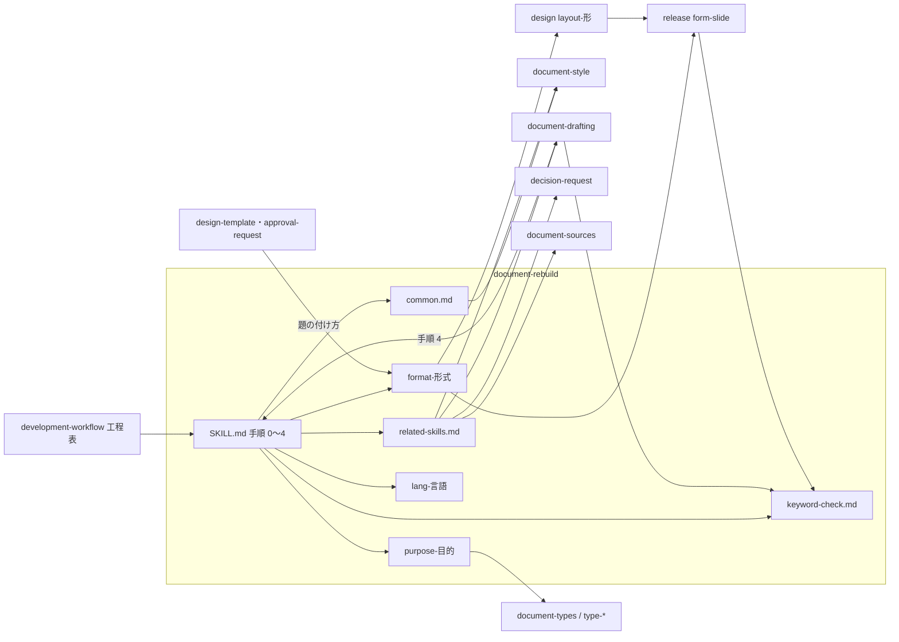

# document-rebuild: 文書形式と目的に合わせて組み直し、読み手の理解を確かめる

## 概要

**`document-rebuild` は、書き上げた文書を、文書形式と文書の目的に当たる参照だけを読んで組み直す。**
形式と目的に関わらない決まりは共通ルールとして 1 か所に置き、他の文書系 Skill の規約は書き写さずに節を指す。

例: 次の文書を組み直すと、手順 0 で読む参照は文書ごとに次のようになる。

```text
#2083 で議論した仕様案（リポジトリの .md、まだ決まっていない論点を含む）
  → format-markdown.md ・ purpose-discussion.md ・ lang-japanese.md
  → 最初の章は「論点」。提案の章は「〜する案とする」で書き、「方針: 〜」と断定しない

docs/presentations/2026-10-17-skill-plugin-development/（社外向けの発表資料）
  → format-slide.md（ページの文言の正本は release の form-slide.md）・ purpose-decided.md（説明・研修の文書タイプ） ・ lang-japanese.md
  → キーワードの確かめで、題の「スキルプラグイン」が公式に無い語と分かり、「スキル」と「プラグイン」へ分ける

docs/specifications/ndf-slide-generation.md（確定仕様）
  → format-markdown.md ・ purpose-decided.md ・ lang-japanese.md
  → 最初の章は「何が決まったか」
```

この文書は、その形に**なぜしたか**（決定と理由・常に成り立つ条件・Skill 間の正本の割り当て・テスト観点）を持つ。
組み直しの手順（手順 0〜4・読み手役の確かめ・報告の形）は
[`document-rebuild` の SKILL.md](../../plugins/ndf/skills/document-rebuild/SKILL.md) が、
共通ルールの一覧は [references/common.md](../../plugins/ndf/skills/document-rebuild/references/common.md) が、
文書系 Skill の表・文書タイプとの対応・`document-style` と重なっていた規約の正本は
[references/related-skills.md](../../plugins/ndf/skills/document-rebuild/references/related-skills.md) が、
キーワードの確かめ方は [references/keyword-check.md](../../plugins/ndf/skills/document-rebuild/references/keyword-check.md) が持つ。
形式ごとの目安と目的ごとの構成は、各 `references/format-<形式>.md`・`references/purpose-<目的>.md` が持つ。

## 用語

「文書形式」「文書の目的」「共通ルール」「キーワード」「確定事項を伝える文書」「議論用の文書」「形式別ガイド」「目的別ガイド」「読み手役」の
定義は用語集（[docs/glossary.md](../glossary.md)）の「NDF の文書の組み直し（`ndf-document`）」が正である。

「目的」の語は `requirements-design` の `document-requirements.md` の意味（読み手が読み終えた後にどうなるか）のまま残し、
組み直しでは常に「文書の目的」と書く。

## コンテキスト

| コンテキスト | 何の語が 1 つの意味に決まるか |
| --- | --- |
| 文書の組み直し（`ndf-document`） | 文書形式・文書の目的・共通ルール・キーワード・形式別ガイド・目的別ガイド |
| スライドの作成（`ndf-slide`） | 台本・構成メモ・ページの文言 |
| 工程（`ndf-workflow`） | 工程「ドキュメント再構成」・文書タイプ |

**文書の組み直しは、他のコンテキストと文書系 Skill に対して順応者である。** 組み直しは上流の規約をそのまま受け入れ、
言い換えずに節を指す。上流は `document-style`・`release` の `form-slide.md`・`document-drafting`・`decision-request` である。
上流の規約が変わっても、組み直しの参照は書き換えない。

## 背景

組み直しの構成が「何が決まったのか」から始まる 1 種類だけだと、議論用の文書では提案が決定に読める（#2083）。
目安が Markdown の設計文書の実測だけだと、スライド・表計算・小説には測るものが当たらない。
社外向けの題の語を確かめる手順が無いと、公式に無い語がリリースの直前まで残る（#2080）。
書き方の規則と組み直しの目安が別々の Skill に二重にあると、順に掛けたときに往復が起きる（#469）。

## 決定と理由

| # | 決定 | 理由 |
| ---: | --- | --- |
| 1 | 文書形式は `release` の `form-*`・`design` の `layout-*` の区分にリポジトリの Markdown を足したものにする。Notion・Confluence は置き場で、形式はページとする。文書の目的は「構成が 1 つ違えば 1 ファイル」で切り、構成が同じもの（作業レポートと定例報告、説明と確定した設計）は 1 ファイルにまとめる | 既存の Skill の分類とずれない。置き場で分けると `document-systems` と重なり、系統で束ねると 1 つの参照の中に分岐ができる。文書タイプと 1 つの軸にすると、`document-drafting` の「何を書くか」と組み直しの「どう並べるか」が混ざる |
| 2 | `document-style` と `document-rebuild` は統合せず、呼び出しの関係を強める。規則の正本は `document-style`、組み直しの手順・構成・文章量の目安の正本は `document-rebuild` とする | 統合すると本文が `SKILL.md` の上限（5,000 トークン）を超える。書いている最中に規則だけを読みたい場面（Pull Request の本文・コミットメッセージ）が残る |
| 3 | 共通ルールには、形式か目的によって成り立たない決まりを入れない。判断を求める前に経緯・前提・材料を示す決まりは、決議依頼と議論の目的別ガイドへ置く | 判断を求めない文書（小説・手順書）に当たらない決まりを「関わらず守る」と書くと、共通ルールの定義と食い違う |
| 4 | 共通ルールは、読み手に何が成り立つか（目的）を規則にし、手段は例として添える。パス・URL は「表示先でリンクとして認識される形で書く」を規則とし、半角スペースは例とする | 手段だけを規則にすると、表示先や形式が変わったときに規則が目的を外れる |
| 5 | キーワードの確かめは `document-rebuild` の `keyword-check.md` に置き、社外向けに限らずすべての文書に掛ける。`form-slide.md` と `document-drafting` はこのファイルを指す | 組み直しは設計文書にも提出物にも掛かり、題がゲート 1 の前に一度確かめられる。`form-slide.md` に置くとスライド以外に、`document-drafting` に置くと `documentation` モードの外に掛からない。社内の文書にも訳語・造語が残る |
| 6 | `document-drafting` の手順 4（見直す）の中で組み直しを呼ぶ。工程表には行を足さない | 工程「ドキュメント再構成」は設計文書にだけ掛かり、提出物に掛からない。工程名を読むスクリプトとテストを変えずに済む |
| 7 | 実測の無い目安も置き、根拠に「未実測」と書く | 目安を置かないと手順 1 と手順 4 が測るものを持たない。根拠を書かないと、実測の値と同じ重さで読まれる |
| 8 | 議論用の文書の提案の言い回しは `purpose-discussion.md` にだけ置く | 確定事項を伝える文書では断定が正しい。目的に依る決まりを書き方の規則に置くと、どの文書にも条件付きの規則が混ざる |
| 9 | スライドのページの文言の正本は `form-slide.md` の「ページの文言を書く」に残し、`layout-slide.md` と `format-slide.md` はその節を指す | 書く時点の手順として読まれる場所である。正本を組み直しの参照へ移すと、スライドを書く工程が組み直しの参照を読むことになり、読む向きが逆になる |
| 10 | 組み直しの Skill を `document-rebuild`、書き方の規則の Skill を `document-style` と名付け、`document-drafting`・`document-sources`・`document-systems`・`document-style` に `user-invocable: false` を付ける | Claude Code で `/ndf:doc` の候補が `document-rebuild` 1 つになり、利用者の入口が 1 つに決まる。名前が `document-` でそろい、何をする Skill かが読める。工程と AI からは今までどおり呼べる |
| 11 | 手順 3 の最後に、文脈を持たない読み手役に 1 回だけ読ませる。語と順で直せるものだけを直し、内容が足りないものは報告に控える | 文長や構成の位置では、読み手が理解し納得したかは測れない。書き手と同じ文脈を持つ AI が読み返しても思い込みは見つからない。読み直させると指摘が出続けて往復が終わらない |
| 12 | 題は `<対象>: <直すと何ができるようになるか>` の短い 1 文にし、今の問題は題に入れない。Issue・Pull Request・設計文書の題の付け方の正本は `format-markdown.md` に置く | 現象と結果を 1 行に詰めると、どちらも読めない語の並びになる。題の付け方は形式ごとに違うため、形式別ガイドに置けば二重にならない |

## 対象範囲

| 対象 | 置き場 |
| --- | --- |
| 組み直しの手順・参照の選び方・報告の形 | [`document-rebuild` の SKILL.md](../../plugins/ndf/skills/document-rebuild/SKILL.md) |
| 共通ルール・文書系 Skill の表・キーワードの確かめ方 | [`document-rebuild` の references/](../../plugins/ndf/skills/document-rebuild/references/) の `common.md`・`related-skills.md`・`keyword-check.md` |
| 形式別ガイド・目的別ガイド・言語の参照 | 同じディレクトリの `format-<形式>.md`・`purpose-<目的>.md`・`lang-<言語>.md` |
| 書き方の規則とセルフチェック | [`document-style` の SKILL.md](../../plugins/ndf/skills/document-style/SKILL.md) |
| 「工程から呼ぶ専用」の発動制御 | [AUTHORING.md の「発動制御の 5 分類」](../../plugins/ndf/skills/AUTHORING.md#発動制御の-5-分類) |
| 組み直しを呼ぶ側 | `development-workflow` の工程表の「ドキュメント再構成」、[`document-drafting` の SKILL.md](../../plugins/ndf/skills/document-drafting/SKILL.md) の手順 4 |
| 正本を指す側 | `release` の `form-slide.md`、`design` の `layout-slide.md`・`design-template.md`、`development-workflow` の `approval-request.md` |

形式への適用（pptx・Google ドキュメント・表計算の生成、Notion・Confluence への投稿、版面の点検）は対象に入らない。
組み直しは形式別ガイドの「呼び出し先」へ渡すだけである。

## 仕様

### 集約

| 集約 | 持ち主（書き換えてよいもの） | 根 | エンティティ | 値オブジェクト |
| --- | --- | --- | --- | --- |
| 組み直しの規約 | `document-rebuild` | `SKILL.md` | 形式別ガイド・目的別ガイド・言語の参照・共通ルール・キーワードの確かめ方 | 構成・目安（値と根拠）・手がかり |
| 書き方の規則 | `document-style` | `SKILL.md` | 重要ルール・セルフチェック | 直訳の和語の対応表 |
| スライドのページの文言 | `release` | `form-slide.md` の「ページの文言を書く」 | — | — |
| 文書タイプ | `development-workflow`（判定）・`document-drafting`（書く節） | `document-types.md` | `type-*.md` | 読み手が最初に問うこと |

**組み直しの規約は、他の集約を書き換えない。** 二重を解くために他の集約の行を「正本を指す 1 行」へ置き換えた箇所
（`document-style` のルール 9 の冒頭・`layout-slide.md` の「ページの文言と章立て」・`form-slide.md` のキーワードの行・
`document-drafting` の手順 4・`design-template.md` と `approval-request.md` の題の行）だけが例外である。

### 正本の割り当て

| 決まり | 正本 | 指す側 |
| --- | --- | --- |
| 組み直しの手順・構成・文章量の目安 | `document-rebuild` | 工程表・`document-drafting` |
| 書き方の規則（語・表現・図表・ファイルの長さ・パスと URL） | `document-style` の重要ルール | `common.md` の各行・工程表 |
| 章と文の長さ | `format-<形式>.md`（数え方は `lang-<言語>.md`） | `document-style` のルール 9 |
| スライドのページの文言・章扉 | `form-slide.md` の「ページの文言を書く」 | `layout-slide.md`・`format-slide.md` |
| キーワードの確かめ方 | `keyword-check.md` | `form-slide.md`・`document-drafting`・`common.md` の K6 |
| Issue・Pull Request・設計文書の題の付け方 | `format-markdown.md` の「題と見出し」 | `design-template.md`・`approval-request.md` |
| 判断を求める前に示すもの | `decision-request` | `purpose-decision.md`・`purpose-discussion.md` |

`document-style` と重なっていた規約の個別の扱いは
[related-skills.md の「`document-style` と重なっていた規約」](../../plugins/ndf/skills/document-rebuild/references/related-skills.md#document-style-と重なっていた規約) が持つ。



### 常に成り立つ条件

| # | 集約 | 条件 | 破れたときの扱い |
| --- | --- | --- | --- |
| I1 | すべて | 1 つの決まりの本文は 1 ファイルの 1 節にだけある。他のファイルはその節を指す | レビューで二重を指摘し、正本でない側を指す 1 行へ直す |
| I2 | 組み直しの規約 | 1 回の組み直しで読む参照は、形式・目的・言語ごとに多くて 1 つ。当たる参照が無いときは読まずに、その場で決めた構成と目安を報告に残して続ける | 2 つ以上当たるときは読む前に止め、形式か目的を決め直す。当たる参照が無いことは破れではない |
| I3 | 組み直しの規約 | 形式か目的が手がかりで決まらないとき、推測で参照を選ばない | 工程の中では呼び出し元へ、明示の呼び出しでは利用者へ確かめる |
| I4 | 組み直しの規約 | 組み直しは内容を足さない | 説明できない行数の増加は手順 2 へ戻して外す |
| I5 | 組み直しの規約 | 別の Skill が固定した章・必ず書く節・出典の節は、組み直しの前後で残る | 欠けた節を手順 4 の表に出し、手順 2 からやり直す |
| I6 | 組み直しの規約 | 目安の各値に根拠（実測の出所か「未実測」）がある | 根拠の無い値は目安として使わない |
| I7 | 組み直しの規約 | 目安を超えた項目を直すために、手順 4 の後に手順 3 へ戻らない。I4・I5 の破れを直す戻り（手順 2 から）は先に効き、戻った後は手順 2〜4 を通し直す | 目安を超えた項目は理由と採らなかった直し方を残して終える |
| I8 | 組み直しの規約 | 参照を 1 つ足しても、ほかの参照と `SKILL.md` の手順を変えない | `SKILL.md` に形式・目的の一覧を持たせない |
| I9 | 組み直しの規約 | どの文書でも、キーワードごとに語・突き合わせた相手・判定が残る。確かめられなかった語も残る | 報告に「キーワードの確認: 無し」と書かず、欠けとして出す |
| I10 | 組み直しの規約 | 組み直した文書について、読み手役の要点の言い直し・分からなかった箇所・納得できなかった主張が残る。読み手役を立てられなかったときは、その理由が残る | 報告に「読み手の確かめ: 無し」と書かず、欠けとして出す |
| I11 | 組み直しの規約 | 議論用の文書を組み直した後、提案が最初の章に「方針」として置かれない | 論点の章を最初へ戻す |

**手順 3 の中の順（共通ルール → 他の Skill の規約 → `document-style` のセルフチェック → キーワード → 読み手役）は、
I7 を成り立たせるためにある。** 規則の点検を測り直しの前に済ませるので、測り直しの後に文が変わらない。

### 呼び出しの経路

| 経路 | 呼ぶ側 | 当たる文書 |
| --- | --- | --- |
| 工程「ドキュメント再構成」 | `development-workflow` の工程表 | 設計文書。整える手順で `document-style` が掛かるため、工程表は `document-style` の行を別に持たない |
| `document-drafting` の手順 4 | `documentation` モードの執筆 | 提出物（提案書・スライドの台本など）。文書タイプから目的別ガイドを選ぶ |
| 明示の呼び出し | 利用者（`/ndf:document-rebuild`） | 文書形式と目的を問わない |

`user-invocable: false` は Claude Code だけが解釈する。Codex・Kiro・agy では、これらの Skill も通常の Skill として一覧に出る
（AUTHORING.md の「発動制御の 5 分類」）。

## エラー処理

| 場合 | 扱い |
| --- | --- |
| 形式か目的が手がかりで決まらない | 推測せず確かめる（I3） |
| 当たる参照が 2 つ以上ある | 読む前に止めて決め直す（I2） |
| 当たる参照が無い | その場で決めた構成・目安を報告に残し、参照を足す候補として報告する（I2） |
| 測る手段が無い | 「測れなかった」と残す。「目安に収まっている」と書かない |
| 目的に要る章が欠けている・読み手役が前提や根拠の不足を返した | 書き足さず、「足すべき内容」として報告に控える（I4） |
| 規約どうしが食い違う | 他の Skill の節を正本として従い、食い違いを `out-of-scope` で Issue にする。目的別ガイドが「行わない」とした事柄は例外で、先に効かせる |
| 公式の出所が見つからない語 | 「確かめられなかった」と残し、語を変えない |
| 読み手役を立てられない | 理由を残し、書き手が文脈を捨てて読む点検で代える。「確かめた」とは書かない（I10） |

## 運用

| 項目 | 内容 |
| --- | --- |
| 未実測の目安の置き換え | 文書・ページ・表計算・スライドのページの字数の目安は未実測である。使った文書で実測が出たら、その形式別ガイドの根拠を実測へ置き換える（決定 7） |
| 実物の無い目的 | 小説・エッセイ・論文・ブログ・アジェンダの構成は、このリポジトリに実物が無く、外部の一般的な形（[IMRaD](https://en.wikipedia.org/wiki/IMRAD) など）に拠る |
| 文書形式・目的を足す | 参照を 1 つ足すだけで、他の参照と `SKILL.md` を変えない（I8） |
| 議論用の文書の見分け | 「案」「提案」の語は確定事項を伝える文書にも出る。誤って議論と判定したときは、呼び出し元の指定で上書きする |
| 文書系 Skill の線引き | `description` が文書の執筆・組み直し・出所・置き場・版面・判断の材料を扱う Skill を表に入れる。文書を書く手順を自分で持つ Skill（`pr`・`retrospective` など）は、共通ルール K3 で扱う |

## テスト観点

`.md` の文言を照合するテストは書かない（`AGENTS.md`）。参照のつながりは既存の検査、手順の効き目は試行で見る。
工程名と配布の基準は
[test_document_rebuild_stage.py](../../plugins/ndf/skills/development-workflow/tests/test_document_rebuild_stage.py) と配布のテストが見る。

- 共通ルール・文書系 Skill の表・形式別ガイドが指す節が実在すること（`scripts/check-markdown-links.py`・`scripts/check-cross-skill-refs.py`）。見出しを変えると落ちること（I1）
- `layout-slide.md` と `format-slide.md` から `form-slide.md` の「ページの文言を書く」へのリンクが通ること（I1）
- `document-drafting`・`document-sources`・`document-systems`・`document-style` の frontmatter に `user-invocable: false` があり、`python3 scripts/check-skill-frontmatter.py` が 0 で終わること。`SKILL.md` が 500 行・本文の上限・`description` の上限に収まること
- 古い名前（`document-restructuring`・`markdown-writing`）を指す参照が、確定仕様・過去の記録・`CHANGELOG.md` の外に無いこと。`claude plugin validate .` と全体テストが通ること
- `plugins/ndf/manifests/*-skills.txt` の差分が、改名した Skill の行の他に無いこと
- 設計文書の題の決まりに「今の問題 → 直した後」の形が残らないこと（`design-template.md`・`approval-request.md`）
- 人が見る観点: 形式と目的の違う文書（議論用の文書・スライド・確定事項を伝える文書）で、前後の値の表・固定の章と出典の節が残ったか・キーワードの表・読み手役の結果が報告に出ること（I5・I9・I10）
- 人が見る観点: 議論用の文書を組み直した後の最初の章が論点で、提案の章が「案とする」で書かれていること（I11）
- 人が見る観点: 目安を超えた項目に理由と採らなかった直し方が付き、手順 4 の後に手順 3 をやり直していないこと（I7）。行数の増加が表への置き換えと章の分割で説明できること（I4）
- 人が見る観点: 各 `format-*.md` の目安に根拠があり（I6）、共通ルールの各行が目的の形で書かれていること（決定 4）
- 人が見る観点: 文書系 Skill の表に、`plugins/ndf/manifests/claude-skills.txt` の文書系 Skill の漏れが無いこと

## 関連リンク

- [`document-rebuild` の SKILL.md](../../plugins/ndf/skills/document-rebuild/SKILL.md)（手順の正）・[references/](../../plugins/ndf/skills/document-rebuild/references/)
- [`document-style` の SKILL.md](../../plugins/ndf/skills/document-style/SKILL.md)（書き方の規則の正）
- [`document-drafting` の SKILL.md](../../plugins/ndf/skills/document-drafting/SKILL.md)・[`decision-request` の SKILL.md](../../plugins/ndf/skills/decision-request/SKILL.md)
- [`release` の references/form-slide.md](../../plugins/ndf/skills/release/references/form-slide.md)・[`design` の references/layout-slide.md](../../plugins/ndf/skills/design/references/layout-slide.md)・[references/design-template.md](../../plugins/ndf/skills/design/references/design-template.md)
- [`development-workflow` の SKILL.md](../../plugins/ndf/skills/development-workflow/SKILL.md)・[references/approval-request.md](../../plugins/ndf/skills/development-workflow/references/approval-request.md)
- [plugins/ndf/skills/AUTHORING.md](../../plugins/ndf/skills/AUTHORING.md)（発動制御の分類）
- [ndf-slide-generation.md](ndf-slide-generation.md)（スライドの生成の経路）・[ndf-documentation-mode.md](ndf-documentation-mode.md)（`documentation` モード）
- #2086（この形を決めた Issue。#2083・#2080・#469 を取り込んだ）
