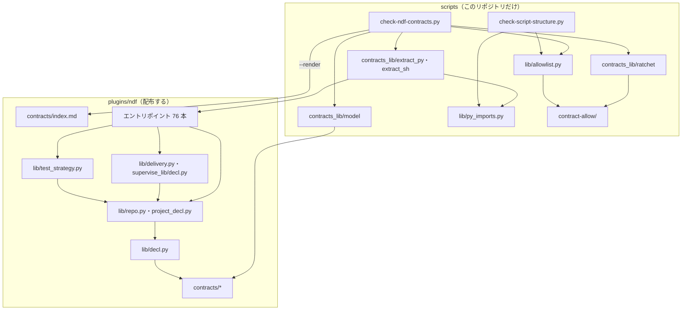

# NDF のエントリポイントの契約: 入出力・設定・環境変数を 1 か所で読み、宣言の外を構造チェックで止める

## 概要

NDF のエントリポイントが受け取るもの（引数・環境変数・`.ndf/` の設定のキー・標準入力）と返すもの（標準出力の形・
書くファイル・終了コードとその意味）は、配布物の `plugins/ndf/contracts/` の 1 か所にある（契約の一覧）。
Skill の本文・README・docstring は契約を写さずに指す。コードと契約の一覧の食い違いは、構造チェック
`scripts/check-ndf-contracts.py` が CI で落とす。

あわせて、`.ndf/` の設定を読む木（呼ばれた木か、メインディレクトリか）を契約の一覧の設定ファイルの項目が決め、
読み手はすべて `plugins/ndf/scripts/lib/decl.py` を通して開く。本番のブランチとテストのコマンドは、それぞれ
1 つの設定だけが持つ。

例: 新しい環境変数 `NDF_FOO` を `lib/ci_wait.py` で読み始めた変更は、`test-run.py` から import でたどれるため、
構造チェックが次の 1 行 JSON を出して終了コード 1 で落とす。

```json
{"tool": "check-ndf-contracts", "status": "error", "summary": "違反 1 件",
 "items": [{"kind": "env-undeclared", "path": "plugins/ndf/scripts/test-run.py", "name": "NDF_FOO",
            "result": "violation", "detail": "契約の env に無い。contracts/entrypoints/plugins__ndf__scripts__test-run.py.json の env へ足すか、contracts/env/NDF_FOO.json を作る",
            "via": "plugins/ndf/scripts/lib/ci_wait.py:42"}],
 "metrics": {"entrypoints": 76, "candidates": 91, "files": 11, "settings": 17, "env": 90,
             "allowed": 183, "violations": 1, "base": "origin/develop@<sha>", "ratchet": "checked"}}
```

**規則の細部は正本が持つ。** ここに書き写さない。

| 何を | 正本 |
| --- | --- |
| エントリポイントごとの契約・受け渡しのファイル・設定ファイル・環境変数の属性 | [`plugins/ndf/contracts/`](../../plugins/ndf/contracts/) の項目のファイル |
| 読み手と書き手の逆引き | [`plugins/ndf/contracts/index.md`](../../plugins/ndf/contracts/index.md)（`--render` が生成する） |
| 構造チェックの引数・結果・終了コード | [`scripts/check-ndf-contracts.py`](../../scripts/check-ndf-contracts.py) の docstring |
| 項目の形の検査 | [`scripts/contracts_lib/model.py`](../../scripts/contracts_lib/model.py) |
| コードから拾う規則 | [`scripts/contracts_lib/extract_py.py`](../../scripts/contracts_lib/extract_py.py)・[`extract_sh.py`](../../scripts/contracts_lib/extract_sh.py) の docstring |
| 設定の置き場の解決 | [`plugins/ndf/scripts/lib/decl.py`](../../plugins/ndf/scripts/lib/decl.py) の docstring |
| 結果の 1 行 JSON の形 | [`plugins/ndf/scripts/lib/README.md`](../../plugins/ndf/scripts/lib/README.md) |

この文書が扱うのは、決定の理由・常に成り立つ条件・違反の種類・テスト観点である。

## 用語

定義は [用語集](../glossary.md) が正である（`.ndf/glossary.json` の `document`）。この文書で使う語は
「エントリポイント」「契約の一覧」「受け渡しのファイル」「構造チェック」「例外リスト」「移行の読み」「設定の置き場」である。

### コンテキスト

| コンテキスト | 何の語が 1 つの意味に決まるか |
| --- | --- |
| スクリプトの契約 | エントリポイント・契約の一覧・受け渡しのファイル・設定の置き場・移行の読み・例外リスト |
| NDF の工程（`ndf-workflow`） | 本番のブランチ・ベースブランチ・テストの戦略・suite |

スクリプトの契約は NDF の工程に対して**公開された言語**（published language）を持つ。工程の側（Skill の本文・
プランの雛形・conductor）は契約の一覧の語と形で呼び、エントリポイントごとの言い換えを持たない。

## 背景

NDF は Skill の手順をスクリプトにしながら育ってきたため、エントリポイントの入出力は Skill の本文・README・docstring に
散り、呼ぶ側が違いを覚えて書いていた。同じ値を 2 つの設定が持ち（本番のブランチ・テストのコマンド）、`.ndf/` を
メインディレクトリから読むか worktree から読むかは読み手ごとに逆だった。その結果、Pull Request で外した必須チェックを
メインディレクトリの宣言から読んで待ち続ける（#2317）、足した suite を読まない（#1709）、本番のブランチの決め方が
2 か所で食い違う（#2097）、サブモジュールでメインディレクトリを取り違える（#2054）といった不具合が別々に起きていた。

契約の一覧は、異常系・データ・入出力をそろえる親の課題（#2335）の柱のうち最初のもので、後続の柱（#2337〜#2344）が
基準として使う。

## 対象範囲

| 扱う | 扱わない |
| --- | --- |
| エントリポイント（下の「数え上げの規則」）すべての契約 | 実行の核と、核を通らないことの検査（#2335） |
| 受け渡しのファイル・`.ndf/` の設定・環境変数の属性と置き場 | 結果の形・記録とログ・データの型・入力の読み込み部品（柱 P1・P2・P6・P7・P8） |
| 契約の外を落とす構造チェックと例外リストのラチェット | 引数の名前をそろえること・`sys.argv` を手で読む入口の `argparse` 化（柱 P8。#2341） |
| 本番のブランチ・テストのコマンドの 1 か所化と移行の読み | `plugins/ndf` の外（`playwright-kit`・`mcp-*`・`factory/`）のスクリプト |
| `.ndf/` の設定を読む木の解決 | hook から import される処理ごとの約束（関数の入出力） |

## 仕様

### 集約

| 集約 | 持ち主（書き換えてよいもの） | 根 | エンティティ | 値オブジェクト |
| --- | --- | --- | --- | --- |
| エントリポイントの契約 | そのエントリポイントを変える変更 | 契約の項目（1 本 1 ファイル） | 副命令 | 引数・環境変数の読み・設定のキーの読み・標準入力の形・標準出力の形・書くファイル・終了コードとその意味・呼び手 |
| 受け渡しのファイル | そのファイルを書くエントリポイントを変える変更 | ファイルの項目 | — | 名前の型（glob）・種類・置き場・Skill の読み手 |
| 設定ファイル | 設定の形を変える変更 | 設定ファイルの項目（`.ndf/<名前>` 1 つに 1 ファイル） | キー | 置き場・範囲（チーム / 個人）・読み手の関数・移行の読み |
| 環境変数 | その変数を読み始める変更 | 環境変数の項目 | — | 誰が設定するか・意味 |
| 例外リスト | 項目を消す変更だけ（足す変更は名前の付け替えに限る） | 例外の項目（1 項目 1 ファイル） | — | パス・名前・種類・理由 |

### 構成

| 要素 | 責務 |
| --- | --- |
| `plugins/ndf/contracts/{entrypoints,files,settings,env}/*.json` | 契約の一覧。配布物に含まれ、実行時にも読める |
| `plugins/ndf/contracts/index.md` | 読み手と書き手の逆引き（生成物） |
| `scripts/check-ndf-contracts.py` | 構造チェックの入口（このリポジトリの CI だけで働く） |
| `scripts/contracts_lib/`（`model`・`extract_py`・`extract_sh`・`ratchet`・`draft`・`render`） | 項目の読み込みと形の検査・コードからの抽出・ラチェット・下書き・逆引きの生成 |
| `scripts/lib/allowlist.py`・`scripts/lib/py_imports.py` | 例外リストの読み込み・ファイル名の規則・`unused-allow` の判定と、エントリポイントからの import のたどり。`check-script-structure.py` と共有する |
| `scripts/contract-allow/` | 契約の構造チェックの例外リスト |
| `plugins/ndf/scripts/lib/decl.py` | 設定の置き場の解決とメインディレクトリの決め方 |
| `plugins/ndf/scripts/lib/repo.py`（`production_of`・`production_branch`） | 本番のブランチの決め方の正本 |
| `plugins/ndf/scripts/lib/delivery.py` | `delivery` の行の `channel` をブランチ名へ解く |
| `plugins/ndf/scripts/lib/test_strategy.py`（`decl_of`） | テストのコマンドを `project.json` の `test` から読み、`supervise.json` の `test` を移行の読みで受ける |



### 数え上げの規則

エントリポイントは、`plugins/ndf/scripts` 直下と `plugins/ndf/skills/*/scripts` 直下にあり、テストと `experimental/` を
除くファイルのうち、最上位に `if __name__ == "__main__":` を持つ `.py` と、1 行目が `#!` の `.sh` である。hook の
command が起動する 7 本（`hook.py`・`relay.py` など）も含む（`relay.py` は利用者が手で打つ入口でもある）。

直下の `.py`・`.sh` の数（`metrics.candidates`。今は 91）と規則の本数（`metrics.entrypoints`。今は 76）の差は、
import と source で読まれるライブラリである。構造チェックは両方を毎回出す。

### 契約の一覧の形

**1 項目 1 ファイルの JSON にする。** 並列のプランが別々のエントリポイントを触っても同じファイルを変えず、マージで
衝突しないためである。形の検査は標準ライブラリだけで書く（CI の `script-structure` のジョブは依存を入れない素の
`python3` で動く）。**配布物に置く**のは、実行時に `lib/decl.py` が設定の置き場を同じ一覧から読むためである。

**読み手と書き手はエントリポイントの項目だけが持つ。** ファイル・設定・環境変数の項目は自分の属性だけを持ち、
逆引きは `--render` が `index.md` へ生成する。同じ事実を 2 か所に持たないためである。Skill の本文が読み手のときだけ、
コードから拾えないためファイルの項目の `skill_readers` に書く。

| 項目 | 置き場 | キー |
| --- | --- | --- |
| エントリポイント | `entrypoints/<パスの / を __ にした名前>.json` | `version`（1）・`path`・`summary`・`callers` か `external`（択一）・`args`・`env`・`settings`・`stdin`・`stdout`・`writes`・`reads`・`exit` |
| 受け渡しのファイル | `files/<name>.json` | `name`・`pattern`（glob）・`kind`・`place`・`skill_readers` |
| 設定ファイル | `settings/<.ndf/ の下の名前>.json` | `file`・`summary`・`place`・`scope`・`readers`・`keys` |
| 環境変数 | `env/<名前>.json` | `name`・`set_by`・`summary` |

| キー | 取りうる値 |
| --- | --- |
| `args` | `{"options": [...], "positionals": [...], "subcommands": {"<名前>": {...}}}`。静的に拾えなければ `{"unparsed": "<理由>"}` |
| `settings` | `[{"file": "project.json", "keys": ["test", "ci"]}]`。最上位のキーだけ |
| `stdin` | `none`・`json`・`text`・`hook-json` |
| `stdout` | `step-result`（1 行 JSON）・`json`・`kv`（`eval` する KEY=VALUE）・`text`・`markdown`・`none` |
| `exit` | `{"0": "<意味>", ...}`。読み取れなければ `{"unknown": "<理由>"}`（例外の項目 `exit-unknown` が要る） |
| ファイルの `kind` | `state`・`record`・`result`・`report` |
| ファイルの `place` | `worktree`・`main`・`tmp`・`state-dir`（XDG の状態の置き場）・`home` |
| 設定の `place` | `worktree`・`main` |
| 設定の `scope` | `team`（追跡する）・`personal`（`.ndf/.gitignore` に載る） |
| 設定の `readers` | 開いてよい関数（`plugins/ndf/scripts/lib/repo.py:read_worktree_decl` の形） |
| 設定の `keys.<キー>` | `summary` と、任意の `migrate_from`（`<ファイル>#<キー>`）・`duplicates`（同）・`place` |
| 環境変数の `set_by` | `user`・`runtime`・`ci`・`ndf` |

### 構造チェック

```text
python3 scripts/check-ndf-contracts.py [--root <リポジトリ>] [--allow <ディレクトリ>] [--base <ref>] [<ファイル>...]
python3 scripts/check-ndf-contracts.py --render [--root <リポジトリ>]
python3 scripts/check-ndf-contracts.py --draft <エントリポイントのパス> [--root <リポジトリ>]
```

| 終了コード | 意味 |
| --- | --- |
| 0 | 違反なし（`--render` は書き直した・変わらなかった、`--draft` は出せた） |
| 1 | 違反あり |
| 2 | 項目か例外の項目が読めない・形の誤り、`--draft` のパスがエントリポイントでない |
| 3 | CI の中で起点の ref を決められない（手元では `metrics.ratchet` を `skipped` にして続ける） |

**既存の `check-script-structure.py` とは別のスクリプトにする。** 既存のチェックの行数と所要を増やさないためである。
同じ役割の部品（例外リストと import のたどり方）は `scripts/lib/` へ移して両方が使い、`check-script-structure.py` の
結果は変えない。

`<ファイル>...` を渡すと、違反の `path` が指定に当たるものだけで合否を決める。チェッカ自身・`contracts_lib`・
`scripts/lib`・契約の一覧・例外リストが範囲に入れば、木全体を数える。

#### コードから拾う規則

拾える範囲を固定するため規則を絞り、拾えない箇所は種類を分けて例外の項目に載せる。呼び出しの流れは追わず、
エントリポイントから届きうる読み書きとして扱う（費用に見合わないため）。

| 対象 | 拾う規則 | 拾えないとき |
| --- | --- | --- |
| 引数 | `add_argument` の文字列・`add_parser` / `add_subparsers` の名前。シェルは `case` の `--名前)` | `args-unparsed` |
| 環境変数 | `os.environ.get("X")`・`os.environ["X"]`・`os.getenv("X")`・`"X" in os.environ`（import でたどれるモジュールを含む）。シェルはファイルの中で代入されない大文字の変数 | `env-dynamic` |
| 設定のキー | 設定ファイルの項目の `readers` の関数の戻り値を代入した名前への、同じ関数の中の `.get("k")`・`["k"]`（最上位のキーだけ） | 読み手の外で開けば `setting-open-outside-reader` |
| ファイルの書き | 書く呼び出し（`open` の `w`/`a`/`x`・`write_text`・`write_bytes`・`lib/jsonio` の書く関数）の引数か同じモジュールの定数の文字列。シェルは `>`・`>>` の文字列 | `file-dynamic` |

#### 常に成り立つ条件

| # | 条件 | 破れたときの違反 |
| --- | --- | --- |
| I1 | 数え上げの規則が拾うファイルと、エントリポイントの項目が 1 対 1 に対応する | `entry-undeclared`（`detail` に `--draft` と同じ下書きの項目を添える）・`entry-stale` |
| I2 | コードから拾った引数・環境変数・設定のキー・受け渡しのファイルの書きは、契約にあるか例外の項目に当たる | `arg-undeclared`・`env-undeclared`・`setting-undeclared`・`file-undeclared` |
| I3 | 契約にある引数・環境変数・設定のキー・書くファイルは、コードから拾える | `contract-stale` |
| I4 | 例外リストは merge-base より増えない（下の「ラチェット」） | `allow-added` |
| I5 | どの例外の項目も今の違反に当たる | `unused-allow` |
| I6 | 設定ファイルは読み手の関数の中で `lib/decl.py` を通して開く | `setting-open-outside-reader` |
| I7 | 1 つの値を持つキーは 1 つだけ。2 か所目は `duplicates` で宣言し、例外の項目に載る | `setting-duplicate` |
| I8 | 呼び手（パス）が 1 つ以上あり、それぞれがエントリポイントの名前を含む。無ければ `external` に理由がある | `no-caller`・`caller-stale` |
| I9 | `index.md` は項目から作り直した結果と一致する | `index-stale` |
| I10 | 移行の読みは、新しい置き場に値が無いときだけ古い置き場の値を使う | 移行の読みのテストが落ちる |

#### 例外リスト

例外の項目は `scripts/contract-allow/<path>--<name>--<kind>.json` に置き、形は `scripts/script-structure-allow/` と
同じ `{"path", "name", "kind", "reason"}`、ファイル名は `scripts/lib/allowlist.py` の `allow_file_name` が決める。
許せる `kind` は `args-unparsed`・`env-dynamic`・`file-dynamic`・`setting-open-outside-reader`・`setting-duplicate`・
`exit-unknown`・`no-caller`・`entry-undeclared`・`arg-undeclared`・`env-undeclared`・`setting-undeclared`・
`file-undeclared` の 12 種類である。`allow-added`・`unused-allow`・`contract-stale`・`index-stale`・`entry-stale`・
`caller-stale` は許さない。

#### ラチェット

`git ls-tree` で merge-base の例外リストを読み、今の木にだけある項目を `allow-added` で落とす。足した項目が今の
違反に当たっていても落とす。

- **起点**: `--base` → `GITHUB_BASE_REF` → `.ndf/worktree.json` の `base_branch` の順に名前を決め、`origin/<名前>` と
  HEAD の merge-base を取る。CI のジョブは `fetch-depth: 0` で取得する
- **付け替え**: 同じ差分で同じ `kind`・`name` の項目を消している追加は、ファイルの移動に伴う付け替えとして数えない
- **初版**: merge-base の `.github/workflows/script-structure.yml` が `check-ndf-contracts.py` を走らせていなければ、
  増加を数えず `metrics.ratchet` を `initial` にする。初版を例外リストの置き場の有無で決めないのは、置き場を丸ごと
  消した次の変更で好きなだけ足せてしまうためである。スクリプトの有無で決めないのは、スクリプトを足す変更と CI へ
  足す変更を別の Pull Request に分けても成り立たせるためである

### 設定の置き場

`.ndf/` の設定を読む木は、設定ファイルの項目の `place` で決まる。

| 範囲 | 見分け方 | 置き場 | 読む順 |
| --- | --- | --- | --- |
| チーム | git が追跡する | `worktree` | 呼ばれた木の根 → メインディレクトリ |
| 個人 | `.ndf/.gitignore` に載る（`worktree.local.json` など） | `main` | メインディレクトリ → 呼ばれた木の根 |

チームの設定は Pull Request の差分に入るため、その worktree で動くエントリポイントが変更後の値を使う必要がある。
個人の設定は追跡されず worktree に写らないため、メインディレクトリにしか無い。読み手ごとに順を選ばせない
（読み手ごとに逆の順で読んでいたことが #2317・#1709 の原因だった）。

**認可に関わる値はチームの設定でもメインディレクトリから読む。** `project.json` の `delivery`・`worktree.json` の
`production_branch`（キーごとの `keys.<キー>.place: "main"`）と `runtimes.json`（ファイルの `place: "main"`）である。
Pull Request の変更だけで承認ゲート 2 の判定やランタイムの制限を緩められないようにするためである。
`read_json_setting` は `main` のキーの値をメインディレクトリのファイルの値で上書きし、そこにキーかファイルが無ければ
キーを消す（呼ばれた木の値で補わない。補うと、メインディレクトリに無いファイルを Pull Request が足すだけで判定を
緩められる）。メインディレクトリが解けないときと、呼ばれた木がメインディレクトリそのものなら、呼ばれた木の値を読む。

`lib/decl.py` の関数:

| 関数 | 入力 | 出力 | 失敗の形 |
| --- | --- | --- | --- |
| `setting_path(root, name, place=None)` | 呼ばれた木の根、`.ndf/` の下の名前 | 開くパスか `None`（どちらの木にも無い） | 契約に無い名前は `KeyError` |
| `read_json_setting(root, name)` | 同上 | `(中身, 読めなかった理由)`。キーの置き場を当てた中身。無ければ `({}, None)` | 例外を上げない |
| `main_dir(root)` | 呼ばれた木の根 | メインディレクトリか `None` | 例外を上げない |

メインディレクトリは、共通ディレクトリ（`--git-common-dir`）の名前が `.git` ならその親、そうでなければ共通ディレクトリの
`core.worktree` → `--git-common-dir` の親の順に決める。サブモジュールでは `--git-common-dir` の親が
`.git/modules/<名前>` を指し、`core.worktree` だけが作業の木を指すためである（#2054）。結果は根ごとにプロセスの中で
1 回だけ解き、契約の項目もプロセスの中で 1 回だけ読む。

`project-decl.py write` がメインディレクトリへ書くことは変えない（書いた値は Pull Request を通って worktree へ届く）。

### 1 か所へ寄せた値

**本番のブランチは `.ndf/worktree.json` の `production_branch`（無ければ既定ブランチ）だけが持つ。** 決め方は
`lib/repo.py` の `production_of`・`production_branch` の 1 か所で、`supervise_lib/decl.py` と `lib/delivery.py` は
独自に後退しない（#2097）。`worktree.json` に寄せるのは、ベースブランチと並ぶ値であり、シェル
（`lib/worktree-branch.sh`）と `project-decl.py write` も既にここを読み書きするためである。

`.ndf/project.json` の `delivery` の行は、本番のブランチ・ベースブランチへのマージで動くことを `channel` で指し、
ブランチ名を写さない。

| キー | 意味 |
| --- | --- |
| `channel` | `"production"` か `"base"`。`project.schema.json` の `Delivery` にある。それ以外の値は `problems` に載る |
| `branch` | `channel` の無い行だけで読む（ほかのブランチで動く行と移行の読み）。両方あれば `channel` が勝つ |

`lib/delivery.py` の `build` は、行を読んだ時点で `channel` を 1 回だけブランチ名へ解いて行の `branch` に入れる。
行の `branch` を読む既存の規則はそのまま当てはまる。`load_delivery` は `channel: base` をメインディレクトリの
`base_branch` で解く（認可に関わる判定の値のため）。`project-decl.py write` は本番のブランチに当たる行を
`"channel": "production"` で書く。

**テストのコマンドは `project.json` の `test.suites` だけが持つ。** `supervise.json` の `test.command`・`test.all` は、
`project.json` に `test` が無いときだけ読む移行の読みで、`lib/test_strategy.py` の `decl_of` が `test.command` から
suite を 1 つ組んで渡す（#2011）。`test.no_reports`（pytest のプラグインを外す指定）は別の値なので `supervise.json` に
残る。`supervise.json` へ寄せないのは、suite の属性（JUnit の出力・範囲のコマンド・CI のジョブ）を持てないためである。

### 呼び手の無いもの

エントリポイントの呼び手は、エントリポイントの名前で Skill の本文・雛形のモジュール・`hooks/*.json`・
`.github/workflows/`・ほかのスクリプトを検索して決め、項目の `callers` に書く（テストを除く）。以後は構造チェックが
`callers` の各ファイルがエントリポイントの名前を含むかを見る（I8）。呼び手の無い関数の棚卸しは `uvx vulture` で
1 回だけ行う。CI の常設の検査にしないのは、動的な呼び出しの誤検出が多く、例外の項目が増えるためである。

## データ・設定

| 設定 | 中身 |
| --- | --- |
| `.ndf/project.json` の `test.suites` | suite `ndf-contracts`（`runner: check-ndf-contracts`、`command: python3 scripts/check-ndf-contracts.py`、`scope_command: python3 scripts/check-ndf-contracts.py {paths}`） |
| `.ndf/project.json` の `delivery` | 本番のブランチで動く行は `"channel": "production"` |
| `.github/workflows/script-structure.yml` | ジョブ `ndf-contracts-check`（`fetch-depth: 0`）。Pull Request では絞り込まずに常に起動する |

## 運用

- **新しいエントリポイントを足すとき**は、構造チェックが `entry-undeclared` の `detail` に出す下書き（`--draft` と同じ）を
  補って `plugins/ndf/contracts/entrypoints/` に置く。項目を変えたら `--render` で `index.md` を作り直す
- **今の外れを減らすとき**は、例外の項目を消す。違反に当たらなくなった項目を残すと `unused-allow` で落ちる
- **後続の柱で消える例外**: `args-unparsed` は柱 P8（#2341）で `argparse` へ移したときに消す。項目の形の書き方は
  データの型の書き方を決める柱 P6（#2339）が決めたら、そちらへ移す
- 所要は手元で 3 秒前後（2026-11-01、76 本・例外 183 件）。`check-script-structure.py` と合わせて 18 秒以内を条件にする

## テスト観点

テストは `scripts/tests/test_check_ndf_contracts.py`・`plugins/ndf/scripts/tests/test_lib_decl.py`・
`test_delivery.py`・`test_project_decl.py` にある。

- このリポジトリの木で構造チェックが 0 を返し、`metrics.entrypoints` が規則の本数と一致すること。項目を 1 つ消すか、
  規則が拾わないファイルの項目を足すと 1 を返すこと
- 契約に無いエントリポイント・引数・環境変数の読み・設定のキーの読み・ファイルの書きをそれぞれ 1 つ入れた木で 1 を返し、
  `items` にファイルとキーが出ること。契約にだけある引数で `contract-stale` が出ること
- 違反に当たらない例外の項目を残した木で `unused-allow`、消した木で 0 になること
- merge-base に無い例外の項目を足した木で `allow-added` になり、同じ `kind`・`name` の付け替えは通ること。merge-base の CI が
  チェックを走らせていない木では `ratchet: initial` で通り、例外リストを丸ごと消した後の木で足すと落ちること。CI の中で
  起点を決められないとき 3、手元では `ratchet: skipped` で 0 になること
- 本番のブランチを読む経路が `repo.production_branch` だけで、`delivery` の行が `channel` で本番を指すこと。
  `duplicates` を宣言して例外の項目が無い木で `setting-duplicate` が出ること
- 古い置き場だけを持つ `.ndf/`（`delivery` の行が `branch` だけ・`supervise.json` の `test` だけ）で寄せる前と同じ値を得て、
  両方あれば新しい置き場が勝つこと
- worktree とメインディレクトリで `project.json` が違う木で、`test-run.py` の待つチェック（#2317）と cross-refactoring の
  `init` の戦略（#1709）が worktree の値を使い、`main` の置き場の設定は逆に読むこと。認可に関わるキーは Pull Request の
  木の値で緩まないこと
- サブモジュールの worktree で `main_dir` がサブモジュールの作業の木を返すこと（#2054）
- 読み手の関数の外で `.ndf/<名前>` を開く木で `setting-open-outside-reader`、呼び手の無い項目で `no-caller`、呼び手のファイルが
  名前を含まない項目で `caller-stale`、`--render` を打たない木で `index-stale` が出ること
- `check-script-structure.py` の結果（`items`・`metrics`）が、共通部品へ移す前と同じであること

## 関連リンク

- [ndf-production-release-record.md](ndf-production-release-record.md)（本番のブランチを使う本番の配布の記録）
- [ndf-step-result-gaps-and-reading.md](ndf-step-result-gaps-and-reading.md)（結果 JSON の形）
- [ndf-deps-require-groups-check.md](ndf-deps-require-groups-check.md)（同じ形の構造チェック `check-script-structure.py`）
- 親の課題 #2335・この仕様の課題 #2336
