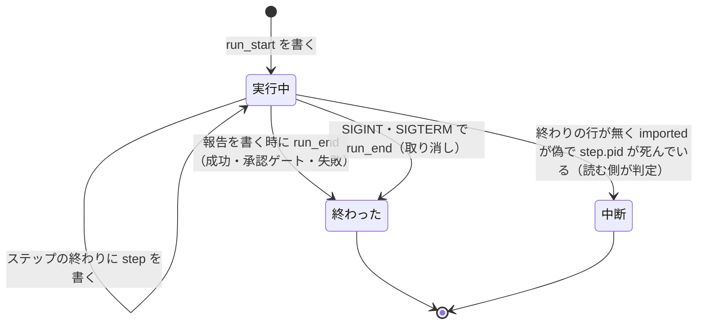

# AI エージェントが実施する前提の工数の見積もり（estimate）

棚卸しの Size・実装のステップの上限・テストの上限・cross-refactoring の配分は、どれも「AI が実施すると
どれだけ掛かるか」を見積もる。NDF はこれを 1 つの規約と 1 つの部品（`plugins/ndf/scripts/estimate.py`）にまとめ、
近い条件の実績から A（AI の実行量）・H（人の作業時間）・L（完了までの時間）・C（利用費用）を値ごとに根拠付きで返す。
入口は Skill `estimate` で、配布先のどのリポジトリでも呼べる。
この文書は、記録の行の形・部品の入出力の契約・接続先の変わった約束と、それぞれをそう決めた理由、研究の一次資料を
確かめた結果を残す。

**定義・手順・規則は Skill の文書が正である。** この文書は写さない。

| 何を読むか | 正本 |
| --- | --- |
| A・H・L・C の定義、見積もりの完了条件、実行の構成、着手前の 6 項目、類似の実績の選び方、実績が足りないときの扱い、Size への換算、実装の上限、記録の置き場、`.ndf/estimate.json` の項目、限界、根拠にした研究の知見 | `plugins/ndf/skills/estimate/references/rules.md` |
| 利用者が課題番号か作業の説明を渡して見積もる手順と、`human`・`import`・`errors`・`actuals` の使い場面 | `plugins/ndf/skills/estimate/SKILL.md` |
| 棚卸しで Size を付ける手順（手順 2B の `predict --save`）と、`rank` の Size の取り方 | `plugins/ndf/skills/backlog-refinement/references/ranking.md` の「大きさは AI の実施の費用で付ける」と `SKILL.md` |
| やらないと決める判定で比べる費用の単位と期間 | `plugins/ndf/skills/backlog-refinement/references/no-work.md` |

## 概要

**例: スプリント m1847 の 2 つの見積もり。** 棚卸しの `rank --capacity 13` は、閉じた課題の supervise の記録と差分の
行数を見てエージェントが付けた Size の和で境界を置いた。同じスプリントの実装プランは、テストの上限を過去の所要から
算術で出した一方、実装のステップの上限は既定の 3600 秒のままで、引継ぎ文書が毎回 `timeout: 5400` 以上へ手で
補っていた。同じ量を Skill ごとに別の材料・別の単位で見積もり、互いの実績を見ていなかった。

今は次のようになる。

| 場面 | 何が起きるか |
| --- | --- |
| 利用者が `/ndf:estimate 1856` を呼ぶ | AI が本文から完了条件と 6 項目を判定し、`estimate.py predict --issue 1856 --done 実装 --items … --save` を打つ。A・H・L・C が別々の欄で返り、各値に `実績`（比べた課題と実測）・`未校正`・`材料なし` のどれかが付く |
| 棚卸しの `rank` | 課題の最新の見積もりの記録の A を Size 1 の基準で尺度へ丸めて Size にし、H・L・C と比べた課題を別の列に出す |
| `supervise.py new` で実装のプランを作る | 引数と宣言に上限が無ければ、同じ構成の実装の直近の実績から上限を出す。3 件未満なら 3600 秒で `未校正` と出る |
| supervise の実行 | 失敗・取り消しを含め、始まり・ステップの終わり・実行の終わりを実績の記録へ追記する |

## 用語

用語の定義は用語集 [docs/glossary.md](../glossary.md) のコンテキスト `ndf-estimate` にある（A・H・L・C、実行の構成、
類似の実績、未校正、見積もりの記録、実績の記録、着手前の 6 項目、見積もりの完了条件、尺度を超える、Size 1 の基準）。

## コンテキスト

| コンテキスト | 何の語が 1 つの意味に決まるか |
| --- | --- |
| 工数の見積もり（`ndf-estimate`） | A・H・L・C、実行の構成、類似の実績、未校正、見積もりの記録、実績の記録、着手前の 6 項目、尺度を超える |
| 課題の棚卸し（`ndf-issue-upkeep`） | Size（見積の段階）・容量・切り出しの境界 |
| 開発ワークフロー（`ndf-workflow`） | supervise のプラン・ステップ・実装の上限 |

関係は**公開された言語**である。見積もりのコンテキストが結果 JSON（`step_result` の形）と記録の行の形を定め、
棚卸しと supervise はその形だけを読む。受け手が 3 つ以上あり、形を先に固めれば互いに独立して変えられるためである。

## 構成要素

| 要素 | 責務 |
| --- | --- |
| 見積もりの規約（`skills/estimate/references/rules.md`） | 定義と規則の正本 |
| Skill `estimate`（`skills/estimate/SKILL.md`） | 利用者の入口。6 項目と完了条件を AI が判定し、部品を呼び、見込みと根拠を示す |
| 集計（`scripts/lib/estimate_stats.py`） | 直近 N 件・中央値・分位（nearest-rank）・最大・Σ秒÷Σ件数。窓の既定 10 を持つ。純粋な関数だけで、ファイルも終了コードも持たない |
| 記録（`scripts/lib/estimate_records.py`） | 置き場の解決、行の形（`schema.Shape`）の検査、実績の記録と見積もりの記録の追記と読み出し、課題ごとの実績の合計 |
| 取り込み（`scripts/lib/estimate_import.py`） | 既存の supervise の記録（`progress.jsonl`）から実績の記録を作る |
| 見込みの算出（`scripts/lib/estimate_predict.py`） | 類似の実績の選択、構成で分けること、値ごとの見込みと印、Size への丸め、実装の上限の見込み、誤差の集計 |
| 部品の CLI（`scripts/estimate.py`） | `predict` / `human` / `import` / `errors` / `actuals` |
| supervise の実績の書き手（`scripts/supervise_lib/actuals.py`） | 実行の始まり・ステップの終わり・実行の終わりを追記する。SIGINT・SIGTERM で `取り消し` を書く |
| 実装の上限（`scripts/supervise_lib/verify_steps.py` の `impl_timeout_estimate`、`templates.py`・`decl.py`） | 引数 → 宣言 → 実績の見込み → 3600 で実装のステップの `timeout` を決め、根拠をステップの `estimate` の欄に書く |
| 棚卸しの重ね（`skills/backlog-refinement/scripts/upkeep_rank_estimate.py`） | 最新の見積もりの記録の A を尺度へ丸め、`rank` の行へ列を足す |
| 既存の 3 系統（`lib/slow_step.py`・`project_lib/measure_ci.py`・`refactor_lib/allocation.py`） | 集計を `estimate_stats` の関数で行う。係数・下限・既定値は各系統に残り、返す値は変えない |

**部品はネットワーク（`gh`・LLM）も `subprocess` も呼ばない。** 読むのは 2 つの jsonl と `.ndf/` と
`project.json` だけで、課題の本文が要るときは呼び出し側の AI が読む。環境変数は `NDF_ESTIMATE_DIR` と
`XDG_STATE_HOME` だけを読み、ランタイムの判定をしないため、どのランタイムから呼んでも同じ記録には同じ結果を返す。

## 仕様

### 集約

| 集約 | 持ち主 | 根 | エンティティ | 値オブジェクト |
| --- | --- | --- | --- | --- |
| 実績の記録 | `estimate_records.append_actual`（呼ぶのは supervise の実行と `estimate.py human`・`import`） | 実行（`run`） | ステップの実績 | 終わり方・実行の構成・秒・USD |
| 見積もりの記録 | `estimate_predict`（呼ぶのは `estimate.py predict --save`） | 見積もり | — | 着手前の 6 項目・完了条件・見込み（値ごと）・根拠 |

どちらも追記だけで、既存の行を書き換えない。実績の記録は見積もりの記録を参照せず、突き合わせは集計の時点で
課題番号と時刻で行う。課題は記録に行を持たず、番号だけで指す。

### 常に成り立つ条件

| # | 条件 | 破れたときの扱い |
| --- | --- | --- |
| I1 | A・H・L・C は別の欄に置き、足した値の欄を持たない | 行の形（`Values` は 4 鍵だけで、知らない項目を拒む）が書き込みの前に落とす |
| I2 | どの値にも印（`実績` / `未校正` / `材料なし`）が 1 つだけ付き、`実績` のときは比べた実績が 1 件以上ある | 根拠の無い `実績` は `未校正` へ倒す |
| I3 | 失敗・中断・取り消し・再試行の実行も実績から除かない。終わりの行が無い実行は、実行中（`step.pid` が生きている）と取り込んだ実行（`imported` が真）を除いて中断として数える | 終わりの行を書けなくても始まりの行は残り、中断として数えられる |
| I4 | 着手前の 6 項目と完了条件は見積もりの時点で書いたものだけで、後から書き換えない | 同じ課題を見積もり直すと新しい行になる |
| I5 | 類似の実績に使うのは今と同じ構成の実績だけで、構成の違う実績は `other_config` に示す | 値の算出に入れない |
| I6 | 研究の倍率・人日からの換算を値に使わない。実績が 0 件なら値は呼び出し側が渡した暫定の範囲か空で、印は `未校正` | 算出の関数は記録と引数だけを入力に取り、係数の定数を持たない |
| I7 | Size は A を Size 1 の基準との比で尺度へ丸めた値で、比が最大を超えたら `尺度を超える` にし、最大へ潰さない | 丸めの関数が最大を超えた比に段階を返さない |

### 実行の構成の取り方

supervise は実行の終わりの `run_end` に構成 `{models, harness, review, test, parallel}` を書く。**値が入るのは
`models` と `harness` だけで、`review`・`test`・`parallel` は常に空（不明）である**（`supervise_lib/actuals.py` の
`ActualsLog.config`。規約の「限界」）。3 つの鍵は実行の中で決まる値で、supervise が読める置き場を持たないためである。
読めない鍵は空にして比べないという退避の形を採り、今の比べ方は実質 `models`（集合として）と `harness` の 2 つになる。

### 課題ごとの実績の合計

| 値 | 合計のしかた |
| --- | --- |
| A | 課題を指す実行の `step` の `seconds` の和。完了条件のフェーズまでのすべての実行（失敗・中断・取り消し・再試行を含む）を足す。2 つ以上の課題を指す実行は課題の数で等分し、根拠に `shared` を付ける |
| L | 課題を指す最初の `run_start` から、完了条件のフェーズの `成功` の `run_end` までの経過 |
| C | 同じ範囲の `cost_usd` の和。空のステップがあれば `note` に「費用の取れない実行を含む」と書く |
| H | `human` の行の `seconds` の和。行が無ければ `材料なし` |

完了条件のフェーズが `成功` で終わっていない課題は、類似の実績の候補に入れない。

### supervise の実行が記録を書く順



supervise の結果 `完了` は `成功`、`関門` は `承認ゲート`、それ以外は `失敗` へ写す。取り消しの後に耐久ワークフローを
再開すると、同じ実行へ残りを書き足し、最後の `run_end` が終わり方になる。

## データ・設定

置き場と `.ndf/estimate.json` の項目は規約の「記録」にある。git の共通ディレクトリの下に置くのは
`step-history.jsonl` と同じ理由で、worktree をまたいで 1 つのリポジトリに 1 つになり、コミットされないためである。

### 実績の記録（`actuals.jsonl`）

4 種類の行を `kind` で分ける。すべての行に `schema: 1`・`kind`・`at`（UTC の ISO 8601）を持つ。

| kind | 列 | 型 | 空を許すか | 意味 |
| --- | --- | --- | --- | --- |
| `run_start` | `run` | string | 許さない | 実行の識別子。`<状態ディレクトリの実体の解決済みパスの sha256 先頭 12 文字>-<progress.jsonl の run の行の at>`。supervise と取り込みが同じ実行に同じ識別子を付ける |
| | `plan` | string | 許さない | プランのパス |
| | `issues` | int[] | 許さない | プランの `課題`。空の配列は課題を持たないプラン |
| | `phase` | string | 許す | プランの `フェーズ`。空は宣言なし |
| | `from` | string | 許す | `--from` のステップ。値があれば再試行 |
| | `attempt` | int | 許さない | 同じプランの何回目の実行か（1 から） |
| | `imported` | bool | 許さない | `estimate.py import` が作った行なら真。真の実行は `run_end` を持たず、中断に数えない |
| `step` | `run`・`step`・`type` | string | 許さない | 実行・ステップの id・ステップの型 |
| | `exit` | int | 許す | 終了コード。空は終了コードを持たないステップ |
| | `seconds` | number | 許す | 利用上限の待ちを引いた所要。空は計らないステップ |
| | `cost_usd` | number | 許す | 空は費用の取れない実行。0 とは区別する |
| | `runtime`・`models` | string・string[] | 許す | ステップを動かしたランタイムとモデル |
| | `retry` | int | 許さない | 遅れの見張りによる同じステップの打ち直しの回数（0 から） |
| `run_end` | `run` | string | 許さない | |
| | `outcome` | string | 許さない | `成功` / `承認ゲート` / `失敗` / `取り消し` |
| | `wall_seconds` | number | 許さない | 実行の始まりから終わりまでの経過 |
| | `config` | object | 許さない | 実行の構成。各値の空は不明（上の「実行の構成の取り方」） |
| `human` | `issues`・`seconds`・`what` | int[]・number・string | `what` だけ許す | 人の作業時間。`estimate.py human` が書く |

**中断は行の種類として持たない。** 書き手が落ちても数えられるよう、読む側が「終わりの行が無い実行」から導く。

### 見積もりの記録（`estimates.jsonl`）

| 列 | 型 | 空を許すか | 意味 |
| --- | --- | --- | --- |
| `schema`・`id`・`at` | int・string・string | 許さない | `id` は `<at>-<issue か説明の sha256 先頭 8 文字>` |
| `issue` | int | 許す | 空は作業の説明で見積もった |
| `task` | string | 許す | 作業の説明 |
| `done` | string | 許さない | 見積もりの完了条件（`設計`・`実装`・`検査`・`配布（開発版）`・`配布（本番）`） |
| `items` | object | 許さない | 着手前の 6 項目 `{requirements, information, spread, verification, environment, rework}`。値は `軽` / `重` / `判定できない` |
| `config` | object | 許さない | 見積もりの時点の実行の構成 |
| `values` | object | 許さない | `{A, H, L, C}`。それぞれ下の値の形 |
| `size` | int / string | 許す | 見積もりの時点の基準で A を丸めた Size。`"尺度を超える"` か、空は丸められない |

値の形:

```text
{"mark": "実績"|"未校正"|"材料なし", "kind": "P50/P80"|"通常/追加の調査", "typical": 秒か USD,
 "high": 秒か USD, "basis": [{"issue": 1601, "run": "…", "value": 5400, "shared": true}], "note": "…"}
```

`A`・`H`・`L` は秒、`C` は USD である。`typical` と `high` の空は値を出せないことを表す。

**時系列は事象の記録で持つ。** 実行の始まりと終わりを事象として積み、課題の合計と中断は読むときに導く。
`state.json` は流し直すたびに上書きされるため、実績の正本にしない。読む側は知らない鍵を無視し、`schema` の無い行を
読み飛ばす。

**移行**: `estimate.py import` が既存の `progress.jsonl` とプランの JSON の `課題`・`フェーズ` から `run_start`・`step` の
行を作る。既存の記録に終わり方が無いため `run_end` は作らず、`imported` を真にする。`run` の識別子で重複を除くため、
何度流しても同じ結果になる。既存の記録（`progress.jsonl`・`step-history.jsonl`・配分の履歴・使用量の帳簿・
`project.json`）の形は変えない。

## 入出力の契約

### `estimate.py predict`

| 項目 | 内容 |
| --- | --- |
| 入力 | `--issue N` か `--task "<説明>"`（どちらか必須）、`--done <フェーズ>`（必須）、`--items requirements=軽,…`（省いた項目は `判定できない`）、`--like 1601,1631`、`--provisional A=1800-5400`、`--save`、`--batch <file>`（上の組を JSON の配列で渡す） |
| 出力 | `status: ok`・終了コード 0。`items` に見積もり 1 件ずつ `{kind: "estimate", issue, task, done, items, config, values: {A, H, L, C}, size, other_config: [...], materials: {test_seconds, test_source}}`。`summary` は件数と未校正の数 |
| 記録の無いリポジトリ | 終了コード 0。すべての値の `mark` が `未校正` か `材料なし` |

### `estimate.py human` / `import` / `errors` / `actuals`

| コマンド | 出力 |
| --- | --- |
| `human --issue N --minutes M [--what 説明]` | `human` の行を 1 行足す |
| `import [--sv-dir DIR]` | 足した実行の数と、重複で飛ばした数 |
| `errors [--since 日付]` | `items` に組ごとの `{issue, predicted, actual, ratio}`（A・L・C）、`metrics` に `pairs`・値ごとの比の中央値・A の順位相関（Spearman） |
| `actuals [--issue N] [--done フェーズ]` | 課題ごとの実績の合計と、その材料の実行（終わり方を含む） |

**`errors` の組**: 見積もりの記録の `issue` が完了条件のフェーズで `成功` した課題について、見積もりの `at` より後の
実行だけで実績を合計する。見積もりの後の実行が無い課題と、作業の説明だけの見積もりは組にしない。組が 0 件なら
`pairs: 0` で終了コード 0 を返す。

### `supervise.py new` の約束

| 項目 | 内容 |
| --- | --- |
| 実装のステップの `timeout` | 引数 `--impl-timeout` → `.ndf/supervise.json` の `impl_timeout` → 実績の見込み → 3600 |
| 実装のステップの `estimate` の欄 | `{"source": "arg"|"decl"|"history"|"uncalibrated", "samples": n, "high": 秒, "basis": [実行の識別子...]}`。プランの検査と耐久ワークフローの再開はこの鍵を拒まない |
| `new` の結果 | プランの行に `impl_timeout_source`。`uncalibrated` のとき `summary` に「実装の上限は未校正（3600 秒）」 |

実績の見込みは、同じ構成でフェーズ `実装`・ステップ `impl` の `step` の行の直近 `window` 件（既定 10、失敗を含む）の
最大に `with_margin`（10%・最小 30 秒）を掛け、3600 秒を下限にする。**最大が打ち切り（終了コード 124）の標本なら
余裕を足さない。** 足すと打ち切りのたびに上限が伸び続けるためである。件数が `min_samples`（既定 3）未満なら
`uncalibrated` である。

### `rank` の変わる出力

| 項目 | 内容 |
| --- | --- |
| `milestones[].rows[]` | `size_source`（`見積もり` / `付けた段階`）・`a`・`h`・`l`・`c`（値の `typical` と `mark`）・`size_basis`（比べた課題の番号）を足す |
| Size の取り方 | 課題の最新の見積もりの記録の **A の `typical` を、`rank` を打った時点の Size 1 の基準で丸め直す**（`upkeep_rank_estimate.estimate_overlay`）。丸められない（記録が無い・A が `実績` でない・基準が無い）ときは今の順（`--scores` → 記録 → 前回の表）に戻る |
| 尺度を超える | 順位の値を丸める前の比で計算し、切り出しの境界に入れない。マイルストーンごとの `over_scale` に出す |
| 表 | `| 順位 | 課題 | UBV | TC | RR/OE | Size | CoD | 順位の値 |` の後ろに `A | H | L | C` を足す。値は分（C は USD）で、印が `実績` でなければ `未校正` か `—` |

**見積もりの記録に保存した `size` は読まない。** 保存した `size` は見積もりを書いた時点の基準で丸めた値で、その後に
`size_unit_seconds` の宣言や実績が変わると、同じ表の中で基準の違う Size が混ざる。尺度を超える課題は丸める前の比が要り、
比は A と今の基準から出るためでもある。

## エラー処理

| 場面 | 扱い |
| --- | --- |
| `predict` の引数の誤り（`--issue` と `--task` の両方が無い・6 項目の値が 3 値の外） | `status: stopped`・終了コード 2 |
| `predict --save` で書けない | 見込みを返し、`items` に `{kind: "warning", reason: "保存できなかった"}` を足して終了コード 0 |
| `human` で書けない | `status: stopped`・終了コード 1 |
| supervise の実行が実績の記録へ書けない | 実行の結果は変えず、`progress.jsonl` に `{"kind": "estimate_record", "ok": false, "reason": …}` を残す |
| `.ndf/estimate.json` が読めない（実装の上限を求めるとき） | `uncalibrated` の 3600 秒にし、`note` に理由を書く |

## 背景（決定の理由）

| # | 決定 | 理由 | 採らなかった案 |
| --- | --- | --- | --- |
| 1 | 入口を新しい Skill `estimate` にする | 利用者は棚卸しとは別の場面（ほかのプロジェクトで 1 件を見積もる）で使う。棚卸しの前提（課題の一覧・宣言）を 1 件の見積もりに背負わせない | `backlog-refinement` への統合。説明と起動の条件が 2 つの用途に割れる |
| 2 | 規約の正本を `skills/estimate/references/rules.md` に置く | Skill の配布物の中にあれば、ほかのプロジェクトでも同じ版の規約が読める | `docs/` に置く。配布されず、ほかのプロジェクトの AI が読めない |
| 3 | 実績を新しい追記だけの記録に持つ | 既存の記録はどれも終わり方（成功・失敗・取り消し）を持たないか、上書きされるか、成功した実行だけを積む | `step-history.jsonl` に失敗の行を足す（遅れの見張りの想定時間が変わる）、既存の記録から読むだけで済ませる |
| 4 | 集計を `estimate_stats.py` の 1 か所に持ち、既存の 3 系統は値を変えずに呼ぶ | 窓の既定 10 が 3 か所で別々に定義されていた。係数・下限・既定値は各系統の意味なので残す | 計測と報告のスクリプト（`run_metrics.py` ほか）まで含める。見積もりの材料を作らない |
| 5 | 類似の実績は AI が選んだ課題（`--like`）を優先し、無ければ 6 項目の違いが 1 つ以下の実績を選ぶ | どの課題が近いかは中身を読む判断で、AI に置く。件数が少ないときに確率を装わない | 6 項目を点数にして距離の重みを付ける。重みが検証されていない |
| 6 | 構成の違う実績は値から外し、`other_config` に示す | 構成を変えた直後に `未校正` が増えるのは事実で、別の欄に出せば参考にできる | 補正して使う。補正の係数を持つことになり、倍率で見積もらない規約に反する |
| 7 | H は `estimate.py human` で人が記録した行だけから取る | 承認の記録は答えた時刻しか持たず、会話の記録の問いと答えの差は、考えて手を動かした時間と待たせた時間を区別できない（後者は L） | 会話の記録から H を取る。上の理由に加え、置き場がランタイムとアカウントごとに違う |
| 8 | cross-refactoring の工程の予算と、実行計画・スプリントの大きさの L は部品へつながない | 配分は別の単位（最終ゲートを通った実行の項目ごとの所要）で回り、つなぐと値が変わる。L は完了までの時間が記録にたまってから設計した方が妥当さを実測で示せる | このスプリントでつなぐ |
| 9 | Size は A ÷ 基準の比を隣り合う段階の中点で丸め、最大を超えたら `尺度を超える` | 尺度そのものが大きい側で間隔を広げており、中点で足りる。基準は秒の値 1 つで宣言でき、宣言が無くても実績から出る | 比の対数で境界を置く、基準を課題番号のアンカーで宣言させる（宣言の無いプロジェクトで丸められない） |
| 10 | 実装の上限は同じ構成の直近の最大に余裕を掛け、3600 秒を下限にする | 上限は超えると打ち切る値で、中央値や 80 分位では 2〜5 回に 1 回打ち切る。短い実績で上限が下がると、それより長い実装が打ち切られ続けて戻らない | 80 分位を使う。打ち切りは取り直しの費用が大きい |
| 11 | 未校正の暫定の範囲は AI が渡し、部品は既定の暫定値を持たない | 部品が既定値を持つと、どの作業にも同じ根拠の無い数値が付いて流通する | 部品が「テストの所要 × 回数」で出す。回数の係数を持つことになる |
| 12 | 複数の課題を 1 本で流した実行は課題の数で等分し、`shared` を付ける | 除外するとスプリントの実績の大半を失い、等分以外の配分は材料が揃わない | 除外する、差分の行数で配分する |
| 13 | 研究からは定性の知見だけを採り、数値は式・既定値・規約へ写さない | どの数値も特定の条件の平均か、校正されていない提案か、シミュレーターの結果である | 一致した数値を既定の暫定値や係数に使う |

## 研究の一次資料の確認

5 件とも一次資料（論文の本文・要旨か、著者の機関のページ）を 2026-10-15 に開き、起票の時点の助言（ChatGPT）が示した
数値はすべて一致した。規約が採った知見は `rules.md` の「根拠にした研究」にあり、ここには確かめた数値と採らなかった
知見を残す。

| 研究 | 一次資料 | 確かめた数値 | 採らなかった知見と理由 |
| --- | --- | --- | --- |
| HIE（Alaswad ほか「Hybrid intelligence effort for software effort estimation in LLM assisted development」Discover Computing 29 巻 424、2026-07-06） | https://link.springer.com/article/10.1007/s10791-026-10331-6 （本文。書誌は Crossref でも確認） | 開発者 22 人・タスク 110 件（25 の OSS）・LLM 3 種・330 回の実行。Story Points だけの R² 0.724 → 混成の変数を足した調整済み R² 約 0.80。1 Story Point ≒ 23 分。作業時間を最もよく説明するのは「検証で見つかった問題」と「手での修正」。LLM 3 種の差は有意でない | 係数・R²・「1 Story Point ≒ 23 分」の換算。説明に効いた指標は実行の後にしか観測できず、着手前に予測できるかは検証されていない。回帰の係数（表 5）は使わないため確かめていない |
| ACEM（El-Ramly「Agentic Cost Estimation Model」arXiv 2608.02582、2026-08-03） | https://arxiv.org/abs/2608.02582 （要旨） | 費用を LLM・人の監督（HITL）・インフラの 3 つの足し算に分ける。Revision Factor・Context Factor・HITL Intensity Score。定数は記号のままで、実データでの校正を呼びかける初期の提案 | 係数（論文に数値が無い）と、Use Case Points・Story Points・Function Points からトークン量への写像。実証が無く、人の工数の単位から換算しない規約に反する |
| METR の生産性実験（Becker ほか、arXiv 2507.09089、2025-07） | https://arxiv.org/abs/2507.09089 （要旨） | 経験のある OSS 開発者 16 人・246 タスク。AI を使うと完了時間が 19% 長くなった。着手前の本人の予想は 24% 短縮、終えた後の見立ては 20% 短縮、専門家は 38〜39% の短縮を予想 | 19% という効果量。2025 年前半の道具と、熟練者が慣れたリポジトリという条件の平均 |
| METR の 2026 年の更新 | https://metr.org/blog/2026-02-24-uplift-update/ | 元の参加者 -18%（95% 信頼区間 -38%〜+9%）・新しい参加者 -4%（-15%〜+9%）。METR 自身が選択の偏りで信頼できないとし、複数のエージェントを同時に動かす開発者の作業時間の計測も信頼できないとする | 推定値そのもの。METR が信頼できないとしており、信頼区間が 0 をまたぐ |
| METR の time horizon | https://metr.org/time-horizons/ | 「AI エージェントが所定の確率で成功すると予測される、人の専門家の所要時間で測ったタスクの長さ」。FAQ は AI が完了に掛ける時間ではないとする。16 時間を超える測定は信頼できない。2026-09-08 に更新の停止を明記 | 値と倍増の傾向。人の所要時間で測った能力の指標で、A でも L でもない |
| 企業の実験（Cui・Demirer・Jaffe・Musolff・Peng・Salz「The Effects of Generative AI on High-Skilled Work: Evidence from Three Field Experiments with Software Developers」） | https://www.microsoft.com/en-us/research/?p=1148213 。SSRN 4945566 の要旨のページは 403 で開けず、著者の機関のページで照合した。Management Science（DOI 10.1287/mnsc.2025.00535）に掲載 | Microsoft・Accenture・匿名の Fortune 100 企業の 3 つの無作為化実験、4,867 人の集計で完了タスク数が 26.08% 増（標準誤差 10.3%）。経験の浅い開発者ほど効果が大きい | 26.08% という効果量。対象はコードの補完で、自律エージェントの所要とは違う |
| E3（Yin・Feng「Do AI Agents Know When a Task Is Simple? Toward Complexity-Aware Reasoning and Execution」arXiv 2607.13034、2026-07-14） | https://arxiv.org/abs/2607.13034 （要旨。助言は出典を示しておらず、検索で見つけた） | 121 件のコード編集のベンチマークで、成功率 100% のまま、文脈を最大に読む方針より費用 85%・トークン 91%・読んだファイル 92% を減らした。主な結果は能力を制御したシミュレーターのもので、実際の GPT-4o のエージェントでは効果は穏やかだが実在する | 削減率。主にシミュレーターの結果 |

## 運用

- **導入の初回**は `estimate.py import` で既存の supervise の記録を取り込む。取り込んだ実行は終わり方を持たず、
  完了した課題の実績にはならない（実装の上限の材料にはなる）
- 予測の当たり外れは `estimate.py errors` で見る。打ち切りの標本が直近にある間は実装の上限が下がらない（規約の「限界」）。
  これも誤差の集計で見る
- 限界（A の内側の並列を足していないこと・打ち切りの粘り・取り込んだ実行）は規約の「限界」にある

## テスト観点

- 記録の無いリポジトリ（`git init` だけ）で `predict` が終了コード 0 を返し、すべての印が `未校正` か `材料なし` で、既定値の解決に ai-plugins のパスと課題番号が出ないこと
- `predict` の `values` が A・H・L・C の 4 鍵だけを持ち、各値に印が 1 つ、`実績` の値は根拠が 1 件以上あること
- `失敗`・`取り消し`・`run_end` の無い（中断）・`from` のある（再試行）実行の秒が課題の A に入ること
- 構成の違う実績が値に入らず `other_config` に出ること
- 実績 0 件で `--provisional` なしなら値が空・印が `未校正` で、部品に倍率の定数が無いこと
- 同じ課題を 2 回 `--save` すると 2 行になり、前の行が変わらないこと
- `rank` の Size が A の丸めになり、`size_basis`・H・L・C の列が出て、比が 20 を超える課題が `尺度を超える` で境界に入らないこと
- `supervise.py new` が、引数・宣言なしで実績 3 件以上なら最大 × 余裕（3600 が下限）、0 件なら 3600 と `uncalibrated`、引数か宣言があればその値を使うこと
- 見積もりの後に実行した課題で `errors` が組を作り、組が無ければ `pairs: 0` で終了コード 0 を返すこと
- `slow_step.expected_for`・`measure_ci.ndf_record`・`allocation.build_table`・`allocation.scope_seconds` が、置き換えの前後で同じ入力に同じ値を返すこと
- `predict` が `subprocess` とネットワークを呼ばず、ランタイムの環境変数を変えても同じ結果を返すこと

## 関連リンク

- 課題: [#1856](https://github.com/devbasex/ai-plugins/issues/1856)
- 設計 Pull Request: [#2021](https://github.com/devbasex/ai-plugins/pull/2021)、実装: [#2023](https://github.com/devbasex/ai-plugins/pull/2023)・[#2024](https://github.com/devbasex/ai-plugins/pull/2024)
- [ndf-backlog-refinement-stage.md](ndf-backlog-refinement-stage.md)（棚卸しの工程）・[ndf-supervise-step-budgets.md](ndf-supervise-step-budgets.md)（ステップの上限の宣言）・[cross-refactoring-time-budget.md](cross-refactoring-time-budget.md)（配分テーブル）
