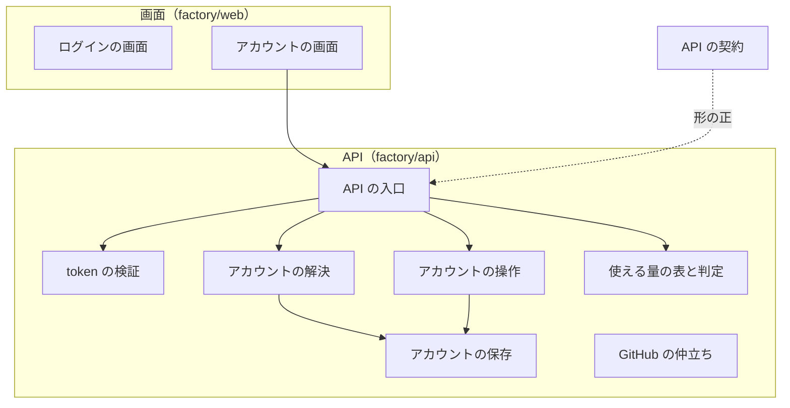
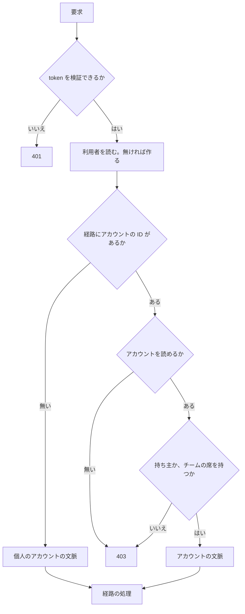
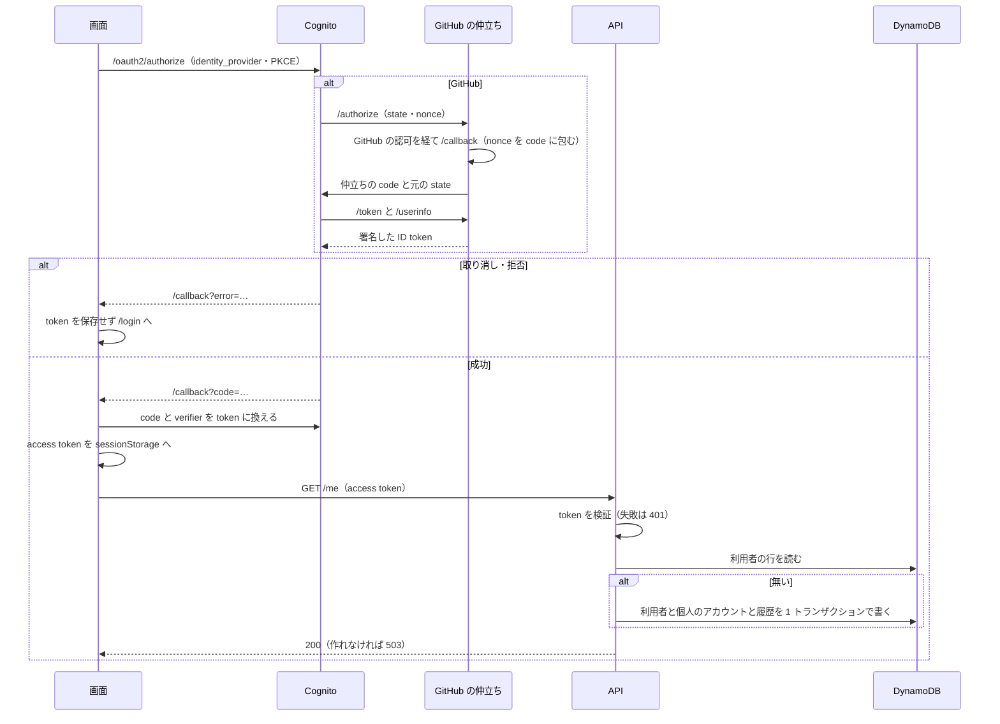
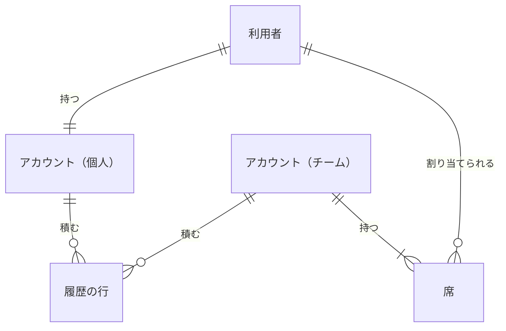
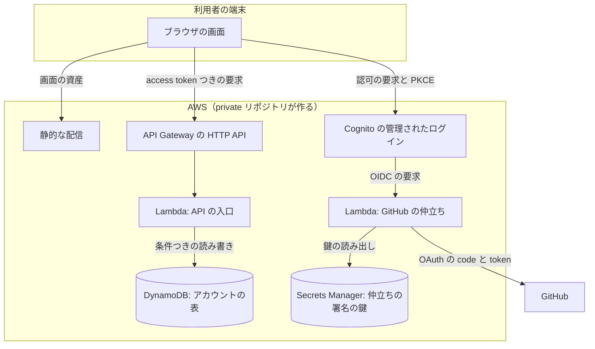

# Neural Development Factory: 認証（Google・GitHub）とアカウント・席・プランごとの使える量

Neural Development Factory の利用者が Google か GitHub のアカウントで Cognito を経てログインし、要求 1 つから「どの利用者が、どのアカウントとして操作しているか」を決め、プランと席の種類ごとの使える量を 1 か所で問い合わせて判定する仕組みを定める。あわせて、`factory/` の TypeScript のパッケージの管理と検査の形を定める。サービス全体の構成・集約の持ち主・実行の形態の意味は [サービスのディレクトリと境界の検査、サービス全体の契約](ndf-factory-service-boundary.md)（以下「全体の契約」）にあり、本書はそこで集約「アカウント」の持ち主とされた部分（#2170）の確定形である。

## 概要

- **ログインは Cognito の管理されたログインを通す。** 画面は IdP（`Google` / `GitHub`）を指定して送り、認可コードと PKCE で access token を得て sessionStorage に置く。Cognito は GitHub を直に受けられないため、`factory/api/` の **GitHub の仲立ち**が GitHub の OAuth を OIDC の IdP の形へ変える
- **API は要求ごとに access token を検証し、経路からアカウントを解決する。** `account_id` は token に載せず、経路 `/accounts/{account_id}/…` から決める。経路に無ければその利用者の個人のアカウントである。初めての要求で、利用者と個人のアカウント（Free・`local`）を 1 つのトランザクションで作る
- **使える量は `factory/api/src/accounts/limits.ts` の表 1 つが決める。** 同時に動かせるスプリントの実行の数と月の token の上限の 2 つで、月の token は実行の形態が `managed` のときだけ照らす。判定は呼び出す側が今の値を渡し、上限と照らした結果と理由を返す
- **他の子課題は `factory/api/src/index.ts` から export したものだけを使う。** 同じ Hono の入口に経路を足し、認証と解決の中間処理を共有する
- **`factory/` は npm の workspaces で束ね、`npm run check` 1 つで検査する。** CI のジョブ `factory-check` が同じコマンドを打つ

## 用語

定義は [用語集](../glossary.md) が正である（文脈 `ndf-factory`）。この文書で使う語は「利用者」「アカウント」「席」「プラン」「使える量」「使える量の判定」「チームの持ち主」「実行の形態」「GitHub の仲立ち」である。

## コンテキスト

変更はすべて Neural Development Factory（`ndf-factory`）の中で閉じる。Cognito と GitHub は外部の系で、受け取るのは利用者の識別子（Cognito の access token の `sub`）と IdP の種類だけである。

## 背景

依頼（#2170）は「Cognitoによる認証(Google, Githubの認証に対応)」と「Claude.aiと類似の認証・課金モデル(Free, 個人PRo, 個人Max, Team(standard/premium sear) etc)」である。後続の子課題（#2171・#2172〜#2174・#2186・#2189）はどれも「この要求はどのアカウントのものか」と「このアカウントはあと何を使えるか」を前提に作るため、この 2 つを先に 1 か所へ決めた。

- **`account_id` を token に載せず、経路から解決する。** 1 人の利用者は個人のアカウント 1 つと、席を持つチームのいくつかに属する。token に載せると別のアカウントとして操作するたびにログインし直すことになり、載せるには Cognito の token を作る前の Lambda をインフラに足す必要がある。経路に置けば、画面のリンクからどのアカウントの画面かが読める
- **初回のアカウントは API の最初の要求で作る。** Cognito のログインの後の Lambda で作ると、インフラがその Lambda をつなぐ必要があり、作成の失敗がログインそのものの失敗になる
- **2 つの IdP の利用者をメールアドレスでまとめない。席も利用者の ID で指し、メールを保存しない。** 片方の IdP でメールを偽れたとき、他人のアカウントや席に入れるためである
- **GitHub の仲立ちを `factory/api/` に置く。** Cognito の組み込みの IdP に GitHub は無く、GitHub の OAuth は ID token を返さないため OIDC の IdP として直に登録できない。仲立ちはインフラでなくサービスのコードである。GitHub の OAuth App の秘密は Cognito が持ち、仲立ちは受け渡すだけにして、同じ秘密を 2 か所に置かない
- **使える量の値はコードの表に置く。** DynamoDB の行に置くと、値の変更をコードの差分と Pull Request で追えず、変える経路と権限を別に作る必要がある
- **今の値の行と追記だけの履歴の行を 1 つの表に置く。** 請求（#2174）が「いつ何の席が何日あったか」を追えるためで、1 つの表にすると条件つきのトランザクションが表の中で閉じ、インフラへ渡す表の定義も 1 つで済む
- **新しいアカウントの実行の形態は `local` にし、Free で `managed` を断る。** `local` はサービスが Claude の認証情報も token の費用も持たず、Free のまま何も足さずに使える唯一の形である。Free に `managed` を置かないのは、全体の契約の「実行の形態」の決定に従う
- **道具は npm の workspaces・Node 24・`tsc --noEmit`・Vitest・Hono・`aws-jwt-verify`・`oidc-client-ts`。** npm は Node に同梱され、手元・CI・ランナーのコンテナのどこでも追加の導入が要らない。`aws-jwt-verify` は Cognito に固有の照合（`token_use`・`client_id`）を 1 回の呼び出しで見て、公開鍵の一覧を外から渡せるため本物の Cognito なしでテストできる。`oidc-client-ts` は Amplify より依存が小さく、使うのは認可コードと PKCE の 1 機能だけである。Hono は Lambda の HTTP API の handler をそのまま出せ、`app.request()` で Lambda を立てずに経路をテストできる

## 対象範囲

- **含む**: `factory/web/` のログイン・ログアウトとアカウントの画面、`factory/api/` の token の検証・アカウントの解決・アカウントと席とプランと実行の形態の読み書き・使える量の問い合わせと判定・GitHub の仲立ち、`factory/contracts/openapi/accounts.yaml`、`factory/` のパッケージの管理と CI のジョブ `factory-check`
- **含まない**: Cognito の利用者プール・DynamoDB の表・Lambda の束ね方などインフラの定義（private リポジトリが作る）、決済・料金・請求とプランを有料へ変える経路（#2174）、使用量の台帳とその月の token の集計（#2174）、スプリントの開始を断る処理そのもの（#2186。本書は判定を返す）、実行の形態ごとのランナー・持ち込んだキーの保存（#2186・#2189）、2 つの IdP の利用者をまとめる機能、招待のメール
- プラグインの配布物・Skill・hook は変わらない。`plugins/` は `factory/` を参照しない（全体の契約の I1）

## 仕様

### 集約

| 集約 | 持ち主 | 根 | エンティティ | 値オブジェクト |
| --- | --- | --- | --- | --- |
| 利用者 | 認証とプラン（`factory/api/`） | 利用者 | — | 利用者の ID（Cognito の `sub`）・IdP の種類 |
| アカウント | 認証とプラン（`factory/api/`） | アカウント | 席 | 種類（個人・チーム）・プラン・席の種類・使える量・実行の形態・履歴の行 |

初めてのログインは「利用者」と「個人のアカウント」の 2 つを 1 つのトランザクションで作る。2 つは同じ利用者の作成でしか生まれず、片方だけがある状態を作らないためで、「1 つの処理が書き換える集約は 1 つ」（全体の契約の「集約」）の例外はこの作成の時だけである。

### 構成要素

| 要素 | 場所 | 責務 |
| --- | --- | --- |
| パッケージの根 | `factory/package.json`・`package-lock.json`・`.node-version`・`vitest.config.ts` | npm の workspaces で `web`・`api`（と #2171 が足した `contracts`）を束ね、依存を 1 つのロックファイルで固める。`npm run check` で契約の検査と各 workspace の検査を走らせる |
| ログインの画面 | `factory/web/src/auth.ts`・`pages/LoginPage.tsx`・`pages/CallbackPage.tsx` | Cognito の管理されたログインへ IdP を指定して送り、戻りで token を受けて保存する。ログアウトで token を消す |
| アカウントの画面 | `factory/web/src/pages/AccountPage.tsx`・`NewTeamPage.tsx`・`TeamPage.tsx` | 自分のアカウント・チームを作る・チームのアカウントの 3 画面。API の 401 で token を消してログインへ戻す |
| token の検証 | `factory/api/src/auth/verify.ts` | `Authorization: Bearer` の access token を検証し、利用者を返す。失敗は 401 |
| アカウントの解決 | `factory/api/src/auth/resolve.ts`・`accounts/service.ts` | 経路の前に token を検証する中間処理と、利用者とアカウントの ID から権限つきの文脈を返す処理。利用者が無ければ作る |
| アカウントの操作 | `factory/api/src/accounts/service.ts` | チームの作成・席の追加と種類の変更と削除・プランの変更・実行の形態の変更 |
| 使える量の表と判定 | `factory/api/src/accounts/limits.ts` | プランと席の種類ごとの上限の表と、実行の形態に合わせた問い合わせと判定 |
| アカウントの保存 | `factory/api/src/accounts/store.ts` | DynamoDB の 1 つの表への読み書き。条件つきの書き込みとトランザクション |
| API の入口 | `factory/api/src/handlers/api.ts` | API Gateway の HTTP API（payload 2.0）から呼ばれる Lambda の handler。ログ・CORS・認証の中間処理・エラーの形・経路の登録 |
| GitHub の仲立ち | `factory/api/src/handlers/github-oidc.ts`・`github-oidc/{app,keys}.ts` | Cognito から OIDC の IdP として呼ばれ、GitHub の OAuth へ取り次ぎ、署名した ID token を返す |
| API の契約 | `factory/contracts/openapi/accounts.yaml` | 画面向けの経路の OpenAPI。Spectral で検査する |
| CI のジョブ | `.github/workflows/factory-check.yml` の `factory-check` | `factory/` かこのワークフローを変える Pull Request で `npm ci` と `npm run check` を打つ |

ログインの画面は API を呼ばず、Cognito とだけ話す。GitHub の仲立ちは Cognito からだけ呼ばれ、ほかの要素と線を持たない。

### 他の子課題へ公開する関数

`factory/api/src/index.ts` から export したものだけを使う（#2171・#2186・#2174・#2189）。

| 名前 | 入力 | 出力 | 失敗 |
| --- | --- | --- | --- |
| `verifyRequest(authorization)` | `Authorization` の値 | `Caller`（`userId`・`idp`） | 401 の `AuthError` |
| `resolveAccount(caller, accountId?)` | `Caller`・アカウントの ID（省くと個人のアカウント） | `AccountContext`（`accountId`・`userId`・`kind`・`plan`・`role`（`owner` / `member`）・`seatType`（チームのときだけ、ほかは `null`）・`executionMode`）。#2186・#2189・#2174 は実行の形態をここから読む | 403 の `ForbiddenError` |
| `getLimits(ctx)` | `plan`・`seatType`・`executionMode` | `Limits`（`concurrentSprintRuns`・`monthlyTokens`）。`monthlyTokens` は `managed` のときだけ表の値で、ほかは `null`（掛けない） | 例外を投げない。表に無い組と、`managed` なのに表に月の token の値が無い組は `null` を返す |
| `judgeLimits(ctx, current)` | 文脈・`current = {runningSprintRuns, tokensThisMonth?}` | `Judgment`（`allowed`・`limits`・`reasons`）。`reasons` は `{quantity, limit, current}` の並び | — |
| `setPlan(accountId, plan)` | アカウントの ID・プラン | 無し | `PlanError`（`unknown_plan` / `plan_kind_mismatch` / `account_not_found`）。版の競合で 3 回書けなければ `AccountUnavailableError` |
| `createApiApp(deps)`・`requireCaller(deps)`・`resolveFromRequest(c, accountId?)` | — | API の入口の Hono のアプリ・認証の中間処理・経路の中でアカウントの文脈を得る関数 | 上と同じ |

あわせて `LIMITS_TABLE`・`AccountService`・エラーの型（`ApiError`・`AuthError`・`ForbiddenError`・`PlanError`）と、`AccountContext`・`Caller`・`ExecutionMode`・`Plan`・`SeatType`・`Limits`・`Judgment`・`CurrentUsage`・`LimitReason`・`AuthEnv`・`ApiApp` の型を export する。

**使える量は HTTP の経路にしない。** #2186・#2174 の処理は同じ `factory/api/` の中で上の関数を呼ぶ。画面は `GET /accounts/{account_id}` の `limits` で上限を出す。

### token の検証とアカウントの解決

- **API は `aws-jwt-verify` で access token を毎回検証する。** 署名・発行元（利用者プールから作る）・`client_id`・期限・`token_use=access` を見る。ID token は `token_use` の違いで 401 になる。`Bearer <token>` の形でない・検証に失敗した・`username` の頭が `Google_` か `GitHub_` でない・`sub` が空のどれも 401 `unauthorized` で、理由を応答に出さない。API Gateway に認可を足しても Lambda の中の検証は外さない
- **利用者の IdP は token の `username` の頭で決める。** `Google_` は `google`、`GitHub_` は `github`。頭は Cognito に登録する IdP の名前に依存する（「外部連携」）
- **解決は「利用者を読み、無ければ作る」から始める。** 経路にアカウントの ID が無ければ個人のアカウントを指す。アカウントが無い・個人のアカウントで持ち主でない・チームで席を持たないのどれも、同じ 403 `forbidden` と同じ本文を返す
- **`role` はアカウントの持ち主なら `owner`、ほかは `member` である。** 個人のアカウントでは本人だけが解決でき、常に `owner` になる

**初回の作成は「利用者の行が無いこと」を条件にしたトランザクションで書く。** 利用者・個人のアカウント（プラン `free`・形態 `local`・版 1）・`account.created` の履歴の行を一緒に書く。並べて 2 回来ても条件で片方だけが通り、失敗した側は利用者を読み直して先にできた方を返す。読み直しても無いか、条件以外で失敗したときは 503 `account_unavailable` で、次の要求で作り直す。

### ログインの流れ

- 画面は `oidc-client-ts` で、`scope=openid email profile`・`redirect_uri=${FACTORY_WEB_URL}/callback`・`identity_provider`（`Google` / `GitHub`）を付けて Cognito の `/oauth2/authorize` へ送り、IdP の選択の画面を飛ばす。PKCE の状態も sessionStorage に置き、クライアントの秘密を画面に持たない
- 戻りに `error` があれば token を保存せず、`/login?error=…` に「ログインできませんでした」を出す
- ログアウトは保存した token を消してから、Cognito の `/logout` へ `client_id` と `logout_uri=${FACTORY_WEB_URL}/login` で送る
- API の 401 を受けた画面は token を消し、`/login` へ移る

### 常に成り立つ条件

全体の契約の I1〜I11 に続けて番号を振る。

| # | 集約 | 条件 | 破れそうなときの扱い |
| --- | --- | --- | --- |
| I12 | 利用者 | 1 人の利用者の個人のアカウントは 1 つだけ | 2 つ目の作成は条件つきの書き込みで失敗し、先にできた方を読み直して返す |
| I13 | アカウント | 個人のアカウントは席を持たず、プランは `free`・`pro`・`max` のどれか。チームのアカウントのプランは `team` | 個人のアカウントへの席の操作は 409 `not_a_team`。合わない組の `setPlan` は `plan_kind_mismatch` で変えない |
| I14 | アカウント | チームのアカウントでは、持ち主が必ず席を 1 つ持つ | 持ち主の席を外す要求は 409 `owner_seat_protected` |
| I15 | アカウント | 1 人の利用者は 1 つのチームに席を 1 つまで持つ | 2 つ目の追加は 409 `seat_exists` |
| I16 | アカウント | 席が指す利用者は、既に 1 度ログインした利用者である | 422 `user_not_found` |
| I17 | アカウント | 席を足す・種類を変える・外すのは、チームの持ち主だけ | 403 `forbidden`。席の有無を確かめる前に返す |
| I18 | アカウント | 個人のアカウントの持ち主でもチームの席を持つ利用者でもない者には、アカウントの有無も中身も応答に出ない | 存在しないアカウントと同じ 403 と同じ本文 |
| I19 | アカウント | 使える量の値は使える量の表 1 か所からだけ決まる | 表に無い組は判定を断る側へ倒し、理由に `not_in_limits_table` を返す |
| I20 | アカウント | プラン・席・実行の形態を変えるたびに、同じトランザクションで履歴の行を 1 つ足し、履歴の行は書き換えない | 履歴を書けなければ変更ごと書かない |
| I21 | アカウント | プランが `free` のアカウントの実行の形態は `managed` でない | 形態を `managed` へ変える要求は 409 `managed_not_allowed_on_free`。`setPlan` で `free` へ下げるとき形態が `managed` なら、同じ更新で `local` へ変え、`plan.changed` と `execution_mode.changed` の 2 つの履歴の行を足す |
| I22 | アカウント | 実行の形態を変えるのは、アカウントの持ち主（個人は本人、チームはチームの持ち主）だけ | 403 `forbidden` |
| I23 | アカウント | 月の token の上限を照らすのは、実行の形態が `managed` のときだけ。同時に動かせるスプリントの実行の数は 3 つの形態すべてで照らす | `local`・`byok` の判定は月の token の今の値を見ない |
| I24 | アカウント | 新しいアカウント（個人もチームも）の実行の形態は `local` で始まる | 作成はいつも `local` で書く |

**プランと形態の更新は、読んだアカウントの行の版が変わっていないことを条件に書く。** アカウントの行は数の `version` を持ち、`setPlan` と形態の変更はどちらも「行があり、`version` が読んだ値と等しいこと」を条件にして、同じ更新で `version` を 1 増やす。条件で失敗したら読み直して I13・I21 を判定し直し、もう一度書く（3 回まで）。これが無いと、プロ・`local` を読んだ `setPlan` が形態を変えないと決めた後に別の要求が `managed` を保存し、続けて `setPlan` が `free` を保存して、`free`・`managed` が残る。席の種類の変更と削除も同じく、読んだ席の種類と足した時刻が変わっていないことを条件にし、競合したら読み直す（3 回まで）。外して足し直した新しい席を古い要求で消さないためである。3 回で書けなければ 503 `account_unavailable` を返す。

### 使える量の表と判定

| プラン・席の種類（表の鍵） | 同時に動かせるスプリントの実行 | 月の token の上限（`managed` だけ） |
| --- | --- | --- |
| Free（`free`） | 1 | 掛けない（`managed` を選べない） |
| 個人 Pro（`pro`） | 3 | 20,000,000 |
| 個人 Max（`max`） | 10 | 100,000,000 |
| Team standard（`team:standard`） | 3 | 25,000,000 |
| Team premium（`team:premium`） | 10 | 125,000,000 |

- **鍵は個人のアカウントではプラン、チームでは `team:<席の種類>` である。** チームの使える量は、要求した利用者の席の種類で決まる
- **月の token は入力と出力の和で、cache の読み書きを含めて数える。** Bedrock の請求と同じ単位で数えるためである。cache を除くと、NDF の実行ではほぼ全部が出力になり、同じ上限でも費用が大きく変わる
- **値の比は依頼の「Claude.aiと類似の」に合わせた。** Pro と Max の比を保ち、Team standard を個人 Pro の少し上、Team premium を個人 Max の少し上に置く
- **判定は「今の値が上限より小さければ許す」である。** 同時のスプリントの実行は新しい 1 つを始める前の数を渡し、上限 3 なら今が 2 で許し、3 で断る。月の token はその UTC の暦月に使った数（チームではその席の利用者の分）を渡し、上限ちょうどで断る。`managed` で `tokensThisMonth` を省くと断る
- 断ったときの `reasons` の `quantity` は `concurrent_sprint_runs` / `monthly_tokens` / `not_in_limits_table` で、`limit` と `current` に上限と今の値を入れる。画面と #2186 は同じ値から利用者に出す文を作る

### API の経路

経路はすべて `Authorization: Bearer <access token>` を要る。エラーの本文は `{"error": {"code": "<機械の値>", "message": "<利用者に出す文>"}}` に揃える。機械可読な正は `factory/contracts/openapi/accounts.yaml` である。

| 経路 | 入力 | 成功 | 失敗 |
| --- | --- | --- | --- |
| `GET /me` | — | 200 `{user_id, idp, personal_account_id, accounts: [{account_id, kind, name, plan, role, seat_type, execution_mode}]}`。先頭は個人のアカウント。初回は個人のアカウントを作る | 401・503 `account_unavailable` |
| `GET /accounts/{account_id}` | — | 200 `{account_id, kind, name, plan, role, seat_type, execution_mode, limits: {concurrent_sprint_runs, monthly_tokens}, seats}`。`monthly_tokens` は `managed` のときだけ数で、ほかは `null`。`seats` はチームだけで `[{user_id, idp, seat_type, added_at}]`、個人では `null` | 401・403 `forbidden` |
| `POST /teams` | `{name: 1〜64 字（空白だけは不可）, seat_type}` | 201 アカウントの本文（上と同じ形）。作った利用者が持ち主で、その席が 1 つある | 400 `invalid_request` |
| `PUT /accounts/{account_id}/execution-mode` | `{execution_mode: "local" \| "byok" \| "managed"}` | 200 アカウントの本文。今と同じ値なら履歴の行を足さずに 200 | 400 `invalid_request`・403 `forbidden`（I22・I18）・409 `managed_not_allowed_on_free`（`message` は「Free のプランでは managed（サービスの Bedrock）を選べません」）・503 `account_unavailable` |
| `POST /accounts/{account_id}/seats` | `{user_id: 1〜128 字, seat_type}` | 201 席 `{user_id, idp, seat_type, added_at}` | 400・403・409 `not_a_team`・422 `user_not_found`・409 `seat_exists` |
| `PATCH /accounts/{account_id}/seats/{user_id}` | `{seat_type}` | 200 席 | 400・403・409 `not_a_team`・404 `seat_not_found`・503 |
| `DELETE /accounts/{account_id}/seats/{user_id}` | — | 204 | 403・409 `not_a_team`・409 `owner_seat_protected`・404 `seat_not_found`・503 |

- **持ち主の確かめは、席の有無とプランの照合より先に行う。** 404 `seat_not_found` と 409 `managed_not_allowed_on_free` は、要求した者が持ち主と確かめた後だけ返す
- **`byok` を選んでもキーの登録はこの経路で求めない。** キーの保存は #2186 が持つ
- **`GET /me` のチームの一覧は GSI を候補として引き、元の席を強い整合で確かめる。** 外した席が GSI に残る間に、そのチームの名前やプランを返さないためである
- 本文が JSON のオブジェクトでなければ 400 `invalid_request`。経路の中で起きた想定外の失敗は 503 `account_unavailable` に揃える

### GitHub の仲立ち

発行元は `GITHUB_OIDC_ISSUER`（`https://<API の入口>/oidc/github`）で、その下に次の経路を置く。署名はすべて RS256 で、鍵は `GITHUB_OIDC_SIGNING_KEY_SECRET_ARN` の PKCS#8 の秘密鍵 1 つである。

| 経路 | 中身 |
| --- | --- |
| `GET /.well-known/openid-configuration` | 発行元・`/authorize`・`/token`・`/userinfo`・`/jwks.json`。`response_types_supported: ["code"]`・`id_token_signing_alg_values_supported: ["RS256"]`・`token_endpoint_auth_methods_supported: ["client_secret_post", "client_secret_basic"]` |
| `GET /authorize` | `redirect_uri` が `https://${COGNITO_DOMAIN}/oauth2/idpresponse` と、`client_id` が `GITHUB_OAUTH_CLIENT_ID` と完全に一致するときだけ受け、違えばどこへも送らず 400 `invalid_request`。受けた `client_id`・`redirect_uri`・`state`・`nonce` を署名した有効期限 10 分の JWT（仲立ちの `state`）に包み、`redirect_uri=${GITHUB_OIDC_ISSUER}/callback`・`scope=read:user user:email` で GitHub の認可の画面へ 302 で送る |
| `GET /callback` | 仲立ちの `state` の署名・期限と中の `client_id`・`redirect_uri` を確かめ（違えば 400 `invalid_request`）、GitHub の `code` と `client_id`・`redirect_uri`・`nonce` を署名した有効期限 5 分の JWT（仲立ちの `code`）に包み、Cognito の `redirect_uri` へ元の `state` と一緒に 302 で返す。GitHub がエラーを返したら（`code` が無ければ `access_denied`）、`error` を元の `state` と一緒に返す |
| `POST /token` | `grant_type=authorization_code` とクライアントの ID と秘密（`client_secret_post` か `client_secret_basic`。Basic を優先）を要る（無ければ `invalid_request`）。仲立ちの `code` の署名・期限を確かめ、中の `client_id`・`redirect_uri` が要求のものと違えば `invalid_grant`。GitHub の token の経路で code を換え、GitHub の利用者を引き、`sub` = GitHub の数の利用者 ID・`aud` = `client_id`・`nonce`（`/authorize` で受けたときだけ）・有効期限 5 分の ID token を署名して返す。`access_token` は GitHub のものをそのまま返す |
| `GET`・`POST /userinfo` | 受けた access token で GitHub の利用者を引き、`sub`・`name`（無ければログイン名）・`preferred_username` と、検証済みの主のメールがあれば `email`・`email_verified` を返す。token が無いか引けなければ 401 `invalid_token` |
| `GET /jwks.json` | 署名の鍵の公開鍵（`kid` は JWK の thumbprint） |

- **`sub` に GitHub のログイン名やメールを使わない。** どちらも利用者が変えられ、別人と入れ替わるためである
- **`nonce` は表を使わず、署名した `state` と `code` で運ぶ。** Cognito は OIDC の IdP へ `nonce` を送り、返った ID token の `nonce` と照らす。GitHub の `code` を Cognito へ直に戻すと `/token` で値を復元できないため、GitHub のコールバックを仲立ちの `/callback` にして `nonce` を仲立ちの `code` に結び付ける。包む JWT は ID token と同じ鍵で署名し、`typ`（`ndf-github-state+jwt` / `ndf-github-code+jwt`）で取り違えを拒む
- **`/authorize` が戻り先を照らす。** GitHub は Cognito の `redirect_uri` を照らさなくなるため、照らさないと `/callback` が任意の URL へ `code` を送るオープンリダイレクトになる
- GitHub の `code` は署名だけで暗号化しない。換えるには Cognito が持つクライアントの秘密が要り、GitHub が 1 回しか換えさせないため、標準の流れでブラウザの URL に出るのと変わらない

### 画面

| 画面 | 経路 | 何をする場所か |
| --- | --- | --- |
| ログイン | `/login` | Google と GitHub の 2 つのボタン。`?error=` があれば「ログインできませんでした」を出す |
| ログインの戻り | `/callback` | code を token に換え、`/account` へ移る。`error` つきの戻りは token を保存せず `/login?error=…` へ移る |
| 自分のアカウント | `/account` | 利用者の ID（写すボタン）・IdP・個人のプランと実行の形態と 2 つの上限（`managed` でなければ月の token は「掛けない」）・形態を変える操作・席を持つチームの一覧・チームを作る・ログアウト |
| チームを作る | `/teams/new` | 名前（1〜64 字）と自分の席の種類（既定は standard）を入れて作る |
| チームのアカウント | `/accounts/:accountId` | プラン・実行の形態・自分の席の種類と 2 つの上限・席の一覧。持ち主には席の追加（利用者の ID は UUID の形で 36 字まで）・種類の変更・削除と形態を変える操作が出る |

それ以外の経路は `/account` へ移る。Free では形態の選択肢の `managed` を選べない。

| 状態 | 出すもの |
| --- | --- |
| 読み込み中 | 「読み込み中」 |
| 未ログイン・API の 401 | token を消して `/login` へ移る |
| 403 | 「このアカウントを見る権限がありません」。アカウントの有無は出さない |
| 席の操作と形態の変更の 409・422・400 | API の `message` を操作の下に出す |
| 5xx | 「時間をおいてやり直してください」 |

画面の出し分けは表示のためだけで、認可は API が毎回行う（I17・I18・I22）。

## データ・設定

### アカウントの表

DynamoDB の 1 つの表（`ACCOUNTS_TABLE_NAME`）に、利用者・アカウント・席・履歴の行を置く。読み出しは強い整合で行う。

| 行 | `pk` | `sk` | `gsi1pk` | `gsi1sk` |
| --- | --- | --- | --- | --- |
| 利用者 | `USER#<user_id>` | `USER` | — | — |
| アカウント | `ACCOUNT#<account_id>` | `ACCOUNT` | — | — |
| 席 | `ACCOUNT#<account_id>` | `SEAT#<user_id>` | `USER#<user_id>` | `ACCOUNT#<account_id>` |
| 履歴の行 | `ACCOUNT#<account_id>` | `HIST#<at>#<uuid>` | — | — |

GSI `gsi1` は利用者が席を持つチームの一覧を引くためにあり、射影は KEYS_ONLY でよい（中身は表から強い整合で読む）。

| 行 | 列 | 型 | 空を許すか | 意味 |
| --- | --- | --- | --- | --- |
| 利用者 | `user_id` | 文字列 | 許さない | Cognito の access token の `sub` |
| 利用者 | `idp` | 文字列 | 許さない | `google` / `github` |
| 利用者 | `personal_account_id` | 文字列 | 許さない | 個人のアカウントの ID（I12） |
| 利用者 | `created_at` | 文字列（ISO 8601、UTC） | 許さない | 初めてログインした時刻 |
| アカウント | `account_id` | 文字列（UUID） | 許さない | `crypto.randomUUID()` で作る |
| アカウント | `kind` | 文字列 | 許さない | `personal` / `team` |
| アカウント | `plan` | 文字列 | 許さない | `free` / `pro` / `max` / `team`（I13） |
| アカウント | `execution_mode` | 文字列 | 許さない | `local` / `byok` / `managed`（I21・I24） |
| アカウント | `version` | 数 | 許さない | 作成のときは 1。プランと形態を変えるたびに 1 増やす |
| アカウント | `owner_user_id` | 文字列 | 許さない | 個人は本人、チームはチームの持ち主 |
| アカウント | `name` | 文字列 | 許す | チームの名前。空は「個人のアカウント」 |
| アカウント | `created_at`・`updated_at` | 文字列（ISO 8601、UTC） | 許さない | 作成と最後の変更の時刻 |
| 席 | `seat_type` | 文字列 | 許さない | `standard` / `premium` |
| 席 | `added_at` | 文字列（ISO 8601、UTC） | 許さない | 席を足した時刻 |
| 履歴の行 | `type` | 文字列 | 許さない | `account.created` / `plan.changed` / `seat.added` / `seat.changed` / `seat.removed` / `execution_mode.changed` |
| 履歴の行 | `at` | 文字列（ISO 8601、UTC） | 許さない | 変えた時刻 |
| 履歴の行 | `actor` | 文字列 | 許さない | 変えた利用者の ID。`setPlan` は `system` |
| 履歴の行 | `before`・`after` | JSON | 許す | 変える前と後の値。空は「無かった」（作成の `before`・削除の `after`） |

**メールアドレスは保存しない。** 今の値（アカウント・席の行）は上書きし、変えるたびに同じトランザクションで履歴の行を足す（I20）。チームの作成は、アカウント・持ち主の席・`account.created` と `seat.added` の履歴の行を 1 つのトランザクションで書く。

| 機能 | 利用者 | アカウント | 席 | 履歴の行 |
| --- | --- | --- | --- | --- |
| 自分のアカウントを見る（`GET /me`） | C（初回）・R | C（初回）・R | R（GSI と表） | C（初回） |
| チームを作る | R | C | C | C |
| チームを見る | R（席の IdP） | R | R | — |
| 席を操作する | R（相手） | R | C・U・D | C |
| 解決する | C（初回）・R | C（初回）・R | R | C（初回） |
| 使える量 | — | R | R | — |
| プランを変える（`setPlan`） | — | U（`free` へ下げるときは形態も） | — | C |
| 実行の形態を変える | — | R・U | R | C |

### 環境変数

`factory/.env.example` に名前だけを置く（値は private リポジトリのインフラが渡す。全体の契約の I6）。全体の契約の `AWS_REGION`・`COGNITO_USER_POOL_ID`・`COGNITO_CLIENT_ID` に、本書の次の 7 つを足した。

| 名前 | 使う側 | 意味 |
| --- | --- | --- |
| `COGNITO_DOMAIN` | 画面・GitHub の仲立ち | Cognito の管理されたログインのドメイン。仲立ちは `/authorize` で受ける `redirect_uri` をこのドメインの `/oauth2/idpresponse` と照らす |
| `FACTORY_WEB_URL` | 画面・API | 画面の URL。画面はログインとログアウトの戻りに、API は CORS で許すオリジンに使う |
| `FACTORY_API_URL` | 画面 | API の入口の URL |
| `ACCOUNTS_TABLE_NAME` | API | アカウントの表の名前 |
| `GITHUB_OIDC_ISSUER` | GitHub の仲立ち | 仲立ちの発行元の URL |
| `GITHUB_OAUTH_CLIENT_ID` | GitHub の仲立ち | GitHub の OAuth App のクライアントの ID（秘密でない）。`/authorize` で受ける `client_id` と照らす |
| `GITHUB_OIDC_SIGNING_KEY_SECRET_ARN` | GitHub の仲立ち | ID token を署名する RSA の秘密鍵の置き場 |

画面へは `vite.config.ts` が `COGNITO_DOMAIN`・`COGNITO_CLIENT_ID`・`FACTORY_WEB_URL`・`FACTORY_API_URL` の 4 つだけを名前で選んで埋め込む。ほかの変数を画面へ入れない。API と仲立ちは、要る変数が無ければ最初の要求の処理で失敗する。

### パッケージの管理

規則の正は [factory/README.md の「パッケージの管理」](../../factory/README.md#パッケージの管理) にある。要点は次のとおり。

| 項目 | 決まり |
| --- | --- |
| 道具 | npm の workspaces（`web`・`api`。#2171 が `contracts` を足した）。ロックファイルは `factory/package-lock.json` の 1 つだけ |
| Node の版 | `factory/.node-version` の 1 行（`24`）。`package.json` の `engines`（`>=24 <25`）と CI の `setup-node` が同じ値を使う |
| 検査 | 各 workspace に `typecheck`（`tsc --noEmit`）・`test`（`vitest run`）・`check`（2 つを順に）。根の `npm run check` は `lint:contracts`（Spectral の `spectral:oas`、warn 以上で失敗）と各 workspace の `check` を走らせる |
| 画面の資産 | `npm run build -w web` が `factory/web/dist/` に作る |

## 外部連携

インフラ（private リポジトリ）へ渡す形は次のとおりで、インフラはこれに合わせて資源を作る。

| 渡す形 | 中身 |
| --- | --- |
| handler | `factory/api/src/handlers/api.ts` の `handler` と `factory/api/src/handlers/github-oidc.ts` の `handler`（どちらも HTTP API の payload 2.0）。束ね方（esbuild など）はインフラが決める |
| 画面の資産 | `factory/web/dist/` |
| 表の鍵 | 「アカウントの表」の `pk`・`sk` と GSI `gsi1`（`gsi1pk`・`gsi1sk`） |
| Cognito の IdP の名前 | `Google`（組み込みの Google）と `GitHub`（OIDC の IdP。発行元は `GITHUB_OIDC_ISSUER`）。大文字と小文字もこのとおりにする。画面が送る `identity_provider` と、API が IdP を決める `username` の頭（`Google_`・`GitHub_`）がこの名前に依存する |
| GitHub の仲立ちの経路 | HTTP API の `/oidc/github/{proxy+}` を認可なしで仲立ちの handler へ通す。GitHub の OAuth App のコールバックの URL は Cognito でなく `${GITHUB_OIDC_ISSUER}/callback` にする。Cognito の OIDC の IdP にはその OAuth App のクライアントの ID と秘密を登録する |
| CORS | API の handler が持つ。許すオリジンは `FACTORY_WEB_URL` のオリジン（無いか URL でなければどこも許さない）、ヘッダは `Authorization`・`Content-Type`、メソッドは GET・POST・PUT・PATCH・DELETE で、preflight（OPTIONS）は認証より先に返す。HTTP API の CORS の設定は使わず、OPTIONS も認可なしで API の handler へ通す |

## セキュリティ

- **token は API で毎回検証し、画面の判定だけで認可しない。** 経路ごとに `resolveAccount` を通し、権限の無い者にはアカウントの有無も出さない（I18）。この仕組みは認証と認可を変えるため、変更は人が承認ゲートで見る
- **サービスが持つ秘密は GitHub の仲立ちの署名の鍵 1 つで、Secrets Manager の ARN だけで受ける。** 鍵は起動のたびに 1 回読み、関数の中に持つ（読めなければ次の要求で読み直す）。GitHub の OAuth App の秘密は Cognito が持ち、仲立ちは受け渡すだけで保存も記録もしない
- **ログは JSON で利用者の ID・メソッド・経路・状態コードだけを出す。** token・クライアントの秘密・鍵・メールアドレスを出さない。メールは保存もしない
- **画面に秘密を置かない。** 認可コードと PKCE を使い、token はタブを閉じれば消える sessionStorage に置く
- **IdP をまたいで利用者をまとめない。** 同じ人でも IdP が違えば別の利用者で、席も利用者の ID で指す
- このリポジトリに Cognito の利用者プールなどインフラの定義・秘密・`.env` の実ファイルを置かない（全体の契約の I3・I4・I6）。テストの鍵はテストの中で作り、ファイルに置かない

## 運用

- **CI**: ジョブ `factory-check`（`.github/workflows/factory-check.yml`）は `pull_request` を `paths` で絞らずに起動し、最初の手順で基点との差分に `factory/` かこのワークフローがあるかを見て、無ければ以降を省いて成功で終える。GitHub は `paths` で除外した実行を成功として扱わず、必須のチェックにしたときに対象外の Pull Request が止まるためである。push（`main`・`develop`）は `paths` で絞る。プラグインの検証と同じワークフローに混ぜないのは、落ちたときにどちらが落ちたかをワークフローの名前から読むためである
- **必須のチェックへの追加は利用者の作業である。** それまでは `scripts/required-checks-allow.json` の `awaiting` に理由つきで置き、突き合わせのチェック（[必須のチェックの突き合わせ](ci-required-checks-reconcile.md)）が「追加待ち」と知らせる
- **使える量の値を変えるとき**: `limits.ts` の `LIMITS_TABLE` の該当の行だけを直す。型が鍵の漏れを落とす。値の妥当さは #2174 の使用量の台帳の実測で見直す
- **Node の版を変えるとき**: `factory/.node-version` の 1 行と `engines` を直す
- **他の子課題が経路を足すとき**: `createApiApp` の返す入口に足し、`requireCaller` と `resolveFromRequest` を通す。新しい workspace の足し方は `factory/README.md` の規則に従う
- **API の形を変えるとき**: `factory/contracts/openapi/accounts.yaml` と本書を一緒に直し、`npm run lint:contracts` を通す

## テスト観点

テストは各ファイルの隣の `*.test.ts(x)` にあり、`factory/` で `npm run check` が走らせる。Cognito の token はテストの中で作った鍵で署名し、公開鍵の一覧を `aws-jwt-verify` に渡して確かめる。DynamoDB の条件つきの書き込みは保存の層の偽物（`accounts/memory-store.ts`）で同じ条件を再現し、`store.test.ts` が DynamoDB へ送る条件の形を確かめる。

| 観点 | 縛る振る舞い |
| --- | --- |
| ログイン | 2 つのボタンがそれぞれ `identity_provider=Google` / `GitHub` を付けて Cognito へ送り、戻りの後に `/account` がプランを出すこと |
| ログインの失敗 | `error` つきの戻りで `/login` に「ログインできませんでした」が出て、保存先に token が無いこと |
| ログアウト | 保存先の token が消え、`/account` を開くと `/login` へ移ること。API の 401 でも同じであること |
| token の検証 | token が無い・署名が違う・期限切れ・別の利用者プール・別のクライアント・ID token のそれぞれで 401 になり、本文にアカウントの中身が無いこと |
| アカウントの解決 | 個人とチームで文脈を返し、席の無いチームの ID で 403 を返すこと。他の子課題の経路を模した経路から同じ関数で使えること |
| 使える量の問い合わせ（I19・I23） | 5 つの組の値が表と一致すること（Free 以外は `managed` の文脈で）。`local`・`byok` では `monthlyTokens` が `null` であること。表に無い組と、`managed` で月の token の値が無い組は断る判定になること |
| 使える量の判定の境目 | `managed` の文脈で、2 つの量それぞれで、上限より 1 少ない → 許す・ちょうど → 断る・1 多い → 断る。断るときの理由に量と上限と今の値が入ること |
| 形態と判定（I23） | `local`・`byok` で月の token が上限より多くても許し、同時のスプリントの数がちょうど上限なら 3 つの形態のどれでも断ること |
| 上限の表示 | 自分のアカウントとチームのアカウントの画面に 2 つの上限が出ること |
| チームの作成 | 持ち主が作った利用者で、持ち主の席が選んだ種類で 1 つあること。新しいアカウントの形態が個人もチームも `local` であること（I24） |
| 席の権限（I17） | 持ち主は席を足す・変える・外せ、持ち主でない席の利用者の同じ 3 操作は 403 で、席の一覧が変わらないこと |
| 席の条件（I14・I15・I16） | 未ログインの利用者 → 422、既に席がある → 409、持ち主の席を外す → 409 で、どれも席の一覧と履歴が変わらないこと |
| 個人のアカウントは 1 つ（I12） | 同じ利用者で `GET /me` を並べて 2 回呼んでも個人のアカウントは 1 つで、2 回とも同じ ID を返すこと |
| 他人のアカウント（I18） | 利用者 A の token で、他人の個人のアカウント・入っていないチーム・存在しない ID の 3 つに読む・書くを送ると、すべて 403 で本文が同じであること |
| プランの組（I13） | 個人のアカウントへの席の操作は 409、`setPlan` で個人に `team`・チームに `pro` は失敗で、行が変わらないこと |
| 履歴（I20） | 席・プラン・実行の形態の変更のたびに履歴の行が 1 つ増え、変更が失敗したときは増えないこと |
| 実行の形態の読み出し | `GET /me`・`GET /accounts/{account_id}` の応答と `resolveAccount` の文脈に保存した形態が出ること |
| 実行の形態の変更（I21・I22） | 持ち主の変更は 200 で形態が変わり、持ち主でない者は 403、Free で `managed` は 409 `managed_not_allowed_on_free` で、どちらも形態と履歴が変わらないこと |
| Free へ下げる（I21） | `managed` のプロのアカウントへ `setPlan(…, "free")` を呼ぶと、プランが `free`・形態が `local` になり、2 つの履歴の行が同じトランザクションで増えること。形態の書き込みが失敗すればプランも変わらないこと |
| 版の競合（I21） | `setPlan` の書き込みの前に別の要求が `managed` を保存して版を進めても、`setPlan` が読み直して、終わったときプランが `free`・形態が `local` であること |
| GitHub の仲立ち | ID token の `sub` が GitHub の数の利用者 ID、`aud` が `client_id` で、公開した鍵で検証できること。検証済みでないメールを返さないこと。`/authorize` の `nonce` が ID token に同じ値で出ること。署名の壊れた・期限の切れた・`client_id` か `redirect_uri` の違う `state` と `code` を断ること。`/authorize` に違う `redirect_uri` か `client_id` が来たら GitHub へ送らずに 400 を返すこと |
| 秘密を出さない | ログの出力に token・`client_secret`・鍵の形が無いこと。`python3 scripts/check-service-boundary.py` が 0 で終わること |
| パッケージの管理と CI | `npm ci` がロックファイルどおりに入り、`npm run check -w web`・`npm run check -w api` が手元と CI の両方で走り、型の誤りかテストの失敗で 1 になること。`factory/` を変えない Pull Request ではジョブが成功で終わること |
| 既存への影響 | `uv run --frozen --project . --all-extras pytest . -q -n 4`・`claude plugin validate .`・既存の必須のチェックが変わらず通り、プラグインの配布物と CLI だけで使う人の振る舞いが変わらないこと |
| 実環境のログイン | private リポジトリのインフラが利用者プールを作った後、実際の Google と GitHub のアカウントでログインし、プラン Free・形態 `local` の個人のアカウントができること |

## 関連リンク

- 課題: [#2170](https://github.com/devbasex/ai-plugins/issues/2170)（要求と受け入れ条件の正本）、親の [#2168](https://github.com/devbasex/ai-plugins/issues/2168)
- 実装の Pull Request: [#2191](https://github.com/devbasex/ai-plugins/pull/2191)・[#2192](https://github.com/devbasex/ai-plugins/pull/2192)
- サービス全体の契約: [ndf-factory-service-boundary.md](ndf-factory-service-boundary.md)
- サービスのディレクトリとパッケージの管理: [factory/README.md](../../factory/README.md)
- API の契約: [factory/contracts/openapi/accounts.yaml](../../factory/contracts/openapi/accounts.yaml)
- 用語: [用語集](../glossary.md)
