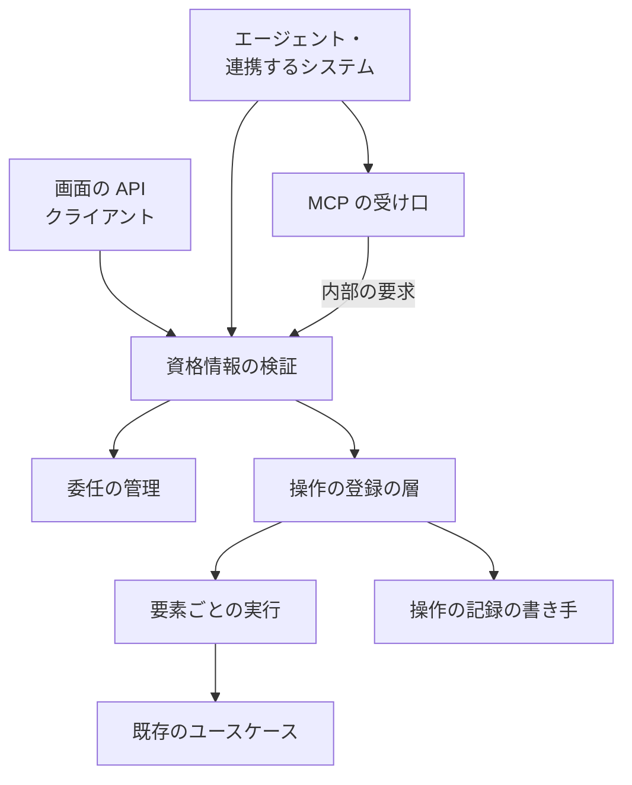
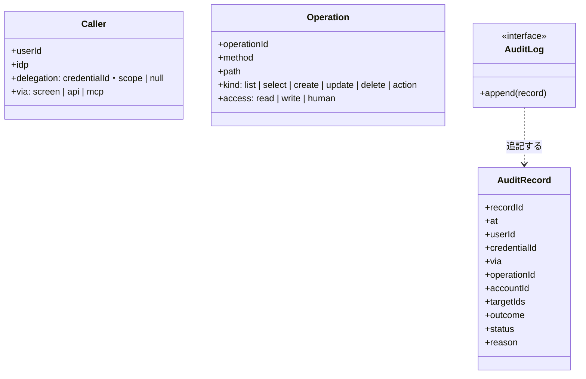
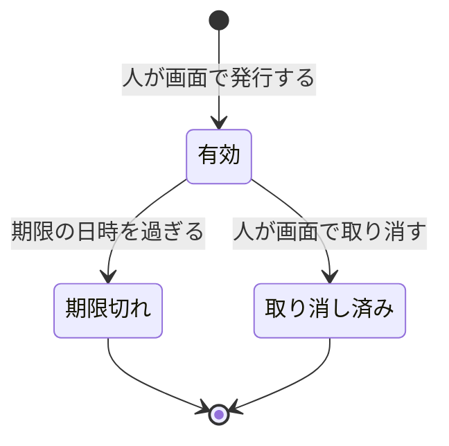

# Neural Development Factory: エージェントからの操作（委任の資格情報・MCP・操作の記録）

人が画面で発行した委任の資格情報で、AI のエージェントや連携するシステムが、画面と同じ操作を API と MCP（Model Context Protocol）から行う。認可は人の直の操作と同じで、人だけが確定できる 10 の操作は委任から断る。利用者向けの操作は 1 回ごとに操作の記録へ 1 件を追記する。利用者向けの操作の入出力の形（要素の配列・要素の結果・要求全体の誤り・作成の冪等の鍵）は、[契約の定義と進捗の受け口](ndf-factory-contracts-and-progress.md#利用者向けの操作の形) が持つ。

## 概要

- **委任の資格情報**は、人が画面（`/delegations`）で発行する不透明な値 `ndfd_<資格情報の ID>_<秘密>` である。範囲は読み取りだけ（`read`）か読み書き（`read_write`）、期限は発行から 300〜3,600 秒である。要求の `Authorization: Bearer <値>` で受ける
- **MCP の受け口**は既存の API の Lambda の `POST /mcp` にある。ツールは契約から生成した操作の表から作り、呼び出しは同じアプリの経路へ内部の要求として送る。認証・範囲の照合・要素の検査・認可・記録は、画面と API と同じ処理を通る
- **操作の記録**は追記だけの表で、だれが・いつ・どの経路で・どの操作を・どの対象に行い、結果がどうだったかを持つ。秘密と個人情報の値は持たない

変更はコンテキスト Neural Development Factory（`ndf-factory`）の中で閉じる。外のエージェントとクライアントは、契約（OpenAPI）と、そこから作った MCP のツールの定義だけでやり取りする（公開された言語）。

## 用語

定義は [用語集](../glossary.md) が正である（文脈 `ndf-factory`）。この文書で使う語は「委任の資格情報」「人だけが確定できる操作」「操作の記録」「呼び出し元の種類」「機能から起こした契約」「操作の扱い」「操作の表」「要素の結果」「作成の冪等の鍵」である。

## 背景

- **MCP の委任の認証は、Factory が発行した資格情報を `Authorization` で直に受ける。** MCP の仕様（2026-07-28 版）は認可を任意とし、独自の認証の方式を認めている。この形なら人が画面で発行した値を MCP のクライアントの設定へコピーするだけで使える。MCP の認可の仕様（OAuth 2.1）に沿わせるには認可サーバーが要り、Cognito はクライアントの動的な登録を持たない
- **委任の資格情報は不透明な値にし、要求のたびに表を強い整合で読む。** 取り消しをその後の最初の要求から効かせるためである。署名した token（JWT）も取り消しには表を読むことになり、照合の結果をキャッシュすると取り消しの直後の要求を通してしまう
- **MCP の SDK は `@modelcontextprotocol/server`（2.4 系）を使う。** MCP の 2026-07-28 版に対応し、Web 標準の要求と応答で動く受け口を持つため、Hono の経路の上で新しい実行基盤を足さずに受けられる

## 対象範囲

- **対象**: 契約に操作の扱い（`x-ndf-access`）を持つ利用者向けの 37 の操作（アカウント 7・取り込みとキーとスプリント 17・開発ループ 7・オーガナイザー 3・委任 3）と、`POST /mcp`
- **対象外**: ランナー向けの経路（`/run-jobs/*`）・進捗の受け口（`/ingest/*`）・GitHub の Webhook。どれも操作の扱いを持たず、委任の資格情報を受けず、操作の記録を書かない

## 仕様

### 集約

| 集約 | 持ち主（書き換えてよいもの） | 根 | 値オブジェクト |
| --- | --- | --- | --- |
| 委任の資格情報 | 委任の管理（`factory/api/src/delegations/`） | 委任の資格情報 | 範囲・期限・秘密のハッシュ・クライアントの名前・作成の冪等の鍵 |
| 操作の記録 | 操作の記録の書き手（`factory/api/src/audit/`） | 記録 1 件 | 呼び出し元の種類・結果・対象の ID の配列 |

委任の資格情報は利用者を ID で参照し、アカウントへの権限を持たない。要求のたびに利用者から、人の直の操作と同じ関数でアカウントを解決する。

### 構成要素

| 要素 | 責務 | 置き場 |
| --- | --- | --- |
| 資格情報の検証 | `Authorization` の値を、委任の資格情報（頭が `ndfd_`）か Cognito の access token として検証し、利用者・委任の有無・呼び出し元の種類を要求の文脈に置く | `factory/api/src/auth/resolve.ts` |
| 委任の管理 | 委任の資格情報の発行・一覧・取り消しと、値の照合 | `factory/api/src/delegations/service.ts` |
| 操作の登録の層 | 経路を操作の表から登録し、範囲の照合・要素の数と重複の検査・経路のアカウントの解決・操作の記録へ渡す値を、すべての利用者向けの操作に同じく掛ける | `factory/api/src/routes/operation.ts` |
| 要素ごとの実行 | 要素を並べる数 10 でユースケースへ渡し、失敗を要素の結果に包む | `factory/api/src/routes/elements.ts` |
| 操作の記録の書き手 | 許可した鍵だけで記録を組み、追記する | `factory/api/src/audit/middleware.ts`・`log.ts` |
| MCP の受け口 | `POST /mcp` で MCP の要求を受け、ツールの呼び出しを同じアプリの経路へ送る | `factory/api/src/mcp/server.ts` |
| 委任の画面 | 委任の資格情報を発行・一覧・取り消す（[画面の地図](ndf-factory-screen-map.md) の `/delegations`） | `factory/web/src/pages/DelegationsPage.tsx` |

### 要求の検査の順

利用者向けの要求は、次の順に検査する。どこで断っても、操作の記録を 1 件追記してから応答を返す。

| 順 | 検査 | 当たったときの応答 |
| --- | --- | --- |
| 1 | 資格情報が有効か（形・秘密・期限・取り消し） | 401 `unauthorized` |
| 2 | 操作の表にある経路か | 404 |
| 3 | 委任の資格情報で、扱い `human` の操作か | 403 `human_only` |
| 4 | 範囲 `read` の委任の資格情報で、扱い `write` の操作か | 403 `scope_insufficient` |
| 5 | 要素が 1〜100 個で、同じ鍵の要素が無いか（一覧には掛けない） | 400 `empty_items`・`too_many_items`・`duplicate_key` |
| 6 | 経路のアカウントを解決できるか | 403 `forbidden` |
| 7 | 要素ごとに人と同じ認可を掛けてユースケースを呼ぶ | 200 と要素の結果の配列 |
| 8 | 操作の記録を追記できたか | 失敗なら 503 `audit_unavailable` |

### 人だけが確定できる操作

扱い `human` の操作は次の 10 である。委任の資格情報では範囲によらず 403 `human_only` で断り、答えも状態も保存しない。

| 何に当たるか | 操作 |
| --- | --- |
| 承認と判断の答え | `answerLoopPending`・`resolveStalledRelease` |
| モデルの認証情報の保存と削除（共通原則の C1） | `putModelCredential`・`deleteModelCredential` |
| 席の追加・変更・削除とチームの作成（C2） | `addSeat`・`changeSeat`・`removeSeat`・`createTeam` |
| 委任の資格情報の発行と取り消し | `createDelegation`・`revokeDelegation` |

リポジトリの登録と外す操作、実行の形態の変更は扱い `write` である。登録は GitHub の画面で人が認可した結果（`proof`）が無いと通らない。課題の候補（`postIssueCandidates`）は言語モデルを呼んで費用が掛かるため、読むだけでも扱い `write` である。承認と通知（#2173）が足す承認の操作も扱い `human` で足す。

### 委任の操作

| operationId | メソッドと経路 | 要素か条件 | 成功の値 |
| --- | --- | --- | --- |
| `listDelegations` | `GET /delegations` | — | `{credential_id, client_name, scope, created_at, expires_at, revoked_at, state}` の配列。自分が発行したものだけを新しい順で 100 件まで |
| `createDelegation` | `POST /delegations` | `{client_name, scope, expires_in_seconds, idempotency_key}` | `{delegation, credential}`。`credential` は値で、発行の応答で 1 度だけ返す。同じ冪等の鍵の 2 回目は同じ資格情報を返し、`credential` を `null` にする |
| `revokeDelegation` | `DELETE /delegations` | `?credential_id=` を繰り返す | 取り消した資格情報の値（一覧の 1 行と同じ形） |

- `client_name` は 1〜64 字、`scope` は `read` か `read_write`、`expires_in_seconds` は 300〜3,600 の整数である。外れた要素は 400 の要素の結果になり、保存しない
- `state` は `active`（有効）・`expired`（期限切れ）・`revoked`（取り消し済み）である
- 取り消しは、期限切れと取り消し済みの資格情報では何も変えずに成功を返す。他人の資格情報と無い資格情報は、同じ `forbidden` の要素の結果になる

有効へ戻る遷移と期限の延長は無い。延ばしたいときは新しく発行する。

### MCP の受け口

| 項目 | 規則 |
| --- | --- |
| 経路 | `POST /mcp`。状態を持たず、要求ごとに JSON の 1 応答で返す。`GET` と `DELETE` の `/mcp` は 405 |
| 資格情報 | 委任の資格情報だけを受ける。Cognito の token は 401。`Origin` のヘッダーがあり画面のオリジンと違えば 403 |
| ツールの名前 | `operationId` のまま。37 の操作すべてを登録する |
| ツールの説明 | 契約の `summary` と `description`。扱い `human` の操作は、頭に「人だけが確定できる。MCP からは常に断られる。画面で行う。」を足す |
| 入力の定義 | オブジェクト。経路に `{accountId}` があれば `account_id`（必須）。一覧・指定の取得・削除は query の項目、作成・更新・操作は `items`（要素の配列。1〜100 個） |
| 呼び出し | 入力から経路・query・本文を組み、`Authorization` をそのまま付けて同じアプリへ内部の要求として送る。MCP の受け口が受け取る依存は、アプリの要求の関数（Hono の `app.request`）1 つだけである |
| 結果 | `structuredContent` に `{status, body}`、`content` に同じ値の JSON の文字列を 1 つ。`isError` は状態が 400 以上のとき真 |

ツールの定義は起動のたびに操作の表から作り、手で書いた定義を持たない。扱い `human` のツールも登録するのは、エージェントが断られた理由と、人が画面で行うことを読めるようにするためである。

### 呼び出し元の種類

| 種類 | 決め方 |
| --- | --- |
| `screen` | Cognito の access token での要求（画面の外から使っても人の直の操作として扱う） |
| `api` | 委任の資格情報で API へ直に送った要求 |
| `mcp` | MCP の受け口が送る内部の要求。印は Hono の要求の環境（`app.request` の第 3 引数）に置く |

外から届くヘッダーでは種類を変えられない。

### 常に成り立つ条件

| # | 集約 | 条件 | 破れたときの扱い |
| --- | --- | --- | --- |
| A1 | 委任の資格情報 | 期限は発行から 300〜3,600 秒の間にある | 発行の要素を 400 で断り、保存しない |
| A2 | 委任の資格情報 | 期限を過ぎた・取り消した資格情報は認証に通らない。取り消しはその後の最初の要求から効く | 401 で、操作を行わない |
| A3 | 委任の資格情報 | 秘密は SHA-256 のハッシュだけを保存し、平文を持たない。照合は一定時間の比較で行う | 保存の関数の引数に平文を取らない |
| A4 | 委任の資格情報 | 委任の資格情報では、人だけが確定できる操作を呼べない | 範囲によらず 403 `human_only` |
| A5 | 委任の資格情報 | 範囲が読み取りだけの資格情報では、書き込みの操作を呼べない | 403 `scope_insufficient` |
| A6 | 委任の資格情報 | 委任の資格情報での認可の判定は、発行した人の直の操作の判定と同じになる | 利用者とアカウントの解決を人と同じ関数で行い、委任の側に認可の分岐を持たない |
| A7 | 操作の記録 | 利用者向けの操作 1 回に記録が 1 件増える。成功・一部の失敗・400・401・403・404 のどれでも増える | 追記に失敗したら操作を 503 `audit_unavailable` で返す |
| A8 | 操作の記録 | 記録を書き換える・消す関数を持たない | 保存の契約は追記の関数 1 つだけを持つ |
| A9 | 操作の記録 | 記録に秘密と個人情報の値が入らない | 記録の対象の ID は許可した鍵の一覧からだけ取る |
| A10 | 機能から起こした契約 | 利用者向けの操作と MCP のツールが 1 対 1 で対応し、画面の API クライアントが呼ぶ操作はすべて契約にある | 検査（`contracts/tests/operations.test.ts`・`web/scripts/check-source.ts`）が落ちる |
| A11 | 機能から起こした契約 | MCP のツールは同じアプリの経路を呼び、保存の関数を直に持たない | MCP の受け口に渡す依存をアプリの要求の関数 1 つに限る |
| A12 | 操作の記録 | 呼び出し元の種類は、要求のヘッダーで変えられない | 種類を資格情報の種類と内部の印だけで決める |

## データ・設定

### 委任の資格情報の表

区分の鍵は `credential_id` だけである。利用者の一覧のため GSI `user_id-created_at` を置く。資格情報の読み出しは強い整合で行う。

| 列 | 型 | 空を許すか | 意味 |
| --- | --- | --- | --- |
| `credential_id` | 文字列 | 許さない | 主キー。ランダムな 16 バイトを base32（小文字・埋めなし、26 字）で書いたもの |
| `user_id` | 文字列 | 許さない | 委任した利用者（Cognito の `sub`） |
| `idp` | 文字列 | 許さない | 委任した利用者の IdP。人の解決と同じ `Caller` を組むために持つ |
| `client_name` | 文字列 | 許さない | 人が付けたクライアントの名前（1〜64 字）。操作の記録には写さない |
| `scope` | 文字列 | 許さない | `read` / `read_write` |
| `secret_hash` | 文字列 | 許さない | 秘密（32 バイト）の SHA-256 の 16 進 |
| `created_at` | 文字列 | 許さない | 発行の日時（UTC、ISO 8601） |
| `expires_at` | 文字列 | 許さない | 期限（UTC） |
| `revoked_at` | 文字列 | 許す | 空は取り消していない。取り消しで 1 度だけ書く |

`revoked_at` の 1 回の書き込み以外は行を書き換えず、期限を過ぎた行も消さない。操作の記録が資格情報の ID だけを持つため、後からクライアントの名前をたどれるようにする。

### 操作の記録の表

区分の鍵は `record_id` だけである。書き込みは `attribute_not_exists(record_id)` の条件つきの追加だけで、更新と削除を行わない。検索の索引は持たない。

| 列 | 型 | 空を許すか | 意味 |
| --- | --- | --- | --- |
| `record_id` | 文字列 | 許さない | 主キー。API Gateway の要求の ID（無ければ UUID）。構造化ログの同じ要求の行とたどれる |
| `at` | 文字列 | 許さない | 受けた日時（UTC、ミリ秒まで） |
| `user_id` | 文字列 | 許す | 操作した利用者。空は 401 で利用者を決められなかった |
| `credential_id` | 文字列 | 許す | 委任の資格情報の ID。空は人の直の操作か、401 で決められなかった |
| `via` | 文字列 | 許さない | 呼び出し元の種類（`screen` / `api` / `mcp`） |
| `operation_id` | 文字列 | 許す | 契約の `operationId`。空は契約に無い経路 |
| `account_id` | 文字列 | 許す | 経路のアカウントの ID。空はアカウントを持たない操作 |
| `target_ids` | 文字列の配列 | 許さない | 要素の鍵と作った識別子を `<鍵の名前>=<値>` で並べる。0 件は空の配列 |
| `outcome` | 文字列 | 許さない | `ok`（すべての要素が成功）/ `partial`（一部の要素が失敗）/ `rejected`（要求全体を断った） |
| `status` | 数 | 許さない | 応答の HTTP の状態 |
| `reason` | 文字列 | 許す | `rejected` の誤りの `code`。`partial` は失敗した要素の `code` を重ねずに `,` で並べる。`ok` は空 |

`target_ids` に写してよい鍵は `account_id`・`user_id`・`repository_id`・`sprint_run_id`・`step_key`・`loop_id`・`issue`・`seq`・`credential_id`・`idempotency_key` の 10 だけである（正は `factory/contracts/src/operations.ts` の `AUDIT_KEYS`）。一覧に無い項目は、要求と応答のどこにあっても記録に写さない。対応の検査は、すべての操作の `x-ndf-keys` と `x-ndf-id` がこの一覧に入っていることを確かめる。MCP の受け口そのもの（`/mcp`）への要求と `OPTIONS` は操作ではないため記録しない（内部の要求をそれぞれ記録する）。

### 作成の冪等の鍵の行

新しい識別子を作る 4 つの作成（スプリントの実行・開発ループ・チーム・委任の資格情報）で、作るものと同じ表へ同じトランザクションで書く。

| 置く表 | 鍵 | 値 |
| --- | --- | --- |
| 実行の表（スプリントの実行・開発ループ）・アカウントの表（チーム） | `IDEMP#<user_id>#<operationId>#<鍵>` | 作った識別子・作った日時・`ttl` |
| 委任の資格情報の表 | 区分の鍵 `credential_id` に同じ形の値 | 同じ |

`ttl` は作った日時の 24 時間後（UNIX 秒）である。期限は TTL の削除に頼らず、書き込みは条件 `attribute_not_exists(<区分の鍵>) OR ttl < :now` で行い、読み出しは `ttl` が今の時刻より前の行を無いものとして扱う。DynamoDB の TTL は期限を過ぎた行をすぐには消さないためである。

### 環境変数

| 名前 | 意味 | 無いとき |
| --- | --- | --- |
| `DELEGATIONS_TABLE_NAME` | 委任の資格情報の表 | 委任の資格情報を 401 にし、委任の操作を 503 にする |
| `AUDIT_TABLE_NAME` | 操作の記録の表 | 記録を構造化ログへ `{"audit": <記録>}` の 1 行で出す |

表・GSI・TTL の属性・権限・`POST /mcp` の経路の定義はインフラ（private リポジトリ）が持つ。API の Lambda に与える権限は、委任の資格情報の表の `GetItem`・`PutItem`・`UpdateItem`・`Query`（GSI）と、操作の記録の表の `PutItem` だけである。操作の記録の表へ `UpdateItem`・`DeleteItem` を与えない。

## エラー処理

- **資格情報の表を読めない**: 503 `delegation_unavailable`
- **記録の追記の失敗**: 構造化ログへ記録の全体を `{"audit_fallback": true, "record": <記録>}` の 1 行で出してから 503 `audit_unavailable` を返す。書き込みの操作は既に行われていることがあるため、呼ぶ側は同じ要求を送り直す。作成は冪等の鍵で、更新・削除・取り消しは同じ値の書き込みとして、送り直しで 2 重にならない
- **要素の中の保存の不調**: その要素だけを 503 の要素の結果にする。1 要素の失敗で要求全体を投げると、1 度しか返せない委任の値など、ほかの要素の成功の結果が失われるためである

## セキュリティ

- 委任の資格情報の値は発行の応答で 1 度だけ返し、表には秘密の SHA-256 だけを置く
- 委任の資格情報の期限は 1 時間以内で、取り消しはその後の最初の要求から効く（照合の結果をキャッシュしない）
- 人だけが確定できる操作は、操作の表の扱いでユースケースを呼ぶ前に断る
- 操作の記録は許可した鍵だけで組む。チームの名前・クライアントの名前・課題の題と本文・モデルの認証情報・GitHub の `code`・`state`・`proof` は記録に入らない

## 運用

- 画面は見えている間 30 秒ごとに読み直すため、開いた画面 1 つで 1 時間に 120 件の記録になる
- 記録の保存期間と、利用者からの削除の求めへの応じ方は決めていない。外部の利用者へ公開する前に決める
- 1 時間を超えて動くエージェントは、人が期限ごとに発行し直す。更新の token で解くときは MCP の認可の仕様へ移り、委任の資格情報の表・範囲・人だけの操作の判定はそのまま使う

## テスト観点

- 画面の API クライアントが組む要求の `operationId` がすべて操作の表にあり、経路の文字列を直に書いた要求が無いこと
- 操作の表の利用者向けの操作と、`tools/list` が返すツールの名前の集合が一致すること
- MCP のツールの呼び出しが API の経路と同じユースケースを通り、同じ結果を返すこと
- 人の token と同じ人の委任の資格情報で同じ操作を呼び、許可と拒否が一致すること
- 期限の後と取り消しの後の最初の要求が 401 で、ユースケースが呼ばれないこと
- 範囲 `read` で書き込みの操作が 403 `scope_insufficient` になること
- 扱い `human` の 10 の操作を範囲 `read_write` で呼び、403 `human_only` で何も保存されないこと
- 委任の資格情報でスプリントの詳細と承認待ちの一覧が読めること
- 期限 299 秒と 3,601 秒の発行が 400 で保存されないこと。保存した行に秘密の平文が無く、ハッシュが値と一致すること
- 同じ冪等の鍵の委任の発行 2 回で同じ ID を返し、2 回目の `credential` が `null` であること
- 成功・一部の失敗・400・401・403 のどれでも記録が 1 件増えること。保存の契約の関数が追記 1 つだけであること
- 秘密と個人情報を含む要求を送り、記録のどの値にもそれらが無いこと
- 外から `x-ndf-via: mcp` などのヘッダーを付けた API の要求が `api` として記録されること
- ランナー向けの経路と受け口の既存のテストが変えずに通ること

テストは `factory/api/src/delegations/delegations.test.ts`・`audit/audit.test.ts`・`mcp/mcp.test.ts`・`routes/elements.test.ts`・`factory/contracts/tests/operations.test.ts` にある。

## 関連リンク

- [契約の定義と進捗の受け口](ndf-factory-contracts-and-progress.md)（利用者向けの操作の形）
- [認証とアカウント・席・料金プラン](ndf-factory-accounts-and-plans.md)
- [画面の地図](ndf-factory-screen-map.md)
- [MCP の仕様 2026-07-28 版の認可](https://modelcontextprotocol.io/specification/2026-07-28/basic/authorization.md)
