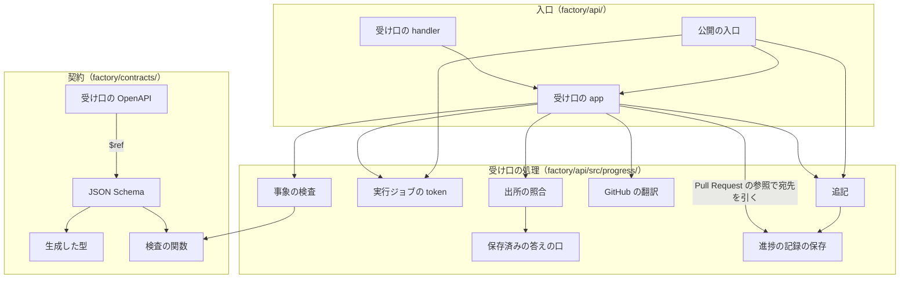
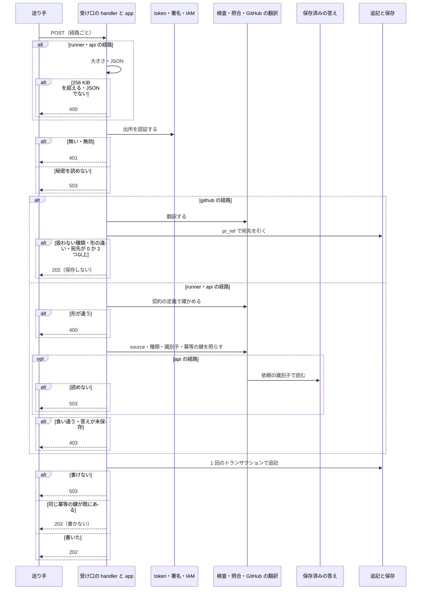
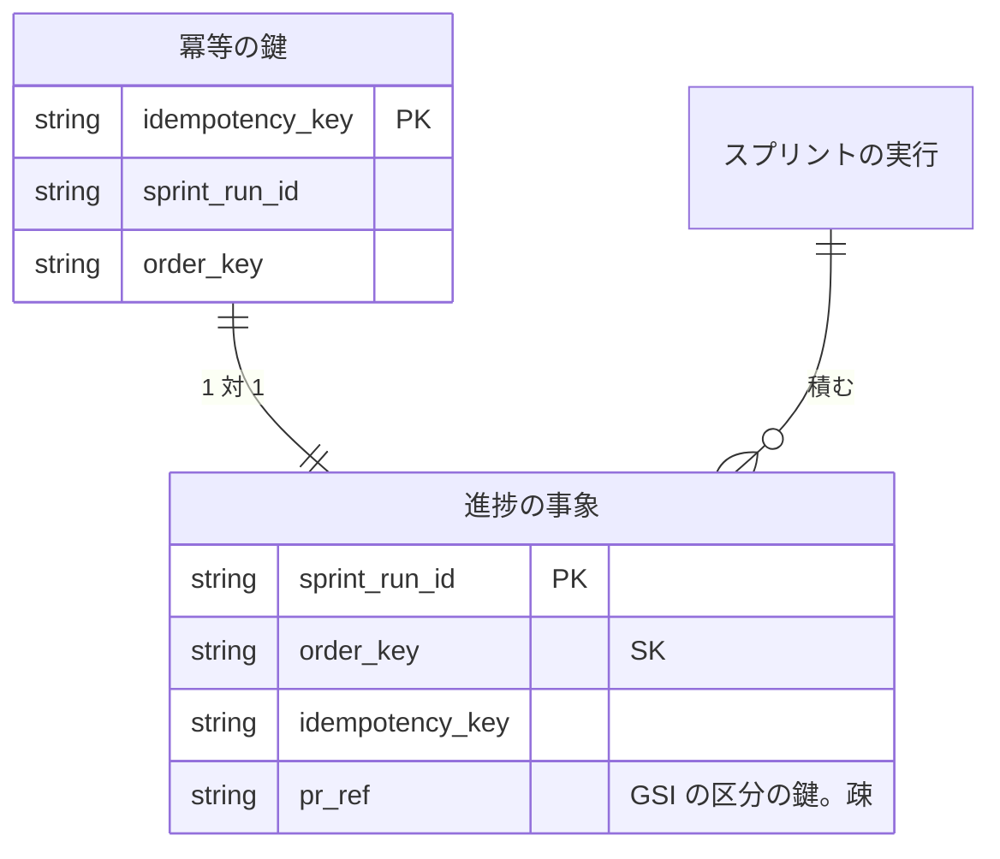
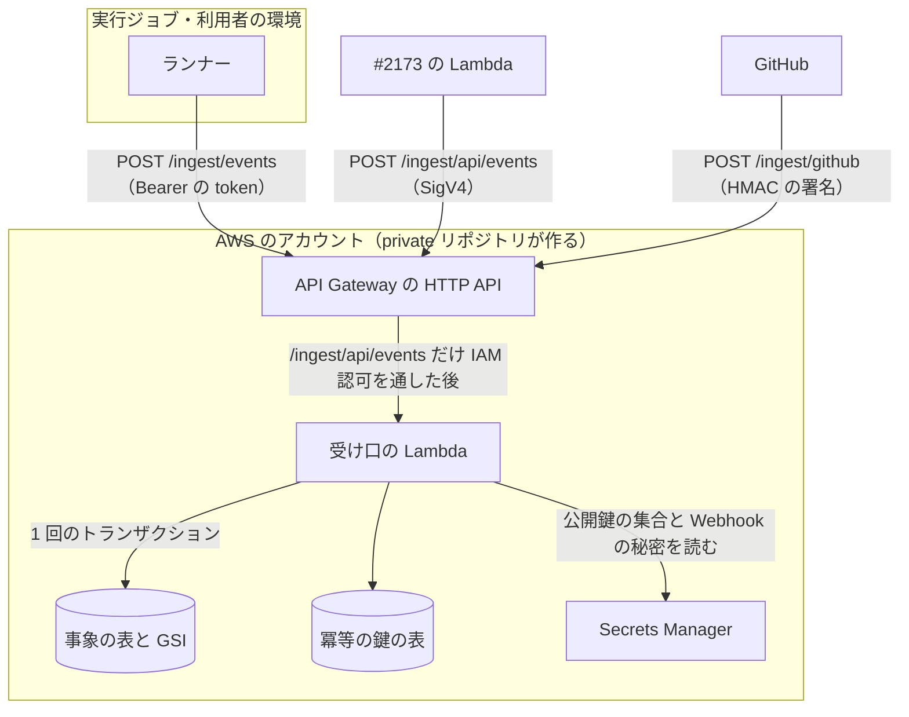

# Neural Development Factory: 契約の定義と型・進捗の受け口・実行ジョブの token

Neural Development Factory の子課題が共有する機械可読な契約（`factory/contracts/`）と、ランナー・承認と通知・GitHub から届く進捗の事象を出所ごとに確かめてスプリントの実行ごとの列へ 1 度だけ残す**進捗の受け口**、受け口と承認と通知が同じ手順で確かめる**実行ジョブの token** を定める。サービス全体の構成・集約の持ち主・事象の種類と受け口の認証の意味は [サービスのディレクトリと境界の検査、サービス全体の契約](ndf-factory-service-boundary.md)（以下「全体の契約」）にあり、本書はそこで集約「進捗の記録」の持ち主とされた部分（#2171）の確定形である。

## 概要

- **契約の正は JSON Schema（2020-12）で、型と実行時の検査は同じ定義から作る。** `factory/contracts/schemas/` の 3 つの定義（進捗の事象・実行ジョブの指示・受け口の応答）から `json-schema-to-typescript` で型を生成してコミットし、`ajv` で検査の関数を作る。受け口の OpenAPI（`ingest.yaml`）は本文の形を `$ref` で指すだけにする。生成し直した型とコミットした型が食い違えば `npm run check` が落ちる
- **受け口の経路は出所ごとに 3 つで、経路が認証の手段を 1 つに決める。** `POST /ingest/events`（`runner`・実行ジョブの token）、`POST /ingest/api/events`（`api`・IAM 認可と呼び出し元のロール）、`POST /ingest/github`（`github`・Webhook の署名）。事象の `source` が経路と食い違えば 403 である
- **残すのは 1 回のトランザクションで、追記だけである。** 冪等の鍵の表と事象の表へ条件つきの `Put` を 2 つ書き、同じ冪等の鍵の 2 回目は 202 を返して保存しない。書き換え・削除の経路は無い
- **実行ジョブの token は EdDSA（Ed25519）の JWT である。** 確かめる側（受け口・#2173）は公開鍵の集合だけを読み、発行の鍵は実行の制御（#2186）だけが持つ。発行の形（`signRunJobToken`）と検証（`verifyRunJobToken`）は本書の側が持つ
- **他の子課題は `factory/api/src/index.ts` から export したものだけを使う。** 実行の制御は `job.finished`（`control`）を `appendControlEvent` で受け口と同じ重複の拒否で直に書く
- **別のリポジトリの修正は、ランナーが起票の依頼（`issue.requested`）を送り、サービスの起票の代行が起票するか下書きを人へ回す（#2216）。** 受け口は依頼を記録するだけで、起票の代行は事象の表のストリームから依頼を読み、結果（`issue.request_resolved`）を `appendIssueRequestResolved` で直に 1 件だけ書く。ランナーの token は 1 リポジトリのまま広げない

## 用語

定義は [用語集](../glossary.md) が正である（文脈 `ndf-factory`）。この文書で使う語は「進捗の受け口」「進捗の事象」「冪等の鍵」「実行ジョブの token」「実行ジョブ」「スプリントの実行」「ランナー」「承認の依頼」「起票の依頼」「起票の依頼の結果」「起票の代行」「下書き（起票の依頼）」である。

## コンテキスト

変更はすべて Neural Development Factory（`ndf-factory`）の中で閉じる。GitHub は外部の系で、受け口が下流の**腐敗防止層**として Webhook の `pull_request`・`check_run` を `pr.updated`・`ci.updated` へ翻訳し、GitHub の語（delivery・check suite など）を事象へ持ち込まない。NDF の開発ワークフロー（`ndf-workflow`）のファイルから事象への翻訳はランナー（#2186）が持ち、本書は触らない。

## 背景

依頼（#2171 の親 #2168）は「sprint一覧でそれぞれがどのフェーズを進めているかが化しかできる」「sprint詳細で進捗状況が可視化できる。」である。一覧と詳細（#2172）・承認（#2173）・課金（#2174）は進捗の事象から導き、送り手（#2186・#2189）と読み手が同じ形を別々に書き起こすと食い違っても検査で落ちないため、形と受け口を先に 1 か所へ決めた。

- **JSON Schema を正にし、OpenAPI はそれを指すだけにする。** 実行ジョブの指示は HTTP の経路でなく環境変数で渡すため、OpenAPI の中に置くと経路の無い定義を持ち込む。`contracts/` を workspace にすれば `api`・後の `runner`・`web` が名前で import できる
- **生成した型をコミットし、検査で作り直して比べる。** 検査の中で毎回作り直すだけでは、型が常に定義と一致してずれを落とす機会が無い。コミットすればレビューで型の差分も読める
- **実行時の検査も同じ定義から `ajv` で作る。** 手で書いた検査は定義を変えたときに直し忘れても落ちず、生成した型だけでは余分な鍵・知らない種類を実行時に落とせない
- **出所ごとに経路を分ける。** IAM 認可は API Gateway の経路ごとの設定で、Bearer の token と Webhook の署名と同じ経路に同居できない。画面向けの `createApiApp` は全経路に Cognito の token を要るため、そこに足さない
- **token を鍵の組（Ed25519）にする。** 共有の秘密にすると、確かめる側が漏れたとき任意のスプリントの実行へ書ける token を作れる。`kid` で鍵を選ぶため、集合へ新しい公開鍵を足してから発行の鍵を替えれば止めずに差し替えられる。期限より前の取り消しは実行ジョブの状態（#2186 の集約）を読むことになるため持たない
- **GitHub の Webhook の宛先は `step.recorded` が運ぶ Pull Request の参照で引く。** 宛先のスプリントの実行を知るのは Pull Request を作ったランナーだけで、ブランチの名前は取り込んだリポジトリの NDF が決めるためサービスの規則を置けない。参照を事象の列（`pr_ref`）に置けば、書き込みは 1 回のトランザクションのまま増えない。ただし申告の `repo` が token の `repo` と一致するときだけ置く（I37）。申告だけで置くと、正しい token を持つランナーが関係の無いリポジトリの Pull Request を自分の実行へ結び付け、ほかの利用者の Pull Request と CI の状態が別の実行の進捗に見える（#2216）
- **事象 1 件の上限は 256 KiB である。** DynamoDB の項目の上限（400 KB）から `order_key`・`pr_ref` と列の名前を引いても 100 KB 以上残る。超える承認資料（`gate.reached` の `material`）はランナーが切り詰め、全文は `pr_url` の Pull Request で読む
- **401・403 の本文は理由によらず 1 つにし、202 は重複でも同じ本文にする。** 送り手が理由を知ると、ほかのスプリントの実行や依頼の有無を試せる。400 だけは送り手が直せるよう、失敗の位置と規則の名前を返す（値は返さない）
- **照合に使うリポジトリは実行ジョブの token の `repo` で運び、受け口はほかの集約を読まない（#2216）。** 実行の制御は実行ジョブの指示の `REPO` と token を同じスプリントの実行から作るため、token に入れる費用は 1 つの値だけで、署名された値はランナーが書き換えられない。受け口がスプリントの実行からリポジトリを引く形は、事象 1 件ごとに読み出しと 503 の経路が増え、期限より前の取り消しを持たない判断とも食い違う
- **別のリポジトリへの起票は、ランナーが依頼を進捗の事象として送り、サービスが代わりに起票する（#2216）。** 依頼を事象にすれば、token の検証・冪等の鍵・送り直しがそのまま使え、依頼と結果が実行の列に並ぶ。受け口は起票先が token の `repo` と同じ依頼だけを拒み（実行のリポジトリへはランナーが自分の導入の token で起票する）、起票してよいかの判定は受け口の外の起票の代行が行う。受け口が登録と GitHub を読むと、照合を token の値だけで閉じる境目が崩れる
- **下書きは承認の依頼にせず、結果の事象を知らせとして回す（#2216）。** 承認を求める種類はゲート 1・ゲート 2 の 2 つだけで（全体の契約の I11）、下書きの起票はスプリントの進行を止める答えを要らない
- **保存済みの答えの読み出しは関数の型の口にし、既定は 503 にする。** 答えは #2173 の集約である。既定を「未保存」（403）にすると、#2173 の実装の途中の誤りを権限の誤りと区別できない

## 対象範囲

- **含む**: `factory/contracts/`（3 つの JSON Schema・生成した型・検査の関数・`openapi/ingest.yaml`・型のずれの検査）、`factory/api/src/progress/` の受け口・事象の検査・出所の照合・GitHub の翻訳・保存・追記・実行ジョブの token、`factory/api/src/handlers/ingest.ts`、起票の代行（`factory/api/src/issue-requests/`・`factory/api/src/handlers/issue-requests.ts`、#2216）、`factory/api/src/testing/run-job-tokens.ts`、`factory/api/src/index.ts` への export、`factory/.env.example` の 5 つの変数の名前
- **含まない**: GitHub App の導入とリポジトリの登録・実行の制御・ランナー・実行ジョブの token の発行の鍵の置き場と期限（#2186）、承認の依頼の保存と答えを読む経路（#2173）、事象からの一覧と詳細の派生と読み出し（#2172）、使用量の台帳と請求（#2174）、token の期限より前の取り消し、相手先の流儀（課題追跡の宣言・Issue テンプレート・外部チケット）を読む判定（#2239）、下書きを受けた人への知らせの送り方（#2173）と見せ方（#2172）、DynamoDB の表と GSI・ストリーム・API Gateway の IAM 認可・ロール・秘密などインフラの定義（private リポジトリが作る）
- プラグインの配布物は、NDF の `issue-file.py create` がランナーの中（環境変数 `NDF_ISSUE_REQUEST_FILE` があるとき）で別のリポジトリへの起票を依頼の行として書き出す分岐だけを持つ。`plugins/` は `factory/` を参照しない（全体の契約の I1）

## 仕様

### 集約

| 集約 | 持ち主（書き換えてよいもの） | 根 | エンティティ | 値オブジェクト |
| --- | --- | --- | --- | --- |
| 進捗の記録 | 進捗の受け口（`factory/api/src/progress/`）。実行の制御（#2186）は `appendControlEvent` を、起票の代行は `appendIssueRequestResolved` を通してだけ書く | スプリントの実行の識別子ごとの列 | 進捗の事象 | 種類・発生の時刻・冪等の鍵・出所・Pull Request の参照・起票した Issue の参照 |
| 起票の依頼の台帳 | 起票の代行（`factory/api/src/issue-requests/`） | スプリントの実行ごとの台帳 | 依頼（中身の要約値ごと） | 状態（`filing`・`filed`・`drafted`）・起票した数 |

**冪等の鍵の表は集約の一部で、別の集約ではない。** 鍵の一意（I10）を守るためだけにあり、事象と同じトランザクションで書く。ほかの集約（スプリントの実行・承認の依頼）は識別子で参照し、承認の依頼は保存済みの答えを読むだけにする。

**起票の代行は、ほかの集約を読むだけで書かない。** スプリントの実行（アカウントを知る）と登録（導入を知る）は #2186 の表を読む。書くのは自分の台帳と、進捗の記録への直の追記（`issue.request_resolved` だけ）である。台帳の依頼の行と起票した数の行は同じ集約で、1 つのトランザクションで書く。

### 構成要素

| 要素 | 場所 | 責務 |
| --- | --- | --- |
| 契約のパッケージ | `factory/contracts/`（workspace `@ndf-factory/contracts`） | JSON Schema を正として持ち、生成した型・定義のオブジェクト・検査の関数（`validateProgressEvent`・`validateRunJobInstruction`・`isIngestResponse`）・種類の一覧（`EVENT_TYPES`・`EVENT_DEFINITIONS`・`isEventType`）を `src/index.ts` から export する。`ajv`・`ajv-formats` はこの workspace の依存である |
| 型の生成 | `factory/contracts/scripts/generate.ts` | `npm run generate -w contracts` で `src/generated/*.ts` を書く。`--check` は書かずに、コミットした型と食い違えば 1 で終わる |
| 受け口の OpenAPI | `factory/contracts/openapi/ingest.yaml` | 3 つの経路の要求と応答。本文の形は `../schemas/` を `$ref` で指すだけにする |
| 事象の検査 | `factory/api/src/progress/validate.ts` | 本文の大きさ（`MAX_EVENT_BYTES`）・JSON・契約の定義を確かめ、失敗の位置と規則の名前を返す |
| 実行ジョブの token | `factory/api/src/progress/run-job-token.ts` | 発行の形（`signRunJobToken`）と検証（`createRunJobTokenVerifier`）。公開鍵の集合を Secrets Manager から読み、5 分ごとに読み直す。発行（I31）は `signRunJobToken` に `account_id` を渡すと型の検査で落ち、渡しても token に載らず、Ed25519 でない鍵では作らず、秘密鍵の JWK からも作れること |
| 出所の照合 | `factory/api/src/progress/authorize.ts` | 経路ごとの `source`・書ける種類・識別子・冪等の鍵の形（I25〜I28）と、呼び出し元のロールの照合 |
| GitHub の翻訳 | `factory/api/src/progress/github.ts` | `X-Hub-Signature-256` の検証と、`pull_request`・`check_run` から事象への翻訳。Pull Request の参照（`prRef`）の形 |
| 保存済みの答えの口 | `factory/api/src/progress/saved-answers.ts` | `SavedAnswerReader` の型と、#2173 が実装するまでの既定（常に「読めない」として投げる） |
| 進捗の記録の保存 | `factory/api/src/progress/store.ts`・`memory-store.ts` | 事象の表と冪等の鍵の表への 1 回のトランザクションと、GSI による Pull Request の参照の読み出し。書き換え・削除の操作を持たない。`memory-store.ts` はテスト用の偽物 |
| 追記 | `factory/api/src/progress/append.ts` | 事象から `order_key` と `pr_ref` を作り、保存へ渡して `{ written }` を返す。受け口と `appendControlEvent` が同じ関数を通る |
| 受け口の app | `factory/api/src/progress/app.ts`・`errors.ts` | Hono の app。3 つの経路と、失敗を決まった本文の応答へ変える処理とログ |
| 受け口の handler | `factory/api/src/handlers/ingest.ts` | API Gateway の HTTP API（payload 2.0）から呼ばれる Lambda の handler。環境変数から依存を 1 回だけ作る |
| 起票の代行 | `factory/api/src/issue-requests/`（`resolve.ts`・`ledger.ts`・`memory-ledger.ts`・`secrets.ts`・`style.ts`） | 記録された `issue.requested` 1 件を判定し、起票してよい先へは GitHub の口で起票し、そうでない先は下書きへ回し、結果を直に追記する（「起票の依頼と起票の代行」）。`memory-ledger.ts` はテスト用の偽物 |
| 起票の代行の handler | `factory/api/src/handlers/issue-requests.ts` | 事象の表の DynamoDB Streams のうち、`type` が `issue.requested` の新しい項目を 1 件ずつ起票の代行へ渡す。投げた項目だけを `batchItemFailures` で返し、ストリームがやり直す |
| テストの鍵の組 | `factory/api/src/testing/run-job-tokens.ts` | テストの中で Ed25519 の鍵の組をメモリに作り、token を作る・確かめる |
| 公開の入口 | `factory/api/src/index.ts` | 「他の子課題へ公開する関数」を export する。#2170 の既存の export は変えない |

### 他の子課題へ公開する関数

`factory/api/src/index.ts` から export したものだけを使う（#2186・#2173・#2172・#2174・#2189）。

| 名前 | 入力 | 出力 | 失敗 |
| --- | --- | --- | --- |
| `verifyRunJobToken(token)` | token の文字列（`Bearer ` を除いたもの） | `Promise<VerifiedRunJob>`（`jobId`・`sprintRunId`・`repo`・`expiresAt`）。公開鍵の集合は `RUN_JOB_TOKEN_VERIFY_KEYS_SECRET_ARN` から読み、5 分ごとに読み直す | 無効は `RunJobTokenError`（`code` が `malformed` / `bad_signature` / `expired` / `unknown_key`。呼ぶ側が 401 にする）。秘密を読めない失敗は `RunJobTokenError` でない例外（呼ぶ側が 503 にする） |
| `createRunJobTokenVerifier(keys)` | 公開鍵の JWK の並び（Ed25519 でない鍵は捨てる） | `RunJobTokenVerifier`（`(token) => Promise<VerifiedRunJob>`） | 無効は `RunJobTokenError`（同じ 4 つ） |
| `signRunJobToken(claims, key)` | `claims` = `RunJobTokenClaims`（`jobId`・`sprintRunId`・`repo`・`expiresAt: Date` だけ。ほかの鍵を型で受けない）、`key` = `RunJobSigningKey`（`kid`・`privateKey`（`CryptoKey` か JWK）） | `Promise<string>` | 鍵が Ed25519 でなければ例外 |
| `createRunJobTokenKit()` | 無し | `Promise<RunJobTokenKit>`（`sign(claims, opts?)`・`otherKeySign(claims)`・`verify`・`publicJwks`・`signingKey`）。`claims` の `repo` を省くと `owner/name` になる。鍵はメモリの中だけ。`sign` の `opts.kid` を変えると知らない鍵の token、`otherKeySign` は署名が合わない token になる | — |
| `appendControlEvent(event)` | `JobFinishedEvent`（`source` は `control`、冪等の鍵は `<job_id>:finished`） | `Promise<{ written: boolean }>`。`false` は同じ鍵（ランナーの分）が既にある | 定義に合わない → `ProgressEventError`（`code` が `invalid_event`）。`control` の照合に合わない → `ProgressEventError`（`forbidden`）。保存の失敗はそのまま投げる |
| `appendIssueRequestResolved(event)` | `IssueRequestResolvedEvent`（`source` は `control`、冪等の鍵は `<依頼の鍵>:resolved`、`payload.request_key` はその `job_id` の `<job_id>:<seq>`） | `Promise<{ written: boolean }>`。`false` は同じ依頼の結果が既にある | 定義に合わない → `ProgressEventError`（`invalid_event`）。ほかの種類・照合に合わない → `ProgressEventError`（`forbidden`）。保存の失敗はそのまま投げる |
| `createIngestApp(deps, log?)` | `deps` = `IngestDeps`（`verifier`・`store`・`savedAnswers`・`webhookSecret: () => Promise<string>`・`apiCallerRoleArn`）か、それを返す関数。`log` は `IngestLogger`（既定は 1 行の JSON を標準出力へ） | Hono の app | — |

あわせて `RunJobTokenError`・`ProgressEventError` と、`IngestDeps`・`IngestLogEntry`・`IngestLogger`・`RunJobSigningKey`・`RunJobTokenClaims`・`RunJobTokenErrorCode`・`RunJobTokenVerifier`・`VerifiedRunJob`・`SavedAnswer`・`SavedAnswerReader`・`ProgressEventRecord`・`ProgressEventStore`・`RunJobTokenKit` の型を export し、`@ndf-factory/contracts` の型（`ProgressEvent`・種類ごとの `JobStartedEvent` など・`RunJobInstruction`・`IngestResponse`・`GateKind`・`EventSource` など）をそのまま写して出す。検査の関数と種類の一覧は `@ndf-factory/contracts` から import する。

### 進捗の事象の定義

`factory/contracts/schemas/progress-event.schema.json`。最上位は 13 種類の `oneOf` で、各種類（`$defs` の `JobStartedEvent` など）は共通の列を `allOf` で取り込み、`unevaluatedProperties: false` で余分な列を落とす。`payload` は種類ごとに `additionalProperties: false`。生成した型は `ProgressEvent`（13 種類の共用）と種類ごとの型である。

**共通の列**（全体の契約の「進捗の正本」の列から、受け口が作る `order_key` と `pr_ref` を除いた 8 列）:

| 鍵 | 型 | 必須 | 規則 |
| --- | --- | --- | --- |
| `sprint_run_id` | 文字列 | 必須 | `^[A-Za-z0-9_-]{1,128}$`（`order_key` の区切りの `#` と冪等の鍵の区切りの `:` を含めない） |
| `idempotency_key` | 文字列 | 必須 | 1〜300 字。出所ごとの形は「出所ごとの照合」が見る |
| `type` | 文字列 | 必須 | 13 種類のどれか（種類ごとの `const`） |
| `at` | 文字列 | 必須 | `format: date-time` かつ末尾 `Z`（UTC） |
| `source` | 文字列 | 必須 | `runner` / `github` / `api` / `control` |
| `job_id` | 文字列か `null` | 必須（値は `null` を許す） | `^[A-Za-z0-9_-]{1,128}$`。`github`・`api` は `null` |
| `schema_version` | 整数 | 必須 | `const: 1` |
| `payload` | オブジェクト | 必須 | 種類ごと |

**種類ごとの `payload`**（全体の契約の「進捗の事象の種類と受け口」の `payload` の列と 1 対 1。`owner/name` は `^[A-Za-z0-9_.-]+/[A-Za-z0-9_.-]+$`）:

| 種類 | 鍵（型。任意のものは「任意」） |
| --- | --- |
| `job.started` | `ndf_version`（文字列）、`start`（`new` / `resume`） |
| `phase.changed` | `phase`（文字列。フェーズの名前の集合は #2172 が決めるため列挙にしない）、`issues`（1 以上の整数の並び） |
| `step.recorded` | `step`（文字列）、`exit_code`（整数）、`seconds`（0 以上の数）、`summary`（文字列）、`pull_request`（任意。`repo`（`owner/name`）・`number`（1 以上の整数）） |
| `attention` | `reason`（文字列）、`summary`（文字列） |
| `gate.reached` | `kind`（`gate1` / `gate2` / `decision`）、`pr_url`（URI か `null`）、`material`（文字列。承認資料の本文） |
| `gate.answered` | `approval_request_id`（文字列）、`kind`（`gate1` / `gate2` / `decision`）、`decision`（`approved` / `rejected`。`kind` が `decision` のときは持たず、ほかでは必須）、`answered_by_account_id`（文字列。#2170 の解決の結果の `accountId`）。本文は持たない |
| `usage.recorded` | `model`（文字列）、`input_tokens`・`output_tokens`（0 以上の整数）、`cost_usd`（0 以上の数）、`step`（文字列） |
| `decision.delegated` | `question`・`answer`・`reason`（どれも 1〜4,000 字の文字列）、`category`（文字列か `null`。hook が止めたときの `metadata.source`） |
| `job.finished` | `result`（`gate` / `stopped` / `done` / `failed`）、`summary`（文字列） |
| `pr.updated` | `repo`（`owner/name`）、`number`（1 以上の整数）、`state`（`open` / `closed` / `merged`） |
| `ci.updated` | `repo`（`owner/name`）、`pr_number`（1 以上の整数）、`name`（文字列）、`conclusion`（文字列か `null`。`null` は「まだ終わっていない」） |
| `issue.requested` | `repo`（`owner/name`。起票先）、`title`（1〜256 字。GitHub の題の上限）、`body`（1〜50,000 字。4 バイトの文字だけでも 256 KiB に収まる長さ）。ラベルと相手の課題の番号は相手先の流儀に属するため持たない |
| `issue.request_resolved` | `request_key`（依頼の冪等の鍵）、`outcome`（`filed` / `drafted`）、`issue`（`filed` のときだけ必須で `drafted` では持たない。`repo`（`owner/name`）・`number`（1 以上の整数）・`url`（URI））、`reason`（`drafted` のときだけ必須。「起票の依頼と起票の代行」の理由の表のどれか）、`duplicate_of`（同じ中身の最初の依頼の鍵か `null`） |

**大きさの上限は 256 KiB（262,144 バイト、`MAX_EVENT_BYTES`）で、定義の外で見る。** `runner`・`api` の経路は要求の本文の UTF-8 のバイト数、`github` の経路と `appendControlEvent` は作った事象を JSON にしたバイト数で見る。JSON Schema の `maxLength` は字の数でバイトを数えられないためである。

### 実行ジョブの指示の定義

`factory/contracts/schemas/run-job-instruction.schema.json`。全体の契約の「実行ジョブの指示」の 11 の入力を、環境変数の名前のまま `properties` に置く。値はどれも文字列で（環境変数と、#2189 の受け取りの応答で同じ形にするため）、`additionalProperties: false`。生成した型は `RunJobInstruction`。

| 入力 | 規則 |
| --- | --- |
| `SPRINT_RUN_ID`・`JOB_ID` | 必須。事象の共通の列と同じ形 |
| `REPO` | 必須。`owner/name` の形 |
| `NDF_VERSION` | 必須。1 字以上 |
| `START` | 必須。`new` / `resume` |
| `ISSUES` | `START` が `new` のとき必須。`^[1-9][0-9]*(,[1-9][0-9]*)*$`（カンマで区切った番号） |
| `APPROVAL_REQUEST_ID` | `START` が `resume` のとき必須。1 字以上 |
| `INGEST_URL` | 必須。`format: uri`。`runner` の経路（`POST /ingest/events`）の URL そのもの |
| `INGEST_TOKEN_SECRET_ARN` | 必須。`^arn:aws[a-z-]*:secretsmanager:` |
| `EXECUTION_MODE` | 必須。`local` / `byok` / `managed` |
| `MODEL_CREDENTIAL_SECRET_ARN` | `EXECUTION_MODE` が `byok` のとき必須、`local`・`managed` のとき持たない。形は `INGEST_TOKEN_SECRET_ARN` と同じ |

必須の違いは `allOf` の中の `if`/`then` で書く。生成した型は条件を表せず任意の鍵になるため、条件は `validateRunJobInstruction` で縛る。

### 受け口の経路と応答

機械可読な正は [`factory/contracts/openapi/ingest.yaml`](../../factory/contracts/openapi/ingest.yaml) と [`factory/contracts/schemas/ingest-response.schema.json`](../../factory/contracts/schemas/ingest-response.schema.json) である。

| 経路 | 出所 | 認証の手段 | 要求の本文 | 応答 |
| --- | --- | --- | --- | --- |
| `POST /ingest/events` | `runner` | `Authorization: Bearer <実行ジョブの token>`（Lambda が公開鍵の集合で検証） | 進捗の事象 1 件 | 202 / 400 / 401 / 403 / 503 |
| `POST /ingest/api/events` | `api` | API Gateway の IAM 認可（SigV4）と、Lambda での呼び出し元のロールの照合 | 進捗の事象 1 件（`gate.answered`） | 202 / 400 / 401 / 403 / 503 |
| `POST /ingest/github` | `github` | `X-Hub-Signature-256`（Lambda が Webhook の秘密で検証）。`X-GitHub-Event`・`X-GitHub-Delivery` を要る | GitHub の Webhook の本文（形は GitHub が決める） | 202 / 401 / 503 |

| 応答 | 本文 | いつ |
| --- | --- | --- |
| 202 | `{"accepted": true}` | 残した・同じ冪等の鍵が既にある・`github` で残さなかった。どれも同じ本文で、重複かどうかを明かさない |
| 400 | `{"error": {"code": "invalid_event", "message": "<位置>: <規則>"}}` | 大きさの上限を超えた（`/: maxBytes 262144`）・JSON でない（`/: json`）・定義に合わない（最初の失敗の `instancePath` と規則の名前）。値を含めない |
| 401 | `{"error": {"code": "unauthorized", "message": "認証できません"}}` | 理由によらずこの本文（I30） |
| 403 | `{"error": {"code": "forbidden", "message": "この事象を書く権限がありません"}}` | 理由によらずこの本文（I30） |
| 503 | `{"error": {"code": "ingest_unavailable", "message": "時間をおいて送り直してください"}}` | 保存・保存済みの答え・秘密を読み書きできない。ほかの想定外の失敗も 503 に揃える。送り手は同じ事象のまま送り直す |

エラーの本文の形は #2170 の `ApiError`（`factory/api/src/errors.ts`）の `{"error": {"code", "message"}}` に揃え、`factory/api/src/progress/errors.ts` の 4 つのクラス（`InvalidEventError`・`IngestUnauthorizedError`・`IngestForbiddenError`・`IngestUnavailableError`）で返す。

**`github` の経路は 400 と 403 を返さない。** GitHub は 2xx 以外を配達の失敗として記録し続けるため、署名が合った後は、`X-GitHub-Event`・`X-GitHub-Delivery` が無い・本文が JSON でない・扱わない種類・宛先がちょうど 1 つに決まらない・翻訳した事象が定義か照合に合わないのどれも 202 で保存しない。

### 受け口の処理の流れ

`runner`・`api` の経路は、本文の大きさと JSON（400）→ 出所の認証（401。`api` はロールの違いで 403）→ 契約の定義（400）→ 出所の照合（403。`api` は保存済みの答えを読めなければ 503）→ 追記の順に見る。

**`appendControlEvent` は認証の手前を通らない。** 契約の定義と大きさの検査・`control` の照合・追記の 3 つだけを通り、失敗は例外で返す（HTTP の応答を持たない）。

| # | ドメインイベント | 発生元 | 受け手 | 失敗したとき |
| --- | --- | --- | --- | --- |
| E1 | 実行ジョブの token を発行した | 実行の制御（#2186）が `signRunJobToken` で作る | ランナー（`INGEST_TOKEN_SECRET_ARN` の置き場から読む） | 本書の外 |
| E2 | 受け口が事象の要求を受け取った | ランナー・#2173・GitHub | 受け口の経路 | 本文が JSON でない・上限を超えた → 400 |
| E3 | 出所を認証した | 受け口の経路 | 形の検査（E4）か翻訳（E6） | token・署名・呼び出し元が無いか合わない → 401 |
| E4 | 事象の形を確かめた | 事象の検査 | 照合（E5） | 定義と違う → 400 |
| E5 | 認証の手段と事象の出所・種類・識別子を照らした | 出所の照合 | 追記（E7） | 食い違う・答えが未保存 → 403 |
| E6 | GitHub の Webhook を `pr.updated`・`ci.updated` へ翻訳した | GitHub の翻訳 | 追記（E7） | 扱わない種類・宛先が引けない → 202 で保存しない |
| E7 | 進捗の事象を追記した | 進捗の記録の保存 | 一覧と詳細（#2172）・承認と通知（#2173）・課金（#2174）が列を読む。実行の制御（#2186）は `job.finished` の結果でジョブの状態を移す（全体の契約の状態の図） | 同じ冪等の鍵がある → 202 で保存しない。表へ書けない → 503 |
| E8 | 実行の制御が `job.finished`（`control`）を直に追記した | 実行の制御（#2186）が `appendControlEvent` を呼ぶ | E7 と同じ | ランナーの分が先にある → 書かない |
| E9 | 実行ジョブの token を検証した | `verifyRunJobToken`（受け口の E3、#2173 の答えを読む経路） | 呼んだ側 | 無効 → `RunJobTokenError` |

### 出所ごとの照合

照合は契約の定義の検査を通った事象に当てる。どれか 1 つでも合わなければ 403（`appendControlEvent` は `ProgressEventError` の `forbidden`）である。

| 出所 | 書ける種類 | 照らすこと |
| --- | --- | --- |
| すべて | — | 事象の `source` が経路の出所と一致する（I25） |
| `runner` | `job.started`・`phase.changed`・`step.recorded`・`attention`・`gate.reached`・`usage.recorded`・`decision.delegated`・`issue.requested`・`job.finished` | `job_id` と `sprint_run_id` が token の `sub` と `sprint_run_id` と一致する。`step.recorded` の `pull_request.repo` は token の `repo` と大文字と小文字を問わず等しい（I37）。`issue.requested` の `repo` は token の `repo` と大文字と小文字を問わず違う（I45）。冪等の鍵が `job.finished` なら `<job_id>:finished`、ほかなら `<job_id>:<seq>`（`seq` は `^[1-9][0-9]*$`）（I27） |
| `api` | `gate.answered` | 呼び出し元のロールが `INGEST_API_CALLER_ROLE_ARN` のロールである（IAM の文脈が無ければ 401、形が違うか一致しなければ 403。認証の段で見る）。`job_id` が `null`。冪等の鍵が `api:<payload.approval_request_id>`。保存済みの答えを読み、`null` なら 403、依頼の識別子・`sprint_run_id`・`kind`・`answered_by_account_id`・`decision`（無いことも含めて）がすべて答えと一致する（I28） |
| `github` | `pr.updated`・`ci.updated` | `job_id` が `null`。翻訳した事象だけが通る |
| `control` | `job.finished`・`issue.request_resolved` | `job_id` が `null` でない。`job.finished` は冪等の鍵が `<job_id>:finished`。`issue.request_resolved` は `payload.request_key` が `<job_id>:<seq>` で、冪等の鍵が `<request_key>:resolved`（I48） |

書ける種類の表は `authorize.ts` の `WRITABLE_TYPES` が持つ（I26）。

**呼び出し元のロールは、アカウントとロールの名前で照らす。** IAM 認可を通った要求の呼び出し元は `requestContext.authorizer.iam.userArn` に引き受けたロールのセッションの ARN（`arn:aws:sts::<アカウント>:assumed-role/<ロールの名前>/<セッション>`）で届き、インフラが渡すロールの ARN（`arn:aws:iam::<アカウント>:role/<パス>/<ロールの名前>`）とは形が違う。両方からパーティション・アカウント・ロールの名前を取り出して比べ、セッションの名前とロールのパスは比べない（セッションの ARN はパスを持たない）。

### GitHub の翻訳

| `X-GitHub-Event` | 事象 | `payload` の出所 | `at` | 宛先を引く参照 |
| --- | --- | --- | --- | --- |
| `pull_request` | `pr.updated` | `repo` = `repository.full_name`、`number` = `pull_request.number`、`state` = `pull_request.merged` が真なら `merged`、ほかは `pull_request.state` | `pull_request.updated_at` | `<full_name の小文字>#<number>` |
| `check_run` | `ci.updated` | `repo` = `repository.full_name`、`pr_number` = 宛先を引けた `check_run.pull_requests[].number`、`name` = `check_run.name`、`conclusion` = `check_run.conclusion` | `check_run.completed_at`、無ければ `check_run.started_at` | `check_run.pull_requests[]` の各番号 |
| ほか（`ping` など） | 残さない | — | — | — |

冪等の鍵は `github:<X-GitHub-Delivery>`、`job_id` は `null`、`source` は `github`、`schema_version` は `1`。宛先は GSI `pr_ref-index` を引き、得たスプリントの実行がちょうど 1 つのときだけ残す。`at` に使う時刻が無い・`repository.full_name` が無い本文も残さない。

**署名は `sha256=` の後の 16 進を、Webhook の秘密による本文の HMAC-SHA256 と `timingSafeEqual` で比べる。** 長さが違えば比べずに 401 である。Webhook の秘密は署名の検証より先に読み、読めなければ 503 を返す。

### 実行ジョブの token

**形は JWS の compact（JWT）で、署名は EdDSA（Ed25519）である。** `account_id` は載せない（I31）。

| 部分 | 鍵 | 値 |
| --- | --- | --- |
| 見出し | `alg` | `EdDSA` だけ |
| 見出し | `typ` | `ndf-run-job+jwt` |
| 見出し | `kid` | 発行の鍵の識別子（公開鍵の集合の `kid` と照らす） |
| 本体 | `iss` | `ndf-factory/run-control` |
| 本体 | `aud` | `ndf-factory/run-job` |
| 本体 | `sub` | 実行ジョブの識別子（`job_id`。`^[A-Za-z0-9_-]{1,128}$`） |
| 本体 | `sprint_run_id` | スプリントの実行の識別子（同じ形） |
| 本体 | `repo` | その実行のリポジトリ（`owner/name`。必須で、無い・形が違えば `malformed`。I44）。`step.recorded` の Pull Request の照合（I37）と、起票の依頼の照合（I45）に使う |
| 本体 | `iat`・`exp` | 発行と期限（秒）。期限の長さは発行側が `RUN_JOB_TOKEN_TTL_SECONDS`（既定 32,400 秒）で決め、打ち切りの時間より長くする |

**検証の失敗は 4 つの「無効」に分け、`jose` の失敗の `code` を読み替える。** `bad_signature` は `ERR_JWS_SIGNATURE_VERIFICATION_FAILED`、`expired` は `ERR_JWT_EXPIRED`、`unknown_key` は `ERR_JWKS_NO_MATCHING_KEY`・`ERR_JWKS_MULTIPLE_MATCHING_KEYS` で、ほか（`ERR_JWS_INVALID`・`ERR_JWT_INVALID`・`ERR_JWT_CLAIM_VALIDATION_FAILED`・`ERR_JOSE_ALG_NOT_ALLOWED`・`ERR_JOSE_NOT_SUPPORTED`、発行者・宛先・`typ`・必須の主張（`sub`・`exp`・`sprint_run_id`・`repo`）の違い、識別子の形の違い、知らない `code`）はすべて `malformed` である。失敗の文に token の値を含めない。

**鍵の置き場**: 公開鍵の集合（`{"keys": [<Ed25519 の公開鍵の JWK。kid つき>, …]}`）は `RUN_JOB_TOKEN_VERIFY_KEYS_SECRET_ARN` にあり、受け口と #2173 が読む。発行の鍵（Ed25519 の秘密鍵と `kid`）は実行の制御（#2186）だけが読み、変数は `RUN_JOB_TOKEN_SIGNING_KEY_SECRET_ARN` である。公開鍵の集合は `createCachedRunJobTokenVerifier` が 5 分（`VERIFY_KEYS_TTL_MS`）ごとに読み直す。集合に Ed25519 でない鍵があれば捨てる。

### 直の追記と保存済みの答えの口

- **`appendIssueRequestResolved` は `issue.request_resolved`（`control`）だけを受ける。** 起票の代行は受け口の認証を通らないサービスの中の処理のため、`appendControlEvent` と同じ `control` の出所で、契約の検査・`control` の照合・追記の 3 つを通る。出所に新しい値を足すと、種類の表と全体の契約の I25 の受け手がすべて新しい値を扱うことになる
- **`appendControlEvent` は `job.finished`（`control`）だけを受ける。** 全体の契約で実行の制御が直に書くのは、ランナーが `job.finished` を送れずに終わったときの `job.finished`（`failed`）だけで、ほかの種類を受けると受け口の認証を通らずに書ける経路が増えるためである。ランナーの `job.finished` が先にあれば同じ鍵のため `{ written: false }` で書かない
- **`SavedAnswerReader` は `(approvalRequestId) => Promise<SavedAnswer | null>` である。** `SavedAnswer` は `{ approvalRequestId; sprintRunId; kind; decision?; answeredByAccountId }` で、`decision` は判断（`kind` が `decision`）では持たない。`null` は未保存、読めないときは投げる（受け口が 503 にする）
- **handler は `savedAnswers` に `saved-answers.ts` の `savedAnswersFromEnv()` を渡す。** 今は常に `SavedAnswersUnavailableError` を投げる既定で、`api` の経路は 503 を返す。#2173 が同じファイルの中身を本物の読み出しに替え、受け口のほかのファイルは変えずに済む

### 起票の依頼と起票の代行

実行ジョブの中で NDF が開発対象リポジトリと別のリポジトリへの起票を決めると、`issue-file.py create` が承認資料の代わりにランナーの渡したファイル（`NDF_ISSUE_REQUEST_FILE`、作業のディレクトリの外）へ `{"repo", "title", "body"}` の 1 行を足して 0 で終える。ランナーは伸びた行を `issue.requested` にして送る（値はそのまま写し、題か本文が上限を超える行は送らずに `attention`（`reason` は `issue_request_too_large`）にする）。ランナーの外では変数が無いため、NDF は今どおり承認資料を書いて止まる。

受け口は依頼を記録して 202 を返すだけで、GitHub もほかの集約も読まない。起票の代行は事象の表のストリームから依頼を受け、次の順で判定する。外へ出す前に安く確かめられるものから並べ、起票した数は起票の直前に増やす。

| 順 | 確かめること | 合わなければ（`reason`） |
| --- | --- | --- |
| 1 | 題と本文に秘密らしい値（AWS のアクセスキー・PEM の秘密鍵の始まりの行・GitHub の token・Anthropic の API キー・JWT の形）が無い | `secret_suspected` |
| 2 | 依頼の `sprint_run_id` からサービスの表で引いたアカウントの登録に、名前が大文字と小文字を問わず一致するものがある（ほかのアカウントの登録は引かない） | `not_registered` |
| 3 | 流儀の判定の口（`FilingStyleResolver`）が GitHub Issues を返す。#2239 が入るまでの既定は「GitHub Issues へ、テンプレートを使わず、依頼の題と本文のまま」 | `unsupported_tracker` |
| 4 | 起票先の公開範囲を読める。起票先が公開なら、実行のリポジトリも公開である（AI が書いた本文は非公開のコードや設定を含みうる） | 読めない → `not_installed`、公開範囲が広がる → `visibility` |
| 5 | 起票した数を上限（`ISSUE_REQUEST_LIMIT_PER_RUN`、既定 10）より少ないときだけ増やせる。下書きは数に入れない | `limit_exceeded` |
| 6 | 起票先の 1 リポジトリ（数の ID）と `issues: write` だけに絞った導入の token で Issue を作れる | token を作れない → `not_installed`、作成の要求の失敗 → `filing_failed`（どちらも数を 1 つ戻す） |

- **同じ中身の依頼から Issue は 1 件だけ作る。** 台帳の行（`RUN#<sprint_run_id>` / `ISSUE#<要約値>`）を条件つきで書いた依頼だけが判定へ進み、同じ中身の別の依頼（送り直し・再開のジョブ）は最初の結果を `duplicate_of` つきで写す。最初の依頼が起票の途中（`filing`）なら投げてやり直させる。要約値は `{"body", "repo"（小文字）, "title"}` を鍵の順にそろえた JSON の sha256 である
- **作成の要求の後はやり直さない。** 要求を出す直前に行へ `attempted_at` を書き、それがある `filing` の行を流し直すと作り直さずに `filing_failed` にする。GitHub が作ったのに応答が届かなかったとき 2 件目を作らないためで、GitHub の Issue の作成は冪等の鍵を持たない
- **読み出しの失敗（表・GitHub の公開範囲）は投げてやり直させる。** 行は自分の `request_key` の `filing` のまま残り、やり直しは続きから進む
- **下書きは結果の事象で人へ回る。** `outcome` が `drafted` の `issue.request_resolved` を #2173 が知らせとして扱い、#2172 が依頼の題と本文を写せる形で見せる。承認の依頼にはしない
- **ログは種類・依頼の鍵・結果・理由・写したかの 5 列だけで、題・本文・token を出さない**

### 常に成り立つ条件

I10 は全体の契約のもの。#2170 の I24 に続けて番号を振る。I37 は #2186 が #2216 の照合として足し、I44〜I50 は #2216 が足した（I32〜I36・I38〜I43 は #2186 のほかの集約の条件）。

| # | 集約 | 条件 | 破れそうなときの扱い |
| --- | --- | --- | --- |
| I10 | 進捗の記録 | 進捗の事象は追記だけで書き換えない。同じ冪等の鍵の事象は 1 つ | 同じ鍵の 2 回目は 202 を返し、保存しない。保存の型（`ProgressEventStore`）は `append` と `findSprintRunsByPrRef` だけを持ち、書き換え・削除の操作を持たない |
| I25 | 進捗の記録 | 事象の `source` は、受け取った経路の認証の手段と一致する（`runner` の経路は `runner`、`api` の経路は `api`、`github` の経路は翻訳した `github`、`appendControlEvent` は `control`） | 403 で保存しない。`appendControlEvent` は `ProgressEventError` を投げて書かない |
| I26 | 進捗の記録 | 出所ごとに書ける種類は決まっている（`runner` は `gate.answered`・`pr.updated`・`ci.updated`・`issue.request_resolved` 以外、`api` は `gate.answered`、`github` は `pr.updated`・`ci.updated`、`control` は `job.finished`・`issue.request_resolved`） | 403 で保存しない。直の追記は `ProgressEventError`（`forbidden`） |
| I27 | 進捗の記録 | `runner` の事象の `job_id`・`sprint_run_id` は token のものと一致し、冪等の鍵は `<job_id>:<seq>`（`seq` は 1 以上）か、`job.finished` だけ `<job_id>:finished` である | 403 で保存しない |
| I28 | 進捗の記録 | `gate.answered` は、依頼の識別子・属するスプリントの実行・種類・答えた人・承認か差し戻しかが保存済みの答えとすべて一致するときだけ残る。冪等の鍵は `api:<依頼の識別子>` | 未保存も含めて 403 で保存しない。答えを読めなければ 503 |
| I29 | 進捗の記録 | 残る事象は契約の定義に合い、1 件の大きさは 256 KiB 以下である | 400 で保存しない（`github` の経路は 202 で保存しない） |
| I30 | 進捗の記録 | 401 と 403 の応答の本文は理由によらず同じで、事象・依頼・スプリントの実行の有無を明かさない | 理由ごとの文言を出さない |
| I31 | 進捗の記録 | 実行ジョブの token は `account_id` を運ばない。token の値・署名の鍵・Webhook の秘密・起票に使う導入の token は応答・ログ・事象に出ない | `signRunJobToken` の `claims` は 4 つの鍵だけを型で受ける。ログは決まった 4 列だけにする |
| I37 | 進捗の記録 | `runner` の `step.recorded` の `pull_request.repo` は、token の `repo` と大文字と小文字を問わず等しい。他のリポジトリの Pull Request を自分の実行へ結び付けない（#2216） | 403 で保存せず、`pr_ref` を残さない |
| I44 | 進捗の記録 | 実行ジョブの token は取り込むリポジトリ（`repo`、`owner/name` の形）を必ず運ぶ | 無い・形が違う token は `malformed` で、どの種類の事象も 401 で保存しない |
| I45 | 進捗の記録 | `runner` の `issue.requested` の `repo` は、token の `repo` と大文字と小文字を問わず違う | 403 で保存しない |
| I46 | 起票の依頼の台帳 | サービスが Issue を作るのは、依頼の実行が属するアカウントの登録に名前の一致するものがあり、その導入で token を作れ、流儀の判定が GitHub Issues を返し、公開範囲が広がらず、秘密らしい値が無く、起票した数が上限より少ないときだけである | どれかが欠ければ起票せず、`drafted` と理由を残す |
| I47 | 起票の依頼の台帳 | 起票に使う導入の token は、起票先の 1 リポジトリ（数の ID）と `issues: write` だけで作り、GitHub の口の中で 1 回使って捨てる。保存しない・返さない・ランナーへ渡さない | GitHub の口の `createIssue` は Issue の参照だけを返す |
| I48 | 起票の依頼の台帳 | 1 つのスプリントの実行で、起票先・題・本文の等しい依頼から作る Issue は 1 件までで、どの依頼にも結果はちょうど 1 件ある | 台帳の行を条件つきで書いてから GitHub を呼ぶ。結果の冪等の鍵は `<依頼の鍵>:resolved` |
| I49 | 起票の依頼の台帳 | 1 つのスプリントの実行で起票した数は上限（`ISSUE_REQUEST_LIMIT_PER_RUN`）以下 | 数の行の条件つきの増加が通らなければ起票せず `limit_exceeded` |
| I50 | 進捗の記録 | 結果の理由と応答は、ほかのアカウントの登録の有無を明かさない | 未登録と「ほかのアカウントだけが登録」を同じ `not_registered` にする |

## データ・設定

### 事象の表

DynamoDB の表（`PROGRESS_EVENTS_TABLE_NAME`）。**時系列の扱いは「事象の記録」である。** 状態を持たず、起きたことを追記だけで積み、一覧と詳細は #2172 が導く。列は全体の契約の「進捗の正本」の列と同じである。

| 列 | 型 | 空を許すか | 意味 |
| --- | --- | --- | --- |
| `sprint_run_id` | 文字列 | 許さない | 区分の鍵 |
| `order_key` | 文字列 | 許さない | 並びの鍵。`<at をミリ秒の 3 桁にそろえた UTC（toISOString）>#<冪等の鍵>`。小数の桁が違う時刻を文字列のまま並べると `…:00.5Z` が `…:00Z` より前に来るため、そろえてから結ぶ |
| `idempotency_key` | 文字列 | 許さない | 出所ごとの形（全体の契約の「進捗の正本」） |
| `type` | 文字列 | 許さない | 13 種類のどれか |
| `at` | 文字列 | 許さない | 送られた値のまま（UTC、末尾 `Z`） |
| `source` | 文字列 | 許さない | `runner` / `github` / `api` / `control` |
| `job_id` | 文字列 | 許す | 空（`null`）は「実行ジョブの外で起きた」（`github`・`api`） |
| `schema_version` | 数 | 許さない | 今は `1` だけ |
| `payload` | Map | 許さない | 種類ごとの中身 |
| `pr_ref` | 文字列 | 許す | 列が無いのは「Pull Request を指さない事象」。`step.recorded` の `payload.pull_request` があるときだけ `<owner/name を小文字にしたもの>#<番号>` を置く |

GSI `pr_ref-index`（区分の鍵 `pr_ref`。受け口が読むのは `sprint_run_id` だけ）。`pr_ref` の無い項目は GSI に入らない。

### 冪等の鍵の表

DynamoDB の表（`PROGRESS_IDEMPOTENCY_TABLE_NAME`）。区分の鍵 `idempotency_key` だけ。`sprint_run_id`・`order_key` は、重複したときにどこに 1 件目があるかを調べるための写しで、照合には使わない。TTL を置かない（I10 は期限なく成り立つ）。

**1 件の追記は `TransactWrite` 1 回に 2 つの `Put` である。** 1 つ目が冪等の鍵の表への `attribute_not_exists(idempotency_key)` つき、2 つ目が事象の表への `attribute_not_exists(order_key)` つきで、どの経路でも既存の項目を上書きしない。取り消しの理由の 1 つ目が `ConditionalCheckFailed` なら重複として `{ written: false }`（受け口は 202）を返し、ほかの理由（`TransactionConflict` など）とほかの失敗は投げる（受け口は 503）。同時の 2 本はどちらかが取り消され、送り直しで重複になる。

| 機能 | 事象の表 | 冪等の鍵の表 | GSI | 承認の依頼（#2173） |
| --- | --- | --- | --- | --- |
| ランナーの事象 | C | C | — | — |
| `gate.answered` | C | C | — | R |
| GitHub の Webhook | C | C | R | — |
| 直の追記（`appendControlEvent`・`appendIssueRequestResolved`） | C | C | — | — |

### 起票の依頼の台帳

DynamoDB の表（`ISSUE_REQUESTS_TABLE_NAME`）。区分の鍵 `pk`・並びの鍵 `sk`、読み出しは強い整合で、GSI は持たない。**時系列の扱いは「今の値の上書き」である。** 過去は進捗の記録（`issue.requested` と `issue.request_resolved`）が持ち、上書きで失うのは `filing` の時刻だけで、結果の事象の `at` から足りる。

| 行 | `pk` | `sk` | 列 |
| --- | --- | --- | --- |
| 依頼 | `RUN#<sprint_run_id>` | `ISSUE#<要約値>` | `state`（`filing` / `filed` / `drafted`）・`request_key`（最初の依頼の冪等の鍵）・`issue_repo`・`issue_number`・`issue_url`（`filed` のとき）・`reason`（`drafted` のとき）・`attempted_at`（Issue の作成の要求を出す直前に書く）・`updated_at` |
| 起票した数 | `RUN#<sprint_run_id>` | `FILED_COUNT` | `count`（I49） |

依頼の行は `attribute_not_exists(pk)` つきの `Put` で作る。数の増加と `attempted_at` は `TransactWrite` 1 回で書き、数の行の条件（`count < 上限`）で取り消されたときだけ上限として読む。

| 機能 | 依頼の行 | 数の行 | 進捗の記録 | スプリントの実行・登録 |
| --- | --- | --- | --- | --- |
| 依頼の受け付け | — | — | C（`issue.requested`） | — |
| 起票 | C・U | U | C（`issue.request_resolved`） | R |
| 下書き | C・U | — | C（`issue.request_resolved`） | R |

### 環境変数

`factory/.env.example` に名前だけを置く（値は private リポジトリのインフラが渡す。全体の契約の I6）。本書は次の 5 つを足した。

| 名前 | 使う側 | 意味 |
| --- | --- | --- |
| `PROGRESS_EVENTS_TABLE_NAME` | 受け口・`appendControlEvent` | 事象の表の名前（GSI `pr_ref-index` を持つ） |
| `PROGRESS_IDEMPOTENCY_TABLE_NAME` | 受け口・`appendControlEvent` | 冪等の鍵の表の名前 |
| `RUN_JOB_TOKEN_VERIFY_KEYS_SECRET_ARN` | 受け口・`verifyRunJobToken` | token の公開鍵の集合の置き場 |
| `GITHUB_APP_WEBHOOK_SECRET_ARN` | 受け口 | GitHub App の Webhook の秘密の置き場 |
| `INGEST_API_CALLER_ROLE_ARN` | 受け口 | `api` の出所として認める #2173 のサービスのロールの ARN |
| `ISSUE_REQUESTS_TABLE_NAME` | 起票の代行 | 起票の依頼の台帳の表の名前（#2216） |
| `ISSUE_REQUEST_LIMIT_PER_RUN` | 起票の代行 | スプリントの実行ごとにサービスが作る Issue の上限（1 以上の整数。無い・形が違えば 10）。10 は実測に基づかない初期値で、本番の結果の事象の `limit_exceeded` の数で見直す（#2216） |

handler は要る変数が無ければ最初の要求の処理で失敗し、503 を返す。Webhook の秘密は 1 回だけ読み、読めなければ次の要求で読み直す。

### 契約のパッケージ

定義は `factory/contracts/schemas/` の `progress-event.schema.json`・`run-job-instruction.schema.json`・`ingest-response.schema.json`（`$id` は GitHub 上のパス）、生成した型は `src/generated/` の同名の `.ts`（コミットし、手で直さない。作り直しは `npm run generate -w contracts`）である。根の `npm run check` が `npm run lint:contracts`（Spectral。`contracts/openapi/*.yaml` の参照切れと OpenAPI の規則）と `npm run check -w contracts`（型検査と、生成し直した型とコミットした型の比較・定義の正しさのテスト）を走らせる。パッケージの管理の規則の正は [factory/README.md の「パッケージの管理」](../../factory/README.md#パッケージの管理) にある。

## 外部連携

インフラ（private リポジトリ）へ渡す形は次のとおりで、インフラはこれに合わせて資源を作る。

| 渡す形 | 中身 |
| --- | --- |
| handler | `factory/api/src/handlers/ingest.ts` の `handler`（HTTP API の payload 2.0）。3 つの経路をこの 1 つの handler が受ける |
| 経路と認可 | `POST /ingest/api/events` だけに API Gateway の IAM 認可を付ける。`POST /ingest/events`・`POST /ingest/github` は認可なしで handler へ通す（Lambda の中で確かめる） |
| 表の鍵 | 事象の表の区分の鍵 `sprint_run_id`・並びの鍵 `order_key`、GSI `pr_ref-index`（区分の鍵 `pr_ref`、射影に `sprint_run_id` を含める）。冪等の鍵の表の区分の鍵 `idempotency_key` |
| 秘密 | 公開鍵の集合（`{"keys": [...]}` の JSON の文字列）と Webhook の秘密（文字列）を Secrets Manager に置き、ARN を変数で渡す |
| GitHub App の Webhook | 宛先の URL を `POST /ingest/github` に、秘密を `GITHUB_APP_WEBHOOK_SECRET_ARN` の値と同じにする。受けるのは `pull_request`・`check_run`（GitHub App の設定は #2186 とインフラが持つ） |
| 起票の代行 | `factory/api/src/handlers/issue-requests.ts` の `handler`（DynamoDB Streams、部分的なバッチの失敗の報告を使う）。事象の表のストリーム（新しい項目の像）を `type` が `issue.requested` の項目に絞って渡す。起票の依頼の台帳の表（区分の鍵 `pk`・並びの鍵 `sk`）を作る。やり直しの回数と行き先はインフラが決める |

**IAM 認可の文脈の形は、payload 2.0 の `requestContext.authorizer.iam.userArn` が引き受けたロールのセッションの ARN で届く前提である。** 実環境の形はインフラが資源を作った後のリリース後テストで確かめる。

## セキュリティ

- **認証は出所ごとに 1 つで、経路が決める。** 受け口の認証を変えることは認証と認可の変更のため、人が承認ゲートで見る
- **秘密は ARN だけで受け、応答・ログ・事象に値を出さない。** 受け口が読む秘密は token の公開鍵の集合と Webhook の秘密の 2 つで、発行の鍵は受け口も #2173 も持たない（I31）
- **起票の代行が起票する先は、依頼の実行のアカウントが登録し App を入れたリポジトリだけで、使う token は 1 リポジトリと `issues: write` だけである**（I46・I47）。サービスが利用者に代わって外へ書く条件を変えることは認可の変更のため、人が承認ゲートで見る
- **ログは 1 要求 1 行の JSON で、`route`・`type`（読めたときだけ）・`status`・`sprint_run_id`（読めたときだけ）の 4 列だけを出す。** 要求の見出し・本文・token を出さない
- **401・403 の本文は理由によらず同じで、202 は重複でも同じである**（I30）。400 の `message` は位置と規則の名前だけで値を含めない
- このリポジトリに表・ロール・秘密などインフラの定義と秘密の値を置かない（全体の契約の I3・I4・I6）。テストの鍵と Webhook の秘密はテストの中で作るか、許可の一覧で個別に除いた偽の値にする

## 運用

- **契約の形を変えるとき**: 全体の契約の「サービス全体の契約」を直す Pull Request を先に出し、`factory/contracts/schemas/` の定義を直して `npm run generate -w contracts` で型を作り直し、本書を一緒に直す。生成し直さないと `npm run check` が落ちる。互換の無い変更は `schema_version` を上げる
- **受け口の経路の形を変えるとき**: `factory/contracts/openapi/ingest.yaml` と本書を一緒に直し、`npm run lint:contracts` を通す
- **token の公開鍵を差し替えるとき**: 新しい公開鍵を集合へ足し、読み直しの間隔（5 分）が過ぎてから発行の鍵を替え、古い token の期限が過ぎてから古い公開鍵を外す。手順の詳細は #2186 とインフラの運用が持つ
- **#2173 が答えの読み出しを実装するとき**: `factory/api/src/progress/saved-answers.ts` の `savedAnswersFromEnv` の中身を替える。それまで `api` の経路は 503 を返す
- **GitHub の Webhook で残らない事象がある。** Pull Request を作った直後の `pull_request.opened` は、ランナーが `step.recorded` で参照を送るより先に届くため、宛先が引けず残らない。`pr_ref-index` は結果整合のため、参照を書いた直後の Webhook も取りこぼすことがある。以後の `synchronize`・`closed` と CI は届き、#2172 は最初の状態を `step.recorded` の参照から読める。スプリントの実行の途中でリポジトリを改名すると `pr_ref` が合わず引けなくなる
- **256 KiB を超える `gate.reached`** は、ランナー（#2186）が `material` を切り詰めて Pull Request の URL への案内を残す。JSON にしたバイト数が 256 KiB 以下になる最長の位置で文字の境目に切り、末尾に Pull Request の URL への案内を足す

## テスト観点

テストは vitest で、`factory/contracts/tests/` と `factory/api/src/progress/*.test.ts` にあり、`factory/` で `npm run check` が走らせる。表は偽の保存（`memory-store.ts`）で冪等と同時の 2 本を縛り、DynamoDB へ送る形は `aws-sdk-client-mock` で確かめる。token はテストの中で作った鍵（`createRunJobTokenKit`）で作り、ファイルに置かない。

| 観点 | 縛る振る舞い |
| --- | --- |
| 実行ジョブの指示の定義 | 入力の名前の集合が全体の契約の 11 項目と等しいこと。`START` が `new` で `ISSUES` が無い・`resume` で `APPROVAL_REQUEST_ID` が無い・`byok` で `MODEL_CREDENTIAL_SECRET_ARN` が無い・`local`・`managed` にそれがある・知らない入力・番号でない `ISSUES` がそれぞれ落ちること |
| 進捗の事象の定義（I29） | 種類の集合が全体の契約の 13 種類と、共通の列が「進捗の正本」の列と 1 対 1 に対応すること。知らない種類は `/type` の `enum`、`schema_version` 2・`payload` の余分な鍵・共通の列の欠け・余分な列・UTC でない時刻・`#` を含む識別子が落ちること。`gate.answered` の `decision` が判断では持てず、ゲートでは必須であること。`step.recorded` の `pull_request` が任意で、形が違えば落ちること。`issue.requested` の題が 257 字・本文が空・余分な鍵で落ちること。`issue.request_resolved` が `filed` で `issue` だけを、`drafted` で `reason` だけを持てること |
| 型のずれと応答の定義 | コミットした型が定義から作り直した型と一致し、定義に項目を足して作り直さないと食い違うこと。202 と 4 つのエラーの本文が応答の定義に合い、ほかは合わないこと |
| OpenAPI | `npm run lint:contracts` が `ingest.yaml` を含めて 0 で終わること（`$ref` の参照切れは Spectral の `invalid-ref` で落ちる） |
| `runner` の認証 | token が無い・`Bearer` でない・形が違う・署名が合わない・期限切れ・知らない鍵がどれも 401 で、保存 0 件、本文が同じであること |
| `runner` の照合（I26・I27） | token と `job_id`・`sprint_run_id` のどちらかが違う、`gate.answered`・`pr.updated`・`ci.updated`、鍵が別のジョブの頭・`seq` が 0 か数でない・`job.finished` に `seq`・ほかの種類に `finished`・token と別のリポジトリの Pull Request を持つ `step.recorded`（I37）がそれぞれ 403 で保存 0 件。`job.finished` は `<job_id>:finished` で残ること |
| 起票の依頼の受け付け（I45） | token の `repo` と違うリポジトリ宛ての `issue.requested` が 202 で 1 件残り、token の `repo` 宛ては大文字と小文字を問わず 403 で保存 0 件。形の違う依頼は token の `repo` 宛てでも 400。`runner` は `issue.request_resolved` を書けないこと |
| `api` の認証と照合（I28） | 保存済みの答えとすべて一致すれば 202 で残ること。IAM の文脈が無い（Cognito の token だけ）と 401、別のロール・別のアカウント・ロールでない呼び出し元は 403。`gate.answered` 以外、5 つの項目のどれかの違い、答えが未保存、鍵が `api:<依頼の識別子>` でない、`job_id` があるのどれも 403。読み出しが投げると 503。どれも保存 0 件。呼び出し元はセッションの ARN とロールの ARN（パスの有無を問わず）をアカウントとロールの名前で照らし、ロールの ARN でない設定とは一致しないこと |
| 出所と形（I25・I29） | どの経路でも `source` の食い違いは 403。JSON でない本文は 400。256 KiB ちょうどの本文は通り、1 バイト超えると 400 で保存 0 件 |
| 追記と冪等（I10） | 受け付けた事象が 202 で列に 1 件、`order_key` が `<ミリ秒にそろえた at>#<鍵>` であること。同じ鍵の 2 回目は中身が違っても 202 で 1 件目が変わらないこと。同じ鍵を同時に 2 本送っても 1 件。保存に失敗したら 503 で、送り直すと 1 件になること |
| 保存（I10） | 1 件の追記が `TransactWriteCommand` 1 回で、冪等の鍵の表を先に、どちらも条件つきの `Put` であること。`ConditionalCheckFailed` だけが重複として読まれ、ほかの取り消しと失敗は投げること。保存の型に書き換えと削除の操作が無いこと |
| Pull Request の参照 | `pull_request` を持つ `step.recorded` だけが `pr_ref` を持ち、`Owner/Name` が小文字にそろうこと。GSI を引いてスプリントの実行を重複なく返すこと |
| GitHub の Webhook | 署名が無い・合わないと 401、長さの違う署名は比べずに落ちること。合った `pull_request`・`check_run` が鍵 `github:<delivery>` と対象の更新時刻（`completed_at`、無ければ `started_at`）の `at` で残ること。同じ delivery の 2 回目、扱わない種類・宛先が引けない・2 つ以上引ける・時刻が無い・形の違う本文は 202 で保存 0 件。Webhook の秘密を読めなければ 503 |
| 実行ジョブの token | 正しい token から `jobId`・`sprintRunId`・`repo` が返ること。`repo` の無い・形の違う token は `malformed` で、どの種類の事象も 401 で保存 0 件（I44）。形が違う・署名が合わない・期限切れ・知らない `kid` がそれぞれ `malformed`・`bad_signature`・`expired`・`unknown_key` で、発行者・宛先・`typ`・`sprint_run_id` の違いは `malformed`。失敗の文に token の値が無いこと。公開鍵の集合を 5 分ごとに読み直し、読めない失敗は `RunJobTokenError` でないこと |
| 公開の入口 | `index.ts` の `signRunJobToken`・`verifyRunJobToken`・`createRunJobTokenKit` で往復できること。`appendControlEvent` が環境変数の表へ 1 回のトランザクションで書くこと。#2170 の既存の export が残ること |
| 直の追記 | `appendControlEvent` が、ランナーの `job.finished` が無ければ `{ written: true }` で 1 件、先にあれば `{ written: false }` で書かないこと。`job.finished` 以外・鍵が `<job_id>:finished` でない・`source` が `control` でないものは `forbidden`、定義に合わないものは `invalid_event` |
| 起票の代行（I46〜I50） | 偽の登録と GitHub の口で、同じアカウントが登録し導入に入った先へ依頼の題と本文の Issue が 1 件でき、結果が参照を持つこと。登録が無い・ほかのアカウントだけが登録はどちらも `not_registered`、導入が起票先を含まないと `not_installed`。流儀の判定が GitHub Issues 以外なら `unsupported_tracker`。起票先が公開で実行のリポジトリが公開でないと `visibility`。同じ中身の依頼を別の `seq`・別のジョブで流すと Issue は 1 件で `duplicate_of` を持ち、同じ依頼を 2 回流しても結果は 1 件。`attempted_at` のある行は作り直さず `filing_failed`。上限 2 で 3 件目が `limit_exceeded`、GitHub が断ると数が戻ること。秘密らしい値で `secret_suspected`、ログに題と本文が無いこと。本物の GitHub の口が token の作成の要求に `repository_ids` 1 つと `{ issues: "write" }` だけを送り、token を返さないこと |
| ランナーと NDF の起票の依頼 | ランナーが依頼の行を `issue.requested` にし、上限を超える行を `attention`、形の違う行を送らないこと。`issue-file.py create` が `NDF_ISSUE_REQUEST_FILE` があり起票先が別のときだけ 1 行を足して 0 で終え、承認資料を書かないこと（pytest） |
| 秘密を出さない（I30・I31） | ログが 4 列だけで、token と Webhook の秘密の値が応答にもログにも現れないこと。`python3 scripts/check-service-boundary.py` が 0 で終わること |
| 1 件の所要 | 偽の表へ `runner` の経路で 1,000 件を送り、token の検証・検査・追記を通した 1 件の平均を測ること |
| 既存への影響 | #2170 のアカウントのテストが変わらずに通り、`accounts.yaml` の経路と応答が変わらないこと |
| 実環境の受け口 | インフラが表とロールを作った後、実環境の受け口へ `runner` の事象を 1 件送り、202 と表の 1 件を確かめること（リリース後テスト） |

## 関連リンク

- 課題: [#2171](https://github.com/devbasex/ai-plugins/issues/2171)（要求と受け入れ条件の正本）、親の [#2168](https://github.com/devbasex/ai-plugins/issues/2168)、照合と起票の依頼の [#2216](https://github.com/devbasex/ai-plugins/issues/2216)（設計 Pull Request [#2233](https://github.com/devbasex/ai-plugins/pull/2233)）、相手先の流儀の判定の [#2239](https://github.com/devbasex/ai-plugins/issues/2239)
- 設計 Pull Request: [#2201](https://github.com/devbasex/ai-plugins/pull/2201)、実装: [#2207](https://github.com/devbasex/ai-plugins/pull/2207)・[#2209](https://github.com/devbasex/ai-plugins/pull/2209)
- サービス全体の契約: [ndf-factory-service-boundary.md](ndf-factory-service-boundary.md)
- 認証とアカウント・席・プランの使える量（#2170）: [ndf-factory-accounts-and-plans.md](ndf-factory-accounts-and-plans.md)
- サービスのディレクトリとパッケージの管理: [factory/README.md](../../factory/README.md)
- 受け口の契約: [factory/contracts/openapi/ingest.yaml](../../factory/contracts/openapi/ingest.yaml)、定義: [factory/contracts/schemas/](../../factory/contracts/schemas/)
- 用語: [用語集](../glossary.md)
