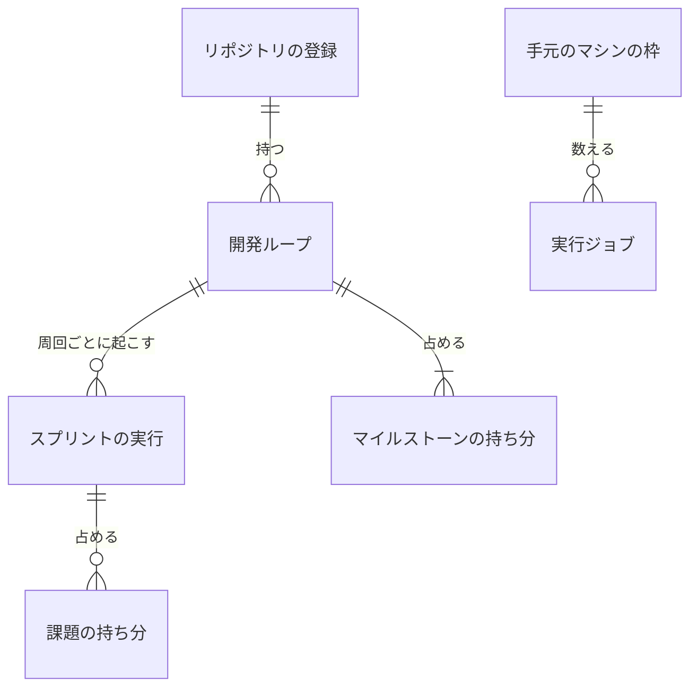

# Neural Development Factory: 開発ループのデータと契約

[開発ループと並行する実行の調整](ndf-factory-dev-loops.md) の実行の表の行・移行の埋め戻し・環境変数と、実行ジョブの指示・進捗の事象・NDF の受け渡しの形・手元のマシンの申告・画面向けの経路の契約を定める（ndf-factory-dev-loops.md から分けた）。機械可読な正は `factory/contracts/` にある。

## データ・設定

### 実行の表の行

実行の表（`RUNS_TABLE_NAME`）の行である。時系列の扱いは既存と同じ「今の値の上書き」で、周回ごとの課題・結果・版・費用は進捗の記録の `loop.lap_closed` が追記で持ち、ループの行の和はそこから作り直せる。

| 行 | `pk` | `sk` | `gsi1pk` / `gsi1sk` |
| --- | --- | --- | --- |
| 開発ループ | `ACCOUNT#<accountId>` | `LOOP#<loopId>` | `WAITING_LOOPS` / `<updatedAt>#<loopId>`（`between_laps` で `waitReason` が `user_start` でない間だけ） |
| ループの実行（周回の開始の書き込みで足す。列は `sprintRunId`） | `ACCOUNT#<accountId>` | `LOOPRUN#<loopId>#<sprintRunId>` | — |
| マイルストーンの持ち分 | `ACCOUNT#<accountId>` | `MILESTONE#<repositoryId>#<題の sha256 の先頭 32 字>` | — |
| 課題の持ち分 | `ACCOUNT#<accountId>` | `ISSUE#<repositoryId>#<番号>` | — |
| 手元のマシンの枠 | `ACCOUNT#<accountId>` | `RUNNER#<runnerId>` | — |
| 移行の済み（表に 1 つ） | `MIGRATION` | `MIGRATED#2347` | — |

| 行 | 列 | 型 | 空 | 意味 |
| --- | --- | --- | --- | --- |
| ループ | `loopId` | 文字列 | 不可 | 32 字（実行と同じ作り方） |
| ループ | `repositoryId`・`name` | 数・文字列 | 不可 | 属する登録と、NDF のループ名（`^[0-9A-Za-z][0-9A-Za-z_-]{0,63}$`） |
| ループ | `milestones` | 文字列の並び | 不可 | 1〜10 件。題に `,` を含まない（NDF の `--milestones` の区切り） |
| ループ | `budget` | `{laps, usd, hours}` | 各値は可 | 空は「宣言しない（NDF の `.ndf/pace.json` の既定）」 |
| ループ | `state` | 文字列 | 不可 | `running` / `between_laps` / `awaiting_approval` / `stopped` / `cancelled`。後ろの 2 つが終わりの状態 |
| ループ | `waitReason` | 文字列 | 可 | `between_laps` の理由: `slots`（枠）・`legacy_version`・`user_start`（`local`）。空は「起こす途中」 |
| ループ | `currentRunId` | 文字列 | 可 | 終わりの状態でない実行（I44）。空は「動く実行が無い」 |
| ループ | `lapRuns` | 数 | 不可 | 起こした実行の数。周回の開始の条件（I44）と、実行の `lap` |
| ループ | `lapsClosed`・`closedCostUsd`・`closedSeconds` | 数 | 不可 | `loop.lap_closed` の和 |
| ループ | `stopCondition`・`stopDetail` | 文字列・JSON | 可 | 止まった理由。NDF の条件か、Factory の `run_failed`・`run_stopped`・`limits_exceeded`・`launch_refused` |
| ループ | `pending` | `{number, reason, lap}` の並び | 不可 | 最後に届いた人の判断待ちの写し |
| ループ | `answers` | `{number, decision, pr}` の並び | 不可 | 画面の答え。次のジョブの `LOOP_ANSWERS` に載り、`pending` から消えた番号は外す |
| ループ | `cancelRequested`・`createdBy`・`createdAt`・`updatedAt`・`lastRunAt` | — | `lastRunAt` だけ可 | 取り消しの要求と時刻（`lastRunAt` は最後の実行の `updatedAt`） |
| 持ち分 | `loopId`・`title` / `sprintRunId` | 文字列 | 不可 | 占めるループと題 / 占める実行 |
| 手元のマシンの枠 | `count` | 数 | 不可 | `running` の `local` のジョブの数（I50） |
| 実行 | `loopId`・`lap` | 文字列・数 | 可 | 空は手動の実行 |
| 実行 | `legacy` | 真偽 | 可 | 古い版として `legacyCount` に数えた実行。作成と移行の埋め戻しで書き、終わりへの移りで真のときだけ `legacyCount` を減らす。空は「埋め戻していない既存の実行」 |
| 実行 | `finishReason` | 文字列 | 可 | `job.finished` の `reason`（`section_limit` / `usage_limit`） |
| 実行 | `resumeAt` | 文字列 | 可 | `awaiting_reset` の間だけ。リセット時刻（読めなければ `USAGE_LIMIT_RETRY_SECONDS` 後） |
| ジョブ | `runnerId` | 文字列 | 可 | `local` で受け取った手元のマシン。手元のマシンの枠を減らす先 |
| リポジトリの枠 | `legacyCount` | 数 | 不可 | 並行を許す版の下限より古い版の、終わりの状態でない実行の数（I48）。無いのは 0 |
| 登録 | `maxConcurrentRuns` | 数 | 可 | 空は「宣言しない（料金プランの値）」 |

実行の状態には `awaiting_reset` がある（終わりの状態でない）。`maxConcurrentRuns`・`loopId` などの無い行は空として読む。

| 機能 | ループ | 実行 | ジョブ | 枠・持ち分・手元のマシンの枠 | 登録 | 進捗の記録 |
| --- | --- | --- | --- | --- | --- | --- |
| 始める | C | C | C | C・U | R | — |
| 止める | U | U | — | U・D | — | R |
| 予算 | U | — | — | — | — | — |
| 次の周回 | U | C | C | U・C | R | — |
| 一覧と詳細 | R | R | — | — | — | R |
| 答える | U | — | — | — | — | — |
| 手動の開始 | R | C | C | C・U | R | — |
| 宣言 | — | — | — | — | U | — |
| 停止の後の処理 | U | U | U | U・D | — | R・C |
| 見回り（再開・待ち） | U | U | C | U・C | R | — |
| 受け取り（`local`） | — | U | U | U | — | — |

### 移行の済みの行と埋め戻し

並行の開始の材料（課題の持ち分・`legacyCount`）は、既存の終わりの状態でない実行から埋め戻してから使う。どの時点で止まっても I47・I48 を破らない。

1. 表に移行の済みの行が無い間、開始はすべての版を古い版として扱い、リポジトリの枠の `count` が 0 のときだけ書く。作成する実行は版によらず `legacy` を真にして `legacyCount` を 1 増やす（偽を書くと、この間に始めた古い版の実行が移行の後に数えられず I48 を破る）
2. 埋め戻しのコマンド（`factory/api/src/runs/backfill.ts`。何度流しても同じ結果になる）が、すべてのアカウントの `legacy` の空の終わりの状態でない実行を 1 本ずつ扱う。実行の課題の持ち分の行を強い整合で読んで他の実行が持つ課題を除き、1 回のトランザクションで実行の `legacy` を真に（条件は `attribute_not_exists(legacy)` と終わりの状態でないこと）・`legacyCount` を 1 増やし・残った課題の持ち分を `attribute_not_exists` で書く。落ちたら（`TransactionCanceledException`）その実行を読み直してやり直す
3. `legacy` の空の終わりの状態でない実行が 0 件になったら、同じコマンドが移行の済みの行を書く。開始はこの行がある間だけ `NDF_PARALLEL_MIN_VERSION` を読み、下限より古い版なら `legacy` を真にして `legacyCount` を 1 増やし、新しい版なら偽にする

- 開始と周回の開始は、移行の済みの行をトランザクションの前に強い整合で 1 回読むだけにし、行の照合（`attribute_exists`）をトランザクションへ入れない。全アカウントで共有の 1 項目を照合に入れると、同時の開始どうしが `TransactionConflict` で取り消し合うためである。行は一度書けば消さないため、読んで「ある」なら以後もあり、「無い」なら 1 の保守側の扱いになる
- 移行の済みの行はアカウントごとに置かず表に 1 つにする。埋め戻しの後に作られたアカウントの実行はすべて作成時に `legacy` を書いており、埋め戻すものが無いためである
- 既存の実行を古い版と見なすのは、その実行の NDF の版を照合していないためである。無い値を 0 と読むのは 1 の間の `legacyCount` だけである

### 環境変数

`factory/.env.example` に名前だけを置く。

| 名前 | 使う側 | 意味 |
| --- | --- | --- |
| `NDF_PARALLEL_MIN_VERSION` | 制御 | 並行を許す NDF の版の下限。無ければ並行を許さない |
| `LOCAL_LOOP_AUTOSTART` | 制御 | `true` のとき `local` のループも自動で次の周回を起こす。既定 `false` |
| `USAGE_LIMIT_RETRY_SECONDS` | 制御 | リセット時刻を読めないときの待ち。既定 900 |
| `RUNNER_SECTION_LIMIT` | ランナー | 区間の上限。既定 20 |

取り込むリポジトリの選定の規則・予算の既定・止まる条件の閾値は、ランナーの中の NDF がそのリポジトリの `.ndf/pace.json` から読む。Factory が持つのは利用者が画面で入れた値（マイルストーン・予算・同時の数の宣言）と、上の設定だけである。

## 外部連携

### 実行ジョブの指示（`run-job-instruction.schema.json`）

| 入力 | 型・必須 | 意味 |
| --- | --- | --- |
| `START` | `new` / `resume` / `loop`・必須 | `loop` は開発ループの周回を新しく始める |
| `ISSUES` | 番号の並び・`new` で必須 | `loop` では持たない |
| `APPROVAL_REQUEST_ID` | 文字列・任意 | 無い `resume` は答えを書かずに続ける（利用上限の後の再開） |
| `LOOP_NAME` | `^[0-9A-Za-z][0-9A-Za-z_-]{0,63}$`・`loop` で必須 | NDF のループ名。ループの実行の `resume` にも載せる |
| `LOOP_MILESTONES` | 文字列・`loop` で必須 | マイルストーンの題を `,` で結ぶ |
| `LOOP_BUDGET` | `^(laps=\d+(\.\d+)?)?(,?usd=\d+(\.\d+)?)?(,?hours=\d+(\.\d+)?)?$`・任意 | 宣言した予算だけを並べる。無ければ NDF の既定 |
| `EXCLUDE_ISSUES` | 番号の並び・任意 | 同じリポジトリの課題の持ち分。無ければ外さない |
| `LOOP_ANSWERS` | `<番号>=(approved\|rejected)(#<PR の番号>)?` を `,` で結ぶ・任意 | 人の判断待ちへの答え |

- `START=loop` は `LOOP_NAME`・`LOOP_MILESTONES` を要り、`ISSUES` を許さない。`LOOP_*`・`EXCLUDE_ISSUES` は `loop` と、ループの実行の `resume` のほかでは許さない
- RunTask の `overrides` の 8,192 字に収めるため、マイルストーンは 10 件・各 100 字まで（ループの開始の入力で断る）

### 進捗の事象（`progress-event.schema.json`）

`schema_version` は 1 である。冪等の鍵は `<job_id>:<seq>` で、`loop.*` はジョブの終わりに `job.finished` より前に送り、実行の制御は停止の後に同じジョブの事象として読む。

| 種類 | 出所 | `payload` | 受け手 |
| --- | --- | --- | --- |
| `section.started` | ランナー | `section`（1 から）・`command`（2,000 字で切る） | 画面の詳細 |
| `loop.lap_closed` | ランナー（`loop.json` の締めた周回） | `loop`・`lap`・`issues`（番号の並び）・`result`（`完了` / `失敗` / `人へ戻した`）・`version`（開発版と本番の版、無ければ `null`）・`cost_usd`・`seconds`・`pending`（`{number, reason, lap}` の並び） | 実行の制御（停止の後に読む）・画面の詳細 |
| `loop.stopped` | ランナー（`loop.json` の `stop`） | `loop`・`condition`（止まる条件の 10 個）・`detail`（`stop` の残りの値の JSON。4,000 字まで）・`pending` | 実行の制御・画面 |
| `job.started` | ランナー | `start` に `loop` を持てる | — |
| `job.finished` | ランナー | `reason`（`section_limit` / `usage_limit`、任意）・`resets_at`（ISO 8601、`usage_limit` のときだけ。読めなければ `null`） | 実行の制御 |
| `gate.reached` | ランナー | `loop`（`{name, lap}`、ループの実行だけ） | 承認の依頼の一覧 |

利用上限の事象はリセット時刻だけを持ち、アカウントの名前を載せない。

### NDF の受け渡しの形（`plugins/ndf/contracts/forms/ndf-next-block.json`）

| 鍵 | 中身 |
| --- | --- |
| `name` | `ndf-next-block` |
| `summary` | 応答の文の最後に置く、次の区間で起動するコマンド |
| `rule` | CommonMark の 3 つのバッククォートの囲みで、情報文字列を前後の空白を除いて `ndf-next` と比べる。ほかの囲みの中の囲みは拾わない。中身は前後の改行を除く。囲みが 2 つ以上なら起動しない。`- 結果:` の行の値が `判断が要る` なら起動しない |
| `writers` / `readers` | `sprint-state.py`（`ndf_next`）・conductor の Skill の本文 / `relay.py`（`relay_lib/mark.py`） |
| `cases` | `{text, blocks, launch}` の並び。囲みが 1 つ・無し・2 つ・別の囲みの中・`~~~` の囲み・情報文字列の前後の空白・`判断が要る`・`完了` を含む |

- 規則の持ち主は NDF で、NDF の変更が例を直す。ランナーは実行時に NDF をマーケットプレイスから入れ、`plugins/` を参照しないため、規則を写す。写した規則が古くなるのを、NDF の pytest（`next_blocks`・`_mark_action`）と Factory の vitest（`next-block.ts`）が同じ例の組を読むことで防ぐ（I55）
- `scripts/contracts_lib/model.py` は `forms/*.json` を読み、上の鍵の型を確かめる（知らない鍵は断る）。Factory はテストだけが `../plugins/ndf/contracts/forms/ndf-next-block.json` を読む。区分 `forms/` は [NDF の入口の契約](ndf-entrypoint-contracts.md) の一覧にある

### 手元のマシンの申告（`local-runner-declaration.schema.json`）

| 鍵 | 型・必須 | 意味 |
| --- | --- | --- |
| `runner_id` | 32 字の英数字・必須 | 登録のたびに発行する |
| `max_jobs` | 1〜16 の整数・任意（無ければ 1） | 同時のジョブの数 |
| `capacity_hint` | 1 以上の整数・任意 | 目安。表示だけに使う |

手元のマシンの登録と心拍の本文はこの形を含む。

### 画面向けの経路（`openapi/loops.yaml`・`openapi/runs.yaml`）

どの経路も Cognito の access token か委任の資格情報を要り、`resolveFromRequest` でアカウントを解決する。ループの要素はループの `accountId` が一致しなければ 403、無ければ 404 `loop_not_found` の要素の結果になる。エラーの本文は `{"error": {"code", "message", "details"?}}`。入力と成功の形は [利用者向けの操作の形](ndf-factory-service-boundary.md#利用者向けの操作の形) に従う。「要素・条件」は要素 1 個の項目か一覧の条件、「値」は成功の要素の `value`（一覧は配列の 1 件）、「失敗」は要素の結果の状態である。

| 経路 | 誰が | 要素・条件 | 値 | 失敗 |
| --- | --- | --- | --- | --- |
| `POST /accounts/{a}/loops` | 席を持つ人 | `{repository_id, name, milestones, budget?: {laps?, usd?, hours?}, idempotency_key}` | `{loop_id, state}`（`running` か `between_laps`） | 400 `invalid_request`（名前・題の形、1〜10 件、予算が正の数でない）・403・404 `repository_not_found`・409 `milestone_in_use`（`details.milestones`・`details.loop_name`）・409 `loop_name_in_use`（同じ登録の終わりの状態でないループ） |
| `GET /accounts/{a}/loops?repository_id=` | 席を持つ人 | 条件 `repository_id` | `{loop_id, name, milestones, state, wait_reason, laps_closed, cost_usd, budget, budget_remaining, last_run_at, stop_condition, stop_detail}`（新しい順 50 件） | 要求全体の 400・403 |
| `GET /accounts/{a}/loops/detail?loop_id=` | 席を持つ人 | 鍵 `loop_id` | `{loop, laps: [{lap, issues, result, version, cost_usd, seconds}], runs: [{sprint_run_id, lap, state, failure_reason, finish_reason, resume_at, cost_usd, sections}], pending: [{number, reason, lap, answer}]}` | 403・404 |
| `PATCH /accounts/{a}/loops` | 席を持つ人 | `{loop_id, budget}` | ループの 1 行 | 400・403・404・409 `already_finished` |
| `POST /accounts/{a}/loops/cancel` | 席を持つ人 | `{loop_id}` | `{state}`（`cancelled` か、実行の停止を待つ `running`） | 403・404・409 `already_finished` |
| `POST /accounts/{a}/loops/next-lap` | 席を持つ人 | `{loop_id}` | `{state}` | 403・404・409 `not_awaiting_user_start` |
| `POST /accounts/{a}/loops/answers` | 席を持つ人（委任の資格情報では断る） | `{loop_id, issue, decision: approved \| rejected, pr?}` | `{loop_id, pending}` | 400・403・404・409 `not_pending`（`pending` に無い番号） |
| `PATCH /accounts/{a}/repositories`（`runs.yaml`） | 持ち主 | `{repository_id, max_concurrent_runs: 1〜100 の整数か null}` | 登録の 1 行 | 400・403・404 |
| `POST /accounts/{a}/sprint-runs`（`runs.yaml`） | 席を持つ人 | [スプリントの実行の経路](ndf-factory-runs-and-runner.md#画面向けの経路) のまま | 同じ | 既存の失敗に加えて 409 `issue_in_use`（`details.numbers`）・409 `issue_in_loop`（`details.numbers`・`details.loop_name`）・409 `parallel_unsupported_version`、`limits_exceeded` の `reasons` に `concurrent_repo_runs` |

## 関連リンク

- [開発ループと並行する実行の調整](ndf-factory-dev-loops.md)
- [スプリントの実行と実行ジョブの状態・実行の表](ndf-factory-runs-state-and-data.md)
- [契約の定義と進捗の受け口](ndf-factory-contracts-and-progress.md)
- [NDF の入口の契約](ndf-entrypoint-contracts.md)
