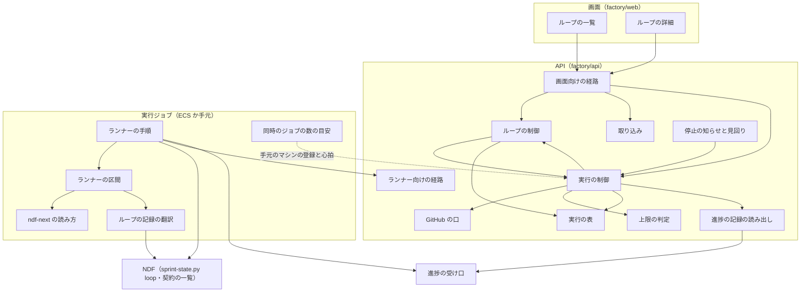
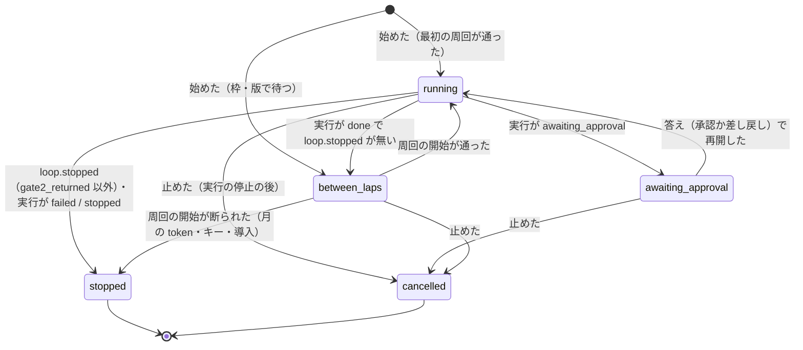
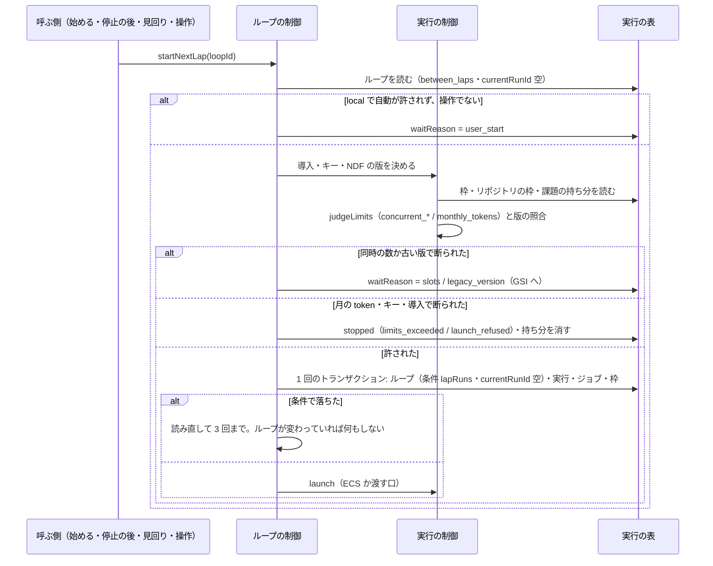
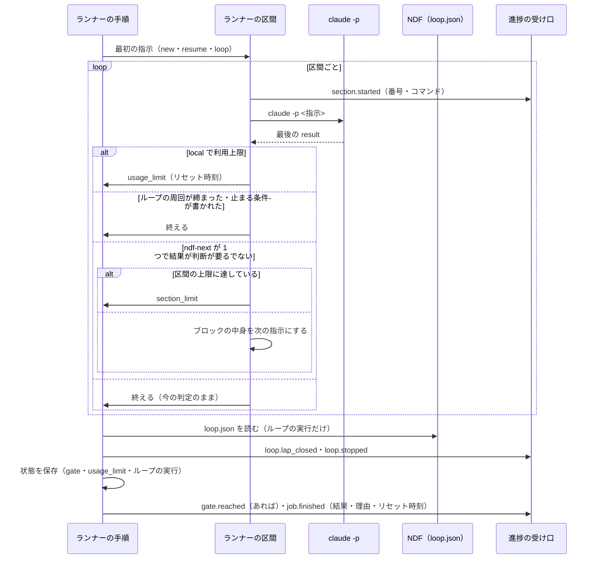

# Neural Development Factory: 開発ループと並行する実行の調整・ジョブの中の区間・利用上限・手元のマシンの同時のジョブの数

Neural Development Factory の利用者は、リポジトリごとに方針の違う開発ループを Web から始め・止め・予算を変え、一覧と詳細で周回と止まった理由を見る。同じリポジトリで並行する実行どうしの取り合い（課題・マイルストーン・NDF の版・同時の数）と、手元のマシンの同時のジョブの数は機械が守る。ランナーは 1 つの実行ジョブの中で `ndf-next` の区間をつなぎ、手元の relay.py と同じく続ける。

## 概要

- **実行をまたぐ制御は API と見回りに、ジョブの中の区切りはランナーに置く。** 次の周回は前の実行の終わり（停止の知らせ）と 5 分ごとの見回りで起こし、常駐のプロセスを持たない。常駐を置くと、ループが 1 本も動かないアカウントにも費用が掛かるためである
- **周回 1 回がスプリントの実行 1 本である。** ランナーは周回が締まった区間の後に次の区間を起動せず、次の周回は実行の制御が新しい実行で起こす。並行する実行の取り合いは実行を起こす時点でしか照らせないためである
- **課題の選定と周回の締めはランナーの中の NDF（`/ndf:development-workflow --loop`・`sprint-state.py loop`）が行う。** Factory は選定の規則を持たない
- 既存の手動のスプリントの実行（`loopId` が空）の振る舞いは変わらない

## 用語

定義は [用語集](../glossary.md) が正である（文脈 `ndf-factory`・`ndf-workflow`）。この文書で使う語は「開発ループ」「周回」「マイルストーンの持ち分」「課題の持ち分」「手元のマシンの枠」「区間」「区間の上限」「同時のジョブの数」「人の判断待ち」「リセット時刻」である。

## コンテキスト

| コンテキスト | 何の語が 1 つの意味に決まるか |
| --- | --- |
| Neural Development Factory（`ndf-factory`） | 開発ループ（集約）・スプリントの実行・実行の枠・マイルストーンの持ち分・課題の持ち分・手元のマシンの枠・区間・区間の上限・同時のジョブの数 |
| NDF の開発ワークフロー（`ndf-workflow`） | 開発ループ（`loop.json`）・周回・ループの予算・止まる条件・人の判断待ち・`ndf-next`・リセット時刻 |

`ndf-workflow` が上流、`ndf-factory` が下流の腐敗防止層である。Factory の開発ループは NDF のループの記録（`.ndf/loop/<名>/loop.json`）を読まず、ランナーが翻訳した進捗の事象（`loop.lap_closed`・`loop.stopped`）だけを読む。翻訳はランナーの `factory/runner/src/loop-file.ts` と `translate.ts` だけが持つ。`ndf-next` のブロックの読み方は NDF の契約の一覧が公開された言語として宣言し、ランナーは形を写す。

## 構成要素

| 要素 | 場所 | 責務 |
| --- | --- | --- |
| ループの制御 | `factory/api/src/runs/loops.ts`（`LoopControl`） | 始める・止める・予算・答え・次の周回の操作、`startNextLap`（周回の開始の判定とトランザクション）、`wakeWaitingLoops`（待っているループを古い順に起こす）、停止の後の処理が使うループの状態の写し |
| 実行の制御 | `factory/api/src/runs/control.ts`（`RunControl`） | 手動の開始の課題の持ち分・マイルストーンの照合・版の照合・リポジトリの同時の数。停止の後の処理で `loop.*` と `job.finished` の理由を読み、ループの写しと `awaiting_reset` を同じトランザクションへ入れる。見回りの再開の時刻と待っているループ。`claimLocalRunJob` の手元のマシンの枠 |
| 実行の表 | `factory/api/src/runs/table.ts`・`dynamo-table.ts`・`memory-table.ts` | ループの行・持ち分の行・手元のマシンの枠の行と、3 集約をまたぐ条件つきの書き込み |
| 移行の埋め戻し | `factory/api/src/runs/backfill.ts` | 既存の終わりの状態でない実行を古い版として `legacyCount` と課題の持ち分へ写し、移行の済みの行を書く |
| 上限の判定 | `factory/api/src/accounts/limits.ts`（`judgeLimits`） | 理由 `concurrent_repo_runs`（リポジトリの枠の数と登録の宣言） |
| 取り込み | `factory/api/src/repositories/service.ts` | 登録の `maxConcurrentRuns` の宣言 |
| GitHub の口 | `factory/api/src/github/port.ts`・`app.ts` | 課題の確かめの応答にマイルストーンの題を返す |
| 進捗の記録の読み出し | `factory/api/src/progress/read.ts`（`ProgressReader`） | ジョブの `loop.lap_closed`・`loop.stopped` と、ループの詳細の周回の行を読む |
| 画面向けの経路 | `factory/api/src/routes/factory.ts` | ループの 7 経路・登録の宣言の経路・開始の 409 |
| ランナー向けの経路 | `factory/api/src/runs/runner-api.ts` | ループの実行の状態の置き場の鍵を `loops/<loopId>/ndf-state.tar.gz` にする |
| ランナーの区間 | `factory/runner/src/sections.ts` | 区間をつなぐ繰り返し・区間の上限・周回の締めの検出・利用上限の検出 |
| `ndf-next` の読み方 | `factory/runner/src/next-block.ts` | 応答の文からブロックと「起動するか」を読む |
| ループの記録の翻訳 | `factory/runner/src/loop-file.ts` | `loop.json` を読み、`loop.lap_closed`・`loop.stopped` と答えの書き込みの要否を作る |
| 同時のジョブの数の目安 | `factory/runner/src/capacity.ts` | CPU の数とメモリから目安を出し、申告と比べる |
| ランナーの手順 | `factory/runner/src/main.ts`・`runtime.ts`・`state.ts`・`translate.ts` | `START=loop` の手順、答えの書き込み、`NDF_LOOP_EXCLUDE` の受け渡し、状態の `.ndf/handoff/loop-*`、`base_conflict` の翻訳 |
| 契約 | `factory/contracts/schemas/*.json`・`openapi/runs.yaml`・`openapi/loops.yaml`・`schemas/local-runner-declaration.schema.json` | [開発ループのデータと契約](ndf-factory-dev-loops-data-and-contracts.md) の「外部連携」 |
| 画面 | `factory/web/src/pages/LoopsPage.tsx`・`LoopDetailPage.tsx`・`RepositoriesPage.tsx` | ループの一覧と始める・詳細と操作・同時の実行の数の宣言 |
| NDF の受け渡しの形 | `plugins/ndf/contracts/forms/ndf-next-block.json`・`scripts/contracts_lib/model.py` | `ndf-next` のブロックの読み方と例の組。構造チェックが形を確かめる |
| NDF のループの除外 | `plugins/ndf/scripts/lib/sprint_loop_select.py`・`plugins/ndf/contracts/env/NDF_LOOP_EXCLUDE.json` | `loop select` が環境変数の課題をその周回の除外へ足す |

ループの制御は既存の API の handler と、停止の知らせと見回りの Lambda の中で動く。手元のマシンは利用者の環境で、`max_jobs` の数までジョブを別の作業場所で並べて動かす。

## 仕様

### 集約

| 集約 | 持ち主（書き換えてよいもの） | 根 | 値オブジェクト |
| --- | --- | --- | --- |
| 開発ループ | ループの制御（`LoopControl`） | ループ | 名前・選定の対象のマイルストーン・予算・状態・待ちの理由・止まった理由・人の判断待ちの写し・答え・締めた周回の和 |
| スプリントの実行 | 実行の制御 | スプリントの実行（エンティティ: 実行ジョブ） | 属するループ・周回の番号・終わりの理由・再開の時刻 |
| 実行の枠 | 実行の制御 | アカウントの枠 | リポジトリの枠の古い版の数・マイルストーンの持ち分・課題の持ち分・手元のマシンの枠 |
| リポジトリの登録 | 取り込み | 登録 | 同時の実行の数の宣言 |

- ほかの集約は識別子で参照する。ループは登録を `repositoryId`、今の実行を `currentRunId` で指し、実行はループを `loopId` で指す
- 1 つの処理が書き換える集約は 1 つで、例外は「開発ループ・スプリントの実行・実行の枠」の 3 つを 1 つのトランザクションで書く周回の開始・実行の終わりへの移り・ループの取り消しである。ループの「今の実行」と実行の作成を別のトランザクションにすると、間で止まったときに見回りがもう 1 本を起こすためである。実行の制御は停止の後の処理でループの写しを同じトランザクションへ入れるが、書く中身はループの制御の関数が組む
- 持ち分と手元のマシンの枠は実行の枠の行である。取り合いの条件を、実行と同じトランザクションの条件つきの書き込みで守るためである（読んでから書くと同時の 2 本がどちらも通る）
- DynamoDB のトランザクションは 100 件まで書け、最も多い手動の開始（実行 1・ジョブ 1・枠 2・課題の持ち分 20・マイルストーンの持ち分の照合が題ごとに 1 件で多くて 20 の 44 件）でも足りる

### 常に成り立つ条件

| # | 集約 | 条件 | 破れそうなときの扱い |
| --- | --- | --- | --- |
| I44 | 開発ループ | 1 つのループで終わりの状態でないスプリントの実行は 1 つまで（`currentRunId`） | 周回の開始は `currentRunId` が空で `lapRuns` が読んだ値のときだけ書く。条件で落ちれば何もしない |
| I45 | 実行の枠 | 同じリポジトリの終わりの状態でない 2 つのループの選定の対象のマイルストーンは重ならない | 持ち分の行を `attribute_not_exists` で書き、落ちれば 409 `milestone_in_use` |
| I46 | 実行の枠 | 枠の数は終わりの状態でない実行の数に等しい。`between_laps` のループは枠の行を持たない | ループは枠の行を書かない。枠は実行の作成と終わりへの移りでだけ増減する |
| I47 | 実行の枠 | 同じリポジトリで、1 つの課題を持つ終わりの状態でない実行は 1 つまで | 手動の開始が課題の持ち分の `attribute_not_exists` の書き込みと、課題のマイルストーンの持ち分の `attribute_not_exists` の照合を同じトランザクションで行う。前者で落ちれば 409 `issue_in_use`、後者で落ちれば 409 `issue_in_loop`。ループの周回へは、強い整合で読んだ持ち分の課題を `EXCLUDE_ISSUES` で渡す |
| I48 | 実行の枠 | 並行を許す版の下限より古い NDF の版の実行がリポジトリにあれば、その実行は唯一である | リポジトリの枠の `legacyCount` と `count` を条件にし、落ちれば 409 `parallel_unsupported_version`（ループは待つ）。移行の済みの行が無い間は、すべての版を古い版として扱う |
| I49 | 実行の枠 | リポジトリの終わりの状態でない実行の数は、料金プランの同時の数と登録の宣言の小さい方以下 | `judgeLimits` が `concurrent_repo_runs` を理由に断る（ループは待つ） |
| I50 | 実行の枠 | 1 つの手元のマシンが `running` で持つ `local` のジョブの数は、その手元のマシンが申告した `max_jobs` 以下 | 受け取りが手元のマシンの枠を条件に書き、落ちれば `null`（渡さない） |
| I51 | スプリントの実行 | 1 つの実行ジョブが起動する区間は区間の上限以下 | ランナーが次の区間を起動せず `job.finished`（`stopped`・`section_limit`）で終える |
| I52 | 開発ループ | `local` のループの次の周回は、利用者の「次の周回を始める」の操作か、設定 `LOCAL_LOOP_AUTOSTART=true` のときだけ起こる | 自動の起動は `waitReason` が `user_start` のループを飛ばす |
| I53 | 開発ループ | ループの状態は、属する実行の終わり方と `loop.stopped` の条件から、下の「ループの状態の写し方」の表のとおりにだけ決まる | 表に無い組は `stopped`（`run_failed`）にする |
| I54 | スプリントの実行 | `usage_limit` で終わるジョブと `awaiting_reset` の実行は、形態 `local` にだけある | ランナーは `local` 以外で利用上限を検出しない。制御は `local` 以外の `usage_limit` を `failed` として扱う |
| I55 | ランナー | ランナーと NDF の relay.py は、同じ応答の文から同じ `ndf-next` のブロックと同じ「起動するか」を読む | 契約の一覧の例の組を両方のテストが読み、どちらかが違えば落ちる |

I8・I9・I32〜I43 は [スプリントの実行と実行ジョブの状態](ndf-factory-runs-state-and-data.md) と [リポジトリの登録・実行の制御・ランナー](ndf-factory-runs-and-runner.md) のまま変わらない。

### ドメインイベント

| # | イベント | 発生元 | 受け手 |
| --- | --- | --- | --- |
| E1 | 開発ループを始めた | 実行の制御（画面の操作） | 実行の制御（E2） |
| E2 | 周回の実行を起こした（`START=loop`） | 実行の制御（`startNextLap`） | ランナー・実行の枠 |
| E3 | 周回の課題を選んだ | ランナーの中の NDF（`loop select`） | ランナー（`phase.changed` の課題で画面へ） |
| E4 | ジョブの中で次の区間を起動した（`section.started`） | ランナー | 進捗の受け口 → 画面の詳細 |
| E5 | リリース承認ゲートで止まった | ランナー（`gate.reached`・`loop.stopped`（`gate2_returned`）） | 承認の依頼・実行の制御（ループを `awaiting_approval`） |
| E6 | 人の判断待ちの課題ができた | ランナー（`loop.lap_closed`・`loop.stopped` の `pending`） | 実行の制御（ループの写し）→ 画面の詳細・知らせ |
| E7 | ループが止まった（`loop.stopped`） | ランナー | 実行の制御（停止の後の処理で読む） |
| E8 | 周回の実行が終わった | 実行の制御（停止の後の処理） | 実行の制御（`startNextLap`・待っているループを起こす） |
| E9 | 取り込みで衝突を解けなかった（`attention`・`base_conflict`） | ランナー（NDF の `progress.jsonl` の行の翻訳） | 画面・知らせ |
| E10 | 次の周回を始める操作を待つ（`local`） | 実行の制御（E8 の後） | 画面（一覧の待ちの理由）・知らせ |
| E11 | 利用上限でジョブを終えた（`usage_limit`） | ランナー | 実行の制御（実行を `awaiting_reset`） |
| E12 | リセット時刻の後に再開を起こした | 実行の制御（見回り） | ランナー（`START=resume`） |
| E13 | 利用者がループを止めた（`cancelled`） | 実行の制御（画面の操作） | 実行の制御（`cancelSprintRun` と同じ形で今の実行を止める） |
| E14 | 手元のマシンが同時のジョブの数を申告した | 手元のマシン（登録と心拍） | 実行の制御（`claimLocalRunJob` の条件） |

### ループの状態

利用上限の `awaiting_reset` の間、ループは `running` のままである（周回は進行中）。

**ループの状態の写し方**（I53）:

| 実行の終わり方 | `loop.stopped` | ループ | 止まった理由 |
| --- | --- | --- | --- |
| `awaiting_approval` | `gate2_returned` か無し | `awaiting_approval` | — |
| `awaiting_reset` | — | `running` のまま | — |
| `done` | 無し | `between_laps` → `startNextLap` | — |
| `done` か `stopped` | `gate2_returned` 以外の条件 | `stopped` | 条件と `detail` |
| `failed` | 無し | `stopped` | `run_failed`（実行の `failureReason` を `detail` に） |
| `stopped` | 無し | `stopped` | `run_stopped`（`finishReason` を `detail` に） |
| `cancelled` | — | `cancelled` | — |

- `loop.stopped` の条件は NDF の止まる条件の 10 個（`gate2_returned`・`user_stop`・`mvv_changed`・`same_failure`・`budget_laps`・`budget_usd`・`budget_hours`・`no_issue`・`outside_mvv`・`refused`）である。`gate2_returned` だけが周回の途中で止まる条件で、`awaiting_approval` へ写し、答えで `resume` が続く
- NDF が周回を失敗で締めた場合（`loop lap --failed`）はジョブが `done` で終わり、`same_failure` の数え方は NDF に残る。ジョブそのものが落ちた（`failed`）ときは NDF が周回を締めておらず、起こし続けると同じ失敗を数えないまま繰り返すため、ループを止める
- **止まった・取り消したループは終わりで、戻る遷移を持たない。** 続けたい利用者は同じマイルストーンで新しいループを始める（持ち分は止まった時点で消えている）。戻る遷移を持つと、どの条件が戻れるかの表が要るためである
- **ループを止めるときに NDF の `loop stop` を打たない。** 動いている実行は今の取り消し（`cancelSprintRun`）で止まり、ランナーは `SIGTERM` で何も送らずに終わる。取り消したループには次のジョブが起きず、止める印を書いても読む者がいないため、知らせはループの `cancelled` そのものとする
- 予算の変更は終わりの状態でないループにだけ効き、次のジョブの指示から NDF の `--budget-*` へ渡る
- **空の予算の単位は、リポジトリの予算の既定（`.ndf/pace.json` の `loop.budget`。宣言の無い単位は無制限）に従う。** 実行の版が `NDF_BUDGET_RESET_MIN_VERSION` 以上なら、周回のジョブの指示に空の単位を `<単位>=default`（既定へ戻す指示）で載せ、NDF が反映の時点の既定の値へ戻す。サービスは前の値を覚えず、空の単位を毎回 `default` で載せる（NDF は値が変わらなければ予算の履歴に行を足さない）。既定の値は Factory が持たず、画面は空の単位を「リポジトリの既定」と出す
- **既定へ戻せない版で動くループでは、値のある単位を空にする予算の変更を 409 `budget_reset_unsupported`（`details.ndf_version`・`details.units`）で断る。** 判定に使う版は、ループの今の実行の版、無ければ今のマーケットプレイスの版である。値を入れる・変える・空のままにする変更は、どの版でも受ける。下限の設定が無い・版を読めないときは戻せない側に倒し、指示には値のある単位だけを載せる
- **既定へ戻す指示は、別の引数でなく `--budget-*` の値 `default` で表し、数へ置き換えるのは NDF の反映の時点に限る。** 指示の組み立て・ランナー・conductor は値を文字列のまま写すため、経路を足さずに NDF まで届く。既定の値の正本を各リポジトリの `.ndf/pace.json` に残し、値の決め方を 2 か所に持たないためでもある。古い版の NDF は `default` を引数の誤り（終了コード 2）で断るため、下限をサービスの設定に置いて受ける前に判定する。下限はこの変更を含む NDF の版としてリリースで決まるため、コードに埋め込まない

### 周回の開始（`startNextLap`）

- **`EXCLUDE_ISSUES` は、トランザクションの直前に強い整合（`ConsistentRead`）で読んだ同じリポジトリの課題の持ち分の番号である。** 読みと手動の開始の間は、マイルストーンの持ち分の行で直列になる。ループの作成がマイルストーンの持ち分を書いた後に通る手動の開始はその行の照合で落ち、作成より前に通った手動の開始の持ち分はこの読みに必ず現れる
- **起こすのは 4 か所だけである**: 始めた直後・停止の後の処理（そのループ）・停止の後の処理で枠が減ったとき（同じアカウントの待っているループを `wakeWaitingLoops` が古い順に 1 本ずつ）・5 分ごとの見回り（`WAITING_LOOPS` をすべて）。`local` の `user_start` は操作だけが起こす（I52）
- **`local` の次の周回と人の判断待ちは、承認の依頼にしない。** 承認の依頼の種類は設計承認ゲート・リリース承認ゲートに限られ、サービスの側で承認を足さないためである。`local` のループは `between_laps`（`waitReason: user_start`）で待ち、一覧の行と詳細に「次の周回を始める」を出す。人の判断待ちの答えはループの行に持ち、次のジョブが `loop answer` で書く（今の実行を再開しない）

### 課題とマイルストーンの取り合い

- 手動の開始は課題ごとに、ループの開始はマイルストーンごとに持ち分の行を `attribute_not_exists` で書き、実行・ループと同じトランザクションで消す。ループの周回が選ぶ課題は持ち分の行を書かない。ループどうしはマイルストーンで分かれ、手動の実行とは `EXCLUDE_ISSUES` と `issue_in_loop` で分かれる
- 手動の開始は、動いているループのマイルストーンに属する課題を断る（409 `issue_in_loop`）。マイルストーンをループに持たせた以上、外から課題を差すと周回の選定と同じ課題を取り合うためである
- 手動の開始のトランザクションは、課題の属するマイルストーンの持ち分の行の照合（`ConditionCheck`）を、課題ごとでなく題ごとに重複を除いて 1 件にする。DynamoDB のトランザクションは同じ項目への 2 つの操作を `ValidationException` で拒むためである。マイルストーンの無い課題は照合の行を持たない
- **開始の確かめの順**（既存の 8 段のうち）: 3 の課題の確かめでマイルストーンの題を引き、`issue_in_loop` を 3 の直後に断る。`issue_in_use` と `parallel_unsupported_version` は 8 のトランザクションの条件で落ち、読み直して理由を返す。8 のトランザクションは題ごとのマイルストーンの持ち分の照合も持ち、3 の直後の照合を通った後に作られたループとの取り合いで落ちれば 409 `issue_in_loop` を返す
- **ループの開始**は、登録の確かめ・名前の重なり・マイルストーンの持ち分と、ループの行を 1 回のトランザクションで書き、続けて `startNextLap` を呼ぶ。最初の周回が枠で待つときも 201（`between_laps`）を返す
- 選定から外す課題は、NDF の `loop select` が環境変数 `NDF_LOOP_EXCLUDE` の番号をその周回の除外（`excluded`、理由「別の実行が持つ課題」）へ足して受ける。`loop exclude` は選定の後にしか打てず、ランナーはその間に割り込めないためである。手元の relay.py で複数のループを並べるときも同じ口を使える

### NDF の版の照合

- リポジトリの枠の `legacyCount` に、並行を許す版の下限より古い版の終わりの状態でない実行の数を持つ。古い版の実行は `count` が 0 のとき、新しい版の実行は `legacyCount` が 0 のときだけ書く
- 比べるのは版の `@` より前を semver として読んだ値で、開発版の接尾辞は semver の前置きの版として小さく読む。下限は設定 `NDF_PARALLEL_MIN_VERSION` が持ち（コードに埋め込まない）、無ければすべての版を古い版として扱い、同じリポジトリの実行を 1 本に絞る
- 実行の行を読んで版を数えない。読んでから書く間に別の開始が通るためである

### 停止の後の処理（`finalize`）

既存の順（`job.finished` を読む → 実行と枠を移す → 最後にジョブを終わりへ）は変わらず、実行と枠を移すトランザクションに次が入る。

| 書くもの | いつ |
| --- | --- |
| 実行を `awaiting_reset`（`resumeAt`）にする | `job.finished` が `stopped`・`usage_limit` で、形態が `local`（I54。ほかの形態では `failed`） |
| 実行の `finishReason` | `job.finished` に `reason` がある |
| 課題の持ち分を消す（`sprintRunId` がその実行の行だけ）・`legacyCount` を減らす（実行の `legacy` が真のときだけ） | 実行が終わりの状態へ移る。実行を移す書き込みに読んだ時の `legacy` の値を条件として入れ（真・偽・`attribute_not_exists(legacy)`）、落ちたら実行と持ち分を読み直してやり直す。読んだ後に埋め戻しが `legacy` を真にしたとき、減算と削除を漏らさないためである |
| 手元のマシンの枠を減らす | ジョブを終わりへ移す最後の書き込み（`runnerId` がある） |
| ループの写し（上の表）・`lapsClosed` などの和・`pending`・持ち分の削除 | 実行が `loopId` を持つ。`loop.lap_closed` と `loop.stopped` をジョブの冪等の鍵の範囲で読む |

トランザクションが通った後に、ループが `between_laps` なら `startNextLap`、枠が減ったなら `wakeWaitingLoops` を呼ぶ。どちらも落ちてよく、次の見回りが同じ結果で起こし直す。

### 利用上限（形態 `local`）

- `local` で利用上限に当たったジョブは `job.finished`（`stopped`・`usage_limit`・`resets_at`）で終え、実行は `awaiting_reset` になる。`awaiting_reset` は終わりの状態でなく、枠を数え、承認待ちと同じく今のジョブは空である
- 見回りがリセット時刻を過ぎた実行に `START=resume` のジョブを作る。`APPROVAL_REQUEST_ID` の無い `resume` は答えを書かずに続け、ランナーは conductor へ「前回の続きから進めてください。」だけを渡す。新しい `START` の値を足さないのは、状態の復元と conductor の起動が `resume` と同じで、違いが答えの有無だけのためである
- リセット時刻を読めないときの待ちは `USAGE_LIMIT_RETRY_SECONDS`（既定 900 秒）である。NDF の上限の宣言（`plugins/ndf/contracts/limits.json`）の方針 `supervise.limit-retry` と同じ値にし、同じ利用者の機械で同じ上限に当たったときの振る舞いを揃える
- 検出は NDF と同じ文言の規則（`usage limit reached|<UNIX 時刻>`・`resets <時刻> (<時間帯>)`）と、`result` の `is_error` で読む
- `managed`・`byok` では同じ文が来ても今の `failed` の扱いになる。アカウントの切り替えは手元で行い、サービスはアカウントを知らない
- リセット時刻の後の自動の再開は、`local` でサービスがジョブを自動で起こす唯一の例外である。次の周回の自動の起動は `LOCAL_LOOP_AUTOSTART`（既定 `false`）が許すときだけである

### ランナーの区間

`START` の 3 つ（`new`・`resume`・`loop`）に共通である。

- 区間の上限は `RUNNER_SECTION_LIMIT`（既定 20）で、最初の起動を数える。20 回目の `claude -p` の後に次を起動しない。既定 20 は、手元の relay の記録 14 本（2026-10-25〜11-02）の区間の数の最大 9 の 2 倍を超え、通常のジョブを打ち切らない値である
- 周回の締めの判定は区間ごとに行う。ジョブの始めの `loop.json` の締めた周回の数より増えたか、`stop` がジョブの始めより後に書かれていれば、`ndf-next` があっても次の区間を起動しない
- 使用量（`usage.recorded`）は区間ごとに送る。打ち切りの時間はジョブの全体に掛かり、区間で延びない
- `progress.jsonl` の `attention` の行のうち `step` が `base-sync` のものは、翻訳が `reason` を `base_conflict` へ写す。ほかの行の理由は変えない。Factory の語へ変えるのは腐敗防止層の仕事で、NDF の側の理由の語は増やさない

### `START=loop` のランナーの手順

既存の手順 1〜4 と 8 は変わらず、5〜7 が次になる。`START=resume` でも `LOOP_NAME` があれば 5・6 の鍵と書き込みは同じである。

| 手順 | 中身 |
| --- | --- |
| 5. 状態の復元 | `POST /run-jobs/state`（`get`）。鍵はループの `loops/<loopId>/ndf-state.tar.gz`。404 は最初の周回として空から始める。戻すのは `.ndf/tmp`・`.ndf/loop`・`.ndf/handoff/loop-<LOOP_NAME>.md`（追跡するファイルは断る） |
| 6. 答えの書き込み | `LOOP_ANSWERS` の各組のうち、`loop.json` の人の判断待ちに答えの無い番号だけ `sprint-state.py loop answer <名> <番号> --approved \| --rejected [--pr <番号>]` を打つ |
| 7. conductor | `/ndf:development-workflow --loop <LOOP_NAME> --milestones <LOOP_MILESTONES> [--budget-laps …]`。子の環境に `NDF_LOOP_EXCLUDE=<EXCLUDE_ISSUES>` を置く |

### 手元のマシンの同時のジョブの数

- `claimLocalRunJob(accountId, {runnerId, maxJobs})` は、その手元のマシンの枠が `maxJobs` 未満のときだけ、ジョブを `running` にする書き込みと枠を 1 増やす書き込みを 1 回のトランザクションで行う（I50）。引数の 2 つ目が無い呼び出しは `max_jobs` 1・ランナーの識別子なしとして扱う
- 申告の値の保存は手元のマシンの登録の集約に属し、この仕様は受け取りの条件と申告の形と目安の関数を持つ
- 目安は `max(1, min(floor(CPU の数 × 3 / 4), floor(メモリの GiB / 5)))` である（2026-09-25 の実測、8 コア・30 GB で全体テスト 6 本から 1 本あたり 4/3 コア・5 GiB）。申告が目安を超えれば手元のマシンが標準エラーへ 1 行の警告を出し、申告はそのまま送る。手元の機械の資源を知るのは手元だけで、サービスは申告を切り詰めない

### 予算の残りと費用

一覧の「費用」「周回の数」「予算の残り」は `loop.lap_closed` の和（ループの行の `lapsClosed`・`closedCostUsd`・`closedSeconds`）で出す。止まる条件を判定する NDF は締めた周回の費用と秒の和を予算と比べるため、`usage.recorded` の和で出すと画面の残りと止まる判定が食い違う。今の周回の分は、詳細の画面で実行ごとの `usage.recorded` の和として別に出す。

### 画面

| 画面 | 経路 | 何をする場所か |
| --- | --- | --- |
| ループ | `/accounts/:accountId/repositories/:repositoryId/loops` | リポジトリのループの一覧・始める欄 |
| ループの詳細 | `/accounts/:accountId/loops/:loopId` | 周回・実行と区間・人の判断待ちと答え・予算の変更・止める・次の周回を始める |
| リポジトリ | 既存 | 行に「ループ」への移りと、持ち主に同時の実行の数の宣言の欄 |

経路と役割の一覧は [画面の地図](ndf-factory-screen-map.md) にある。

| 画面 | 項目 | 型 | 必須 | 上限 | 満たさないときの表示 |
| --- | --- | --- | --- | --- | --- |
| ループ | 名前 | 文字列 | 必須 | 64 字・英数字と `-` `_` | 「英数字と - _ で 64 字までにしてください」 |
| ループ | マイルストーン | 開いているマイルストーンの複数選択 | 必須 | 10 件 | 「マイルストーンを 1 つ以上選んでください」 |
| ループ・詳細 | 予算（周回の数・費用（USD）・時間）。空の欄に「空ならリポジトリの既定」を出す | 正の数 | 任意 | — | 「0 より大きい数を入れてください」 |
| 詳細 | 答え | 承認・差し戻し、設計 PR の番号（承認のとき任意） | 必須 | — | — |
| リポジトリ | 同時の実行の数 | 整数か空 | 任意 | 1〜100 | 「1 から 100 の整数を入れてください」 |

| 状態 | 出すもの |
| --- | --- |
| 読み込み中・403・5xx | 既存の画面と同じ |
| ループが 0 件 | 「まだループがありません」と始める欄 |
| `between_laps` | 待ちの理由: `slots`「同時に動かせる実行の空きを待っています」・`legacy_version`「並行できない版の実行が終わるのを待っています」・`user_start`「次の周回を始める」のボタン |
| `stopped` | 止まった理由（条件の名前と `detail` の要点）。`budget_*` は「新しいループで続けられます」 |
| 実行が `awaiting_reset` | 「利用上限のため <時刻（利用者の時間帯）> に再開します」 |
| 409 `milestone_in_use` | 「<題> はループ <名前> が選んでいます」 |
| 予算の残りに空の単位がある | 値のある単位は残りを出し、空の単位は「<単位>はリポジトリの既定」と 1 項目にまとめる（例: `2 周 / 費用・時間はリポジトリの既定`）。既定の値そのものは出さない |
| 予算の変更が 409 `budget_reset_unsupported` | 予算の欄の誤りとして「このループの次のジョブが使う NDF（版 <`details.ndf_version`>）は予算をリポジトリの既定へ戻せません。値を入れるか、次の周回が新しい版で始まってから空にしてください」。文は翻訳のファイルに置き、`code` から選ぶ（API の `message` は API と MCP の利用者向け） |
| 人の判断待ちが 0 件 | 節を出さない |

権限: 一覧・詳細・操作は席を持つ人、同時の実行の数の欄は持ち主だけに出す（API も 403）。

## データ・設定

実行の表の行・移行の埋め戻し・環境変数と、外部との契約（実行ジョブの指示・進捗の事象・NDF の受け渡しの形・手元のマシンの申告・画面向けの経路）は [開発ループのデータと契約](ndf-factory-dev-loops-data-and-contracts.md) にある。

## エラー処理

- 周回の開始・ループの写し・終わりへの移りは条件つきの 1 回のトランザクションで書き、実行の制御のどの処理が途中で止まっても、見回りか知らせの再送で同じ結果へやり直せる（1 つの周回の実行を 2 本起こさない）
- 周回の開始の条件で落ちたときは読み直して 3 回までやり直し、ループが変わっていれば何もしない
- 同時の数か古い版で断られた周回はループを `between_laps`（`slots` / `legacy_version`）で待たせ、月の token・キー・導入で断られた周回はループを `stopped`（`limits_exceeded` / `launch_refused`）にして持ち分を消す
- `loop.stopped` が届かずにジョブが終わったループは、実行の終わり方から `run_failed` か `run_stopped` で `stopped` になる

## セキュリティ

- サービスは `local` のアカウントと認証を知らない。利用上限の事象はリセット時刻だけを持つ
- ループの操作は、そのリポジトリの登録を持つアカウントだけが行える。ループの経路は `resolveFromRequest` の後に要素ごとにループの `accountId` と登録を照らし、他人のループの要素は 403、無ければ 404 の要素の結果になる
- 同時の実行の数の宣言は持ち主だけが変えられる

## テスト観点

- ループを始め・止め・予算を変える経路と、周回のジョブの指示が `START=loop`・`LOOP_NAME` を持つこと。`factory/api/src/` に選定の規則が無いこと
- 「ループの状態の写し方」の表の各行の組で、ループの状態と止まった理由が表のとおりになり、10 個の条件のどれも `loop.stopped` として受かること
- 枠が満ちたアカウントでループが `between_laps`（`slots`）で待ち、枠の行の数が実行の数と等しく、別の実行が終わると待っていたループの周回が起きること
- 重なるマイルストーンの 2 本目が 409 `milestone_in_use`、重ならない 2 本目が 201 で、同時の 2 つの開始で片方だけが通ること
- 動いている実行の課題を指す手動の開始が 409 `issue_in_use`、ループのマイルストーンの課題が 409 `issue_in_loop` になり、周回の指示の `EXCLUDE_ISSUES` に持ち分の課題が並び、NDF の `loop select` が `NDF_LOOP_EXCLUDE` の課題をその周回の除外にすること
- 下限より古い版の実行があるリポジトリで 2 本目が 409 `parallel_unsupported_version` になり、下限が設定に無ければ 2 本目が断られ、下限以上の版どうしは並ぶこと
- 移行の済みの行が無い間は下限以上の版でも 2 本目が断られ、埋め戻しの後に既存の実行の課題を指す手動の開始が 409 `issue_in_use` になること。埋め戻しを 2 回流しても `legacyCount` が増えず、埋め戻す前に終わった実行で `legacyCount` が負にならないこと
- `step` が `base-sync` の `attention` の行だけが `reason: base_conflict` の事象になること
- 料金プランの値 3 で宣言 1 のリポジトリで 2 本目が `concurrent_repo_runs` で断られ、宣言が無ければ料金プランの値で断られること
- `max_jobs` 1 のランナーへ 2 本目を渡さず、1 本目が終わると渡し、申告が無ければ 1 として扱うこと。目安が 8 コア・30 GiB で 6、2 コア・4 GiB で 1 になり、目安を超える申告で警告の 1 行が出て申告は変わらないこと
- 答えると次のジョブの `LOOP_ANSWERS` に載り、ランナーが `loop answer` を打ち、答えの済んだ番号は打たないこと。ループの実行の `gate.reached` が `loop` を持つこと
- `local` の周回の後にループが `user_start` で待ち、`next-lap` で起き、`LOCAL_LOOP_AUTOSTART=true` なら待たず、`managed`・`byok` は待たないこと
- 偽の `claude` が `ndf-next` を 1 つ返すと次の区間が起き、`判断が要る`・ブロック無し・2 つでは起きず、区間ごとに `section.started` が届くこと。21 回目を起動せず `section_limit` で終わり、打ち切りの時間は区間の合計に掛かること
- 契約の一覧の例の組を NDF の pytest と Factory の vitest が読んで同じ答えを返し、`check-service-boundary.py` が通ること
- `local` の偽の `claude` が上限の文を返すと `usage_limit` で終わって実行が `awaiting_reset` になり、時刻の後の見回りで `APPROVAL_REQUEST_ID` の無い `resume` が積まれ、時刻が読めなければ 900 秒後になること。`managed`・`byok` では `failed` になること
- 契約の検査が新しい欄と種類を通して生成した型に現れ、`loop` に `ISSUES` を持つ指示が断られること
- 手動の開始・一覧・取り消し・再開の既存のテストが変えずに通ること
- 予算 `{usd: 10}` で始めたループの費用を空にした後、既定へ戻せる版の周回のジョブの指示が `LOOP_BUDGET=laps=default,usd=default,hours=default` で契約の検査を通り、ランナーが `--budget-usd default` を渡し、NDF が記録の費用を `.ndf/pace.json` の `loop.budget.usd`（宣言が無ければ無制限）へ戻して、数を書いた単位はその値で止まる条件を判定すること。値が変わらなければ予算の履歴が増えないこと
- 既定へ戻せない版の実行の指示に `default` が載らず、そのループで値のある単位を空にする変更が 409 `budget_reset_unsupported` でループの行を変えず、値を変える・空のままにする変更は通ること。今の実行が無いループはマーケットプレイスの版で判定し、下限の設定が無ければ断ること。`supportsBudgetReset` が下限と同じ・新しい版で真、古い版・開発版の接尾辞の付いた同じ版・下限が無い・読めない版で偽になること
- 予算の残りに空の単位があると「リポジトリの既定」と出て「掛けない」を出さず、`budget_reset_unsupported` で版を差し込んだ翻訳の文が予算の欄に出ること
- 周回の開始のトランザクションの後で止めても、2 つの呼び手が同時に `startNextLap` を呼んでも、実行が 1 本だけになること

## 関連リンク

- [サービスの境界と全体の契約](ndf-factory-service-boundary.md)
- [リポジトリの登録・実行の制御・ランナー](ndf-factory-runs-and-runner.md)
- [スプリントの実行と実行ジョブの状態・実行の表](ndf-factory-runs-state-and-data.md)
- [契約の定義と進捗の受け口](ndf-factory-contracts-and-progress.md)
- [認証とアカウント・席・料金プラン](ndf-factory-accounts-and-plans.md)
- [画面の地図](ndf-factory-screen-map.md)
- [開発ループのデータと契約](ndf-factory-dev-loops-data-and-contracts.md)
- [NDF の入口の契約](ndf-entrypoint-contracts.md)
