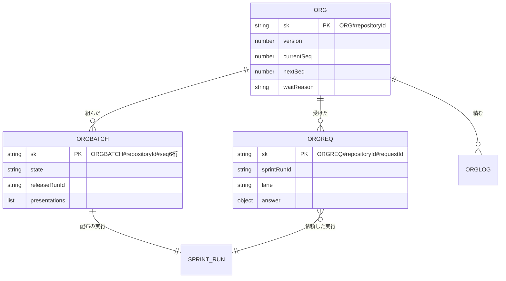

# Neural Development Factory: Factory のオーガナイザーのデータと契約

[Factory のオーガナイザー](ndf-factory-organizer.md) が実行の表に持つ行と、画面向けの経路・ランナー向けの経路・進捗の事象・ジョブの指示・NDF の置き場の契約を扱う。不変条件の番号（I56〜I68）はその文書のものを指す。

## データ・設定

### 保存する形

オーガナイザーの進行の行は、今の実行の表（`pk=ACCOUNT#<accountId>`）に置く。まとめた配布と配布の実行を 1 回のトランザクションで書く（I57）ためである。



**根（`sk=ORG#<repositoryId>`）**: 1 リポジトリに 1 行。最初に書き込む `tick` が作る。

| 列 | 型 | 空を許すか | 意味 |
| --- | --- | --- | --- |
| `repositoryId` | 数値 | 許さない | リポジトリの登録の識別子 |
| `version` | 数値 | 許さない | 楽観的な排他の版（I67）。書くたびに 1 増やす |
| `currentSeq` | 数値 | 許す | 流れているまとめた配布の連番。空は「流れていない」（I56） |
| `nextSeq` | 数値 | 許さない | 次に組むまとめた配布の連番（1 から） |
| `waitReason` | 文字列 | 許す | `external_release_open` / `legacy_run`。空は「待っていない」 |
| `waitDetail` | 文字列 | 許す | 待ちの相手（外の Pull Request の URL・依頼を出していない古い版の実行の数） |
| `gsi1pk`・`gsi1sk` | 文字列 | 許す | 既存の GSI `gsi1` の鍵 `ORGANIZER_ACTIVE` と `<accountId>#<sk>`。`currentSeq` があるときだけ持つ |

**受けた依頼（`sk=ORGREQ#<repositoryId>#<requestId>`）**: 依頼 1 件に 1 行（I59）。依頼の中身は書き換えない。

| 列 | 型 | 空を許すか | 意味 |
| --- | --- | --- | --- |
| `requestId` | 文字列 | 許さない | NDF が作る依頼の id |
| `sprintRunId` | 文字列 | 許さない | 依頼を出した実行 |
| `loopId` | 文字列 | 許す | 依頼を出した実行のループ。空は手動の実行 |
| `lane` | 文字列 | 許さない | `NDF_ORGANIZER_LANE` の値 |
| `prs`・`issues` | 数値の配列 | 許さない（空の配列は可） | 依頼の Pull Request と課題 |
| `ndfVersion` | 文字列 | 許さない | 依頼した実行の NDF の版 |
| `requestedAt` | 文字列 | 許さない | 依頼のファイルの時刻 |
| `answer` | オブジェクト | 許す | `{seq, result, version, prodPrUrl, reason, at}`。`result` は `released` / `rejected`、差し戻しの `reason` は `release_rejected`。空は「未回答」。1 回だけ書く（I58） |
| `deliveredAt` | 文字列 | 許す | 答えを依頼元へ届け終えた時刻。空は「届け終えていない」 |
| `gsi1pk`・`gsi1sk` | 文字列 | 許す | `gsi1` の鍵 `ORGANIZER_ACTIVE`。`deliveredAt` が空の間だけ持ち、`deliveredAt` を書く書き込みで外す |

**まとめた配布（`sk=ORGBATCH#<repositoryId>#<seq を 6 桁で 0 埋め>`）**

| 列 | 型 | 空を許すか | 意味 |
| --- | --- | --- | --- |
| `seq` | 数値 | 許さない | 連番 |
| `state` | 文字列 | 許さない | `composed` / `presented` / `represented` / `confirmed` / `stalled` / `released` / `rejected` |
| `releaseRunId` | 文字列 | 許さない | 配布の実行（I57） |
| `lanes` | 配列 | 許さない | 組んだ時点のレーン `{lane, sprintRunId, loopId, requestIds, issues}`。依頼の無いレーンは `requestIds` が空 |
| `presentations` | 配列 | 許さない（空の配列は可） | 提示 `{k, sha, version, prs, lanes:[{lane, requested}], addedPrs, at, approvalRequestId}`。2 つまで（I60）で、上書きせず足す。`approvalRequestId` はその提示へ答えた承認の依頼で、古い承認の再送を次の提示の承認と取り違えないために残す |
| `confirmedK` | 数値 | 許す | 確定した提示の番号。空は「確定していない」 |
| `mainMerged` | 真偽 | 許さない | `main` へのマージを記録したか（I63） |
| `result` | オブジェクト | 許す | `{version, prodPrUrl, sha, prs}`。空は「配布済みでない」 |
| `stallReason` | 文字列 | 許す | `stalled` の理由。`stalled` 以外は空 |
| `stalledFrom` | 文字列 | 許す | 止まる前の状態（`composed` / `presented` / `represented` / `confirmed`）。「続きから流す」でこの状態へ戻す。`stalled` 以外は空 |

**記録（`sk=ORGLOG#<repositoryId>#<ISO 時刻>#<種類>#<乱数 8 桁>`）**: 追記だけで書き換えない。末尾の乱数は、同じ時刻に同じ種類の記録を 2 件書いても上書きしないためである。種類は `waited` / `composed` / `presented` / `represented` / `confirmed` / `stalled` / `resolved` / `released` / `rejected`。

**時系列の扱いは事象の記録と追記だけの提示の列である。** まとめた配布の `state` は上書きするが、遷移は記録の行に積み、提示は配列に足すだけにする。承認する人が何のコミットを見て答えたかを、出し直しの後も辿れるようにするためである。

**スプリントの実行・ジョブ・リポジトリの枠に足した列**（既存の列は変えない。空は今の意味として読む）:

| 行 | 列 | 型 | 意味 |
| --- | --- | --- | --- |
| リポジトリの枠 | `legacySeq` | 数値 | 古い版の実行を `legacyCount` へ数えに入れた回数。`legacyCount` を増やす書き込み（開始・移行の埋め戻し）で同じトランザクションで 1 増やし、減らす書き込みでは変えない。組む書き込みの条件に使う（I62） |
| 実行 | `purpose` | 文字列 | `release`。空はスプリントの実行 |
| 実行 | `releaseSeq` | 数値 | 配布の実行のまとめた配布 |
| 実行 | `awaitingReason` | 文字列 | `awaiting_approval` の理由 `release_requested` / `release_stalled`。空は承認の依頼の待ち |
| 実行 | `releaseRequestId` | 文字列 | 手動の実行が待つ依頼の id。理由が `release_requested` のときだけ |
| ジョブ | `start` | 文字列 | 今の値に `release` を足す |
| ジョブ | `releaseStep` | 文字列 | `present` / `represent` / `confirm:1` / `confirm:2` / `continue`。配布の実行のジョブだけ |
| ジョブ | `releaseRequestId` | 文字列 | 手動の実行の再開で、答えの出た依頼の id |

既存のデータの移行は無い。

## 外部連携

### 画面向けの経路（`factory/contracts/openapi/organizer.yaml`）

入力と成功の形は [利用者向けの操作の形](ndf-factory-service-boundary.md#利用者向けの操作の形) に従う。「値」は成功の要素の `value`（一覧は配列の 1 件）、「失敗の形」は要素の結果の状態である（401 は要求全体）。

| 経路 | 要素・条件 | 値 | 失敗の形 |
| --- | --- | --- | --- |
| `GET /accounts/{accountId}/approval-requests?repository_id=` | 鍵 `repository_id` | `{repository_id, organizer: {current_seq, wait_reason, wait_detail}, items}`。`items` の 1 件は `{kind, sprint_run_id?, loop_id?, pr_url?, number?, reason?, created_at, release?}`。`kind` は `gate1` / `gate2` / `decision` / `loop_pending` / `release_stalled`。`release` は配布の実行のものだけが持つ `{seq, k, sha, lanes:[{lane, requested, prs}], added_prs, choices}` | 401・403・404 |
| `GET /accounts/{accountId}/releases?repository_id=` | 条件 `repository_id`（1 つ）と `limit`（1〜100、既定 20） | `{seq, state, release_run_id, presentations, confirmed_k, result, log}`（新しい順） | 要求全体の 400・401・403・404 |
| `POST /accounts/{accountId}/releases/resolve` | `{repository_id, seq, choice: "continue" \| "reject", body?}`（委任の資格情報では要求全体を 403 `human_only` で断る） | `{seq, state}`。`state` は戻した状態（`composed` / `presented` / `represented` / `confirmed`）か `rejected` | 400・401・403・404・409（`not_stalled` / `release_after_main`） |

一覧と履歴の経路は読むだけで、承認を確定する経路はこのファイルに無い（I66）。

### ランナー向けの経路（`factory/contracts/openapi/runs.yaml`）

| 経路 | 入力 | 成功 | 失敗の形 |
| --- | --- | --- | --- |
| `GET /run-jobs/organizer/answers` | 実行ジョブの token | 200 `{answers: [{request_id, result, version, release, reason, at}], ranges: [{seq, sha, version, prs, lanes}]}`。手動の実行はその実行の、ループの実行はそのループのすべての実行の依頼の答えと、リポジトリの配布済みの範囲（新しい方から 100 件のまとめた配布のうち `released` のもの） | 401・403 |
| `GET /run-jobs/organizer/batch` | 実行ジョブの token（配布の実行のジョブだけ） | 200 `{seq, step, lanes:[{lane, requests:[{id, prs}], issues}], presentations, choices}` | 401・403・404 |

答えの形は並列のオーガナイザーの `parallel-request.json` の答えと範囲にそろえる。受けた依頼の行の `prodPrUrl` は答えの `release` に写す（本番の Pull Request の URL）。レーンの中身はジョブの指示に載せず、ランナーがこの経路で読む。RunTask の `overrides` の上限（8,192 字）を避けるためである。

### 進捗の事象（`factory/contracts/schemas/progress-event.schema.json`）

| 種類 | 出所 | payload | 冪等の鍵 |
| --- | --- | --- | --- |
| `release.requested` | `runner` | `{request_id, lane, prs, issues, ndf_version, requested_at}` | `<request_id>` |
| `release.presented` | `runner` | `{seq, k, sha, version, prs, lanes:[{lane, requested}], added_prs, auto}`。`auto` は MVV 判定が通したとき真 | `<sprint_run_id>:presented:<k>` |
| `release.progress` | `runner` | `{seq, stage}`。`stage` は `release_branch` / `develop_merged` / `prod_pr_opened` / `main_merged` / `tagged` | `<sprint_run_id>:progress:<stage>` |
| `release.settled` | `runner` | `{seq, result, version?, prod_pr_url?, sha?, prs, lanes, reason?}`。`result` は `released` / `failed` | `<sprint_run_id>:settled:<result>` |
| `release.answered` | `control` | `{seq, request_id?, result, version?, prod_pr_url?}`。範囲の実行の進捗の記録へ書く | `<seq>:<sprint_run_id>` |

冪等の鍵は実行の識別子を頭にする。冪等の鍵の表はサービス全体で 1 つのため、リポジトリごとの連番だけを鍵にしない。結果の鍵を種類ごとに分けるのは、同じ実行が `failed` を送った後に再開して `released` を送れるようにするためである。式は `factory/contracts/src/index.ts` の `releasePresentedKey`・`releaseProgressKey`・`releaseSettledKey` と `factory/api/src/progress/authorize.ts` だけが持ち、ランナーの送信と受け口の照合が同じ式を使う。

`gate.reached` の payload に任意の `choices`（文字列の配列）がある。配布の実行が `main` へのマージの後に判断で止まったときは `["continue"]` だけを載せる（I63）。

### ジョブの指示（`factory/contracts/schemas/run-job-instruction.schema.json`）

| 項目 | 規則 |
| --- | --- |
| `START` | `new` / `resume` / `loop` / `release` |
| `RELEASE_SEQ` | 1 以上の整数の文字列。`START` が `release` のときは必須、ほかでは持たない |
| `RELEASE_STEP` | `present` / `represent` / `confirm:1` / `confirm:2` / `continue`。`START` が `release` のときは必須、ほかでは持たない |
| `RELEASE_REQUEST_ID` | 手動の実行の再開で、答えの出た配布の依頼の id |

### 実行の制御の関数

| 関数 | 振る舞い |
| --- | --- |
| `buildReleaseRun(base, seq, ndfVersion)` | 範囲の実行を元に、目的 `release` の配布の実行とジョブ（`START=release`・`releaseStep=present`）を組む。枠の行は書かない（I64） |
| `resumeForRelease(sprintRunId, requestId)` | 手動の実行が理由 `release_requested` でこの依頼を待つときだけ、`addResumeJob` の条件にその照らしを入れて再開のジョブを作る。`resumed` / `busy` / `not_waiting` を返す |
| `resumeRelease(run, step, organizer?)` | 理由 `release_stalled` の配布の実行を `step` で再開する。`organizer` を渡すと、まとめた配布の状態の戻しを同じトランザクションで書く |
| 停止の後の処理（`finalize`） | `release.requested` を受けた依頼の行として同じトランザクションへ入れ、後で `tick` を呼ぶ。手動の実行が依頼を出して `gate`（理由 `release_requested`）で終わると、理由と依頼の id を持つ `awaiting_approval` へ移す。この理由はジョブの終わりの理由（`finishReason`）には写さない |
| 見回り（`sweep`） | 最後に `organizer.sweep()` を呼ぶ。`gsi1` の `ORGANIZER_ACTIVE` を引き、リポジトリごとに `tick` を呼ぶ |

## NDF の置き場の契約（`plugins/ndf/contracts/forms/parallel-external.json`）

```text
<NDF_ORGANIZER_DIR>/
├── requests/<依頼の id>.json      # NDF が書く（レーン）
├── answers/<依頼の id>.json       # 外のオーガナイザーが書く
├── ranges/<連番>.json             # 外のオーガナイザーが書く（配布済みの範囲）
├── batch.json                     # 外のオーガナイザーが書く（配布の実行だけ）
├── presented/<連番>-<提示>.json   # NDF が書く（配布の実行）
├── progress/<連番>.json           # NDF が書く（配布の実行）
└── results/<連番>.json            # NDF が書く（配布の実行）
```

| ファイル | 形 |
| --- | --- |
| `requests/` | 並列のオーガナイザーの配布の依頼（`parallel-request.json`）に `ndf_version`（空でない文字列）を足した形。ファイル名は id |
| `answers/`・`ranges/` | 答え `{result, version, release, reason, at}`（`result` は `released` / `rejected`）と範囲 `{sha, version, prs, lanes}` |
| `batch.json` | `{seq, step, lanes:[{lane, requests:[{id, prs}], issues}], presentations, choices}` |
| `presented/` | `{seq, k, sha, version, prs, lanes:[{lane, requested}], added_prs, auto}`。`k` は 1 か 2 |
| `progress/` | `{seq, stages}`。届いた段の並び |
| `results/` | `{seq, result, version, prod_pr_url, sha, prs, lanes, reason}`。`result` は `released` / `failed` |

- どちらの書き手も一時ファイルへ書いて名前を付け替える。読み手は名前の付いたファイルだけを読み、書きかけのファイルを読まない
- 契約は例の組を持ち、NDF の構造チェックとランナーのテストが同じ例を読む
- 環境変数の宣言は `plugins/ndf/contracts/env/NDF_ORGANIZER_DIR.json`・`NDF_ORGANIZER_LANE.json`・`NDF_FACTORY_RUN.json` にある

## テスト観点

- 経路・事象・ジョブの指示の追加は既存の項目の意味を変えず、`npm run check` の契約の検査が通ること
- 同じ時刻に同じ種類の記録を 2 件書いても、どちらも残ること
- `START` が `release` でないジョブの指示が `RELEASE_SEQ`・`RELEASE_STEP` を持つと、定義の検査で落ちること
- ランナーの翻訳が、置き場の契約の例の組を進捗の事象へ写し、答えと範囲を同じ形のファイルへ書くこと

## 関連リンク

- [Factory のオーガナイザー](ndf-factory-organizer.md)
- [並列のオーガナイザー（1 台の中）](ndf-parallel-organizer.md)
- [開発ループのデータと契約](ndf-factory-dev-loops-data-and-contracts.md)
- [契約の定義と型・進捗の受け口](ndf-factory-contracts-and-progress.md)
