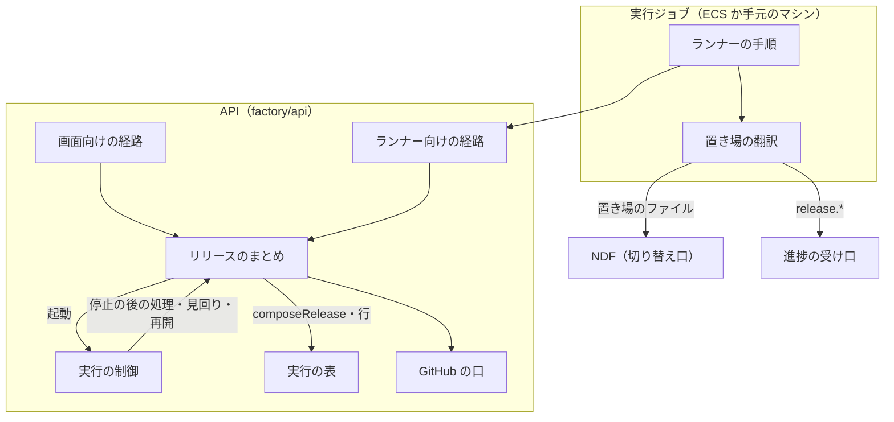
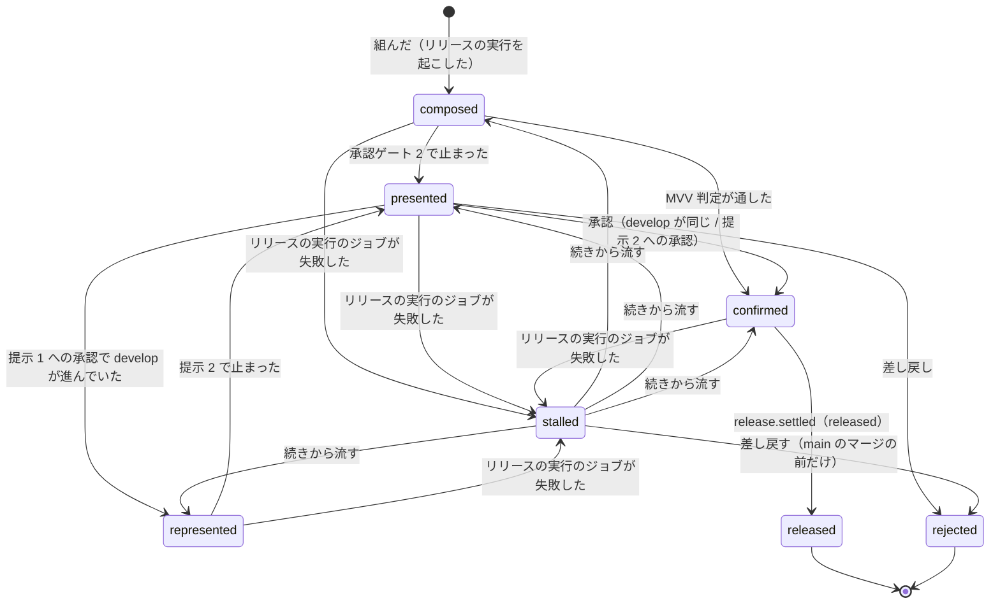
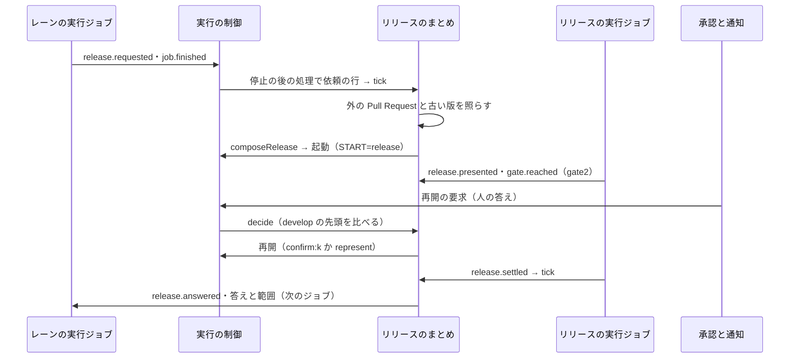

# Neural Development Factory: Factory のオーガナイザー（リリースを 1 本にまとめ、承認と問いをリポジトリごとに 1 か所へ集める）

同じリポジトリで 2 本以上の開発ループかスプリントの実行を Factory で回すと、リリースは Factory のオーガナイザーが 1 本にまとめる。流すのは専用のリリースの実行 1 本で、承認ゲート 2 は 1 回で済む。承認と問いはリポジトリごとの 1 つの一覧に並ぶ。NDF の側は、外のオーガナイザーと置き場のファイルで依頼と答えをやり取りする切り替え口を持ち、Factory を名指ししない。

## 概要

- **リリースを流すのは、同じリポジトリでリリースの実行 1 本だけである。** 実行ごとにリリースを流すと、各実行が `develop` の先頭を出すため、先に出した実行が他の実行の変更もまとめて出してしまう。リリースの実行は、承認したコミットまでの範囲だけを出す。範囲に Pull Request が入った実行すべてへ、同じ版と同じ本番の Pull Request を返す。範囲の外の変更は次のまとめたリリースで出る
- **常駐のプロセスとインフラの部品を足さない。** 状態はすべて実行の表（DynamoDB）の行で、既存の API の handler と 5 分ごとの見回りの中で進む。見回りが引く索引は、既存の GSI `gsi1` に鍵 `ORGANIZER_ACTIVE` の行を載せて使う
- **1 台の中のオーガナイザー（[並列のオーガナイザー](ndf-parallel-organizer.md)）とは同じ層の別の実装で、互いに排他である。** 共有するのは依頼と答えの形とリリースの規則だけである。Factory の実行ジョブでは 1 台の中のオーガナイザーを起動しない
- 承認ゲート 1 と承認ゲートの外の問いは依頼にせず、今の承認の流れのまま、一覧への並べ方だけをまとめる

## 用語

定義は [用語集](../glossary.md) が正である（文脈 `ndf-factory`・`ndf-workflow`）。この文書で使う語は「Factory のオーガナイザー」「リリースの実行」「手元のマシン」「料金プラン」「レーン」「承認ゲート 2」「MVV 判定」「見回り」である。

次の 4 つは、この文書の中だけで使う構成要素の名前である。

| 名前 | 意味 |
| --- | --- |
| リリースのまとめ | Factory のオーガナイザーのうち、この仕組みが足した部分（`OrganizerControl`） |
| 受けた依頼 | 実行が出したリリースの依頼 1 件の行 |
| まとめたリリース | 1 回のリリースの単位。範囲・提示・結果を持つ |
| 提示 | 承認ゲート 2 で人へ示した、出すコミットと範囲。1 つのまとめたリリースに 2 つまで |

## コンテキスト

| コンテキスト | 何の語が 1 つの意味に決まるか |
| --- | --- |
| Neural Development Factory（`ndf-factory`） | Factory のオーガナイザー・リリースの実行・受けた依頼・まとめたリリース・提示・待ちの理由・手元のマシン・料金プラン |
| NDF の開発ワークフロー（`ndf-workflow`） | オーガナイザー・レーン・リリースの依頼・承認ゲート 2・承認したコミット |

`ndf-workflow` は依頼と答えの形を公開された言語として持つ（`plugins/ndf/contracts/forms/parallel-request.json` と `parallel-external.json`）。`ndf-factory` はランナーの翻訳（`factory/runner/src/organizer.ts`）を腐敗防止層に置き、置き場のファイルを進捗の事象へ写す。API は NDF のファイルを読まない。

Factory のオーガナイザーは、既存の実行の制御・ループの制御と、リリースのまとめでできる役割である。

| 1 台の中のオーガナイザーの仕事 | Factory の担い手 |
| --- | --- |
| レーンを起動・監視・停止する | 実行の制御・ループの制御（周回の開始・停止の後の処理・見回り・取り消し） |
| リリースを 1 本にまとめる | リリースのまとめ |
| 問いを集める | リリースのまとめの一覧（リポジトリごと） |
| 答えの後の作業を持ち主のレーンへ返す | リリースのまとめの届け・`resumeForRelease`・ランナー向けの答えの経路 |
| 共有の作業を一時レーンへ渡す | リリースの実行 |
| （Factory 固有）実行ジョブの起動・停止・再開、実行の枠と手元のマシンの枠、ジョブをまたぐ状態の置き場 | 実行の制御・ランナー向けの経路 |

## 構成要素

| 要素 | 場所 | 責務 |
| --- | --- | --- |
| リリースのまとめ | `factory/api/src/organizer/control.ts`（`OrganizerControl`） | `newRequestRows`（受けた依頼の行）・`tick`（届け直し・流れているリリースの 1 手・待ちの判定と組む）・`decide`（承認の答え）・`resolve`（止まったリリースを解く）・`list`（一覧）・`history`（履歴）・`answersFor`・`batchFor`（ランナー向け）・`sweep`（見回り） |
| 型と純粋な関数 | `factory/api/src/organizer/model.ts` | 根・受けた依頼・まとめたリリース・記録の行の型。答える依頼の決め方（`requestsToAnswer`）・止まったリリースの選択肢（`choicesOf`）・再開の手（`stepFrom`）・リリースの実行の NDF の版（`newestVersion`） |
| 実行の表 | `factory/api/src/runs/table.ts`・`dynamo-table.ts`・`memory-table.ts` | オーガナイザーの行の読み書き。まとめたリリースとリリースの実行を 1 回で書くトランザクション（`composeRelease`）。古い版の実行を数えるたびに `legacySeq` を 1 増やす。`addResumeJob` の待ちの照らし |
| 実行の制御 | `factory/api/src/runs/control.ts`（`RunControl`） | 停止の後の処理で受けた依頼の行を同じトランザクションへ入れ、後で `tick` を呼ぶ。リリースの実行の再開を `decide` へ回す。リリースの実行を枠の外で作る（`buildReleaseRun`）。`resumeForRelease`・`resumeRelease`。見回りで `organizer.sweep` を呼ぶ |
| GitHub の口 | `factory/api/src/github/port.ts`・`app.ts` | `develop` の先頭・`main` 宛の開いている Pull Request の head・head を指定した Pull Request・枝の有無 |
| 経路 | `factory/api/src/routes/factory.ts`・`runs/runner-api.ts` | 画面向けの 3 経路とランナー向けの 2 経路 |
| 出所の許可 | `factory/api/src/progress/authorize.ts` | 出所 `runner` が `release.*` の 4 種類を、出所 `control` が `release.answered` を書ける |
| 置き場の翻訳 | `factory/runner/src/organizer.ts` | 依頼・提示・届いた段・結果のファイル → 進捗の事象。答え・範囲・まとめたリリースの中身 → ファイル。未回答の依頼の再送 |
| ランナーの手順 | `factory/runner/src/main.ts`・`runtime.ts` | `START=release` の手順と、NDF へ渡す環境変数 |
| 契約 | `factory/contracts/openapi/organizer.yaml`・`runs.yaml`・`schemas/progress-event.schema.json`・`schemas/run-job-instruction.schema.json`・`src/index.ts` | 経路・事象・ジョブの指示の形と、レーンの名前と冪等の鍵の式（[データと契約](ndf-factory-organizer-data-and-contracts.md)） |
| NDF の切り替え口 | `plugins/ndf/scripts/lib/parallel_external.py`・`parallel_external_cli.py`・`parallel_lane.py`・`parallel.py`・`plugins/ndf/contracts/forms/parallel-external.json`・`plugins/ndf/contracts/env/NDF_ORGANIZER_{DIR,LANE}.json`・`NDF_FACTORY_RUN.json` | 置き場の契約と、依頼の書き出し・答えの読み込み・リリースの実行の手順（「NDF の切り替え口」） |

## 仕様

### 集約

| 集約 | 持ち主（書き換えてよいもの） | 根 | エンティティ | 値オブジェクト |
| --- | --- | --- | --- | --- |
| オーガナイザーの進行 | リリースのまとめ | リポジトリのオーガナイザー（`repositoryId`） | 受けた依頼・まとめたリリース | 待ちの理由・提示・答え・リリースの結果 |
| スプリントの実行 | 実行の制御 | スプリントの実行 | 実行ジョブ | 目的（`release`）・属するまとめたリリース・待っている依頼 |
| 開発ループ | ループの制御 | ループ | — | 人の判断待ち・答え |

- オーガナイザーの進行は、ほかの集約を識別子でだけ参照する
- 1 つの処理が書き換える集約は 1 つで、例外は 2 つである。まとめたリリースを組む処理は、オーガナイザーの進行とリリースの実行（実行とジョブ）を 1 つのトランザクションで書く。停止の後の処理は、ジョブが送った `release.requested` を受けた依頼の行として、実行の移りと同じトランザクションへ入れる。どちらも、間で止まったときに見回りが 2 本目を起こすか依頼を取りこぼすためである
- 一覧は承認の依頼とループの人の判断待ちを読んで並べるだけで、書き換えない。承認の依頼の持ち主は 1 つに保ち、答えたかどうかを 2 か所に分けない

### 常に成り立つ条件

番号は Factory の確定仕様の続きである。

| # | 条件 | 破れたときの扱い |
| --- | --- | --- |
| I56 | 同じリポジトリで、終わりの状態でないまとめたリリースは 1 つまで | 組む書き込みは、根の `currentSeq` が空で `version` が読んだ値のときだけ通す。落ちたら読み直し、組まない |
| I57 | まとめたリリース 1 つにリリースの実行は 1 本で、まとめたリリースと同じトランザクションで作る | 片方だけを書く経路を持たない。トランザクションが落ちればどちらも無い |
| I58 | 受けた依頼 1 件に答えは 1 回だけ書く | 答えの書き込みは答えが無いことを条件にし、落ちたら書かない |
| I59 | 同じ依頼の id は 1 行（ランナーが送り直しても増えない） | 停止の後の処理は在る行を読んでから無い行だけを書く。`release.requested` は冪等の鍵が依頼の id で 1 件になる |
| I60 | 提示は 1 つのまとめたリリースに 2 つまで。`develop` の先頭を比べるのは提示 1 への承認のときだけ | 提示 2 への答えでは GitHub を読まない。3 つ目の提示は記録しない |
| I61 | 答える依頼はまとめたリリースの終わり方で決まる。リリース済みなら結果の Pull Request の範囲に入る依頼へ `released`。差し戻しなら最後の提示の範囲に入る依頼へ `rejected`。提示の前の差し戻しなら、まとめたリリースが受けた依頼すべてへ `rejected`。Pull Request を持たない依頼は、まとめたリリースが受けた依頼であれば範囲に入る。どれにも入らない依頼は次のまとめたリリースへ残る | 照らせない依頼は答えずに残す |
| I62 | Factory の外の本番の Pull Request が開いている間、またはリポジトリに依頼を出していない古い版の実行がある間は、まとめたリリースを組まない。逆に、まとめたリリースが終わりの状態でない間は古い版の実行を始めない | 「待ちの判定」のとおり |
| I63 | `main` へのマージを記録したまとめたリリースは差し戻せない | 止まったリリースの選択肢を「続きから流す」だけにし、差し戻しを 409 `release_after_main` で断る。ジョブの無いリリースの実行の取り消しも同じ 409 で断る |
| I64 | リリースの実行は実行の枠（アカウント・リポジトリ）を持たず、使える量の判定にかけない。トークンと費用は登録したアカウントの利用量へ数える | リリースの実行の作成は枠の行を書かない |
| I65 | リリースの依頼を出したループの実行は `done` で終わる。手動の実行は理由 `release_requested` の `awaiting_approval` で枠を持ったまま答えを待つ。リリースの実行はジョブが失敗しても、差し戻しかリリース済みまで終わりの状態にならない（理由 `release_stalled` の `awaiting_approval`） | 停止の後の処理が実行の目的と `job.finished` の結果から決める |
| I66 | 保存した承認の依頼へ答えを書けるのは人だけ。一覧と履歴の経路は読むだけで、答えを書く経路を持たない。MVV 判定が承認ゲート 2 を通すときは承認の依頼を作らない | 一覧と履歴の経路は GET だけを持つ。止まったリリースを解く操作は画面の経路（Cognito の利用者の token）でだけ受ける |
| I67 | 根の状態を変える書き込みは `version` を条件にする（API の handler と見回りが同時に進めても 1 回だけ通る） | 落ちたら 3 回まで読み直す。状態が変わっていれば何もしない |
| I68 | Factory の実行ジョブでは 1 台の中のオーガナイザーを起動せず、リリースは依頼として出す | ランナーが `NDF_FACTORY_RUN=1`・`NDF_ORGANIZER_DIR`・`NDF_ORGANIZER_LANE` を必ず渡す。`parallel.py init`・`start`・`run` は `NDF_FACTORY_RUN` があれば 1 で断る |

### ドメインイベント

| # | イベント | 発生元 | 受け手 |
| --- | --- | --- | --- |
| E1 | 実行がリリースの依頼を出した（`release.requested`） | ランナー（依頼のファイルの翻訳） | 停止の後の処理（受けた依頼の行）→ リリースのまとめ |
| E2 | まとめたリリースを組んだ | リリースのまとめ（`tick`） | 実行の制御（リリースの実行を起こす） |
| E3 | 承認資料をそろえ、承認ゲート 2 で止まった（`release.presented`・`gate.reached`） | ランナー（リリースの実行） | リリースのまとめ（提示の記録）・承認と通知 |
| E4 | 人が承認ゲート 2 に答えた | 承認と通知（再開の要求） | リリースのまとめ（`decide`） |
| E5 | 答えの時点の `develop` が進んでいたので出し直した | デプロイのまとめ（`decide`） | リリースの実行（`represent` で再開） |
| E7 | 本番の Pull Request を作ってマージし、版を出した（`release.progress`・`release.settled`） | ランナー（リリースの実行） | リリースのまとめ（`tick`） |
| E8 | 範囲の実行へリリースの結果を返した（`release.answered`） | リリースのまとめ | 実行の進捗の記録・次のジョブ（答えの経路）・手動の実行（`resumeForRelease`） |
| E11 | 外の本番の Pull Request か古い版の実行があったので待った | リリースのまとめ（`tick`） | 一覧（待ちの理由）・記録の行 |
| E12 | MVV 判定が承認ゲート 2 を通した（`release.presented` の `auto` が真） | ランナー（リリースの実行） | リリースのまとめ（提示 1 を記録して確定する。`decide` を通さない） |

承認ゲートの外の問い（判断）は、今の経路（`gate.reached` → 承認の依頼 → 再開の要求、ループは人の判断待ち）のまま持ち主の実行へ返る。

### まとめたリリースの状態

`presented` から止まるのは、提示を送った後、承認ゲート 2 に届く前にジョブが落ちたときである。リリースの実行が取り消しなどで終わりの状態になり、`main` へのマージが無ければ、まとめたリリースは `rejected` になる。

### 依頼から結果まで

1. **依頼**: NDF は本番のステージの代わりに依頼のファイルを置き場へ書く。ランナーはそれを `release.requested` として送る。ループの実行は周回をリリース待ちで締めて `done` で、手動の実行は `job.finished`（`gate`・理由 `release_requested`）で終わる
2. **受ける**: 停止の後の処理が `release.requested` を読み、受けた依頼の行を実行の移りと同じトランザクションで書く。通った後に `tick` を呼ぶ。`tick` が落ちても見回りが続ける
3. **組む**: `tick` は根を読み、まとめたリリースが流れておらず未回答の依頼があれば、待ちの判定をしてから組む。依頼が 1 件でも、他の依頼を待たずに組む。組む書き込み（`composeRelease`）は、根・まとめたリリース（`composed`）・リリースの実行・ジョブ（`START=release`、`RELEASE_STEP=present`）・記録の行を 1 回で書く。続けて起動する
4. **提示**: リリースの実行は、ランナー向けの経路でまとめたリリースの中身を読み、NDF のリリースの手順を流す。MVV 判定が通せば `release.presented`（`auto` が真）を送ってリリースまで続け、承認の依頼は作らない。止まれば `release.presented` と `gate.reached`（`gate2`）を送って終わり、リリースの実行は `awaiting_approval` になる
5. **答え**: 再開の要求がリリースの実行を `decide` へ回す。提示 1 への承認では、GitHub の口で `develop` の先頭を読み、提示したコミットと比べる。同じなら `confirm:1`、進んでいれば `represent` で再開する。提示 2 への承認は比べずに `confirm:2` で再開する。`confirm:<k>` で出すのは提示 k のコミットで、本番のプランはそのコミットから `release/v<版>` を切る。答えの後に `develop` が進んでも出すコミットは変わらない。差し戻しはジョブを起こさず、まとめたリリースを `rejected`、リリースの実行を `stopped` にし、範囲の依頼へ `rejected`（理由 `release_rejected`）を返す
6. **結果**: リリースの実行が `release.settled`（`released`）を送ると、`tick` が根を空け、まとめたリリースを `released` にし、範囲の依頼へ答えを書く
7. **届ける**: `tick` は先頭で、答えがあって届け終えていない依頼を届ける。依頼元の実行の進捗の記録へ `release.answered` を追記し、手動の実行には `resumeForRelease` で再開のジョブを作る。どちらも通った後に届け終えた時刻を書き、見回りの索引から外す。続けて残った依頼で次のまとめたリリースを組む
8. **次のジョブ**: レーンの次のジョブ（ループの次の周回か手動の実行の再開）の開始で、ランナーは答えと範囲を読んで置き場へ書き、答えの無い依頼のファイルを送り直す。NDF は周回の境で答えを読み、`released` なら残りの工程を流す

### 待ちの判定

`tick` は組む前に次の順で照らし、当たれば根に待ちの理由と相手を書き、記録の行（`waited`）を積んで終える。次の `tick` で照らし直す。

| 順 | 理由 | 当たる条件 |
| --- | --- | --- |
| 1 | `external_release_open` | `main` 宛の開いている Pull Request のうち、head が `release/v` で始まるか `develop` のものがある。新しい方から 20 件のまとめたリリースのうち、差し戻したものが提示した版の `release/v<版>` は外のものに数えない（差し戻しの後に開いたまま残った自分の本番の Pull Request で、次のリリースが待ち続けないため） |
| 2 | `legacy_run` | リポジトリの枠の `legacyCount` から、未回答の依頼を出して理由 `release_requested` で待つ古い版の実行の数を引いた値が 1 以上（依頼を出した実行は自分でリリースしないため数えない） |

組む書き込みは、リポジトリの枠の `legacySeq`（古い版の実行を数えに入れるたびに 1 増える値）が照らしたときに読んだ値と同じことを条件にする。照らした後に古い版の実行が 1 本でも数えに入れば、`legacyCount` が同じ値へ戻っていても落ちる。古い版の実行の開始は、オーガナイザーの根の `currentSeq` が空であることを条件にし、落ちれば 409 `parallel_unsupported_version` で断る（ループは待つ）。古い版の見分け方は [開発ループの確定仕様](ndf-factory-dev-loops.md) の「NDF の版の照合」にある。

**待つ相手は GitHub の上の状態と古い版の実行である。** 2 つのオーガナイザーが互いの記録を読めなくても、両方が読めるのは GitHub だけだからである。head が `develop` の Pull Request も待つのは、並列のオーガナイザーのリリースの規則より前の NDF の版がその形の本番の Pull Request を作るためである。

まとめたリリースのレーンは、依頼のあるレーンと、同じリポジトリで動いている依頼の無いレーン（リリースの実行と終わった実行を除く）の両方である。リリースの実行の NDF の版は、依頼の NDF の版のうち最も新しいものである。

### 止まったときと再開

| 場面 | 扱い |
| --- | --- |
| `tick` が組む前・組んだ後に止まった | トランザクションの単位で残るか消えるかが決まる。次の `tick` が根から続ける |
| 組んだ後、起動の前に止まった | 見回りは、リリースの実行が `starting` で、ジョブが `pending`・形態 `ecs`・起動の記録が無く、作ってから 60 秒を過ぎていれば起動し直す |
| リリースの実行のジョブが失敗した・打ち切られた | 停止の後の処理はリリースの実行を理由 `release_stalled` の `awaiting_approval` へ移す。続く `tick` がまとめたリリースを `stalled` にし、止まる前の状態（`stalledFrom`）と理由を書く。`release.progress` に `main_merged` があるか、GitHub で head が `release/v<提示の版>` の `main` 宛の Pull Request がマージ済みなら、`main` へのマージを記録する |
| 止まったリリースを「続きから流す」 | `resolve` が同じリリースの実行を再開する。リリースの実行を作り直さない。まとめたリリースの状態の戻しと再開のジョブの作成は 1 つのトランザクションで書く。再開の手は下の表 |
| 止まったリリースを「差し戻す」 | `resolve` が差し戻しの答えと同じ処理をする（I61）。`main` へのマージの後は 409 `release_after_main` |
| リリースの実行の中の NDF が判断を求めた | 今の経路（`gate.reached` の判断 → 承認の依頼 → 再開の要求）。`decide` は、まとめたリリースの今の状態から下の表と同じ規則で再開の手を決める。`main` へのマージの後は、ランナーが `gate.reached` の `choices` を `["continue"]` だけにする |
| 同じ承認の答えが再び届いた | 提示に答えた承認の依頼の識別子を記録しておき、今待っている提示への答えでなければ 409 `not_presented` で断る |
| 答えを書いた後、届け終える前に止まった | 届け終えていない依頼は見回りの索引に残り、見回りが届け直す（`release.answered` は冪等の鍵で 1 件） |
| 手動の実行の再開が `busy` | 届け終えたことにせず残し、次の `tick` で呼び直す |
| 手動の実行がもうこの依頼を待っていない | 再開のジョブを作らず、届け終えた時刻を書く。「待っている」は、実行が `awaiting_approval` で、理由が `release_requested`、待つ依頼の id がこの依頼と一致することを指す。この照らしは再開のジョブを作る条件つきの書き込み（`addResumeJob`）の条件に入れる。別の承認ゲートの待ちを、その承認の答え無しに再開させないためである |
| リリースの実行を取り消した | ジョブが動いていれば止め、`main` へのマージの後なら終わりの状態にせず、理由 `release_stalled` の `awaiting_approval` へ移す（続きから流してリリースを仕上げる） |

| 止まる前の状態 | 再開の手（`RELEASE_STEP`） |
| --- | --- |
| `composed` | `present`（提示 1 のプランから作り直す） |
| `presented` | 最後の提示が 1 なら `present`、2 なら `represent` |
| `represented` | `represent`（提示 2 のプランから作り直す） |
| `confirmed` | 本番のプランに手を付けた跡があれば `continue`（保存したプランから続ける）、無ければ `confirm:<確定した提示>`（初めから流す） |

本番のプランに手を付けた跡とは、`main` へのマージの記録、リリースの実行の `release.progress` が 1 件以上、または GitHub に `release/v<提示の版>` の枝か、その枝を head とする `main` 宛の Pull Request があることである。差し戻したまとめたリリースが残した同じ版の枝は跡に数えない。ジョブは段の事象を送る前に落ちうるため、GitHub の状態でも照らす。

### リリースの実行と枠

リリースの実行は範囲の実行がすでに入った枠の続きの仕事なので、実行の枠を持たず、使える量の判定にかけない（I64）。枠を持たせると、ループが枠を埋めたリポジトリでリリースが組めず、`develop` の変更が `main` へ届かなくなる。同時の数はリポジトリに 1 本まで（I56・I57）で、枠が無くても増えない。費用は `usage.recorded` でリリースの実行の識別子に付き、アカウントの利用量と形態 `managed` の月のトークンに数える。

依頼の後のループの実行を `done` にし、手動の実行を理由つきの `awaiting_approval` にするのは、今の待ち方と状態の遷移を変えないためである（I65）。ループは周回をリリース待ちで締めると次の周回を起こせる。手動の実行は今も承認ゲート 2 の待ちで枠を持ったまま `awaiting_approval` になっている。状態と遷移の表は [スプリントの実行の状態とデータ](ndf-factory-runs-state-and-data.md) にある。

### 一覧と止まったリリースの操作

リポジトリごとの一覧は、同じリポジトリの `awaiting_approval` の実行と、ループの人の判断待ちを、作った時刻の古い順に 1 つの並びで返す。

| 種類（`kind`） | 何が並ぶか |
| --- | --- |
| `gate1` / `gate2` / `decision` | 承認ゲートか判断で止まった実行の、答えの無い最後の `gate.reached`（最後の `gate.reached` より後に同じ種類の `gate.answered` があれば出さない。判定は承認待ちの一覧と同じ `awaitingGateOf`）。リリースの実行のものは、まとめたリリースの要約（連番・提示・レーンごとの依頼の有無と Pull Request・加わった Pull Request・選択肢）を添える |
| `release_stalled` | 止まったリリース。要約と選択肢（`continue` / `reject`、`main` へのマージの後は `continue` だけ）を添える |
| `loop_pending` | ループの人の判断待ち |

理由 `release_requested` でリリースの答えを待つ手動の実行は並べない（人の答えを待っていないため）。承認の依頼の中身と答えの経路は承認と通知が持ち、一覧は識別子と要約だけを返す。経路の形は [データと契約](ndf-factory-organizer-data-and-contracts.md) にある。

### NDF の切り替え口

NDF は環境変数 `NDF_ORGANIZER_DIR` があるときだけ、リリースを自分で組まずに、外のオーガナイザーへ置き場のファイルで依頼を出す。切り替え口は Factory を名指しせず、手元の別のまとめ役からも同じ形で使える（`plugins/` は `factory/` を参照しない）。手順の正本は `plugins/ndf/skills/development-workflow/references/parallel.md` の「外のオーガナイザーのレーン」、副命令の終了コードは `plugins/ndf/scripts/lib/parallel_external_cli.py` の冒頭の表、置き場の形は [データと契約](ndf-factory-organizer-data-and-contracts.md) にある。

例: Factory のループ `l20261102` の周回の実行ジョブで、ランナーが `NDF_ORGANIZER_LANE=loop-l20261102` を渡す。NDF は本番のステージを組む時点で、依頼を `requests/<依頼の id>.json` へ書いて周回をリリース待ちで締める。ランナーはそれを `release.requested` として送る。次の周回のジョブの開始で、ランナーは `answers/<依頼の id>.json`（`released`・版）を書き、NDF は周回の境でそれを読んで残りの工程を流す。

| 点 | 決まり |
| --- | --- |
| レーンの判定 | `NDF_ORGANIZER_DIR` があれば、外のオーガナイザーのレーン（名前は `NDF_ORGANIZER_LANE`）として判定し、計画名の代わりに `--external` を付ける |
| 依頼 | `parallel.py request --external` は依頼を書いて 10 で終わる。自分の Pull Request がすべてすでに `main` にあれば、書かずに 0 で終わる |
| 答え | `parallel.py await --external` は答えのファイルを読み、`released` で 0、`rejected` で 10、まだ無ければ 3 で終わる |
| 問い | 設計の承認と承認ゲートの外の問いは依頼にせず、今どおり止まって人へ戻す |
| リリースの実行 | `/goal /ndf:development-workflow --parallel-helper --external` で始め、`batch.json` の手（`step`）ごとに 1 手を打つ。`present` / `represent` は提示のプランと本番のプランを流し、承認ゲート 2 で止まれば提示を書いて「判断が要る」で終える。`confirm:<k>` は確定した提示 k の本番のプランだけを流す。`continue` は止まったプランを続ける。終わりに `parallel.py settle --external` が届いた段と結果を書く |

置き場は取り込んだリポジトリの `.ndf/organizer` で、ランナーが保存する NDF の状態に入り、周回と再開をまたいで残る。ランナーは NDF へ `NDF_FACTORY_RUN=1`・`NDF_ORGANIZER_DIR`・`NDF_ORGANIZER_LANE`・`NDF_VERSION`（入れた NDF の版）を渡す。

レーンの名前は、ループの実行が `loop-<ループの名前を小文字にした先頭 27 字>`、手動の実行が `run-<実行の識別子を小文字にした先頭 16 字>` である。式は契約の `organizerLaneName`（`factory/contracts/src/index.ts`）だけが持ち、ランナーとリリースのまとめが同じ式で名付ける。

### 語: 手元のマシンと料金プラン

利用者が自分の環境に登録して実行ジョブを受け取るマシンは「手元のマシン」、アカウントの契約の種類（Free・個人 Pro・個人 Max・Team）は「料金プラン」と書く。NDF の「プラン」（`plan.json`）と語を分け、マシンそのものとして読めるようにするためである。改めたのは説明文・用語集・画面の文言（`factory/web/src/i18n/ja.json`）で、コードの識別子（`runnerId`・`plan` など）・API とデータの項目名・翻訳のキーは変えない。識別子を変えると API の互換と保存済みのデータの移行が要るためである。用語集は `手元のランナー` を廃止した語として持つ。

## エラー処理

| 場面 | 応答 |
| --- | --- |
| `resolve` の `choice` が `continue` / `reject` でない | 400 |
| 登録の無いリポジトリ・無いまとめたリリース | 404（`repository_not_found` / `release_not_found`） |
| 止まっていないリリースを解く | 409 `not_stalled` |
| `main` へのマージの後の差し戻し・取り消し | 409 `release_after_main` |
| 今待っている提示への答えでない承認 | 409 `not_presented` |
| 承認の答えが読めない・`develop` の先頭が読めない・3 回読み直しても書けない | 503（`approval_answer_unavailable` / `develop_unreadable` / `organizer_busy`） |
| まとめたリリースが流れている間の古い版の実行の開始 | 409 `parallel_unsupported_version` |
| 見回りの `tick` の失敗 | 1 行の記録（`organizer_tick_failed`）を出して次のリポジトリへ進む |

## セキュリティ

- 承認の確定は人だけが行う（I66）。止まったリリースを解く操作は承認ゲートではなく失敗の扱いで、画面の経路だけで受ける
- リリースの実行のジョブの token と導入の token は、ほかの実行と同じく実行のリポジトリ 1 つに絞る
- どの経路も `resolveFromRequest` でアカウントを解決し、他人のアカウントは 403

## 運用

- 範囲・出し直し・待ちの理由・結果は、まとめたリリースの行（提示を上書きせずに 2 つまで持つ）と記録の行で後から辿れる。履歴の経路で読める
- 依頼からリリースの実行の起動までは、見回り 1 回分（5 分）以内である。承認資料を作る時間は含めない
- 依頼を出さない NDF の版の実行は、今どおり自分でリリースを流す。並行を許す版の下限（`NDF_PARALLEL_MIN_VERSION`）は、切り替え口の入った NDF の版以上にする。下限より低いと、切り替え口の無い版の実行が古い版として数えられずに自分でリリースし、まとめたリリースとぶつかる

## テスト観点

検査は `cd factory && npm run check`（型検査と vitest）。リリースのまとめの規則はメモリの表（`MemoryRunsTable`）で確かめる（`factory/api/src/organizer/control.test.ts`）。NDF の側は `plugins/ndf/scripts/tests/test_parallel_external.py`。

- 同じリポジトリの 2 本の実行が依頼を出すと、まとめたリリース 1 つ・リリースの実行 1 本になり、結果の後に 2 本とも同じ版と本番の Pull Request の `release.answered` を持つこと
- 依頼 1 件でも他を待たずに組むこと
- 提示 1 への承認で `develop` が進んでいれば `represent`、同じなら `confirm:1` になり、提示 2 への答えでは GitHub を読まないこと
- 流れている間に届いた依頼は組まずに残り、結果の直後の `tick` で次が組まれること。同時の 2 つの `tick` で組まれるのは 1 つであること
- 片方の書き込みを失敗させると、まとめたリリースとリリースの実行のどちらも無いこと
- 手動の実行が理由 `release_requested` の `awaiting_approval` で枠を持つこと
- 外の本番の Pull Request か依頼を出していない古い版の実行がある間は組まずに待ちの理由を書き、閉じた後の `tick` で組むこと。照らした後に `legacyCount` が戻っても、`legacySeq` の条件で組む書き込みが落ちること。まとめたリリースが流れている間は古い版の実行の開始が 409 になること
- 一覧が同じリポジトリの承認の依頼とループの人の判断待ちを 1 つの並びで返し、別のリポジトリのものを含まないこと
- `tick` を途中で止めて呼び直しても、答えは 1 回、依頼の行は 1 行、リリースの実行は 1 本であること。届け終えていない依頼は見回りが届け直し、再開した手動の実行が別の承認ゲートで止まっていれば再開のジョブを作らないこと
- `main` へのマージを記録した止まったリリースの選択肢は `continue` だけで、差し戻しは 409 になること。`confirmed` から止まったリリースは、本番のプランに手を付けた跡があれば `continue`、無ければ `confirm:<k>` で再開すること
- リリースの実行の作成が枠の行を増やさないこと
- NDF の側で、`NDF_ORGANIZER_DIR` があると本番のステージが依頼のプランになり、依頼のファイルが契約の例と同じ形で書かれ、打ち直しても同じ id になること。`confirm:1` が提示 1 の本番のプランだけを流すこと

テストが無い振る舞い: ループの実行が依頼の後に `done` で終わること（I65）は、ランナー（`factory/runner/src/main.ts`）がループの実行で依頼を `gate` にせず通常の終わりを送ることで成り立つ。API の側のテストはこれを確かめていない。

## 関連リンク

- [Factory のオーガナイザーのデータと契約](ndf-factory-organizer-data-and-contracts.md)
- [並列のオーガナイザー（1 台の中）](ndf-parallel-organizer.md)
- [開発ループと並行する実行の調整](ndf-factory-dev-loops.md)
- [スプリントの実行の状態とデータ](ndf-factory-runs-state-and-data.md)
- [契約の定義と型・進捗の受け口](ndf-factory-contracts-and-progress.md)
- [issue #2439](https://github.com/devbasex/ai-plugins/issues/2439)
