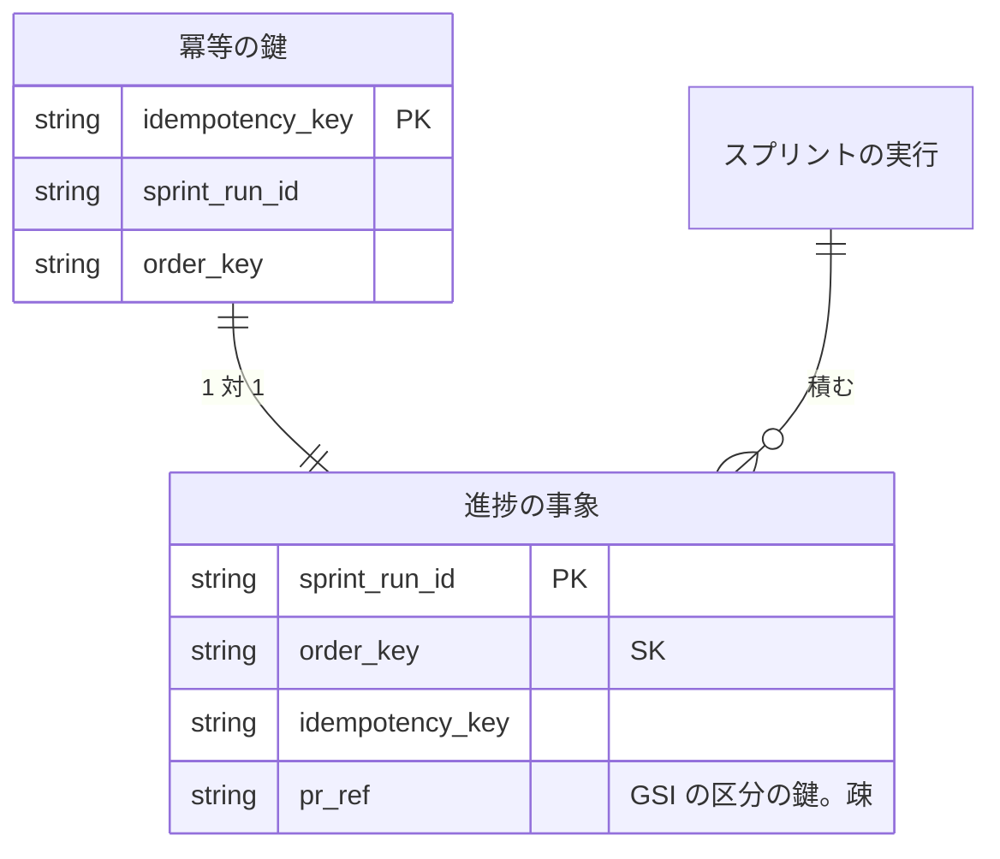

# Neural Development Factory: 進捗の記録の表と設定

[契約の定義と型・進捗の受け口・実行ジョブの token](ndf-factory-contracts-and-progress.md)（以下「本体」）から、事象の表・冪等の鍵の表・環境変数・契約のパッケージを分けた文書である。語の定義・常に成り立つ条件・テスト観点は本体にある。

## 事象の表

DynamoDB の表（`PROGRESS_EVENTS_TABLE_NAME`）。**時系列の扱いは「事象の記録」である。** 状態を持たず、起きたことを追記だけで積み、一覧と詳細は #2172 が導く。列は全体の契約の「進捗の正本」の列と同じである。

| 列 | 型 | 空を許すか | 意味 |
| --- | --- | --- | --- |
| `sprint_run_id` | 文字列 | 許さない | 区分の鍵 |
| `order_key` | 文字列 | 許さない | 並びの鍵。`<at をミリ秒の 3 桁にそろえた UTC（toISOString）>#<冪等の鍵>`。小数の桁が違う時刻を文字列のまま並べると `…:00.5Z` が `…:00Z` より前に来るため、そろえてから結ぶ |
| `idempotency_key` | 文字列 | 許さない | 出所ごとの形（全体の契約の「進捗の正本」） |
| `type` | 文字列 | 許さない | 13 種類のどれか |
| `at` | 文字列 | 許さない | 送られた値のまま（UTC、末尾 `Z`） |
| `source` | 文字列 | 許さない | `runner` / `github` / `api` / `control` |
| `job_id` | 文字列 | 許す | 空（`null`）は「実行ジョブの外で起きた」（`github`・`api`） |
| `schema_version` | 数 | 許さない | 今は `1` だけ |
| `payload` | Map | 許さない | 種類ごとの中身 |
| `pr_ref` | 文字列 | 許す | 列が無いのは「Pull Request を指さない事象」。`step.recorded` の `payload.pull_request` があるときだけ `<owner/name を小文字にしたもの>#<番号>` を置く |

GSI `pr_ref-index`（区分の鍵 `pr_ref`。受け口が読むのは `sprint_run_id` だけ）。`pr_ref` の無い項目は GSI に入らない。

## 冪等の鍵の表

DynamoDB の表（`PROGRESS_IDEMPOTENCY_TABLE_NAME`）。区分の鍵 `idempotency_key` だけ。`sprint_run_id`・`order_key` は、重複したときにどこに 1 件目があるかを調べるための写しで、照合には使わない。TTL を置かない（I10 は期限なく成り立つ）。

**1 件の追記は `TransactWrite` 1 回に 2 つの `Put` である。** 1 つ目が冪等の鍵の表への `attribute_not_exists(idempotency_key)` つき、2 つ目が事象の表への `attribute_not_exists(order_key)` つきで、どの経路でも既存の項目を上書きしない。取り消しの理由の 1 つ目が `ConditionalCheckFailed` なら重複として `{ written: false }`（受け口は 202）を返し、ほかの理由（`TransactionConflict` など）とほかの失敗は投げる（受け口は 503）。同時の 2 本はどちらかが取り消され、送り直しで重複になる。

| 機能 | 事象の表 | 冪等の鍵の表 | GSI | 承認の依頼（#2173） |
| --- | --- | --- | --- | --- |
| ランナーの事象 | C | C | — | — |
| `gate.answered` | C | C | — | R |
| GitHub の Webhook | C | C | R | — |
| 直の追記（`appendControlEvent`・`appendIssueRequestResolved`） | C | C | — | — |

## 環境変数

`factory/.env.example` に名前だけを置く（値は private リポジトリのインフラが渡す。全体の契約の I6）。本書は次の 5 つを足した。

| 名前 | 使う側 | 意味 |
| --- | --- | --- |
| `PROGRESS_EVENTS_TABLE_NAME` | 受け口・`appendControlEvent` | 事象の表の名前（GSI `pr_ref-index` を持つ） |
| `PROGRESS_IDEMPOTENCY_TABLE_NAME` | 受け口・`appendControlEvent` | 冪等の鍵の表の名前 |
| `RUN_JOB_TOKEN_VERIFY_KEYS_SECRET_ARN` | 受け口・`verifyRunJobToken` | token の公開鍵の集合の置き場 |
| `GITHUB_APP_WEBHOOK_SECRET_ARN` | 受け口 | GitHub App の Webhook の秘密の置き場 |
| `INGEST_API_CALLER_ROLE_ARN` | 受け口 | `api` の出所として認める #2173 のサービスのロールの ARN |

handler は要る変数が無ければ最初の要求の処理で失敗し、503 を返す。Webhook の秘密は 1 回だけ読み、読めなければ次の要求で読み直す。

## 契約のパッケージ

定義は `factory/contracts/schemas/` の `progress-event.schema.json`・`run-job-instruction.schema.json`・`ingest-response.schema.json`（`$id` は GitHub 上のパス）、生成した型は `src/generated/` の同名の `.ts`（コミットし、手で直さない。作り直しは `npm run generate -w contracts`）である。根の `npm run check` が `npm run lint:contracts`（Spectral。`contracts/openapi/*.yaml` の参照切れと OpenAPI の規則）と `npm run check -w contracts`（型検査と、生成し直した型とコミットした型の比較・定義の正しさのテスト）を走らせる。パッケージの管理の規則の正は [factory/README.md の「パッケージの管理」](../../factory/README.md#パッケージの管理) にある。
