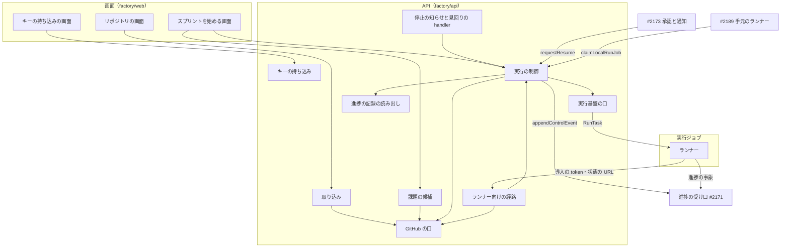
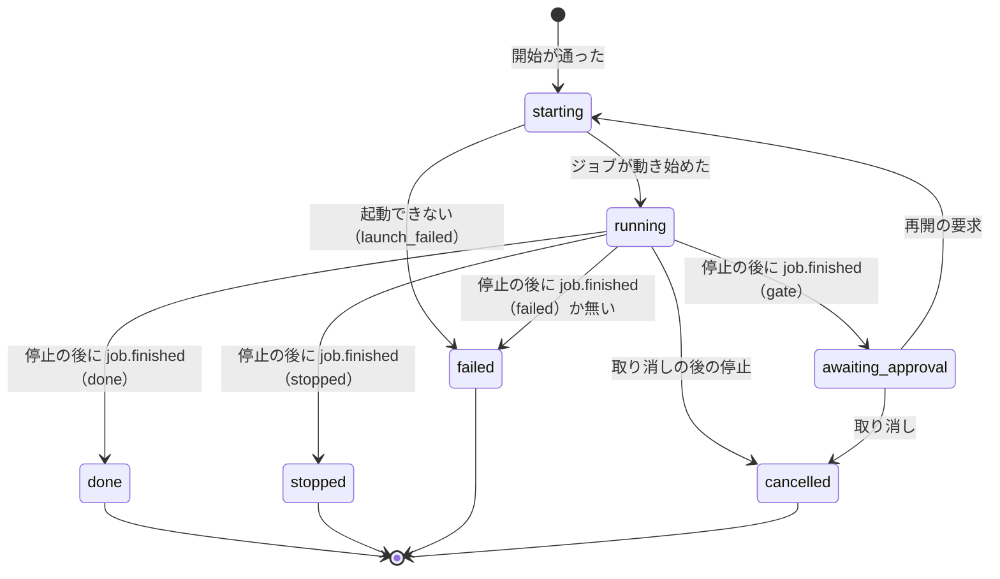
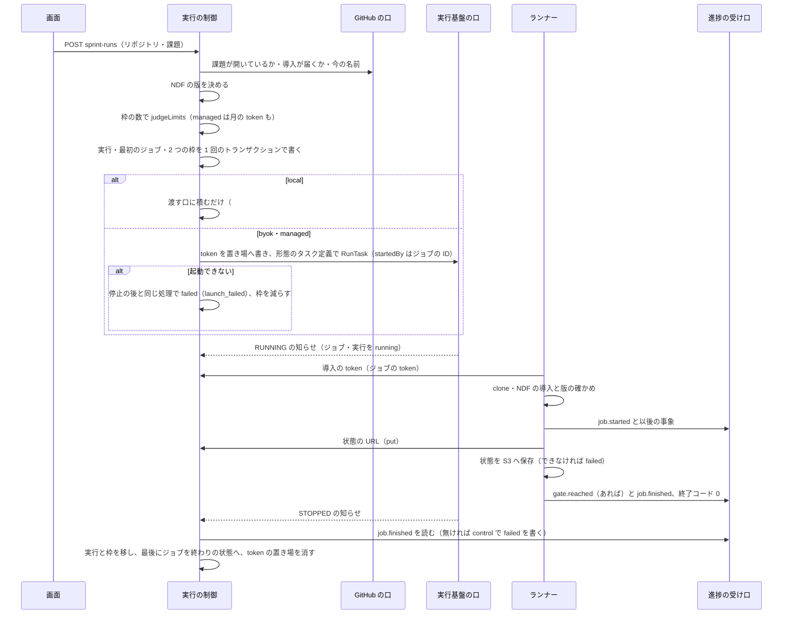
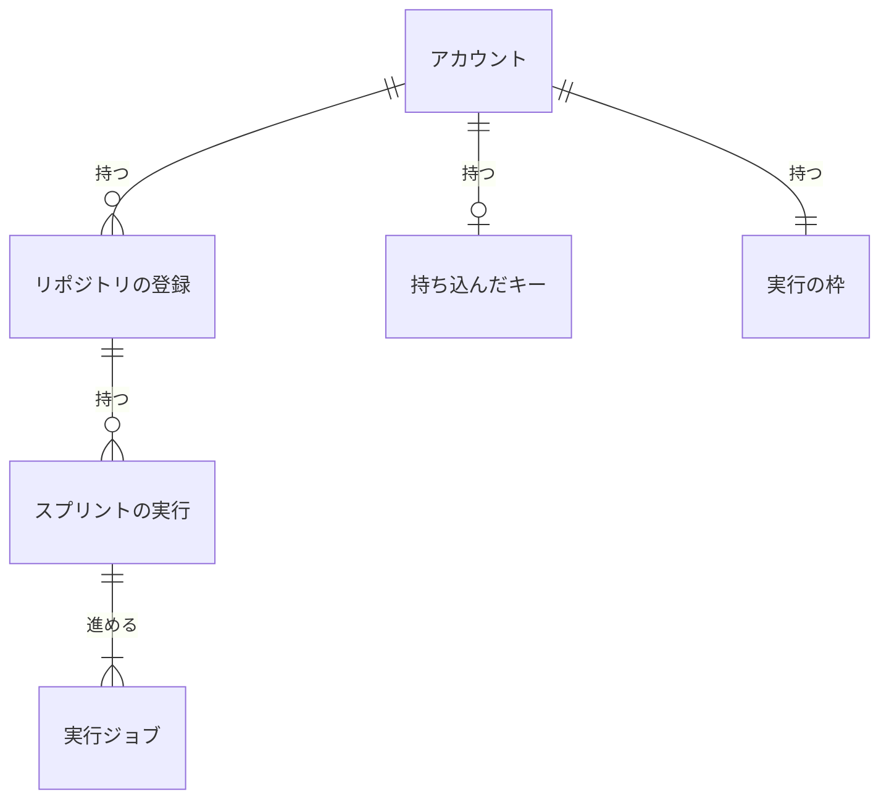

# Neural Development Factory: リポジトリの登録・スプリントの実行の制御・ランナー

Neural Development Factory の利用者が自分の GitHub のリポジトリを登録し、AI が選んだ課題で NDF のスプリントを Web から始め、上限までの本数を並列に流すための仕組みを定める。中身は、GitHub App の導入と**リポジトリの登録**、形態 `byok` の**キーの持ち込み**、**課題の候補**、スプリントの実行と実行ジョブの状態を持つ**実行の制御**（開始の判定・実行の枠・起動・停止の知らせ・見回り・取り消し・再開の要求・渡す口）、実行ジョブの中身の**ランナー**である。サービス全体の構成・集約の持ち主・実行ジョブの指示・進捗の事象の種類は [サービスのディレクトリと境界の検査、サービス全体の契約](ndf-factory-service-boundary.md)（以下「全体の契約」）に、受け口と実行ジョブの token の形は [契約の定義と型・進捗の受け口・実行ジョブの token](ndf-factory-contracts-and-progress.md)（以下「受け口の仕様」）にあり、本書はそこで「#2186 が持つ」とされた部分の確定形である。

## 概要

- **登録は、GitHub App の利用者の認可で確かめた候補からだけできる。** 認可の戻りで、利用者が届く導入とその対象のリポジトリを引き、10 分だけ有効な**候補の証明**に署名して画面へ返す。登録はその証明と、登録の直前のリポジトリ 1 つに絞った導入の token の作成で確かめる。GitHub の身元の結び付けは保存しないため、Google でログインした利用者も同じ流れで登録できる
- **開始は 1 回のトランザクションで、実行と最初の実行ジョブと実行の枠を書く。** 枠の数を `judgeLimits` に渡して許されたときだけ、枠の数が読んだ値と等しいことを条件に書く。同時の 2 本の開始は片方が条件で落ち、読み直す
- **実行ジョブは ECS Fargate のタスク 1 つで、状態の移りはタスクの停止の後だけで行う。** 停止の知らせ（EventBridge）か 5 分ごとの見回りで、進捗の記録の `job.finished` を読み、無ければ `appendControlEvent` で `failed` を書いてから移す。打ち切りの時間は 8 時間、実行ジョブの token の期限は 9 時間
- **ランナーは NDF の書くファイルを 2 秒ごとに読んで進捗の事象へ翻訳し、受け口へ送る。** NDF はイメージに焼き込まず、開始で固定した版をマーケットプレイスから入れる。承認の依頼で止まったら NDF の状態を S3 へ保存して終わり、答えで起きた `resume` の実行ジョブが別のコンテナでそこから続ける
- **ランナーは長く使える秘密を受け取らない。** GitHub App の秘密鍵の代わりに 1 時間の導入の token をランナー向けの経路で 50 分ごとに取り直し、S3 の権限の代わりにその実行の鍵だけの 15 分の署名つき URL を受け取る

## 用語

定義は [用語集](../glossary.md) が正である（文脈 `ndf-factory`）。この文書で使う語は「リポジトリの登録」「GitHub App の導入」「候補の証明」「キーの持ち込み」「課題の候補」「スプリントの実行」「実行ジョブ」「実行の制御」「実行の枠」「打ち切りの時間」「見回り」「再開の要求」「代わりの判断」「ランナー」「実行ジョブの token」「実行の形態」「承認の依頼」「使える量」である。

## コンテキスト

| コンテキスト | 何の語が 1 つの意味に決まるか |
| --- | --- |
| Neural Development Factory（`ndf-factory`） | リポジトリの登録・キーの持ち込み・課題の候補・スプリントの実行・実行ジョブ・実行の枠・打ち切りの時間・見回り・再開の要求 |
| NDF の開発ワークフロー（`ndf-workflow`） | スプリント・承認ゲート・conductor・`progress.jsonl`・スプリント状態ファイル・作業の報告・`ask.jsonl` |

`ndf-workflow` が上流、`ndf-factory` が下流の**腐敗防止層**で（全体の契約のまま）、翻訳はランナーの `factory/runner/src/translate.ts` だけが持つ。GitHub と AWS は外部の系で、GitHub の口（`factory/api/src/github/`）と実行基盤の口（`factory/api/src/runs/platform.ts`）が、それぞれの語を取り込みと実行の制御の語へ変える。

## 背景

依頼（#2186、親 #2168）は「利用者が自分の GitHub のリポジトリを登録し、そのリポジトリで NDF のスプリントを始められる」「1 つのアカウントで複数のスプリントを同時に流せる」と、#2206 の利用者の指示「承認ゲート以外のユーザー問い合わせは原則hookで止めてAIが判断するように強制する」である。全体の契約が「#2186 が決める」とした値（打ち切りの時間・token の期限・使える CLI・`gate.reached` の切り詰め）と、#2216（他のリポジトリの Pull Request の申告）・#2206（代わりの判断の事象）の 2 点もここで決めた。

- **打ち切りの時間は実測から 8 時間にする。** 過去 7 本のスプリントで、承認から次の承認までの区間（実行ジョブ 1 本に当たる）の最大は 18,031 秒（課題 4 件）、ほかは 5,385〜8,637 秒だった。課題の多いスプリントの伸びを見込んで 1.5 倍を時間へ切り上げた。打ち切りを置かないと、止まった conductor のコンテナが費用を払い続ける
- **token の期限は打ち切りの時間に 1 時間を足す。** 足す 1 時間は Fargate の起動（`pending` の間）と、止めた後にランナーが送る時間に当てる別の時間で、打ち切りを延ばさない
- **実行の枠を数の行で持ち、実行と同じトランザクションで増減する。** GSI で数えてから書くと、同時の 2 本が同じ数を読んでどちらも通る。枠をアカウントの集約（#2170）の行に置くと、開始が 2 つの持ち主の表をまたぐ
- **状態の移りはタスクの停止の後だけにする。** ランナーの `job.finished` を受けた時点ではコンテナはまだ動いている。停止を待てば移りの経路が 1 つになり、承認待ちの実行に動くジョブが残らない（全体の契約の I8）。受け口の追記を引き金にすると、受け口（#2171）が実行の制御を呼ぶことになる
- **他のリポジトリの Pull Request の申告は、token に `repo` を載せて受け口で照らす（#2216）。** 受け口は token を確かめた時点で実行のリポジトリを知れ、実行の表を読まずに済む。リポジトリは実行の中で変わらないため、主張は古くならない。照合そのものは [受け口の仕様](ndf-factory-contracts-and-progress.md) の I37 にある
- **代わりの判断は新しい種類 `decision.delegated` で送る（#2206）。** `attention` に載せると承認と通知（#2173）が知らせとして扱い、人の手を止める。`gate.reached` の「判断」に混ぜると承認の依頼を作って実行ジョブを終わらせる
- **NDF の版は、正式版をタグ、開発版をコミットで固定する。** 開発版の `develop` は版数を上げずに進むため、版数だけでは同じ中身を入れ直せない。版は実行の制御が開始の時点で決める。指示の `NDF_VERSION` は必須で、最初のジョブにも値が要るためである
- **導入の token はランナー向けの経路で渡し直す。** 導入の token は GitHub の仕様で 1 時間で切れ、実行ジョブは最大 8 時間動く。秘密鍵を渡せばランナーが任意の導入の token を作れる
- **状態の置き場は署名つき URL でだけ渡す。** ランナーは取り込んだリポジトリのコードを動かすため、タスクの役割に S3 の権限を持たせると別の実行の鍵を推して読める。経路は指示に項目を足さずに決めるため `INGEST_URL` と同じ origin に置く
- **タスク定義は形態ごとに 2 つにする。** 同じ定義で `byok` を動かすと、取り込んだリポジトリのコードがサービスの Bedrock を呼べる
- **外部 ID はサービスがアカウントごとに作る。** 利用者が入れる形では、他人のロールの ARN と外部 ID を知る者がそのロールを引き受けさせられる（AWS の confused deputy の文書）
- **課題の候補は API の中でサービスの Bedrock を呼んで作り、使える量に数えない。** 実行ジョブにすると指示の `START` に新しい値が要り契約が変わる。`local` のアカウントはサービスに Claude の資格を預けないため、利用者のキーでは理由を作れない
- **持ち込んだキーは復元の期間を置かずに消す。** 期間を置くと、消したと思った値が Secrets Manager に残る

## 対象範囲

- **含む**: `factory/api/src/` の取り込み（`repositories/`）・キーの持ち込み（`credentials/`）・GitHub の口（`github/`）・実行の制御（`runs/`）・進捗の記録の読み出し（`progress/read.ts`）・画面向けの経路（`routes/factory.ts`）・ランナー向けの経路と停止の知らせと見回りの handler（`handlers/run-jobs.ts`・`handlers/run-control.ts`）・`index.ts` への export、`factory/runner/`（ランナーとイメージ）、`factory/web/src/pages/` の 3 画面（リポジトリ・キーの持ち込み・スプリントを始める）、`factory/contracts/openapi/runs.yaml`、`factory/.env.example` の 14 の変数の名前
- **含まない**: 承認の依頼の保存と答えを返す経路の実装（#2173。経路の形だけを `runs.yaml` に置く）、手元のランナー（形態 ①）の登録・心拍・受け取りの経路（#2189。本書は渡す口の関数だけを持つ）、一覧と詳細の画面（#2172）、料金と台帳（#2174）、承認ゲートの外の問い合わせを止める hook と `ask.jsonl` の書き手（#2206）、ECS・S3・Secrets Manager・DynamoDB・EventBridge・GitHub App の作成などインフラの定義（private リポジトリ）
- **取り込むリポジトリの起点・テスト・配布・進め方の入力欄は持たない。** ランナーの中の NDF がそのリポジトリの `.ndf/` から読む（全体の契約の決定 8）
- **止まった・失敗したスプリントの実行を同じ実行のまま続け直さない。** 新しいスプリントの実行として始める
- プラグインの配布物・Skill・hook は変わらない。`plugins/` は `factory/` を参照しない（全体の契約の I1）

## 仕様

### 集約

| 集約 | 持ち主（書き換えてよいもの） | 根 | エンティティ | 値オブジェクト |
| --- | --- | --- | --- | --- |
| リポジトリの登録 | 取り込み（`factory/api/src/repositories/`） | 登録 | — | GitHub のリポジトリ（数の ID・`owner/name`）・導入の識別子 |
| 持ち込んだキー | キーの持ち込み（`factory/api/src/credentials/`） | アカウントのキー | — | 種類（`anthropic_api_key` / `aws_role`）・置き場の ARN・外部 ID |
| スプリントの実行 | 実行の制御（`factory/api/src/runs/`） | スプリントの実行 | 実行ジョブ | 状態・課題の並び・NDF の版・実行の形態の写し・ジョブの結果・失敗の理由 |
| 実行の枠 | 実行の制御（`factory/api/src/runs/`） | アカウントの枠 | — | 終わりの状態でない数（アカウント全体・リポジトリごと） |

- **ほかの集約は識別子で参照する。** スプリントの実行は登録を `repositoryId` で、アカウントを `accountId` で指す。進捗の記録（#2171）は `ProgressReader` で読むだけで、書くのは `appendControlEvent` の `job.finished`（`control`）だけである
- **1 つの処理が書き換える集約は 1 つで、例外はスプリントの実行と実行の枠の 2 つだけである**（全体の契約の「集約」）。開始と終わりの状態への移りを 1 つのトランザクションで書く。登録を外す処理はリポジトリの枠の行を条件として確かめるだけで書かない
- **課題の候補は保存しない。** 画面へ返して捨てる値である

### 構成要素

| 要素 | 場所 | 責務 |
| --- | --- | --- |
| GitHub の口 | `factory/api/src/github/port.ts`（型）・`app.ts`（`GitHubApp`） | App の JWT（RS256。秘密鍵は `GITHUB_APP_PRIVATE_KEY_SECRET_ARN`）・リポジトリ 1 つに絞った導入の token の作成・利用者の認可の code の交換と届くリポジトリの一覧・課題の確かめ・新しい順の課題・棚卸しの順位の表の読み出し。API の中で読む導入の token は残り 10 分を切るまで使い回す。テストは偽物 |
| 取り込み | `factory/api/src/repositories/service.ts`（`RepositoryService`）・`proof.ts` | 導入の URL・認可の URL と `state`・候補と候補の証明・登録・外し・一覧（I32・I33・I36） |
| キーの持ち込み | `factory/api/src/credentials/service.ts`（`CredentialService`） | 保存・差し替え・消去・外部 ID（`externalIdOf`）。値は Secrets Manager にだけ書く（I38） |
| 課題の候補 | `factory/api/src/runs/candidates.ts`（`chooseCandidates`・`bedrockCandidateModel`） | 棚卸しの順位の表か新しい順の課題を読み、Bedrock の Converse で採否と理由を作る |
| 実行の制御 | `factory/api/src/runs/control.ts`（`RunControl`） | 開始の判定・枠・token の発行・起動・停止の知らせ・見回り・取り消し・再開の要求・渡す口（I8・I9・I34・I35・I39〜I41） |
| 実行の表 | `factory/api/src/runs/table.ts`（`RunsTable`）・`dynamo-table.ts`・`memory-table.ts` | 条件つきの書き込みを操作の単位で持つ。`memory-table.ts` はテスト用の偽物 |
| 実行基盤の口 | `factory/api/src/runs/platform.ts`（`RunnerPlatform`）・`ecs.ts`（`EcsRunnerPlatform`） | `RunTask`・`StopTask`・`DescribeTasks`、token の置き場の作成と削除、状態の置き場の署名つき URL。テストは偽物 |
| 依存の組み立て | `factory/api/src/runs/deps.ts`（`factoryDepsFromEnv`・`ndfVersionFromMarketplace`） | 環境変数から依存を 1 回だけ作り、秘密を ARN から読む |
| 進捗の記録の読み出し | `factory/api/src/progress/read.ts`（`ProgressReader`） | `job.finished` を冪等の鍵で読む・月の `usage.recorded` の token を足す。読むだけで、保存の型に書き換えを足さない |
| 画面向けの経路 | `factory/api/src/routes/factory.ts`（`registerFactory`） | 既存の API の handler（`handlers/api.ts`）に足す。どの経路も `resolveFromRequest` でアカウントを解決する |
| ランナー向けの経路 | `factory/api/src/runs/runner-api.ts`（`createRunnerApiApp`）・`handlers/run-jobs.ts` | 実行ジョブの token で認証し、導入の token の渡し直しと状態の置き場の署名つき URL を返す |
| 停止の知らせと見回りの handler | `factory/api/src/handlers/run-control.ts`（`handleRunControlEvent`） | HTTP を持たない。EventBridge の「ECS Task State Change」と 5 分ごとの起動を受ける |
| ランナー | `factory/runner/src/`（workspace `@ndf-factory/runner`） | `main.ts`（起動と手順・終了コード）・`runtime.ts`（git・gh・claude・NDF のスクリプトを動かす本物）・`translate.ts`（翻訳）・`send.ts`（送信）・`state.ts`（状態の保存と復元）・`model.ts`（形態ごとの claude の呼び方） |
| ランナーのイメージ | `factory/runner/Dockerfile` | `node:24-bookworm-slim` に git・gh・Python・uv・claude の CLI を足す。NDF と秘密を焼き込まない。`factory/` を文脈にして作る |
| 画面 | `factory/web/src/pages/RepositoriesPage.tsx`・`ModelCredentialPage.tsx`・`NewSprintPage.tsx` | 「画面」の節 |
| 契約 | `factory/contracts/openapi/runs.yaml` | 画面向けとランナー向けの経路の OpenAPI。`npm run lint:contracts` で検査する |

**配置**: 画面向けの経路は既存の API の handler に、ランナー向けの経路は Cognito を通らないため別の handler（`/run-jobs/*`、API Gateway の認可なし、`INGEST_URL` と同じ origin）に置く。停止の知らせと見回りは HTTP を持たない Lambda である。ランナーは ECS Fargate のタスクで、`managed` は `RUNNER_TASK_DEFINITION_ARN`、`byok` は `RUNNER_BYOK_TASK_DEFINITION_ARN` のタスク定義で動く。

### 他の子課題へ公開する関数

`factory/api/src/index.ts` から export する。

| 名前 | 使う側 | 入力 | 出力 | 失敗 |
| --- | --- | --- | --- | --- |
| `requestResume({sprintRunId, approvalRequestId})` | #2173（答えを保存した後） | 実行と依頼の識別子 | `Promise<{jobId}>`。`START=resume` のジョブを作り起動する | `ResumeRejectedError`（`code` が `not_found` / `not_awaiting_approval` / `sprint_run_busy`）。`sprint_run_busy` は前のジョブの停止を待っている間か、別の再開が先に通ったときで、呼ぶ側は時間をおいて呼び直す |
| `claimLocalRunJob(accountId)` | #2189（手元のランナーの受け取り） | アカウント | `Promise<{instruction: RunJobInstruction, token} \| null>`。そのアカウントの最も古い `pending` の `local` のジョブ（取り消しの要求の無い実行のもの）を `running` にし、指示と token を 1 回だけ返す | 保存の失敗は投げる |
| `reportLocalRunJobEnded(jobId)` | #2189（終わりか心拍の切れ） | ジョブ | `Promise<void>`。停止の知らせと同じ処理 | 知らないジョブ・`local` でないジョブ・終わったジョブは何もしない |
| `cancelSprintRun(ctx, sprintRunId)` | 画面の経路と同じ処理 | アカウントの文脈と実行 | `Promise<{state: "cancelled" \| "running"}>` | `NotFoundError`（`sprint_run_not_found`。別のアカウントの実行を含む）・`ConflictError`（`already_finished`） |
| `getSprintRun(sprintRunId)`・`getRegistration(accountId, repositoryId)` | 実行と登録を読む側 | 識別子 | 行か `null` | — |

あわせて `RunControl`・`ResumeRejectedError`・`repoKey`（`owner/name` を小文字にした比較の鍵）と、`ResumeRejectedCode`・`RunControlConfig`・`RunControlDeps`・`RunJob`・`SprintRun`・`RunState`・`JobState` の型を export する。

**`local` のジョブの token は置き場に書かず、`claimLocalRunJob` の応答で 1 回だけ返す。** 指示の形（`INGEST_TOKEN_SECRET_ARN` は必須）を保つため、その項目には `arn:aws:secretsmanager:local:000000000000:secret:ndf-factory/run-jobs/<job_id>` の形の、実在しない ARN を置く。手元のランナーは環境変数 `INGEST_TOKEN` で token を直に渡し、ランナーはそれがあれば置き場を読まない。

### 画面向けの経路

機械可読な正は [`factory/contracts/openapi/runs.yaml`](../../factory/contracts/openapi/runs.yaml) である。どの経路も Cognito の access token を要り、`resolveFromRequest` でアカウントを解決する。他人のアカウントは #2170 の I18 と同じ 403 である（[認証とアカウント・席・プランごとの使える量](ndf-factory-accounts-and-plans.md)）。エラーの本文は `{"error": {"code", "message", "details"?}}`。

| 経路 | 誰が | 入力 | 成功 | 失敗 |
| --- | --- | --- | --- | --- |
| `GET /accounts/{a}/github/install-url` | 席を持つ人 | — | 200 `{url}`（`https://github.com/apps/<GITHUB_APP_SLUG>/installations/new`） | 403 |
| `GET /accounts/{a}/github/authorize-url` | 持ち主 | — | 200 `{url}`（`https://github.com/login/oauth/authorize?client_id=<GITHUB_APP_CLIENT_ID>&state=<state>`） | 403 |
| `POST /accounts/{a}/github/candidates` | 持ち主 | `{code, state}`（認可の戻り） | 200 `{proof, candidates: [{repository_id, full_name, installation_id, registered}]}` | 400 `invalid_request`（`state` が合わない・`code` が無いか換えられない）・403 |
| `GET /accounts/{a}/repositories` | 席を持つ人 | — | 200 `{repositories: [{repository_id, full_name, installation_id, registered_at, active_sprint_runs}]}` | 403 |
| `POST /accounts/{a}/repositories` | 持ち主 | `{proof, repository_id}` | 201 登録の 1 行（`active_sprint_runs` を除く） | 400（証明の署名・期限・利用者・アカウントの違い）・403（証明に無い ID、登録の直前に導入の token を作れない。I33）・409 `repository_exists`（I32） |
| `DELETE /accounts/{a}/repositories/{repositoryId}` | 持ち主 | — | 204 | 400（ID の形）・403・404 `repository_not_found`・409 `repository_in_use`（I36） |
| `GET /accounts/{a}/model-credential` | 持ち主 | — | 200 `{registered, kind, updated_at, external_id}`。未登録なら `kind`・`updated_at` は `null`。`external_id` は常に返す（秘密でない） | 403 |
| `PUT /accounts/{a}/model-credential` | 持ち主 | `{kind: "anthropic_api_key", api_key}`（1〜512 字）か `{kind: "aws_role", role_arn, region}`（`^arn:aws[a-z-]*:iam::\d{12}:role/.+$` で 2,048 字まで、`^[a-z]{2}(-[a-z]+)+-\d$` で 32 字まで） | 200 上と同じ形（値も ARN も返さない） | 400・403・503 `credential_unavailable` |
| `DELETE /accounts/{a}/model-credential` | 持ち主 | — | 204（無くても 204） | 403・503 `credential_unavailable` |
| `POST /accounts/{a}/repositories/{r}/issue-candidates` | 席を持つ人 | `{exclude?: [番号]}`（選び直しで外す番号） | 200 `{source: "ranking" \| "recent", milestone, candidates: [{number, title, selected, reason}], note}` | 400（ID の形）・403・404 `repository_not_found` |
| `POST /accounts/{a}/sprint-runs` | 席を持つ人 | `{repository_id, issues}`（1〜20 件の重なりの無い番号） | 201 `{sprint_run_id, state: "starting"}` | 400・403・404・409・503（下の表） |
| `GET /accounts/{a}/sprint-runs?repository_id=` | 席を持つ人 | — | 200 `{sprint_runs: [{sprint_run_id, repository_id, issues, state, failure_reason, created_at}]}`（新しい順 50 件） | 400（ID の形）・403 |
| `POST /accounts/{a}/sprint-runs/{id}/cancel` | 席を持つ人 | — | 200 `{state}`（`cancelled` か、停止を待つ `running`） | 403・404 `sprint_run_not_found`・409 `already_finished` |

**持ち主だけの経路は、席を持つだけの利用者に他人のアカウントと同じ 403 `forbidden` を返す**（`requireOwner`）。チームのアカウントでは、リポジトリの登録と外し・認可・候補・キーの 3 つの操作は持ち主（`role` が `owner`）だけが、スプリントの開始・一覧・取り消しと課題の候補は席を持つ人が行う。

**開始の確かめの順は次のとおりで、使える量を最後に見る。** 上限の判定とトランザクションの間に外部の呼び出しを挟まないためである。

| 順 | 確かめ | 失敗 |
| --- | --- | --- |
| 1 | `repository_id` が 1 以上の整数、`issues` が 1〜20 件の重なりの無い 1 以上の整数 | 400 `invalid_request` / `invalid_issues`（`details.numbers` は空） |
| 2 | そのアカウントの登録がある | 404 `repository_not_found` |
| 3 | 課題が開いていて、Pull Request でない | 400 `invalid_issues`（`details.numbers` に当たらない番号） |
| 4 | 形態 `byok` ならキーが保存されている | 409 `model_credential_missing` |
| 5 | 導入がそのリポジトリへ届き、今の名前を引ける（違えば登録の `fullName` を書き換える） | 409 `installation_unreachable` |
| 6 | NDF の版を決める（「NDF の版」） | 503 |
| 7 | 枠の数を `judgeLimits` に渡す。形態 `managed` では月の token も渡す | 409 `limits_exceeded`（`details.reasons` は `judgeLimits` の `reasons`） |
| 8 | 実行・最初のジョブ・2 つの枠を 1 回のトランザクションで書く。枠が読んだ値と違えば 7 から読み直し、3 回で通らなければ | 503 `sprint_run_unavailable` |

**月の token は開始 1 回につき 1 度だけ数える。** その UTC の暦月に、アカウントの `managed` の実行（終わりの状態で月の初めより前に更新したものを除く）の `usage.recorded` の入力と出力の token を足す。チームでは上限が席ごとのため、開始した利用者が作った実行だけを数える。`local`・`byok` の実行の分は数えない。

### ランナー向けの経路

`handlers/run-jobs.ts` の `handler`。`Authorization: Bearer <実行ジョブの token>` を `verifyRunJobToken` で確かめ、無い・無効なら 401。token のジョブが無い・別の実行のもの・終わりの状態なら 403。401・403 の本文は受け口と同じである（受け口の仕様の I30）。ほかの想定外の失敗は 503。

| 経路 | 入力 | 成功 | 失敗 |
| --- | --- | --- | --- |
| `POST /run-jobs/github-token` | — | 200 `{token, expires_at}`。その実行のリポジトリ 1 つに絞り、権限を「GitHub App の権限」の 6 つに絞った導入の token | 401・403・409 `installation_unreachable`（登録が無い・導入が届かない）・503 |
| `POST /run-jobs/state` | `{op: "put" \| "get"}` | 200 `{url, expires_at}`。鍵 `sprint-runs/<sprint_run_id>/ndf-state.tar.gz` だけの 15 分の署名つき URL | 400 `invalid_request`（`op` の違い）・401・403・404 `state_not_found`（`get` で保存が無い）・503 |
| `GET /run-jobs/approval-requests/{approvalRequestId}/answer` | — | 200 `{kind, decision?, body?, gate?}`（`ApprovalAnswer`） | 401・403（その実行の依頼でない）・404・409（答えがまだ無い） |

**承認の依頼の答えの経路は、形だけを `runs.yaml` に置き、実装は #2173 が持つ。** `run-jobs.ts` の handler はこの経路を持たない。答えの形は次のとおりで、ランナーはこれを「resume の手順」のとおり NDF へ書く。

| 鍵 | 型 | 意味 |
| --- | --- | --- |
| `kind` | `gate1` / `gate2` / `decision`・必須 | 依頼の種類 |
| `decision` | `approved` / `rejected` | ゲートの答え。判断では持たない |
| `body` | 文字列か `null` | 承認の理由か判断の本文 |
| `gate` | 文字列 | スプリント状態ファイルに書く関門の名前。無ければ `kind` を `関門 1` / `関門 2` へ写す |

### 実行の制御の値

全体の契約の「実行の制御」の表にある値の、出所と効き方を定める。

| 項目 | 値 | 効き方 |
| --- | --- | --- |
| 打ち切りの時間 | 28,800 秒（`RUN_JOB_TIMEOUT_SECONDS`） | 見回りが、`running` のジョブの `startedAt` からの経過と比べる |
| 実行ジョブの token の期限 | 32,400 秒（`RUN_JOB_TOKEN_TTL_SECONDS`） | 発行の時刻に足して `exp` にする。打ち切りの時間以下の値と、正の整数でない値は `runControlConfig` が投げる（I41） |
| `pending` の上限 | 900 秒（`PENDING_LIMIT_SECONDS`） | ECS のジョブが `createdAt` からこれを過ぎて `pending` なら `failed`（`launch_failed`）。`local` のジョブには掛けない |
| 見回りの間隔 | 5 分 | EventBridge の定期の起動（インフラが設定する） |
| 課題の数 | 1〜20 件（`MAX_ISSUES`） | 開始の入力と画面の上限 |
| 枠の取り直し | 3 回 | 開始のトランザクションが枠の条件で落ちたとき |
| 発行の鍵 | `RUN_JOB_TOKEN_SIGNING_KEY_SECRET_ARN` の JSON `{"kid": …, "jwk": <Ed25519 の秘密鍵の JWK>}` | 1 回だけ読み、読めなければ次の呼び出しで読み直す |

**識別子**: `sprint_run_id` と `job_id` は `crypto.randomUUID()` からハイフンを除いた 32 字である。

**実行ジョブの指示の値の出所**（形は受け口の仕様の「実行ジョブの指示の定義」のまま）:

| 入力 | 値 |
| --- | --- |
| `SPRINT_RUN_ID`・`JOB_ID` | 実行とジョブの識別子 |
| `REPO` | 実行の `repo`（開始の時点に GitHub から引いた `owner/name`） |
| `NDF_VERSION` | 実行の `ndfVersion`（開始で決めた値。I39） |
| `START`・`APPROVAL_REQUEST_ID` | ジョブの `start` と、`resume` の依頼の識別子 |
| `ISSUES` | 実行の `issues` をカンマで結ぶ（`new` だけ） |
| `INGEST_URL` | API の設定の `INGEST_URL` |
| `INGEST_TOKEN_SECRET_ARN` | ジョブごとに作る `ndf-factory/run-jobs/<job_id>` の秘密の ARN。ジョブが終わりの状態へ移った後に、復元の期間を置かずに消す |
| `EXECUTION_MODE`・`MODEL_CREDENTIAL_SECRET_ARN` | 実行の写し。`byok` だけ、開始の時点のキーの `secretArn` |

### NDF の版

`ndfVersionFromMarketplace` が、開始のたびに `https://raw.githubusercontent.com/<NDF_MARKETPLACE>/<NDF_CHANNEL>/plugins/ndf/.claude-plugin/plugin.json` の `version` を読む。`NDF_MARKETPLACE` は `owner/name`（既定 `devbasex/ai-plugins`）、`NDF_CHANNEL` は既定 `main` である。

| チャネル | 値 | ランナーが入れるもの |
| --- | --- | --- |
| `main`（正式版） | `<version>`（例 `10.27.1`） | タグ `ndf--v<version>` |
| ほか（開発版） | `<version>@<コミットの SHA>`（SHA は `GET /repos/<NDF_MARKETPLACE>/commits/<NDF_CHANNEL>`） | そのコミット |

### 状態と移り

スプリントの実行の状態は `starting` / `running` / `awaiting_approval` / `done` / `stopped` / `failed` / `cancelled` で、後ろの 4 つが終わりの状態である。実行ジョブの状態は `pending` / `running` / `gate` / `stopped` / `done` / `failed` で、後ろの 4 つが終わりの状態である（ジョブの図は全体の契約の「スプリントの実行の流れ」）。

`RUNNING` の知らせを取りこぼしたときは `starting` から終わりの状態や `awaiting_approval` へ直に移る。`running` への移りは `starting` のときだけ書く。

**失敗の理由**（実行の `failureReason`）:

| 値 | いつ |
| --- | --- |
| `launch_failed` | token の置き場の作成か `RunTask` が失敗した。`pending` のまま 15 分を過ぎた |
| `timeout` | 見回りが打ち切りの時間で止めた |
| `task_stopped` | ランナーの `job.finished` が無いままタスクが止まった（手元のランナーの終わりの知らせを含む） |
| `job_failed` | ランナーが `job.finished`（`failed`）を送った |

### 処理の流れ

- **停止の後の処理**（`finalize`）: `job.finished` を進捗の記録から鍵 `<job_id>:finished` で読み、無ければ `appendControlEvent` で `failed` を書く（同じ鍵が先にあれば書かれず、読み直す）。そのジョブが実行の今のジョブなら、取り消しの要求があれば `cancelled`、結果が `gate` なら `awaiting_approval`（今のジョブを空にする）、ほかは結果の状態へ移す。終わりの状態への移りは実行の行が終わりの状態でないことを条件にし、同じトランザクションで 2 つの枠を 1 ずつ減らす。**ジョブを終わりの状態にするのは最後で**、途中で止まってもジョブは見回りの対象に残り、次の見回りか知らせの再送が同じ結果でやり直す。同じ知らせの 2 回目は、ジョブが終わりの状態なので何もしない
- **見回り**（`sweep`）: 終わりの状態でないジョブ（GSI の `ACTIVE_JOBS`）を最後のページまで引き、ECS のジョブは ① `pending` のまま 15 分を過ぎたら `StopTask` して `launch_failed` で停止の後の処理、② タスクが `STOPPED` か見つからなければ停止の後の処理、③ `running` で打ち切りの時間を過ぎ、まだ止めていなければ `stopReason` に `timeout` を書いて `StopTask`、④ タスクが `RUNNING` でジョブが `pending` なら `running` にする。`STOPPING`・`DEPROVISIONING` などの止まる途中は確定しない。`local` のジョブは `running` で打ち切りの時間を過ぎたら直に `timeout` で停止の後の処理をする
- **再開の要求**（`requestResume`）: 実行が `awaiting_approval` で今のジョブが空のときだけ、実行を `starting`・今のジョブを新しいジョブにする書き込みと、`resume` のジョブの作成を 1 回のトランザクションで行い、起動する。実行が承認待ちでなくても、今のジョブの `job.finished` が `gate` なら（停止の知らせの前）`sprint_run_busy` を返す。再開は使える量の判定にかけず、枠を変えない
- **取り消し**（`cancelSprintRun`）: 今のジョブが無ければその場で `cancelled` にして枠を減らす。あれば取り消しの要求を立て、ECS のタスクがあれば `StopTask` して `running` を返し、停止の後の処理で `cancelled` へ移す。`local` のジョブかタスクがまだ無いジョブは、その場で停止の後の処理をして `cancelled` を返す
- **ランナーは止められると何も送らずに 1 で終わる**（`SIGTERM`）。打ち切りと取り消しの `job.finished` は実行の制御が `failed` で書く

### ランナーの手順

`main.ts` の `runJob`。指示は環境変数から読み、`validateRunJobInstruction` に合わなければ 1 で終わる。token は `INGEST_TOKEN` があればそれを、無ければ `INGEST_TOKEN_SECRET_ARN` の秘密を読む。

| 手順 | 中身 |
| --- | --- |
| 1. 導入の token | `POST /run-jobs/github-token` で取り、ジョブ専用の `GH_CONFIG_DIR`（`<作業場所>/.ndf-job/gh/hosts.yml`）へ書く。git はジョブ専用の `GIT_CONFIG_GLOBAL`（利用者の git の設定を include する）に `gh auth setup-git` で gh の資格の口を使う。以後 50 分ごとに取り直して書き換える（環境変数に置かない） |
| 2. 取り込み | `https://github.com/<REPO>.git` を `<作業場所>/repo` へ clone する。作業場所は `RUNNER_WORK_DIR`（イメージは `/home/node/work`） |
| 3. NDF の導入 | `NDF_MARKETPLACE` を `NDF_VERSION` の ref（タグかコミット）で `<作業場所>/ndf-marketplace` へ clone し、`claude plugin marketplace add <そのディレクトリ>` と `claude plugin install ndf@<取得元の marketplace.json の name>` を打つ。入った `plugin.json` の版が `NDF_VERSION` と違えば失敗。NDF のスクリプトはこの写しから読む |
| 4. `job.started` | `ndf_version` は `NDF_VERSION`、`start` は `START` |
| 5. 状態の復元（`resume`） | `POST /run-jobs/state`（`get`）の URL から取り、`.ndf/tmp`・`.ndf/loop` の下の追跡しないパスだけを戻す（I42） |
| 6. 答えの記録（`resume`） | 答えの経路から読む。判断は `body` を conductor への利用者の判断として渡す。ゲートは、復元した `.ndf/` の下のスプリント状態ファイル（`gates` と `plans` を持ち「ステージ」を持たない JSON のうち最後に更新したもの。目録の `sprint.json` とは別）へ `sprint-state.py gate <ファイル> <関門の名前> --by user --outcome <approved \| rejected> --what <body か既定の文>` を書く。差し戻しは状態ファイルを変えないため、差し戻しと理由を明示した指示を conductor へ渡す |
| 7. conductor | `claude -p <指示> --output-format stream-json --verbose --permission-mode acceptEdits --allowed-tools Read,Edit,Write,Bash,Grep,Glob,Skill,Agent,Monitor,SendMessage,ToolSearch`。指示は `new` で `/ndf:development-workflow #<番号> …`、`resume` で「前回の続きから進めてください。」に手順 6 の指示を足したもの。NDF の worktree は `NDF_WORKTREE_BASE`（`<作業場所>/worktrees`）に置く |
| 8. 終わり | `POST /run-jobs/state`（`put`）の URL へ状態を保存 → 結果が判断が要るなら `gate.reached` → `job.finished`。手順 1〜8 のどこかが失敗すれば `gate.reached` を送らず `job.finished`（`failed`） |

**ランナーの終了コードは 0（`job.finished` を受け口が受け取った）か 1 だけである**（I43）。`job.finished` が 4xx で断られたか、送り直しを使い切ったときも 1 である。

**形態ごとの claude の呼び方**（`model.ts` の `claudeEnv`）。どの形態でも、子の環境から `INGEST_TOKEN`・`INGEST_TOKEN_SECRET_ARN`・`MODEL_CREDENTIAL_SECRET_ARN` を外す。

| 形態 | 子の環境 |
| --- | --- |
| `managed` | `ANTHROPIC_API_KEY` と AWS のアクセスキーの 3 つを外し、`CLAUDE_CODE_USE_BEDROCK=1`、`AWS_REGION` は `BEDROCK_REGION`（無ければ `AWS_REGION`、それも無ければ `us-east-1`）。資格はタスクの役割の権限 |
| `byok`（API キー） | 同じく外し、置き場の `api_key` を `ANTHROPIC_API_KEY` にする |
| `byok`（ロール） | 同じく外し、置き場の `role_arn`・`region`・`external_id` で `AssumeRole`（外部 ID つき、1 時間）する。資格は `credential_process` の形のファイル（`~/.ndf-byok/`）に置き、`AWS_CONFIG_FILE`・`AWS_PROFILE=ndf-byok`・`AWS_SDK_LOAD_CONFIG=1`・`CLAUDE_CODE_USE_BEDROCK=1`・`AWS_REGION` で読ませる。タスクの役割の資格の口（`AWS_CONTAINER_CREDENTIALS_*`）を外す。conductor が動く間は 30 分ごとに引き受け直してファイルを書き換える |
| `local` | 利用者が手元で設定したモデルの資格をそのまま渡す |

### ランナーの翻訳

`runtime.ts` が 2 秒ごとに `<repo>/.ndf/` の下（5 階層まで）の `progress.jsonl` と `ask.jsonl` の伸びた分を読み、`translate.ts` で事象にする。`seq` はジョブの中で 1 から増やし、冪等の鍵は `<job_id>:<seq>`、`job.finished` だけ `<job_id>:finished` である。`resume` では復元したファイルの末尾から読み、前のジョブが送った行を新しい `job_id` で送り直さない。

| 事象 | NDF の何から | 規則 |
| --- | --- | --- |
| `phase.changed` | 行が伸びた `progress.jsonl` の親のディレクトリの名前（計画の名前。末尾の `-state` を除く）が前と変わった | 先頭の番号を除き、残りの番号を課題、番号でない部分を `-` で結んだものをフェーズにする（`5-impl-2171` → `impl`・`[2171]`） |
| `step.recorded` | `progress.jsonl` の `kind: step` の行 | `step`・`exit`（整数でなければ 0）・`seconds`（0 以上の数でなければ 0）・`summary`（JSON の文字列なら `summary` の値）。行の `pr`・`summary`・`report` にある Pull Request の URL のうち `REPO` のもの（大文字と小文字を問わない）だけを `pull_request` にする |
| `attention` | `progress.jsonl` の `kind: attention` の行 | `reason`（空なら `attention`）・`summary`（`text`、無ければ `summary`） |
| `usage.recorded` | conductor の stream-json の `result` の `modelUsage`（`step` は `conductor`）と、`progress.jsonl` の `step` の行の `models`（supervise が別のプロセスで起動したステップの分） | モデルごとに 1 件。入力の token は入力に cache の読みと書きを足す（#2170 の数え方）。`cost_usd` は `costUSD` か `cost` |
| `decision.delegated` | `${NDF_MVV_STATE_DIR:-~/.local/state/ndf}/ask.jsonl`（[`ask_ledger.py`](../../plugins/ndf/scripts/lib/ask_ledger.py)）の `kind: decision` の行のうち、`cwd` がこのジョブの作業場所の下のもの | `question`・`answer`・`reason`（どれかが無ければ送らない。4,000 字で切る）。`category` は `ref` が指す `kind: verdict` の行の `source`、無ければ行の `category`、それも無ければ `null` |
| `gate.reached` | conductor の最後の `result` の文の `- 結果: 判断が要る` | `kind` は最後の計画の名前が `design` を含めば `gate1`、`release` を含めば `gate2`、ほかは `decision`。`pr_url` は文の最初の Pull Request の URL、`material` は文そのもの |
| `job.finished` | 終わり方 | 失敗 → `failed`、結果が `判断が要る` → `gate`、`完了` → `done`、`できなかった` → `stopped`、結果の行が無い → `failed`。`summary` は文の先頭 2,000 字か失敗の理由 |

- **256 KiB を超える `gate.reached` は `material` だけを切り詰める。** 末尾に `\n\n（ここから先を切り詰めた。全文は <pr_url> にある）`（`pr_url` が `null` なら `（ここから先を切り詰めた。元の大きさ <n> バイト）`）を足し、JSON にしたバイト数が 262,144 以下になる最長の位置で、文字の境目で切る
- **送信は、送る前に契約で確かめる**（`validateProgressEvent`。合わなければ送らず標準エラーへ 1 行）。5xx と接続の失敗だけを、同じ事象のまま 1・2・4・8 秒…最大 60 秒の間を置いて 30 分まで送り直す。4xx は送り直さず標準エラーへ 1 行書いて次へ進む
- conductor の使用量の送信と実行中の読み取りは、conductor が終わった後にすべて待ち合わせてから手順 8 へ進む

### GitHub App の権限

全体の契約の「実行の制御」の表のとおり 6 つで、導入の token はこの権限とリポジトリ 1 つに絞って作る（`INSTALLATION_PERMISSIONS`）。NDF が今の工程で使う操作だけを許すためである。

| 権限 | 水準 | 何に使うか |
| --- | --- | --- |
| Metadata | 読む | 必須（GitHub の規則） |
| Contents | 読み書き | clone・ブランチの push |
| Pull requests | 読み書き | 設計と実装の Pull Request の作成・本文の更新・レビューの返信・マージ |
| Issues | 読み書き | 課題の本文・コメント・ラベル・マイルストーン（棚卸しの順位の表を読む） |
| Checks | 読む | CI の結果を待つ |
| Actions | 読む | 失敗した CI のログを読む |

Workflows・Administration・Projects は持たない。Workflows は CI を書き換えて秘密を持ち出せる権限で、取り込んだリポジトリのコードを動かすランナーに持たせると被害が大きい。Webhook は `pull_request`・`check_run` を受ける（受け口の仕様の「GitHub の翻訳」）。

### 取り込みと候補の証明

- **認可の `state` と候補の証明は、HS256 の 10 分の JWT である**（`proof.ts`）。発行者 `ndf-factory/repositories`、`sub` は利用者の ID、`acc` はアカウントの ID、`purpose` は `state` か `proof`。証明は候補の `[repository_id, full_name, installation_id]` の並びを持つ。署名・期限・利用者・アカウント・用途のどれかが違えば無効である。鍵は GitHub App のクライアントの秘密から `sha256("ndf-factory:repositories:" + 秘密)` で用途を分けて作る
- **候補は、利用者の認可の token で引いた導入（`/user/installations`）とその対象のリポジトリ（`/user/installations/{id}/repositories`）で、最後のページまで読む。** 利用者の token は換えた要求の中で使い捨て、保存しない。認可の戻りは画面のリポジトリの経路へ `code` と `state` を付けて届く
- **登録の行の `fullName` は、開始のたびに GitHub の今の名前で書き換える。** 識別子は改名で変わらない数の ID である

### 課題の候補

| 項目 | 決まり |
| --- | --- |
| 順位の表 | 開いたマイルストーンのうち、名前が `<2 桁の連番> <主題>` の形で、説明に順位の表（`\| <順位> \| #<番号>… \|` の行）を持つ、連番が最も小さいもの。題はそのマイルストーンの開いた課題から引き、閉じた課題と Pull Request を除く。`source` は `ranking`、`milestone` はその名前 |
| 表が無いとき | 開いている課題（Pull Request を除く）の新しい順に 10 件（`RECENT_LIMIT`）。`source` は `recent`、`milestone` は `null` |
| 件数 | 外す番号を除いた後、順位の表は 20 件、新しい順は 10 件で切る |
| 理由 | `CANDIDATE_MODEL_ID` のモデルを Bedrock の Converse で呼ぶ。入力は課題の番号と題だけ、出力は 1,500 token まで。使った token は `issue_candidates` の 1 行のログに残し、使える量に数えない |
| 選べないとき | 候補が 0 件なら `note` に「候補にできる開いた課題がありません」。モデルが失敗したか、理由の無い候補を返したら、`note` に「AI が理由を作れなかった。順位の表の順に並べています」を出し、元の順の先頭 5 件を選んだ状態で `<順位の表 \| 開いている課題の新しい順>の n 番目` を理由にする |

### 画面

| 画面 | 経路 | 何をする場所か |
| --- | --- | --- |
| リポジトリ | `/accounts/:accountId/repositories` | 導入の案内・「GitHub で確かめる」（認可へ送り、戻りの `code`・`state` で候補を引く）・候補から登録・登録の一覧と外す・リポジトリごとのスプリントの実行の状態と失敗の理由 |
| キーの持ち込み | `/accounts/:accountId/model-credential` | 種類の選択・API キー（伏せて入力）かロールの ARN と地域の入力・保存・消去・外部 ID（写すボタン）と信頼の設定の例 |
| スプリントを始める | `/accounts/:accountId/repositories/:repositoryId/sprints/new` | AI が選んだ候補と理由・外す・番号で足す（20 件まで）・「AI に選び直させる」・開始 |

| 状態 | 出すもの |
| --- | --- |
| 読み込み中・403・5xx | #2170 の画面と同じ |
| 登録が 0 件 | 「まだリポジトリがありません」と導入の案内 |
| 候補が 0 件・AI が選べない | `note` と、番号で足す欄 |
| 開始の 409 `limits_exceeded` | 「同時に動かせるスプリントは <limit> 本までです（今 <current> 本）」。ほかの 409 は API の `message` |
| 開始の 400 `invalid_issues` | 当たらない番号を「開いている課題ではありません」で出す |
| キーの入力の誤り | 「API キーを入力してください」「IAM のロールの ARN の形で入力してください」「AWS の地域の名前で入力してください」 |
| 持ち主でない席の人 | 登録・外す・キーの操作を出さない（API も 403） |

### ドメインイベント

| # | イベント | 発生元 | 受け手 | 失敗したとき |
| --- | --- | --- | --- | --- |
| E1 | 利用者が GitHub App を導入した | GitHub（画面の案内から） | 取り込み（候補の一覧） | 導入されていなければ候補に出ない |
| E2 | リポジトリを登録した | 取り込み | 実行の制御（開始で登録を読む） | 証明に無い・導入が届かない → 403、登録済み → 409 |
| E3 | リポジトリの登録を外した | 取り込み | 実行の制御（以後の開始が 404） | 終わりの状態でない実行がある → 409 |
| E4 | 持ち込んだキーを保存した・消した | キーの持ち込み | 実行の制御（`byok` の開始で有無を見る） | 書けない → 503 |
| E5 | AI が課題の候補を選んだ | 課題の候補 | 画面 | モデルの失敗 → 元の順と `note` |
| E6 | スプリントの実行を始めた | 実行の制御 | 実行の枠（増やす）・E7 | 上限・キーが無い・導入が届かない → 409 |
| E7 | 実行ジョブの token を発行した | 実行の制御（`signRunJobToken`） | ランナー（置き場か `claimLocalRunJob` の応答） | 鍵を読めない → `launch_failed` |
| E8 | 実行ジョブを起動した | 実行の制御（ECS か渡す口） | ランナー | 起動できない → `launch_failed` |
| E9 | 取り込みと NDF の導入を終えた | ランナー | 進捗の受け口（`job.started`） | 失敗 → `job.finished`（`failed`） |
| E10 | 進捗の事象を送った | ランナー | 進捗の受け口 | 5xx・接続の失敗 → 同じ事象で送り直す |
| E11 | 代わりの判断を送った | ランナー（`ask.jsonl`） | 進捗の受け口（`decision.delegated`）→ #2172 | E10 と同じ |
| E12 | 承認の依頼が出て実行ジョブが終わった | ランナー（`gate.reached`・`job.finished`（`gate`）） | #2173・実行の制御（停止の後に承認待ちへ） | 状態を保存できない → `failed` |
| E13 | 再開の要求を受けた | #2173（`requestResume`） | 実行の制御 | 承認待ちでない・動くジョブがある → `ResumeRejectedError` |
| E14 | `resume` のジョブが答えを読み NDF へ書いた | ランナー | conductor | 答えを読めない・状態ファイルが無い → `failed` |
| E15 | 実行ジョブが終わった | ランナー（`job.finished`） | 実行の制御（停止の後に読む） | 送れない → E16 が補う |
| E16 | `job.finished`（`control`）を直に書いた | 実行の制御（`appendControlEvent`） | 進捗の記録 | ランナーの分が先にある → 書かない |
| E17 | 打ち切りの時間を超えたジョブを止めた | 見回り | ECS → E16 | — |
| E18 | スプリントの実行を取り消した | 実行の制御（利用者の操作） | ECS → E16、実行の枠（減らす） | 終わっている → 409 |

### 常に成り立つ条件

全体の契約の I8・I9 と受け口の仕様の I31 に続けて番号を振る。I37（`step.recorded` の Pull Request の照合）は受け口の仕様にある。

| # | 集約 | 条件 | 破れそうなときの扱い |
| --- | --- | --- | --- |
| I8 | スプリントの実行 | 全体の契約のまま。状態の移りはタスクの停止の後だけで行うため、承認待ちの実行に動くジョブは無い | 見回りが打ち切りの時間を過ぎたジョブを止め、`failed`（`timeout`）にする |
| I9 | スプリントの実行 | 1 つの実行で終わりの状態でない実行ジョブは 1 つまで（実行の `currentJobId`） | 再開のジョブの作成は、実行が承認待ちで `currentJobId` が `null` のときだけ書く条件で失敗し `sprint_run_busy` |
| I32 | リポジトリの登録 | 1 つのアカウントに同じリポジトリ（数の ID）の登録は 1 つ | 条件つきの書き込みが落ち、409 `repository_exists` |
| I33 | リポジトリの登録 | 登録は、候補の証明に載り、登録の直前に導入の token を作れたリポジトリにだけある | 403 で書かない |
| I34 | 実行の枠 | 枠の数は、そのアカウント（とリポジトリ）の終わりの状態でない実行の数に等しい | 開始と終わりの状態への移りで実行と同じトランザクションで増減し、条件で落ちれば書かない。終わりの状態への 2 回目の移りは条件で落ち、2 回減らさない |
| I35 | 実行の枠 | 開始が通るのは、枠の数を `judgeLimits` に渡して許されたときだけ | 409 `limits_exceeded` と `reasons` |
| I36 | リポジトリの登録 | リポジトリの枠が 0 でない登録は外せない | 409 `repository_in_use` |
| I38 | 持ち込んだキー | キーの値は、応答・ログ・進捗の事象・実行ジョブの指示に出ない。指示に載るのは置き場の ARN だけで、そのアカウントの `byok` の実行ジョブにだけ載る | 値も ARN も返す経路を持たない。ランナーは値を claude の子の環境にだけ置く |
| I39 | スプリントの実行 | NDF の版と実行の形態（と `byok` のキーの置き場）は開始で決まり、以後の実行ジョブはすべて同じ値を持つ | 再開のジョブは実行の値を写すだけで、読み直さない |
| I40 | スプリントの実行 | 実行ジョブの `job.finished` は進捗の記録に 1 件だけある | 実行の制御は先に読み、無いときだけ `<job_id>:finished` の鍵で書く。同じ鍵が先にあれば書かれない |
| I41 | スプリントの実行 | 実行ジョブの token の期限は打ち切りの時間より長い | `runControlConfig` が設定の読み込みで断り、制御が動かない |
| I42 | — （ランナー） | ランナーは取り込んだリポジトリの追跡するファイル（`.ndf/` を含む）を状態の復元で上書きしない | 保存に追跡するパス・`.ndf/tmp`・`.ndf/loop` の外のパス・絶対パス・`..` を含むパスがあれば、何も書かずに `failed` |
| I43 | — （ランナー） | ランナーは GitHub App の秘密鍵とアクセスキーを受け取らず、終了コードは 0（`job.finished` を送った）か 1 だけ | 秘密鍵の変数をランナーの定義とイメージに持たない |

## データ・設定

### 実行の表

DynamoDB の 1 つの表（`RUNS_TABLE_NAME`）。区分の鍵 `pk`・並びの鍵 `sk`、GSI `gsi1`（区分の鍵 `gsi1pk`・並びの鍵 `gsi1sk`、射影は全部）。読み出しは強い整合で、GSI は候補を引くだけに使い、行は表から読み直す。**時系列の扱いは「今の値の上書き」である。** 過去は進捗の記録が持ち、上書きで失う状態の移りの時刻は `job.*` の事象から作り直せる。

| 行 | `pk` | `sk` | `gsi1pk` / `gsi1sk` |
| --- | --- | --- | --- |
| リポジトリの登録 | `ACCOUNT#<accountId>` | `REPO#<repositoryId>` | — |
| 持ち込んだキー | `ACCOUNT#<accountId>` | `CREDENTIAL` | — |
| 実行の枠（全体） | `ACCOUNT#<accountId>` | `ACTIVE` | — |
| 実行の枠（リポジトリ） | `ACCOUNT#<accountId>` | `ACTIVE#REPO#<repositoryId>` | — |
| スプリントの実行 | `RUN#<sprintRunId>` | `RUN` | `ACCOUNT#<accountId>` / `RUN#<createdAt>` |
| 実行ジョブ | `JOB#<jobId>` | `JOB` | `ACTIVE_JOBS` / `<createdAt>#<jobId>`（終わりの状態でない間だけ。終わりへ移すときに外す） |

列の名前は `factory/api/src/runs/model.ts` の型の名前のまま（camelCase）である。

| 行 | 列 | 型 | 空 | 意味 |
| --- | --- | --- | --- | --- |
| 登録 | `accountId`・`repositoryId` | 文字列・数 | 不可 | 属するアカウントと GitHub のリポジトリの数の ID（改名で変わらない） |
| 登録 | `fullName` | 文字列 | 不可 | `owner/name`。開始のたびに GitHub の値で書き換える |
| 登録 | `installationId` | 数 | 不可 | 導入の識別子 |
| 登録 | `registeredBy`・`registeredAt` | 文字列 | 不可 | 登録した利用者の ID と時刻 |
| キー | `kind` | 文字列 | 不可 | `anthropic_api_key` / `aws_role` |
| キー | `secretArn` | 文字列 | 不可 | 値の置き場（名前は `ndf-factory/model-credentials/<UUID>`。アカウントの ID を名前に入れない） |
| キー | `updatedAt` | 文字列 | 不可 | 最後に保存した時刻 |
| 枠 | `count` | 数 | 不可 | 終わりの状態でないスプリントの実行の数（I34）。行が無いのは 0 |
| 実行 | `accountId`・`repositoryId`・`repo` | 文字列・数・文字列 | 不可 | 属する先と開始の時点の `owner/name`（token の `repo` の主張に使う） |
| 実行 | `state` | 文字列 | 不可 | 「状態と移り」の 7 つ |
| 実行 | `issues` | 数の並び | 不可 | 確かめた課題の並び |
| 実行 | `ndfVersion`・`executionMode`・`modelCredentialSecretArn` | 文字列 | `modelCredentialSecretArn` だけ可 | 開始で決めた値（I39）。キーの置き場は `byok` だけ |
| 実行 | `currentJobId` | 文字列 | 可 | 終わりの状態でないジョブ。`null` は「動くジョブが無い」（I9） |
| 実行 | `jobCount` | 数 | 不可 | 作ったジョブの数。次のジョブの `seq` になる |
| 実行 | `cancelRequested`・`failureReason` | 真偽・文字列 | `failureReason` は可 | 取り消しの要求と失敗の理由 |
| 実行 | `createdBy`・`createdAt`・`updatedAt` | 文字列 | 不可 | 開始した利用者と時刻 |
| ジョブ | `sprintRunId`・`accountId`・`seq`・`start` | — | 不可 | 属する実行とアカウント・何本目か・`new` / `resume` |
| ジョブ | `approvalRequestId` | 文字列 | 可 | `resume` の答えの出た依頼 |
| ジョブ | `state`・`result` | 文字列 | `result` は可 | 「状態と移り」の 6 つと、`job.finished` の結果 |
| ジョブ | `runnerKind` | 文字列 | 不可 | `ecs` / `local` |
| ジョブ | `taskArn`・`tokenSecretArn` | 文字列 | 可 | ECS のタスクと token の置き場 |
| ジョブ | `stopReason` | 文字列 | 可 | 実行の制御が止めた理由（`timeout` / `launch_failed`）。停止の後の失敗の理由になる |
| ジョブ | `createdAt`・`startedAt`・`finishedAt` | 文字列 | `startedAt`・`finishedAt` は可 | 作った時刻（`pending` の上限の起点）・動き始めた時刻（打ち切りの起点）・終わった時刻 |

| 機能 | 登録 | キー | 枠 | 実行 | ジョブ | 進捗の記録 |
| --- | --- | --- | --- | --- | --- | --- |
| 登録・外す | C・D | — | R（外すときの条件） | — | — | — |
| キー | — | C・U・D | — | — | — | — |
| 開始 | R・U（名前） | R | U | C | C | R（`managed` の月の token） |
| 停止の知らせ・見回り・取り消し | — | — | U | U | U | R・C（`control`） |
| 再開 | — | — | — | U | C | R |
| 渡す口 | — | — | — | U | U | — |

### 置き場の値

| 置き場 | 形 |
| --- | --- |
| 持ち込んだキー（Secrets Manager） | `{"kind": "anthropic_api_key", "api_key": …}` か `{"kind": "aws_role", "role_arn": …, "region": …, "external_id": "ndf-factory:<accountId>"}`。差し替えは同じ ARN へ新しい値を書き、消去は復元の期間を置かない |
| 実行ジョブの token（Secrets Manager） | `ndf-factory/run-jobs/<jobId>` に token の文字列。ジョブが終わりの状態へ移った後に、復元の期間を置かずに消す |
| NDF の状態（S3 の `RUN_STATE_BUCKET`） | `sprint-runs/<sprintRunId>/ndf-state.tar.gz`。`<repo>/.ndf/tmp` と `<repo>/.ndf/loop` の tar.gz |

### 環境変数

`factory/.env.example` に名前だけを置く（全体の契約の I6）。本書は次の 14 を足した。`GITHUB_APP_ID`・`GITHUB_APP_PRIVATE_KEY_SECRET_ARN`・`BEDROCK_REGION`・`NDF_MARKETPLACE`・`NDF_CHANNEL`・`RUNNER_TASK_DEFINITION_ARN` は全体の契約が置いた名前で、本書の構成要素が読む。

| 名前 | 使う側 | 意味 |
| --- | --- | --- |
| `RUNS_TABLE_NAME` | API・制御 | 実行の表 |
| `RUN_STATE_BUCKET` | ランナー向けの経路 | NDF の状態の置き場 |
| `RUN_JOB_TOKEN_SIGNING_KEY_SECRET_ARN` | 制御 | 発行の鍵 |
| `RUN_JOB_TIMEOUT_SECONDS`・`RUN_JOB_TOKEN_TTL_SECONDS` | 制御 | 打ち切りの時間（既定 28800）と token の期限（既定 32400） |
| `RUNNER_CLUSTER_ARN`・`RUNNER_SUBNET_IDS`・`RUNNER_SECURITY_GROUP_IDS` | 制御 | `RunTask` の宛先（サブネットとセキュリティグループはカンマ区切り。公開の IP は付けない） |
| `RUNNER_BYOK_TASK_DEFINITION_ARN` | 制御 | `byok` のタスク定義（`managed` は `RUNNER_TASK_DEFINITION_ARN`） |
| `INGEST_URL` | 制御 | 指示の `INGEST_URL` に写す値。ランナー向けの経路はこの origin に置く |
| `GITHUB_APP_SLUG`・`GITHUB_APP_CLIENT_ID`・`GITHUB_APP_CLIENT_SECRET_ARN` | 取り込み | 導入の URL と App の利用者の認可。クライアントの秘密は候補の証明の鍵の元にもなる |
| `CANDIDATE_MODEL_ID` | 課題の候補 | 理由を作る Bedrock のモデル |

API は要る変数が無ければ最初の要求の処理で失敗する。ランナーは指示の 11 項目のほかに `NDF_MARKETPLACE`・`BEDROCK_REGION`・`RUNNER_WORK_DIR`・`NDF_MVV_STATE_DIR`（`ask.jsonl` の置き場）と、手元のランナーの `INGEST_TOKEN` を読む。

## 外部連携

インフラ（private リポジトリ）へ渡す形は次のとおりである。

| 渡す形 | 中身 |
| --- | --- |
| handler | `handlers/api.ts`（画面向けの経路を含む）・`handlers/run-jobs.ts`（`/run-jobs/*`、認可なし、`INGEST_URL` と同じ origin）・`handlers/run-control.ts`（HTTP なし） |
| EventBridge | ランナーのクラスタの「ECS Task State Change」（`detail.startedBy` にジョブの ID、`detail.lastStatus` が `RUNNING` か `STOPPED` を使う）と、5 分ごとの「Scheduled Event」を `run-control.ts` へ |
| ECS | 起動の型 `FARGATE`、コンテナの名前 `runner`、指示は `containerOverrides` の環境変数。タスク定義は形態ごとに 2 つで、`managed` の役割だけが Bedrock を呼べ、`byok` の役割はキーの置き場の読み出しと `AssumeRole` だけを持つ。どちらの役割も S3 の権限を持たない。token の置き場（`ndf-factory/run-jobs/*`）の読み出しは両方に要る |
| ランナーのイメージ | `factory/runner/Dockerfile`（`factory/` を文脈にして作る） |
| GitHub App | 権限は「GitHub App の権限」の 6 つ。利用者の認可の戻りの URL は画面の `/accounts/:accountId/repositories` |

## セキュリティ

- **ランナーへ渡る秘密は、1 時間の導入の token・ジョブの token・`byok` のキーの置き場の ARN だけである。** App の秘密鍵は API の GitHub の口だけが読む。状態はその実行の鍵だけの 15 分の署名つき URL で渡す
- **ランナーの子（claude と取り込んだリポジトリのコード）へ、ジョブの token と置き場の ARN を渡さない。** `managed`・`byok` ではサービスが決めた資格だけを子へ置く。gh と git の認証はジョブ専用の置き場へ書き、利用者の `~/.config/gh` と `~/.gitconfig` を書き換えない
- **キーの値は応答・ログ・事象・指示に出ない**（I38）。応答は登録済みか・種類・更新の時刻・外部 ID の 4 つだけである
- **持ち主だけの操作は、席を持つだけの人にも他人と同じ 403 を返す。** 有無を明かさない
- 秘密の値は ARN で受け、このリポジトリに置かない（全体の契約の I3・I4・I6）

## 運用

- **打ち切りの時間と token の期限を変えるとき**: 環境変数を変える。期限は時間より長くする（I41）。#2174 の台帳と見回りが止めた件数で見直す
- **ワークフローを変える課題は Factory では進められない。** App が Workflows の権限を持たないため push が断られ、ジョブは `failed` で終わる。手元の NDF で進める
- **ランナーの中の NDF のボードの記録は失敗する。** App が Projects の権限を持たないためで、NDF はボードの失敗で工程を止めない
- **持ち込んだキーを消すと、その `byok` の実行の次のジョブは起動の時点で置き場を読めずに `failed` になる。** 実行は開始の時点のキーの ARN を持ち（I39）、消した後に保存し直したキーは新しい ARN になるためである。動いているジョブは起動の時点で読んだ値で続ける
- **`local` の `pending` のジョブには 15 分の上限を掛けない。** 手元のランナーが受け取るまで枠を使い続ける。止めるには取り消す
- **承認の依頼の答えの経路（`GET /run-jobs/approval-requests/{id}/answer`）は #2173 が実装するまで無い。** それまで `resume` のジョブは答えを読めず `failed` で終わる
- **実環境の形は、インフラが入った後のリリース後テストで確かめる。** EventBridge の ECS の知らせの形・GitHub App の利用者の認可の応答・2 本の同時の実行の登録から完了まで

## 制約

- **`managed` のタスクの役割は、取り込んだリポジトリのコードからも Bedrock を直に呼べる。** その費用は `usage.recorded` に載らない。全体の契約の決定 13 が受け入れた形で、塞がない
- **課題の候補の費用（1 回 1,500 token の出力まで）はサービスが持ち、利用者の月の token に数えない。** 台帳は #2174 が持ち、実行の外の使用量を積む口が無い
- **`gate.reached` の種類は計画の名前（`design` / `release` を含むか）で決める。** 取り込んだリポジトリの NDF が計画の名前の付け方を変えると、ゲートが「判断」として届く

## テスト観点

テストは vitest で、`factory/api/src/runs/control.test.ts`・`runner-api.test.ts`・`factory/api/src/routes/factory.test.ts`・`factory/api/src/progress/*.test.ts`・`factory/runner/src/runner.test.ts`・`factory/web/src/App.test.tsx` にあり、`factory/` で `npm run check` が走らせる。ECS・Secrets Manager・S3・GitHub・Bedrock・STS は口の偽物、表は `memory-table.ts` で条件つきの書き込みを再現し、token は `createRunJobTokenKit` で作る。

| 観点 | 縛る振る舞い |
| --- | --- |
| 候補と登録（I32・I33） | 偽の GitHub が返した導入の対象のうち、利用者の届くものだけが候補に出ること。証明に無い ID・届かない導入の登録が 403 で行が増えないこと。同じ ID の 2 回目と同時の 2 本が 409 で 1 行であること |
| 外し（I36） | 終わりの状態でない実行があると 409、終われば 204 であること |
| 他人のアカウント | 他人のアカウントへの経路が #2170 と同じ 403 の本文を返し、持ち主でない席の人の持ち主だけの操作も同じ 403 であること |
| キーの持ち込み（I38） | 2 種類の保存・差し替え・消去が通り、応答が 4 項目だけであること。テストのキーの値が、応答・ログ・事象・`RunTask` の環境変数のどこにも無く、ARN は自分のアカウントの `byok` のジョブにだけ載ること |
| 外部 ID | 外部 ID がアカウントごとに違い、`AssumeRole` に付くこと。偽の STS が断ると `failed` になること |
| 課題の候補 | 順位の表のあるリポジトリで候補に理由が付き、表が無ければ新しい順であること。モデルが失敗すると `note` が出ること。外す・選び直しが通ること |
| 開始（I35） | 開いていない番号・Pull Request は 400 `invalid_issues` で番号を返すこと。上限ちょうどで 409 と `reasons`、1 少なければ通ること。承認待ちも数えること。`managed` は月の token も照らすこと。同時の開始でも上限を超えないこと |
| 開始の分岐 | `byok` でキーが無いと 409、導入が届かないと 409 で実行が増えないこと。`local` は `RunTask` を呼ばず `claimLocalRunJob` で 1 回だけ受け取れること。開始で実行と `new` のジョブができ `RunTask` が 1 回で、指示が契約に合うこと。起動に失敗すると両方 `failed`（`launch_failed`）で枠が戻ること |
| 承認待ちと再開（I8） | `job.finished`（`gate`）の後の停止で承認待ちになり、再開で `resume` と依頼の識別子を持つジョブが起動すること。停止の前の再開は `sprint_run_busy`、承認待ちでない実行は `not_awaiting_approval` であること |
| 同時に動くジョブ（I9） | 同時の 2 本の再開の要求のうち 1 本だけが通ること |
| `job.finished` は 1 件（I40） | ランナーの `job.finished` が無い停止で `control` の `failed` が 1 件、ある停止では書かないこと。同じ知らせの 2 回目は何もしないこと。ジョブを終わりにする前に止まっても、次の見回りが同じ結果でやり直すこと |
| 枠の数（I34） | 開始・終わり・2 回目の終わりを並べた後、枠の数が終わりの状態でない実行の数と等しいこと |
| 見回り | 打ち切りの時間を過ぎたジョブに `StopTask` し、停止の後に `failed`（`timeout`）になること。知らせを取りこぼしたジョブを拾い `job.finished` が 1 件になること。`pending` のまま 15 分を過ぎたジョブが `failed`（`launch_failed`）になること |
| 取り消し | 動くジョブを止め、停止の後に `cancelled` で枠が減ること。承認待ちはその場で `cancelled`、別のアカウントからは 404 であること |
| 設定（I41） | token の期限が打ち切りの時間以下なら断り、既定が 28,800 と 32,400 であること |
| ランナー向けの経路 | その実行のリポジトリ 1 つに絞った導入の token を返し取り直せること。token が無い・無効なら 401、終わったジョブ・別の実行の token は 403 であること。状態の URL がその実行の鍵だけで、保存の無い `get` が 404 であること |
| 停止の知らせと見回りの handler | ECS の知らせの `startedBy` でジョブを引き、定期の起動で見回りが動くこと |
| 翻訳 | `progress.jsonl` の `step`・`attention` が契約に合う事象になり、`REPO` の Pull Request だけが付くこと（`pr` の URL を含む）。計画の名前からフェーズと課題、`modelUsage` からモデルごとの使用量ができること。代わりの判断の記録から `decision.delegated` ができ、形の違う記録は送らないこと |
| 切り詰め | 300 KiB の承認資料が 256 KiB 以下に切られ、案内が残ること |
| 送信 | 5xx と接続の失敗は同じ冪等の鍵で送り直し、4xx は送り直さないこと |
| 答えの記録 | 関門の名前が NDF の名前へ写り、差し戻しが明示され、状態ファイルが目録の `sprint.json` と見分けられること。`resume` が状態を戻し答えを記録してから続け、`gate.reached` と `job.finished`（`gate`）を送って 0 で終わること |
| 状態（I42） | 追跡する `.ndf/pace.json` と状態ディレクトリの外を含む保存の復元を断ること |
| claude の呼び方 | `managed` は Bedrock とタスクの役割で API キーもアクセスキーも置かないこと。`local` は手元の資格を渡し受け口の token を渡さないこと。`byok` の API キーは子の環境にだけ置かれること |
| 版と終了コード（I39・I43） | 2 本目のジョブの `NDF_VERSION` が 1 本目と同じこと。入った版が違えば `failed`、`job.finished` が送れなければ 1 であること。50 分ごとに導入の token を取り直すこと |
| 退行しないこと | #2170 と #2171 の既存のテストが通ること。`python3 scripts/check-service-boundary.py` が 0 で終わること |
| 実環境 | インフラが入った後、実際の GitHub App・ECS・Bedrock で、登録からスプリントの完了までと 2 本の同時の実行を確かめること（リリース後テスト） |

## 関連リンク

- 課題: [#2186](https://github.com/devbasex/ai-plugins/issues/2186)（要求と受け入れ条件の正本）、親の [#2168](https://github.com/devbasex/ai-plugins/issues/2168)、取り込んだ [#2216](https://github.com/devbasex/ai-plugins/issues/2216)、代わりの判断の記録 [#2206](https://github.com/devbasex/ai-plugins/issues/2206)
- 実装: [#2248](https://github.com/devbasex/ai-plugins/pull/2248)・[#2250](https://github.com/devbasex/ai-plugins/pull/2250)
- サービス全体の契約: [ndf-factory-service-boundary.md](ndf-factory-service-boundary.md)
- 受け口と実行ジョブの token（#2171）: [ndf-factory-contracts-and-progress.md](ndf-factory-contracts-and-progress.md)
- 認証とアカウント・席・プランの使える量（#2170）: [ndf-factory-accounts-and-plans.md](ndf-factory-accounts-and-plans.md)
- 経路の契約: [factory/contracts/openapi/runs.yaml](../../factory/contracts/openapi/runs.yaml)
- サービスのディレクトリと API の入口: [factory/README.md](../../factory/README.md)
- 代わりの判断を残す問い合わせの guard（#2206）: [ndf-ask-guard.md](ndf-ask-guard.md)、記録の形: [plugins/ndf/scripts/lib/ask_ledger.py](../../plugins/ndf/scripts/lib/ask_ledger.py)
- 版と配布の規則（ランナーが導入する NDF に当たる）: [版と配布の正本](../versioning-and-distribution.md)
- 用語: [用語集](../glossary.md)
