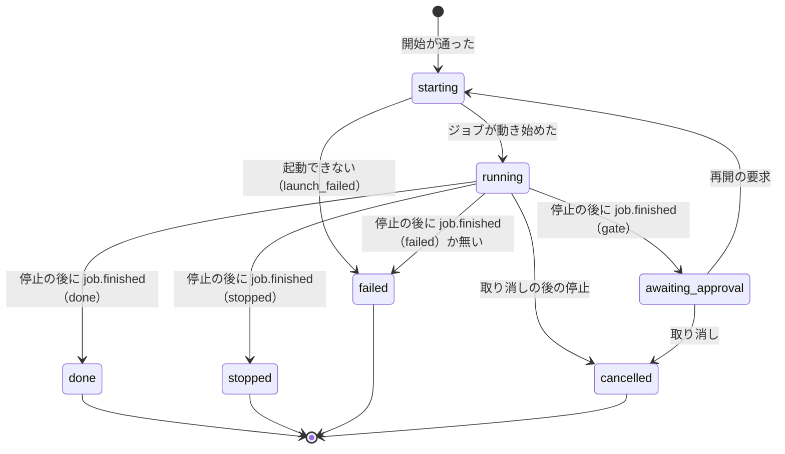
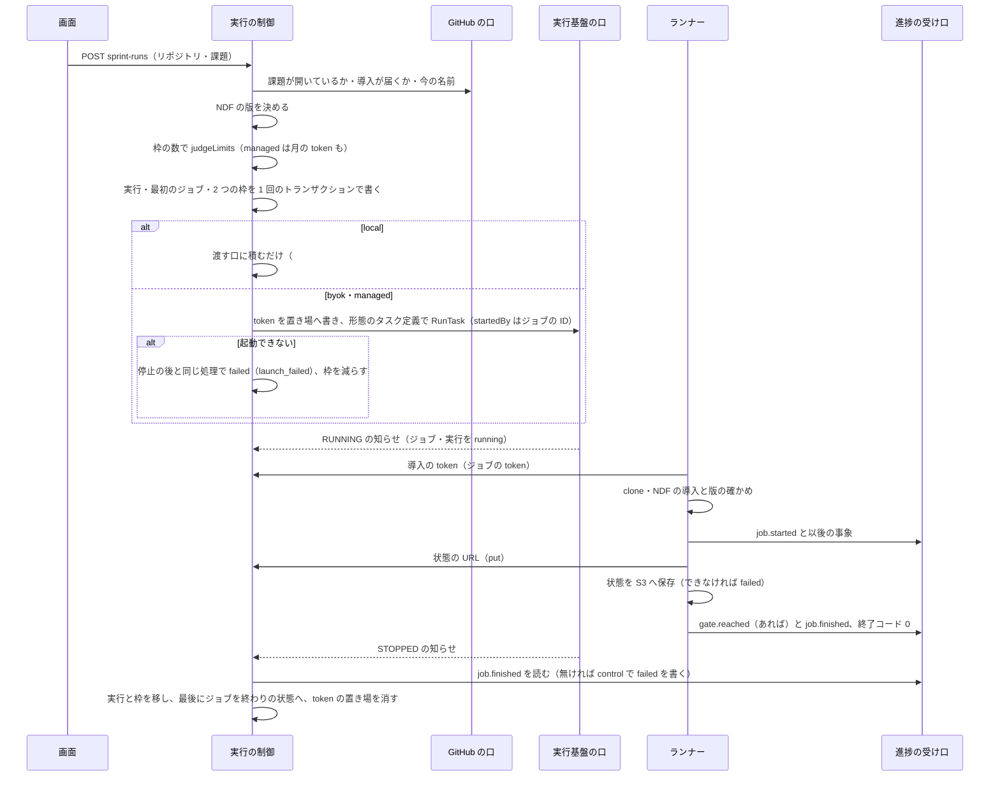
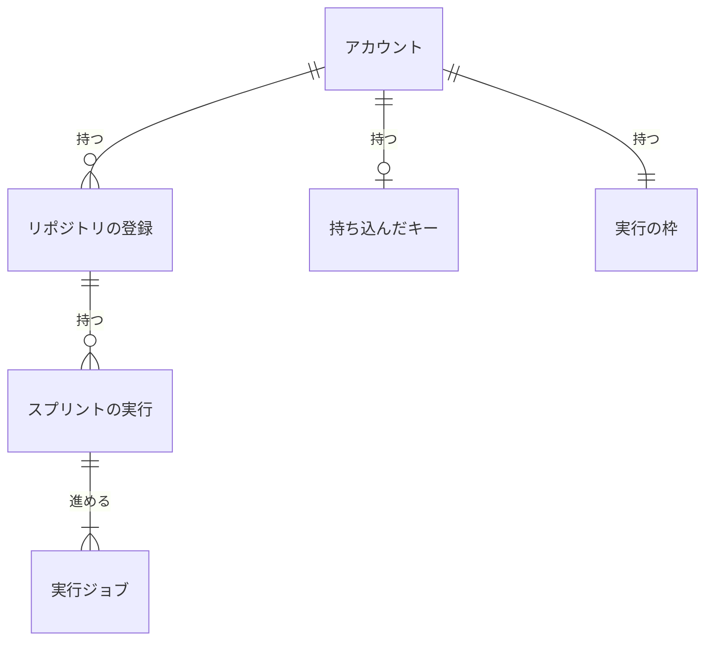

# Neural Development Factory: スプリントの実行の状態・処理の流れ・表と設定

[リポジトリの登録・スプリントの実行の制御・ランナー](ndf-factory-runs-and-runner.md)（以下「本体」）から、実行と実行ジョブの状態の移り・処理の流れ・実行の表・置き場の値・環境変数を分けた文書である。語の定義・常に成り立つ条件・テスト観点は本体にある。

## 状態と処理の流れ

### 状態と移り

スプリントの実行の状態は `starting` / `running` / `awaiting_approval` / `done` / `stopped` / `failed` / `cancelled` で、後ろの 4 つが終わりの状態である。実行ジョブの状態は `pending` / `running` / `gate` / `stopped` / `done` / `failed` で、後ろの 4 つが終わりの状態である（ジョブの図は全体の契約の「スプリントの実行の流れ」）。

`RUNNING` の知らせを取りこぼしたときは `starting` から終わりの状態や `awaiting_approval` へ直に移る。`running` への移りは `starting` のときだけ書く。

**失敗の理由**（実行の `failureReason`）:

| 値 | いつ |
| --- | --- |
| `launch_failed` | token の置き場の作成か `RunTask` が失敗した。`pending` のまま 15 分を過ぎた |
| `timeout` | 見回りが打ち切りの時間で止めた |
| `task_stopped` | ランナーの `job.finished` が無いままタスクが止まった（手元のランナーの終わりの知らせを含む） |
| `job_failed` | ランナーが `job.finished`（`failed`）を送った |

### 処理の流れ

- **停止の後の処理**（`finalize`）: `job.finished` を進捗の記録から鍵 `<job_id>:finished` で読み、無ければ `appendControlEvent` で `failed` を書く（同じ鍵が先にあれば書かれず、読み直す）。そのジョブが実行の今のジョブなら、取り消しの要求があれば `cancelled`、結果が `gate` なら `awaiting_approval`（今のジョブを空にする）、ほかは結果の状態へ移す。終わりの状態への移りは実行の行が終わりの状態でないことを条件にし、同じトランザクションで 2 つの枠を 1 ずつ減らす。**ジョブを終わりの状態にするのは最後で**、途中で止まってもジョブは見回りの対象に残り、次の見回りか知らせの再送が同じ結果でやり直す。同じ知らせの 2 回目は、ジョブが終わりの状態なので何もしない
- **見回り**（`sweep`）: 終わりの状態でないジョブ（GSI の `ACTIVE_JOBS`）を最後のページまで引き、ECS のジョブは ① `pending` のまま 15 分を過ぎたら `StopTask` して `launch_failed` で停止の後の処理、② タスクが `STOPPED` か見つからなければ停止の後の処理、③ `running` で打ち切りの時間を過ぎ、まだ止めていなければ `stopReason` に `timeout` を書いて `StopTask`、④ タスクが `RUNNING` でジョブが `pending` なら `running` にする。`STOPPING`・`DEPROVISIONING` などの止まる途中は確定しない。`local` のジョブは `running` で打ち切りの時間を過ぎたら直に `timeout` で停止の後の処理をする
- **再開の要求**（`requestResume`）: 実行が `awaiting_approval` で今のジョブが空のときだけ、実行を `starting`・今のジョブを新しいジョブにする書き込みと、`resume` のジョブの作成を 1 回のトランザクションで行い、起動する。実行が承認待ちでなくても、今のジョブの `job.finished` が `gate` なら（停止の知らせの前）`sprint_run_busy` を返す。再開は使える量の判定にかけず、枠を変えない
- **取り消し**（`cancelSprintRun`）: 今のジョブが無ければその場で `cancelled` にして枠を減らす。あれば取り消しの要求を立て、ECS のタスクがあれば `StopTask` して `running` を返し、停止の後の処理で `cancelled` へ移す。`local` のジョブかタスクがまだ無いジョブは、その場で停止の後の処理をして `cancelled` を返す
- **ランナーは止められると何も送らずに 1 で終わる**（`SIGTERM`）。打ち切りと取り消しの `job.finished` は実行の制御が `failed` で書く

## データ・設定

### 実行の表

DynamoDB の 1 つの表（`RUNS_TABLE_NAME`）。区分の鍵 `pk`・並びの鍵 `sk`、GSI `gsi1`（区分の鍵 `gsi1pk`・並びの鍵 `gsi1sk`、射影は全部）。読み出しは強い整合で、GSI は候補を引くだけに使い、行は表から読み直す。**時系列の扱いは「今の値の上書き」である。** 過去は進捗の記録が持ち、上書きで失う状態の移りの時刻は `job.*` の事象から作り直せる。

| 行 | `pk` | `sk` | `gsi1pk` / `gsi1sk` |
| --- | --- | --- | --- |
| リポジトリの登録 | `ACCOUNT#<accountId>` | `REPO#<repositoryId>` | — |
| 持ち込んだキー | `ACCOUNT#<accountId>` | `CREDENTIAL` | — |
| 実行の枠（全体） | `ACCOUNT#<accountId>` | `ACTIVE` | — |
| 実行の枠（リポジトリ） | `ACCOUNT#<accountId>` | `ACTIVE#REPO#<repositoryId>` | — |
| スプリントの実行 | `RUN#<sprintRunId>` | `RUN` | `ACCOUNT#<accountId>` / `RUN#<createdAt>` |
| 実行ジョブ | `JOB#<jobId>` | `JOB` | `ACTIVE_JOBS` / `<createdAt>#<jobId>`（終わりの状態でない間だけ。終わりへ移すときに外す） |

列の名前は `factory/api/src/runs/model.ts` の型の名前のまま（camelCase）である。

| 行 | 列 | 型 | 空 | 意味 |
| --- | --- | --- | --- | --- |
| 登録 | `accountId`・`repositoryId` | 文字列・数 | 不可 | 属するアカウントと GitHub のリポジトリの数の ID（改名で変わらない） |
| 登録 | `fullName` | 文字列 | 不可 | `owner/name`。開始のたびに GitHub の値で書き換える |
| 登録 | `installationId` | 数 | 不可 | 導入の識別子 |
| 登録 | `registeredBy`・`registeredAt` | 文字列 | 不可 | 登録した利用者の ID と時刻 |
| キー | `kind` | 文字列 | 不可 | `anthropic_api_key` / `aws_role` |
| キー | `secretArn` | 文字列 | 不可 | 値の置き場（名前は `ndf-factory/model-credentials/<UUID>`。アカウントの ID を名前に入れない） |
| キー | `updatedAt` | 文字列 | 不可 | 最後に保存した時刻 |
| 枠 | `count` | 数 | 不可 | 終わりの状態でないスプリントの実行の数（I34）。行が無いのは 0 |
| 実行 | `accountId`・`repositoryId`・`repo` | 文字列・数・文字列 | 不可 | 属する先と開始の時点の `owner/name`（token の `repo` の主張に使う） |
| 実行 | `state` | 文字列 | 不可 | 「状態と移り」の 7 つ |
| 実行 | `issues` | 数の並び | 不可 | 確かめた課題の並び |
| 実行 | `ndfVersion`・`executionMode`・`modelCredentialSecretArn` | 文字列 | `modelCredentialSecretArn` だけ可 | 開始で決めた値（I39）。キーの置き場は `byok` だけ |
| 実行 | `currentJobId` | 文字列 | 可 | 終わりの状態でないジョブ。`null` は「動くジョブが無い」（I9） |
| 実行 | `jobCount` | 数 | 不可 | 作ったジョブの数。次のジョブの `seq` になる |
| 実行 | `cancelRequested`・`failureReason` | 真偽・文字列 | `failureReason` は可 | 取り消しの要求と失敗の理由 |
| 実行 | `createdBy`・`createdAt`・`updatedAt` | 文字列 | 不可 | 開始した利用者と時刻 |
| ジョブ | `sprintRunId`・`accountId`・`seq`・`start` | — | 不可 | 属する実行とアカウント・何本目か・`new` / `resume` |
| ジョブ | `approvalRequestId` | 文字列 | 可 | `resume` の答えの出た依頼 |
| ジョブ | `state`・`result` | 文字列 | `result` は可 | 「状態と移り」の 6 つと、`job.finished` の結果 |
| ジョブ | `runnerKind` | 文字列 | 不可 | `ecs` / `local` |
| ジョブ | `taskArn`・`tokenSecretArn` | 文字列 | 可 | ECS のタスクと token の置き場 |
| ジョブ | `stopReason` | 文字列 | 可 | 実行の制御が止めた理由（`timeout` / `launch_failed`）。停止の後の失敗の理由になる |
| ジョブ | `createdAt`・`startedAt`・`finishedAt` | 文字列 | `startedAt`・`finishedAt` は可 | 作った時刻（`pending` の上限の起点）・動き始めた時刻（打ち切りの起点）・終わった時刻 |

| 機能 | 登録 | キー | 枠 | 実行 | ジョブ | 進捗の記録 |
| --- | --- | --- | --- | --- | --- | --- |
| 登録・外す | C・D | — | R（外すときの条件） | — | — | — |
| キー | — | C・U・D | — | — | — | — |
| 開始 | R・U（名前） | R | U | C | C | R（`managed` の月の token） |
| 停止の知らせ・見回り・取り消し | — | — | U | U | U | R・C（`control`） |
| 再開 | — | — | — | U | C | R |
| 渡す口 | — | — | — | U | U | — |

### 置き場の値

| 置き場 | 形 |
| --- | --- |
| 持ち込んだキー（Secrets Manager） | `{"kind": "anthropic_api_key", "api_key": …}` か `{"kind": "aws_role", "role_arn": …, "region": …, "external_id": "ndf-factory:<accountId>"}`。差し替えは同じ ARN へ新しい値を書き、消去は復元の期間を置かない |
| 実行ジョブの token（Secrets Manager） | `ndf-factory/run-jobs/<jobId>` に token の文字列。ジョブが終わりの状態へ移った後に、復元の期間を置かずに消す |
| NDF の状態（S3 の `RUN_STATE_BUCKET`） | `sprint-runs/<sprintRunId>/ndf-state.tar.gz`。`<repo>/.ndf/tmp` と `<repo>/.ndf/loop` の tar.gz |

### 環境変数

`factory/.env.example` に名前だけを置く（全体の契約の I6）。本書は次の 14 を足した。`GITHUB_APP_ID`・`GITHUB_APP_PRIVATE_KEY_SECRET_ARN`・`BEDROCK_REGION`・`NDF_MARKETPLACE`・`NDF_CHANNEL`・`RUNNER_TASK_DEFINITION_ARN` は全体の契約が置いた名前で、本書の構成要素が読む。

| 名前 | 使う側 | 意味 |
| --- | --- | --- |
| `RUNS_TABLE_NAME` | API・制御 | 実行の表 |
| `RUN_STATE_BUCKET` | ランナー向けの経路 | NDF の状態の置き場 |
| `RUN_JOB_TOKEN_SIGNING_KEY_SECRET_ARN` | 制御 | 発行の鍵 |
| `RUN_JOB_TIMEOUT_SECONDS`・`RUN_JOB_TOKEN_TTL_SECONDS` | 制御 | 打ち切りの時間（既定 28800）と token の期限（既定 32400） |
| `RUNNER_CLUSTER_ARN`・`RUNNER_SUBNET_IDS`・`RUNNER_SECURITY_GROUP_IDS` | 制御 | `RunTask` の宛先（サブネットとセキュリティグループはカンマ区切り。公開の IP は付けない） |
| `RUNNER_BYOK_TASK_DEFINITION_ARN` | 制御 | `byok` のタスク定義（`managed` は `RUNNER_TASK_DEFINITION_ARN`） |
| `INGEST_URL` | 制御 | 指示の `INGEST_URL` に写す値。ランナー向けの経路はこの origin に置く |
| `GITHUB_APP_SLUG`・`GITHUB_APP_CLIENT_ID`・`GITHUB_APP_CLIENT_SECRET_ARN` | 取り込み | 導入の URL と App の利用者の認可。クライアントの秘密は候補の証明の鍵の元にもなる |
| `CANDIDATE_MODEL_ID` | 課題の候補 | 理由を作る Bedrock のモデル |

API は要る変数が無ければ最初の要求の処理で失敗する。ランナーは指示の 11 項目のほかに `NDF_MARKETPLACE`・`BEDROCK_REGION`・`RUNNER_WORK_DIR`・`NDF_MVV_STATE_DIR`（`ask.jsonl` の置き場）と、手元のランナーの `INGEST_TOKEN` を読む。

## 関連リンク

- 本体: [ndf-factory-runs-and-runner.md](ndf-factory-runs-and-runner.md)
- 課題: [#2186](https://github.com/devbasex/ai-plugins/issues/2186)
- 用語: [用語集](../glossary.md)
