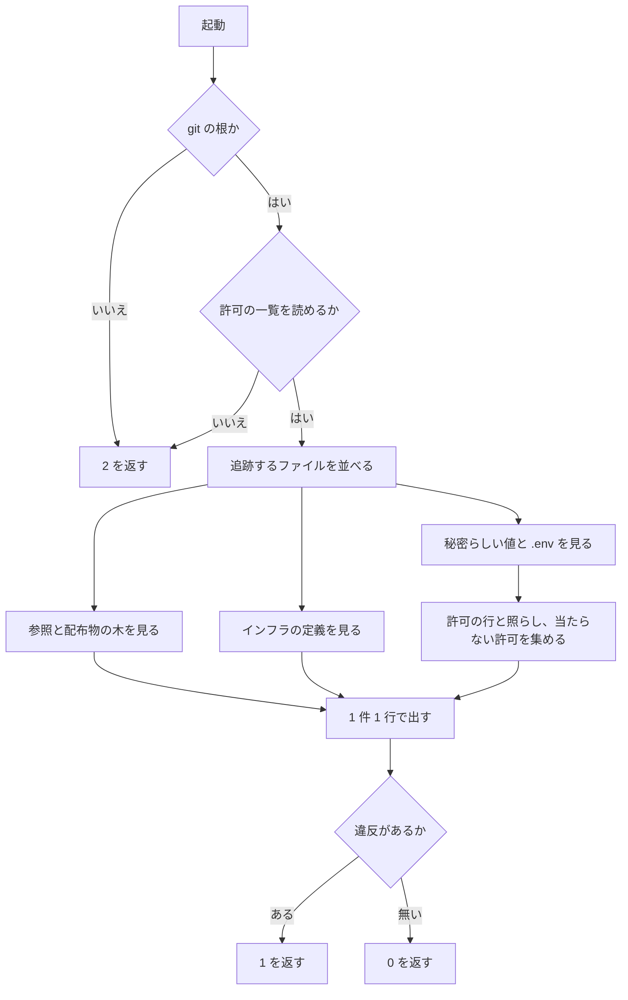
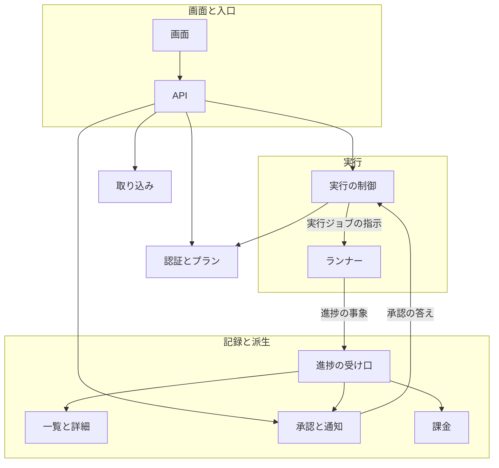
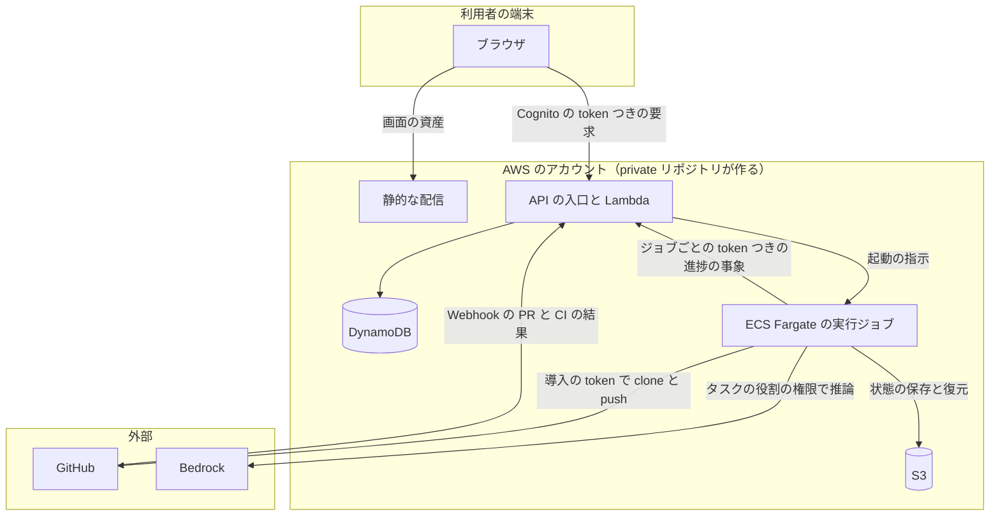
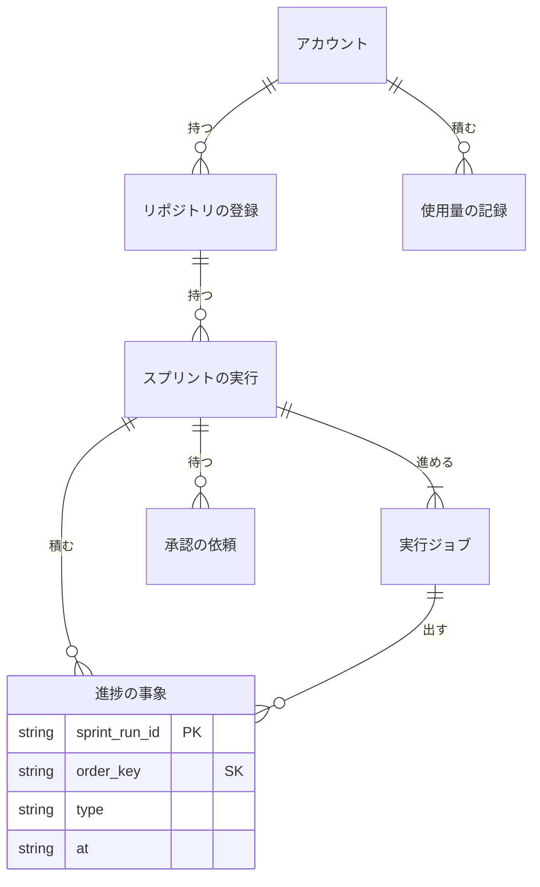
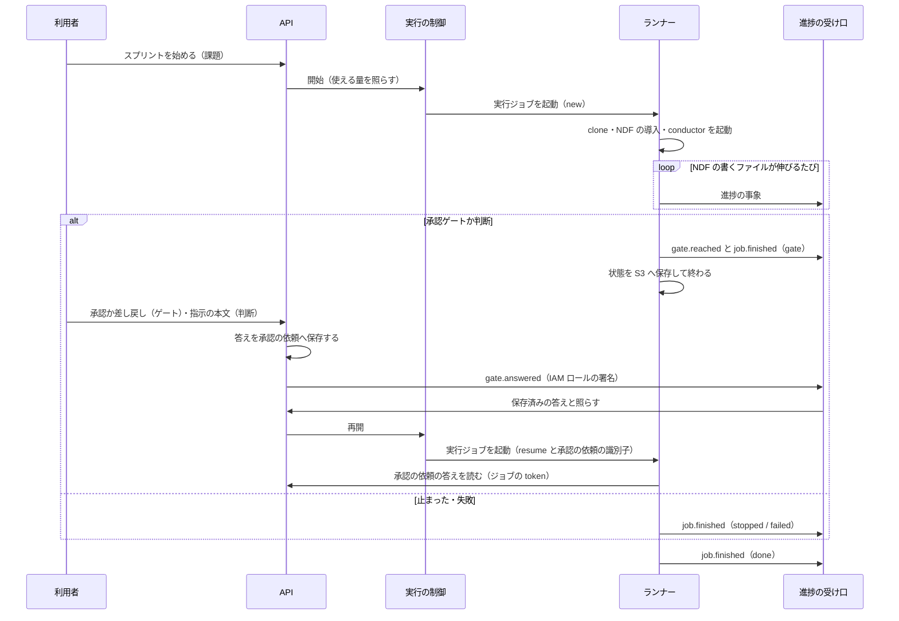
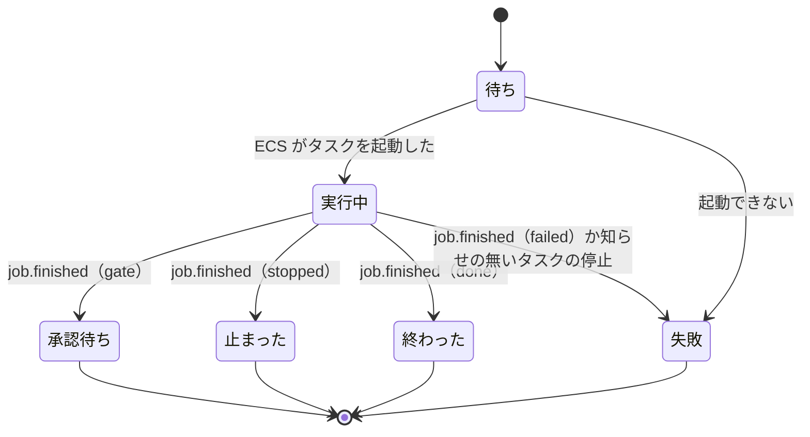

# Neural Development Factory: サービスのディレクトリと境界の検査、サービス全体の契約

NDF を Web UI から操作できる Software Factory のサービス（Neural Development Factory）について、コードの置き場（`factory/`）・プラグインとインフラとの境目を機械で守る検査・サービス全体の構成と構成要素の間の契約を定める。境界の検査とサービスのディレクトリは実装済みで、サービス全体の契約は子課題 #2170〜#2174・#2186 が実装するときの入力である。

## 概要

- **サービスのコードは根の `factory/` 1 つに閉じる。** `factory/` は自分の `LICENSE` を持ち、どのプラグインの配布物の木（`.claude-plugin/marketplace.json` の `source` が指すディレクトリ。すべて `./plugins/` の下）とも重ならない。ライセンスを差し替えても配布物は変わらない
- **境目は `python3 scripts/check-service-boundary.py` が見る**（CI のジョブ `service-boundary-check`）。プラグインからサービスへの参照・配布物の木の重なり・インフラの定義・秘密らしい値・`.env` の実ファイル・値を持つ `.env.example`・古い許可を、違反 1 件 1 行で出して終了コード 1 を返す
- **インフラの定義（CDK など）と秘密は private リポジトリが持つ。** このリポジトリはインフラから受け取る変数の名前（`factory/.env.example`）だけを持つ
- **サービス全体の形は「サービス全体の契約」の節が決める。** 子課題はこの形を変えずに作る。変えるときは本書を直す Pull Request を先に出す。本書を直すことが契約を変える手順である

## 用語

定義は [用語集](../glossary.md) が正である（`.ndf/glossary.json` の `document`。文脈 `ndf-factory`）。この文書で使う語は「Neural Development Factory」「サービスのディレクトリ」「境界の検査」「実行基盤」「ランナー」「実行ジョブ」「スプリントの実行」「進捗の事象」「承認の依頼」である。

## コンテキスト

| コンテキスト | 何の語が 1 つの意味に決まるか |
| --- | --- |
| Neural Development Factory（`ndf-factory`） | サービスのディレクトリ・境界の検査・アカウント・リポジトリの登録・スプリントの実行・実行ジョブ・進捗の事象・承認の依頼・使用量の記録 |
| NDF の開発ワークフロー（`ndf-workflow`） | スプリント・フェーズ・承認ゲート・conductor・`sprint.json`・`progress.jsonl` |
| このリポジトリの開発の検査（`repo-dev-checks`） | 必須チェック・追加待ち |

`ndf-workflow` が上流、`ndf-factory` が下流で、**腐敗防止層**の関係にある。ランナーが NDF の書くファイル（`sprint.json`・`progress.jsonl`・作業の報告）を読み、`ndf-factory` の語（進捗の事象）へ翻訳する。`ndf-factory` の中の構成要素どうしは、本書に書いた事象と指示の形でつなぐ。

## 背景

利用者の指示（#2168）は 2 つの約束を求めた。「Webサービス部分はライセンスを切り離す可能性があるため、ディレクトリを明確に分離しておく」と「CDKなどのセキュリティに関わるインフラ部分は別のprivate repositoryに」である。手で守る約束は崩れるため、境目は CI で落とす。あわせて、#2170〜#2174 が並列に進んでも食い違わないよう、サービス全体の形を先に決めた。

- **置き場を根の `factory/` にする。** 根の直下の 1 ディレクトリなら、ライセンスの差し替えは `factory/LICENSE` の 1 ファイルで済み、`./plugins/` の下を指すどの `source` とも重ならない。サービスは 1 つなので `services/factory/` のように階層を足さない（決定 1）
- **境界の検査は git の追跡するファイルだけを見る、標準ライブラリの Python 1 本にする。** 手元の追跡していない `.env` で結果が変わらず、CI で依存を入れずに打てる。gitleaks などは参照・重なり・インフラの定義を見ないため、入れても結局スクリプトが要り、許可の一覧が 2 か所になる（決定 9）
- **許可はファイルと値の sha256 の組で持つ。** 値を直に書くと一覧そのものが秘密らしい値として当たる。パスだけで許すと、許可したファイルに本物の値を足しても通る（決定 10）
- **インフラの定義はファイルの名前と宣言の形で見て、Markdown の本文は見ない。** 語の出現で落とすと、インフラについて書いた設計や仕様（本書を含む）が置けない（決定 12）
- **新しいジョブとして足し、既存の必須のジョブに混ぜない。** 混ぜると、落ちたときにチェックの名前から境界の違反だと読めない（決定 11）

## 対象範囲

- **働く範囲はこのリポジトリだけ。** 境界の検査は配布物に入れない（`scripts/` に置く）。サービスが取り込む利用者のリポジトリには何も置かない
- **ライセンスは根と同じ MIT のままである。** 切り離す時期と新しいライセンスは利用者が決める
- **含まない**: private リポジトリ側のインフラ（CDK のスタック・ネットワーク・秘密の管理）、プラグインの配布の仕組みと版の規則の変更

## 仕様

### 構成要素（このリポジトリに置いたもの）

| 要素 | 責務 |
| --- | --- |
| サービスのディレクトリ（`factory/`） | サービスのコードの唯一の置き場。`LICENSE`（根と同じ MIT の写し）・`README.md`・`.env.example`（変数の名前だけ）・`.gitignore`（`.env` と `node_modules/`）を持つ |
| 境界の検査（`scripts/check-service-boundary.py`） | 下の「常に成り立つ条件」の I1〜I7 を、git が追跡するファイルに対して見る |
| 許可の一覧（`scripts/service-boundary-allow.json`） | 秘密の形をした偽の値の、ファイルと値の sha256 と理由の組 |
| 検査のテスト（`scripts/tests/test_check_service_boundary.py`） | 違反を 1 つずつ入れた一時の git リポジトリで、検査が落ちることを確かめる |
| CI のジョブ（`service-boundary-check`） | `.github/workflows/runtime-plugin-validate.yml` のジョブ。Pull Request で絞り込まずに常に走る |
| 案内（根の `README.md` の「ライセンス」・`AGENTS.md` の構造の図） | サービスのディレクトリの位置と、ライセンスが別ファイルであることを示す |

### 境界の検査の入出力

| 項目 | 内容 |
| --- | --- |
| 名前 | `python3 scripts/check-service-boundary.py [--root <dir>] [--allow <file>]` |
| 入力 | `--root` のリポジトリ（既定は今の git の根）が追跡するファイル（`git ls-files`）。`--allow` の許可の一覧（既定 `<root>/scripts/service-boundary-allow.json`） |
| 出力 | 違反 1 件 1 行で `<種類>: <パス>:<行> → <直し方>`。行の無い種類は `:<行>` を省く。秘密らしい値は末尾に `（sha256=<照らした値の sha256>）` を足す。最後に `[check-service-boundary] 違反 <n> 件` |
| 終了コード | 0 = 違反なし / 1 = 違反が 1 件以上 / 2 = 読めない |
| 所要 | 今の木で 1 秒前後（基準は 10 秒以内） |

| 種類 | 何に当たるか | 直し方 |
| --- | --- | --- |
| サービスへの参照 | `plugins/` の下と `.claude-plugin/marketplace.json` で、パスの区切りとして現れる `factory/`（前に語の文字・`.`・`-` が無いもの）、または行き先がサービスのディレクトリのシンボリックリンク | 参照を外す。プラグインからサービスを使わない |
| 配布物の木の重なり | `source` が根・サービスのディレクトリ・その祖先か子孫を指す。パスは `marketplace.json#<プラグイン名>` で出す | `source` を `plugins/` の下へ戻す |
| インフラの定義 | `cdk.json`・`cdk.context.json`・`.terraform.lock.hcl`、`*.tf`・`*.tf.json`・`*.tfvars`、依存の宣言（`package.json`・`pyproject.toml`・`requirements*.txt`）の中の `aws-cdk-lib` の行、`.json`・`.yaml`・`.yml`・`.template` の CloudFormation の宣言（`AWSTemplateFormatVersion` か `AWS::<種>::<型>`。1 ファイル 1 件）。Markdown の本文は見ない | private リポジトリへ移す |
| 秘密らしい値 | AWS のアクセスキーの形（`AKIA` か `ASIA` に英大文字と数字 16 字）と、PEM の秘密鍵の始まりの行。許可の行と一致するものを除く | 値を消して環境変数で受ける。偽の値なら、行の末尾の sha256 をそのまま許可の行へ写す |
| .env の実ファイル | 名前が `.env` か `.env.<何か>` のファイル（`.env.example` を除く） | ファイルを消し、`.gitignore` に足す |
| 値を持つ .env.example | `factory/` の下の `.env.example` で、`=` の後が空でない行（`#` で始まる注釈の行を除く） | 値を消し、名前だけにする |
| 古い許可 | 許可の行が今の木のどこにも当たらない | 許可の一覧から外す |

**PEM の値は始まりの行から終わりの行（無ければファイルの末尾）までの塊全体の sha256 で照らす。** 始まりの行だけで照らすと、同じパスの鍵を差し替えても許可される。塊は行末を `\n` にそろえて結ぶため、ファイルの中身の sha256 とは一致しない。許可の行には違反の行に出た sha256 を写す。

**読めない（終了コード 2）のは次のときで、違反は出さない。** git のリポジトリでない・`--root` が git の根でない・`git ls-files` が失敗した・許可の一覧が読めないか形が違う・`marketplace.json` が JSON として読めない。理由は標準エラーに `[check-service-boundary] <理由>` で出す。



### 常に成り立つ条件（境界の宣言）

| # | 条件 | 破れたときの扱い |
| --- | --- | --- |
| I1 | `plugins/` の下と `.claude-plugin/marketplace.json` のどのファイルも、サービスのディレクトリを参照しない（パスの語・シンボリックリンクの行き先） | 「サービスへの参照」で 1 |
| I2 | どのプラグインの配布物の木も、サービスのディレクトリと重ならない | 「配布物の木の重なり」で 1 |
| I3 | 追跡するファイルに、インフラの定義が無い | 「インフラの定義」で 1。許可で除けない |
| I4 | 秘密らしい値は、許可の一覧のファイルと値（sha256）の組に一致するものだけがある。`.env` の実ファイルは無い | 「秘密らしい値」「.env の実ファイル」で 1 |
| I5 | 許可の行はどれも今の木の 1 か所以上に当たる。ディレクトリ単位・glob の許可は無い | 当たらない行は「古い許可」で 1、形の違う行は 2 |
| I6 | サービスのディレクトリの `.env.example` は、どの変数にも値を持たない | 「値を持つ .env.example」で 1 |
| I7 | 検査はサービスのディレクトリの `LICENSE` の種類と文面を合否の条件にしない。秘密らしい値の検査（I4）は `LICENSE` にもほかと同じく当てる | 別の文面へ差し替えた `LICENSE` で結果が変われば、テストが落ちる |

## データ・設定

**許可の一覧**（`scripts/service-boundary-allow.json`）:

```json
{"version": 1, "secrets": [{"path": "plugins/ndf/scripts/tests/test_project_decl.py", "sha256": "<値の sha256>", "reason": "<なぜ偽の値を置くか>"}]}
```

| 鍵 | 規則 |
| --- | --- |
| `version` | `1` だけ |
| `secrets` | 並び。無ければ空として扱う |
| `path` | ファイル 1 つ。`*`・`?`・`[` を含む・`/` で終わる・既存のディレクトリを指すものは 2 |
| `sha256` | 64 字の小文字の 16 進 |
| `reason` | 空でない文字列 |

一覧の鍵が `version`・`secrets` 以外を持つか、行の鍵が `path`・`sha256`・`reason` の 3 つと違えば 2 を返す。今の一覧は、秘密を伏せる処理のテストの入力にある AWS のアクセスキーの形の偽の値 1 件である。

**サービスのディレクトリの変数**（`factory/.env.example`）: `AWS_REGION`・`COGNITO_USER_POOL_ID`・`COGNITO_CLIENT_ID`・`GITHUB_APP_ID`・`GITHUB_APP_PRIVATE_KEY_SECRET_ARN`・`BEDROCK_REGION`・`NDF_MARKETPLACE`・`NDF_CHANNEL`・`RUNNER_TASK_DEFINITION_ARN`。値は private リポジトリのインフラが渡す。子課題は名前を足してよく、値は書かない（I6）。秘密は `*_SECRET_ARN` の名前で Secrets Manager の場所だけを受ける。

**必須のチェックの宣言**（`scripts/required-checks-allow.json`）: `awaiting` に `service-boundary-check` を理由つきで置く。突き合わせのチェック（[必須のチェックの突き合わせ](ci-required-checks-reconcile.md)）はこれを「追加待ち」として知らせ、失敗にしない。

## サービス全体の契約（子課題が実装する）

この節は、子課題 #2170〜#2174・#2186 が実装するサービスの形を、決定済みの契約として持つ。子課題は次の形を変えずに作る。**変えるときは本書を直す Pull Request を先に出す。** 機械可読な定義（JSON Schema と OpenAPI）は #2171 が本節から起こして `factory/contracts/` に置き、形の正は本節である。

### 受け持つ課題

| 課題 | 受け持つ範囲 | 提供する契約 | 使う契約 |
| --- | --- | --- | --- |
| #2170 | Cognito の利用者プール（Google・GitHub）・アカウント・席・プランと使える量の画面と API | 認可の token の `account_id`、使える量の問い合わせ（同時のスプリントの数・月の token の上限） | 無し |
| #2171 | `factory/contracts/`・進捗の受け口・実行ジョブの token の検証 | 実行ジョブの指示・進捗の事象の種類と形・受け口の認証と応答・実行ジョブの token の検証（token から実行ジョブと `sprint_run_id` を返し、無効なら拒む） | #2170 の `account_id`、#2173 の保存済みの答え（`gate.answered` の照合） |
| #2186 | GitHub App・リポジトリの登録・スプリントの実行と実行ジョブ・ランナー・実行ジョブの token の発行 | 実行の制御への再開の要求の受け口 | #2171 の `factory/contracts/`・進捗の受け口・token の検証、#2170 の `account_id` と使える量、#2173 の承認の依頼の答えを読む経路 |
| #2172 | 一覧と詳細の画面・派生の形・フェーズの名前の集合 | 無し | 進捗の事象（`phase.changed`・`step.recorded`・`pr.updated`・`ci.updated`） |
| #2173 | 承認の依頼・Web と Slack の通知・Web からの承認 | `gate.answered`、承認の依頼の答えを読む経路、実行の制御への再開の要求 | `gate.reached`・`attention`、#2171 の実行ジョブの token の検証 |
| #2174 | プランの料金・使用量の台帳・決済の手段と提供元・Bedrock の使用量の帰属 | 請求の画面と API | `usage.recorded`、#2170 のプラン |

各課題が本節の外で決めること: `factory/` の TypeScript のパッケージの管理の道具（npm・pnpm）は、最初に TypeScript のコードを置く #2170、ランナーで使える CLI（Bedrock 経由の claude を前提にし、cross-review が 2 つ目の CLI を要るときの扱い）と実行ジョブの打ち切りの時間（実測で決める）は #2186、`phase.changed` が運ぶフェーズの名前の集合は #2172、決済の提供元と Bedrock の請求との突き合わせは #2174 が決める。

### 構成と言語

**サービスのコードは TypeScript で書く。** 画面は React の SPA（Vite）、API は Node の Lambda、ランナーも TypeScript で、型の定義を `factory/contracts/` から生成して共有する。ランナーのコンテナには NDF のスクリプトのために Python と uv を入れる（決定 2）。置き場は `factory/contracts/`（#2171）・`factory/web/`（#2170・#2172〜#2174・#2186）・`factory/api/`（#2170〜#2174・#2186）・`factory/runner/`（#2186）である。

| 要素 | 責務 | 課題 |
| --- | --- | --- |
| 画面 | ログイン・リポジトリの登録・スプリントの一覧と詳細・承認・プランと請求 | 各課題が各画面 |
| API | 画面からの要求を受け、アカウントで認可して各集約の持ち主へ渡す | 各課題が自分の経路 |
| 認証とプラン | 利用者プールとアカウント・席・プランの使える量 | #2170 |
| 取り込み | GitHub App の導入とリポジトリの登録 | #2186 |
| 実行の制御 | スプリントの実行と実行ジョブの状態を持ち、ジョブを起動し終了を受ける。同時の数をプランの使える量で抑える。実行ジョブの token を発行する | #2186 |
| ランナー | 実行ジョブの中身。取り込み・NDF の導入・conductor の起動・翻訳・送信・状態の保存 | #2186 |
| 進捗の受け口 | ランナー・GitHub の通知・API から進捗の事象を受け、出所ごとに認証して冪等に追記する。実行ジョブの token を検証する | #2171 |
| 一覧と詳細 | 進捗の事象から一覧と詳細の読み出しの形を導く | #2172 |
| 承認と通知 | 承認の依頼を作って知らせ（Web・Slack）、答えを実行の制御へ渡す | #2173 |
| 課金 | 使用量の事象を台帳へ積み、プランの料金に上乗せして請求する | #2174 |



**配置**: 基盤は AWS（認証の Cognito と推論の Bedrock が AWS のため）で、AWS のアカウントの資源は private リポジトリが作る。画面の資産は静的な配信から、要求は Cognito の token つきで API の入口と Lambda へ届く。状態の表は DynamoDB、NDF の状態の保存は S3 に置く。実行ジョブは ECS Fargate のタスク 1 つで、ジョブごとの token で進捗の事象を送り、GitHub App の導入の token で clone と push をし、タスクの役割の権限で Bedrock を呼ぶ。GitHub は Webhook で Pull Request と CI の結果を API の入口へ送る。



### 集約

| 集約 | 持ち主 | 根 | エンティティ | 値オブジェクト |
| --- | --- | --- | --- | --- |
| アカウント | 認証とプラン（#2170） | アカウント | 席 | プラン・使える量 |
| リポジトリの登録 | 取り込み（#2186） | 登録 | — | GitHub のリポジトリの識別子・GitHub App の導入の識別子 |
| スプリントの実行 | 実行の制御（#2186） | スプリントの実行 | 実行ジョブ | NDF の版・スプリントの状態・ジョブの結果 |
| 進捗の記録 | 進捗の受け口（#2171） | スプリントの実行の識別子ごとの列 | 進捗の事象 | 種類・発生の時刻・冪等の鍵 |
| 承認の依頼 | 承認（#2173） | 承認の依頼 | — | 種類（ゲート 1・ゲート 2・判断）・答え |
| 使用量の記録 | 課金（#2174） | アカウントと月ごとの台帳 | 使用量の行 | モデル・入力と出力の token・費用 |

ほかの集約は識別子で参照する。1 つの処理が書き換える集約は 1 つで、集約の間は進捗の事象で後から揃える。

### 実行の単位と NDF の扱い

- **実行ジョブは承認の依頼で終え、答えで新しいジョブを起こす。** 承認までの時間は人が決め数日かかることもあるため、待つ間にコンテナの費用を払わない。コードの状態は GitHub のブランチと Pull Request に、NDF の状態（`sprint.json` と計画の状態ディレクトリ）は S3 に置き、新しいジョブはそこから続ける。並列はスプリントの実行ごとに別のジョブと別の clone を持つことで成り立つ（決定 3）
- **ランナーは NDF をマーケットプレイスから導入し、版をスプリントの開始で固定する。** `NDF_MARKETPLACE` から導入し、最初の実行ジョブで導入した版を `NDF_VERSION` として記録し、以後のジョブも同じ版を入れる。チャネルは `NDF_CHANNEL` で選ぶ。`plugins/` をパスで読まず、イメージに焼き込まない。プラグインの版と配布の規則がサービスにもそのまま当たる（決定 4）
- **サービスは取り込むリポジトリの起点・テスト・配布を持たない。** リポジトリの登録が持つのはリポジトリと GitHub App の導入の識別子だけで、ベースブランチ（`.ndf/worktree.json`）・テストのコマンド・配布の手段・進め方（`.ndf/pace.json`）はランナーの中の NDF がそのリポジトリの `.ndf/` から読む。`.ndf/` が無ければ NDF の既定で動く。画面に入力欄を持たず、このリポジトリの形（`develop` 起点・`uv` のテスト）を既定に置かない（決定 8）
- **翻訳はランナーだけが持つ。** NDF のファイルの形が変わっても、直すのはランナーだけで、受け口・画面・通知・課金は進捗の事象の形だけを知る（決定 6）
- **サービスの承認は NDF の承認ゲートの答えを運ぶだけにする。** 承認を求めるのはゲート 1・2 だけで、判断は NDF が「止めて人へ戻す」としたときの知らせである。サービスの側で承認を足したり省いたりしない（決定 15）

### 進捗の正本

**進捗の正本は、スプリントの実行ごとに追記だけで持つ進捗の事象の列である（決定 5）。** 事象の源は、ランナーの中の NDF が書く `sprint.json`・`progress.jsonl`・作業の報告と、GitHub の Webhook である。今のフェーズや承認待ちかは事象から導く派生で、作り直せる。一覧のための集約した形は #2172 が派生として持つ。課題の本文の `## 進行` とボードは読まない（取り込むリポジトリがボードを使うとは限らない）。ほかの集約の表は持ち主の課題が決める。



| 列 | 型 | 空を許すか | 意味 |
| --- | --- | --- | --- |
| `sprint_run_id` | 文字列 | 許さない | 区分の鍵。スプリントの実行の識別子 |
| `order_key` | 文字列 | 許さない | 並びの鍵。`<at>#<冪等の鍵>`。重複の判定には使わない |
| `idempotency_key` | 文字列 | 許さない | 重複の判定の鍵。一意はこの値だけで決める（I10） |
| `type` | 文字列 | 許さない | 下の「進捗の事象の種類」のどれか |
| `at` | 文字列（ISO 8601、UTC） | 許さない | 事象が起きた時刻。送り直しでも変えない |
| `source` | 文字列 | 許さない | `runner` / `github` / `api` / `control` |
| `job_id` | 文字列 | 許す | 空は「実行ジョブの外で起きた」（GitHub の通知・API の操作） |
| `schema_version` | 整数 | 許さない | 事象の形の版。上げるのは互換の無い変更のときだけ |
| `payload` | JSON | 許さない | 種類ごとの中身。無い種類は `{}` |

| `source` | `idempotency_key` の形 | `at` の取り方 |
| --- | --- | --- |
| `runner` | `<job_id>:<seq>`（`seq` はジョブの中で 1 から増やす）。`job.finished` だけは `<job_id>:finished` | ランナーが事象を作った時刻 |
| `github` | `github:<X-GitHub-Delivery の値>` | 本文の対象の更新時刻（`pull_request.updated_at`、チェックは `check_run.completed_at`、無ければ `check_run.started_at`）。受け取った時刻は使わない |
| `api` | `api:<承認の依頼の識別子>`。1 つの依頼への答えは 1 つ | API が答えを受け付けた時刻 |
| `control` | `<job_id>:finished` | 実行の制御が ECS の停止の知らせを受けた時刻 |

**重複の拒否は、冪等の鍵の表への条件つきの書き込みと事象の書き込みを 1 つのトランザクションで行う。** 冪等の鍵が既にあればトランザクションごと書かない。`job.finished` はランナーと実行の制御が同じ鍵を使うため、先に書いた 1 つだけが残る。

| 機能 | 進捗の事象 | スプリントの実行 | 承認の依頼 | 使用量の記録 |
| --- | --- | --- | --- | --- |
| 進捗の受け口（#2171） | C | — | R（`gate.answered` の照合） | — |
| 実行の制御（#2186） | C（`job.*`） | C・U | R | — |
| 一覧と詳細（#2172） | R | R | R | — |
| 承認と通知（#2173） | R | — | C・U | — |
| 課金（#2174） | R | — | — | C |

### 実行ジョブの指示

実行の制御からランナーへ、コンテナの環境変数で渡す。

| 入力 | 型・必須 | 意味 |
| --- | --- | --- |
| `SPRINT_RUN_ID`・`JOB_ID` | 文字列・必須 | 事象の宛先と冪等の鍵の頭 |
| `REPO` | `owner/name`・必須 | 取り込むリポジトリ |
| `NDF_VERSION` | 文字列・必須 | スプリントの開始で固定した NDF の版 |
| `START` | `new` / `resume`・必須 | `new` は課題から始め、`resume` は保存した状態から続ける |
| `ISSUES` | 番号の並び・`new` で必須 | スプリントへ入れる課題 |
| `APPROVAL_REQUEST_ID` | 文字列・`resume` で必須 | 答えの出た承認の依頼の識別子。答えの本文は載せない（RunTask の `overrides` は全体で 8192 字が上限で、長い差し戻しで起動が失敗するため） |
| `INGEST_URL`・`INGEST_TOKEN_SECRET_ARN` | 文字列・必須 | 進捗の受け口と、このジョブだけに効く token の置き場 |

**`resume` のランナーは、答えを #2173 の API からこのジョブの token で読む。** #2173 はその token を #2171 の token の検証で確かめ、token の実行ジョブの `sprint_run_id` と依頼の属するスプリントの実行が一致し、かつ答えが保存済みのときだけ本文を返す。一致しなければ 403 を返し、本文も依頼の有無も明かさない。

| 種類 | 答えの形 | ランナーが NDF へ書くもの |
| --- | --- | --- |
| ゲート 1・ゲート 2 | 承認か差し戻しか・本文 | `sprint-state.py gate --by user` の承認の記録（差し戻しは本文を添える） |
| 判断 | 指示の本文だけ | ゲートの記録は書かない。本文を、再開した conductor への利用者の指示として渡す |

**ランナーの終了は `job.finished` で伝え、終了コードは 0（結果を送った）/ 1（送れなかった）に限る。** `job.finished` を送れずに終わったジョブは、実行の制御が ECS の停止の知らせを受けて `job.finished`（`failed`、`source` は `control`）を進捗の記録へ直に書く。ランナーの分が先に書かれていれば同じ鍵のため書かれない。

### 進捗の事象の種類と受け口

| 種類 | 出所 | `payload` | 主な受け手 |
| --- | --- | --- | --- |
| `job.started` | ランナー | NDF の版・`START` | #2172 |
| `phase.changed` | ランナー（`sprint.json` の計画と `progress.jsonl` の `step` の行） | フェーズの名前・課題 | #2172 |
| `step.recorded` | ランナー（`progress.jsonl` の `step`） | ステップ・終了コード・秒・要約 | #2172 |
| `attention` | ランナー（`progress.jsonl` の `attention`） | 理由・要約 | #2172・#2173 |
| `gate.reached` | ランナー（作業の報告の `判断が要る` と承認資料） | 種類（ゲート 1・ゲート 2・判断）・Pull Request の URL・承認資料の本文 | #2173 |
| `gate.answered` | API（#2173） | 承認の依頼の識別子・種類・承認か差し戻しか（判断では無し）・答えた人のアカウント。本文は事象に載せない | #2171・#2172 |
| `usage.recorded` | ランナー（claude の結果の使用量） | モデル・入力と出力の token・費用・ステップ | #2174 |
| `job.finished` | ランナー。送れずに終わったときは実行の制御 | 結果（`gate` / `stopped` / `done` / `failed`）・要約 | #2186・#2172 |
| `pr.updated`・`ci.updated` | GitHub の Webhook | Pull Request の番号と状態・チェックの名前と結論 | #2172 |

課金の境界はランナーが `usage.recorded` を出すところまでで、料金の計算・台帳・決済・Bedrock の請求との突き合わせは #2174 が持つ（決定 14）。

**受け口の認証は出所ごとに 1 つで、認証の手段と事象の `source` が食い違えば拒む。** 実行の制御は受け口を通らず、進捗の記録へ直に書く。

| 出所 | 認証の手段 | 書ける種類 |
| --- | --- | --- |
| `runner` | 実行ジョブごとの token。token の実行ジョブと事象の `job_id`・`sprint_run_id` が一致すること | `gate.answered`・`pr.updated`・`ci.updated` を除く種類 |
| `api` | #2173 のサービスの IAM ロールによる署名だけ（利用者の Cognito の token では書けない）。加えて、依頼の識別子・属するスプリントの実行・種類・答えた人・承認か差し戻しかが保存済みの答えとすべて一致するときだけ書く（未保存なら 403）。利用者の token と `account_id` の確かめは #2173 の API が行う | `gate.answered` |
| `github` | `X-Hub-Signature-256` を GitHub App の Webhook の秘密で検証する | `pr.updated`・`ci.updated` |

**受け口の応答**: 受け取ったら 202（同じ冪等の鍵の 2 回目も 202）、認証できなければ 401、認証の手段と `source`・種類・識別子が食い違えば 403、形が違えば 400。ランナーは 5xx と接続の失敗を、同じ事象のまま送り直す。

### スプリントの実行の流れ



ランナーはゲートの答えを NDF の既存の記録として書いてから conductor を続ける。進め方（`pace`）は取り込んだリポジトリの `.ndf/pace.json` が決め、サービスは上書きしない。



実行ジョブは承認待ちから実行中へ戻らない。再開は新しい実行ジョブである。

### 常に成り立つ条件（サービス全体）

| # | 集約 | 条件 | 破れたときの扱い | 縛る課題 |
| --- | --- | --- | --- | --- |
| I8 | スプリントの実行 | 実行ジョブは承認の依頼が出たら終わる。人の答えを待つ間に動いている実行ジョブは無い | 実行の制御が待ちの上限で止め、ジョブの結果を「失敗」にする | #2186 |
| I9 | スプリントの実行 | 1 つのスプリントの実行で、同時に動く実行ジョブは 1 つ | 2 つ目の開始を拒む | #2186 |
| I10 | 進捗の記録 | 進捗の事象は追記だけで書き換えない。同じ冪等の鍵の事象は 1 つ | 同じ鍵の 2 回目は 202 を返し、保存しない | #2171 |
| I11 | 承認の依頼 | 承認を求める種類はゲート 1 とゲート 2 の 2 つだけ | 3 つ目の種類の承認を受け付けない | #2173 |

各課題は自分の設計のテスト設計で、受け持つ条件を 1 条件 1 テストで縛る。

## セキュリティ

- **このリポジトリに秘密・認証情報・インフラの定義を置かない。** 境界の検査の I3・I4・I6 が落とす。`factory/.gitignore` が `.env` を追跡から外す
- **サービスのコードは秘密の ARN だけを受ける。** GitHub App の秘密鍵・Slack の Webhook の URL・決済の鍵は private リポジトリのインフラが Secrets Manager に置く。Bedrock はタスクの役割の権限で呼び、アクセスキーを渡さない（決定 13）
- **ランナーに長く使える鍵を渡さない。** ランナーは利用者のリポジトリのコードを実行するため、受け口へ書く token は実行ジョブごとに作り、そのジョブのスプリントの実行にだけ書ける（決定 13）
- **秘密の形の偽の値は、許可の一覧の 1 行で個別に除く。** ディレクトリごとは除かない（I5）

## 運用

- **CI**: ジョブ `service-boundary-check` は `runtime-plugin-validate.yml` にあり、Pull Request では絞り込まずに走る。push（`main`・`develop`）の `paths` に `factory/**` を持ち、サービスの変更でも走る
- **必須のチェックへの追加は利用者の作業で、まだ入っていない**（2026-10-30 に ruleset を見て確かめた）。それまでは `scripts/required-checks-allow.json` の `awaiting` にあり、突き合わせのチェックが「追加待ち」と知らせる。ruleset へ足したら `awaiting` から外す
- **秘密の形の偽の値を足すとき**: 検査を打ち、違反の行の末尾の `（sha256=…）` の値を `path`・`reason` と一緒に許可の一覧へ写す。偽の値を消したら許可の行も消す（残すと「古い許可」で落ちる）
- **ライセンスを差し替えるとき**: `factory/LICENSE` と根の `README.md` の「ライセンス」の節だけを書き換える。検査とプラグインの配布物は変わらない（I7）
- **サービス全体の契約を変えるとき**: 本書の「サービス全体の契約」を直す Pull Request を先に出し、`factory/contracts/` と各課題の実装をそれに合わせる

## テスト観点

テストは `scripts/tests/test_check_service_boundary.py` にあり、違反を 1 つずつ入れた一時の git リポジトリを入力にする。秘密の形の値はテストの中で組み立て、テストのファイル自身が当たらない。

| 観点 | 縛る振る舞い |
| --- | --- |
| 配布物が変わらない（I2） | `source` が `./plugins/<名前>` の木で、`factory/` にファイルを足しても消しても 0、各 `source` の追跡ファイルの一覧も変わらない。`source` を `./` か `./factory` にすると「配布物の木の重なり」で 1 |
| 参照の禁止（I1） | `plugins/` の下の `.md`・`.json` と `marketplace.json` に `factory/` のパスを書くと 1。`factory/` を指すシンボリックリンクでも 1。似た語（`software-factory/`・`my_factory/`）と `plugins/` の外の参照は 0 |
| ライセンスの差し替え（I7） | `factory/LICENSE` を別の文面にしても結果が同じ。`LICENSE` に AWS のアクセスキーの形の値を足すと「秘密らしい値」で 1 |
| インフラの定義（I3） | `cdk.json`・`aws-cdk-lib` を依存に持つ `package.json`・`.tf`・CloudFormation の YAML がそれぞれ 1。`aws-cdk-lib` の語を書いた `.md` は 0 |
| 秘密らしい値と `.env`（I4） | アクセスキーの形・PEM の始まりの行・`.env` がそれぞれ 1、`.env.example` は 0。許可したファイルに別の値を足すと 1、許可した値を別のファイルに置くと 1。PEM は塊全体で照らし、鍵を差し替えると 1、始まりの行だけの許可では 1。出力の sha256 を写すと 0。追跡していない `.env` は見ない |
| 許可の一覧（I5） | 当たらない行は「古い許可」で 1。ディレクトリ・glob の `path`、知らない鍵、`version` の違い、64 字の 16 進でない `sha256` は 2。git の外も 2 |
| `.env.example`（I6） | `factory/.env.example` に値のある行で 1、注釈の行と `NAME=` は 0。`plugins/mcp/` の `.env.example` は対象外で 0 |
| このリポジトリ | 今の木で 0。許可の一覧から既存の偽の値を外すと 1 |
| 所要 | 今の木で 10 秒以内 |
| サービス全体の契約（I8〜I11） | 文書の文言を照合するテストは書かない。各課題の設計のテスト設計が受け持つ条件を縛り、該当の行が無ければ設計 Pull Request で指摘する |

## 関連リンク

- 起点の課題: [#2169](https://github.com/devbasex/ai-plugins/issues/2169)（要求と受け入れ条件の正本）、親の [#2168](https://github.com/devbasex/ai-plugins/issues/2168)
- 子課題: [#2170](https://github.com/devbasex/ai-plugins/issues/2170)・[#2171](https://github.com/devbasex/ai-plugins/issues/2171)・[#2172](https://github.com/devbasex/ai-plugins/issues/2172)・[#2173](https://github.com/devbasex/ai-plugins/issues/2173)・[#2174](https://github.com/devbasex/ai-plugins/issues/2174)・[#2186](https://github.com/devbasex/ai-plugins/issues/2186)
- 設計 Pull Request: [#2175](https://github.com/devbasex/ai-plugins/pull/2175)、実装: [#2177](https://github.com/devbasex/ai-plugins/pull/2177)
- サービスのディレクトリ: [factory/README.md](../../factory/README.md)
- 境界の検査: [scripts/check-service-boundary.py](../../scripts/check-service-boundary.py)、許可の一覧: [scripts/service-boundary-allow.json](../../scripts/service-boundary-allow.json)
- 追加待ちの扱い: [必須のチェックの突き合わせ](ci-required-checks-reconcile.md)
- 版と配布の規則（ランナーが導入する NDF に当たる）: [版と配布の正本](../versioning-and-distribution.md)
