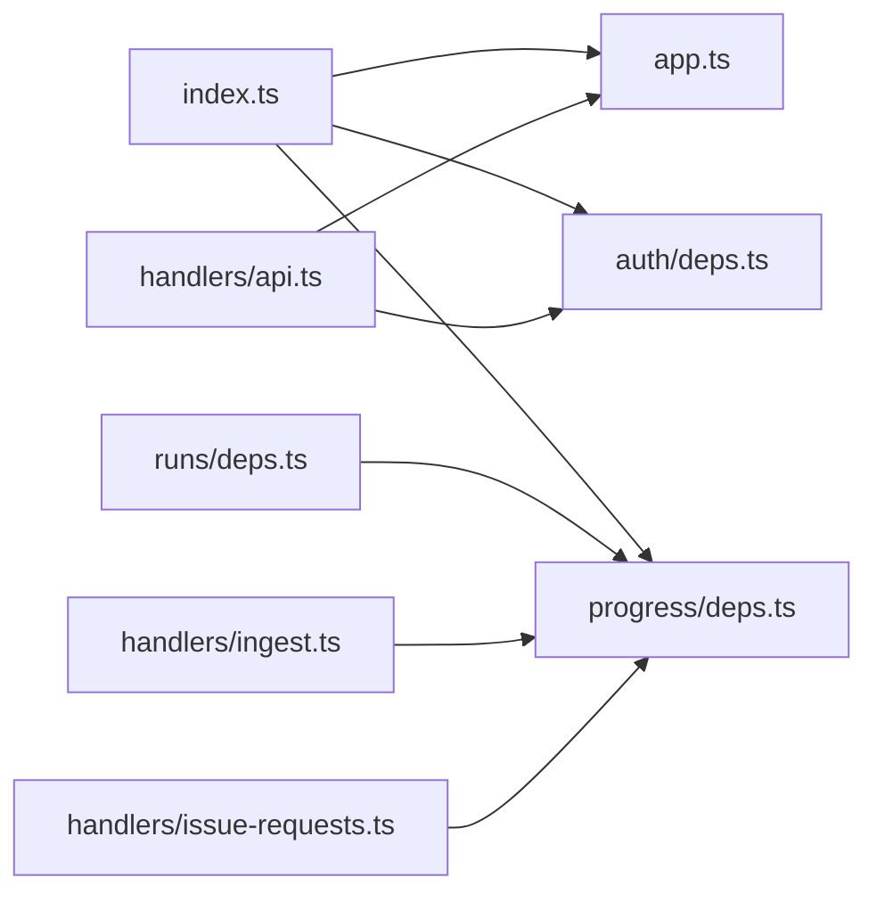
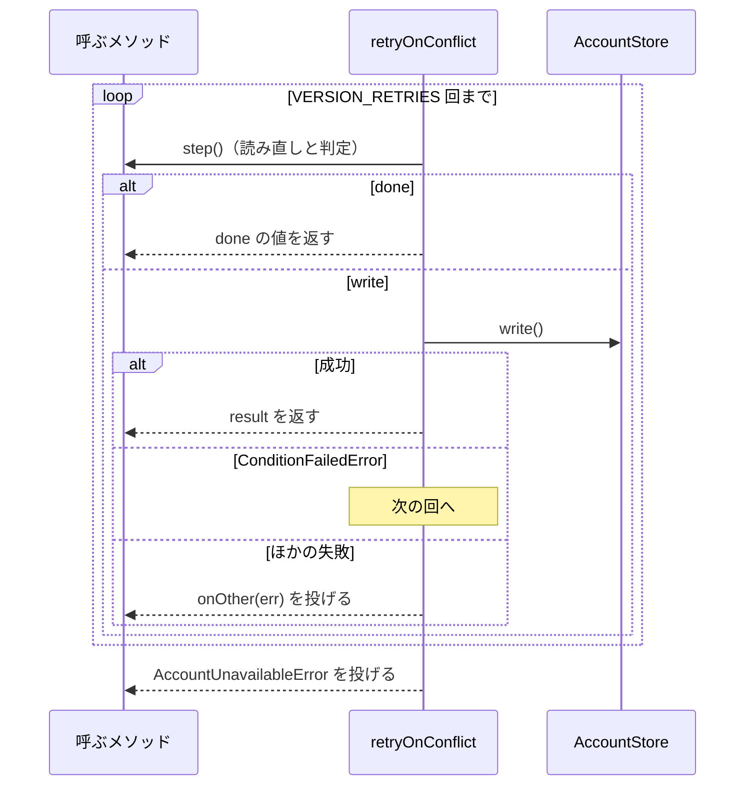
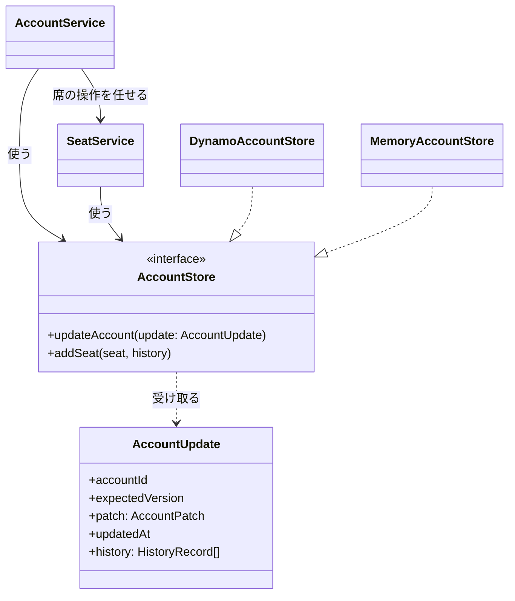

# Neural Development Factory: 同じ役割の処理の置き場

Neural Development Factory の API（`factory/api/src`）と画面（`factory/web/src`）で、同じ役割の処理を 1 か所に置く規則と、その置き場を定める。HTTP の応答・OpenAPI の契約・DynamoDB の行の形・画面の表示は、この規則で変わらない。

## 概要

- **Lambda の handler のファイル（`factory/api/src/handlers/*.ts`）は、handler の配線だけを持つ。** Hono のアプリ・環境変数からの依存の組み立てはほかのファイルに置き、`handlers/` の外から `handlers/` を読まない
- **アカウントの保存の契約は、DynamoDB の実装と別のファイルに置く。** 契約は AWS SDK を読まない
- **同じ役割の関数・定数は `factory/` の中で 1 つだけ定義する。** 下の「置き場の一覧」に載る処理を足すときは、その置き場の関数を使い、写しを作らない
- **画面のログインの確認と失敗の表示は `context.tsx` の 2 つに寄せる。** 画面ごとに token の有無を確かめない

## 用語

定義は [用語集](../glossary.md) が正である（文脈 `ndf-factory`）。この文書で使う語は「同じ役割の写し」「保存の契約」である。

## コンテキスト

変更は Neural Development Factory（`ndf-factory`）の中だけに属する。集約（利用者・アカウント）と持ち主は [アカウントと料金プラン](ndf-factory-accounts-and-plans.md) の「集約」のとおりで、この文書は持ち主の内部の関数の置き場だけを定める。

## 背景

`factory/` の子課題は同じ `factory/api/`・`factory/web/` に足していく。そのため、環境変数の読み取り・再試行・ログインの確認などの処理が、子課題ごとに写されて広がっていた。cross-refactoring は同じ提案を毎回出し、時間の上限で見送っていた。置き場を 1 つに決め、足す側がその関数を使う形にした。

## 仕様

### 依存の向き

図の横幅のため、`env.ts` を読む向きは図から省いた。`env.ts` を読むのは `auth/deps.ts`・`progress/deps.ts`・`runs/deps.ts` と、`handlers/` の `ingest.ts`・`github-oidc.ts`・`issue-requests.ts` である。

handler の名前と置き場（`handlers/*.ts` の `handler`）は変えない。private リポジトリのインフラがこのファイルをエントリポイントとしてバンドルするためである。

### 置き場の一覧

| 処理 | 置き場 | 使う側 |
| --- | --- | --- |
| 必須の環境変数の読み取り（`requireEnv`）。無ければ `環境変数 <名前> がありません` を投げる | `factory/api/src/env.ts` | `auth/deps.ts`・`progress/deps.ts`・`runs/deps.ts`・`handlers/` の `ingest.ts`・`github-oidc.ts`・`issue-requests.ts` |
| API の Hono のアプリ（`createApiApp`）と、ログ（`jsonLogger`・`LogEntry`・`Logger`）・画面のオリジン（`webOriginFromEnv`） | `factory/api/src/app.ts` | `handlers/api.ts`・`index.ts`・テストの補助（`testing/app.ts`） |
| 認証の依存の組み立て（`depsFromEnv`。`AuthDeps` を 1 回だけ作る） | `factory/api/src/auth/deps.ts` | `handlers/api.ts`・`index.ts` |
| 進捗の記録の保存の組み立て（`progressStoreFromEnv`） | `factory/api/src/progress/deps.ts` | `handlers/ingest.ts`・`handlers/issue-requests.ts`・`runs/deps.ts`・`index.ts` |
| 保存の契約（`AccountStore`・`AccountPatch`・`AccountUpdate`・`ConditionFailedError`） | `factory/api/src/accounts/port.ts` | `accounts/store.ts`（DynamoDB の実装）・`accounts/memory-store.ts`（メモリの実装）・`accounts/service.ts`・`accounts/seat-service.ts`・`accounts/conflict.ts` |
| 版の競合の再試行（`retryOnConflict`）と、再試行しない書き込みの失敗の読み替え（`writeOr`） | `factory/api/src/accounts/conflict.ts` | `accounts/service.ts`（チームの作成・利用者の作成・料金プランと実行の形態の変更）・`accounts/seat-service.ts`（席の追加・種類の変更・削除） |
| 履歴の行を同じトランザクションで足す書き込み（`transact`）と、アカウントの表の鍵の頭（`USER#`・`ACCOUNT#`）・更新の列の表（`PATCH_COLUMNS`） | `factory/api/src/accounts/store.ts` | 同じファイルの書き込み |
| 席の種類の検証と文言（`validateSeatType`。`席の種類は standard か premium です`） | `factory/api/src/accounts/service.ts` | `routes/accounts.ts`・`routes/teams.ts` |
| アカウントの詳細の本文（`accountDetailBody`。チームなら席を読んで足す） | `factory/api/src/routes/views.ts` | `routes/accounts.ts`（詳細の取得・実行の形態の変更）・`routes/teams.ts`（チームの作成） |
| GitHub の利用者の取得と ID の検証（`githubUser`。取れなければ `null`） | `factory/api/src/github-oidc/app.ts` の `createGithubOidcApp` の中 | `/token`・`/userinfo` |
| IdP の判定（`idpFromUsername`） | `factory/api/src/auth/verify.ts` のモジュールの中 | `verifyAuthorization` |
| ログインの確認（`RequireLogin`） | `factory/web/src/context.tsx` | `App.tsx` のログインの後の画面の枠（`AppShell` の layout route）の `element` |
| 失敗を画面の文へ変える呼び出し（`useAttempt`） | `factory/web/src/context.tsx` | 画面（`pages/*.tsx`）と `pages/parts.tsx` |
| 席の種類の選択肢（`SeatTypeOptions`） | `factory/web/src/pages/parts.tsx`（`SEAT_TYPES` の隣） | `TeamPage.tsx`・`NewTeamPage.tsx` |

### 同じ役割として寄せない処理

次の処理は、名前や形が似ていても判断が違うため、上の置き場へ寄せない。

| 処理 | 寄せない理由 |
| --- | --- |
| 実行の表の鍵（`runs/dynamo-table.ts` の `accountPk`） | アカウントの表とは別の表の設計である |
| 実行の枠・ループ・整理役・埋め戻しの再試行（`runs/`・`organizer/` の各定数） | アカウントの版の競合とは別の集約で、読み直しと判定の中身も違う |
| スプリントとループの開始の失敗（`NewSprintPage.tsx`・`LoopsPage.tsx`） | 失敗の種類ごとに文を変える |
| スプリントの手順の詳細の読み込み（`SprintDetailPage.tsx`） | 画面を離れた後の結果を捨てる判断を含む |
| 定期の読み直し（`poll.ts` の `usePolled`）と枠の利用者の読み込み（`ui/AppShell.tsx`） | 読み直しの失敗で前の表示を残し、誤りの文を出さない |
| 画面ごとの「読み込み中」と `role="alert"` の出し分け | 画面ごとに準備の条件が違う |

### 常に成り立つ条件

| # | 条件 | 破れたときの扱い |
| --- | --- | --- |
| S1 | `factory/api/src` の `handlers/` の外のコード（`*.test.ts` を除く。`testing/app.ts` は含む）が `handlers/` を import しない。`handlers/` の中のファイルどうしも互いを import しない | 置き場の一覧の場所へ移してから足す |
| S2 | 置き場の一覧の処理の定義は `factory/` の中に 1 つだけある | 写しを消し、置き場の関数を使う |
| S3 | アカウントの書き込みは `transact` を通り、`TransactItems` を業務の項目 → 履歴の行 → 作成の冪等の鍵の行の順に並べる。鍵・属性・条件式・プレースホルダ（`:plan`・`:mode` など）の名前は [アカウントと料金プラン](ndf-factory-accounts-and-plans.md) の「アカウントの表」のとおりである | 並びか名前が違えば、DynamoDB の行の形が変わる。`store.test.ts` が落とす |
| S4 | `ConditionFailedError` は `accounts/port.ts` にだけ定義し、`store.ts` は再公開しない。2 つの実装・サービス・`conflict.ts` の `instanceof` が同じクラスを見る | 別のクラスになると条件の失敗を読み替えられない |

### 版の競合の再試行と書き込みの失敗

`retryOnConflict(step, onOther)` の `step` は、読み直しと判定をして `{ done: T }`（書かずに終わる）か `{ write, result }`（書いて終わる）を返す。

- `step` の中で投げた誤り（権限・競合・料金プラン・席が無い）は、書き込みの前の判定なので、そのまま呼ぶ側へ届く
- 読み替えるのは `write` の失敗だけである
- `onOther` は条件以外の失敗を何へ変えるかを決める。既定は `AccountUnavailableError` で、料金プランの変更は受けた誤りをそのまま返す

`writeOr(write, onCondition)` は `write` を呼ぶ。結果は次の 3 つのどれかになる。

- 成功なら `undefined` を返す
- 条件の失敗なら `onCondition()` の結果を返す（`onCondition` は投げてもよい）
- それ以外の失敗は `AccountUnavailableError` を投げる

| 呼ぶメソッド | `onCondition` |
| --- | --- |
| 席の追加 | `ConflictError("seat_exists", …)` を投げる |
| チームの作成 | 冪等の鍵があれば鍵の行を読み直し、先に書いた作成の文脈を返す。無ければ `AccountUnavailableError` を投げる |
| 利用者の作成 | 利用者を読み直し、あれば返す。無ければ `AccountUnavailableError` を投げる |

### 履歴の行と更新の引数

- アカウントの履歴の行は、`accounts/service.ts` の呼ぶ側が `HistoryRecord` の名前つきのオブジェクトで書く。`before` と `after` の取り違えをフィールドの名前で防ぐためである。席の履歴の行は `accounts/seat-service.ts` の `seatHistory` が組み立てる
- `updateAccount` は `AccountUpdate`（`accountId`・`expectedVersion`・`patch`・`updatedAt`・`history`）を 1 つ受ける。`version` が `expectedVersion` と等しいときだけ `patch` を当て、`version` を 1 増やす

### 画面のログインの確認と失敗の表示

- `RequireLogin` は token が無ければ、枠も画面も描かずに `/login` へ移る。ログインの後の画面はすべてこの枠の下にあり、後から足す画面にも確認が掛かる。そのため画面は token の有無を確かめず、`usePolled` は token の有無を引数に取らない
- `useAttempt()` は `attempt(op, show)` を返す。`attempt` は `op` を呼び、失敗したら画面の文を `show` へ渡す（401 ならログインの画面へ移って `show(null)`）。`attempt` は投げない
- `attempt` は描くたびに同じ関数を返す（`useCallback`）。`useEffect` の依存に入れても読み込みを繰り返さない

## 外部連携

インフラ（private リポジトリ）がバンドルする handler は `handlers/*.ts` の `handler` のままである。一覧は [アカウントと料金プラン](ndf-factory-accounts-and-plans.md) の「外部連携」にある。

## テスト観点

- 次の検索で、置き場の一覧の処理が 1 か所にあることを満たすこと
  - `grep -rn "function requireEnv" factory/api/src` が 1 行
  - `factory/web/src/pages` で `Navigate to="/login"` と `hasToken` が 0 行
  - `SEAT_TYPES.map` が `pages/parts.tsx` の 1 行
  - 失敗を画面の文へ変える `onFailure(err)` が `context.tsx`・`poll.ts`・`ui/AppShell.tsx` と、寄せない 3 画面（`NewSprintPage.tsx`・`LoopsPage.tsx`・`SprintDetailPage.tsx`）だけにある
- S1 の 2 つの検索がどちらも 0 行を返すこと
  - `grep -rn 'from "[./]*/handlers/' factory/api/src --include=*.ts | grep -v '\.test\.ts:'`
  - `grep -n 'from "\./' factory/api/src/handlers/*.ts | grep -v '\.test\.ts:'`
- `npm --prefix factory run check`（vitest・`tsc --noEmit`・spectral）が 0 で終わること。応答・表示・エラーの文言は既存の vitest が縛る
- `store.test.ts` の期待値（鍵・GSI の鍵・条件式・プレースホルダ・履歴の行の位置）が S3 を満たすこと
- `service.test.ts` と `handlers/api.test.ts` で、次の 4 つを満たすこと
  - 版の競合が 3 回続けば保存の失敗を返す
  - 書き込みの失敗で席も履歴も増えない
  - 既に席があれば 409 を返す
  - 冪等の鍵の 2 回目が 1 回目のチームを返す
- `verify.test.ts`・`github-oidc/app.test.ts`・`App.test.tsx` で、認証の判定と、token が無いとき・401 のときに `/login` へ移ることが変わらないこと
- `uv run --frozen --project . --all-extras pytest scripts/tests/test_check_markdown_links.py -q` が通ること。スクリプトの読み込みは関数のスコープの fixture で、テストごとに新しいモジュールを作る

## 関連リンク

- [アカウントと料金プラン](ndf-factory-accounts-and-plans.md)（集約・構成要素・アカウントの表）
- [画面の部品](ndf-factory-ui-components.md)
- [サービスのディレクトリと境界](ndf-factory-service-boundary.md)
- 課題 #2199（ https://github.com/devbasex/ai-plugins/issues/2199 ）、実装の Pull Request #2533（ https://github.com/devbasex/ai-plugins/pull/2533 ）
