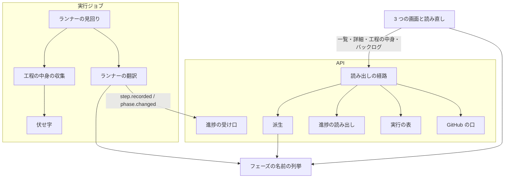
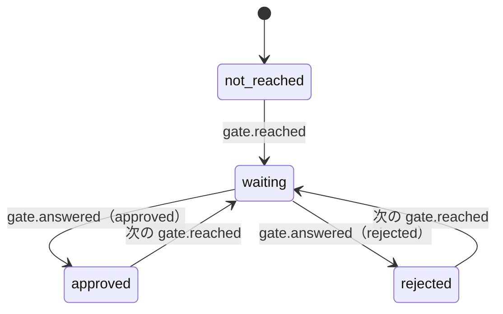

# Neural Development Factory: スプリントの一覧と詳細・工程の中身・バックログの読み出し

1 つのアカウントで並列に流れる複数のスプリントの実行について、一覧で各実行の今のフェーズと状態を、詳細で課題ごとの工程・Pull Request・CI・承認ゲートを、工程の詳細パネルで触ったファイル・決めたこと・費用・作業の報告を読める。バックログの画面では、取り込んだリポジトリの順位の表と棚卸しの記録をスプリントの外で読める。どれも読むだけで、書き込む操作を持たない。

## 概要

- **一覧・詳細・工程の中身・バックログは、進捗の事象の列とスプリントの実行の行から、読み出しのたびに導く派生である。** 派生の表は持たない。派生の関数は 2 つの集約のどちらも書き換えない
- **NDF の語はランナーの翻訳の中だけで読む。** ランナーはプランの `"フェーズ"` の値を 5 つのフェーズの名前へ写し、工程の中身を `step.recorded` に任意の項目として添えて送る。API と画面は NDF のファイルを読まない
- **フェーズの名前の集合は `factory/contracts/src/phases.ts` の 1 か所にある。** ランナー・派生・画面が同じ列挙を読む
- 派生の値の導き方と `step.recorded` の工程の中身の項目は、[契約の定義と型・進捗の受け口](ndf-factory-contracts-and-progress.md) の「進捗の事象の定義」と「スプリントの一覧と詳細の読み出し」が正である。この文書は、経路の形・読み出しの口・画面・常に成り立つ条件と、そう決めた理由を持つ

## 用語

定義は [用語集](../glossary.md) が正である（文脈 `ndf-factory`）。この文書で使う語は「フェーズの名前」「工程の記録」「工程の中身」「スプリント全体の欄」「スプリントの一覧」「スプリントの詳細」「詳細パネル」「バックログの画面」である。

## コンテキスト

| コンテキスト | 何の語が 1 つの意味に決まるか |
| --- | --- |
| Neural Development Factory（`ndf-factory`） | スプリントの実行・進捗の事象・フェーズの名前・工程の記録・スプリントの一覧と詳細 |
| NDF の開発ワークフロー（`ndf-workflow`） | プラン・ステップ・プランの `"フェーズ"`・`progress.jsonl`・作業の報告 |

`ndf-factory` が下流で、ランナーの翻訳を腐敗防止層に置く。

## 構成要素

| 要素 | 場所 | 責務 |
| --- | --- | --- |
| フェーズの名前の列挙 | `factory/contracts/src/phases.ts` | `PHASE_NAMES`（5 つ）・`isPhaseName`・仕上げに常に置く工程 `CLOSING_STEPS`（振り返り `retro`・棚卸し `refine`）。依存を持たず、画面は `@ndf-factory/contracts/phases` から読む |
| ランナーの翻訳 | `factory/runner/src/translate.ts` | プランの `"フェーズ"` を 5 つの名前へ写す。`step.recorded` を作り、事象 1 件を 256 KiB に収める（`fitStep`） |
| 工程の中身の収集 | `factory/runner/src/step-details.ts` | プランの JSON・作業場所の git・判断の台帳・ステップの出力から工程の中身を集める。外のファイルとコマンドに触るのはここだけ |
| 伏せ字 | `factory/runner/src/redact.ts` | NDF の `secret_redact.py` の 4 つの形の規則と、ランナーが持つ秘密の値を `***` にする |
| ランナーの見回り | `factory/runner/src/runtime.ts` | ステップの行ごとに工程の中身の収集を呼ぶ。同じ行から作る `usage.recorded` の `at` を `step.recorded` の `at` にそろえる |
| 進捗の読み出し | `factory/api/src/progress/read.ts` | 読むだけの 5 つの口（「読み出しの口」） |
| 派生 | `factory/api/src/views/derive.ts` | 事象の列と実行の行から一覧の行・詳細・工程の中身・棚卸しの記録を作る純粋な関数。時刻も外の世界も読まない |
| 読み出しの経路 | `factory/api/src/routes/sprint-views.ts`（一覧は `routes/factory.ts`） | アカウントの解決と 403 の本文の統一、読み出しの口と派生の呼び出し |
| 経路の定義 | `factory/contracts/openapi/runs.yaml` | 一覧の項目の追加と 3 つの経路 |
| 画面 | `factory/web/src/pages/SprintsPage.tsx`・`SprintDetailPage.tsx`・`BacklogPage.tsx`・`sprintParts.tsx` | 3 つの画面と導線 |
| 読み直し | `factory/web/src/poll.ts`・`config.ts`・`vite.config.ts` | 画面を開いている間、設定の間隔で読み直し、失敗しても前の表示を残す |

## 仕様

### 常に成り立つ条件

| # | 条件 |
| --- | --- |
| I1 | `step.recorded` の工程の中身の項目はどれも任意で、項目の無い事象（`schema_version` 1 の今の形）も受け口が 202 で受ける |
| I2 | 事象 1 件は 256 KiB 以下。超える `step.recorded` は `output.text` → `files` → `decisions` の順に削り、削ったことを `output.truncated`・`files_omitted` に残す。削っても超えれば工程の中身をすべて外す |
| I3 | `output.text`・`decisions` の文・`files` のパスは、送る前に伏せ字の規則に通す |
| I4 | 一覧の今のフェーズは、その実行の最後の `phase.changed`（`order_key` の順）の `phase`。0 件なら `null` |
| I5 | 5 つの名前に無い `phase` は捨てずに名前のまま返し、読み出しは 200 を返す |
| I6 | 工程は `issues` の課題ごとの欄に 1 回ずつ並び、`issues` が無いか空なら「スプリント全体」の欄に並ぶ。欄の中は `order_key` の順 |
| I7 | 工程のフェーズは `step.recorded` の `phase`、無ければ同じ実行ジョブの直前の `phase.changed` の `phase` |
| I8 | 工程の費用は、同じ `job_id`・同じ `step`・同じ `at` の `usage.recorded` の `cost_usd` の和で、1 件も無ければ `null` |
| I9 | 承認の欄はゲート 1・ゲート 2 の 2 つと判断の 1 つ。どの欄も、その種類の最後の `gate.reached` と、それより後の同じ種類の `gate.answered` から状態を決める |
| I10 | 仕上げの欄は振り返り（`retro`）と棚卸し（`refine`）の行を常に持ち、記録が無ければ `record` が `null` |
| I11 | 詳細の件数の上限は `step.recorded` だけに効き、新しい方から最大 2,000 件読む。超えたら古い `step.recorded` から省き、省いた数を `omitted_steps` に返す。ほかの種類の事象は件数によらずすべて読み、I4・I7〜I9 と使用量の和から欠かさない |
| I12 | 一覧・詳細・工程の中身・バックログ・承認待ちの一覧の 5 つの読み出しは、`resolveAccount` で解決したアカウントの実行とリポジトリだけを返す。他人のアカウント・無いアカウント・アカウントに属さない実行・無い実行・無い工程・登録の無いリポジトリは、どれも同じ本文の 403 `forbidden` |
| I13 | 一覧・詳細・工程の中身の読み出しは GitHub の口を呼ばない。バックログは順位の表の読み出し（`findRankingTable`）だけを呼ぶ |
| I14 | 読み出しは事象の表と実行の表へ書かない |

### ランナーが送る工程の中身

**フェーズの名前の対応づけはランナーの翻訳だけが持つ。** プランの JSON の `"フェーズ"` は NDF が持つフェーズの値で、`設計`・`実装`・`検査`・`配布（開発版）`・`配布（本番）`・`まとめ` の 6 つが現れる。`配布（開発版）` は `取り込み`、`配布（本番）` と `まとめ` は `仕上げ` へ写す。`まとめ` は進め方 `fast` / `auto` のプランで、振り返りと棚卸しを持つため仕上げに当たる。状態のディレクトリの名前の断片（`impl`・`release-prod`）から写さないのは、断片がプランのテンプレートの数だけ増え、フェーズの名前と別に増えるためである。

**工程にフェーズと課題を添えるのは、事象の並びに頼らないためである。** 1 つの実行ジョブの中で課題ごとの実装のプランが並列に流れ、事象が交互に届く。課題の番号はプランの名前の番号から取る（`5-impl-2171` なら 2171）。検査・リリースのプランの `"課題"` はスプリントのすべての課題を持つため、使うとスプリント全体の工程がすべての欄に重なる。

| 項目 | 取り方 |
| --- | --- |
| 触ったファイル | プランの JSON の `"作業場所"` で、工程の時間の窓（`at − seconds` 〜 `at`）のコミットを `git log --no-merges --numstat` で読む。最大 100 件で、外した数を `files_omitted`。コミットが無ければ空の配列、作業場所が無い・git が 0 以外で終わるときは項目ごと省く |
| コミットの範囲 | 窓の最初のコミットの親と最後のコミット |
| 決めたこと | NDF の判断の台帳（`ask.jsonl`）の `decision` の行のうち、`cwd` が工程の作業場所の下で `at` が窓の中のもの（`by: ai`）。最大 20 件・1 件 1,000 字 |
| 出力 | ステップの出力（`.out`）。`work` のステップは作業の報告（`report`）、`run` のステップはログ（`log`）。UTF-8 で 32 KiB まで |

収集の失敗は工程の送信を止めない。読めない項目だけを省き、今の形の `step.recorded` に戻る。出力を 32 KiB で切るのは、過去の 11 スプリントの実測で出力の p99 が 19,323 バイトで 99% 以上がそのまま届き、最大（57,843 バイト）でも事象 1 件の上限に収まるためである。

**伏せ字の規則は NDF の 4 つの形（URL の資格・GitHub の token の形・`x-access-token:` の値・認証ヘッダー）を写し、ランナーが持つ秘密の値（実行ジョブの token・導入の token・持ち込んだキー・引き受けたロールの資格）を文字列のまま置き換える。** `factory/` から `plugins/` を参照しない境界のため、NDF の Python を呼ばずに TypeScript へ写した。写した規則の出所は `redact.ts` の先頭に書いてある。

**工程の費用を結ぶため、同じステップの行から作る `step.recorded` と `usage.recorded` は同じ `at` で送る。** 同じ名前のステップ（`pr`・`merge`）はプランごとに現れ、`step` だけでは別の工程の費用まで足すためである。費用の正は `usage.recorded` で、`step.recorded` に費用を持たせない。conductor の `usage.recorded` はどの工程にも結ばず、使用量の和にだけ入る。

**受け口は `phase` を列挙で縛らない。** NDF の版がフェーズを足しても、その版の事象を 400 にせず残すためである。

### 経路（`factory/contracts/openapi/runs.yaml`）

入力と成功の形は [利用者向けの操作の形](ndf-factory-contracts-and-progress.md#利用者向けの操作の形) に従う。「値」は一覧の 1 件か、成功の要素の `value` である。

| 経路 | 値 / 失敗 |
| --- | --- |
| `GET /accounts/{accountId}/sprint-runs` | 一覧。`SprintRunRow` の配列。各行に `repo`・`current_phase`・`current_step`・`last_event_at` を足す。既存の 6 項目の名前と型は変えない / 要求全体の 403 |
| `GET /accounts/{accountId}/sprint-runs/detail?sprint_run_id=` | 指定の取得。`SprintRunDetail` / 要素の 403 / 要素の 503 |
| `GET /accounts/{accountId}/sprint-runs/steps?sprint_run_id=&step_key=` | 指定の取得。実行の ID は 1 つの条件で、鍵は工程の `step_key`（事象の `idempotency_key`）を繰り返す。`StepDetail` / 他人の実行は要求全体の 403、要素の 403 / 503 |
| `GET /accounts/{accountId}/backlogs?repository_id=` | 指定の取得。`Backlog` / 要素の 403 / 要素の 503（保存か GitHub の口の失敗） |
| `GET /accounts/{accountId}/sprint-runs/approval-requests` | 承認待ちの一覧（`listApprovalRequests`。#2430）。`ApprovalRequestRow` の配列を分割せず 1 回で返す / 要求全体の 403 / 503 |

403 はどれも `{"error": {"code": "forbidden", "message": "このアカウントを見る権限がありません"}}`（要素の結果では `{ok: false, status: 403, error}`）である。無い実行と他人の実行で、同じ回数の読み出しの後に返す。登録の無いリポジトリも 404 にしない。404 を返すと、アカウントがそのリポジトリを取り込んでいるかが分かるためである。保存の失敗は 503 で、応答に中身を出さない。

`SprintRunDetail`:

| 項目 | 意味 |
| --- | --- |
| `sprint_run_id`・`repo`・`repository_id`・`issues`・`state`・`failure_reason`・`created_at` | 一覧と同じ |
| `ndf_version`・`execution_mode`・`job_count` | 概要の札（実行の行から） |
| `current_phase` | 一覧と同じ |
| `phases` | `{name, step_keys[], required[]}`。5 つの名前の順に 5 つ、その後に現れた順に 5 つに無い名前。`required` は仕上げだけが持つ `[{label, step, record}]`（振り返り・棚卸し）。`record` は最後の記録の `{key, exit_code, seconds}` か `null` |
| `columns` | `{issue, step_keys[], pull_requests[]}`。実行の `issues` の順に課題の欄、最後にスプリント全体の欄（`issue` が `null`） |
| `columns[].pull_requests` | `{repo, number, url, state, checks[]}`。`state` は最後の `pr.updated` か `unknown`、`checks` はチェックの名前ごとの最後の `{name, conclusion}`（`null` は実行中） |
| `steps` | 工程の行 `{key, at, job_id, step, phase, issues, exit_code, seconds, cost_usd, summary, pull_request, has_details}`（`order_key` の順）。`has_details` は工程の中身を 1 つでも持つか |
| `gates` | `{gate1, gate2, decision}`。`gate1`・`gate2` の `state` は `not_reached` / `waiting` / `approved` / `rejected`、`decision` の `state` は `none` / `waiting` / `answered` |
| `delegated_decisions` | `decision.delegated` の件数 |
| `usage` | `{input_tokens, output_tokens, cost_usd}`。`usage.recorded` の和 |
| `omitted_steps` | 上限で省いた工程の数 |
| `attention` | 注意の行 `{key, at, reason, summary}`。実行の `attention` をすべて `order_key` の順に持ち、工程の記録の上限で減らない。`reason` と `summary` は受け口が受けた値のまま |

`ApprovalRequestRow` は `{sprint_run_id, repository_id, repo, issues, kind, loop, waiting_since}` で、1 つの実行に 0 か 1 行である。行があるのは、実行の状態が `awaiting_approval` で待つ理由が空であり、最後の `gate.reached` より後に同じ種類の `gate.answered` が無いときだけで（判定は `awaitingGateOf`）、`kind`・`loop`（ループでない実行は `null`）・`waiting_since` はその `gate.reached` から取る。行は `waiting_since` の古い順で、同じ日時は実行の ID の順に並ぶ。実行は状態で絞って読み（`listAwaitingRuns`）、その実行だけ承認の事象を読む。

`StepDetail` は工程の行に、`files`（各行に `url`）・`files_omitted`・`decisions`・`output`・`diff_url` を足したものである。工程の中身を持たない工程ではそれぞれ `null`。リンクは GitHub を呼ばずに文字列で作る。

| リンク | 作り方 |
| --- | --- |
| Pull Request | `https://github.com/{repo}/pull/{number}` |
| 差分（`diff_url`） | `pull_request` があれば `…/pull/{number}/files`、無く `commit_range` があれば `…/compare/{from}...{to}`、どちらも無ければ `null` |
| ファイル | `commit_range` があれば `https://github.com/{repo}/blob/{to}/{path}`、無ければ `null` |

`Backlog` は `repository_id`・`repo`・`ranking`（`{milestone, rows: [{rank, number, title}]}` か `null`）・`refinements`（そのリポジトリの実行の新しい方から 50 件の、`step` が `refine` の `step.recorded` を `at` の新しい順に。`{sprint_run_id, key, at, exit_code, summary, pull_request}`）である。

**詳細の応答は工程の中身の本文を持たない。** 詳細は読み直しのたびに返すため、本文を含めると使わない本文を毎回返す。画面は工程を押したときに工程の中身の経路で 1 件を読む。鍵の `idempotency_key` から実行の ID を引けるため、別の実行の鍵を渡されても 403 にできる。

### 承認の欄の状態

判断の欄は `waiting` / `answered` の 2 つに読み替える。`gate.reached` の前に届いた答えは状態を変えない。承認の依頼の集約は読まず、事象だけから導く。

### 読み出しの口（`ProgressReader`）

| 名前 | 入力 | 出力 |
| --- | --- | --- |
| `listRunEvents` | 実行の ID・`step.recorded` の上限 | `order_key` の順の事象の列（`step.recorded` 以外はすべて、`step.recorded` は新しい方から上限まで、本文の `files`・`decisions`・`output` は読まない）と、上限で読まなかった `step.recorded` の数 |
| `latestOfRun` | 実行の ID | 最後の `phase.changed`・最後の `step.recorded`・最後の事象（無ければ `null`） |
| `getStep` | 実行の ID・`idempotency_key` | その実行の `step.recorded` の全項目か `null`（別の実行の鍵も `null`） |
| `listStepsNamed` | 実行の ID・`step` の値 | その値の `step.recorded`（本文を読まない） |
| `listGateEvents` | 実行の ID | その実行の `gate.reached` と `gate.answered` だけを `order_key` の順に（承認待ちの一覧とリポジトリの承認と問いの一覧が読む） |

`listRunEvents` は DynamoDB の事象の表を `sprint_run_id` で `order_key` の昇順に Query し、全ページ読んでから、手元で古い `step.recorded` を上限の外として捨てる。表に `type` の索引が無く、`Limit` と `FilterExpression` では「`step.recorded` だけを新しい方から上限まで」を作れないためである。新しい方から `Limit` で切る読み方は、古い `gate.reached`・`usage.recorded` を落とすため採らない。上限が抑えるのは応答の大きさだけで、読み出しの量は実行の事象の総数に比例する。

一覧は各行について `latestOfRun` を並列 10 本までで呼ぶ。バックログは登録を確かめ、`findRankingTable` と実行ごとの `listStepsNamed(…, "refine")` を並列 10 本までで呼ぶ。

**派生の表を持たないのは、今の件数で要らず、書き手が 2 つになるためである。** 過去の 11 スプリントの実測で 1 スプリントの事象は最大 233 件だった。派生の表を持つと、受け口が事象の表と別の表を同じ追記で書くことになる。上限の 2,000 件は実測の最大の約 8.6 倍である。

### 画面

| 画面 | 経路 | 出す項目 |
| --- | --- | --- |
| スプリントの一覧 | `/accounts/:accountId/sprints` | 札 2 つ（動いている数、対応待ちの数）。タブ（すべて・動いている・対応待ち・終わった。画面の中で絞る）。表の列はスプリント（課題の番号の並びとリポジトリ）・課題・フェーズ（5 つの棒と今の工程。「始まる前」「その他（<名前>）」は文字で）・状態・始めた日時・最後の動き |
| スプリントの詳細 | `/accounts/:accountId/sprints/:sprintRunId` | 見出し（課題の番号・状態・リポジトリ）と「GitHub で開く」。概要の札（NDF の版・実行の形態・始めた日時・実行ジョブの数）。フェーズの欄（仕上げに振り返りと棚卸し）。左に工程の記録（新しいものが上、課題の欄ごとのタブで絞る）。右の既定は承認の欄・注意の欄（理由が `base_conflict` なら「取り込みで解けない衝突」、ほかの理由は値そのもの。要約と日時）・課題の欄ごとの Pull Request と CI・AI が代わりに判断した件数・使用量。工程を押すと右が詳細パネル（ステップ・終了コード・秒・費用・要約・触ったファイルと増減の行数・決めたこと・差分のリンク・作業の報告かログ・概要に戻る） |
| バックログの画面 | `/accounts/:accountId/repositories/:repositoryId/backlog` | リポジトリの名前、札 2 つ（最後の棚卸しの日時・順位の表のマイルストーン）。着手の順位の表（順位・課題の番号と題）。棚卸しの記録（日時・要約・Pull Request・終了コード） |

画面の地図と状態ごとの表示は [画面の地図](ndf-factory-screen-map.md) にある。バックログの画面は読むだけで、課題・マイルストーン・ボードへ書き込む操作を持たない。一覧と詳細は画面を開いている間、画面の設定 `pollIntervalMs`（環境変数 `FACTORY_POLL_INTERVAL_MS`、既定 30,000 ミリ秒）の間隔で読み直す。読み直しは前の読み直しが終わる前に次を打たず、失敗しても前の表示を残して失敗の時刻を出す。押し出しの通知は使わない。401 は token を消してログインへ移る。

## セキュリティ

- 他人の実行の有無を、応答の本文・状態のコード・読み出しの回数で区別できない（I12）
- 作業の報告とログには、コマンドの失敗の出力に混ざった token が入りうるため、ランナーが送る前に伏せる（I3）
- 読み出しは書き込まず（I14）、一覧・詳細・工程の中身は GitHub を呼ばない（I13）

## 運用

- 「触ったファイル」は作業場所のコミットの時刻（秒の精度）で窓に入るものを取る。同じ作業場所で並列のステップがコミットすると、隣の工程のコミットが混ざりうる。NDF のプランは課題ごとに作業場所を分ける前提で、実物では確かめていない
- `commit_range` の `compare` のリンクは、push 前のコミットでは 404 になる
- 一覧と詳細の応答時間の目安は p95 2 秒で、DynamoDB の実環境でしか測れない（未計測）。超えたら派生の表を課題にする
- 判断の「誰が」は、ランナーが読める判断の台帳の行がどれも AI の代わりの判断のため `ai` になる。利用者の答えは承認の欄に出る

## テスト観点

検査は `cd factory && npm run check`（型検査と vitest）と `python3 scripts/check-service-boundary.py`。派生は純粋な関数の単体テスト（`factory/api/src/views/derive.test.ts`）、経路は偽の保存（`factory/api/src/routes/sprint-views.test.ts`）、画面は `factory/web/src/pages/sprints.test.tsx`、ランナーは `factory/runner/src/step-details.test.ts` と翻訳のテストが縛る。

- 最後の `phase.changed` が `設計`・`検査`・`仕上げ` の 3 つの実行の一覧の行に、それぞれその名前が出ること。0 件の実行は `null`（「始まる前」）
- 5 つに無い名前（例 `準備`）でも一覧が 200 を返し、名前のまま出ること
- 翻訳がプランの `"フェーズ"` の 6 つの値を写し、プランの JSON が読めないときはプランの名前を送ること
- 課題 #A・#B・番号なしの工程がそれぞれの欄に `order_key` の順で並び、`issues: [A, B]` の工程が 2 つの欄に 1 回ずつ並ぶこと
- 欄の Pull Request の状態が最後の `pr.updated`、チェックが名前ごとの最後の結論で、`pr.updated` が無ければ `unknown` であること
- 工程の費用が同じ `job_id`・`step`・`at` の和で、別の `at` の `usage.recorded` を足さないこと
- 承認の欄が 3 つで、判断の `gate.reached` がゲート 1 を変えないこと
- 仕上げの 2 行が記録の前は `record: null` であること
- 偽の時計で間隔ごとに読み直し、読み直しの失敗で前の表示が残ること
- 4 つの経路で、他人・無いアカウント・属さない実行・無い実行（バックログは登録の無いリポジトリも）の 403 の本文が同じであること
- 3 つの画面で 401 を受けると token が消えてログインへ移ること
- 一覧・詳細・工程の中身で偽の GitHub の口の呼び出しが 0 回、バックログは `findRankingTable` だけであること。読み出しの後に保存の行が変わらないこと
- 工程の中身を持たない `step.recorded` が 202 で受かり、詳細に出ること
- バックログの棚卸しの記録が新しい順で、順位の表が無いときに `ranking: null` であること
- 300 KiB になる `step.recorded` が 256 KiB 以下になり、`output.truncated` が真になること
- ランナーが持つ秘密の値と 4 つの形を含む報告・判断・パスが、送る本文に残らないこと
- `phase` の無い工程が同じ実行ジョブの直前の `phase.changed` のフェーズに入ること
- `step.recorded` 2,001 件と、その前の `gate.reached`・`usage.recorded` を持つ列で `omitted_steps` が 1 になり、省くのが最も古い工程で、承認の欄と使用量の和が全件から導いた値と一致すること

## 関連リンク

- [契約の定義と型・進捗の受け口](ndf-factory-contracts-and-progress.md)
- [サービスの境界とサービス全体の契約](ndf-factory-service-boundary.md)
- [画面の地図](ndf-factory-screen-map.md)
- [リポジトリの登録・スプリントの実行の制御・ランナー](ndf-factory-runs-and-runner.md)
- [issue #2172](https://github.com/devbasex/ai-plugins/issues/2172)
