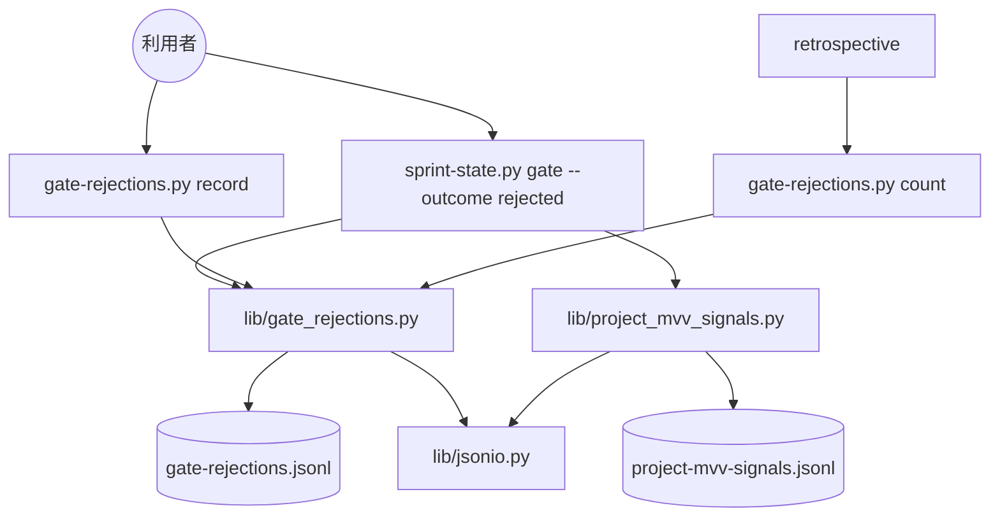

# 起票者の推定と承認ゲートの差し戻しの記録: 起票者が推して足した条件を承認ゲート 1 で確かめ、差し戻しを 1 件ずつ記録して承認ゲートごとに数える（gate-rejections.py）

## 概要

**起票者（課題を書いた AI）が文書・コード・経緯から推して足した条件は、課題の本文の `## 起票者の推定` の節に書き、
要求の仕様のコピーと承認資料へ運んで、承認ゲート 1 で利用者が確かめる。** 節の無い本文は `issue-file.py create` が
課題を作らずに退ける。**承認ゲートで利用者が差し戻したら、差し戻しの記録
（`<NDF_MVV_STATE_DIR>/gate-rejections.jsonl`）へ 1 回 1 行で追記する。** どの pace でも、MVV 判定を通した承認ゲートでも、置き場はこの 1 つである。 振り返りは `gate-rejections.py count` で
承認ゲート 1・2 に分けて数える。差し戻しの記録は覆し（MVV 判定と人の答えの食い違い）の記録とは別のファイルで、
互いに読まない。

この文書は、その形に**なぜしたか**（背景・決定と理由・常に成り立つ条件・記録の 1 行の形・リポジトリの決め方・
既知の限界・テスト観点）を残す。**手順と打ち方の正は Skill とスクリプトにある。**

| 何を | 正本 |
| --- | --- |
| 起票者の推定の節の書き方（1 行 1 条件・推した出所・0 件は「無し」） | [`out-of-scope` の SKILL.md](../../plugins/ndf/skills/out-of-scope/SKILL.md) の手順 5 |
| 依頼の原文の書き手と日付・起票者の推定を仕様へ写す手順（手順 1a） | [`requirements-design` の SKILL.md](../../plugins/ndf/skills/requirements-design/SKILL.md) と [references/spec-template.md](../../plugins/ndf/skills/requirements-design/references/spec-template.md) |
| 承認資料の「起票者の推定」の行と、差し戻しを記録するコマンド | `development-workflow` の [references/approval-request.md](../../plugins/ndf/skills/development-workflow/references/approval-request.md) の「答えを記録する」 |
| 振り返りの観点の表の「承認ゲートの差し戻し」 | [`retrospective` の SKILL.md](../../plugins/ndf/skills/retrospective/SKILL.md) |
| 副命令・引数・終了コード | [`gate-rejections.py`](../../plugins/ndf/scripts/gate-rejections.py) と [`sprint-state.py`](../../plugins/ndf/scripts/sprint-state.py) の冒頭の説明 |
| 本文の骨格の 6 つの見出しの検査 | [out-of-scope-issue-file.md](out-of-scope-issue-file.md) |

決定の番号は #1833 の設計の番号である。

## 用語

「起票者の推定」「承認ゲートの差し戻し」「差し戻しの記録」「覆し」の定義は用語集（[docs/glossary.md](../glossary.md)）が正である。

**承認ゲートの答えは開発の工程（`ndf-workflow`）が持ち、MVV（`ndf-mvv`）はその答えのうち直前の MVV 判定と食い違うものだけを
覆しとして受ける。** 差し戻しの記録は MVV へ渡らず、覆しの件数は差し戻しの記録から作らない。

## 背景

起票者が推して足した条件が、課題の本文・仕様のコピー・承認資料のどこでも利用者の決定と区別されなかった。#1658 の
「Draft でない PR の cross-refactoring を止める」は起票者が足した条件で、承認ゲート 2 で初めて利用者に退けられ
（「Draft でない PR の cross-refactoring を止める必要はない」、2026-10-07）、開発版を 3 回出した。

承認ゲートで利用者が差し戻しても、`pace: normal` では記録が残らなかった。差し戻しは状態ファイルの `rejections` にだけ
書かれ、状態ファイルを持たない単発の変更では書く先が無く、書かれた `rejections` を読むコードも 0 件だった。
`~/.local/state/ndf/` に差し戻しを持つ状態ファイルは 0 件だった（2026-10-10 の実測）。差し戻しは覆しに数えられないため、
振り返りの読み手は見直しの兆候に気づけなかった。

## 決定と理由

| # | 決定 | 理由 | 採らなかった案 |
| ---: | --- | --- | --- |
| 1 | 起票の骨格（`issue-file.py` の `SKELETON`）に `起票者の推定` の見出しを足し、`create` で欠けを止める。「無し」の 1 行は空としない | 推定かどうかは書き手にしか分からないが、書いたかどうかは機械で確かめられる。推定の無い起票も止まらない | 雛形に節を足すだけにする（書き忘れが起票の時点で見えず、承認ゲート 1 まで運ばれない） |
| 2 | 承認資料の起票者の推定は、仕様のコピーの節の行を要約せずに並べる。節が無い・読めないときは「無し（<理由>）」と出し、承認ゲートは止めない | 承認する人が要約で判断を変えない。ほかの行も conductor が設計文書から写している | この行のためだけに抽出のスクリプトを作る（組み立ての経路が 2 つになる） |
| 3 | 差し戻しの置き場は差し戻しの記録の 1 つだけにする。`sprint-state.py gate --outcome rejected` は `sprint.json` に `rejections` を書かない | 状態ファイルを持たない単発の変更でも記録でき、数える側が読むのは 1 か所になる。`rejections` は読み手も既存の記録も 0 件で、書くのをやめても壊れるものが無い | 状態ファイルの `rejections` と別の記録の 2 か所に分ける。課題や PR へコメントで残す（他者が読む場所へ毎回書き、数えるのに GitHub の検索が要る） |
| 4 | JSONL の読み書き（`read_jsonl`・`append_jsonl`）を `lib/jsonio.py` に置き、差し戻しの記録と覆しの記録で共有する。壊れた行を止めるか飛ばすかは引数（`skip_broken`）で選ぶ | 差し戻しの件数は壊れた行を「不明」として扱う必要があり、覆しの側は壊れた行を飛ばす。同じ役割の関数を `lib/` に 2 つ並べない | 差し戻しの側に読み方を新しく書く |
| 5 | 記録のファイルが無ければ件数は 0、読めない・壊れた行があれば「不明」（件数 `null`・終了コード 2） | ファイルが無いのは「この端末で差し戻しを記録していない」ことで、0 と言える。読めないときは何件あったかを言えない | ファイルが無いときも「不明」とする（差し戻しの無いスプリントがいつまでも「不明」になる） |
| 6 | 差し戻しの記録は、利用者の答えを受けた conductor が既存の承認ゲートの答えの直後に 1 行打つだけにする。打つ場所は `approval-request.md` の「答えを記録する」の 1 か所に置き、`--gate` の値は `関門 1` / `関門 2` に固定する | 承認ゲートの数を変えず、利用者へ新しい確認を求めない。答えは `AskUserQuestion` で受けるため、提示のスクリプトは答えを知らない | 承認資料の提示と同じスクリプトで答えも受ける |
| — | 記録の `repo` は、`--repo` → `origin` の `owner/repo` → メインディレクトリの絶対パス（`lib/repo.main_dir`）→ 根の絶対パスの順で決め、この解決を `lib/gate_rejections.py` の `ledger_repo` 1 か所に置く | worktree で打った `record` / `sprint-state.py gate` と、マージ後にメインディレクトリで打つ `count` で同じ値になる | 覆しの記録の `mvv_repo_key(root)` を使う（worktree ごとに値が変わり、メインディレクトリの `count` が 0 件になる） |

## 仕様

### 構成要素と責務

| 要素 | 責務 |
| --- | --- |
| `plugins/ndf/scripts/issue-file.py` | `create` の本文の骨格の 6 つの見出しに `起票者の推定` を含め、欠ければ課題を作らない |
| `plugins/ndf/scripts/lib/gate_rejections.py` | 差し戻しの記録の置き場（`ledger_path`）・リポジトリの決め方（`ledger_repo`）・1 行の形（`make_row`）・追記（`append`）・読み取り（`read_rejections`）・範囲の当たり（`in_scope`）・承認ゲートごとの件数（`count_by_gate`） |
| `plugins/ndf/scripts/gate-rejections.py` | 状態ファイルを持たない差し戻しの `record` と、件数の `count` の入口 |
| `plugins/ndf/scripts/sprint-state.py` | `gate --by user --outcome rejected` で差し戻しの記録へ 1 行書く。関門は通さず、状態ファイルは変えない。覆しの記録は直前の MVV 判定と食い違うときだけ今までどおり書く |
| `plugins/ndf/scripts/lib/jsonio.py` | `read_jsonl`・`append_jsonl` の唯一の置き場。`project_mvv_signals` はここから読み、壊れた行を飛ばす |

### 常に成り立つ条件

| # | 条件 | 破れたときの扱い |
| --- | --- | --- |
| I1 | `create` で作る課題の本文は `## 起票者の推定` の節を持ち、節は空でない（「無し」の 1 行を含む） | 課題を作らず、終了コード 1 で欠けた見出し（`missing` / `empty`）を `items` に返す。GitHub を呼ぶ前に止まる |
| I2 | 利用者の差し戻し 1 回につき、記録はちょうど 1 行増える。既存の行は書き換えない（追記だけ） | 書けなければ終了コード 1 で止め、`summary` に理由とパスを出す |
| I3 | 各行は承認ゲートの名前・日時・要約・リポジトリを持ち、スプリントの状態ファイル・課題・PR のうち 1 つ以上を持つ | 範囲が 1 つも無い `record` は書かずに終了コード 2 で止まる |
| I4 | 件数は記録を読めたときだけ数で出す。読めない・壊れた行があるときは数を出さずに「不明」と出す。ファイルが無いときは 0 | 「不明」を 0 と出さない。終了コード 2 で `metrics` の件数を `null` にする |
| I5 | 差し戻しの記録を足しても、覆しの件数・閾値・改訂の提案は同じ入力で変わらない | 覆しの記録へ差し戻しを書かず、`project-mvv.py signals` は差し戻しの記録を読まない |
| I6 | 状態ファイルを持つスプリントの差し戻しも、差し戻しの記録にだけ書く | `sprint.json` へ `rejections` を書かない |

`sprint-state.py gate --outcome rejected` は、リポジトリの解決を覆しの記録より前に行う。差し戻しの記録を書けずに 1 で止まっても
覆しの記録は書いたまま残るが、`origin` を読めないことでは止まらない（絶対パスへ落とす）ため、打ち直して覆しが重なる経路は無い。

## データ・設定

### 差し戻しの記録の 1 行

置き場は `<mvv_state_base()>/gate-rejections.jsonl`（`NDF_MVV_STATE_DIR` → `~/.local/state/ndf`。覆し・MVV 判定の記録と同じディレクトリ）で、
新しい設定は持たない。差し戻し 1 回を 1 行の事象として追記し、主キーは持たない（同じ答えを 2 度打てば 2 行になる）。

| 鍵 | 型 | 空を許すか | 意味 |
| --- | --- | --- | --- |
| `at` | 文字列（ISO 8601、UTC） | 許さない | 利用者が差し戻した日時。`--at` が無ければ書いた時刻 |
| `repo` | 文字列（`<所有者>/<リポジトリ>` か絶対パス） | 許さない | 差し戻した対象のリポジトリ。決め方は「決定と理由」の最後の行 |
| `gate` | 文字列 | 許さない | 承認ゲートの名前。`関門 1` / `関門 2`（`sprint-state.py` の記録の名前と同じ）。ほかの名前もそのまま書き、`other` に数える |
| `what` | 文字列 | 許さない | 何を差し戻したかの要約 |
| `sprint` | 文字列（絶対パス）か `null` | 許す | スプリントの状態ファイル。`null` は「状態ファイルを持たない進め方」を表す |
| `issues` | 整数の配列（昇順・重複なし） | 空の配列を許す | 差し戻した対象の課題。`sprint-state.py` は状態ファイルの `issues` を書く |
| `prs` | 整数の配列（昇順・重複なし） | 空の配列を許す | 差し戻した対象の PR |
| `by` | 文字列 | 許さない | 常に `user` |

### `count` の数え方

- `repo` が一致する行だけを見る。範囲（`--sprint` / `--issue` / `--pr`）を渡せば、そのどれかに当たる行を数える（または）。範囲を渡さなければそのリポジトリのすべての行
- `gate` を `関門 1` → `gate_1`、`関門 2` → `gate_2`、ほか → `other` に仕分け、`total` は数えた行の数
- 既存の `sprint.json` の `rejections` は読まず、書き換えもしない

## 運用

### 既知の限界

| 項目 | 内容 |
| --- | --- |
| 端末をまたぐ件数 | 差し戻しの記録は端末ごとの置き場にあり、スプリントを複数の端末で通すと 1 台の `count` には一部しか出ない。覆しの記録と同じ制約である |
| 記録を始める前の差し戻し | 記録には無く、`count` は 0 を出す |
| `--gate` の書き方の揺れ | `承認ゲート 1` などの別の書き方は `other` に数える。`approval-request.md` のコマンド例が `関門 1` / `関門 2` を固定している |
| 起票者の推定の正しさ | 推定かどうかは書き手にしか分からない。機械で確かめるのは節があることだけである |

## テスト観点

差し戻しの記録は `plugins/ndf/scripts/tests/test_gate_rejections.py`、骨格は `test_issue_file.py`、状態ファイルの側は
`test_sprint_state.py`、覆しの集計は `test_project_mvv.py` にある。

- `## 起票者の推定` が無い本文と見出しだけの本文で `create` が 1 を返し、`items` に `missing` / `empty` が出て GitHub を呼ばないこと。節が「無し」の 1 行だけでほかがそろえば 10（承認資料）を返すこと
- `record` が 1 回で記録を 1 行増やし、行が `gate`・`at`・`what`・`repo` と範囲を持つこと。範囲が無ければ 2 で書かないこと。`sprint-state.py gate --outcome rejected` も（`pace: normal` の状態ファイルでも）1 行増やし、`sprint.json` に `rejections` を書かないこと
- `origin` の無いリポジトリの worktree で `record` し、メインディレクトリで `count` すると 1 件になること
- 記録の置き場が書けないとき、`record` と `sprint-state.py gate --outcome rejected` が 1 を返すこと
- `count` がスプリント・課題・PR の範囲ごとに `gate_1`・`gate_2` を数え、壊れた行があると 2 で件数が `null`・`summary` に「不明」、ファイルが無いと 0 であること
- 差し戻しを記録する前と後で、同じ覆しの記録と MVV 判定の記録に対する `project-mvv.py signals` の `metrics` が同じであること。`project_mvv_signals.read_jsonl` が壊れた行を飛ばすこと
- 承認（`--outcome approved` と省略）・`--by mvv`・`--withdraw`・`issue-file.py` の `resolve-target`・`dup`・`note`・`by-origin` の既存のテストが期待値を変えずに通ること

## 関連リンク

- [`gate-rejections.py`](../../plugins/ndf/scripts/gate-rejections.py)・[`lib/gate_rejections.py`](../../plugins/ndf/scripts/lib/gate_rejections.py)・[`sprint-state.py`](../../plugins/ndf/scripts/sprint-state.py)・[`lib/jsonio.py`](../../plugins/ndf/scripts/lib/jsonio.py)
- `development-workflow` の [references/approval-request.md](../../plugins/ndf/skills/development-workflow/references/approval-request.md)・[references/project-mvv.md](../../plugins/ndf/skills/development-workflow/references/project-mvv.md)
- [out-of-scope-issue-file.md](out-of-scope-issue-file.md)（起票の部品と本文の骨格）
- #1833（この形を決めた課題）、#1658（起票者の推定が承認ゲート 2 で退けられた事例）
